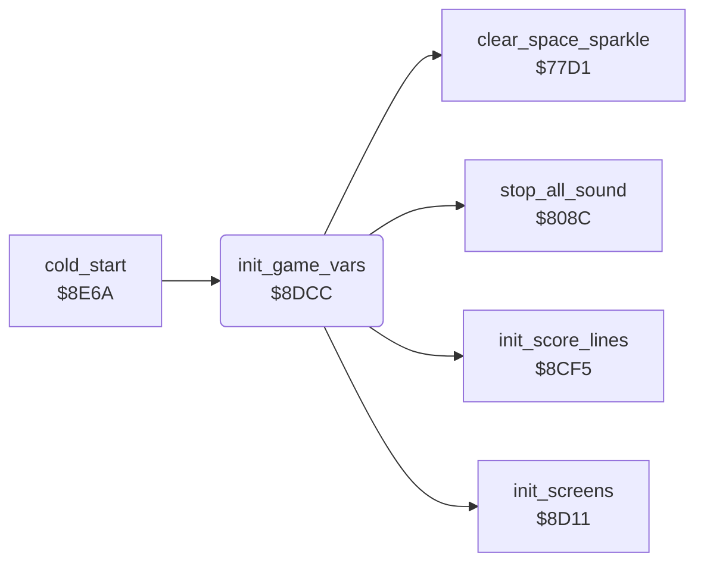

<!-- Generated by c64-docs from knowledge revision 20261025T214622.009-09wod3 and .c64-re-tools/local/generated/src/source-map.json. Do not edit: change the knowledge, generate the source again, then run docs.ts generate. -->
# init/init_vars.asm: Game variables

Range `$8DCC-$8E37`. Source: [init/init_vars.asm](../../../../src/init/init_vars.asm). Index: [the reference](../../index.md).

## Routines

| Routine | Address | Reached from | Summary |
|---|---|---|---|
| [`init_game_vars`](init_vars.md#init_game_vars) | `$8DCC` | [`cold_start`](cold_start.md#cold_start) | Resets the game variables at each cold start. |

## Call graph

A solid arrow is a call, a thick arrow a table entry. Rounded nodes are in this file.

## Details

### [`init_game_vars`](../../../../src/init/init_vars.asm#L6) `$8DCC`

*routine*

Resets the game variables at each cold start. The first start also clears the best scores, sets one player and prepares screens and charsets.

- **Called from:** [`cold_start`](cold_start.md#cold_start)
- **Calls:** [`stop_all_sound`](../sound/voices_off.md#stop_all_sound), [`clear_space_sparkle`](../screen/space_sparkle.md#clear_space_sparkle), [`init_score_lines`](init_screens.md#init_score_lines), [`init_screens`](init_screens.md#init_screens)
- **Reads:** [`first_start_flag`](../../memory-map.md#first_start_flag)
- **Writes:** [`decoded_cave`](../../memory-map.md#decoded_cave), [`irq_mode`](../../memory-map.md#irq_mode), [`key_row0`](../../memory-map.md#key_row0), [`key_row7`](../../memory-map.md#key_row7), [`key_row0_last`](../../memory-map.md#key_row0_last), [`key_row7_last`](../../memory-map.md#key_row7_last), [`scroll_x_pos`](../../memory-map.md#scroll_x_pos), [`scroll_x_char`](../../memory-map.md#scroll_x_char), [`scroll_y_pos`](../../memory-map.md#scroll_y_pos), [`scroll_y_char`](../../memory-map.md#scroll_y_char), [`flash_frames`](../../memory-map.md#flash_frames), [`cave_number`](../../memory-map.md#cave_number) and 20 more

| Label | Address | Comment |
|---|---|---|
| [`init_vars_black`](../../../../src/init/init_vars.asm#L39) | `$8E0B` |  |
| [`init_vars_best_scores`](../../../../src/init/init_vars.asm#L45) | `$8E15` |  |
| [`init_vars_done`](../../../../src/init/init_vars.asm#L62) | `$8E37` |  |
