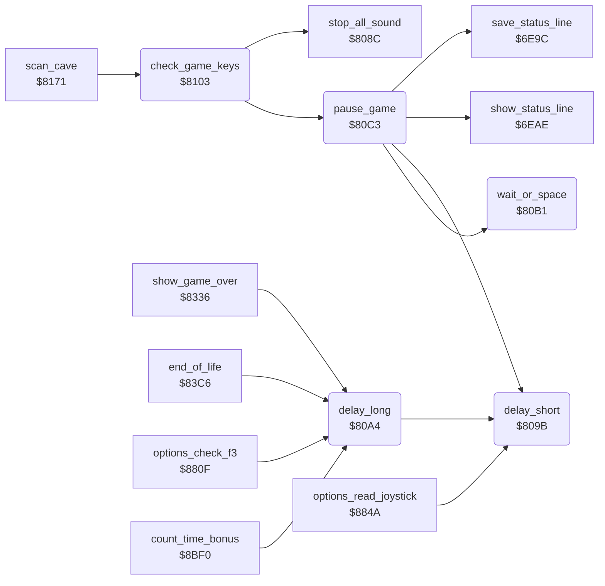

<!-- Generated by c64-docs from knowledge revision 20261025T214622.009-09wod3 and .c64-re-tools/local/generated/src/source-map.json. Do not edit: change the knowledge, generate the source again, then run docs.ts generate. -->
# input/game_keys.asm: Delays, pause and the game keys

Range `$809B-$813A`. Source: [input/game_keys.asm](../../../../src/input/game_keys.asm). Index: [the reference](../../index.md).

## Routines

| Routine | Address | Reached from | Summary |
|---|---|---|---|
| [`delay_short`](game_keys.md#delay_short) | `$809B` | [`delay_long`](game_keys.md#delay_long), [`pause_game`](game_keys.md#pause_game), [`options_read_joystick`](../title/options.md#options_read_joystick) | Busy wait of 128 times X loop steps. |
| [`delay_long`](game_keys.md#delay_long) | `$80A4` | [`show_game_over`](../status/end_of_life.md#show_game_over), [`end_of_life`](../status/end_of_life.md#end_of_life), [`options_check_f3`](../title/options.md#options_check_f3), [`count_time_bonus`](../cave/cave_end.md#count_time_bonus) | Busy wait of four short delays. |
| [`wait_or_space`](game_keys.md#wait_or_space) | `$80B1` | [`pause_game`](game_keys.md#pause_game) | Busy wait that ends early when SPACE is pressed (key_row7 = $EF). |
| [`pause_game`](game_keys.md#pause_game) | `$80C3` | [`check_game_keys`](game_keys.md#check_game_keys) | Pause: blinks SPACEBAR TO RESUME with the saved status line until SPACE is pressed again. |
| [`check_game_keys`](game_keys.md#check_game_keys) | `$8103` | [`scan_cave`](../engine/cave_scan.md#scan_cave) | Reads the game keys after each scan: SPACE pauses, RUN/STOP ends the life, F1 restarts the game. |

## Call graph

A solid arrow is a call, a thick arrow a table entry. Rounded nodes are in this file.

## Details

### [`delay_short`](../../../../src/input/game_keys.asm#L6) `$809B`

*routine*

Busy wait of 128 times X loop steps. Input: X. A does not change.

- **Called from:** [`delay_long`](game_keys.md#delay_long), [`pause_game`](game_keys.md#pause_game), [`options_read_joystick`](../title/options.md#options_read_joystick)

| Label | Address | Comment |
|---|---|---|
| [`delay_short_loop`](../../../../src/input/game_keys.asm#L8) | `$809D` |  |

### [`delay_long`](../../../../src/input/game_keys.asm#L15) `$80A4`

*routine*

Busy wait of four short delays.

- **Called from:** [`show_game_over`](../status/end_of_life.md#show_game_over), [`end_of_life`](../status/end_of_life.md#end_of_life), [`options_check_f3`](../title/options.md#options_check_f3), [`count_time_bonus`](../cave/cave_end.md#count_time_bonus)
- **Calls:** [`delay_short`](game_keys.md#delay_short)

### [`wait_or_space`](../../../../src/input/game_keys.asm#L22) `$80B1`

*routine*

Busy wait that ends early when SPACE is pressed (key_row7 = $EF).

- **Called from:** [`pause_game`](game_keys.md#pause_game)
- **Reads:** [`key_row7`](../../memory-map.md#key_row7)

| Label | Address | Comment |
|---|---|---|
| [`wait_or_space_outer`](../../../../src/input/game_keys.asm#L24) | `$80B3` |  |
| [`wait_or_space_inner`](../../../../src/input/game_keys.asm#L26) | `$80B5` |  |
| [`wait_or_space_next`](../../../../src/input/game_keys.asm#L31) | `$80BC` |  |

### [`pause_game`](../../../../src/input/game_keys.asm#L38) `$80C3`

*routine*

Pause: blinks SPACEBAR TO RESUME with the saved status line until SPACE is pressed again.
Saves the status line in status_saved.

- **Called from:** [`check_game_keys`](game_keys.md#check_game_keys)
- **Calls:** [`save_status_line`](../status/status_line.md#save_status_line), [`show_status_line`](../status/status_line.md#show_status_line), [`delay_short`](game_keys.md#delay_short), [`wait_or_space`](game_keys.md#wait_or_space)
- **Reads:** [`pause_flag`](../../memory-map.md#pause_flag), [`key_row7`](../../memory-map.md#key_row7)
- **Writes:** [`text_ptr`](../../memory-map.md#text_ptr), [`text_ptr_hi`](../../memory-map.md#text_ptr_hi), [`pause_flag`](../../memory-map.md#pause_flag), [`key_row7`](../../memory-map.md#key_row7)
- **Refers to:** [`saved_status_line`](../../memory-map.md#saved_status_line)

| Label | Address | Comment |
|---|---|---|
| [`pause_blink`](../../../../src/input/game_keys.asm#L51) | `$80DE` |  |

### [`check_game_keys`](../../../../src/input/game_keys.asm#L69) `$8103`

*routine*

Reads the game keys after each scan: SPACE pauses, RUN/STOP ends the life, F1 restarts the game.

- **Called from:** [`scan_cave`](../engine/cave_scan.md#scan_cave)
- **Calls:** [`stop_all_sound`](../sound/voices_off.md#stop_all_sound), [`pause_game`](game_keys.md#pause_game)
- **Jumps to:** [`cold_start`](../init/cold_start.md#cold_start)
- **Reads:** [`key_row7`](../../memory-map.md#key_row7), [`pause_flag`](../../memory-map.md#pause_flag), [`cave_clock_on`](../../memory-map.md#cave_clock_on), [`birth_countdown`](../../memory-map.md#birth_countdown), [`key_row0`](../../memory-map.md#key_row0)
- **Writes:** [`cave_clock_on`](../../memory-map.md#cave_clock_on), [`pause_flag`](../../memory-map.md#pause_flag), [`cave_end_state`](../../memory-map.md#cave_end_state), [`key_row7`](../../memory-map.md#key_row7)

| Label | Address | Comment |
|---|---|---|
| [`check_keys_run_stop`](../../../../src/input/game_keys.asm#L81) | `$811B` | RUN/STOP counts only when Rockford is born. |
| [`check_keys_f1`](../../../../src/input/game_keys.asm#L91) | `$812D` |  |
| [`check_keys_done`](../../../../src/input/game_keys.asm#L98) | `$813A` |  |
