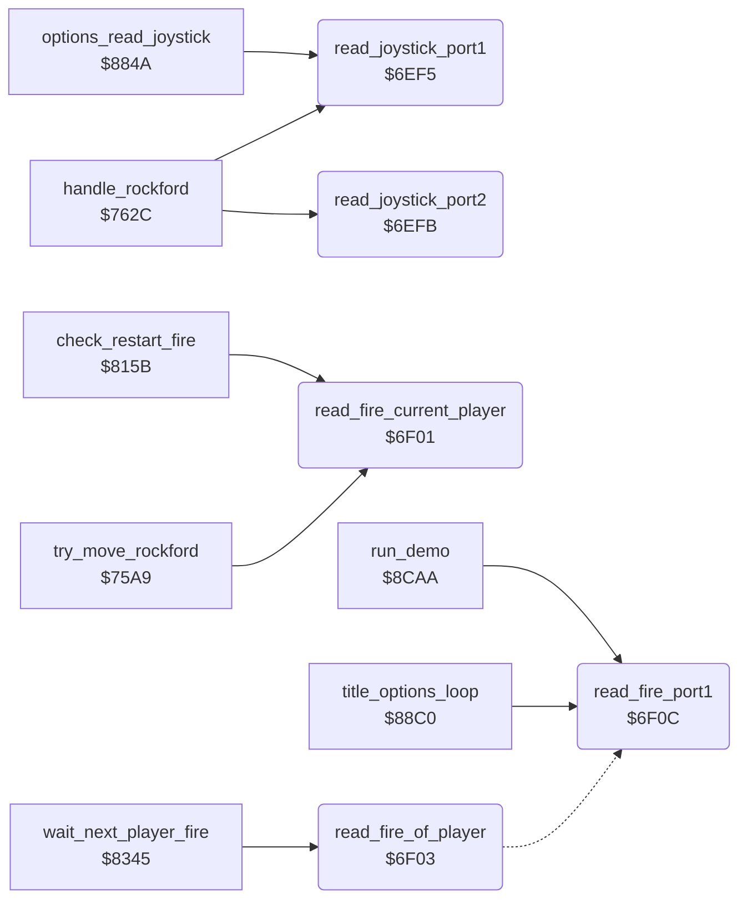

<!-- Generated by c64-docs from knowledge revision 20261024T103116.823-byvbsh and .c64-re-tools/local/generated/src/source-map.json. Do not edit: change the knowledge, generate the source again, then run docs.ts generate. -->
# input/joystick.asm: Joystick and fire button

Range `$6EF5-$6F13`. Source: [input/joystick.asm](../../../../src/input/joystick.asm). Index: [the reference](../../index.md).

## Call graph

A solid arrow is a call, a thick arrow a table entry, a dotted arrow a jump. Rounded nodes are in this file.

## Names

### [`read_joystick_port1`](../../../../src/input/joystick.asm#L6) `$6EF5`

*routine*

Returns the direction bits of joystick port 1 in A (CIA 1 port B AND $0f, a bit is 0 when pressed).

- **Called from:** [`handle_rockford`](../rockford/movement.md#handle_rockford) [`$7640`](../../../../src/rockford/movement.asm#L177), [`options_read_joystick`](../title/options.md#options_read_joystick) [`$884A`](../../../../src/title/options.asm#L41), [`options_read_joystick`](../title/options.md#options_read_joystick) [`$8876`](../../../../src/title/options.asm#L67), [`options_read_joystick`](../title/options.md#options_read_joystick) [`$8887`](../../../../src/title/options.asm#L77)
- **Reads:** [`CIAPRB`](../../memory-map.md#CIAPRB)

### [`read_joystick_port2`](../../../../src/input/joystick.asm#L11) `$6EFB`

*routine*

Returns the direction bits of joystick port 2 in A. Rockford uses it for player 2 when the game has two joysticks.

- **Called from:** [`handle_rockford`](../rockford/movement.md#handle_rockford) [`$763B`](../../../../src/rockford/movement.asm#L174)
- **Reads:** [`CIAPRA`](../../memory-map.md#CIAPRA)

### [`read_fire_current_player`](../../../../src/input/joystick.asm#L16) `$6F01`

*routine*

Reads the fire button of the current player into fire_button ($00 when pressed). Z is set when pressed.

- **Called from:** [`try_move_rockford`](../rockford/movement.md#try_move_rockford) [`$75B0`](../../../../src/rockford/movement.asm#L87), [`check_restart_fire`](../engine/cave_scan.md#check_restart_fire) [`$815B`](../../../../src/engine/cave_scan.asm#L26)
- **Reads:** [`current_player`](../../memory-map.md#current_player)

### [`read_fire_of_player`](../../../../src/input/joystick.asm#L19) `$6F03`

*routine*

Reads the fire button of the player in A (0 or 1): port 2 for player 2 with two joysticks, else port 1.

- **Called from:** [`wait_next_player_fire`](../status/end_of_life.md#wait_next_player_fire) [`$8356`](../../../../src/status/end_of_life.asm#L29)
- **Jumps to:** [`read_fire_port1`](joystick.md#read_fire_port1), [`read_fire_store`](joystick.md#read_fire_store)
- **Reads:** [`two_joysticks`](../../memory-map.md#two_joysticks), [`CIAPRA`](../../memory-map.md#CIAPRA)

### [`read_fire_port1`](../../../../src/input/joystick.asm#L25) `$6F0C`

*routine*

Reads the fire button of joystick port 1 into fire_button ($00 when pressed). Z is set when pressed.

- **Called from:** [`title_options_loop`](../title/options.md#title_options_loop) [`$891C`](../../../../src/title/options.asm#L155), [`run_demo`](../title/demo.md#run_demo) [`$8CD1`](../../../../src/title/demo.asm#L30)
- **Jumped to from:** [`read_fire_of_player`](joystick.md#read_fire_of_player) [`$6F05`](../../../../src/input/joystick.asm#L21)
- **Reads:** [`CIAPRB`](../../memory-map.md#CIAPRB)
- **Writes:** [`fire_button`](../../memory-map.md#fire_button)

### [`read_fire_store`](../../../../src/input/joystick.asm#L27) `$6F0F`

*label*

- **Jumped to from:** [`read_fire_of_player`](joystick.md#read_fire_of_player) [`$6F0A`](../../../../src/input/joystick.asm#L23)
