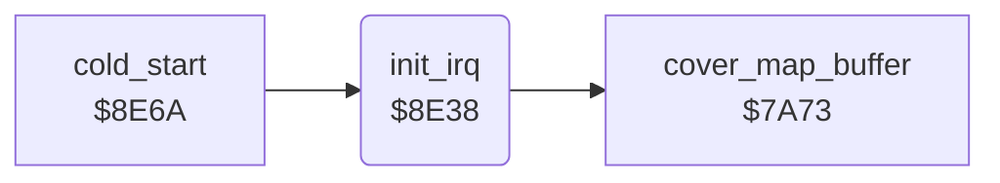

<!-- Generated by c64-docs from knowledge revision 20261024T103116.823-byvbsh and .c64-re-tools/local/generated/src/source-map.json. Do not edit: change the knowledge, generate the source again, then run docs.ts generate. -->
# irq/irq_setup.asm: IRQ setup

Range `$8E38-$8E68`. Source: [irq/irq_setup.asm](../../../../src/irq/irq_setup.asm). Index: [the reference](../../index.md).

## Call graph

A solid arrow is a call, a thick arrow a table entry, a dotted arrow a jump. Rounded nodes are in this file.

## Names

### [`init_irq`](../../../../src/irq/irq_setup.asm#L6) `$8E38`

*routine*

Clears the play screens, copies the title raster split values to $54-$5b, enables the raster IRQ at line $28 and sets $0314 to irq_handler.

- **Called from:** [`cold_start`](../init/cold_start.md#cold_start) [`$8EEF`](../../../../src/init/cold_start.asm#L74)
- **Calls:** [`cover_map_buffer`](../screen/cover.md#cover_map_buffer)
- **Reads:** [`irq_title_values`](../title/run_title.md#irq_title_values)
- **Writes:** [`game_d018_value`](../../memory-map.md#game_d018_value), [`irq_d011_values`](../../memory-map.md#irq_d011_values), [`IRQMSK`](../../memory-map.md#IRQMSK), [`irq_split_index`](../../memory-map.md#irq_split_index), [`RASTER`](../../memory-map.md#RASTER), [`SCROLY`](../../memory-map.md#SCROLY), [`CINV`](../../memory-map.md#CINV), [`CINV+1`](../../memory-map.md#CINV)
- **Refers to:** [`irq_handler`](irq_handler.md#irq_handler)

### [`init_irq_copy_values`](../../../../src/irq/irq_setup.asm#L12) `$8E43`

*label*

- **Jumped to from:** [`init_irq`](irq_setup.md#init_irq) [`$8E49`](../../../../src/irq/irq_setup.asm#L16)
