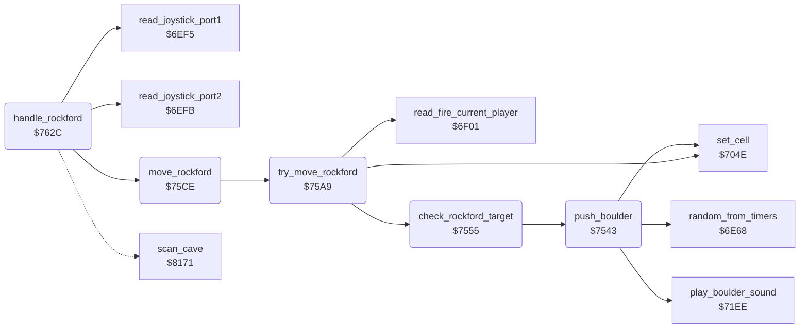

<!-- Generated by c64-docs from knowledge revision 20261024T103116.823-byvbsh and .c64-re-tools/local/generated/src/source-map.json. Do not edit: change the knowledge, generate the source again, then run docs.ts generate. -->
# rockford/movement.asm: Rockford movement and digging

Range `$7529-$764E`. Source: [rockford/movement.asm](../../../../src/rockford/movement.asm). Index: [the reference](../../index.md).

## Call graph

A solid arrow is a call, a thick arrow a table entry, a dotted arrow a jump. Rounded nodes are in this file.

## Names

### [`collect_diamond`](../../../../src/rockford/movement.asm#L6) `$7529`

*label*

Rockford collects a diamond: plays the sound, adds the diamond points to the score and counts the diamond.

- **Jumped to from:** [`check_rockford_target`](movement.md#check_rockford_target) [`$7575`](../../../../src/rockford/movement.asm#L50)

### [`collect_diamond_copy`](../../../../src/rockford/movement.asm#L9) `$752E`

*label*

- **Jumped to from:** [`$7535`](../../../../src/rockford/movement.asm#L13)

### [`push_boulder`](../../../../src/rockford/movement.asm#L20) `$7543`

*routine*

Pushes the boulder by one cell to scan_ptr+Y with a chance of 1 in 4 and plays the boulder sound.

- **Called from:** [`check_rockford_target`](movement.md#check_rockford_target) [`$7594`](../../../../src/rockford/movement.asm#L68), [`check_rockford_target`](movement.md#check_rockford_target) [`$75A3`](../../../../src/rockford/movement.asm#L77)
- **Calls:** [`random_from_timers`](../engine/random.md#random_from_timers), [`play_boulder_sound`](../sound/element_sounds.md#play_boulder_sound), [`set_cell`](../engine/cell_draw.md#set_cell)
- **Reads:** [`rockford_moved`](../../memory-map.md#rockford_moved)
- **Writes:** [`rockford_moved`](../../memory-map.md#rockford_moved)

### [`push_boulder_done`](../../../../src/rockford/movement.asm#L28) `$7554`

*label*

- **Jumped to from:** [`push_boulder`](movement.md#push_boulder) [`$7548`](../../../../src/rockford/movement.asm#L23)

### [`check_rockford_target`](../../../../src/rockford/movement.asm#L31) `$7555`

*routine*

Examines the cell at scan_ptr+Y that Rockford moves to. Sets rockford_moved when Rockford can enter it and starts the step sound.

- **Called from:** [`try_move_rockford`](movement.md#try_move_rockford) [`$75A9`](../../../../src/rockford/movement.asm#L84)
- **Calls:** [`push_boulder`](movement.md#push_boulder)
- **Jumps to:** [`collect_diamond`](movement.md#collect_diamond)
- **Reads:** [`cell_ptr`](../../memory-map.md#cell_ptr), [`rockford_moved`](../../memory-map.md#rockford_moved)
- **Writes:** [`rockford_moved`](../../memory-map.md#rockford_moved), [`step_sound_pitch`](../../memory-map.md#step_sound_pitch), [`cave_end_state`](../../memory-map.md#cave_end_state), [`exit_reached`](../../memory-map.md#exit_reached)

### [`check_target_dirt`](../../../../src/rockford/movement.asm#L40) `$7565`

*label*

- **Jumped to from:** [`check_rockford_target`](movement.md#check_rockford_target) [`$755B`](../../../../src/rockford/movement.asm#L35)

### [`check_target_diamond`](../../../../src/rockford/movement.asm#L47) `$7571`

*label*

- **Jumped to from:** [`check_rockford_target`](movement.md#check_rockford_target) [`$7567`](../../../../src/rockford/movement.asm#L42)

### [`check_target_exit`](../../../../src/rockford/movement.asm#L51) `$7578`

*label*

- **Jumped to from:** [`check_rockford_target`](movement.md#check_rockford_target) [`$7573`](../../../../src/rockford/movement.asm#L49)

### [`check_target_boulder`](../../../../src/rockford/movement.asm#L59) `$7586`

*label*

- **Jumped to from:** [`check_rockford_target`](movement.md#check_rockford_target) [`$757A`](../../../../src/rockford/movement.asm#L53)

### [`push_left_done`](../../../../src/rockford/movement.asm#L69) `$7597`

*label*

- **Jumped to from:** [`check_rockford_target`](movement.md#check_rockford_target) [`$7592`](../../../../src/rockford/movement.asm#L67)

### [`check_push_right`](../../../../src/rockford/movement.asm#L71) `$7599`

*label*

- **Jumped to from:** [`check_rockford_target`](movement.md#check_rockford_target) [`$758C`](../../../../src/rockford/movement.asm#L63)

### [`push_right_done`](../../../../src/rockford/movement.asm#L78) `$75A6`

*label*

- **Jumped to from:** [`check_rockford_target`](movement.md#check_rockford_target) [`$75A1`](../../../../src/rockford/movement.asm#L76)

### [`check_target_done`](../../../../src/rockford/movement.asm#L80) `$75A8`

*label*

- **Jumped to from:** [`check_rockford_target`](movement.md#check_rockford_target) [`$7588`](../../../../src/rockford/movement.asm#L61), [`check_rockford_target`](movement.md#check_rockford_target) [`$759B`](../../../../src/rockford/movement.asm#L73)

### [`try_move_rockford`](../../../../src/rockford/movement.asm#L83) `$75A9`

*routine*

Moves Rockford to scan_ptr+Y when the cell lets him in. With fire pressed he clears the cell and stays. Returns rockford_moved.

- **Called from:** [`move_rockford`](movement.md#move_rockford) [`$75DF`](../../../../src/rockford/movement.asm#L117), [`move_rockford`](movement.md#move_rockford) [`$75EF`](../../../../src/rockford/movement.asm#L127), [`move_rockford`](movement.md#move_rockford) [`$760E`](../../../../src/rockford/movement.asm#L146), [`move_rockford`](movement.md#move_rockford) [`$7622`](../../../../src/rockford/movement.asm#L158)
- **Calls:** [`check_rockford_target`](movement.md#check_rockford_target), [`read_fire_current_player`](../input/joystick.md#read_fire_current_player), [`set_cell`](../engine/cell_draw.md#set_cell)
- **Reads:** [`rockford_moved`](../../memory-map.md#rockford_moved)
- **Writes:** [`rockford_moved`](../../memory-map.md#rockford_moved)

### [`try_move_step`](../../../../src/rockford/movement.asm#L95) `$75BF`

*label*

Scanned Rockford $39 in the new cell, space in the old cell.

- **Jumped to from:** [`try_move_rockford`](movement.md#try_move_rockford) [`$75B3`](../../../../src/rockford/movement.asm#L88)

### [`try_move_done`](../../../../src/rockford/movement.asm#L102) `$75CD`

*label*

- **Jumped to from:** [`try_move_rockford`](movement.md#try_move_rockford) [`$75AE`](../../../../src/rockford/movement.asm#L86)

### [`move_rockford`](../../../../src/rockford/movement.asm#L105) `$75CE`

*routine*

Moves Rockford by the joystick bits in A: down, up, right, left. Updates rockford_col, rockford_row and rockford_facing.

- **Called from:** [`handle_rockford`](movement.md#handle_rockford) [`$7645`](../../../../src/rockford/movement.asm#L181)
- **Calls:** [`try_move_rockford`](movement.md#try_move_rockford)
- **Reads:** [`rockford_view_row`](../../memory-map.md#rockford_view_row), [`scroll_y_speed_hi`](../../memory-map.md#scroll_y_speed_hi), [`rockford_moved`](../../memory-map.md#rockford_moved), [`rockford_row`](../../memory-map.md#rockford_row), [`rockford_view_col`](../../memory-map.md#rockford_view_col), [`scroll_x_speed_hi`](../../memory-map.md#scroll_x_speed_hi), [`rockford_col`](../../memory-map.md#rockford_col)
- **Writes:** [`rockford_row`](../../memory-map.md#rockford_row), [`rockford_facing`](../../memory-map.md#rockford_facing), [`rockford_col`](../../memory-map.md#rockford_col)

### [`move_rockford_down`](../../../../src/rockford/movement.asm#L115) `$75DD`

*label*

- **Jumped to from:** [`move_rockford`](movement.md#move_rockford) [`$75D6`](../../../../src/rockford/movement.asm#L110), [`move_rockford`](movement.md#move_rockford) [`$75DA`](../../../../src/rockford/movement.asm#L112)

### [`move_down_done`](../../../../src/rockford/movement.asm#L121) `$75E8`

*label*

- **Jumped to from:** [`move_rockford`](movement.md#move_rockford) [`$75E4`](../../../../src/rockford/movement.asm#L119)

### [`move_rockford_check_up`](../../../../src/rockford/movement.asm#L123) `$75E9`

*label*

- **Jumped to from:** [`move_rockford`](movement.md#move_rockford) [`$75D0`](../../../../src/rockford/movement.asm#L107)

### [`move_up_done`](../../../../src/rockford/movement.asm#L131) `$75F8`

*label*

- **Jumped to from:** [`move_rockford`](movement.md#move_rockford) [`$75F4`](../../../../src/rockford/movement.asm#L129)

### [`move_rockford_check_right`](../../../../src/rockford/movement.asm#L133) `$75F9`

*label*

- **Jumped to from:** [`move_rockford`](movement.md#move_rockford) [`$75EB`](../../../../src/rockford/movement.asm#L125)

### [`move_rockford_right`](../../../../src/rockford/movement.asm#L142) `$7608`

*label*

- **Jumped to from:** [`move_rockford`](movement.md#move_rockford) [`$7601`](../../../../src/rockford/movement.asm#L138), [`move_rockford`](movement.md#move_rockford) [`$7605`](../../../../src/rockford/movement.asm#L140)

### [`move_right_done`](../../../../src/rockford/movement.asm#L150) `$7617`

*label*

- **Jumped to from:** [`move_rockford`](movement.md#move_rockford) [`$7613`](../../../../src/rockford/movement.asm#L148)

### [`move_rockford_check_left`](../../../../src/rockford/movement.asm#L152) `$7618`

*label*

- **Jumped to from:** [`move_rockford`](movement.md#move_rockford) [`$75FB`](../../../../src/rockford/movement.asm#L135)

### [`move_rockford_done`](../../../../src/rockford/movement.asm#L162) `$762B`

*label*

- **Jumped to from:** [`move_rockford`](movement.md#move_rockford) [`$761A`](../../../../src/rockford/movement.asm#L154), [`move_rockford`](movement.md#move_rockford) [`$7627`](../../../../src/rockford/movement.asm#L160)

### [`handle_rockford`](../../../../src/rockford/movement.asm#L165) `$762C`

*routine*

Handler of Rockford $38. Reads the joystick of the current player, or the demo input, and moves Rockford.

- **Calls:** [`read_joystick_port2`](../input/joystick.md#read_joystick_port2), [`read_joystick_port1`](../input/joystick.md#read_joystick_port1), [`move_rockford`](movement.md#move_rockford)
- **Jumps to:** [`scan_cell_settle`](../engine/cave_scan.md#scan_cell_settle)
- **Reads:** [`demo_mode`](../../memory-map.md#demo_mode), [`joystick_dir`](../../memory-map.md#joystick_dir), [`two_joysticks`](../../memory-map.md#two_joysticks), [`current_player`](../../memory-map.md#current_player)
- **Writes:** [`joystick_dir`](../../memory-map.md#joystick_dir), [`rockford_absent`](../../memory-map.md#rockford_absent)

### [`rockford_read_joystick`](../../../../src/rockford/movement.asm#L170) `$7635`

*label*

- **Jumped to from:** [`handle_rockford`](movement.md#handle_rockford) [`$762E`](../../../../src/rockford/movement.asm#L167)

### [`rockford_read_port1`](../../../../src/rockford/movement.asm#L176) `$7640`

*label*

- **Jumped to from:** [`handle_rockford`](movement.md#handle_rockford) [`$7639`](../../../../src/rockford/movement.asm#L173)

### [`rockford_store_input`](../../../../src/rockford/movement.asm#L178) `$7643`

*label*

- **Jumped to from:** [`handle_rockford`](movement.md#handle_rockford) [`$763E`](../../../../src/rockford/movement.asm#L175)

### [`rockford_move`](../../../../src/rockford/movement.asm#L180) `$7645`

*label*

- **Jumped to from:** [`handle_rockford`](movement.md#handle_rockford) [`$7632`](../../../../src/rockford/movement.asm#L169)
