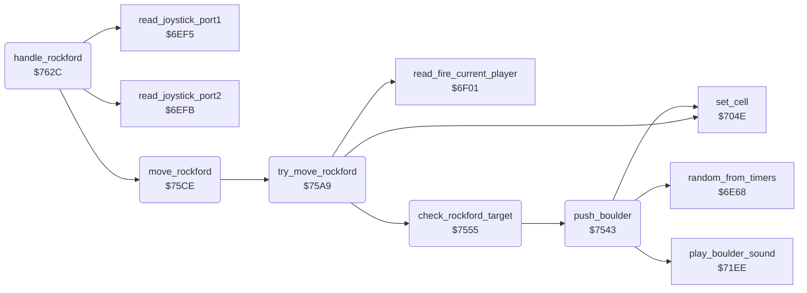

<!-- Generated by c64-docs from knowledge revision 20261025T214622.009-09wod3 and .c64-re-tools/local/generated/src/source-map.json. Do not edit: change the knowledge, generate the source again, then run docs.ts generate. -->
# rockford/movement.asm: Rockford movement and digging

Range `$7529-$764E`. Source: [rockford/movement.asm](../../../../src/rockford/movement.asm). Index: [the reference](../../index.md).

## Routines

| Routine | Address | Reached from | Summary |
|---|---|---|---|
| [`push_boulder`](movement.md#push_boulder) | `$7543` | [`check_rockford_target`](movement.md#check_rockford_target) | Pushes the boulder by one cell to scan_ptr+Y with a chance of 1 in 4 and plays the boulder sound. |
| [`check_rockford_target`](movement.md#check_rockford_target) | `$7555` | [`try_move_rockford`](movement.md#try_move_rockford) | Examines the cell at scan_ptr+Y that Rockford moves to. |
| [`try_move_rockford`](movement.md#try_move_rockford) | `$75A9` | [`move_rockford`](movement.md#move_rockford) | Moves Rockford to scan_ptr+Y when the cell lets him in. |
| [`move_rockford`](movement.md#move_rockford) | `$75CE` | [`handle_rockford`](movement.md#handle_rockford) | Moves Rockford by the joystick bits in A: down, up, right, left. |
| [`handle_rockford`](movement.md#handle_rockford) | `$762C` |  | Handler of Rockford $38. |

## Call graph

A solid arrow is a call, a thick arrow a table entry. Rounded nodes are in this file.

## Details

### [`push_boulder`](../../../../src/rockford/movement.asm#L20) `$7543`

*routine*

Pushes the boulder by one cell to scan_ptr+Y with a chance of 1 in 4 and plays the boulder sound.

- **Called from:** [`check_rockford_target`](movement.md#check_rockford_target)
- **Calls:** [`random_from_timers`](../engine/random.md#random_from_timers), [`play_boulder_sound`](../sound/element_sounds.md#play_boulder_sound), [`set_cell`](../engine/cell_draw.md#set_cell)
- **Reads:** [`rockford_moved`](../../memory-map.md#rockford_moved)
- **Writes:** [`rockford_moved`](../../memory-map.md#rockford_moved)

| Label | Address | Comment |
|---|---|---|
| [`push_boulder_done`](../../../../src/rockford/movement.asm#L28) | `$7554` |  |

### [`check_rockford_target`](../../../../src/rockford/movement.asm#L31) `$7555`

*routine*

Examines the cell at scan_ptr+Y that Rockford moves to. Sets rockford_moved when Rockford can enter it and starts the step sound.

- **Called from:** [`try_move_rockford`](movement.md#try_move_rockford)
- **Calls:** [`push_boulder`](movement.md#push_boulder)
- **Jumps to:** [`collect_diamond`](movement.md#collect_diamond)
- **Reads:** [`cell_ptr`](../../memory-map.md#cell_ptr), [`rockford_moved`](../../memory-map.md#rockford_moved)
- **Writes:** [`rockford_moved`](../../memory-map.md#rockford_moved), [`step_sound_pitch`](../../memory-map.md#step_sound_pitch), [`cave_end_state`](../../memory-map.md#cave_end_state), [`exit_reached`](../../memory-map.md#exit_reached)

| Label | Address | Comment |
|---|---|---|
| [`check_target_dirt`](../../../../src/rockford/movement.asm#L40) | `$7565` |  |
| [`check_target_diamond`](../../../../src/rockford/movement.asm#L47) | `$7571` |  |
| [`check_target_exit`](../../../../src/rockford/movement.asm#L51) | `$7578` |  |
| [`check_target_boulder`](../../../../src/rockford/movement.asm#L59) | `$7586` |  |
| [`push_left_done`](../../../../src/rockford/movement.asm#L69) | `$7597` |  |
| [`check_push_right`](../../../../src/rockford/movement.asm#L71) | `$7599` |  |
| [`push_right_done`](../../../../src/rockford/movement.asm#L78) | `$75A6` |  |
| [`check_target_done`](../../../../src/rockford/movement.asm#L80) | `$75A8` |  |

### [`try_move_rockford`](../../../../src/rockford/movement.asm#L83) `$75A9`

*routine*

Moves Rockford to scan_ptr+Y when the cell lets him in. With fire pressed he clears the cell and stays. Returns rockford_moved.

- **Called from:** [`move_rockford`](movement.md#move_rockford)
- **Calls:** [`check_rockford_target`](movement.md#check_rockford_target), [`read_fire_current_player`](../input/joystick.md#read_fire_current_player), [`set_cell`](../engine/cell_draw.md#set_cell)
- **Reads:** [`rockford_moved`](../../memory-map.md#rockford_moved)
- **Writes:** [`rockford_moved`](../../memory-map.md#rockford_moved)

| Label | Address | Comment |
|---|---|---|
| [`try_move_step`](../../../../src/rockford/movement.asm#L95) | `$75BF` | Scanned Rockford $39 in the new cell, space in the old cell. |
| [`try_move_done`](../../../../src/rockford/movement.asm#L102) | `$75CD` |  |

### [`move_rockford`](../../../../src/rockford/movement.asm#L105) `$75CE`

*routine*

Moves Rockford by the joystick bits in A: down, up, right, left. Updates rockford_col, rockford_row and rockford_facing.

- **Called from:** [`handle_rockford`](movement.md#handle_rockford)
- **Calls:** [`try_move_rockford`](movement.md#try_move_rockford)
- **Reads:** [`rockford_view_row`](../../memory-map.md#rockford_view_row), [`scroll_y_speed_hi`](../../memory-map.md#scroll_y_speed_hi), [`rockford_moved`](../../memory-map.md#rockford_moved), [`rockford_row`](../../memory-map.md#rockford_row), [`rockford_view_col`](../../memory-map.md#rockford_view_col), [`scroll_x_speed_hi`](../../memory-map.md#scroll_x_speed_hi), [`rockford_col`](../../memory-map.md#rockford_col)
- **Writes:** [`rockford_row`](../../memory-map.md#rockford_row), [`rockford_facing`](../../memory-map.md#rockford_facing), [`rockford_col`](../../memory-map.md#rockford_col)

| Label | Address | Comment |
|---|---|---|
| [`move_rockford_down`](../../../../src/rockford/movement.asm#L115) | `$75DD` |  |
| [`move_down_done`](../../../../src/rockford/movement.asm#L121) | `$75E8` |  |
| [`move_rockford_check_up`](../../../../src/rockford/movement.asm#L123) | `$75E9` |  |
| [`move_up_done`](../../../../src/rockford/movement.asm#L131) | `$75F8` |  |
| [`move_rockford_check_right`](../../../../src/rockford/movement.asm#L133) | `$75F9` |  |
| [`move_rockford_right`](../../../../src/rockford/movement.asm#L142) | `$7608` |  |
| [`move_right_done`](../../../../src/rockford/movement.asm#L150) | `$7617` |  |
| [`move_rockford_check_left`](../../../../src/rockford/movement.asm#L152) | `$7618` |  |
| [`move_rockford_done`](../../../../src/rockford/movement.asm#L162) | `$762B` |  |

### [`handle_rockford`](../../../../src/rockford/movement.asm#L165) `$762C`

*routine*

Handler of Rockford $38. Reads the joystick of the current player, or the demo input, and moves Rockford.

- **Calls:** [`read_joystick_port2`](../input/joystick.md#read_joystick_port2), [`read_joystick_port1`](../input/joystick.md#read_joystick_port1), [`move_rockford`](movement.md#move_rockford)
- **Jumps to:** [`scan_cell_settle`](../engine/cave_scan.md#scan_cell_settle)
- **Reads:** [`demo_mode`](../../memory-map.md#demo_mode), [`joystick_dir`](../../memory-map.md#joystick_dir), [`two_joysticks`](../../memory-map.md#two_joysticks), [`current_player`](../../memory-map.md#current_player)
- **Writes:** [`joystick_dir`](../../memory-map.md#joystick_dir), [`rockford_absent`](../../memory-map.md#rockford_absent)

| Label | Address | Comment |
|---|---|---|
| [`rockford_read_joystick`](../../../../src/rockford/movement.asm#L170) | `$7635` |  |
| [`rockford_read_port1`](../../../../src/rockford/movement.asm#L176) | `$7640` |  |
| [`rockford_store_input`](../../../../src/rockford/movement.asm#L178) | `$7643` |  |
| [`rockford_move`](../../../../src/rockford/movement.asm#L180) | `$7645` |  |

## Labels

| Label | Address | Comment |
|---|---|---|
| [`collect_diamond`](../../../../src/rockford/movement.asm#L6) | `$7529` | Rockford collects a diamond: plays the sound, adds the diamond points to the score and counts the diamond. |
| [`collect_diamond_copy`](../../../../src/rockford/movement.asm#L9) | `$752E` |  |
