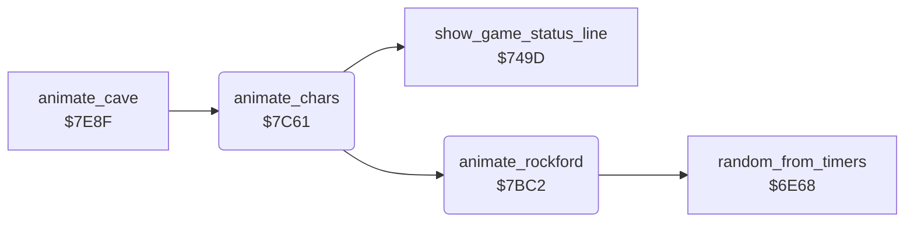

<!-- Generated by c64-docs from knowledge revision 20261024T103116.823-byvbsh and .c64-re-tools/local/generated/src/source-map.json. Do not edit: change the knowledge, generate the source again, then run docs.ts generate. -->
# screen/animation.asm: Character animation

Range `$7BC2-$7CEF`. Source: [screen/animation.asm](../../../../src/screen/animation.asm). Index: [the reference](../../index.md).

## Call graph

A solid arrow is a call, a thick arrow a table entry, a dotted arrow a jump. Rounded nodes are in this file.

## Names

### [`animate_rockford`](../../../../src/screen/animation.asm#L6) `$7BC2`

*routine*

Copies one byte row of the Rockford characters $4C, $4D, $5C and $5D. Input: X = frame offset, Y = byte row 0-7. Walking uses the left or right frames. Standing uses the standing image, with random eye blinks and foot taps.

- **Called from:** [`animate_chars`](animation.md#animate_chars) [`$7CE6`](../../../../src/screen/animation.asm#L137)
- **Calls:** [`random_from_timers`](../engine/random.md#random_from_timers)
- **Reads:** [`joystick_dir`](../../memory-map.md#joystick_dir), [`rockford_facing`](../../memory-map.md#rockford_facing), [`rockford_right_tl`](../rockford/rockford_glyphs.md#rockford_right_tl), [`rockford_right_tr`](../rockford/rockford_glyphs.md#rockford_right_tr), [`rockford_right_bl`](../rockford/rockford_glyphs.md#rockford_right_bl), [`rockford_right_br`](../rockford/rockford_glyphs.md#rockford_right_br), [`rockford_left_tl`](../rockford/rockford_glyphs.md#rockford_left_tl), [`rockford_left_tr`](../rockford/rockford_glyphs.md#rockford_left_tr), [`rockford_left_bl`](../rockford/rockford_glyphs.md#rockford_left_bl), [`rockford_left_br`](../rockford/rockford_glyphs.md#rockford_left_br), [`rockford_tap`](../../memory-map.md#rockford_tap), [`rockford_blink`](../../memory-map.md#rockford_blink), [`rockford_blink_tl`](../rockford/rockford_glyphs.md#rockford_blink_tl), [`rockford_blink_tr`](../rockford/rockford_glyphs.md#rockford_blink_tr), [`gfx_rockford_stand_tl`](../../memory-map.md#gfx_rockford_stand_tl), [`gfx_rockford_stand_tr`](../../memory-map.md#gfx_rockford_stand_tr), [`rockford_tap_bl`](../rockford/rockford_glyphs.md#rockford_tap_bl), [`rockford_tap_br`](../rockford/rockford_glyphs.md#rockford_tap_br), [`gfx_rockford_stand_bl`](../../memory-map.md#gfx_rockford_stand_bl), [`gfx_rockford_stand_br`](../../memory-map.md#gfx_rockford_stand_br)
- **Writes:** [`rockford_tap`](../../memory-map.md#rockford_tap), [`rockford_blink`](../../memory-map.md#rockford_blink), [`gfx_rockford_tl`](../../memory-map.md#gfx_rockford_tl), [`gfx_rockford_tr`](../../memory-map.md#gfx_rockford_tr), [`gfx_rockford_bl`](../../memory-map.md#gfx_rockford_bl), [`gfx_rockford_br`](../../memory-map.md#gfx_rockford_br)

### [`animate_rockford_left`](../../../../src/screen/animation.asm#L24) `$7BEB`

*label*

- **Jumped to from:** [`animate_rockford`](animation.md#animate_rockford) [`$7BD0`](../../../../src/screen/animation.asm#L14)

### [`animate_rockford_idle`](../../../../src/screen/animation.asm#L35) `$7C04`

*label*

Once in each cycle, Rockford blinks with a chance of 1 in 4. The foot tap toggles with a chance of 1 in 16.

- **Jumped to from:** [`animate_rockford`](animation.md#animate_rockford) [`$7BC6`](../../../../src/screen/animation.asm#L9)

### [`animate_rockford_tap_check`](../../../../src/screen/animation.asm#L45) `$7C17`

*label*

- **Jumped to from:** [`animate_rockford`](animation.md#animate_rockford) [`$7C11`](../../../../src/screen/animation.asm#L42)

### [`animate_rockford_top`](../../../../src/screen/animation.asm#L52) `$7C24`

*label*

- **Jumped to from:** [`animate_rockford`](animation.md#animate_rockford) [`$7C06`](../../../../src/screen/animation.asm#L37), [`animate_rockford`](animation.md#animate_rockford) [`$7C1C`](../../../../src/screen/animation.asm#L48)

### [`animate_rockford_top_stand`](../../../../src/screen/animation.asm#L60) `$7C37`

*label*

- **Jumped to from:** [`animate_rockford`](animation.md#animate_rockford) [`$7C26`](../../../../src/screen/animation.asm#L54)

### [`animate_rockford_bottom`](../../../../src/screen/animation.asm#L65) `$7C43`

*label*

- **Jumped to from:** [`animate_rockford`](animation.md#animate_rockford) [`$7C34`](../../../../src/screen/animation.asm#L59)

### [`animate_rockford_bot_stand`](../../../../src/screen/animation.asm#L73) `$7C54`

*label*

- **Jumped to from:** [`animate_rockford`](animation.md#animate_rockford) [`$7C45`](../../../../src/screen/animation.asm#L67)

### [`animate_chars`](../../../../src/screen/animation.asm#L80) `$7C61`

*routine*

Shows the status line during play. Then copies the current animation frame (anim_frame) into the characters of the diamond and of Rockford. Also the amoeba, the butterfly and the firefly characters, as cave_anim_flags selects.

- **Called from:** [`animate_cave`](animate_cave.md#animate_cave) [`$7E98`](../../../../src/screen/animate_cave.asm#L12)
- **Calls:** [`show_game_status_line`](../status/score_time.md#show_game_status_line), [`animate_rockford`](animation.md#animate_rockford)
- **Reads:** [`birth_countdown`](../../memory-map.md#birth_countdown), [`cave_clock_on`](../../memory-map.md#cave_clock_on), [`anim_frame`](../../memory-map.md#anim_frame), [`diamond_glyph_tl`](../data/element_glyphs.md#diamond_glyph_tl), [`diamond_glyph_tr`](../data/element_glyphs.md#diamond_glyph_tr), [`diamond_glyph_bl`](../data/element_glyphs.md#diamond_glyph_bl), [`diamond_glyph_br`](../data/element_glyphs.md#diamond_glyph_br), [`cave_anim_flags`](../../memory-map.md#cave_anim_flags), [`amoeba_glyph_tl`](../data/element_glyphs.md#amoeba_glyph_tl), [`amoeba_glyph_tr`](../data/element_glyphs.md#amoeba_glyph_tr), [`amoeba_glyph_bl`](../data/element_glyphs.md#amoeba_glyph_bl), [`amoeba_glyph_br`](../data/element_glyphs.md#amoeba_glyph_br), [`butterfly_glyph_tl`](../data/element_glyphs.md#butterfly_glyph_tl), [`butterfly_glyph_tr`](../data/element_glyphs.md#butterfly_glyph_tr), [`butterfly_glyph_bl`](../data/element_glyphs.md#butterfly_glyph_bl), [`butterfly_glyph_br`](../data/element_glyphs.md#butterfly_glyph_br), [`firefly_glyph_tl`](../data/element_glyphs.md#firefly_glyph_tl), [`firefly_glyph_tr`](../data/element_glyphs.md#firefly_glyph_tr), [`firefly_glyph_bl`](../data/element_glyphs.md#firefly_glyph_bl), [`firefly_glyph_br`](../data/element_glyphs.md#firefly_glyph_br)
- **Writes:** [`gfx_diamond_tl`](../../memory-map.md#gfx_diamond_tl), [`gfx_diamond_tr`](../../memory-map.md#gfx_diamond_tr), [`gfx_diamond_bl`](../../memory-map.md#gfx_diamond_bl), [`gfx_diamond_br`](../../memory-map.md#gfx_diamond_br), [`gfx_amoeba_tl`](../../memory-map.md#gfx_amoeba_tl), [`gfx_amoeba_tr`](../../memory-map.md#gfx_amoeba_tr), [`gfx_amoeba_bl`](../../memory-map.md#gfx_amoeba_bl), [`gfx_amoeba_br`](../../memory-map.md#gfx_amoeba_br), [`gfx_butterfly_tl`](../../memory-map.md#gfx_butterfly_tl), [`gfx_butterfly_tr`](../../memory-map.md#gfx_butterfly_tr), [`gfx_butterfly_bl`](../../memory-map.md#gfx_butterfly_bl), [`gfx_butterfly_br`](../../memory-map.md#gfx_butterfly_br), [`gfx_firefly_tl`](../../memory-map.md#gfx_firefly_tl), [`gfx_firefly_tr`](../../memory-map.md#gfx_firefly_tr), [`gfx_firefly_bl`](../../memory-map.md#gfx_firefly_bl), [`gfx_firefly_br`](../../memory-map.md#gfx_firefly_br)

### [`animate_chars_start`](../../../../src/screen/animation.asm#L86) `$7C6C`

*label*

- **Jumped to from:** [`animate_chars`](animation.md#animate_chars) [`$7C63`](../../../../src/screen/animation.asm#L82), [`animate_chars`](animation.md#animate_chars) [`$7C67`](../../../../src/screen/animation.asm#L84)

### [`animate_chars_loop`](../../../../src/screen/animation.asm#L91) `$7C72`

*label*

- **Jumped to from:** [`animate_chars`](animation.md#animate_chars) [`$7CED`](../../../../src/screen/animation.asm#L141)

### [`animate_chars_butterfly`](../../../../src/screen/animation.asm#L112) `$7CAA`

*label*

- **Jumped to from:** [`animate_chars`](animation.md#animate_chars) [`$7C90`](../../../../src/screen/animation.asm#L103)

### [`animate_chars_firefly`](../../../../src/screen/animation.asm#L124) `$7CC8`

*label*

- **Jumped to from:** [`animate_chars`](animation.md#animate_chars) [`$7CAE`](../../../../src/screen/animation.asm#L115)

### [`animate_chars_next`](../../../../src/screen/animation.asm#L136) `$7CE6`

*label*

- **Jumped to from:** [`animate_chars`](animation.md#animate_chars) [`$7C8C`](../../../../src/screen/animation.asm#L101), [`animate_chars`](animation.md#animate_chars) [`$7CCC`](../../../../src/screen/animation.asm#L127)
