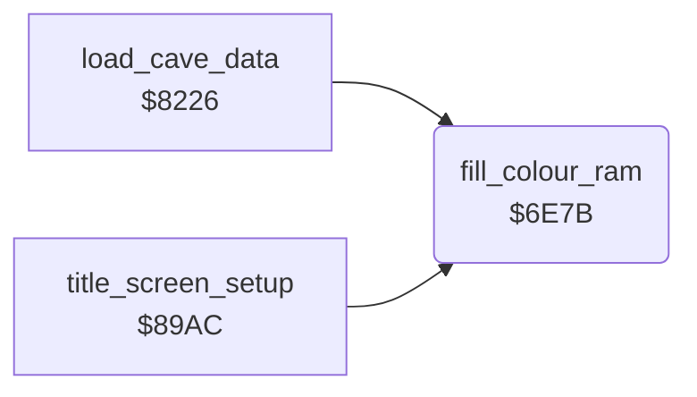

<!-- Generated by c64-docs from knowledge revision 20261025T214622.009-09wod3 and .c64-re-tools/local/generated/src/source-map.json. Do not edit: change the knowledge, generate the source again, then run docs.ts generate. -->
# screen/colour_ram.asm: Colour RAM fill

Range `$6E7B-$6E9B`. Source: [screen/colour_ram.asm](../../../../src/screen/colour_ram.asm). Index: [the reference](../../index.md).

## Routines

| Routine | Address | Reached from | Summary |
|---|---|---|---|
| [`fill_colour_ram`](colour_ram.md#fill_colour_ram) | `$6E7B` | [`load_cave_data`](../cave/setup.md#load_cave_data), [`title_screen_setup`](../title/run_title.md#title_screen_setup) | Sets colour RAM row 0 ($d800-$d827) to 9, then fills $d800+Y to $dbff with A. |

## Call graph

A solid arrow is a call, a thick arrow a table entry. Rounded nodes are in this file.

## Details

### [`fill_colour_ram`](../../../../src/screen/colour_ram.asm#L6) `$6E7B`

*routine*

Sets colour RAM row 0 ($d800-$d827) to 9, then fills $d800+Y to $dbff with A. Input: A = colour, Y = first offset. Output: colour_ram_ptr = $dc00, Y = 0.

- **Called from:** [`load_cave_data`](../cave/setup.md#load_cave_data), [`title_screen_setup`](../title/run_title.md#title_screen_setup)
- **Reads:** [`text_ptr`](../../memory-map.md#text_ptr), [`text_ptr_hi`](../../memory-map.md#text_ptr_hi)
- **Writes:** `$D800`, [`text_ptr`](../../memory-map.md#text_ptr), [`text_ptr_hi`](../../memory-map.md#text_ptr_hi)

| Label | Address | Comment |
|---|---|---|
| [`fill_colour_ram_row0`](../../../../src/screen/colour_ram.asm#L10) | `$6E80` | Row 0 gets colour 9 (multicolour, colour 1). |
| [`fill_colour_ram_loop`](../../../../src/screen/colour_ram.asm#L20) | `$6E91` | Fills four pages, $d8-$db. |
