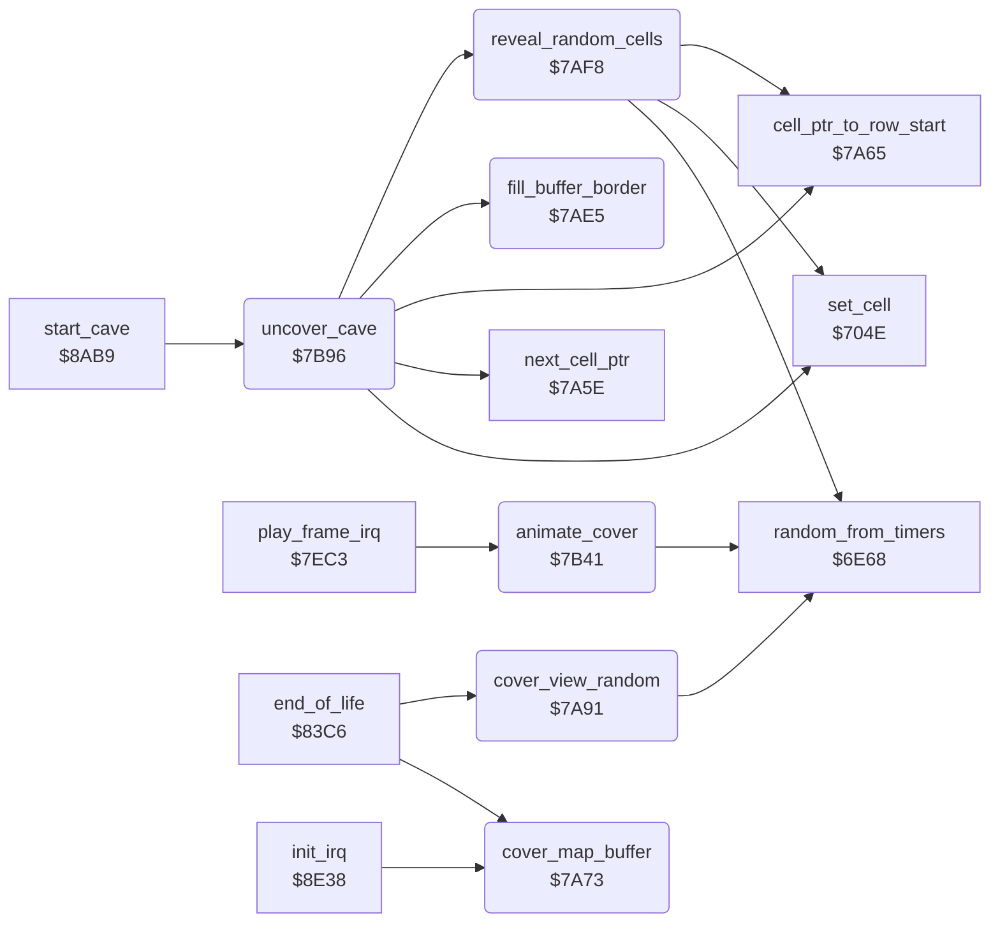

<!-- Generated by c64-docs from knowledge revision 20261025T214622.009-09wod3 and .c64-re-tools/local/generated/src/source-map.json. Do not edit: change the knowledge, generate the source again, then run docs.ts generate. -->
# screen/cover.asm: Cover and uncover the cave

Range `$7A73-$7BC1`. Source: [screen/cover.asm](../../../../src/screen/cover.asm). Index: [the reference](../../index.md).

## Routines

| Routine | Address | Reached from | Summary |
|---|---|---|---|
| [`cover_map_buffer`](cover.md#cover_map_buffer) | `$7A73` | [`end_of_life`](../status/end_of_life.md#end_of_life), [`init_irq`](../irq/irq_setup.md#init_irq) | Fills the 22 rows of 160 bytes of the map buffer with the cover character $7C. |
| [`cover_view_random`](cover.md#cover_view_random) | `$7A91` | [`end_of_life`](../status/end_of_life.md#end_of_life) | Makes the table view_row_ptrs of the 24 visible character rows in the map buffer. |
| [`fill_buffer_border`](cover.md#fill_buffer_border) | `$7AE5` | [`uncover_cave`](cover.md#uncover_cave) | Fills the 256 bytes after the map buffer ($4DC3) and the 3 bytes before it ($4000) with the steel wall character $4A. |
| [`reveal_random_cells`](cover.md#reveal_random_cells) | `$7AF8` | [`uncover_cave`](cover.md#uncover_cave) | Draws one random cell of each cave row into the map buffer, in 69 passes. |
| [`animate_cover`](cover.md#animate_cover) | `$7B41` | [`play_frame_irq`](../irq/play_frame.md#play_frame_irq) | While cave_covered is set, rolls the cover character $7C up one pixel row each frame. |
| [`uncover_cave`](cover.md#uncover_cave) | `$7B96` | [`start_cave`](../cave/cave_start.md#start_cave) | Uncovers the cave: draws random cells, then draws all 22 rows of 40 cells into the map buffer, then fills the buffer border. |

## Call graph

A solid arrow is a call, a thick arrow a table entry. Rounded nodes are in this file.

## Details

### [`cover_map_buffer`](../../../../src/screen/cover.asm#L6) `$7A73`

*routine*

Fills the 22 rows of 160 bytes of the map buffer with the cover character $7C.

- **Called from:** [`end_of_life`](../status/end_of_life.md#end_of_life), [`init_irq`](../irq/irq_setup.md#init_irq)
- **Reads:** [`cave_row_addr_lo`](cell_screen_tables.md#cave_row_addr_lo), [`cave_row_addr_hi`](cell_screen_tables.md#cave_row_addr_hi), [`cell_buffer_ptr`](../../memory-map.md#cell_buffer_ptr)
- **Writes:** [`cell_buffer_ptr`](../../memory-map.md#cell_buffer_ptr), [`cell_buffer_ptr_hi`](../../memory-map.md#cell_buffer_ptr_hi)

| Label | Address | Comment |
|---|---|---|
| [`cover_map_buffer_row`](../../../../src/screen/cover.asm#L8) | `$7A75` |  |
| [`cover_map_buffer_byte`](../../../../src/screen/cover.asm#L15) | `$7A83` |  |

### [`cover_view_random`](../../../../src/screen/cover.asm#L26) `$7A91`

*routine*

Makes the table view_row_ptrs of the 24 visible character rows in the map buffer. Then puts the cover character $7C at a random place in each row, 48 times.

- **Called from:** [`end_of_life`](../status/end_of_life.md#end_of_life)
- **Calls:** [`random_from_timers`](../engine/random.md#random_from_timers)
- **Reads:** [`view_ptr`](../../memory-map.md#view_ptr), [`view_ptr_hi`](../../memory-map.md#view_ptr_hi), [`view_row_ptrs`](../../memory-map.md#view_row_ptrs), [`view_row_ptrs_hi`](../../memory-map.md#view_row_ptrs_hi), [`cover_count`](../../memory-map.md#cover_count), [`draw_ptr`](../../memory-map.md#draw_ptr), [`scan_col`](../../memory-map.md#scan_col)
- **Writes:** [`view_row_ptrs`](../../memory-map.md#view_row_ptrs), [`view_row_ptrs_hi`](../../memory-map.md#view_row_ptrs_hi), [`view_row_ptrs_1`](../../memory-map.md#view_row_ptrs_1), [`view_row_ptrs_1_hi`](../../memory-map.md#view_row_ptrs_1_hi), [`scan_col`](../../memory-map.md#scan_col), [`cover_count`](../../memory-map.md#cover_count), [`draw_ptr`](../../memory-map.md#draw_ptr), [`draw_ptr_hi`](../../memory-map.md#draw_ptr_hi)

| Label | Address | Comment |
|---|---|---|
| [`cover_view_row_ptrs`](../../../../src/screen/cover.asm#L32) | `$7A9B` |  |
| [`cover_view_pass`](../../../../src/screen/cover.asm#L46) | `$7AB2` |  |
| [`cover_view_row`](../../../../src/screen/cover.asm#L48) | `$7AB4` |  |
| [`cover_view_random_col`](../../../../src/screen/cover.asm#L55) | `$7AC0` |  |
| [`cover_view_store`](../../../../src/screen/cover.asm#L66) | `$7AD2` |  |

### [`fill_buffer_border`](../../../../src/screen/cover.asm#L79) `$7AE5`

*routine*

Fills the 256 bytes after the map buffer ($4DC3) and the 3 bytes before it ($4000) with the steel wall character $4A.

- **Called from:** [`uncover_cave`](cover.md#uncover_cave)
- **Writes:** `$4DC3`, `$4000`

| Label | Address | Comment |
|---|---|---|
| [`fill_buffer_border_end`](../../../../src/screen/cover.asm#L82) | `$7AE9` |  |
| [`fill_buffer_border_start`](../../../../src/screen/cover.asm#L87) | `$7AF1` |  |

### [`reveal_random_cells`](../../../../src/screen/cover.asm#L93) `$7AF8`

*routine*

Draws one random cell of each cave row into the map buffer, in 69 passes. This uncovers the cave at random places.

- **Called from:** [`uncover_cave`](cover.md#uncover_cave)
- **Calls:** [`cell_ptr_to_row_start`](../cave/cell_ptr.md#cell_ptr_to_row_start), [`random_from_timers`](../engine/random.md#random_from_timers), [`set_cell`](../engine/cell_draw.md#set_cell)
- **Reads:** [`scan_col`](../../memory-map.md#scan_col), [`reveal_skip`](../../memory-map.md#reveal_skip), [`cell_ptr`](../../memory-map.md#cell_ptr), [`cell_ptr_hi`](../../memory-map.md#cell_ptr_hi), [`scan_row`](../../memory-map.md#scan_row), [`reveal_passes`](../../memory-map.md#reveal_passes)
- **Writes:** [`reveal_passes`](../../memory-map.md#reveal_passes), [`scan_row`](../../memory-map.md#scan_row), [`scan_col`](../../memory-map.md#scan_col), [`reveal_skip`](../../memory-map.md#reveal_skip), [`cell_ptr`](../../memory-map.md#cell_ptr), [`cell_ptr_hi`](../../memory-map.md#cell_ptr_hi)

| Label | Address | Comment |
|---|---|---|
| [`reveal_random_pass`](../../../../src/screen/cover.asm#L96) | `$7AFC` |  |
| [`reveal_random_row`](../../../../src/screen/cover.asm#L100) | `$7B03` |  |

### [`animate_cover`](../../../../src/screen/cover.asm#L134) `$7B41`

*routine*

While cave_covered is set, rolls the cover character $7C up one pixel row each frame. It also plays the cover noise on voice 2 in a cycle of three frames.

- **Called from:** [`play_frame_irq`](../irq/play_frame.md#play_frame_irq)
- **Calls:** [`random_from_timers`](../engine/random.md#random_from_timers)
- **Reads:** [`cave_covered`](../../memory-map.md#cave_covered), [`cover_sound_step`](../../memory-map.md#cover_sound_step), [`gfx_cover`](../../memory-map.md#gfx_cover), [`cover_row_save`](../../memory-map.md#cover_row_save)
- **Writes:** [`sound1_request`](../../memory-map.md#sound1_request), [`cover_sound_step`](../../memory-map.md#cover_sound_step), [`ATDCY2`](../../memory-map.md#ATDCY2), [`FREHI2`](../../memory-map.md#FREHI2), [`VCREG2`](../../memory-map.md#VCREG2), [`cover_row_save`](../../memory-map.md#cover_row_save), [`gfx_cover`](../../memory-map.md#gfx_cover)

| Label | Address | Comment |
|---|---|---|
| [`animate_cover_sound_off`](../../../../src/screen/cover.asm#L154) | `$7B6E` |  |
| [`animate_cover_roll`](../../../../src/screen/cover.asm#L159) | `$7B78` |  |
| [`animate_cover_roll_loop`](../../../../src/screen/cover.asm#L163) | `$7B7F` |  |
| [`animate_cover_idle`](../../../../src/screen/cover.asm#L172) | `$7B90` |  |

### [`uncover_cave`](../../../../src/screen/cover.asm#L177) `$7B96`

*routine*

Uncovers the cave: draws random cells, then draws all 22 rows of 40 cells into the map buffer, then fills the buffer border.

- **Called from:** [`start_cave`](../cave/cave_start.md#start_cave)
- **Calls:** [`reveal_random_cells`](cover.md#reveal_random_cells), [`cell_ptr_to_row_start`](../cave/cell_ptr.md#cell_ptr_to_row_start), [`set_cell`](../engine/cell_draw.md#set_cell), [`next_cell_ptr`](../cave/cell_ptr.md#next_cell_ptr), [`fill_buffer_border`](cover.md#fill_buffer_border)
- **Reads:** [`cell_ptr`](../../memory-map.md#cell_ptr), [`scan_col`](../../memory-map.md#scan_col), [`scan_row`](../../memory-map.md#scan_row)
- **Writes:** [`scan_row`](../../memory-map.md#scan_row), [`scan_col`](../../memory-map.md#scan_col)

| Label | Address | Comment |
|---|---|---|
| [`uncover_cave_row`](../../../../src/screen/cover.asm#L182) | `$7BA0` |  |
| [`uncover_cave_cell`](../../../../src/screen/cover.asm#L185) | `$7BA4` |  |
