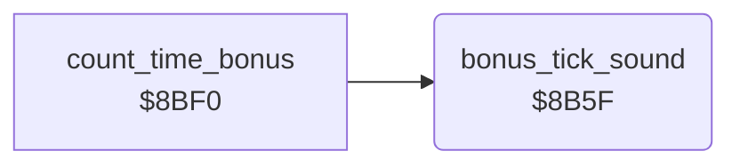

<!-- Generated by c64-docs from knowledge revision 20261025T214622.009-09wod3 and .c64-re-tools/local/generated/src/source-map.json. Do not edit: change the knowledge, generate the source again, then run docs.ts generate. -->
# sound/bonus_sound.asm: Time bonus sound

Range `$8B5F-$8B90`. Source: [sound/bonus_sound.asm](../../../../src/sound/bonus_sound.asm). Index: [the reference](../../index.md).

## Routines

| Routine | Address | Reached from | Summary |
|---|---|---|---|
| [`bonus_tick_sound`](bonus_sound.md#bonus_tick_sound) | `$8B5F` | [`count_time_bonus`](../cave/cave_end.md#count_time_bonus) | Plays one sweep on SID voice 3 for one bonus time unit: the pitch rises in 15 steps (start minus 2 times X). |

## Call graph

A solid arrow is a call, a thick arrow a table entry. Rounded nodes are in this file.

## Details

### [`bonus_tick_sound`](../../../../src/sound/bonus_sound.asm#L6) `$8B5F`

*routine*

Plays one sweep on SID voice 3 for one bonus time unit: the pitch rises in 15 steps (start minus 2 times X). Lowers the start pitch in $03. Returns with A non-zero.

- **Called from:** [`count_time_bonus`](../cave/cave_end.md#count_time_bonus)
- **Reads:** [`view_row_ptrs_hi`](../../memory-map.md#view_row_ptrs_hi), [`view_row_ptrs`](../../memory-map.md#view_row_ptrs)
- **Writes:** [`view_row_ptrs_hi`](../../memory-map.md#view_row_ptrs_hi), [`VCREG3`](../../memory-map.md#VCREG3), [`view_row_ptrs`](../../memory-map.md#view_row_ptrs), [`FREHI3`](../../memory-map.md#FREHI3), [`SUREL3`](../../memory-map.md#SUREL3), [`ATDCY3`](../../memory-map.md#ATDCY3)

| Label | Address | Comment |
|---|---|---|
| [`bonus_tick_sweep`](../../../../src/sound/bonus_sound.asm#L9) | `$8B63` |  |
| [`bonus_tick_wait`](../../../../src/sound/bonus_sound.asm#L25) | `$8B85` |  |
