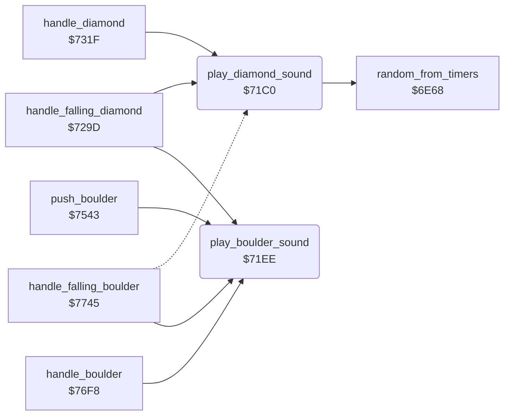

<!-- Generated by c64-docs from knowledge revision 20261024T103116.823-byvbsh and .c64-re-tools/local/generated/src/source-map.json. Do not edit: change the knowledge, generate the source again, then run docs.ts generate. -->
# sound/element_sounds.asm: Sounds of diamonds and boulders

Range `$71C0-$71FC`. Source: [sound/element_sounds.asm](../../../../src/sound/element_sounds.asm). Index: [the reference](../../index.md).

## Call graph

A solid arrow is a call, a thick arrow a table entry, a dotted arrow a jump. Rounded nodes are in this file.

## Data

| Range | Type | Name | Read by | Written by |
|---|---|---|---|---|
| [`$71E7`](../../../../src/sound/element_sounds.asm#L28)-`$71ED` | bytes | [`boulder_sound_regs`](../../../../src/sound/element_sounds.asm#L27) | [`play_boulder_sound`](element_sounds.md#play_boulder_sound) |  |

## Names

### [`play_diamond_sound`](../../../../src/sound/element_sounds.asm#L6) `$71C0`

*routine*

Puts a diamond sound with a random pitch into voice1_regs and requests it on SID voice 1.

- **Called from:** [`handle_falling_diamond`](../engine/diamond.md#handle_falling_diamond) [`$72CC`](../../../../src/engine/diamond.asm#L39), [`handle_diamond`](../engine/diamond.md#handle_diamond) [`$732A`](../../../../src/engine/diamond.asm#L88)
- **Jumped to from:** [`handle_falling_boulder`](../engine/boulder.md#handle_falling_boulder) [`$7775`](../../../../src/engine/boulder.asm#L73)
- **Calls:** [`random_from_timers`](../engine/random.md#random_from_timers)
- **Reads:** [`sound1_request`](../../memory-map.md#sound1_request), [`diamond_fall_sound_regs`](../status/score_time.md#diamond_fall_sound_regs)
- **Writes:** [`sound1_request`](../../memory-map.md#sound1_request), [`voice1_pulse_lo`](../../memory-map.md#voice1_pulse_lo), [`voice1_sustain`](../../memory-map.md#voice1_sustain), [`sound1_pending`](../../memory-map.md#sound1_pending), [`voice1_freq_hi`](../../memory-map.md#voice1_freq_hi)

### [`play_diamond_sound_copy`](../../../../src/sound/element_sounds.asm#L9) `$71C5`

*label*

- **Jumped to from:** [`play_diamond_sound`](element_sounds.md#play_diamond_sound) [`$71CC`](../../../../src/sound/element_sounds.asm#L13)

### [`boulder_sound_regs`](../../../../src/sound/element_sounds.asm#L27) `$71E7-$71ED`

*data*

SID voice 1 registers of the boulder sound: frequency, pulse width, control, attack/decay, sustain/release.

- **Read by:** [`play_boulder_sound`](element_sounds.md#play_boulder_sound) [`$71F3`](../../../../src/sound/element_sounds.asm#L34)

### [`play_boulder_sound`](../../../../src/sound/element_sounds.asm#L30) `$71EE`

*routine*

Copies boulder_sound_regs to voice1_regs and requests the sound on SID voice 1.

- **Called from:** [`handle_falling_diamond`](../engine/diamond.md#handle_falling_diamond) [`$72C6`](../../../../src/engine/diamond.asm#L36), [`push_boulder`](../rockford/movement.md#push_boulder) [`$754C`](../../../../src/rockford/movement.asm#L25), [`handle_boulder`](../engine/boulder.md#handle_boulder) [`$7703`](../../../../src/engine/boulder.asm#L12), [`handle_falling_boulder`](../engine/boulder.md#handle_falling_boulder) [`$7778`](../../../../src/engine/boulder.asm#L75)
- **Reads:** [`sound1_request`](../../memory-map.md#sound1_request), [`boulder_sound_regs`](element_sounds.md#boulder_sound_regs)
- **Writes:** [`sound1_request`](../../memory-map.md#sound1_request), [`sound1_pending`](../../memory-map.md#sound1_pending)

### [`play_boulder_sound_copy`](../../../../src/sound/element_sounds.asm#L33) `$71F3`

*label*

- **Jumped to from:** [`play_boulder_sound`](element_sounds.md#play_boulder_sound) [`$71FA`](../../../../src/sound/element_sounds.asm#L37)
