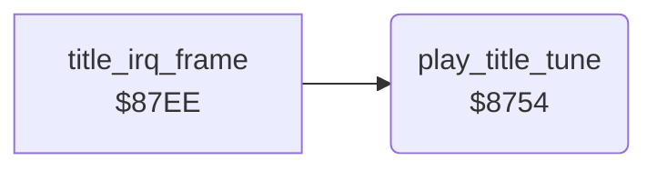

<!-- Generated by c64-docs from knowledge revision 20261024T103116.823-byvbsh and .c64-re-tools/local/generated/src/source-map.json. Do not edit: change the knowledge, generate the source again, then run docs.ts generate. -->
# sound/title_tune.asm: Title tune player

Range `$8754-$87D5`. Source: [sound/title_tune.asm](../../../../src/sound/title_tune.asm). Index: [the reference](../../index.md).

## Call graph

A solid arrow is a call, a thick arrow a table entry, a dotted arrow a jump. Rounded nodes are in this file.

## Names

### [`play_title_tune`](../../../../src/sound/title_tune.asm#L6) `$8754`

*routine*

Plays the title tune on voices 1 and 2 on odd title ticks. In demo mode, the second pass ends the title.
MUSPLY in the developer symbol table of the Micro Fun build.

- **Called from:** [`title_irq_frame`](../title/title_animation.md#title_irq_frame) [`$880B`](../../../../src/title/title_animation.asm#L35)
- **Reads:** [`title_frame_count`](../../memory-map.md#title_frame_count), [`title_note_phase`](../../memory-map.md#title_note_phase), [`tune_index`](../../memory-map.md#tune_index), [`title_tune_voice1`](../data/title_tune_notes.md#title_tune_voice1), [`FREQ`](../title/draw_title_screen.md#FREQ), [`FREQ_HI`](../title/draw_title_screen.md#FREQ_HI), [`title_tune_voice2`](../data/title_tune_notes.md#title_tune_voice2), [`tune_loop_count`](../../memory-map.md#tune_loop_count), [`demo_mode`](../../memory-map.md#demo_mode)
- **Writes:** [`VCREG1`](../../memory-map.md#VCREG1), [`VCREG2`](../../memory-map.md#VCREG2), [`ATDCY2`](../../memory-map.md#ATDCY2), [`SUREL2`](../../memory-map.md#SUREL2), [`tune_index`](../../memory-map.md#tune_index), [`FRELO1`](../../memory-map.md#FRELO1), [`FREHI1`](../../memory-map.md#FREHI1), [`FRELO2`](../../memory-map.md#FRELO2), [`FREHI2`](../../memory-map.md#FREHI2), [`tune_loop_count`](../../memory-map.md#tune_loop_count), [`SUREL1`](../../memory-map.md#SUREL1), [`title_note_phase`](../../memory-map.md#title_note_phase), [`title_done`](../../memory-map.md#title_done)
- **Refers to:** [`tune_freq_table`](tune_frequencies.md#tune_freq_table)

### [`title_tune_note`](../../../../src/sound/title_tune.asm#L11) `$875B`

*label*

tune_tick $A0 starts a new note.

- **Jumped to from:** [`play_title_tune`](title_tune.md#play_title_tune) [`$8758`](../../../../src/sound/title_tune.asm#L9)

### [`title_tune_envelope`](../../../../src/sound/title_tune.asm#L41) `$87A5`

*label*

The sustain of voice 1 falls over the eight ticks of a note.

- **Jumped to from:** [`play_title_tune`](title_tune.md#play_title_tune) [`$8760`](../../../../src/sound/title_tune.asm#L14), [`play_title_tune`](title_tune.md#play_title_tune) [`$87A0`](../../../../src/sound/title_tune.asm#L39)

### [`music_play_exit`](../../../../src/sound/title_tune.asm#L65) `$87D5`

*label*

- **Jumped to from:** [`play_title_tune`](title_tune.md#play_title_tune) [`$87C8`](../../../../src/sound/title_tune.asm#L59), [`play_title_tune`](title_tune.md#play_title_tune) [`$87CF`](../../../../src/sound/title_tune.asm#L62)
