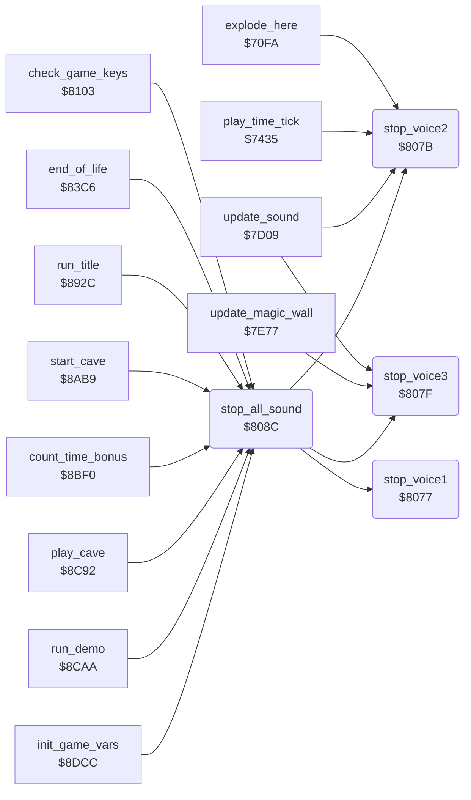

<!-- Generated by c64-docs from knowledge revision 20261025T214622.009-09wod3 and .c64-re-tools/local/generated/src/source-map.json. Do not edit: change the knowledge, generate the source again, then run docs.ts generate. -->
# sound/voices_off.asm: Stop the SID voices

Range `$8077-$809A`. Source: [sound/voices_off.asm](../../../../src/sound/voices_off.asm). Index: [the reference](../../index.md).

## Routines

| Routine | Address | Reached from | Summary |
|---|---|---|---|
| [`stop_voice1`](voices_off.md#stop_voice1) | `$8077` | [`stop_all_sound`](voices_off.md#stop_all_sound) | Stops SID voice 1. |
| [`stop_voice2`](voices_off.md#stop_voice2) | `$807B` | [`explode_here`](../engine/explosion.md#explode_here), [`play_time_tick`](../status/score_time.md#play_time_tick), [`update_sound`](effects.md#update_sound), [`stop_all_sound`](voices_off.md#stop_all_sound) | Stops SID voice 2. |
| [`stop_voice3`](voices_off.md#stop_voice3) | `$807F` | [`update_sound`](effects.md#update_sound), [`update_magic_wall`](../engine/magic_wall.md#update_magic_wall), [`stop_all_sound`](voices_off.md#stop_all_sound) | Stops SID voice 3. |
| [`stop_all_sound`](voices_off.md#stop_all_sound) | `$808C` | [`check_game_keys`](../input/game_keys.md#check_game_keys), [`end_of_life`](../status/end_of_life.md#end_of_life), [`run_title`](../title/run_title.md#run_title), [`start_cave`](../cave/cave_start.md#start_cave), [`count_time_bonus`](../cave/cave_end.md#count_time_bonus), [`play_cave`](../engine/play_loop.md#play_cave), [`run_demo`](../title/demo.md#run_demo), [`init_game_vars`](../init/init_vars.md#init_game_vars) | Stops the three voices and sets the SID volume to 15 with filter mode bit 6. |

## Call graph

A solid arrow is a call, a thick arrow a table entry. Rounded nodes are in this file.

## Details

### [`stop_voice1`](../../../../src/sound/voices_off.asm#L6) `$8077`

*routine*

Stops SID voice 1. It sets and clears the test bit of the voice control register.

- **Called from:** [`stop_all_sound`](voices_off.md#stop_all_sound)
- **Jumps to:** [`stop_voice_x`](voices_off.md#stop_voice_x)

### [`stop_voice2`](../../../../src/sound/voices_off.asm#L10) `$807B`

*routine*

Stops SID voice 2.

- **Called from:** [`explode_here`](../engine/explosion.md#explode_here), [`play_time_tick`](../status/score_time.md#play_time_tick), [`update_sound`](effects.md#update_sound), [`stop_all_sound`](voices_off.md#stop_all_sound)
- **Jumped to from:** [`update_sound`](effects.md#update_sound)
- **Jumps to:** [`stop_voice_x`](voices_off.md#stop_voice_x)

### [`stop_voice3`](../../../../src/sound/voices_off.asm#L14) `$807F`

*routine*

Stops SID voice 3.

- **Called from:** [`update_sound`](effects.md#update_sound), [`update_magic_wall`](../engine/magic_wall.md#update_magic_wall), [`stop_all_sound`](voices_off.md#stop_all_sound)
- **Writes:** [`FRELO1`](../../memory-map.md#FRELO1)

| Label | Address | Comment |
|---|---|---|
| [`stop_voice_x`](../../../../src/sound/voices_off.asm#L16) | `$8081` | X is the register offset of the voice. |

### [`stop_all_sound`](../../../../src/sound/voices_off.asm#L23) `$808C`

*routine*

Stops the three voices and sets the SID volume to 15 with filter mode bit 6.

- **Called from:** [`check_game_keys`](../input/game_keys.md#check_game_keys), [`end_of_life`](../status/end_of_life.md#end_of_life), [`run_title`](../title/run_title.md#run_title), [`start_cave`](../cave/cave_start.md#start_cave), [`count_time_bonus`](../cave/cave_end.md#count_time_bonus), [`play_cave`](../engine/play_loop.md#play_cave), [`run_demo`](../title/demo.md#run_demo), [`init_game_vars`](../init/init_vars.md#init_game_vars)
- **Calls:** [`stop_voice1`](voices_off.md#stop_voice1), [`stop_voice2`](voices_off.md#stop_voice2), [`stop_voice3`](voices_off.md#stop_voice3)
- **Writes:** [`SIGVOL`](../../memory-map.md#SIGVOL)
