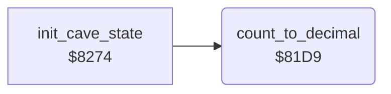

<!-- Generated by c64-docs from knowledge revision 20261025T214622.009-09wod3 and .c64-re-tools/local/generated/src/source-map.json. Do not edit: change the knowledge, generate the source again, then run docs.ts generate. -->
# status/decimal.asm: Binary to decimal

Range `$81D6-$81FD`. Source: [status/decimal.asm](../../../../src/status/decimal.asm). Index: [the reference](../../index.md).

## Routines

| Routine | Address | Reached from | Summary |
|---|---|---|---|
| [`count_to_decimal`](decimal.md#count_to_decimal) | `$81D9` | [`init_cave_state`](../cave/setup.md#init_cave_state) | Converts decimal_count to three decimal digits in decimal_digits, hundreds first. |

## Data

| Range | Type | Name | Read by | Written by |
|---|---|---|---|---|
| [`$81D6`](../../../../src/status/decimal.asm#L7)-`$81D8` | bytes | [`decimal_one`](../../../../src/status/decimal.asm#L6) | [`count_to_decimal`](decimal.md#count_to_decimal) |  |

## Call graph

A solid arrow is a call, a thick arrow a table entry. Rounded nodes are in this file.

## Details

### [`decimal_one`](../../../../src/status/decimal.asm#L6) `$81D6-$81D8`

*data*

The number 1 as three decimal digits, hundreds first.

- **Read by:** [`count_to_decimal`](decimal.md#count_to_decimal)

### [`count_to_decimal`](../../../../src/status/decimal.asm#L9) `$81D9`

*routine*

Converts decimal_count to three decimal digits in decimal_digits, hundreds first. It counts up one at a time and sets decimal_count to 0.

- **Called from:** [`init_cave_state`](../cave/setup.md#init_cave_state)
- **Reads:** [`decimal_count`](../../memory-map.md#decimal_count), [`decimal_digits`](../../memory-map.md#decimal_digits), [`decimal_one`](decimal.md#decimal_one)
- **Writes:** [`decimal_digits`](../../memory-map.md#decimal_digits), [`decimal_count`](../../memory-map.md#decimal_count)

| Label | Address | Comment |
|---|---|---|
| [`count_to_decimal_clear`](../../../../src/status/decimal.asm#L12) | `$81DD` |  |
| [`count_to_decimal_step`](../../../../src/status/decimal.asm#L18) | `$81E6` |  |
| [`count_to_decimal_digit`](../../../../src/status/decimal.asm#L21) | `$81E9` |  |
| [`count_to_decimal_store`](../../../../src/status/decimal.asm#L27) | `$81F4` |  |
| [`cave_sequence_base`](../../../../src/status/decimal.asm#L32) | `$81FC` |  |
| [`count_to_decimal_done`](../../../../src/status/decimal.asm#L34) | `$81FD` |  |
