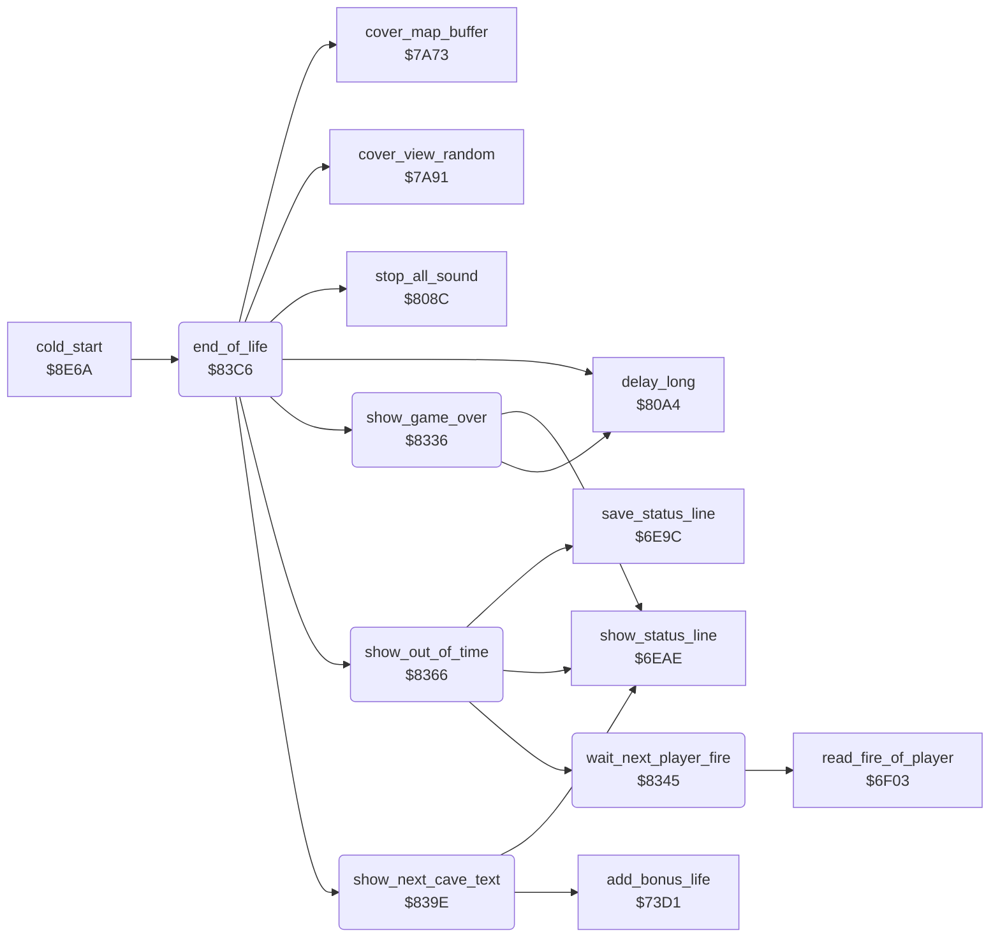

<!-- Generated by c64-docs from knowledge revision 20261025T214622.009-09wod3 and .c64-re-tools/local/generated/src/source-map.json. Do not edit: change the knowledge, generate the source again, then run docs.ts generate. -->
# status/end_of_life.asm: Messages at the end of a life

Range `$8336-$8405`. Source: [status/end_of_life.asm](../../../../src/status/end_of_life.asm). Index: [the reference](../../index.md).

## Routines

| Routine | Address | Reached from | Summary |
|---|---|---|---|
| [`show_game_over`](end_of_life.md#show_game_over) | `$8336` | [`end_of_life`](end_of_life.md#end_of_life) | Shows G A M E   O V E R in the status line and waits. |
| [`wait_next_player_fire`](end_of_life.md#wait_next_player_fire) | `$8345` | [`show_out_of_time`](end_of_life.md#show_out_of_time) | Waits a fixed time. |
| [`show_out_of_time`](end_of_life.md#show_out_of_time) | `$8366` | [`end_of_life`](end_of_life.md#end_of_life) | Blinks OUT OF TIME with the saved status line 20 times, or until fire is pressed. |
| [`show_next_cave_text`](end_of_life.md#show_next_cave_text) | `$839E` | [`end_of_life`](end_of_life.md#end_of_life) | For an intermission, shows B O N U S  L I F E and adds a life. |
| [`end_of_life`](end_of_life.md#end_of_life) | `$83C6` | [`cold_start`](../init/cold_start.md#cold_start) | Runs after a life or a cave ends: shows out of time, game over or the next cave text. |

## Call graph

A solid arrow is a call, a thick arrow a table entry. Rounded nodes are in this file.

## Details

### [`show_game_over`](../../../../src/status/end_of_life.asm#L6) `$8336`

*routine*

Shows G A M E   O V E R in the status line and waits.

- **Called from:** [`end_of_life`](end_of_life.md#end_of_life)
- **Calls:** [`show_status_line`](status_line.md#show_status_line), [`delay_long`](../input/game_keys.md#delay_long)
- **Writes:** [`text_ptr`](../../memory-map.md#text_ptr), [`text_ptr_hi`](../../memory-map.md#text_ptr_hi)

### [`wait_next_player_fire`](../../../../src/status/end_of_life.asm#L15) `$8345`

*routine*

Waits a fixed time. Fire of the next player ends the wait early. In an intermission, it reads the fire of the same player.

- **Called from:** [`show_out_of_time`](end_of_life.md#show_out_of_time)
- **Calls:** [`read_fire_of_player`](../input/joystick.md#read_fire_of_player)
- **Reads:** [`intermission_flag`](../../memory-map.md#intermission_flag), [`current_player`](../../memory-map.md#current_player)

| Label | Address | Comment |
|---|---|---|
| [`wait_fire_outer`](../../../../src/status/end_of_life.asm#L17) | `$8347` |  |
| [`wait_fire_inner`](../../../../src/status/end_of_life.asm#L19) | `$8349` |  |
| [`wait_fire_same_player`](../../../../src/status/end_of_life.asm#L25) | `$8354` |  |
| [`wait_fire_read`](../../../../src/status/end_of_life.asm#L28) | `$8356` |  |
| [`wait_fire_next`](../../../../src/status/end_of_life.asm#L33) | `$835F` |  |

### [`show_out_of_time`](../../../../src/status/end_of_life.asm#L40) `$8366`

*routine*

Blinks OUT OF TIME with the saved status line 20 times, or until fire is pressed.

- **Called from:** [`end_of_life`](end_of_life.md#end_of_life)
- **Calls:** [`save_status_line`](status_line.md#save_status_line), [`show_status_line`](status_line.md#show_status_line), [`wait_next_player_fire`](end_of_life.md#wait_next_player_fire)
- **Reads:** [`blink_count`](../../memory-map.md#blink_count), [`fire_button`](../../memory-map.md#fire_button)
- **Writes:** [`blink_count`](../../memory-map.md#blink_count), [`text_ptr`](../../memory-map.md#text_ptr), [`text_ptr_hi`](../../memory-map.md#text_ptr_hi), [`fire_button`](../../memory-map.md#fire_button)
- **Refers to:** [`saved_status_line`](../../memory-map.md#saved_status_line)

| Label | Address | Comment |
|---|---|---|
| [`out_of_time_blink`](../../../../src/status/end_of_life.asm#L43) | `$836B` |  |
| [`out_of_time_check_fire`](../../../../src/status/end_of_life.asm#L64) | `$8399` |  |

### [`show_next_cave_text`](../../../../src/status/end_of_life.asm#L69) `$839E`

*routine*

For an intermission, shows B O N U S  L I F E and adds a life. Else shows the player line.

- **Called from:** [`end_of_life`](end_of_life.md#end_of_life)
- **Calls:** [`show_status_line`](status_line.md#show_status_line), [`add_bonus_life`](score_time.md#add_bonus_life)
- **Reads:** [`cave_number`](../../memory-map.md#cave_number), [`count_to_decimal_done`](decimal.md#count_to_decimal_done)
- **Writes:** [`intermission_flag`](../../memory-map.md#intermission_flag), [`text_ptr`](../../memory-map.md#text_ptr), [`text_ptr_hi`](../../memory-map.md#text_ptr_hi)
- **Refers to:** [`cave_sequence`](../cave/sequence.md#cave_sequence), [`status_line_text`](../../memory-map.md#status_line_text)

| Label | Address | Comment |
|---|---|---|
| [`next_cave_player_line`](../../../../src/status/end_of_life.asm#L84) | `$83BA` |  |
| [`next_cave_text_done`](../../../../src/status/end_of_life.asm#L90) | `$83C5` |  |

### [`end_of_life`](../../../../src/status/end_of_life.asm#L93) `$83C6`

*routine*

Runs after a life or a cave ends: shows out of time, game over or the next cave text. Then it clears the screen.
The clock reached the time of the cave.

- **Called from:** [`cold_start`](../init/cold_start.md#cold_start)
- **Calls:** [`show_out_of_time`](end_of_life.md#show_out_of_time), [`show_game_over`](end_of_life.md#show_game_over), [`show_next_cave_text`](end_of_life.md#show_next_cave_text), [`stop_all_sound`](../sound/voices_off.md#stop_all_sound), [`cover_view_random`](../screen/cover.md#cover_view_random), [`cover_map_buffer`](../screen/cover.md#cover_map_buffer), [`delay_long`](../input/game_keys.md#delay_long)
- **Reads:** [`seconds_elapsed`](../../memory-map.md#seconds_elapsed), [`cave_time`](../../memory-map.md#cave_time), [`game_over`](../../memory-map.md#game_over), [`cave_number`](../../memory-map.md#cave_number)
- **Writes:** [`cave_clock_on`](../../memory-map.md#cave_clock_on), [`screen0`](../../memory-map.md#screen0), [`magic_wall_state`](../../memory-map.md#magic_wall_state), [`cave_covered`](../../memory-map.md#cave_covered)

| Label | Address | Comment |
|---|---|---|
| [`end_of_life_game_over`](../../../../src/status/end_of_life.asm#L102) | `$83D8` |  |
| [`end_of_life_next_cave`](../../../../src/status/end_of_life.asm#L111) | `$83EA` |  |
| [`end_of_life_reset`](../../../../src/status/end_of_life.asm#L115) | `$83F1` |  |
| [`end_of_life_done`](../../../../src/status/end_of_life.asm#L124) | `$8405` |  |
