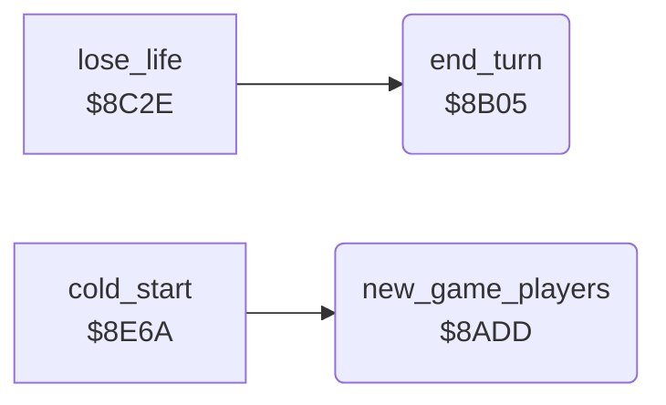

<!-- Generated by c64-docs from knowledge revision 20261025T214622.009-09wod3 and .c64-re-tools/local/generated/src/source-map.json. Do not edit: change the knowledge, generate the source again, then run docs.ts generate. -->
# status/players.asm: Players and lives

Range `$8ADD-$8B5E`. Source: [status/players.asm](../../../../src/status/players.asm). Index: [the reference](../../index.md).

## Routines

| Routine | Address | Reached from | Summary |
|---|---|---|---|
| [`new_game_players`](players.md#new_game_players) | `$8ADD` | [`cold_start`](../init/cold_start.md#cold_start) | Starts a new game: player 1, three lives, score 0 for both players. |
| [`end_turn`](players.md#end_turn) | `$8B05` | [`lose_life`](../cave/cave_end.md#lose_life) | Takes one life, saves the current player state and loads the next player with lives. |

## Call graph

A solid arrow is a call, a thick arrow a table entry. Rounded nodes are in this file.

## Details

### [`new_game_players`](../../../../src/status/players.asm#L6) `$8ADD`

*routine*

Starts a new game: player 1, three lives, score 0 for both players. Loads the best score of player 1.
GMINIT in the developer symbol table.

- **Called from:** [`cold_start`](../init/cold_start.md#cold_start)
- **Reads:** [`lives`](../../memory-map.md#lives), [`CHRGET`](../../memory-map.md#CHRGET)
- **Writes:** [`current_player`](../../memory-map.md#current_player), [`game_over`](../../memory-map.md#game_over), [`score_digits`](../../memory-map.md#score_digits), [`points_to_add`](../../memory-map.md#points_to_add), [`lives`](../../memory-map.md#lives), [`player1_state`](../../memory-map.md#player1_state), [`player2_state`](../../memory-map.md#player2_state), [`best_score`](../../memory-map.md#best_score)

| Label | Address | Comment |
|---|---|---|
| [`new_game_clear_score`](../../../../src/status/players.asm#L11) | `$8AE5` |  |
| [`new_game_copy_players`](../../../../src/status/players.asm#L19) | `$8AF2` | Copies lives, cave, level and score to both player states. |
| [`new_game_load_best`](../../../../src/status/players.asm#L26) | `$8AFD` |  |

### [`end_turn`](../../../../src/status/players.asm#L33) `$8B05`

*routine*

Takes one life, saves the current player state and loads the next player with lives. No lives left sets game_over.
NXTPLY in the developer symbol table.

- **Called from:** [`lose_life`](../cave/cave_end.md#lose_life)
- **Reads:** [`lives`](../../memory-map.md#lives), [`current_player`](../../memory-map.md#current_player), [`two_players`](../../memory-map.md#two_players), [`player2_state`](../../memory-map.md#player2_state), [`player1_state`](../../memory-map.md#player1_state)
- **Writes:** [`lives`](../../memory-map.md#lives), [`player1_state`](../../memory-map.md#player1_state), [`player2_state`](../../memory-map.md#player2_state), [`current_player`](../../memory-map.md#current_player), [`game_over`](../../memory-map.md#game_over)

| Label | Address | Comment |
|---|---|---|
| [`end_turn_save_p1`](../../../../src/status/players.asm#L38) | `$8B0D` |  |
| [`end_turn_save_p2`](../../../../src/status/players.asm#L44) | `$8B16` |  |
| [`end_turn_save_p2_loop`](../../../../src/status/players.asm#L46) | `$8B18` |  |
| [`end_turn_choose`](../../../../src/status/players.asm#L51) | `$8B1F` | Two players change turns when the other player has lives. |
| [`end_turn_to_p1`](../../../../src/status/players.asm#L60) | `$8B30` |  |
| [`end_turn_load`](../../../../src/status/players.asm#L64) | `$8B36` |  |
| [`end_turn_load_p1_loop`](../../../../src/status/players.asm#L68) | `$8B3C` |  |
| [`end_turn_load_p2`](../../../../src/status/players.asm#L74) | `$8B45` |  |
| [`end_turn_load_p2_loop`](../../../../src/status/players.asm#L76) | `$8B47` |  |
| [`end_turn_check_lives`](../../../../src/status/players.asm#L81) | `$8B4E` | No lives: game over, the state resets to player 1 with three lives. |
| [`end_turn_done`](../../../../src/status/players.asm#L90) | `$8B5E` |  |
