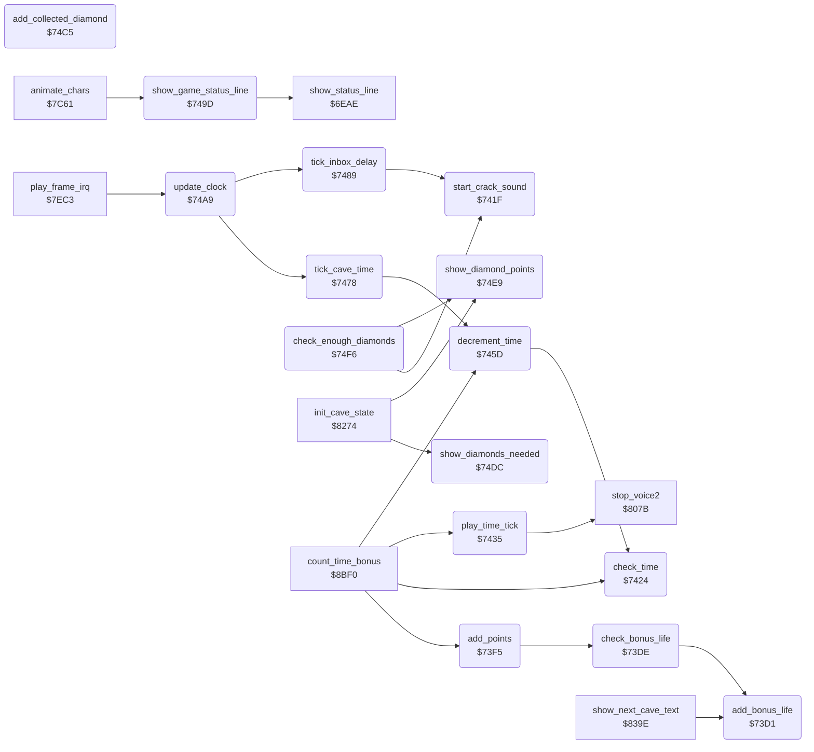

<!-- Generated by c64-docs from knowledge revision 20261025T214622.009-09wod3 and .c64-re-tools/local/generated/src/source-map.json. Do not edit: change the knowledge, generate the source again, then run docs.ts generate. -->
# status/score_time.asm: Score, lives, cave time and diamond counts

Range `$73D1-$7528`. Source: [status/score_time.asm](../../../../src/status/score_time.asm). Index: [the reference](../../index.md).

## Routines

| Routine | Address | Reached from | Summary |
|---|---|---|---|
| [`add_bonus_life`](score_time.md#add_bonus_life) | `$73D1` | [`check_bonus_life`](score_time.md#check_bonus_life), [`show_next_cave_text`](end_of_life.md#show_next_cave_text) | Adds one life up to 9 and starts bonus_life_timer. |
| [`check_bonus_life`](score_time.md#check_bonus_life) | `$73DE` | [`add_points`](score_time.md#add_points) | Gives a bonus life when the thousands digit of the score changed, or when the hundreds digit changed from 4: one life each 500 points. |
| [`add_points`](score_time.md#add_points) | `$73F5` | [`count_time_bonus`](../cave/cave_end.md#count_time_bonus), [`$7537`](../../../../src/rockford/movement.asm#L14) | Adds the 6 digits of points_to_add to the score, shows the score in the status line and checks for a bonus life. |
| [`start_crack_sound`](score_time.md#start_crack_sound) | `$741F` | [`tick_inbox_delay`](score_time.md#tick_inbox_delay), [`check_enough_diamonds`](score_time.md#check_enough_diamonds) | Requests the noise sound crack_sound_regs on SID voice 3. |
| [`check_time`](score_time.md#check_time) | `$7424` | [`decrement_time`](score_time.md#decrement_time), [`count_time_bonus`](../cave/cave_end.md#count_time_bonus) | Sets cave_end_state to 2 when the cave time is 0. |
| [`play_time_tick`](score_time.md#play_time_tick) | `$7435` | [`count_time_bonus`](../cave/cave_end.md#count_time_bonus) | Plays the tick sound of the last seconds on SID voice 2 unless voice2_busy_timer runs. |
| [`decrement_time`](score_time.md#decrement_time) | `$745D` | [`tick_cave_time`](score_time.md#tick_cave_time), [`count_time_bonus`](../cave/cave_end.md#count_time_bonus) | Subtracts 1 from the 3 decimal digits of the cave time, shows them and calls check_time. |
| [`tick_cave_time`](score_time.md#tick_cave_time) | `$7478` | [`update_clock`](score_time.md#update_clock) | Counts one second of the cave: decrements the time and counts seconds_elapsed. |
| [`tick_inbox_delay`](score_time.md#tick_inbox_delay) | `$7489` | [`update_clock`](score_time.md#update_clock) | Counts one second of inbox_delay. |
| [`show_game_status_line`](score_time.md#show_game_status_line) | `$749D` | [`animate_chars`](../screen/animation.md#animate_chars) | Shows status_line ($983a) in screen row 0. |
| [`update_clock`](score_time.md#update_clock) | `$74A9` | [`play_frame_irq`](../irq/play_frame.md#play_frame_irq) | Called once in each frame. |
| [`add_collected_diamond`](score_time.md#add_collected_diamond) | `$74C5` | [`$753A`](../../../../src/rockford/movement.asm#L15) | Adds 1 to the 2 decimal digits of diamonds_collected and shows them in the status line. |
| [`show_diamonds_needed`](score_time.md#show_diamonds_needed) | `$74DC` | [`init_cave_state`](../cave/setup.md#init_cave_state) | Shows the 2 digits of diamonds_needed in the status line. |
| [`show_diamond_points`](score_time.md#show_diamond_points) | `$74E9` | [`check_enough_diamonds`](score_time.md#check_enough_diamonds), [`init_cave_state`](../cave/setup.md#init_cave_state) | Shows the tens and ones of the points of one diamond in the status line. |
| [`check_enough_diamonds`](score_time.md#check_enough_diamonds) | `$74F6` | [`$753D`](../../../../src/rockford/movement.asm#L16) | At the needed diamond count: opens the exit, sets the extra diamond points, shows diamond symbols, plays the crack sound, flashes the screen. |

## Data

| Range | Type | Name | Read by | Written by |
|---|---|---|---|---|
| [`$7418`](../../../../src/status/score_time.asm#L55)-`$741E` | bytes | [`crack_sound_regs`](../../../../src/status/score_time.asm#L54) | [`update_sound`](../sound/effects.md#update_sound) |  |
| [`$7522`](../../../../src/status/score_time.asm#L224)-`$7528` | bytes | [`diamond_collect_sound`](../../../../src/status/score_time.asm#L223) | [`play_diamond_sound`](../sound/element_sounds.md#play_diamond_sound), `$752E` |  |

## Call graph

A solid arrow is a call, a thick arrow a table entry. Rounded nodes are in this file.

## Details

### [`add_bonus_life`](../../../../src/status/score_time.asm#L6) `$73D1`

*routine*

Adds one life up to 9 and starts bonus_life_timer.

- **Called from:** [`check_bonus_life`](score_time.md#check_bonus_life), [`show_next_cave_text`](end_of_life.md#show_next_cave_text)
- **Reads:** [`lives`](../../memory-map.md#lives)
- **Writes:** [`lives`](../../memory-map.md#lives), [`bonus_life_timer`](../../memory-map.md#bonus_life_timer)

| Label | Address | Comment |
|---|---|---|
| [`add_bonus_life_done`](../../../../src/status/score_time.asm#L13) | `$73DD` |  |

### [`check_bonus_life`](../../../../src/status/score_time.asm#L16) `$73DE`

*routine*

Gives a bonus life when the thousands digit of the score changed, or when the hundreds digit changed from 4: one life each 500 points.

- **Called from:** [`add_points`](score_time.md#add_points)
- **Calls:** [`add_bonus_life`](score_time.md#add_bonus_life)
- **Reads:** [`old_score_thousands`](../../memory-map.md#old_score_thousands), [`score_thousands`](../../memory-map.md#score_thousands), [`old_score_hundreds`](../../memory-map.md#old_score_hundreds), [`score_hundreds`](../../memory-map.md#score_hundreds)

| Label | Address | Comment |
|---|---|---|
| [`check_bonus_life_500`](../../../../src/status/score_time.asm#L22) | `$73E7` |  |
| [`check_bonus_life_done`](../../../../src/status/score_time.asm#L29) | `$73F4` |  |

### [`add_points`](../../../../src/status/score_time.asm#L32) `$73F5`

*routine*

Adds the 6 digits of points_to_add to the score, shows the score in the status line and checks for a bonus life.

- **Called from:** [`$7537`](../../../../src/rockford/movement.asm#L14), [`count_time_bonus`](../cave/cave_end.md#count_time_bonus)
- **Calls:** [`check_bonus_life`](score_time.md#check_bonus_life)
- **Reads:** [`score_thousands`](../../memory-map.md#score_thousands), [`score_hundreds`](../../memory-map.md#score_hundreds), [`score_digits`](../../memory-map.md#score_digits), [`points_to_add`](../../memory-map.md#points_to_add)
- **Writes:** [`old_score_thousands`](../../memory-map.md#old_score_thousands), [`old_score_hundreds`](../../memory-map.md#old_score_hundreds), [`score_digits`](../../memory-map.md#score_digits), [`status_score`](../../memory-map.md#status_score)

| Label | Address | Comment |
|---|---|---|
| [`add_points_loop`](../../../../src/status/score_time.asm#L39) | `$7400` |  |
| [`add_points_store`](../../../../src/status/score_time.asm#L45) | `$740A` |  |

### [`crack_sound_regs`](../../../../src/status/score_time.asm#L54) `$7418-$741E`

*data*

SID voice 3 registers $d40e-$d414 of the noise sound that start_crack_sound requests.

- **Read by:** [`update_sound`](../sound/effects.md#update_sound)

### [`start_crack_sound`](../../../../src/status/score_time.asm#L57) `$741F`

*routine*

Requests the noise sound crack_sound_regs on SID voice 3.

- **Called from:** [`tick_inbox_delay`](score_time.md#tick_inbox_delay), [`check_enough_diamonds`](score_time.md#check_enough_diamonds)
- **Writes:** [`noise_request`](../../memory-map.md#noise_request)

### [`check_time`](../../../../src/status/score_time.asm#L62) `$7424`

*routine*

Sets cave_end_state to 2 when the cave time is 0. Plays the tick sound for each of the last 9 seconds.

- **Called from:** [`decrement_time`](score_time.md#decrement_time), [`count_time_bonus`](../cave/cave_end.md#count_time_bonus)
- **Jumps to:** [`check_time_done`](score_time.md#check_time_done), [`play_time_tick`](score_time.md#play_time_tick)
- **Reads:** [`time_digits`](../../memory-map.md#time_digits), [`time_tens`](../../memory-map.md#time_tens), [`time_ones`](../../memory-map.md#time_ones)
- **Writes:** [`cave_end_state`](../../memory-map.md#cave_end_state)

### [`play_time_tick`](../../../../src/status/score_time.asm#L73) `$7435`

*routine*

Plays the tick sound of the last seconds on SID voice 2 unless voice2_busy_timer runs. The pitch rises as the time falls.

- **Called from:** [`count_time_bonus`](../cave/cave_end.md#count_time_bonus)
- **Jumped to from:** [`check_time`](score_time.md#check_time)
- **Calls:** [`stop_voice2`](../sound/voices_off.md#stop_voice2)
- **Reads:** [`sound2_lock`](../../memory-map.md#sound2_lock), [`time_ones`](../../memory-map.md#time_ones), [`sound1_request`](../../memory-map.md#sound1_request)
- **Writes:** [`ATDCY2`](../../memory-map.md#ATDCY2), [`SUREL2`](../../memory-map.md#SUREL2), [`FREHI2`](../../memory-map.md#FREHI2), [`VCREG2`](../../memory-map.md#VCREG2), [`sound1_request`](../../memory-map.md#sound1_request)

| Label | Address | Comment |
|---|---|---|
| [`check_time_done`](../../../../src/status/score_time.asm#L90) | `$745C` |  |

### [`decrement_time`](../../../../src/status/score_time.asm#L93) `$745D`

*routine*

Subtracts 1 from the 3 decimal digits of the cave time, shows them and calls check_time.

- **Called from:** [`tick_cave_time`](score_time.md#tick_cave_time), [`count_time_bonus`](../cave/cave_end.md#count_time_bonus)
- **Calls:** [`check_time`](score_time.md#check_time)
- **Reads:** [`time_digits`](../../memory-map.md#time_digits)
- **Writes:** [`time_digits`](../../memory-map.md#time_digits), [`status_time`](../../memory-map.md#status_time)

| Label | Address | Comment |
|---|---|---|
| [`decrement_time_loop`](../../../../src/status/score_time.asm#L96) | `$7460` |  |
| [`decrement_time_store`](../../../../src/status/score_time.asm#L102) | `$746A` |  |

### [`tick_cave_time`](../../../../src/status/score_time.asm#L111) `$7478`

*routine*

Counts one second of the cave: decrements the time and counts seconds_elapsed. At the amoeba time the amoeba grows fast.

- **Called from:** [`update_clock`](score_time.md#update_clock)
- **Calls:** [`decrement_time`](score_time.md#decrement_time)
- **Reads:** [`seconds_elapsed`](../../memory-map.md#seconds_elapsed), [`cave_magic_time`](../../memory-map.md#cave_magic_time)
- **Writes:** [`seconds_elapsed`](../../memory-map.md#seconds_elapsed), [`amoeba_grow_mask`](../../memory-map.md#amoeba_grow_mask)

| Label | Address | Comment |
|---|---|---|
| [`tick_cave_time_done`](../../../../src/status/score_time.asm#L119) | `$7488` |  |

### [`tick_inbox_delay`](../../../../src/status/score_time.asm#L122) `$7489`

*routine*

Counts one second of inbox_delay. At 0 it plays the crack sound, ends inbox_waiting and sets play_started.

- **Called from:** [`update_clock`](score_time.md#update_clock)
- **Calls:** [`start_crack_sound`](score_time.md#start_crack_sound)
- **Reads:** [`birth_countdown`](../../memory-map.md#birth_countdown)
- **Writes:** [`birth_countdown`](../../memory-map.md#birth_countdown), [`rockford_waiting`](../../memory-map.md#rockford_waiting), [`key_row0`](../../memory-map.md#key_row0), [`key_row7`](../../memory-map.md#key_row7), [`cave_clock_on`](../../memory-map.md#cave_clock_on)

| Label | Address | Comment |
|---|---|---|
| [`tick_inbox_delay_done`](../../../../src/status/score_time.asm#L132) | `$749C` |  |

### [`show_game_status_line`](../../../../src/status/score_time.asm#L135) `$749D`

*routine*

Shows status_line ($983a) in screen row 0.

- **Called from:** [`animate_chars`](../screen/animation.md#animate_chars)
- **Calls:** [`show_status_line`](status_line.md#show_status_line)
- **Writes:** [`text_ptr`](../../memory-map.md#text_ptr), [`text_ptr_hi`](../../memory-map.md#text_ptr_hi)

### [`update_clock`](../../../../src/status/score_time.asm#L143) `$74A9`

*routine*

Called once in each frame. Each 60 frames, when the game does not pause, it counts the inbox delay or the cave time.

- **Called from:** [`play_frame_irq`](../irq/play_frame.md#play_frame_irq)
- **Calls:** [`tick_cave_time`](score_time.md#tick_cave_time), [`tick_inbox_delay`](score_time.md#tick_inbox_delay)
- **Reads:** [`clock_frames`](../../memory-map.md#clock_frames), [`pause_flag`](../../memory-map.md#pause_flag), [`rockford_waiting`](../../memory-map.md#rockford_waiting)
- **Writes:** [`clock_frames`](../../memory-map.md#clock_frames)

| Label | Address | Comment |
|---|---|---|
| [`update_clock_inbox`](../../../../src/status/score_time.asm#L156) | `$74C1` |  |
| [`update_clock_done`](../../../../src/status/score_time.asm#L158) | `$74C4` |  |

### [`add_collected_diamond`](../../../../src/status/score_time.asm#L161) `$74C5`

*routine*

Adds 1 to the 2 decimal digits of diamonds_collected and shows them in the status line.

- **Called from:** [`$753A`](../../../../src/rockford/movement.asm#L15)
- **Reads:** [`diamonds_collected`](../../memory-map.md#diamonds_collected)
- **Writes:** [`diamonds_collected`](../../memory-map.md#diamonds_collected), [`status_collected`](../../memory-map.md#status_collected)

| Label | Address | Comment |
|---|---|---|
| [`add_collected_loop`](../../../../src/status/score_time.asm#L164) | `$74C8` | X is 1 for the ones digit and 0 for the tens: A+carry adds 1 once. |
| [`add_collected_store`](../../../../src/status/score_time.asm#L170) | `$74D1` |  |

### [`show_diamonds_needed`](../../../../src/status/score_time.asm#L178) `$74DC`

*routine*

Shows the 2 digits of diamonds_needed in the status line.

- **Called from:** [`init_cave_state`](../cave/setup.md#init_cave_state)
- **Reads:** [`diamonds_needed`](../../memory-map.md#diamonds_needed)
- **Writes:** [`status_needed`](../../memory-map.md#status_needed)

| Label | Address | Comment |
|---|---|---|
| [`show_diamonds_needed_loop`](../../../../src/status/score_time.asm#L180) | `$74DE` |  |

### [`show_diamond_points`](../../../../src/status/score_time.asm#L188) `$74E9`

*routine*

Shows the tens and ones of the points of one diamond in the status line.

- **Called from:** [`check_enough_diamonds`](score_time.md#check_enough_diamonds), [`init_cave_state`](../cave/setup.md#init_cave_state)
- **Reads:** [`diamond_points_tens`](../../memory-map.md#diamond_points_tens)
- **Writes:** [`status_diamond_points`](../../memory-map.md#status_diamond_points)

| Label | Address | Comment |
|---|---|---|
| [`show_diamond_points_loop`](../../../../src/status/score_time.asm#L190) | `$74EB` |  |

### [`check_enough_diamonds`](../../../../src/status/score_time.asm#L198) `$74F6`

*routine*

At the needed diamond count: opens the exit, sets the extra diamond points, shows diamond symbols, plays the crack sound, flashes the screen.

- **Called from:** [`$753D`](../../../../src/rockford/movement.asm#L16)
- **Calls:** [`show_diamond_points`](score_time.md#show_diamond_points), [`start_crack_sound`](score_time.md#start_crack_sound)
- **Reads:** [`diamonds_collected`](../../memory-map.md#diamonds_collected), [`diamonds_needed`](../../memory-map.md#diamonds_needed), [`diamonds_collected_ones`](../../memory-map.md#diamonds_collected_ones), [`diamonds_needed_ones`](../../memory-map.md#diamonds_needed_ones), [`extra_diamond_points`](../../memory-map.md#extra_diamond_points)
- **Writes:** [`enough_diamonds`](../../memory-map.md#enough_diamonds), [`diamond_points`](../../memory-map.md#diamond_points), [`status_needed`](../../memory-map.md#status_needed), [`flash_frames`](../../memory-map.md#flash_frames)

| Label | Address | Comment |
|---|---|---|
| [`enough_diamonds_copy`](../../../../src/status/score_time.asm#L208) | `$7508` |  |
| [`check_enough_diamonds_done`](../../../../src/status/score_time.asm#L220) | `$7521` |  |

### [`diamond_collect_sound`](../../../../src/status/score_time.asm#L223) `$7522-$7523`

*data*

SID voice 1 registers of the sound of a collected diamond: frequency, pulse width, control, attack/decay, sustain/release.

- **Read by:** [`$752E`](../../../../src/rockford/movement.asm#L10)

### [`diamond_fall_sound_regs`](../../../../src/status/score_time.asm#L225) `$7524-$7528`

*data*

play_diamond_sound copies these 4 bytes (pulse width, control, attack/decay) to voice1_regs+2.

- **Read by:** [`play_diamond_sound`](../sound/element_sounds.md#play_diamond_sound)
