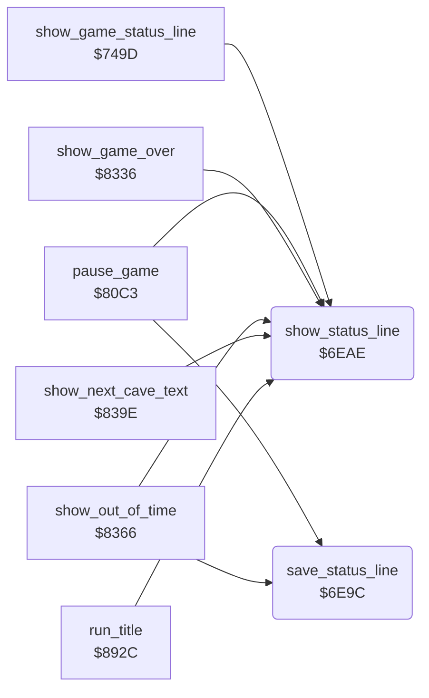

<!-- Generated by c64-docs from knowledge revision 20261024T103116.823-byvbsh and .c64-re-tools/local/generated/src/source-map.json. Do not edit: change the knowledge, generate the source again, then run docs.ts generate. -->
# status/status_line.asm: Status line save and display

Range `$6E9C-$6EF4`. Source: [status/status_line.asm](../../../../src/status/status_line.asm). Index: [the reference](../../index.md).

## Call graph

A solid arrow is a call, a thick arrow a table entry, a dotted arrow a jump. Rounded nodes are in this file.

## Names

### [`save_status_line`](../../../../src/status/status_line.asm#L6) `$6E9C`

*routine*

Copies the left halves of the 20 double-width characters of screen row 0 to saved_status_line.

- **Called from:** [`pause_game`](../input/game_keys.md#pause_game) [`$80C3`](../../../../src/input/game_keys.asm#L39), [`show_out_of_time`](end_of_life.md#show_out_of_time) [`$836B`](../../../../src/status/end_of_life.asm#L44)
- **Reads:** [`screen0`](../../memory-map.md#screen0)
- **Writes:** [`saved_status_line`](../../memory-map.md#saved_status_line)

### [`save_status_line_loop`](../../../../src/status/status_line.asm#L9) `$6EA0`

*label*

- **Jumped to from:** [`save_status_line`](status_line.md#save_status_line) [`$6EAB`](../../../../src/status/status_line.asm#L16)

### [`show_status_line`](../../../../src/status/status_line.asm#L19) `$6EAE`

*routine*

Shows the 20-character line at text_ptr in screen row 0 as double-width characters (c and c+$34). Sets the colours of the two count fields.

- **Called from:** [`show_game_status_line`](score_time.md#show_game_status_line) [`$74A5`](../../../../src/status/score_time.asm#L140), [`pause_game`](../input/game_keys.md#pause_game) [`$80CE`](../../../../src/input/game_keys.asm#L44), [`pause_game`](../input/game_keys.md#pause_game) [`$80E9`](../../../../src/input/game_keys.asm#L57), [`show_game_over`](end_of_life.md#show_game_over) [`$833E`](../../../../src/status/end_of_life.asm#L11), [`show_out_of_time`](end_of_life.md#show_out_of_time) [`$8376`](../../../../src/status/end_of_life.asm#L49), [`show_out_of_time`](end_of_life.md#show_out_of_time) [`$8384`](../../../../src/status/end_of_life.asm#L55), [`show_next_cave_text`](end_of_life.md#show_next_cave_text) [`$83B1`](../../../../src/status/end_of_life.asm#L81), [`show_next_cave_text`](end_of_life.md#show_next_cave_text) [`$83C2`](../../../../src/status/end_of_life.asm#L89), [`run_title`](../title/run_title.md#run_title) [`$898F`](../../../../src/title/run_title.asm#L59)
- **Reads:** [`text_ptr`](../../memory-map.md#text_ptr)
- **Writes:** `$D80E`, `$D802`, [`screen0`](../../memory-map.md#screen0)

### [`show_status_colour_collected`](../../../../src/status/status_line.asm#L26) `$6EBA`

*label*

- **Jumped to from:** [`show_status_line`](status_line.md#show_status_line) [`$6EB6`](../../../../src/status/status_line.asm#L24)

### [`show_status_fill_collected`](../../../../src/status/status_line.asm#L29) `$6EBD`

*label*

Colour of screen columns 14-17 (characters 7-8).

- **Jumped to from:** [`show_status_line`](status_line.md#show_status_line) [`$6EC1`](../../../../src/status/status_line.asm#L32)

### [`show_status_colour_needed`](../../../../src/status/status_line.asm#L39) `$6ECF`

*label*

- **Jumped to from:** [`show_status_line`](status_line.md#show_status_line) [`$6ECB`](../../../../src/status/status_line.asm#L37)

### [`show_status_fill_needed`](../../../../src/status/status_line.asm#L42) `$6ED2`

*label*

Colour of screen columns 2-5 (characters 1-2).

- **Jumped to from:** [`show_status_line`](status_line.md#show_status_line) [`$6ED6`](../../../../src/status/status_line.asm#L45)

### [`show_status_char_loop`](../../../../src/status/status_line.asm#L48) `$6EDC`

*label*

- **Jumped to from:** [`show_status_line`](status_line.md#show_status_line) [`$6EF2`](../../../../src/status/status_line.asm#L63)

### [`show_status_store_char`](../../../../src/status/status_line.asm#L54) `$6EE4`

*label*

- **Jumped to from:** [`show_status_line`](status_line.md#show_status_line) [`$6EE0`](../../../../src/status/status_line.asm#L51)
