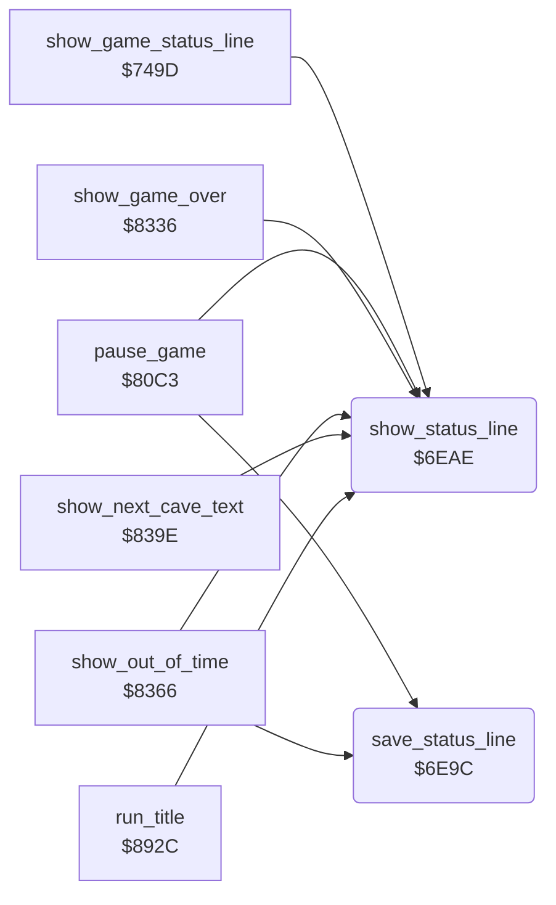

<!-- Generated by c64-docs from knowledge revision 20261025T214622.009-09wod3 and .c64-re-tools/local/generated/src/source-map.json. Do not edit: change the knowledge, generate the source again, then run docs.ts generate. -->
# status/status_line.asm: Status line save and display

Range `$6E9C-$6EF4`. Source: [status/status_line.asm](../../../../src/status/status_line.asm). Index: [the reference](../../index.md).

## Routines

| Routine | Address | Reached from | Summary |
|---|---|---|---|
| [`save_status_line`](status_line.md#save_status_line) | `$6E9C` | [`pause_game`](../input/game_keys.md#pause_game), [`show_out_of_time`](end_of_life.md#show_out_of_time) | Copies the left halves of the 20 double-width characters of screen row 0 to saved_status_line. |
| [`show_status_line`](status_line.md#show_status_line) | `$6EAE` | [`show_game_status_line`](score_time.md#show_game_status_line), [`pause_game`](../input/game_keys.md#pause_game), [`show_game_over`](end_of_life.md#show_game_over), [`show_out_of_time`](end_of_life.md#show_out_of_time), [`show_next_cave_text`](end_of_life.md#show_next_cave_text), [`run_title`](../title/run_title.md#run_title) | Shows the 20-character line at text_ptr in screen row 0 as double-width characters (c and c+$34). |

## Call graph

A solid arrow is a call, a thick arrow a table entry. Rounded nodes are in this file.

## Details

### [`save_status_line`](../../../../src/status/status_line.asm#L6) `$6E9C`

*routine*

Copies the left halves of the 20 double-width characters of screen row 0 to saved_status_line.

- **Called from:** [`pause_game`](../input/game_keys.md#pause_game), [`show_out_of_time`](end_of_life.md#show_out_of_time)
- **Reads:** [`screen0`](../../memory-map.md#screen0)
- **Writes:** [`saved_status_line`](../../memory-map.md#saved_status_line)

| Label | Address | Comment |
|---|---|---|
| [`save_status_line_loop`](../../../../src/status/status_line.asm#L9) | `$6EA0` |  |

### [`show_status_line`](../../../../src/status/status_line.asm#L19) `$6EAE`

*routine*

Shows the 20-character line at text_ptr in screen row 0 as double-width characters (c and c+$34). Sets the colours of the two count fields.

- **Called from:** [`show_game_status_line`](score_time.md#show_game_status_line), [`pause_game`](../input/game_keys.md#pause_game), [`show_game_over`](end_of_life.md#show_game_over), [`show_out_of_time`](end_of_life.md#show_out_of_time), [`show_next_cave_text`](end_of_life.md#show_next_cave_text), [`run_title`](../title/run_title.md#run_title)
- **Reads:** [`text_ptr`](../../memory-map.md#text_ptr)
- **Writes:** `$D80E`, `$D802`, [`screen0`](../../memory-map.md#screen0)

| Label | Address | Comment |
|---|---|---|
| [`show_status_colour_collected`](../../../../src/status/status_line.asm#L26) | `$6EBA` |  |
| [`show_status_fill_collected`](../../../../src/status/status_line.asm#L29) | `$6EBD` | Colour of screen columns 14-17 (characters 7-8). |
| [`show_status_colour_needed`](../../../../src/status/status_line.asm#L39) | `$6ECF` |  |
| [`show_status_fill_needed`](../../../../src/status/status_line.asm#L42) | `$6ED2` | Colour of screen columns 2-5 (characters 1-2). |
| [`show_status_char_loop`](../../../../src/status/status_line.asm#L48) | `$6EDC` |  |
| [`show_status_store_char`](../../../../src/status/status_line.asm#L54) | `$6EE4` |  |
