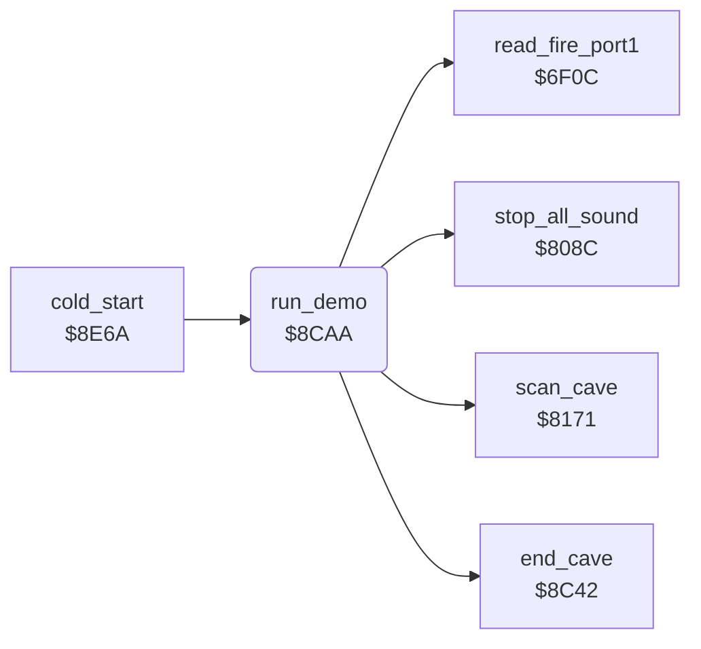

<!-- Generated by c64-docs from knowledge revision 20261025T214622.009-09wod3 and .c64-re-tools/local/generated/src/source-map.json. Do not edit: change the knowledge, generate the source again, then run docs.ts generate. -->
# title/demo.asm: Demo play

Range `$8CAA-$8CF4`. Source: [title/demo.asm](../../../../src/title/demo.asm). Index: [the reference](../../index.md).

## Routines

| Routine | Address | Reached from | Summary |
|---|---|---|---|
| [`run_demo`](demo.md#run_demo) | `$8CAA` | [`cold_start`](../init/cold_start.md#cold_start) | Plays the demo from the table at $5ea8: low nibble = joystick direction, high nibble = tick count. |

## Call graph

A solid arrow is a call, a thick arrow a table entry. Rounded nodes are in this file.

## Details

### [`run_demo`](../../../../src/title/demo.asm#L6) `$8CAA`

*routine*

Plays the demo from the table at $5ea8: low nibble = joystick direction, high nibble = tick count. Fire or a 0 direction ends it.

- **Called from:** [`cold_start`](../init/cold_start.md#cold_start)
- **Calls:** [`read_fire_port1`](../input/joystick.md#read_fire_port1), [`scan_cave`](../engine/cave_scan.md#scan_cave), [`stop_all_sound`](../sound/voices_off.md#stop_all_sound), [`end_cave`](../cave/cave_end.md#end_cave)
- **Reads:** [`demo_step_count`](../../memory-map.md#demo_step_count), [`demo_index`](../../memory-map.md#demo_index), [`demo_moves`](../input/demo_moves.md#demo_moves), [`demo_stop_flag`](../../memory-map.md#demo_stop_flag), [`exit_reached`](../../memory-map.md#exit_reached)
- **Writes:** [`demo_index`](../../memory-map.md#demo_index), [`demo_stop_flag`](../../memory-map.md#demo_stop_flag), [`demo_step_count`](../../memory-map.md#demo_step_count), [`joystick_dir`](../../memory-map.md#joystick_dir), [`cave_number`](../../memory-map.md#cave_number)

| Label | Address | Comment |
|---|---|---|
| [`demo_next_step`](../../../../src/title/demo.asm#L11) | `$8CB2` |  |
| [`demo_set_count`](../../../../src/title/demo.asm#L23) | `$8CC7` |  |
| [`demo_check_fire`](../../../../src/title/demo.asm#L29) | `$8CD1` | Fire ends the demo. |
| [`demo_check_end`](../../../../src/title/demo.asm#L35) | `$8CDA` |  |
| [`demo_end`](../../../../src/title/demo.asm#L41) | `$8CE6` |  |
| [`demo_to_title`](../../../../src/title/demo.asm#L47) | `$8CF0` |  |
