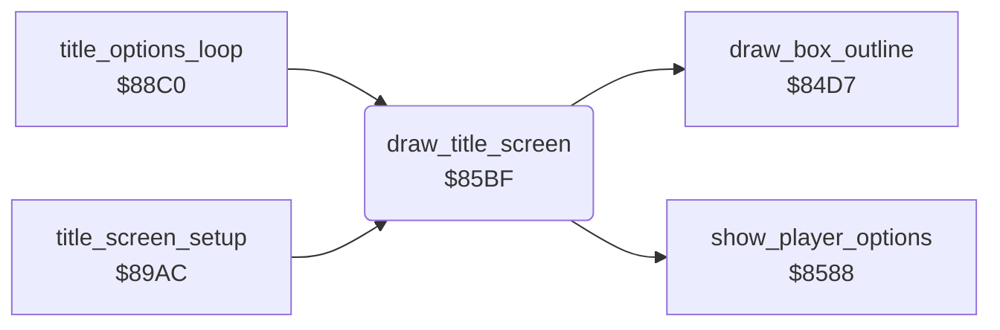

<!-- Generated by c64-docs from knowledge revision 20261025T214622.009-09wod3 and .c64-re-tools/local/generated/src/source-map.json. Do not edit: change the knowledge, generate the source again, then run docs.ts generate. -->
# title/draw_title_screen.asm: Title screen

Range `$85BF-$86DD`. Source: [title/draw_title_screen.asm](../../../../src/title/draw_title_screen.asm). Index: [the reference](../../index.md).

## Routines

| Routine | Address | Reached from | Summary |
|---|---|---|---|
| [`draw_title_screen`](draw_title_screen.md#draw_title_screen) | `$85BF` | [`title_options_loop`](options.md#title_options_loop), [`title_screen_setup`](run_title.md#title_screen_setup) | Draws the title in the map: clears three bands, copies the picture, writes credits or scores, the player and cave lines, then a frame. |

## Call graph

A solid arrow is a call, a thick arrow a table entry. Rounded nodes are in this file.

## Details

### [`draw_title_screen`](../../../../src/title/draw_title_screen.asm#L6) `$85BF`

*routine*

Draws the title in the map: clears three bands, copies the picture, writes credits or scores, the player and cave lines, then a frame.
Clears map rows 1-2, 9-10 and 17-18.

- **Called from:** [`title_options_loop`](options.md#title_options_loop), [`title_screen_setup`](run_title.md#title_screen_setup)
- **Calls:** [`show_player_options`](player_options.md#show_player_options), [`draw_box_outline`](../cave/draw_objects.md#draw_box_outline)
- **Reads:** [`title_logo_boulder`](../data/title_logo.md#title_logo_boulder), [`title_logo_dash`](../data/title_logo.md#title_logo_dash), [`title_logo_boulder_rows`](../data/title_logo.md#title_logo_boulder_rows), [`title_logo_dash_rows`](../data/title_logo.md#title_logo_dash_rows), [`show_credits`](../../memory-map.md#show_credits), [`demo_mode`](../../memory-map.md#demo_mode), [`text_by_peter_liepa`](../text/texts.md#text_by_peter_liepa), [`text_with_chris_grey`](../text/texts.md#text_with_chris_grey), [`text_press_button`](../text/texts.md#text_press_button), [`text_plyr_1_plyr_2`](../text/texts.md#text_plyr_1_plyr_2), [`last_scores_line`](../../memory-map.md#last_scores_line), [`high_scores_line`](../../memory-map.md#high_scores_line) and 2 more
- **Writes:** `$0828`, `$0968`, `$0AA8`, `$0850`, `$0990`, `$0878`, `$09B8`, `$0AF8`, `$0B20`, `$0B48`, [`title_player_digit`](../../memory-map.md#title_player_digit), [`title_level_digit`](../../memory-map.md#title_level_digit) and 6 more

| Label | Address | Comment |
|---|---|---|
| [`title_clear_bands`](../../../../src/title/draw_title_screen.asm#L9) | `$85C2` |  |
| [`title_copy_picture_top`](../../../../src/title/draw_title_screen.asm#L17) | `$85D2` |  |
| [`title_copy_picture_rows`](../../../../src/title/draw_title_screen.asm#L26) | `$85E5` |  |
| [`title_credits_line1`](../../../../src/title/draw_title_screen.asm#L39) | `$8600` |  |
| [`title_credits_line2`](../../../../src/title/draw_title_screen.asm#L52) | `$8617` |  |
| [`title_credits_line3`](../../../../src/title/draw_title_screen.asm#L65) | `$862E` |  |
| [`title_scores`](../../../../src/title/draw_title_screen.asm#L77) | `$8644` |  |
| [`title_scores_line1`](../../../../src/title/draw_title_screen.asm#L80) | `$8648` |  |
| [`title_scores_line2`](../../../../src/title/draw_title_screen.asm#L93) | `$865F` |  |
| [`title_scores_line3`](../../../../src/title/draw_title_screen.asm#L106) | `$8676` |  |
| [`title_cave_line`](../../../../src/title/draw_title_screen.asm#L117) | `$8689` |  |
| [`title_cave_line_loop`](../../../../src/title/draw_title_screen.asm#L120) | `$868D` |  |
| [`title_player_line`](../../../../src/title/draw_title_screen.asm#L133) | `$86A4` |  |
| [`title_clear_last_row`](../../../../src/title/draw_title_screen.asm#L146) | `$86BB` |  |
| [`FREQ`](../../../../src/title/draw_title_screen.asm#L154) | `$86CA` | tune_freq_table minus $14, as FREQ in the symbol table of the Micro Fun build. play_title_tune indexes it with note number times 2. |
| [`FREQ_HI`](../../../../src/title/draw_title_screen.asm#L155) | `$86CB` |  |
