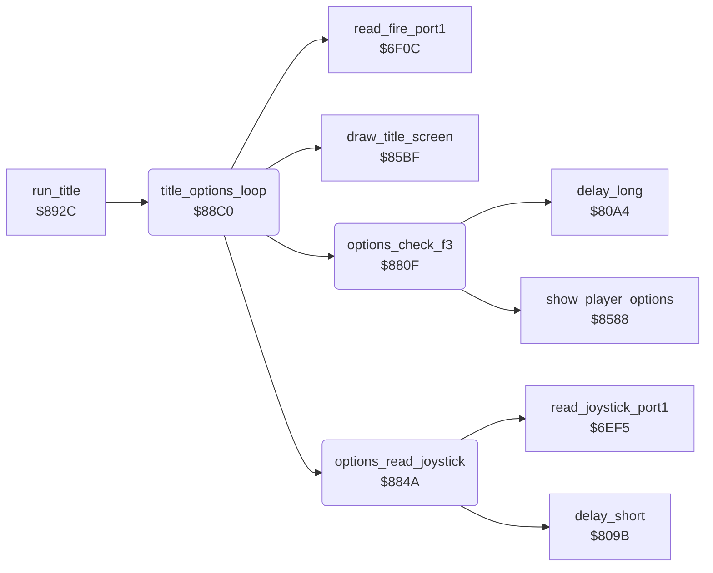

<!-- Generated by c64-docs from knowledge revision 20261025T214622.009-09wod3 and .c64-re-tools/local/generated/src/source-map.json. Do not edit: change the knowledge, generate the source again, then run docs.ts generate. -->
# title/options.asm: Options on the title screen

Range `$880F-$892B`. Source: [title/options.asm](../../../../src/title/options.asm). Index: [the reference](../../index.md).

## Routines

| Routine | Address | Reached from | Summary |
|---|---|---|---|
| [`options_check_f3`](options.md#options_check_f3) | `$880F` | [`title_options_loop`](options.md#title_options_loop) | F3 cycles player_mode 1-3 and sets two_players and two_joysticks from it. |
| [`options_read_joystick`](options.md#options_read_joystick) | `$884A` | [`title_options_loop`](options.md#title_options_loop) | Joystick 1 on the options: down and up change the level, left and right change the start cave by 4. |
| [`title_options_loop`](options.md#title_options_loop) | `$88C0` | [`run_title`](run_title.md#run_title) | Runs the title until title_done. |

## Call graph

A solid arrow is a call, a thick arrow a table entry. Rounded nodes are in this file.

## Details

### [`options_check_f3`](../../../../src/title/options.asm#L6) `$880F`

*routine*

F3 cycles player_mode 1-3 and sets two_players and two_joysticks from it. It shows the new mode, waits, and clears key_row0.

- **Called from:** [`title_options_loop`](options.md#title_options_loop)
- **Calls:** [`show_player_options`](player_options.md#show_player_options), [`delay_long`](../input/game_keys.md#delay_long)
- **Jumps to:** [`show_player_options`](player_options.md#show_player_options)
- **Reads:** [`key_row0`](../../memory-map.md#key_row0), [`player_mode`](../../memory-map.md#player_mode), [`two_players`](../../memory-map.md#two_players), [`two_joysticks`](../../memory-map.md#two_joysticks)
- **Writes:** [`tune_loop_count`](../../memory-map.md#tune_loop_count), [`player_mode`](../../memory-map.md#player_mode), [`two_players`](../../memory-map.md#two_players), [`two_joysticks`](../../memory-map.md#two_joysticks), [`key_row0`](../../memory-map.md#key_row0)

| Label | Address | Comment |
|---|---|---|
| [`options_f3_mode2`](../../../../src/title/options.asm#L22) | `$882D` |  |
| [`options_f3_mode3`](../../../../src/title/options.asm#L27) | `$8835` |  |
| [`options_f3_show`](../../../../src/title/options.asm#L32) | `$883D` |  |
| [`options_f3_done`](../../../../src/title/options.asm#L35) | `$8843` |  |

### [`options_read_joystick`](../../../../src/title/options.asm#L40) `$884A`

*routine*

Joystick 1 on the options: down and up change the level, left and right change the start cave by 4. Shows them, then waits.

- **Called from:** [`title_options_loop`](options.md#title_options_loop)
- **Calls:** [`read_joystick_port1`](../input/joystick.md#read_joystick_port1), [`delay_short`](../input/game_keys.md#delay_short)
- **Reads:** [`level`](../../memory-map.md#level), [`cave_number`](../../memory-map.md#cave_number), [`options_hidden`](../../memory-map.md#options_hidden)
- **Writes:** [`tune_loop_count`](../../memory-map.md#tune_loop_count), [`level`](../../memory-map.md#level), [`cave_number`](../../memory-map.md#cave_number), [`title_level_digit`](../../memory-map.md#title_level_digit), [`title_cave_letter`](../../memory-map.md#title_cave_letter)

| Label | Address | Comment |
|---|---|---|
| [`options_joy_up`](../../../../src/title/options.asm#L52) | `$8860` | Up: level plus 1, at most 4. |
| [`options_joy_level_set`](../../../../src/title/options.asm#L59) | `$886C` |  |
| [`options_joy_left`](../../../../src/title/options.asm#L66) | `$8876` |  |
| [`options_joy_right`](../../../../src/title/options.asm#L76) | `$8887` |  |
| [`options_joy_show`](../../../../src/title/options.asm#L88) | `$889E` |  |
| [`options_joy_delay`](../../../../src/title/options.asm#L103) | `$88BC` |  |

### [`title_options_loop`](../../../../src/title/options.asm#L107) `$88C0`

*routine*

Runs the title until title_done. F1 opens the options. Fire on the options starts a game. The title tune sets title_done for the demo.

- **Called from:** [`run_title`](run_title.md#run_title)
- **Calls:** [`options_check_f3`](options.md#options_check_f3), [`options_read_joystick`](options.md#options_read_joystick), [`draw_title_screen`](draw_title_screen.md#draw_title_screen), [`read_fire_port1`](../input/joystick.md#read_fire_port1)
- **Reads:** [`options_hidden`](../../memory-map.md#options_hidden), [`key_row0`](../../memory-map.md#key_row0), [`level`](../../memory-map.md#level), [`cave_number`](../../memory-map.md#cave_number), [`two_players`](../../memory-map.md#two_players), [`title_done`](../../memory-map.md#title_done)
- **Writes:** [`show_credits`](../../memory-map.md#show_credits), `$DB70`, `$DB84`, `$DBA6`, `$DBBA`, [`title_level_digit`](../../memory-map.md#title_level_digit), [`title_cave_letter`](../../memory-map.md#title_cave_letter), [`two_players`](../../memory-map.md#two_players), [`title_player_digit`](../../memory-map.md#title_player_digit), [`options_hidden`](../../memory-map.md#options_hidden), [`demo_mode`](../../memory-map.md#demo_mode), [`title_done`](../../memory-map.md#title_done)

| Label | Address | Comment |
|---|---|---|
| [`options_show`](../../../../src/title/options.asm#L118) | `$88D7` | Colour 14 for the player, joystick, cave and level digits. |
| [`options_colour_digits`](../../../../src/title/options.asm#L121) | `$88DB` |  |
| [`options_show_players`](../../../../src/title/options.asm#L145) | `$890C` |  |
| [`title_check_fire`](../../../../src/title/options.asm#L152) | `$8918` |  |
| [`title_check_done`](../../../../src/title/options.asm#L160) | `$8927` |  |
