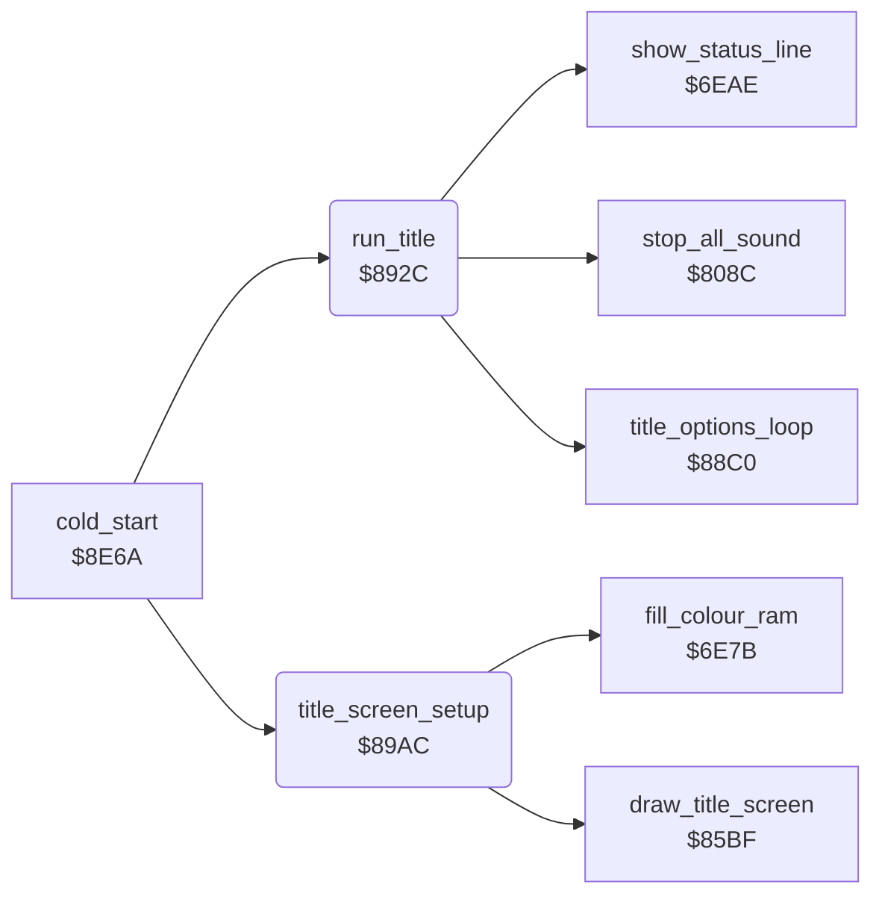

<!-- Generated by c64-docs from knowledge revision 20261025T214622.009-09wod3 and .c64-re-tools/local/generated/src/source-map.json. Do not edit: change the knowledge, generate the source again, then run docs.ts generate. -->
# title/run_title.asm: Title screen and its start

Range `$892C-$8A0B`. Source: [title/run_title.asm](../../../../src/title/run_title.asm). Index: [the reference](../../index.md).

## Routines

| Routine | Address | Reached from | Summary |
|---|---|---|---|
| [`run_title`](run_title.md#run_title) | `$892C` | [`cold_start`](../init/cold_start.md#cold_start) | Runs the title until a game or the demo starts. |
| [`title_screen_setup`](run_title.md#title_screen_setup) | `$89AC` | [`cold_start`](../init/cold_start.md#cold_start) | Draws the title, covers rows 19-24 while the options are hidden, sets title colours and IRQ mode, waits one IRQ and clears the sound state. |

## Data

| Range | Type | Name | Read by | Written by |
|---|---|---|---|---|
| [`$8997`](../../../../src/title/run_title.asm#L65)-`$899B` | bytes | [`title_colours`](../../../../src/title/run_title.asm#L64) | [`title_screen_setup`](run_title.md#title_screen_setup) |  |
| [`$899C`](../../../../src/title/run_title.asm#L68)-`$89A3` | bytes of 2 | [`irq_title_values`](../../../../src/title/run_title.asm#L67) | [`init_irq`](../irq/irq_setup.md#init_irq) |  |
| [`$89A4`](../../../../src/title/run_title.asm#L74)-`$89AB` | bytes of 2 | [`irq_game_values`](../../../../src/title/run_title.asm#L73) | [`run_title`](run_title.md#run_title) |  |

## Call graph

A solid arrow is a call, a thick arrow a table entry. Rounded nodes are in this file.

## Details

### [`run_title`](../../../../src/title/run_title.asm#L6) `$892C`

*routine*

Runs the title until a game or the demo starts. Then sets the game IRQ values and fills the status line.

- **Called from:** [`cold_start`](../init/cold_start.md#cold_start)
- **Calls:** [`title_options_loop`](options.md#title_options_loop), [`stop_all_sound`](../sound/voices_off.md#stop_all_sound), [`show_status_line`](../status/status_line.md#show_status_line)
- **Reads:** [`charset_text`](../../memory-map.md#charset_text), [`demo_mode`](../../memory-map.md#demo_mode), [`cave_number`](../../memory-map.md#cave_number), [`level`](../../memory-map.md#level)
- **Writes:** [`charset_text`](../../memory-map.md#charset_text), [`cave_number`](../../memory-map.md#cave_number), [`demo_mode`](../../memory-map.md#demo_mode), [`cave_covered`](../../memory-map.md#cave_covered), [`frame_counter`](../../memory-map.md#frame_counter), [`irq_d011_values`](../../memory-map.md#irq_d011_values), [`irq_mode`](../../memory-map.md#irq_mode), [`title_frame_count`](../../memory-map.md#title_frame_count), [`key_row0`](../../memory-map.md#key_row0), [`key_row7`](../../memory-map.md#key_row7), [`level`](../../memory-map.md#level), [`status_line_text`](../../memory-map.md#status_line_text) and 5 more
- **Refers to:** [`status_line_text`](../../memory-map.md#status_line_text)

| Label | Address | Comment |
|---|---|---|
| [`run_title_copy_char0`](../../../../src/title/run_title.asm#L8) | `$892E` |  |
| [`run_title_game_irq`](../../../../src/title/run_title.asm#L23) | `$894B` |  |
| [`run_title_status`](../../../../src/title/run_title.asm#L41) | `$896C` | Digit 3: three lives in the status line. |

### [`title_colours`](../../../../src/title/run_title.asm#L64) `$8997-$899B`

*data*

Colours of the border and of the background registers 0-3 on the title, for $d020-$d024.

- **Read by:** [`title_screen_setup`](run_title.md#title_screen_setup)

### [`irq_title_values`](../../../../src/title/run_title.asm#L67) `$899C-$89A3`

*data*

Raster split values of the title: two bytes each for $d011, $d016, $d018 and $d012, copied to $54-$5b.
Index 0 applies from raster line $CA: multicolour bitmap mode for map rows 19-24. Index 1 applies from line $28.

- **Read by:** [`init_irq`](../irq/irq_setup.md#init_irq)

### [`irq_game_values`](../../../../src/title/run_title.asm#L73) `$89A4-$89AB`

*data*

Raster split values of the game: two bytes each for $d011, $d016, $d018 and $d012, copied to $54-$5b.

- **Read by:** [`run_title`](run_title.md#run_title)

### [`title_screen_setup`](../../../../src/title/run_title.asm#L79) `$89AC`

*routine*

Draws the title, covers rows 19-24 while the options are hidden, sets title colours and IRQ mode, waits one IRQ and clears the sound state.

- **Called from:** [`cold_start`](../init/cold_start.md#cold_start)
- **Calls:** [`draw_title_screen`](draw_title_screen.md#draw_title_screen), [`fill_colour_ram`](../screen/colour_ram.md#fill_colour_ram)
- **Reads:** [`options_hidden`](../../memory-map.md#options_hidden), [`title_colours`](run_title.md#title_colours), [`text_ptr`](../../memory-map.md#text_ptr), [`text_ptr_hi`](../../memory-map.md#text_ptr_hi), [`irq_started`](../../memory-map.md#irq_started)
- **Writes:** `$0AF8`, [`title_done`](../../memory-map.md#title_done), [`VMCSB`](../../memory-map.md#VMCSB), [`EXTCOL`](../../memory-map.md#EXTCOL), [`text_ptr`](../../memory-map.md#text_ptr), [`text_ptr_hi`](../../memory-map.md#text_ptr_hi), [`irq_started`](../../memory-map.md#irq_started), [`irq_mode`](../../memory-map.md#irq_mode), [`tune_index`](../../memory-map.md#tune_index), [`tune_loop_count`](../../memory-map.md#tune_loop_count), [`cover_sound_step`](../../memory-map.md#cover_sound_step), [`sound_spare`](../../memory-map.md#sound_spare) and 4 more

| Label | Address | Comment |
|---|---|---|
| [`title_setup_cover_rows`](../../../../src/title/run_title.asm#L85) | `$89B7` |  |
| [`title_setup_vic`](../../../../src/title/run_title.asm#L90) | `$89BF` |  |
| [`title_setup_colours`](../../../../src/title/run_title.asm#L96) | `$89CA` |  |
| [`title_setup_fill_white`](../../../../src/title/run_title.asm#L107) | `$89E0` |  |
| [`title_setup_wait_irq`](../../../../src/title/run_title.asm#L115) | `$89ED` |  |
