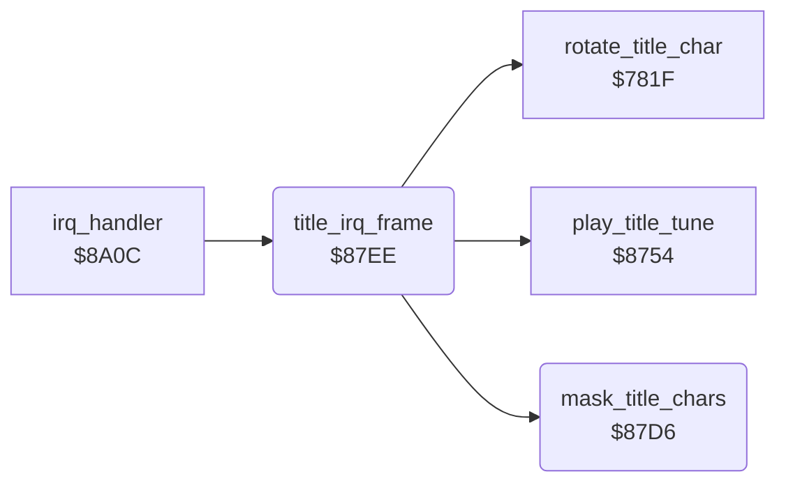

<!-- Generated by c64-docs from knowledge revision 20261025T214622.009-09wod3 and .c64-re-tools/local/generated/src/source-map.json. Do not edit: change the knowledge, generate the source again, then run docs.ts generate. -->
# title/title_animation.asm: Title screen animation

Range `$87D6-$880E`. Source: [title/title_animation.asm](../../../../src/title/title_animation.asm). Index: [the reference](../../index.md).

## Routines

| Routine | Address | Reached from | Summary |
|---|---|---|---|
| [`mask_title_chars`](title_animation.md#mask_title_chars) | `$87D6` | [`title_irq_frame`](title_animation.md#title_irq_frame) | Builds text characters 9 and 10: characters 6 and 7 ORed with the scrolled character 0. |
| [`title_irq_frame`](title_animation.md#title_irq_frame) | `$87EE` | [`irq_handler`](../irq/irq_handler.md#irq_handler) | Title IRQ work. |

## Call graph

A solid arrow is a call, a thick arrow a table entry. Rounded nodes are in this file.

## Details

### [`mask_title_chars`](../../../../src/title/title_animation.asm#L6) `$87D6`

*routine*

Builds text characters 9 and 10: characters 6 and 7 ORed with the scrolled character 0.
MASQUE in the developer symbol table of the Micro Fun build.

- **Called from:** [`title_irq_frame`](title_animation.md#title_irq_frame)
- **Reads:** [`charset_text`](../../memory-map.md#charset_text)
- **Writes:** [`charset_text`](../../memory-map.md#charset_text)

| Label | Address | Comment |
|---|---|---|
| [`mask_title_chars_loop`](../../../../src/title/title_animation.asm#L8) | `$87D8` |  |

### [`title_irq_frame`](../../../../src/title/title_animation.asm#L19) `$87EE`

*routine*

Title IRQ work. The first call sets irq_started. Every fourth call scrolls character 0 and masks the title characters. Each call plays the tune.

- **Called from:** [`irq_handler`](../irq/irq_handler.md#irq_handler)
- **Calls:** [`rotate_title_char`](title_char.md#rotate_title_char), [`mask_title_chars`](title_animation.md#mask_title_chars), [`play_title_tune`](../sound/title_tune.md#play_title_tune)
- **Reads:** [`irq_started`](../../memory-map.md#irq_started), [`title_frame_count`](../../memory-map.md#title_frame_count)
- **Writes:** [`irq_started`](../../memory-map.md#irq_started), [`title_frame_count`](../../memory-map.md#title_frame_count)

| Label | Address | Comment |
|---|---|---|
| [`title_irq_count`](../../../../src/title/title_animation.asm#L25) | `$87F9` |  |
| [`title_irq_tune`](../../../../src/title/title_animation.asm#L34) | `$880B` |  |
| [`title_irq_done`](../../../../src/title/title_animation.asm#L36) | `$880E` |  |
