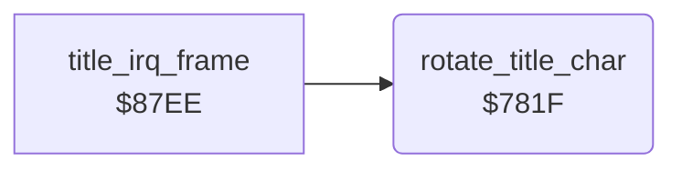

<!-- Generated by c64-docs from knowledge revision 20261025T214622.009-09wod3 and .c64-re-tools/local/generated/src/source-map.json. Do not edit: change the knowledge, generate the source again, then run docs.ts generate. -->
# title/title_char.asm: Title character animation

Range `$781F-$7832`. Source: [title/title_char.asm](../../../../src/title/title_char.asm). Index: [the reference](../../index.md).

## Routines

| Routine | Address | Reached from | Summary |
|---|---|---|---|
| [`rotate_title_char`](title_char.md#rotate_title_char) | `$781F` | [`title_irq_frame`](title_animation.md#title_irq_frame) | Rotates the 8 bytes of character 0 of the charset at $2000 up by one byte. |

## Call graph

A solid arrow is a call, a thick arrow a table entry. Rounded nodes are in this file.

## Details

### [`rotate_title_char`](../../../../src/title/title_char.asm#L6) `$781F`

*routine*

Rotates the 8 bytes of character 0 of the charset at $2000 up by one byte. The title IRQ calls it every fourth time.

- **Called from:** [`title_irq_frame`](title_animation.md#title_irq_frame)
- **Reads:** [`charset_text`](../../memory-map.md#charset_text)
- **Writes:** [`charset_text`](../../memory-map.md#charset_text)

| Label | Address | Comment |
|---|---|---|
| [`rotate_title_char_loop`](../../../../src/title/title_char.asm#L9) | `$7824` |  |
