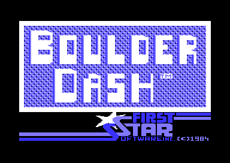
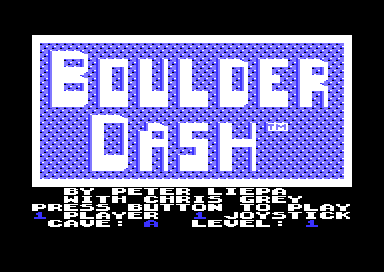

# Boulder Dash v2: the Statesoft title

The Statesoft build shows two title pictures. The tape shows the Statesoft loading picture while the game loads. Then the game shows its own title. The words BOULDER and DASH fill a frame in large text characters, and the logo of First Star Software fills the bottom of the screen. F1 replaces the First Star logo with the credits and the options. This page explains the parts of the title that are different in the Statesoft build (v2). The options, the tune, the demo and the animated background work as in v1. [The title page of v1](../../v1/docs/title.md) explains them.

**Conventions.**
- Addresses are C64 addresses of v2. Names are the names of the v2 knowledge. The v2 code is the v1 code moved by `$398`, and the data `$5000-$66E7` has the same addresses in both builds.
- The *map* is the screen at `$0800`. On the title it is the screen that the VIC-II shows. A *map row* is one row of 40 cells.
- A *title IRQ* is one call of the raster interrupt in title mode. The interrupt makes two raster splits in each frame.
- The *logo words* are BOULDER and DASH in text characters. The *First Star logo* is the multicolour bitmap at the bottom.
- **Observed** marks a fact that a run showed. **Code** marks a fact from the code only. **Conclusion** marks an interpretation.

## How it works

The tape loader shows the Statesoft picture, loads the game and jumps to the cold start. The cold start builds the First Star logo one time. Each start of the title then draws the logo words and the frame, and the interrupt shows the bitmap rows under them.

~~~mermaid
flowchart TB
  A["Tape: Statesoft picture while the game loads"] --> B["Cold start"]
  B --> C["Build bitmap rows 19-24 (init_screens)"]
  C --> D["Title raster values: text mode, bitmap from line $CA (init_irq)"]
  D --> E["Draw the logo words, the lines and the frame (draw_title_screen)"]
  E --> F{"Options hidden?"}
  F -- yes --> G["Fill map rows 19-24 with $6E: the bitmap colours"]
  F -- no --> H["Text lines in rows 19-24"]
  G --> I["Title loop: F1, F3, joystick, fire, tune (title_options_loop)"]
  H --> I
  I --> J["Game or demo"]
~~~

1. **The cold start builds the bitmap.** [`init_screens` `$8D11`](../src/init/init_screens.asm#L21) copies the First Star logo into bitmap rows 19-24 at `$37C0-$3F3F`. It runs at each cold start, but the bitmap stays the same. **Code.**
2. **The title sets the raster values.** [`init_irq` `$8E38`](../src/irq/irq_setup.asm#L6) copies the 8 title values of `irq_title_values` into zero page `$54-$5B`. The values put the VIC-II into bitmap mode from raster line `$CA`. **Code.**
3. **The title draws the map.** [`title_screen_setup` `$89AC`](../src/title/run_title.asm#L79) calls `draw_title_screen`. While the options are hidden, it fills map rows 19-24 with `$6E`. Then it sets the colours and starts the title IRQ. **Code.**
4. **The title loop waits for the player.** `run_title` and `title_options_loop` read F1, F3, the joystick and fire. They are the v1 code at new addresses, without the colour writes of v1. **Code.**

### The start screen of the tape

The image shows the Statesoft loading picture. It is a multicolour bitmap at `$E000` with its screen at `$CC00`, with a purple border and a white background. The original tape has a turbo loader with flashing border stripes. It shows this picture while the game loads, then it jumps to `cold_start` at `$8E6A`. **Observed.** The page [releases.md](../../docs/releases.md#statesoft-the-original-tape) tells more about the tape.

The game itself does not use the picture. A run of the title and of cave A read no byte of `$CC00-$CFE7` or `$E000-$FF3F`. The capture of the game does not include them. **Observed.**

The rebuild shows the picture as its start screen. The loader of the rebuild shows the picture after its copies. Then it waits for a key or a fire button on port 1 or port 2. Then it sets the entry state and starts the game. The switch `START_SCREEN` in `config.asm` selects the start screen: 1 (the default) shows it, and 0 starts the game at once. The builds of the releases have no start screen. The code is in [start_screen.asm](../src/start_screen.asm). **Code.**

The Roan crack has the picture files, but no colour RAM. Its bitmap holds the bytes of the KERNAL vector table (`$FD30-$FD4F`). The crack saved the RAM under the ROM, and the save took the ROM bytes at these addresses. **Observed.**

### The logo words

The image shows the title after the cold start. The logo words BOULDER and DASH fill map rows 2-16 inside a white frame. The First Star logo fills rows 19-24. **Observed.**

The logo words are text characters, not a bitmap. [`draw_title_screen` `$85BF`](../src/title/draw_title_screen.asm#L6) builds them in five steps: **Code.**

1. It writes code 0 into map rows 1-2, 9-10 and 17-18.
2. It copies [`title_logo_boulder` `$66E8`](../src/data/title_logo.asm#L6) (16 bytes) to columns 0-15 of row 2, and `title_logo_boulder_rows` (240 bytes) to rows 3-8.
3. It copies [`title_logo_dash` `$67E8`](../src/data/title_logo.asm#L42) to row 10, and `title_logo_dash_rows` to rows 11-16.
4. It writes the text lines into rows 19-23 and clears row 24.
5. It draws a frame of code `$03` around map rows 0-18, 40 cells wide.

The words use five characters of the text charset. Code `$03` is a full block. Code `$08` is a block with a shaded left edge. Codes `$09` and `$0A` are the upper and the lower diagonal edges. Codes `$1D-$1F` make the TM sign after DASH. Code `$00` is the background. `run_title` copies a pattern from character `$0B` into character 0 before the title loop. **Code.**

The background and the diagonal edges move. Every fourth title IRQ, `rotate_title_char` turns character 0 one row up. Then `mask_title_chars` builds characters 9 and 10 from characters 6 and 7 and the new character 0. Thus the pattern moves behind the words and inside the edges. The v1 title page explains this animation. **Code.**

The frame is not data. `draw_title_screen` calls [`draw_box_outline` `$84D7`](../src/cave/draw_objects.asm#L109), the routine that draws a box in a cave. The cave data uses code `$03` for the magic wall, but on the title the map shows text characters, so `$03` is a block. **Code** for the call, **Conclusion** for the reuse.

### The First Star logo

The bottom six rows of the title are a multicolour bitmap. The title IRQ changes the mode of the VIC-II in the middle of the screen: **Code.**

| Index | From raster line | `$D011` | `$D016` | `$D018` | Screen rows |
|---|---|---|---|---|---|
| 1 | `$28` | `$1B` text | `$18` multicolour | `$28` | 0-18 |
| 0 | `$CA` | `$3B` bitmap | `$18` multicolour | `$28` | 19-24 |

The table gives the values of [`irq_title_values` `$899C`](../src/title/run_title.asm#L67). Map row 19 starts on raster line `$CB`, one line after the split. The value `$28` of `$D018` selects the screen `$0800` and the address `$2000`. In text mode, `$2000` is the text charset. In bitmap mode, `$2000` is the start of an 8000-byte bitmap. **Code.**

The bitmap at `$2000-$3F3F` lies over both charsets, but the VIC-II shows only rows 19-24, the last 1920 bytes at `$37C0-$3F3F`. The charsets at `$2000` and `$3000` lie below these bytes. Thus the program needs no extra 8000 bytes for the logo. **Code** for the addresses, **Conclusion** for the reason.

`init_screens` fills the bitmap rows from the data at [`first_star_logo_r19_right` `$68E8`](../src/data/first_star_logo.asm#L6). **Code.**

- Rows 19-22: columns 0-15 get 0 (empty), and columns 16-39 get the logo.
- Rows 23-24: all 40 columns get the logo. These rows hold the long stripes under SOFTWARE.

In bitmap mode, the map cells give the colours of the cells. `title_screen_setup` writes `$6E` into the 240 cells of map rows 19-24. Thus bit pair 01 shows blue (6) and bit pair 10 shows light blue (14). Bit pair 11 takes its colour from the colour RAM, and the title makes the colour RAM from `$DB01` white (1). Bit pair 00 shows the background colour, black. **Code.**

The title colours set `$D022` to 6 and `$D023` to 14, the colours of the multicolour text above. Thus the words and the logo use the same blue and light blue. **Code** for the values, **Conclusion** for the intent.

### The options and the text lines

The image shows the title after F1. The credits, PRESS BUTTON TO PLAY, the player line and the cave line fill rows 19-23. The First Star logo is not on the screen. **Observed.**

The text lines and the logo share map rows 19-24. [`irq_handler` `$8A0C`](../src/irq/irq_handler.asm#L6) selects one of them in each title IRQ. When the options show, it writes `$1B` into the `$D011` value of index 0. The bottom split then stays in text mode, and rows 19-24 show the text lines. While the options are hidden, the value stays `$3B` from `irq_title_values`, and the rows show the bitmap. **Code.**

The cold start sets `options_hidden` to 1, so the First Star logo shows after each load and each restart. [`title_options_loop` `$88C0`](../src/title/options.asm#L107) clears the flag when the player presses F1. After a game the options stay on the screen, and the lines show the LAST and HIGH scores in place of the credits. **Code.** A screen capture after a game shows these lines. **Observed.**

The options work as in v1. F3 selects the players and the joysticks. Joystick up and down selects the level, and left and right selects the start cave. Fire starts the game. Two loops of the title tune without input start the demo. The v1 title page explains these parts. **Observed** in the recordings.

The title loop writes colour 14 into the colour RAM of the player, joystick, cave and level digits. v1 has the same loop as the routine `color_option_digits` (`BLUE` in the v1 symbol table). v2 has the loop inline in `title_options_loop`. **Code.**

## How v2 differs from v1

Most of the title code is the same in both builds. These parts are different.

| Part | v1 (Micro Fun) | v2 (Statesoft) |
|---|---|---|
| Title data | One 40 x 25 picture of 1000 bytes at `$66E8-$6ACF` | Logo words (512 bytes) at `$66E8-$68E7`, First Star bitmap (1408 bytes) at `$68E8-$6E67` |
| Draw the title | Copies 768 bytes of the picture to the map from `$0800`, and 256 bytes to screen `$0C00` from `$0EE8` | Clears three bands, copies the logo words, draws a frame |
| Bottom rows | Text lines of the picture: LICENSED FROM FIRST STAR SOFTWARE, MICRO FUN | First Star bitmap logo |
| Split of the bottom rows | Line `$C2`: screen `$0C00` while the options are hidden | Line `$CA`: a change of mode, text to bitmap |
| Top rows | MICRO FUN * MICRO FUN and PRESENTS, in yellow | The frame |
| Colour routines | `color_option_digits` (`BLUE`), `color_status_rows` (`YELLOW`) | A colour loop in the title loop, no yellow rows |
| `init_screens` | Fills both screens | Builds the bitmap rows, does not fill the screens |

The table comes from the code. The texts of the bottom and the top rows come from the screen captures of the two titles (**Observed**). The extra 920 bytes (`$398`) of title data move the v2 code after the data by `$398`. Near the end of the file, the move is `$397`. The data before the title data has the same addresses. **Code.**

The forum post states that Micro Fun made its build from the Statesoft build. It also states that Micro Fun removed the First Star logo, changed the layout of the logo words and added the yellow text. The differences in the table agree with these three changes. **Conclusion.**

The page [releases.md](../../docs/releases.md) tells which releases have each build.

## The data

### The logo words

| Address | Bytes | Map cells | Content |
|---|---|---|---|
| `$66E8-$66F7` | 16 | Row 2, columns 0-15 | Top of B |
| `$66F8-$67E7` | 240 | Rows 3-8 | BOULDER |
| `$67E8-$67F7` | 16 | Row 10, columns 0-15 | Top of D |
| `$67F8-$68E7` | 240 | Rows 11-16 | DASH and the TM sign |

Each byte is a screen code of the text charset. The cells of columns 0 and 39 and of row 0 get the frame after the copy. **Code.**

### The First Star logo

| Address | Bytes | Bitmap address | Cells |
|---|---|---|---|
| `$68E8` | 192 | `$3840` | Row 19, columns 16-39 |
| `$69A8` | 192 | `$3980` | Row 20, columns 16-39 |
| `$6A68` | 192 | `$3AC0` | Row 21, columns 16-39 |
| `$6B28` | 192 | `$3C00` | Row 22, columns 16-39 |
| `$6BE8` | 128 | `$3CC0` | Row 23, columns 0-15 |
| `$6C68` | 192 | `$3D40` | Row 23, columns 16-39 |
| `$6D28` | 128 | `$3E00` | Row 24, columns 0-15 |
| `$6DA8` | 192 | `$3E80` | Row 24, columns 16-39 |

Each cell has 8 bytes, one byte for each pixel row, as the VIC-II reads a bitmap. `init_screens` copies each block with one loop of 192 bytes. A copy of a 128-byte block therefore also copies the first 64 bytes of the next block to their correct place. **Code.**

## The state machine of the title

~~~mermaid
stateDiagram-v2
  state "Logo: First Star bitmap in rows 19-24" as Logo
  state "Options: text lines in rows 19-24" as Options
  state "Game" as Game
  state "Demo" as Demo
  [*] --> Logo: cold start
  Logo --> Options: F1
  Logo --> Demo: two tune loops
  Options --> Game: fire
  Options --> Demo: two tune loops
  Game --> Options: game over
  Demo --> Options: fire or end of the moves
  Demo --> Logo: F1 (cold start)
~~~

| State | Condition | Next state | Code |
|---|---|---|---|
| Logo | F1 | Options | `title_options_loop` |
| Logo | two tune loops | Demo | `play_title_tune` |
| Options | fire on port 1 | Game | `title_options_loop` |
| Options | two tune loops | Demo | `play_title_tune` |
| Game | no lives | Options | `lose_life`, `top_loop` |
| Demo | fire or the end of the moves | Options | `run_demo`, `top_loop` |
| Demo | F1 | Logo | `check_game_keys`, `cold_start` |

After the demo, `top_loop` clears `options_hidden`, so the title shows the options and not the First Star logo. No run reached the end of the demo. In the recordings, F1 in the demo restarted the program first. **Code.**

## Worked example

### The top of the B

`title_logo_boulder` holds `$00 $00 $08 $03 $03 $03 $09 $00`, then 8 bytes of `$00`. `draw_title_screen` copies them to map row 2 at `$0850`. **Code.**

| Column | Code | Character |
|---|---|---|
| 0-1 | `$00` | Background |
| 2 | `$08` | Block with a shaded left edge |
| 3-5 | `$03` | Block |
| 6 | `$09` | Upper diagonal edge over the background |
| 7-15 | `$00` | Background |

The image shows the top of the B from column 2 to column 6, with a diagonal corner at the right. **Observed.**

### One cell of the bitmap

The first cell of row 19 at `$3840` holds `$00 $00 $00 $00 $00 $00 $FF $3F`. Pixel rows 0-5 are empty, so they show black. Pixel row 6 is `$FF`, four bit pairs 11: four wide pixels in the colour of the colour RAM, white. Pixel row 7 is `$3F`, the bit pairs 00 11 11 11: one black pixel, then three white pixels. **Code.**

## Still open

- The end of the demo never ran. A run that lets the demo play to the end of its moves can show that the options follow the demo.
- The First Star release has the original logo layout, by the forum post. The project has no copy of it. A dump of that release can show whether its title is the same as the v2 title.
