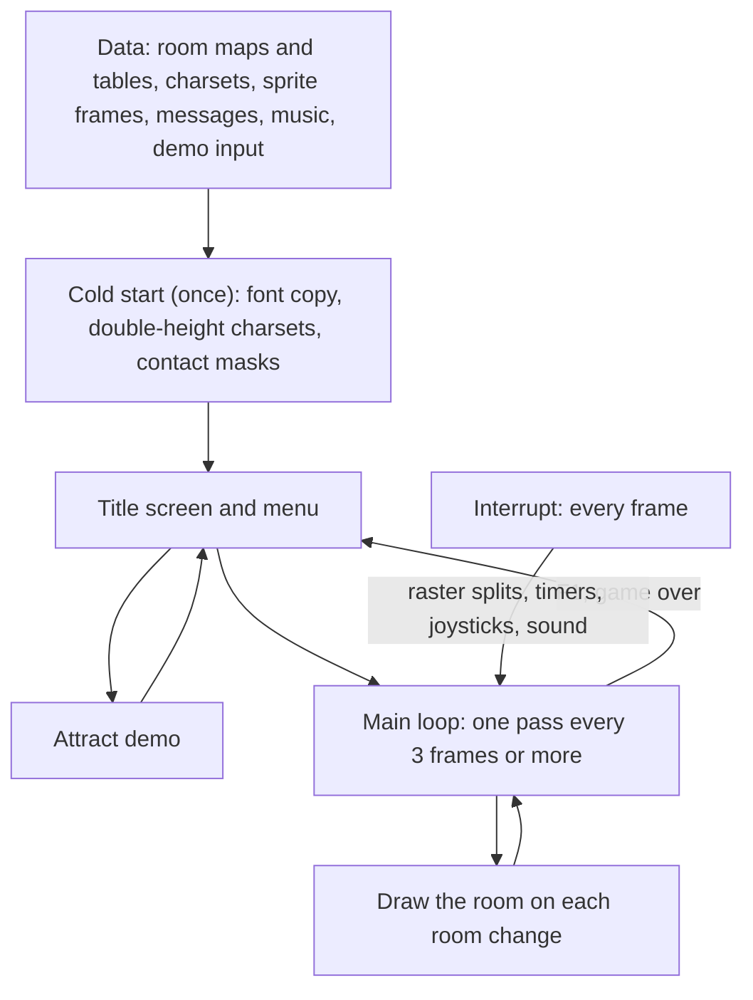
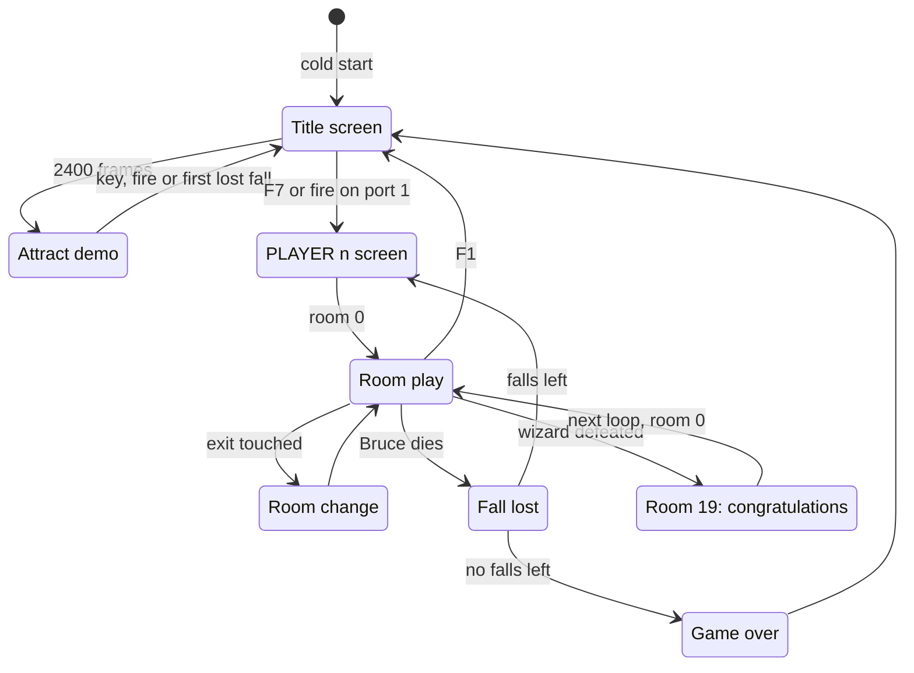

# Bruce Lee

*Bruce Lee* is a single-load C64 action game by Ron J. Fortier. Datasoft published it in 1984, and the title reads "REV.2 BY RJF". Bruce goes through 20 rooms, collects lanterns and fights the Yamo (a green sumo) and the Ninja. A second player can control the Yamo. The way leads to the wizard in room 18 and the "CONGRATULATIONS" room 19. Then the game starts a new, faster loop. This documentation is for the game file of `original/saeger.d64`, a crack of October 1984, and compares it with two other cracks of the same image. The source in [src/](src/) assembles byte for byte to the game without the crack, and the rebuild shows the Datasoft title picture at the start.

**Evidence.** **Observed** marks a fact that an emulator run or the coverage of the runs showed. **Code** marks a fact from the code or the image only. **Conclusion** marks an interpretation. A scenario is named by its file in [tests/](tests/).

## The development

The release image is a memory dump of the development machine, not a clean assembly. About 6 KB of it is bytes that no code of the game reads. The final source only reserved some areas, for example the actor workspace, the sprite buffers, the screen and the gaps in the music code. The assembler did not write these areas, so the older memory content stayed in them. These bytes include copies of older builds and a part of the assembler source text. They also include a part of the symbol table and the data file of a music editor. The rebuild keeps them out of the game, and the knowledge keeps them in the spaces `bank1` to `bank7`. `tests/leftovers_unused.json` fills each leftover with `$A5` at the entry, and the game runs the same (**Observed**).

**A port from the Atari.** Bruce Lee was first an Atari 8-bit game. `atari_digit_key_codes` in bank1 at `$4CBA` holds the Atari keyboard codes of the keys 0-9. The next table holds the same codes plus the Atari SHIFT bit `$40`. No code reads them, and the C64 game has no digit keys (**Code**). So the authors made the C64 version from the Atari source, and a table of the Atari version stayed in it (**Conclusion**).

**Source text with Apple II conventions.** `$5900-$59A4` holds 165 bytes of assembler source text: the end of the source file of a room charset, with `* CHAR 97` comment lines and `DFB` lines. The characters have bit 7 set, and the lines end in `$8D`. These are the conventions of Apple II assemblers. The 31 bytes in the text are equal to tiles 96-99 of `room_charset_d` (**Observed**). So the authors typed even the graphics as assembler source, one tile at a time (**Conclusion**).

**The original names.** `$8B00-$8E7F` in bank2 holds 896 bytes of the symbol table of an older build: 88 entries of a length byte, the name and the value. Two offsets give the final address of each value. The names are short codes, for example PLOFS for the frame offset of an actor and IMGL/IMGH for the image address of a frame. The 46 frame labels have the form action, side, phase and sprite layer, for example ADOWNL11. One entry is the typo ADWONL22. The build never referenced it, and a copy of the frame with the right name is in the final build (**Observed**: byte decode). The frame labels show that the Yamo frames first came after the frames of Bruce, and later moved in front of them (**Conclusion**).

**Older builds.** Pages `$EF-$F1` hold code of an older build, `$C600` higher than where it ran. Its addresses show how the program grew: zero page moved up by 3 bytes, and code moved by `$7D` to `$12E` bytes. The old `check_fight_pair` does not have the test for a fall attack that hit the attacker (**Code**). Older copies of two room charsets, two sprite mask tables, four sound effects and the attract demo recording are also in the image. Each differs a little from the final version, so the authors changed these parts late in the work (**Observed**: byte compares).

**The title tune came from a music editor.** `$E800-$EC8F` was the data file of the MicroPearl music editor by John A. Fitzpatrick, loaded `$A800` higher than the editor made it. In the file, voice 0 of the title tune has a first part of 102 bytes. The game does not use it: the song table points voice 0 102 bytes later. So the authors made the tune shorter with a pointer, not with a new file (**Conclusion**).

**Older screens.** The image holds plain-text versions of "BRUCE LEE", "BY", "RON J FORTIER", "GAME OVER" and "PLAYER" in the message format. No pointer goes to them. The final title and game over screens use logo characters and big letters (**Code**).

**The graphic artist.** The game names only Ron J. Fortier ("REV.2 BY RJF"). The Datasoft title picture also names the graphic artist: "GRAPHIC ART BY KELLY DAY" (**Observed**: the picture of the TBC intro). Only the TBC release holds the picture. The rebuild shows it at the start, without the changes of TBC (see Releases and cracks).

The details and their evidence are on [docs/development.md](docs/development.md).

## The copy protection

The original disk had a protected loader. It left three marks in memory: `$EF` in the data direction register `$00` of the CPU port, `$32` in `$02`, and an RTS at `$0080`. The image also holds a key page at `$CF00-$CFFF`. Its two halves of 32 bytes form key pairs: a byte and the byte `$20` higher. A reset machine has `$2F` in `$00`, and nothing in the program writes `$02` (**Code**). So the game cannot run from a plain load of its file (**Conclusion**).

The game checks these marks and keys in eleven places, in all its parts. Two checks run at the cold start, and one runs on each title screen. Two run in every frame, and three are in the room code of rooms 2, 5 and 10. One runs on each pass of a game. The last two checks compute a value in one place and use it in another place (**Code**). Thus a cracker who removes one check still meets the next one (**Conclusion**).

A check that fails does one of three things (**Code**. **Observed** for checks 4, 5, 9, 10 and 11 in the protection runs):

- **It hangs.** The code branches to itself, or loops inside the interrupt.
- **It destroys.** Two checks wipe memory, and one jumps through the empty I/O area at `$DE00`. The room 10 check cuts the maps of rooms 0, 1 and 5. The game then draws these rooms empty in each later game.
- **It waits.** The two delayed checks move their own operands one key pair further on each footstep of any actor. After 32 footsteps they write a TXS into the code, and the game crashes. The crash comes many seconds after the cause, and this hides the source of the crash (**Conclusion**).

All three releases keep every check. Their relocator sets the loader marks again, and the key page comes with the image. Thus their game passes every check (**Observed**: title, demo and game runs). In the rebuild, the switch `PROTECTION` gives each of the 13 patched places its passing path, with the same registers and flags. The patches of the checks that run often also take the same cycles as the original. The default build has it off, and each release build has it on. The details are on [docs/protection.md](docs/protection.md).

## Findings

The facts that a reader does not expect. Each page has more.

- **The copy protection is still in the game, and it is delayed.** Several checks compare marks of the original loader in zero page and pairs of bytes on the key page `$CF00`. A failed check does not stop the game at once. It changes code step by step. Then [`random_byte` `$1159`](src/irq/interrupt_entry_1131.asm#L45) breaks, the game jumps through `$DE00`, or the game wipes memory or damages the maps of rooms 0, 1 and 5. **Code**. **Observed**: junk on the `$CF00` page breaks the game. See [protection.md](docs/protection.md).
- **A room change can stop the game.** [`draw_room` `$09BC`](src/room/draw_room.asm#L28) switches the screen off and on with a read and a write of `SCROLY`. Each write puts bit 8 of the current raster line into the raster compare line. When both writes come on lines 256-311, the compare line stays above the last line of the frame. Then no raster interrupt comes again, and the game waits for ever. **Observed**: the exit from room 15 to room 13 in `runs/room_change_freeze`. See [interrupts.md](docs/interrupts.md).
- **A knock-out by a fall attack repeats.** After the knock-out, [`apply_fight_ko` `$2C24`](src/actor/fight_hits.asm#L384) jumps back to `apply_fight_hits_fall`. So the damage and the points repeat until the energy wraps to a positive value. **Observed**: in one run the score went from 2000 to 15050, and the Yamo survived with 124 energy. See [combat.md](docs/combat.md).
- **Six rooms write 2 bytes into a contact mask.** The maps of rooms 4, 7, 10, 13, 17 and 18 decode to 442 cells instead of 440. The two extra cells write `$80` to `$9010-$9011`, a mask of Bruce's frames. **Observed** in the room runs. See [rooms.md](docs/rooms.md).
- **A new top score moves the next extra fall to 171072 points.** [`update_high_score` `$3184`](src/game/score.asm#L65) copies 4 bytes to `top_score`, and the 4th byte, the raster split index in `$44`, lands in `bonus_fall_first_score`. **Observed** in 7 of 7 stores. See [main_loop.md](docs/main_loop.md).
- **Extra falls come late.** The extra-fall test compares the score with the limit byte by byte, not as one 24-bit number. **Code**. See [main_loop.md](docs/main_loop.md).
- **The random table is filled and never read.** The game fills `random_table` at `$0200`. But `init_game_variables` clears its pointer, so `random_byte` reads zero page and the stack page instead. In the demo it returns 1. **Observed**. See [startup_title.md](docs/startup_title.md).
- **The right-handed key is R.** The title keys L/R and shift-L/shift-R set the joystick handedness of port 1 and port 2. **Code**: key code `$11` is matrix column 2, row 1. **Observed**: the R key of the recording `title_options` runs `title_set_joy1_right_handed`. See [startup_title.md](docs/startup_title.md).
- **The S key only switches the title tune.** The sound effects of the game always play. **Code**. See [sound_music.md](docs/sound_music.md).
- **The music has NTSC tuning.** On PAL every note is about 2/3 of a semitone flat. **Code**. See [sound_music.md](docs/sound_music.md).
- **The attract demo ends at its first lost fall.** It reads 569 bytes of [`demo_input_stream` `$F300`](src/input/demo_input.asm#L12). **Observed**. See [startup_title.md](docs/startup_title.md).
- **Unused exits and a closing exit.** Six entries of the exit tables have no marker in any room. After Bruce defeats the wizard, a tile overwrites the marker of the way back to room 17. **Code**. **Observed** for room 6. See [game_flow.md](docs/game_flow.md).
- **The fourth charset is the wizard flash.** [`room_charset_d` `$9C00`](src/graphics/room_charset_d.asm#L8) becomes `charset_wizard_flash` at `$B800`. Only the defeat of the wizard selects it. **Code**. See [graphics.md](docs/graphics.md).
- **A cracker changed message `$62`.** [`msg_presents` `$4770`](src/text/messages_rooms.asm#L322) reads "DIABOLO  PRESENTS" in the SAEGER release and "DATASOFT PRESENTS" in the TBC and DC releases. No code prints the message. **Observed**: byte compare of the releases. See [releases.md](docs/releases.md).
- **Someone saved the SAEGER image from a game that ran.** The image holds the music state of a tune. It also holds a `$55` of the KERNAL RAM test at `$9B00`, in the source of a room charset. TBC and DC have the bytes from before any run. **Observed**: byte compare and a watchpoint on `$9B00`. **Conclusion**: a dump after a reset. See [releases.md](docs/releases.md).
- **The DC release has no demo input.** Its packed file ends at `$F200`, so the attract demo gives Bruce no input and ends at his first lost fall. **Observed**. See [releases.md](docs/releases.md).
- **Only one crack kept the title picture.** The Datasoft title picture is only in the TBC release, with a crack text in it and simplified colours. The game itself never shows it. **Observed**. A preservation project needs the TBC file for the picture. See [releases.md](docs/releases.md).
- **No cheat or trainer.** `falls_left` decreases only when Bruce loses a fall. It also decreases by 5 when a player-controlled Yamo stays idle too long. The room 16 bonus adds falls. No release adds a trainer. **Code**. **Observed**: byte compare of the releases. See [protection.md](docs/protection.md).

## How the program works

The game is one block of code and data that fills almost all of the 64 KB. The cold start builds the data that the image does not hold. It makes double-height charsets from the ROM font and from the four room charsets. It also makes a contact mask for each pose of the actors. These buffers overwrite their own sources, so the cold start can run only once. Then the title screen runs as a loop of its own. It shows a menu, and after a pause it plays an attract demo from a recorded input stream.

A game is a series of rooms. The game draws each room once from a packed map. Then the code of the room changes it: lanterns disappear, passages open and traps move. The main loop sets the pace of the play. One pass reads the keys, spawns the enemies, runs the room and tests the contacts. It then moves Bruce, the Yamo and the Ninja through their action states and builds their sprites. A pass waits for 3 frames of the interrupt. So the game logic runs at most 50 / 3, about 17, times a second on PAL. The interrupts do the work of each frame. They make the raster splits for the status line, the room charset and the colour bands. They also run the timers, the joysticks and the sound effects.

1. **The cold start runs once.** [`cold_start` `$0400`](src/game/cold_start.asm#L22) copies the ROM font to `$8800` and expands the four room charset sources at `$9000-$9FFF` into double-height charsets. `build_contact_masks` then builds the contact masks over the charset sources, so the cold start cannot run a second time. (**Code**. [startup_title.md](docs/startup_title.md))
2. **The title is a loop of its own.** [`title_menu_loop` `$08B1`](src/game/title_menu.asm#L14) reads the option keys and the fire button of port 1. After 2400 frames it starts the attract demo. F7 or fire starts a game. (**Observed** in the recordings `title_options` and `demo`)
3. **A room is drawn once and then changed by code.** [`draw_room` `$09BC`](src/room/draw_room.asm#L28) decodes the room map and runs the init handler of the room. Everything that moves or opens later is done by the frame handler of the room, once in each pass. ([rooms.md](docs/rooms.md))
4. **The main loop sets the pace of the game.** One pass of [`main_loop` `$1BC2`](src/game/game_main_loop.asm#L23) runs the keys, the enemy spawns, the room handler and the contact tests. Then it runs the input and the action of each actor, and the sprite builder. It then waits for `frame_countdown`. The interrupt counts this variable down from 3, once in each frame. (**Observed**. [main_loop.md](docs/main_loop.md))
5. **The interrupts set the picture in every frame.** [`irq_entry` `$1103`](src/irq/interrupt_entry.asm#L10) jumps through `irq_vector` to the next raster handler of a chain. In a game, the chain sets the status line, the room charset and the colour bands. `frame_update` runs the timers, the joysticks and the sound effects. ([interrupts.md](docs/interrupts.md))
6. **The actors go through a state machine.** The input of an actor picks an action. The input is a joystick, the computer AI or the demo stream. [`actor_action_step` `$1C5B`](src/actor/actor_step.asm#L21) moves the actor through its states. `select_actor_pose` picks the pose, and `build_actor_sprites` draws the pose into the sprite buffers. ([actors.md](docs/actors.md), [graphics.md](docs/graphics.md))

The flow of a player through the game:

The order of the rooms and the conditions that open each way are on [game_flow.md](docs/game_flow.md). Each room is described on [rooms_catalogue.md](docs/rooms_catalogue.md).

## The pages

| Page | Content |
|---|---|
| [docs/startup_title.md](docs/startup_title.md) | **Start-up and title.** The start screen with the title picture, and the cold start. The title screen and its menu, the attract demo, the start of a game and the PLAYER n screen. |
| [docs/main_loop.md](docs/main_loop.md) | **The main loop.** One pass of the game and the game keys. Pause and idle, the status line, the score and extra falls. The loss of a fall, the player switch and game over. |
| [docs/interrupts.md](docs/interrupts.md) | **The interrupt chain.** The IRQ entry and its vector, the raster handlers of the title, PLAYER and game screens, and the work of each frame. |
| [docs/game_flow.md](docs/game_flow.md) | **The game state machine.** The whole program as one state machine, two-player turns, the next game loop, and the map of the 20 rooms from the exit tables. |
| [docs/rooms.md](docs/rooms.md) | **Rooms: data and code.** The room tables, the packed map format, how a room is drawn, the room handlers, lanterns, passages, hazards and the map overflow bug. |
| [docs/rooms_catalogue.md](docs/rooms_catalogue.md) | **The 20 rooms, one by one.** The picture, the data, the setup, the behaviour and the exits of each room. |
| [docs/actors.md](docs/actors.md) | **The actors.** Bruce, the Yamo and the Ninja: their data, spawning, input, the computer AI, the action state machine, movement and poses. |
| [docs/combat.md](docs/combat.md) | **Combat and collision.** Sprite collisions, the background contact test, hits, damage, energy, knock-outs and points. |
| [docs/graphics.md](docs/graphics.md) | **Graphics.** The VIC bank, the double-height tiles, the charsets, the colours and raster splits, the sprite frame format and the double-buffered software sprites. |
| [docs/text_messages.md](docs/text_messages.md) | **Text and messages.** The message format and its printer, the status line, the big banners and all 101 messages. |
| [docs/sound_music.md](docs/sound_music.md) | **Sound and music.** The music player and its stream format, the title tune, the three sound-effect players, the request priorities and the 15 effects. |
| [docs/dispatch_tables.md](docs/dispatch_tables.md) | **Dispatch.** How the program chooses code at run time: vectors, RTS tables, compare chains and computed jumps. |
| [docs/protection.md](docs/protection.md) | **Copy protection.** The delayed protection checks that are still in the game, and the switch that turns them off. |
| [docs/development.md](docs/development.md) | **The development.** What the leftovers in the image tell about how the game was made. |
| [docs/releases.md](docs/releases.md) | **Releases and cracks.** The three cracks compared byte by byte, what each crack changed, and the switches that give each release. |

## Releases and cracks

Three cracks of the game are in the project. All three come from one cracked image. Their game bytes are the same, except for the traces below.

| Label | File | SHA-256 of the file |
|---|---|---|
| SAEGER (base) | `original/saeger.d64`, file `BRUCE LEE` (`original/bruce_lee.prg`) | `032fb72523f73a0c9e755809c71bd6072709e42b119deb443b119ca392fb7590` |
| TBC | `original/bruce_lee_tbc.prg` | `0ed44d52101414928872eddbe1220427f90cbaf129aa41b3d81ba18909b1d597` |
| DC | `original/danish.d64`, file `BRUCE LEE   (DC)` (`original/bruce_lee_dc.prg`) | `331fe97e73f8c77624242b4da3029efcb9199ffa184d6cd95220a60311efdaf4` |

- **SAEGER.** Saeger Soft Group, October 1984. It adds an intro that waits for SPACE, a mover and a relocator. The file is not packed. Its game bytes are different from TBC in 76 bytes: message `$62`, the byte at `$9B00` and the music state.
- **TBC.** It adds an intro with the Datasoft title picture, a mover and the same relocator. The file is not packed. It changed no byte of the game.
- **DC.** Danish Crackers, "DC-011/P". It adds an intro and the same relocator, and TCS-CRUNCH packs the file. It changed no byte of the game, but the file does not hold the demo input.

No crack removed a copy protection check. The common relocator writes again the marks of the original loader (**Observed**: the byte compare, and runs of the title, the demo and the game).

**SAEGER: the edit of another cracker.** [`msg_presents` `$4770`](src/text/messages_rooms.asm#L322) reads "DIABOLO  PRESENTS" in SAEGER and "DATASOFT PRESENTS" in TBC and DC (**Observed**: a byte compare of the releases). No code prints this message (**Code**). Thus a cracker who signed as Diabolo edited the image first, and SSG released that copy later (**Conclusion**). The text identifies a copy of the SAEGER line. The switch `CRACK_DIABOLO` gives the text in the rebuild.

**SAEGER: a dump of a game that ran.** The music variables of SAEGER hold the state after a tune. TBC and DC hold the values from before a run (**Observed**: a byte compare). `$9B00` holds the `$55` of the KERNAL RAM test. Thus somebody reset a running game and saved its memory (**Conclusion**). The game writes each music byte before it reads it, so the music state changes nothing (**Code**. **Observed**: a compare of 900 frames). But [`build_double_height_font` `$4892`](src/room/draw_helpers.asm#L51) reads `$9B00` at the cold start (**Observed**: a watchpoint). Thus SAEGER builds character `$60` of the wizard charset with a different top row. The switch `FIX_RAM_TEST_BYTE` gives the clean byte.

**SAEGER and TBC: tape tools in memory.** The two captures hold the same tape turbo tools at `$FE00-$FFF9`, and DC does not hold them (**Observed**: a byte compare). The game does not use them (**Observed**: `tests/leftovers_unused.json`). Thus the image of SAEGER and TBC went through a machine with a tape turbo (**Conclusion**).

**DC: the demo input is lost.** The packed DC file holds the game only up to `$F200`. Thus [`demo_input_stream` `$F300`](src/input/demo_input.asm#L12) holds the RAM content of the machine: zeros and `$FF` (**Observed**: a byte compare). In the DC release, the attract demo gives Bruce no input. The demo stops at his first lost fall (**Observed**: a run of the DC release). Do not use the DC file as the source of the demo input.

**TBC: the title picture.** Only the TBC intro holds the Datasoft title picture. TBC wrote "CRACKED BY TBC" into the bitmap and gave each cell the same screen colours (**Observed**: a run of the TBC intro). The game itself never shows the picture. A preservation project needs the TBC file for the picture. The rebuild shows the picture as its start screen, without the changes of TBC (see "The start screen" below).

The details, the hashes of the disk images and each different byte are on [releases.md](docs/releases.md).

## The rebuild

**The base release.** The knowledge holds the memory of the SAEGER release when it gets to [`cold_start` `$0400`](src/game/cold_start.asm#L22). It holds only the game: 24 segments from `$03FF` to `$FFFF` (40,075 bytes). The capture leaves out these parts:

- the crack at `$A000-$A9FF`: a copy of the relocator and duplicated pages
- the original loader stage at `$033C-$03FE`
- 28 leftover blocks of the development and the release, and the 10 leftover ranges of the source

The scenarios `tests/crack_leftover_a000.json`, `tests/original_loader_stage_033c.json` and `tests/leftovers_unused.json` show that the game uses none of them (**Observed**).

**The entry state.** The game needs the marks that the original loader left. The relocator of each crack sets them again: `$00` = `$EF`, `$02` = `$32`, an RTS at `$0080`, and `warm_start_flag` = 0. They stay in the entry state. `build/clean_loader.prg` copies the segments into place, sets the entry state of the capture and jumps to `cold_start`. The emulator check of c64-source verified it.

**The start screen.** `build/clean_loader.prg` first shows the Datasoft title picture. Then it waits for a key, or for the fire button of joystick port 1 or 2. The picture comes from the TBC intro: the knowledge holds a capture of the intro at `$0872` in the space `loading`. The switch `CRACK_TBC_PICTURE` of that space holds the changes of TBC: the text "CRACKED BY TBC" and the light blue Chinese name. Its default is 0, so the loader shows the clean picture. The clean cells come from a reference screenshot of the original picture, through `src/title_picture.kla` of commit a67158a. No original Datasoft file holds them (**Observed**: the loader check and a byte compare in memory). An older capture of the same intro stays in space bank8 as history. The loader does not use it. Set `START_SCREEN = 0` in `src/config.asm` to start the game at once.

**The leftovers.** No code uses 114 bytes of code and data in 13 ranges (**Observed**: `generate` of c64-re-tools 2.6.0-rc.3 and the test `leftovers_unused`). Examples are an RTS that no code reaches, the unused copy `inc_pointer_06_copy` and the unreachable `unused_jump_reset_vector`. The source keeps them in the files `src/leftovers/leftover_xxxx.asm`. The default build and `build/clean_loader.prg` do not have them, and each release build has them. The switch `LEFTOVERS` in `src/config.asm` puts them in.

**The switches.** `src/config.asm` holds the value of each switch. Change a value there, then build again. `src/switches.asm` holds the value of each switch for each release. The default build is the clean game.

| Switch | Kind | Default | Releases with it on | What it changes |
|---|---|---|---|---|
| `PROTECTION` | protection | 0 | SAEGER, TBC, DC | the copy protection checks |
| `CRACK_DIABOLO` | crack | 0 | SAEGER | "DIABOLO  PRESENTS" in message `$62` |
| `FIX_RAM_TEST_BYTE` | fix | 1 | TBC, DC | `$0F` in place of the `$55` of the RAM test at `$9B00` |
| `RUN_STATE` | change | 0 | SAEGER | the music state of a run in `$E100-$E86C` |

**The builds.** From the project folder, with the c64-assembler skill:

- `build/clean_loader.prg` is the clean game with the start screen, ready to run. Start the game with this file. `source.ts generate --out src --loader` makes it again. `src/loader.asm` is the packed form, so do not build it alone.
- `assembler.ts build src main.asm --out build/bruce_lee.prg` gives the clean game without a loader.
- `assembler.ts build src main.asm --release SAEGER --compare --out build/bruce_lee_SAEGER.prg` checks the original against the knowledge. `--release TBC` and `--release DC` check the other releases. Each release build gives its capture byte for byte: SAEGER in all 24 segments, TBC and DC in their 23 segments.

**The tests.** Nine recordings in [tests/recordings/](tests/recordings/) play parts of the original: the title and its options, the demo and the game keys. Other recordings play two players, a player Yamo, a game over and all 20 rooms. Each recording replays on `build/clean_loader.prg` with the same game state at each checkpoint, 11845 checkpoints in all (**Observed**). The replays pin the stack page, because `random_byte` reads it. Seven scenarios and run files test what a replay cannot test:

- `leftovers_unused`, `crack_leftover_a000` and `original_loader_stage_033c` put junk in the unused blocks of the original, and the game runs the same.
- `no_protection` destroys the protection data of the default build and compares it with the TBC release.
- `start_screen`, `start_screen_fire` and `start_screen_waits` test the start screen of the loader.

[tests/README.md](tests/README.md) gives the conditions of each test and the parts that it does not compare. [tests/PLAYTEST.md](tests/PLAYTEST.md) is the checklist for a human playtest.

## Still open

These questions come up on more than one page. Each page lists its own questions at its end.

- **Some code never ran.** The coverage of all runs misses 763 instructions in 121 ranges. Examples are parts of the wizard defeat, some room events and several protection paths. The source marks each range with `; not executed`, and `.c64-re-tools/local/generated/src/not_executed.json` lists them. Git does not keep that file: `generate` writes it again. Runs that reach these paths can close the gaps.
- **What some room pieces are in game terms.** The sliders, the runners and some graphic messages have names that come from their place and use. See [rooms.md](docs/rooms.md).
- **The warm-start flag.** [`warm_start_flag` `$03FF`](src/game/cold_start.asm#L7) must be 0, and nothing writes it. The original loader may have had a restart path. See [protection.md](docs/protection.md).

## The reference

[docs/reference/index.md](docs/reference/index.md)
