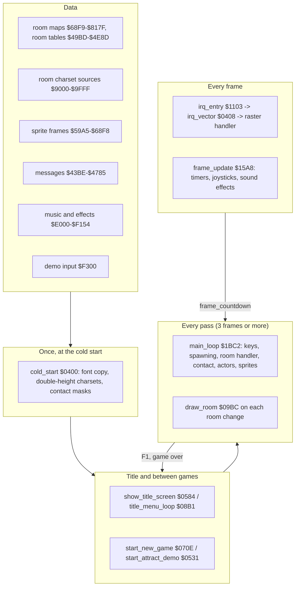
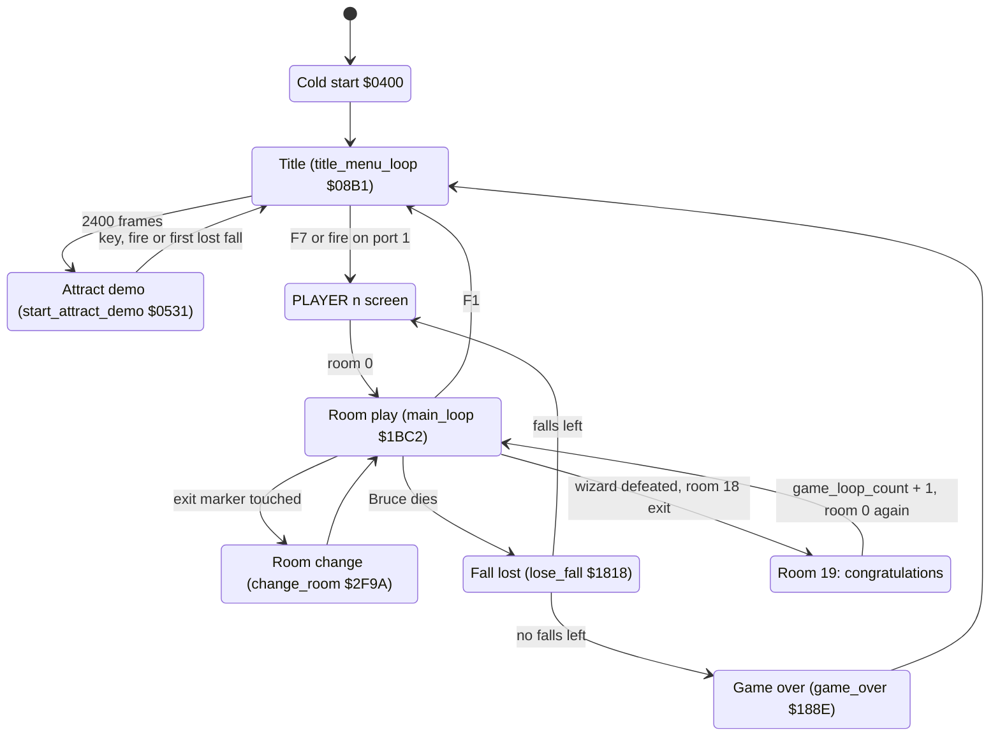

# Bruce Lee: how the program works

*Bruce Lee* (Datasoft 1984, by Ron J. Fortier, "REV.2 BY RJF") is a single-load C64 action game. Bruce goes through 20 rooms, collects lanterns and fights the Yamo (a green sumo) and the Ninja. Player 2 can control the Yamo. The way leads to the wizard in room 18 and the "CONGRATULATIONS" room 19. Then the game starts a new, faster loop. This documentation is for the game file on `original/saeger.d64`, an October 1984 crack. The crack's intro, mover and relocator are removed (section 6). The source in [src/](src/) assembles byte for byte to the clean game. The pages explain the code from the cold start to the last room and link each name to its source line.

| Page | Content |
|---|---|
| [docs/startup_title.md](docs/startup_title.md) | **Start-up and title.** The cold start, the title screen and its menu, the attract demo, the start of a game and the PLAYER n screen. |
| [docs/main_loop.md](docs/main_loop.md) | **The main loop.** One pass of [`main_loop`](src/game_main_loop.asm#L23) [`$1BC2`](docs/reference/modules/game_main_loop.md#main_loop), the game keys, pause and idle, the status line, the score and extra falls, the loss of a fall, the player switch and game over. |
| [docs/interrupts.md](docs/interrupts.md) | **The interrupt chain.** [`irq_entry`](src/interrupt_entry.asm#L10) [`$1103`](docs/reference/modules/interrupt_entry.md#irq_entry), [`irq_vector`](src/cold_start.asm#L31) [`$0408`](docs/reference/modules/cold_start.md#irq_vector), every raster handler of the title, PLAYER and game screens, and the per-frame work of [`frame_update`](src/frame_update.asm#L20) [`$15A8`](docs/reference/modules/frame_update.md#frame_update). |
| [docs/game_flow.md](docs/game_flow.md) | **The game state machine.** The whole program as one state machine, two-player turns, the next game loop, and the exit tables decoded into the map of the 20 rooms. |
| [docs/rooms.md](docs/rooms.md) | **Rooms: data and code.** The per-room tables, the RLE map format, [`draw_room`](src/draw_room.asm#L28) [`$09BC`](docs/reference/modules/draw_room.md#draw_room), the room init and frame dispatch tables, lanterns, passages, hazards and the map overflow bug. |
| [docs/rooms_catalogue.md](docs/rooms_catalogue.md) | **The 20 rooms, one by one.** Screenshot, table data, setup, behaviour, state machines and exits of each room. |
| [docs/actors.md](docs/actors.md) | **The actors.** Bruce, Yamo and Ninja: the actor arrays, spawning, input, the computer AI, the action state machine, movement and poses. |
| [docs/combat.md](docs/combat.md) | **Combat and collision.** Sprite collisions, the background contact test, hits, damage, energy, knock-outs and points. |
| [docs/graphics.md](docs/graphics.md) | **Graphics.** The VIC bank 2 memory map, the double-height tiles, the charsets, colours and raster splits, the 1-bit sprite frame format and the double-buffered software sprites. |
| [docs/text_messages.md](docs/text_messages.md) | **Text and messages.** [`print_message`](src/actor_driver_text.asm#L59) [`$17E2`](docs/reference/modules/actor_driver_text.md#print_message), the message format, the status line, the big banners and a catalogue of all 101 messages. |
| [docs/sound_music.md](docs/sound_music.md) | **Sound and music.** The MicroPearl music player and its stream format, the title tune, the three sound-effect players, the request priorities and all 15 effects. |
| [docs/dispatch_tables.md](docs/dispatch_tables.md) | **Jump and dispatch tables.** Every jump table, RTS dispatch, vector and computed jump, with all its entries. |
| [docs/protection.md](docs/protection.md) | **Copy protection and the release.** The delayed protection checks that are still in the game, and what the release changed. |

**Evidence.** **Observed** marks a fact that an emulator run or the coverage of the runs showed. **Code** marks a fact from the code or the image only. **Conclusion** marks an interpretation. A scenario is named by its file in [tests/](tests/).

## 1. The layers

How the layers work together:

1. **The cold start runs once.** [`cold_start`](src/cold_start.asm#L22) [`$0400`](docs/reference/modules/cold_start.md#cold_start) copies the ROM font to `$8800` and expands the four room charset sources at `$9000-$9FFF` into double-height charsets. [`build_contact_masks`](src/frame_builder.asm#L16) [`$512F`](docs/reference/modules/frame_builder.md#build_contact_masks) then builds the background contact masks over the charset sources. So the cold start cannot run a second time (**Code**, [startup_title.md](docs/startup_title.md)).
2. **The title is a loop of its own.** [`title_menu_loop`](src/title_menu.asm#L14) [`$08B1`](docs/reference/modules/title_menu.md#title_menu_loop) reads the option keys and the fire button of port 1. After 2400 frames it starts the attract demo through [`start_attract_demo`](src/title_demo_start.asm#L32) [`$0531`](docs/reference/modules/title_demo_start.md#start_attract_demo). F7 or fire starts a game through [`start_new_game`](src/title_demo_start.asm#L283) [`$070E`](docs/reference/modules/title_demo_start.md#start_new_game) (**Observed** in `tests/title.json`, `tests/title_options.json` and `tests/demo.json`).
3. **A room is drawn once and then changed by code.** [`draw_room`](src/draw_room.asm#L28) [`$09BC`](docs/reference/modules/draw_room.md#draw_room) decodes the room map and runs the init handler of the room from [`room_init_handlers`](src/room_dispatch.asm#L19) [`$4E9C`](docs/reference/modules/room_dispatch.md#room_init_handlers). Everything that moves or opens later is done by the frame handler of the room from [`room_frame_handlers`](src/room_dispatch.asm#L28) [`$4EC4`](docs/reference/modules/room_dispatch.md#room_frame_handlers) ([rooms.md](docs/rooms.md)).
4. **The main loop paces the game.** One pass of [`main_loop`](src/game_main_loop.asm#L23) [`$1BC2`](docs/reference/modules/game_main_loop.md#main_loop) runs the keys, the enemy spawning, the room handler, the contact tests, the input and actions of each actor, and the sprite builder. It then waits for [`frame_countdown`](src/constants.asm#L38) [`$48`](docs/reference/variables.md#frame_countdown), which the interrupt counts down once per frame from 3. So a pass takes at least 3 frames (**Observed**, [main_loop.md](docs/main_loop.md)).
5. **The interrupts set the picture every frame.** [`irq_entry`](src/interrupt_entry.asm#L10) [`$1103`](docs/reference/modules/interrupt_entry.md#irq_entry) jumps through [`irq_vector`](src/cold_start.asm#L31) [`$0408`](docs/reference/modules/cold_start.md#irq_vector) to the next raster handler. In a game the chain is [`irq_game_bottom`](src/game_irq.asm#L12) [`$48C1`](docs/reference/modules/game_irq.md#irq_game_bottom), [`irq_game_playfield`](src/game_irq.asm#L62) [`$491E`](docs/reference/modules/game_irq.md#irq_game_playfield) and [`irq_game_colour_split`](src/game_irq.asm#L117) [`$4982`](docs/reference/modules/game_irq.md#irq_game_colour_split): status line, room charset and colour bands. [`frame_update`](src/frame_update.asm#L20) [`$15A8`](docs/reference/modules/frame_update.md#frame_update) runs the timers, the joysticks and the sound effects ([interrupts.md](docs/interrupts.md)).
6. **The actors go through a state machine.** Input (joystick, computer AI or the demo stream) picks an action. [`actor_action_step`](src/actor_step.asm#L21) [`$1C5B`](docs/reference/modules/actor_step.md#actor_action_step) moves the actor through its states, [`select_actor_pose`](src/actor_poses.asm#L18) [`$2780`](docs/reference/modules/actor_poses.md#select_actor_pose) picks the pose, and [`build_actor_sprites`](src/actor_sprites.asm#L12) [`$2584`](docs/reference/modules/actor_sprites.md#build_actor_sprites) draws the pose into the sprite buffers ([actors.md](docs/actors.md), [graphics.md](docs/graphics.md)).

## 2. The flow of a player

The order of the rooms and the conditions that open each way are on [game_flow.md](docs/game_flow.md). The handler of each room is on [rooms_catalogue.md](docs/rooms_catalogue.md).

## 3. Findings

The facts that a reader does not expect. Each page has more.

| Finding | Evidence |
|---|---|
| **The copy protection is still in the game, and it is delayed.** Several checks compare the loader marks in zero page and pairs of bytes on the key page `$CF00`. A failed check does not stop the game at once: it changes code step by step until [`random_byte`](src/interrupt_entry.asm#L89) [`$1159`](docs/reference/modules/interrupt_entry.md#random_byte) breaks, jumps through `$DE00`, wipes memory, or damages the maps of rooms 0, 1 and 5. | **Code**; **Observed**: junk on the `$CF00` page breaks the game. [protection.md](docs/protection.md) |
| **A knock-out by a fall attack repeats.** After the knock-out, [`apply_fight_ko`](src/fight_hits.asm#L384) [`$2C24`](docs/reference/modules/fight_hits.md#apply_fight_ko) jumps back to [`apply_fight_hits_fall`](src/fight_hits.asm#L354) [`$2BF9`](docs/reference/modules/fight_hits.md#apply_fight_hits_fall). Damage and points repeat until the energy wraps to positive. | **Observed**: in one run the score went from 2000 to 15050, and Yamo survived with 124 energy. [combat.md](docs/combat.md) |
| **Six rooms write 2 bytes into a contact mask.** The maps of rooms 4, 7, 10, 13, 17 and 18 decode to 442 cells instead of 440. The two extra cells write `$80` to `$9010-$9011`, a mask of Bruce's frames. | **Observed** in the room runs. [rooms.md](docs/rooms.md) |
| **A new top score moves the next extra fall to 171072 points.** [`update_high_score`](src/score.asm#L65) copies 4 bytes to [`top_score`](src/fireball_text_score_vars.asm#L63) [`$4388`](docs/reference/modules/fireball_text_score_vars.md#top_score). The 4th byte is [`raster_split_index`](src/constants.asm#L36) [`$44`](docs/reference/variables.md#raster_split_index), and it lands in [`bonus_fall_first_score`](src/fireball_text_score_vars.asm#L69) [`$438B`](docs/reference/modules/fireball_text_score_vars.md#bonus_fall_first_score). | **Observed** in 7 of 7 stores. [main_loop.md](docs/main_loop.md) |
| **Extra falls come late.** The extra-fall test compares the score with the limit byte by byte, not as one 24-bit number. | **Code**. [main_loop.md](docs/main_loop.md) |
| **[`random_table`](src/constants.asm#L151) [`$0200`](docs/reference/variables.md#random_table) is filled and never read.** [`init_game_variables`](src/game_setup.asm#L18) clears the pointer, so [`random_byte`](src/interrupt_entry.asm#L89) [`$1159`](docs/reference/modules/interrupt_entry.md#random_byte) reads zero page and the stack page. In the demo it returns 1. | **Observed**. [startup_title.md](docs/startup_title.md) |
| **The right-handed key is R.** The title keys L/R and shift-L/shift-R set the joystick handedness of port 1 and port 2. | **Code**: key code `$11` is matrix column 2, row 1. [startup_title.md](docs/startup_title.md) |
| **The S key only switches the title tune.** The sound effects of the game always play. | **Code**. [main_loop.md](docs/main_loop.md), [sound_music.md](docs/sound_music.md) |
| **The music is tuned for NTSC.** On PAL every note is about 2/3 of a semitone flat. | **Code**. [sound_music.md](docs/sound_music.md) |
| **The attract demo ends at its first lost fall.** It reads 569 bytes of [`demo_input_stream`](src/demo_input.asm#L65) [`$F300`](docs/reference/modules/demo_input.md#demo_input_stream). | **Observed**. [startup_title.md](docs/startup_title.md) |
| **Unused exits and a closing exit.** Six exit-table entries have no marker in any room. After the wizard is defeated, a tile overwrites the marker of the way back to room 17. | **Code**; **Observed** for room 6. [game_flow.md](docs/game_flow.md) |
| **The fourth charset is the wizard flash.** [`room_charset_d`](src/room_charset_d.asm#L8) [`$9C00`](docs/reference/graphics.md#room_charset_d) becomes [`charset_wizard_flash`](src/constants.asm#L160) [`$B800`](docs/reference/variables.md#charset_wizard_flash). Only the defeat of the wizard selects it. | **Code**. [graphics.md](docs/graphics.md) |
| **Message `$62` was changed.** [`msg_presents`](src/messages.asm#L429) [`$4770`](docs/reference/modules/messages.md#msg_presents) reads "DIABOLO  PRESENTS". A stale copy in the image still holds "DATASO…SENTS". No code prints the message. | **Code**. [text_messages.md](docs/text_messages.md) |
| **The build left developer data.** [`unused_room_lists_copy`](src/unused_build_leftovers.asm#L7) [`$572D`](docs/reference/modules/unused_build_leftovers.md#unused_room_lists_copy) is a stale copy of the room list tables, followed by assembler source text with bit 7 set. | **Code**. [reference](docs/reference/modules/unused_build_leftovers.md) |
| **No cheat or trainer.** [`falls_left`](src/constants.asm#L31) [`$28`](docs/reference/variables.md#falls_left) goes down only in [`lose_fall`](src/lose_fall_game_over.asm#L14) [`$1818`](docs/reference/modules/lose_fall_game_over.md#lose_fall) and by 5 in [`frame_update_yamo_idle`](src/frame_update.asm#L295) [`$173F`](docs/reference/modules/frame_update.md#frame_update_yamo_idle), when a player-controlled Yamo stays idle too long. The room 16 bonus adds falls. | **Code**. [protection.md](docs/protection.md) |

## 4. The reference

The generated reference of every file, routine, table and variable is in [docs/reference/index.md](docs/reference/index.md). It also has the [names](docs/reference/symbols.md), the [variables](docs/reference/variables.md), the [tables](docs/reference/tables.md), the [memory map](docs/reference/memory-map.md) and the [graphics](docs/reference/graphics.md).

## 5. Still open

These questions come up on more than one page. Each page lists its own questions at its end.

- **The keyboard scanner never ran.** [`scan_keyboard`](src/keyboard_scan.asm#L24) [`$139E`](docs/reference/modules/keyboard_scan.md#scan_keyboard) needs a C64 keyboard matrix, and VICE 3.10 holds bits 5-7 of the CIA 1 ports low (VICE bug #2202). The runs and the tests write the key codes into [`key_code`](src/constants.asm#L137) [`$0109`](docs/reference/variables.md#key_code) and [`key_ready`](src/constants.asm#L140) [`$010C`](docs/reference/variables.md#key_ready). A run on VICE with the fix can confirm the scanner and the R key.
- **Some code never ran.** The coverage of all runs misses 941 instructions in 127 ranges. Examples are parts of the wizard defeat, some room events and several protection paths. The source marks each range with `; not executed`, and [src/not_executed.json](src/not_executed.json) lists them.
- **What some room pieces are in game terms.** The sliders, the runners and some graphic messages have names that come from their place and use ([rooms.md](docs/rooms.md)).
- **The warm-start flag.** [`warm_start_flag`](src/cold_start.asm#L7) [`$03FF`](docs/reference/modules/cold_start.md#warm_start_flag) must be 0, and nothing writes it. The original loader may have had a restart path ([protection.md](docs/protection.md)).

## 6. The release and the rebuild

- **The release.** `original/saeger.d64` holds one file, `BRUCE LEE` (186 blocks), extracted as `original/bruce_lee.prg`. Its BASIC line `1984 SYS 2161 SSG` starts the crack: an intro screen that waits for SPACE, a mover that copies parts of the file to `$C000`, `$CF00`, `$E000` and `$FE00`, and a relocator that moves the game down to `$0400` and jumps to [`cold_start`](src/cold_start.asm#L22) [`$0400`](docs/reference/modules/cold_start.md#cold_start). The file is not packed.
- **The clean program.** The knowledge holds the memory at [`cold_start`](src/cold_start.asm#L22) [`$0400`](docs/reference/modules/cold_start.md#cold_start) without the crack: the segments `$03FF-$9FFF`, `$CF00-$CFFF`, `$E000-$F5FF` and `$FE00-$FFFF`. The capture leaves out `$A000-$A9FF` (a copy of the relocator and duplicates of the `$CF00` and `$E000` pages) and `$033C-$03FE` (a page that the relocator copied). The scenarios `tests/crack_leftover_a000.json` and `tests/crack_leftover_033c.json` show that the game does not use them. The relocator also sets the marks that the protection checks need: `$00` = `$EF`, `$02` = `$32`, an RTS at `$0080`, and [`warm_start_flag`](src/cold_start.asm#L7) [`$03FF`](docs/reference/modules/cold_start.md#warm_start_flag) = 0. These stay in the entry state.
- **The rebuild.** [src/](src/) is generated from the knowledge and assembles to the clean program byte for byte (`src/main.asm`). `src/loader.prg` is a loader that copies the segments into place, sets the entry state of the capture and jumps to [`cold_start`](src/cold_start.asm#L22). The emulator check of c64-source verified it. The scenarios in [tests/](tests/) run the original disk file and `src/loader.prg` side by side and compare memory, the VIC-II and the screen: `title`, `title_options`, `demo`, `game_start`, `room_change`, `game_keys`, `lose_fall_game_over`, `wizard_and_ending` and `all_rooms` (each of the 20 rooms: the picture, the VIC-II, VIC bank 2 and colour RAM). All pass. [tests/PLAYTEST.md](tests/PLAYTEST.md) is the checklist for a human playtest.
- **The copy protection is off by default.** The switch `NO_PROTECTION` puts in 13 patches, one for each protection check ([protection.md](docs/protection.md#7-the-switch-no_protection)). The hand-written default builds `src/bruce_lee.asm` (the game) and `src/bruce_lee_loader.asm` (the runnable loader) set it to 1. `--define NO_PROTECTION=0`, or the generated `src/main.asm` and `src/loader.prg`, give the original byte for byte. `tests/no_protection.json` shows that the default build runs like the original when the protection data is destroyed. `tests/all_rooms_no_protection.json` shows that the default build draws all 20 rooms as the original.
- **Build** (from the repository root, with the c64-assembler skill):
  - `assemble.ts --project bruce_lee --source-root src --entry bruce_lee_loader.asm --out build/bruce_lee_loader.prg` gives the runnable game without protection. `tests/no_protection.json` needs it.
  - `assemble.ts --project bruce_lee --source-root src --entry main.asm --out build/bruce_lee.prg --compare` checks the original against the knowledge.
