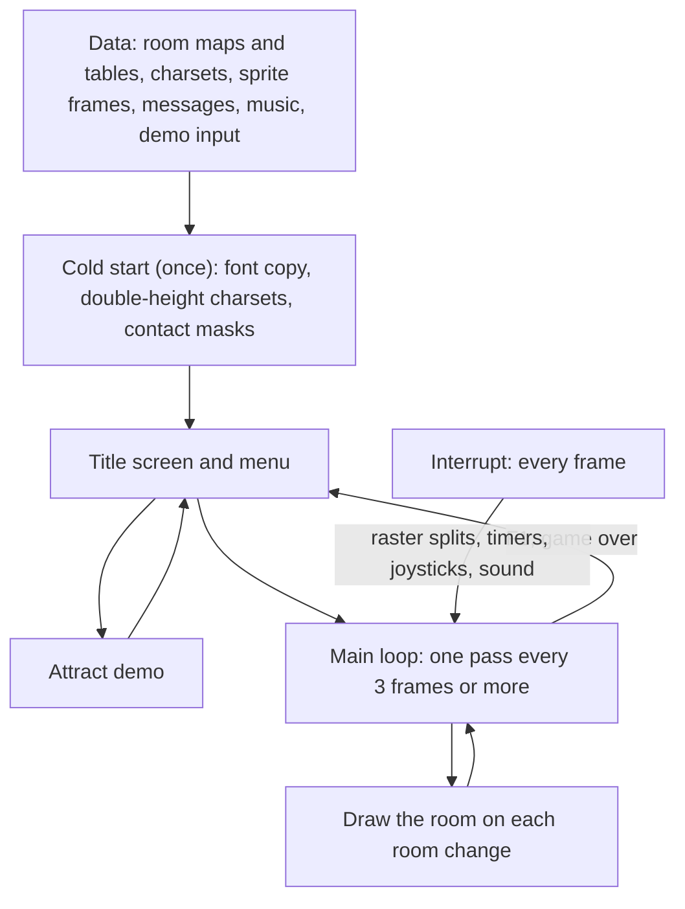
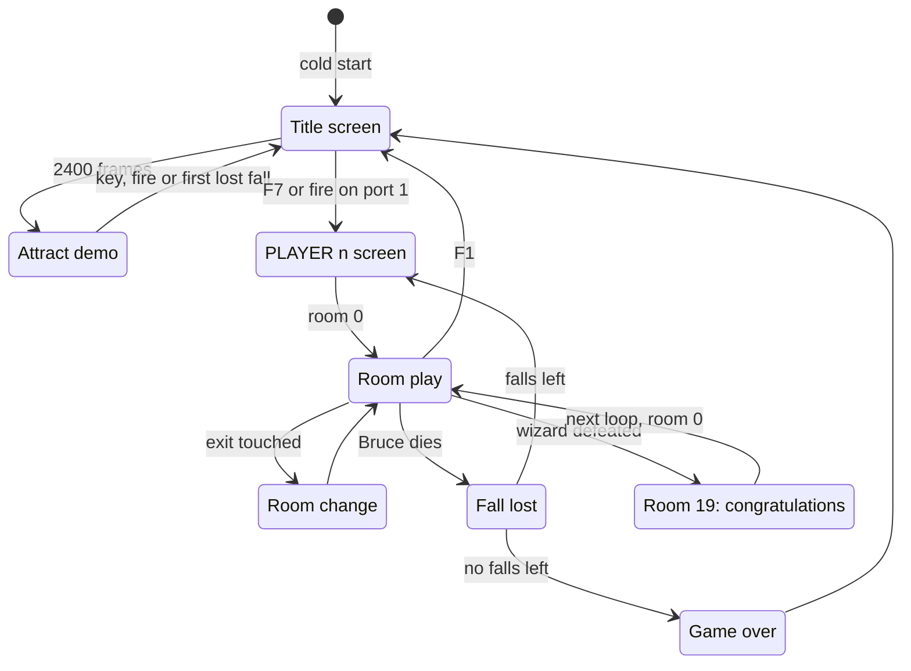

# Bruce Lee

*Bruce Lee* is a single-load C64 action game by Ron J. Fortier. Datasoft published it in 1984, and the title reads "REV.2 BY RJF". Bruce goes through 20 rooms, collects lanterns and fights the Yamo (a green sumo) and the Ninja. A second player can control the Yamo. The way leads to the wizard in room 18 and the "CONGRATULATIONS" room 19. Then the game starts a new, faster loop. This documentation is for the game file of `original/saeger.d64`, a crack of October 1984, and compares it with two other cracks of the same image. The source in [src/](src/) assembles byte for byte to the game without the crack.

**Evidence.** **Observed** marks a fact that an emulator run or the coverage of the runs showed. **Code** marks a fact from the code or the image only. **Conclusion** marks an interpretation. A scenario is named by its file in [tests/](tests/).

## How the program works

The game is one block of code and data that fills almost all of the 64 KB. The cold start builds the data that the image does not hold. It makes double-height charsets from the ROM font and from the four room charsets. It also makes a contact mask for each pose of the actors. These buffers overwrite their own sources, so the cold start can run only once. Then the title screen runs as a loop of its own. It shows a menu, and after a pause it plays an attract demo from a recorded input stream.

A game is a series of rooms. The game draws each room once from a packed map. Then the code of the room changes it: lanterns disappear, passages open and traps move. The main loop sets the pace of the play. One pass reads the keys, spawns the enemies, runs the room and tests the contacts. It then moves Bruce, the Yamo and the Ninja through their action states and builds their sprites. A pass waits for 3 frames of the interrupt. So the game logic runs at most 50 / 3, about 17, times a second on PAL. The interrupts do the work of each frame. They make the raster splits for the status line, the room charset and the colour bands. They also run the timers, the joysticks and the sound effects.

1. **The cold start runs once.** [`cold_start` `$0400`](src/cold_start.asm#L22) copies the ROM font to `$8800` and expands the four room charset sources at `$9000-$9FFF` into double-height charsets. `build_contact_masks` then builds the contact masks over the charset sources, so the cold start cannot run a second time. (**Code**. [startup_title.md](docs/startup_title.md))
2. **The title is a loop of its own.** [`title_menu_loop` `$08B1`](src/title_menu.asm#L14) reads the option keys and the fire button of port 1. After 2400 frames it starts the attract demo. F7 or fire starts a game. (**Observed** in `tests/title.json`, `tests/title_options.json` and `tests/demo.json`)
3. **A room is drawn once and then changed by code.** [`draw_room` `$09BC`](src/draw_room.asm#L28) decodes the room map and runs the init handler of the room. Everything that moves or opens later is done by the frame handler of the room, once in each pass. ([rooms.md](docs/rooms.md))
4. **The main loop sets the pace of the game.** One pass of [`main_loop` `$1BC2`](src/game_main_loop.asm#L23) runs the keys, the enemy spawns, the room handler and the contact tests. Then it runs the input and the action of each actor, and the sprite builder. It then waits for `frame_countdown`. The interrupt counts this variable down from 3, once in each frame. (**Observed**. [main_loop.md](docs/main_loop.md))
5. **The interrupts set the picture in every frame.** [`irq_entry` `$1103`](src/interrupt_entry.asm#L10) jumps through `irq_vector` to the next raster handler of a chain. In a game, the chain sets the status line, the room charset and the colour bands. `frame_update` runs the timers, the joysticks and the sound effects. ([interrupts.md](docs/interrupts.md))
6. **The actors go through a state machine.** The input of an actor picks an action. The input is a joystick, the computer AI or the demo stream. [`actor_action_step` `$1C5B`](src/actor_step.asm#L21) moves the actor through its states. `select_actor_pose` picks the pose, and `build_actor_sprites` draws the pose into the sprite buffers. ([actors.md](docs/actors.md), [graphics.md](docs/graphics.md))

The flow of a player through the game:

The order of the rooms and the conditions that open each way are on [game_flow.md](docs/game_flow.md). Each room is described on [rooms_catalogue.md](docs/rooms_catalogue.md).

## The pages

| Page | Content |
|---|---|
| [docs/startup_title.md](docs/startup_title.md) | **Start-up and title.** The cold start, the title screen and its menu, the attract demo, the start of a game and the PLAYER n screen. |
| [docs/main_loop.md](docs/main_loop.md) | **The main loop.** One pass of the game and the game keys. Pause and idle, the status line, the score and extra falls. The loss of a fall, the player switch and game over. |
| [docs/interrupts.md](docs/interrupts.md) | **The interrupt chain.** The IRQ entry and its vector, the raster handlers of the title, PLAYER and game screens, and the work of each frame. |
| [docs/game_flow.md](docs/game_flow.md) | **The game state machine.** The whole program as one state machine, two-player turns, the next game loop, and the map of the 20 rooms from the exit tables. |
| [docs/rooms.md](docs/rooms.md) | **Rooms: data and code.** The room tables, the packed map format, how a room is drawn, the room handlers, lanterns, passages, hazards and the map overflow bug. |
| [docs/rooms_catalogue.md](docs/rooms_catalogue.md) | **The 20 rooms, one by one.** The picture, the data, the setup, the behaviour and the exits of each room. |
| [docs/actors.md](docs/actors.md) | **The actors.** Bruce, the Yamo and the Ninja: their data, spawning, input, the computer AI, the action state machine, movement and poses. |
| [docs/combat.md](docs/combat.md) | **Combat and collision.** Sprite collisions, the background contact test, hits, damage, energy, knock-outs and points. |
| [docs/graphics.md](docs/graphics.md) | **Graphics.** The VIC bank, the double-height tiles, the charsets, the colours and raster splits, the sprite frame format and the double-buffered software sprites. |
| [docs/text_messages.md](docs/text_messages.md) | **Text and messages.** The message format and its printer, the status line, the big banners and all 101 messages. |
| [docs/sound_music.md](docs/sound_music.md) | **Sound and music.** The music player and its stream format, the title tune, the three sound-effect players, the request priorities and the 15 effects. |
| [docs/dispatch_tables.md](docs/dispatch_tables.md) | **Dispatch.** How the program chooses code at run time: vectors, RTS tables, compare chains and computed jumps. |
| [docs/protection.md](docs/protection.md) | **Copy protection.** The delayed protection checks that are still in the game, and the switch that turns them off. |
| [docs/development.md](docs/development.md) | **The development.** What the leftovers in the image tell about how the game was made. |
| [docs/releases.md](docs/releases.md) | **Releases and cracks.** The three cracks compared byte by byte, what each crack changed, and the switches that give each release. |

## Findings

The facts that a reader does not expect. Each page has more.

- **The copy protection is still in the game, and it is delayed.** Several checks compare marks of the original loader in zero page and pairs of bytes on the key page `$CF00`. A failed check does not stop the game at once. It changes code step by step. Then [`random_byte` `$1159`](src/interrupt_entry.asm#L89) breaks, the game jumps through `$DE00`, or the game wipes memory or damages the maps of rooms 0, 1 and 5. **Code**. **Observed**: junk on the `$CF00` page breaks the game. See [protection.md](docs/protection.md).
- **A knock-out by a fall attack repeats.** After the knock-out, [`apply_fight_ko` `$2C24`](src/fight_hits.asm#L384) jumps back to `apply_fight_hits_fall`. So the damage and the points repeat until the energy wraps to a positive value. **Observed**: in one run the score went from 2000 to 15050, and the Yamo survived with 124 energy. See [combat.md](docs/combat.md).
- **Six rooms write 2 bytes into a contact mask.** The maps of rooms 4, 7, 10, 13, 17 and 18 decode to 442 cells instead of 440. The two extra cells write `$80` to `$9010-$9011`, a mask of Bruce's frames. **Observed** in the room runs. See [rooms.md](docs/rooms.md).
- **A new top score moves the next extra fall to 171072 points.** [`update_high_score` `$3184`](src/score.asm#L65) copies 4 bytes to `top_score`, and the 4th byte, the raster split index in `$44`, lands in `bonus_fall_first_score`. **Observed** in 7 of 7 stores. See [main_loop.md](docs/main_loop.md).
- **Extra falls come late.** The extra-fall test compares the score with the limit byte by byte, not as one 24-bit number. **Code**. See [main_loop.md](docs/main_loop.md).
- **The random table is filled and never read.** The game fills `random_table` at `$0200`. But `init_game_variables` clears its pointer, so `random_byte` reads zero page and the stack page instead. In the demo it returns 1. **Observed**. See [startup_title.md](docs/startup_title.md).
- **The right-handed key is R.** The title keys L/R and shift-L/shift-R set the joystick handedness of port 1 and port 2. **Code**: key code `$11` is matrix column 2, row 1. See [startup_title.md](docs/startup_title.md).
- **The S key only switches the title tune.** The sound effects of the game always play. **Code**. See [sound_music.md](docs/sound_music.md).
- **The music has NTSC tuning.** On PAL every note is about 2/3 of a semitone flat. **Code**. See [sound_music.md](docs/sound_music.md).
- **The attract demo ends at its first lost fall.** It reads 569 bytes of [`demo_input_stream` `$F300`](src/demo_input.asm#L12). **Observed**. See [startup_title.md](docs/startup_title.md).
- **Unused exits and a closing exit.** Six entries of the exit tables have no marker in any room. After Bruce defeats the wizard, a tile overwrites the marker of the way back to room 17. **Code**. **Observed** for room 6. See [game_flow.md](docs/game_flow.md).
- **The fourth charset is the wizard flash.** [`room_charset_d` `$9C00`](src/room_charset_d.asm#L8) becomes `charset_wizard_flash` at `$B800`. Only the defeat of the wizard selects it. **Code**. See [graphics.md](docs/graphics.md).
- **A cracker changed message `$62`.** [`msg_presents` `$4770`](src/messages_rooms.asm#L322) reads "DIABOLO  PRESENTS" in the SAEGER release and "DATASOFT PRESENTS" in the TBC and DC releases. No code prints the message. **Observed**: byte compare of the releases. See [releases.md](docs/releases.md).
- **Someone saved the SAEGER image from a game that ran.** The image holds the music state of a tune. It also holds a `$55` of the KERNAL RAM test at `$9B00`, in the source of a room charset. TBC and DC have the bytes from before any run. **Observed**: byte compare and a watchpoint on `$9B00`. **Conclusion**: a dump after a reset. See [releases.md](docs/releases.md).
- **The DC release has no demo input.** Its packed file ends at `$F200`, so the attract demo gives Bruce no input and ends at his first lost fall. **Observed**. See [releases.md](docs/releases.md).
- **No cheat or trainer.** `falls_left` decreases only when Bruce loses a fall. It also decreases by 5 when a player-controlled Yamo stays idle too long. The room 16 bonus adds falls. No release adds a trainer. **Code**. **Observed**: byte compare of the releases. See [protection.md](docs/protection.md).

## The development

The image holds many leftovers of the development, outside the parts that the game uses:

- assembler source text in the Apple II format
- a fragment of the assembler symbol table, with the original names of the sprite frames
- shifted copies of tables and code
- older versions of code, charsets, the title tune and the demo recording
- key codes of the Atari 8-bit
- the encoded last stage of the original protected loader

The game build leaves them out. The knowledge keeps them in the spaces `bank1` to `bank7`. The scenario `tests/leftovers_unused.json` shows that the game does not read them (**Observed**). The details and their evidence are on [development.md](docs/development.md).

## Releases, cracks and preservation

Three cracks of the game are in the project. All three come from the same cracked image: the game bytes are the same except for three small changes.

| Label | File | Crack |
|---|---|---|
| SAEGER (base) | `original/saeger.d64`, file `BRUCE LEE` | "CRACKED IN OKTOBER 1984 BY SAEGER SOFT GROUP": an intro that waits for SPACE, a mover and a relocator. Not packed. |
| TBC | `original/bruce_lee_tbc.prg` | "CRACKED BY TBC": the Datasoft title picture as the intro, a mover and the same relocator. Not packed. |
| DC | `original/danish.d64`, file `BRUCE LEE   (DC)` | Danish Crackers "DC-011/P": packed with TCS-CRUNCH, with an intro and the same relocator. |

The SAEGER image carries the edit "DIABOLO  PRESENTS". Someone saved it from a game that ran. So SSG released again an image that another cracker changed before. TBC and DC have the text and the bytes from before a run (**Conclusion**). SAEGER and TBC also hold the same tape turbo tools at `$FE00`, and DC does not hold them (**Observed**). No crack removed the copy protection checks. Each relocator sets again the marks that the original loader left. The details, the hashes of the files and each difference are on [releases.md](docs/releases.md).

## The rebuild

**The base release.** The knowledge holds the memory of the SAEGER release when it gets to [`cold_start` `$0400`](src/cold_start.asm#L22). It holds only the game: 24 segments from `$03FF` to `$FFFF` (40,075 bytes). The capture leaves out these parts:

- the crack at `$A000-$A9FF`: a copy of the relocator and duplicated pages
- the original loader stage at `$033C-$03FE`
- 28 leftover blocks of the development and the release

The scenarios `tests/crack_leftover_a000.json`, `tests/original_loader_stage_033c.json` and `tests/leftovers_unused.json` show that the game uses none of them (**Observed**).

**The entry state.** The game needs the marks that the original loader left. The relocator of each crack sets them again: `$00` = `$EF`, `$02` = `$32`, an RTS at `$0080`, and `warm_start_flag` = 0. They stay in the entry state. `src/loader.prg` copies the segments into place, sets the entry state of the capture and jumps to `cold_start`. The emulator check of c64-source verified it.

**The switches.** The source holds each difference of the releases as a switch in `src/switches.asm`. The default build is the clean game.

| Switch | Kind | Default | Releases with it on | What it changes |
|---|---|---|---|---|
| `PROTECTION` | protection | 0 | SAEGER, TBC, DC | the copy protection checks |
| `CRACK_DIABOLO` | crack | 0 | SAEGER | "DIABOLO  PRESENTS" in message `$62` |
| `FIX_RAM_TEST_BYTE` | fix | 1 | TBC, DC | `$0F` in place of the `$55` of the RAM test at `$9B00` |
| `RUN_STATE` | change | 0 | SAEGER | the music state of a run in `$E100-$E86C` |

**The builds.** From the project folder, with the c64-assembler skill:

- `assembler.ts build src loader.asm --out build/bruce_lee_loader.prg` gives the clean game, ready to run. The scenarios of the default build need it.
- `assembler.ts build src main.asm --out build/bruce_lee.prg` gives the clean game without a loader.
- `assembler.ts build src main.asm --release SAEGER --compare --out build/bruce_lee_SAEGER.prg` checks the original against the knowledge. `--release TBC` and `--release DC` check the other releases. Each release build gives its capture byte for byte: SAEGER in all 24 segments, TBC and DC in their 23 segments.

**The tests.** The scenarios in [tests/](tests/) run the original disk file and `src/loader.prg` side by side. They compare memory, the VIC-II and the screen:

- `title`, `title_options` and `demo`
- `game_start`, `room_change`, `game_keys` and `lose_fall_game_over`
- `wizard_and_ending`
- `all_rooms`: the picture, the VIC-II, VIC bank 2 and colour RAM of each of the 20 rooms

`no_protection` and `all_rooms_no_protection` run the TBC release against the default loader. They destroy the protection data. The default build then runs like the original and draws all 20 rooms like the original. The recording `tests/recordings/first-rooms` replays on both loaders. [tests/PLAYTEST.md](tests/PLAYTEST.md) is the checklist for a human playtest.

## Still open

These questions come up on more than one page. Each page lists its own questions at its end.

- **The keyboard scanner never ran.** [`scan_keyboard` `$139E`](src/keyboard_scan.asm#L24) needs a C64 keyboard matrix, and VICE 3.10 holds bits 5-7 of the CIA 1 ports low (VICE bug #2202). The runs and the tests write the key codes into `key_code` and `key_ready`. A run on a VICE with the fix can check the scanner and the R key.
- **Some code never ran.** The coverage of all runs misses 941 instructions in 127 ranges. Examples are parts of the wizard defeat, some room events and several protection paths. The source marks each range with `; not executed`, and [src/not_executed.json](src/not_executed.json) lists them. Runs that reach these paths can close the gaps.
- **What some room pieces are in game terms.** The sliders, the runners and some graphic messages have names that come from their place and use. See [rooms.md](docs/rooms.md).
- **The warm-start flag.** [`warm_start_flag` `$03FF`](src/cold_start.asm#L7) must be 0, and nothing writes it. The original loader may have had a restart path. See [protection.md](docs/protection.md).

## The reference

[docs/reference/index.md](docs/reference/index.md)
