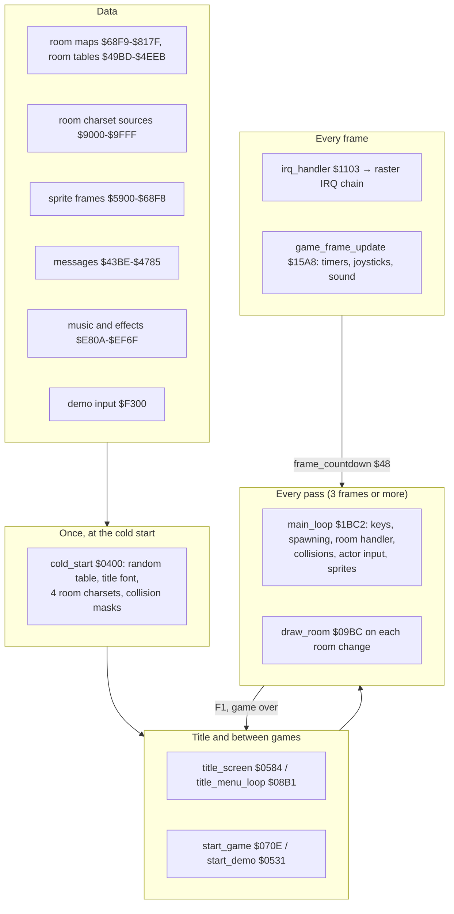
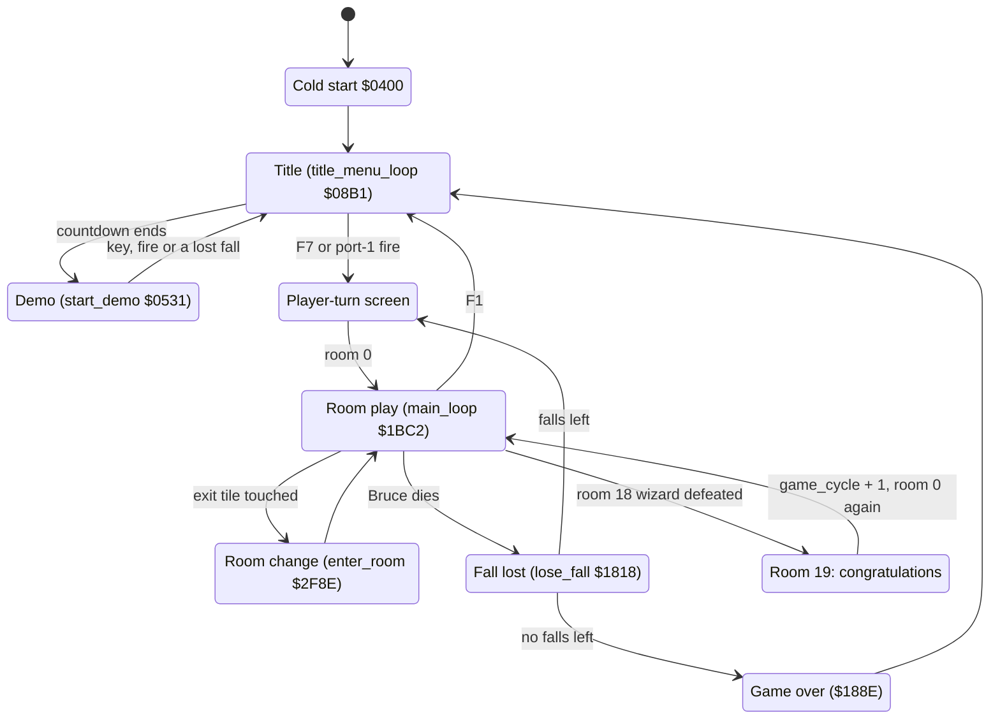

# Bruce Lee: how the program works

*Bruce Lee* (Datasoft 1984, "REV.2 BY RJF") is a single-load C64 game. Bruce goes through 20 rooms, collects lanterns and fights the Yamo and the Ninja, up to the wizard in room 18 and the "CONGRATULATIONS" room 19. This documentation is for the release on `original/saeger.d64`, the October 1984 crack by SSG, in the clean form of [report.md](../report.md): the game image `unpacked/clean/image.json` without the cracktro and the mover. The source is in [src/](../src/). It assembles byte for byte to that image. The documentation tells how the code works, from the cold start to the last room, and it points to the source line of each name.

| Page | Content |
|---|---|
| [parts/startup_title.md](parts/startup_title.md) | **Start-up and title.** The cold start, the title screen and its menu, the demo start, [`start_game`](../src/title.asm#L185) [`$070E`](reference/modules/title.md#start_game) and the player-turn screen. |
| [parts/main_loop.md](parts/main_loop.md) | **The main loop and the game controls.** One pass of [`main_loop`](../src/main_loop.asm#L6) [`$1BC2`](reference/modules/main_loop.md#main_loop), the status line, pause, the game keys, the keyboard scanner, the player swap, the loss of a fall, game over and the score. |
| [parts/interrupts.md](parts/interrupts.md) | **The interrupt chain.** [`irq_handler`](../src/interrupts.asm#L6) [`$1103`](reference/modules/interrupts.md#irq_handler), the raster IRQ chains of the game, title and player-up screens, and the per-frame work of [`game_frame_update`](../src/frame_update.asm#L6) [`$15A8`](reference/modules/frame_update.md#game_frame_update). |
| [rooms.md](rooms.md) | **The rooms (entry page of the room subsystem).** How the 20 rooms are stored, drawn and run, and in which order a player goes through them. It leads to the four room pages below. |
| [parts/room_pipeline.md](parts/room_pipeline.md) | **Room data and room generation.** The per-room tables, the RLE map format, [`draw_room`](../src/room_draw.asm#L6) [`$09BC`](reference/modules/room_draw.md#draw_room) step by step, the charsets and the colour bands. |
| [parts/room_flow.md](parts/room_flow.md) | **The room flow.** The game state machine: exits, lanterns, death and respawn, floor traps, the change of player and the end of the game. |
| [parts/rooms_00_09.md](parts/rooms_00_09.md) | **Rooms 0-9, one by one,** with the shared room mechanisms. |
| [parts/rooms_10_19.md](parts/rooms_10_19.md) | **Rooms 10-19, one by one,** with the wizard and the ending. |
| [parts/actors.md](parts/actors.md) | **The actors.** The actor tables, set-up and enemy spawning, joystick input, the enemy AI, the demo input stream and movement. |
| [parts/object_actions.md](parts/object_actions.md) | **Object actions and poses.** The action state machine of the actors (jumps, kicks, punches, climbing, falls, enemy states) and the pose of each state. |
| [parts/combat_collision.md](parts/combat_collision.md) | **Combat and collision.** The collision masks, the pixel collision against the background, sprite collisions, hits, damage, energy and knock-out. |
| [parts/sprites.md](parts/sprites.md) | **The actor sprites.** The 1-bit frame format, the frame tables and the renderer that builds the X-expanded sprites each pass. |
| [parts/sound.md](parts/sound.md) | **Sound.** The music player calls, the three sound-effect players, the effect streams and a table of all effects. |
| [parts/music_format.md](parts/music_format.md) | **The music format.** The command bytes of the MicroPearl music player and the title tune, decoded. |
| [parts/text_messages.md](parts/text_messages.md) | **Messages.** [`print_message`](../src/text.asm#L6) [`$17E2`](reference/modules/text.md#print_message), the message format, and a catalogue of all 101 messages, text and tile strings. |
| [parts/protection.md](parts/protection.md) | **Copy protection and crack traces.** The protection checks that are still in the game, what they sabotage, and the changes of the crack. |

**Evidence.** **Observed** marks a fact that an emulator run or the coverage of the runs showed. **Code** marks a fact from the code or the image only. **Conclusion** marks an interpretation. A run is named by its name in `runs/` or its c64-testing scenario in `tests/`.

## 1. The layers

How the layers work together:
1. **The cold start runs once.** [`cold_start`](../src/init.asm#L6) [`$0400`](reference/modules/init.md#cold_start) fills the random table, copies the ROM font to `$8800` for the title, expands the four room charsets from `$9000-$9FFF` and builds the collision masks of all sprite frames. The masks overwrite the charset sources. So the cold start cannot run a second time (**Code**, [startup_title.md](parts/startup_title.md)).
2. **The title is a loop of its own.** [`title_menu_loop`](../src/title_menu.asm#L6) [`$08B1`](reference/modules/title_menu.md#title_menu_loop) reads the option keys and the fire button. After about 2391 frames it starts the demo through [`start_demo`](../src/restart.asm#L24) [`$0531`](reference/modules/restart.md#start_demo). F7 or fire starts a game through [`start_game`](../src/title.asm#L185) [`$070E`](reference/modules/title.md#start_game) (**Code**, **Observed** in the `title` and `title_options` tests).
3. **A room is drawn once and then changed by code.** [`draw_room`](../src/room_draw.asm#L6) [`$09BC`](reference/modules/room_draw.md#draw_room) decodes the room map and runs the init handler of the room. Everything that moves or opens later is drawn by the frame handler of the room and the shared mechanisms ([rooms.md](rooms.md)).
4. **The main loop paces the game.** One pass of [`main_loop`](../src/main_loop.asm#L6) [`$1BC2`](reference/modules/main_loop.md#main_loop) runs the room handler, the enemy spawning, the collisions, the input of each actor and the sprite renderer. It then waits until [`frame_countdown`](../src/constants.asm#L34) [`$48`](reference/variables.md#frame_countdown) is 0. The interrupt counts it down once per frame from 3, so a pass takes at least 3 frames ([main_loop.md](parts/main_loop.md)).
5. **The interrupts set the picture every frame.** [`irq_handler`](../src/interrupts.asm#L6) [`$1103`](reference/modules/interrupts.md#irq_handler) jumps through [`irq_chain_vector`](../src/init.asm#L15) [`$0408`](reference/modules/init.md#irq_chain_vector) to the next raster handler. In a game the chain is [`irq_frame_top`](../src/raster_irq_game.asm#L6) [`$48C1`](reference/modules/raster_irq_game.md#irq_frame_top), [`irq_playfield_top`](../src/raster_irq_game.asm#L54) [`$491E`](reference/modules/raster_irq_game.md#irq_playfield_top) and [`irq_colour_split`](../src/raster_irq_game.asm#L107) [`$4982`](reference/modules/raster_irq_game.md#irq_colour_split): status line, room charset and colour bands. [`game_frame_update`](../src/frame_update.asm#L6) [`$15A8`](reference/modules/frame_update.md#game_frame_update) does the timers, the joysticks and the sound effects ([interrupts.md](parts/interrupts.md)).
6. **The actors go through a state machine.** Input (joystick, computer AI or the demo stream) picks an action. The action state machine moves the actor and selects its pose. The renderer copies the pose frames into sprite blocks ([actors.md](parts/actors.md), [object_actions.md](parts/object_actions.md), [sprites.md](parts/sprites.md)).

## 2. The flow of a player

The order of the rooms, and the lantern conditions that open each way, are on [rooms.md](rooms.md#2-the-flow-of-a-player). The transitions with their code are on [room_flow.md](parts/room_flow.md).

## 3. Findings

The facts that a reader does not expect. Each page has more. The room findings are on [rooms.md](rooms.md#3-findings).

| Finding | Evidence |
|---|---|
| **PAL freeze bug of the original.** [`draw_room`](../src/room_draw.asm#L6) [`$09BC`](reference/modules/room_draw.md#draw_room) changes `$D011` with a read-modify-write. A draw on raster lines 256-311 sets bit 8 of the raster compare, the next IRQ line never comes, and [`main_loop`](../src/main_loop.asm#L6) waits for ever. | **Observed** in the `r17_freeze` run (room 17). Details on [rooms.md](rooms.md#3-findings) and [interrupts.md](parts/interrupts.md). |
| **The S key does not mute the game.** It only switches the title tune: [`title_screen`](../src/title.asm#L6) [`$0584`](reference/modules/title.md#title_screen) is the only reader of [`sound_toggle`](../src/actor_room_tables.asm#L105) [`$1385`](reference/modules/actor_room_tables.md#sound_toggle). The sound effects always play. This corrects report.md. | **Code**, [main_loop.md](parts/main_loop.md), [sound.md](parts/sound.md). |
| **A knock-out by a drop loops.** [`object_knocked_out`](../src/combat_hits.asm#L356) [`$2C24`](reference/modules/combat_hits.md#object_knocked_out) jumps back to the drop test (`$2C51`), so the drop damage and the knock-out repeat until the energy wraps. A drop on Yamo can give about 12550 points. | **Code**; the path never ran. [combat_collision.md](parts/combat_collision.md#63-original-bug-a-knock-out-by-a-drop-loops). |
| **Six rooms write 2 bytes into collision mask 0.** The maps of rooms 4, 7, 10, 13, 17 and 18 hold 442 cells instead of 440. The two extra bottom chars land in mask 0 at `$9010/$9011`. | **Observed**: the `rooms` snapshots of those six rooms hold `$80 $80` there, the other 14 rooms `$0C $0C`. [combat_collision.md](parts/combat_collision.md). |
| **The high score overwrites the next game's extra-fall score.** [`store_high_score`](../src/score.asm#L87) [`$31B8`](reference/modules/score.md#store_high_score) copies 4 bytes. The 4th byte is [`split_index`](../src/constants.asm#L32) [`$44`](reference/variables.md#split_index), and it lands in [`first_extra_life_score`](../src/variables.asm#L112) [`$438B`](reference/modules/variables.md#first_extra_life_score). | **Code**. [main_loop.md](parts/main_loop.md). |
| **The report.md bug "[`add_score`](../src/score.asm#L47) [`$3175`](reference/modules/score.md#add_score) does not keep X" does no harm.** Each caller in [`apply_hit_effects`](../src/combat_hits.asm#L227) [`$2B4E`](reference/modules/combat_hits.md#apply_hit_effects) loads X again from [`current_actor`](../src/constants.asm#L40) right after the call. | **Code**. [combat_collision.md](parts/combat_collision.md#7-the-reportmd-bug-that-add_score-does-not-keep-x). |
| **Jumps fall 12 pixels but rise 11.** The test `cpy #$06` at `$2111` compares the state number that [`actor_move_left`](../src/actor_movement.asm#L341) leaves in Y, not the timer. | **Code**. [object_actions.md](parts/object_actions.md). |
| **An enemy that is stuck moves Bruce.** [`action_blocked_step`](../src/object_actions.asm#L681) [`$24B7`](reference/modules/object_actions.md#action_blocked_step) sets [`current_actor`](../src/constants.asm#L40) = 0 before it calls [`enter_room`](../src/background_touch.asm#L210). | **Code**; **Observed**: the coverage runs executed `$24DB-$24EA`. [object_actions.md](parts/object_actions.md). |
| **The Ninja comes in on the wrong side in six rooms.** [`actor_pick_spawn_ninja`](../src/actors.asm#L86) [`$0C2A`](reference/modules/actors.md#actor_pick_spawn_ninja) takes the side from the Yamo's table. | **Code**. [actors.md](parts/actors.md). |
| **Directions alone do not stop the idle timer.** [`idle_reset_check`](../src/frame_update.asm#L227) [`$1723`](reference/modules/frame_update.md#idle_reset_check) ORs Bruce's and the Yamo's active-low direction bytes. After about 11 minutes without fire the game pauses itself, and later the screen saver starts. | **Code**; no run reached the screen saver. [interrupts.md](parts/interrupts.md), [actors.md](parts/actors.md). |
| **The demo Bruce mostly stands still.** 416 of the 569 demo bytes at [`demo_input_data`](../src/demo_input.asm#L6) [`$F300`](reference/modules/demo_input.md#demo_input_data) are direction combinations that no joystick gives, such as up+down. | **Code**. [actors.md](parts/actors.md). |
| **A frame of 22 rows writes one byte too many.** Frame 129 fills its sprite block, and the clear loop then writes a 0 at block + `$C0`. | **Code**. [sprites.md](parts/sprites.md). |
| **The title tune plays at volume 15, and its notes are tuned for NTSC.** On PAL every note is about 0.6 semitone flat. | **Code**. [sound.md](parts/sound.md), [music_format.md](parts/music_format.md). |
| **The protection is still in the game, and it is delayed.** For example, a wrong `$00` in room 10 writes the end mark `$80` into the maps of rooms 0, 1 and 5. One check ([`protection_key_check`](../src/score.asm#L61) [`$3189`](reference/modules/score.md#protection_key_check)) is inverted: a page of zeros fails it. | **Code**. [protection.md](parts/protection.md). |
| **The vectors at `$0302` and `$0318` are not needed.** `$0300-$0327` is [`room_entry_bonus_flags`](../src/constants.asm#L138) [`$0300`](reference/variables.md#room_entry_bonus_flags), which [`init_game_vars`](../src/game_vars.asm#L6) [`$0F72`](reference/modules/game_vars.md#init_game_vars) writes at every game start. This corrects report.md. | **Code**. [protection.md](parts/protection.md). |
| **Messages 46, 82, 83 and 98 are never printed.** Message 98 is "DIABOLO PRESENTS" ([`msg_diabolo_presents`](../src/messages.asm#L194) [`$4770`](reference/modules/messages.md#msg_diabolo_presents)). | **Code**, and the coverage shows no read of their pointers. [text_messages.md](parts/text_messages.md). |
| **No cheat or trainer.** [`falls_left`](../src/constants.asm#L27) [`$28`](reference/variables.md#falls_left) is decremented only in [`lose_fall`](../src/game_over.asm#L6) [`$1818`](reference/modules/game_over.md#lose_fall), and the game keys are only F1, S, SPACE and V. | **Code**. [protection.md](parts/protection.md). |

## 4. The reference

The generated reference of every file, routine, table and variable is in [reference/index.md](reference/index.md). It also has the [names](reference/symbols.md), the [variables](reference/variables.md), the [tables](reference/tables.md), the [memory map](reference/memory-map.md) and the [graphics](reference/graphics.md). The extracted assets are in [assets/](../assets/README.md).

## 5. Still open

These questions come up on more than one page. Each page lists its own questions at its end.

- **The keyboard scanner never ran** in the runs, because the emulator has a CIA port bug, and the runs put the key codes into memory instead. A run on an emulator without that bug, with each title and game key, can confirm [`keyboard_scan`](../src/keyboard.asm#L18) [`$139E`](reference/modules/keyboard.md#keyboard_scan) ([main_loop.md](parts/main_loop.md), [startup_title.md](parts/startup_title.md)).
- **Bruce's hits never ran**: punches, flying kicks and drops, with their points and the drop knock-out loop. A fight run with watchpoints on [`actor_energy`](../src/constants.asm#L99) [`$D1-$D3`](reference/variables.md#actor_energy) and [`score`](../src/constants.asm#L31) [`$41`](reference/variables.md#score) can show them ([combat_collision.md](parts/combat_collision.md), [object_actions.md](parts/object_actions.md)).
- **The idle pause and the screen saver never ran.** A run that waits 32768 frames without input in a room without enemies can show them ([interrupts.md](parts/interrupts.md), [main_loop.md](parts/main_loop.md)).
- **The extra fall from the score never ran.** A run that sets [`score`](../src/constants.asm#L31) [`$41`](reference/variables.md#score) just below the threshold and takes a lantern can show it ([main_loop.md](parts/main_loop.md), [room_flow.md](parts/room_flow.md)).
- **What the original had** at `$0080`, `$CF00-$CFFF`, `$00` and `$02`, and whether `$110C`, `$10F7` and `$0E2E` are crack patches. A c64-provenance comparison with an uncracked copy can answer it ([protection.md](parts/protection.md)).
- **The code that no run executed** is marked `; not executed` in the source. `src/not_executed.json` lists each range.
