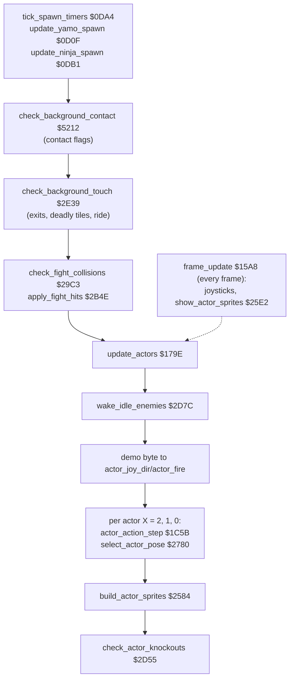
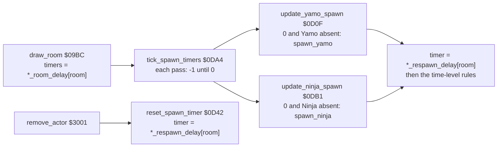
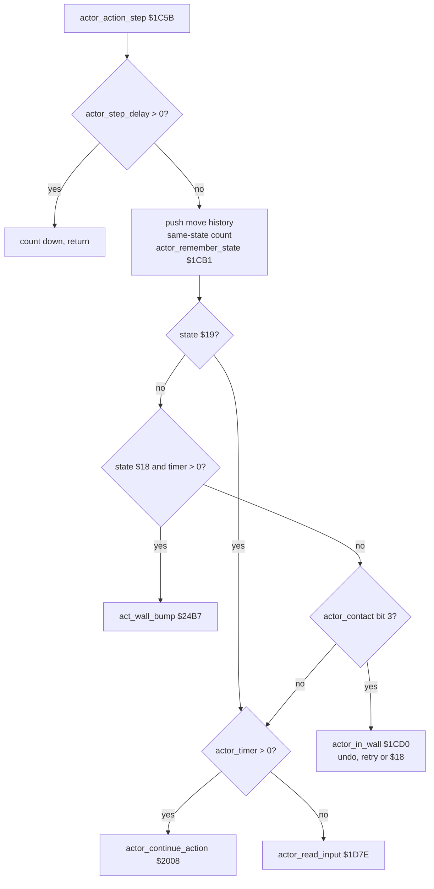
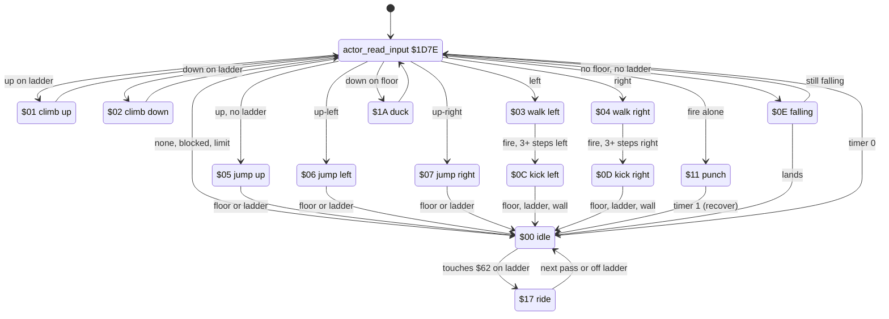
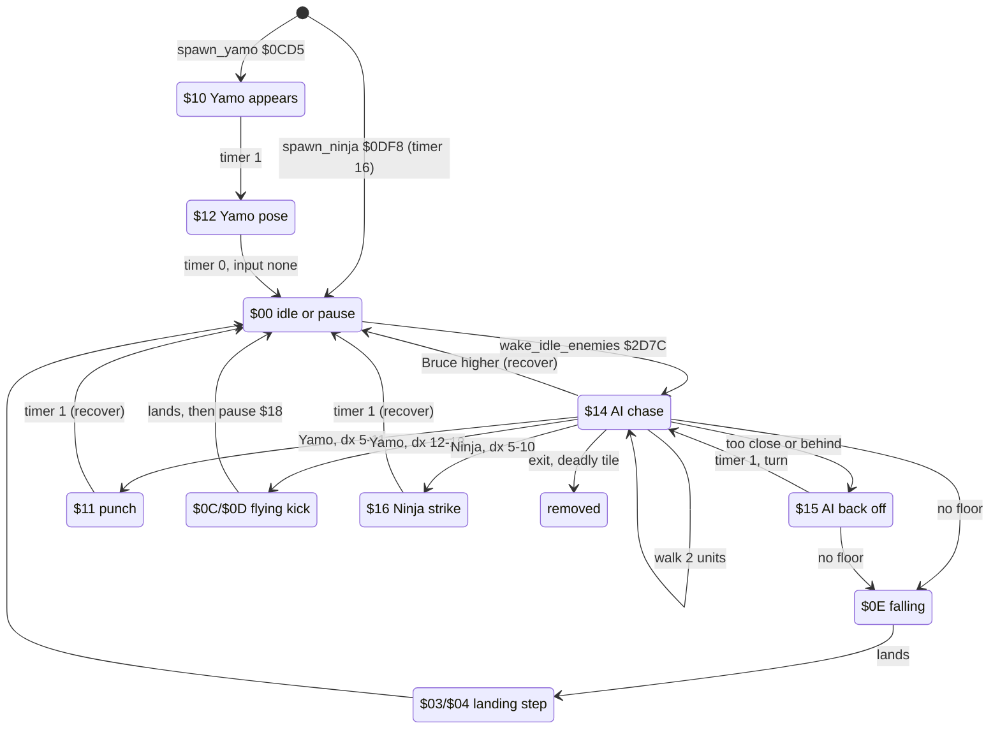
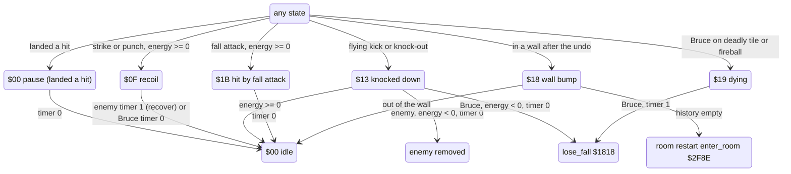

# Bruce Lee: the actors

The game has three actors: Bruce (the player), Yamo (the green sumo wrestler) and the Ninja (black, with a bokken). This page tells how the program keeps them in memory, how they appear in a room, where their input comes from, how the computer moves the enemies, and how the action state machine turns input into movement and poses. Fights and collisions are on [combat.md](combat.md).


Room 0 with Bruce at his start point A ([`spawn_a_x`](../src/room_tables.asm#L101) / [`spawn_a_y`](../src/room_tables.asm#L106) = `$1A`, `$C4`), before the enemies appear.

**Scope.**

- The actor arrays: every per-actor variable, its meaning and its encoding.
- Spawning: [`spawn_actor`](../src/actor_spawn.asm#L20) [`$0B8E`](reference/modules/actor_spawn.md#spawn_actor), [`spawn_yamo`](../src/actor_spawn.asm#L203) [`$0CD5`](reference/modules/actor_spawn.md#spawn_yamo), [`spawn_ninja`](../src/actor_spawn.asm#L398) [`$0DF8`](reference/modules/actor_spawn.md#spawn_ninja), the spawn timers and the per-room tables.
- Input: the joysticks ([`frame_update`](../src/frame_update.asm#L20) [`$15A8`](reference/modules/frame_update.md#frame_update)), handedness, Yamo played by player 2, the attract demo stream ([`update_actors`](../src/actor_driver_text.asm#L10) [`$179E`](reference/modules/actor_driver_text.md#update_actors)).
- The computer AI: [`wake_idle_enemies`](../src/actor_helpers.asm#L40) [`$2D7C`](reference/modules/actor_helpers.md#wake_idle_enemies), [`ai_chase`](../src/enemy_ai_states.asm#L13) [`$22FA`](reference/modules/enemy_ai_states.md#ai_chase), the back-off state.
- The action state machine: [`actor_action_step`](../src/actor_step.asm#L21) [`$1C5B`](reference/modules/actor_step.md#actor_action_step), [`actor_read_input`](../src/actor_step.asm#L184) [`$1D7E`](reference/modules/actor_step.md#actor_read_input), [`actor_continue_action`](../src/actor_timed_actions.asm#L14) [`$2008`](reference/modules/actor_timed_actions.md#actor_continue_action) and the state setters.
- Movement, the move history and the wall undo.
- Poses: [`select_actor_pose`](../src/actor_poses.asm#L18) [`$2780`](reference/modules/actor_poses.md#select_actor_pose), [`set_actor_pose`](../src/actor_poses.asm#L324) [`$29A1`](reference/modules/actor_poses.md#set_actor_pose).
- Sources: `src/actor_step.asm`, `src/actor_timed_actions.asm`, `src/enemy_ai_states.asm`, `src/actor_hit_states.asm`, `src/actor_poses.asm`, `src/actor_spawn.asm`, `src/actor_helpers.asm`, `src/actor_driver_text.asm`, `src/frame_update.asm`, `src/room_enemy_tables.asm`, `src/actor_workspace.asm`.

**Conventions.**

- Addresses are C64 addresses. Names are the names of the knowledge.
- An *actor* is one of three slots, index X: 0 = Bruce, 1 = Yamo, 2 = Ninja. A per-actor array has 3 bytes, `array,X`.
- A *pass* is one run of [`main_loop`](../src/game_main_loop.asm#L23) [`$1BC2`](reference/modules/game_main_loop.md#main_loop). A pass takes 3 frames ([`frame_countdown`](../src/constants.asm#L38) = 3), so there are 16.7 passes per second on PAL.
- A *step* of an actor is a pass in which its step delay [`actor_step_delay`](../src/constants.asm#L136) [`$0106`](reference/variables.md#actor_step_delay) is 0, so that [`actor_action_step`](../src/actor_step.asm#L21) [`$1C5B`](reference/modules/actor_step.md#actor_action_step) does an action.
- A *unit* of [`actor_x`](../src/constants.asm#L94) is 2 screen pixels (one multicolour pixel; the sprites are X-expanded). A unit of [`actor_y`](../src/constants.asm#L95) is one raster line.
- Joystick values are in the CIA format, active low: bit 0 up, bit 1 down, bit 2 left, bit 3 right, `$0F` = no direction.
- A *computer enemy* is the Ninja, and Yamo when [`option_yamo_player2`](../src/options_and_patterns.asm#L18) [`$42CA`](reference/modules/options_and_patterns.md#option_yamo_player2) = 0.
- The *time level* is the result of [`get_room_time_level`](../src/game_setup.asm#L253) [`$10D0`](reference/modules/game_setup.md#get_room_time_level) on the high byte of [`room_time`](../src/constants.asm#L86) [`$87`](reference/variables.md#room_time): level 0 below `$19` (6400 frames), level C from `$19`, level V from `$20` (8192 frames).
- State numbers are written `$00`-`$1B`. "State `$0C`/`$0D`" means the left or the right variant.
- **Observed** marks a fact that a run showed. **Code** marks a fact from the code only. **Conclusion** marks an interpretation.

## 1. Overview

One pass of the main loop does the actor work in this order (**Code**, [`main_loop`](../src/game_main_loop.asm#L23) [`$1BC2`](reference/modules/game_main_loop.md#main_loop)):



1. The spawn timers count down. At zero, Yamo or the Ninja appears (section 3). Rooms with [`room_no_enemy_flag`](../src/constants.asm#L75) [`$7A`](reference/variables.md#room_no_enemy_flag) set skip this.
2. [`check_background_contact`](../src/background_contact.asm#L17) [`$5212`](reference/modules/background_contact.md#check_background_contact) tests each sprite shape against the background pixels and sets [`actor_contact`](../src/constants.asm#L102) [`$B6`](reference/variables.md#actor_contact) (floor, trigger, ladder, wall). See [combat.md](combat.md).
3. [`check_background_touch`](../src/background_touch.asm#L10) [`$2E39`](reference/modules/background_touch.md#check_background_touch) reads the characters under each actor: exits, deadly tiles, lanterns, the moving character `$62` (state `$17`).
4. [`check_fight_collisions`](../src/fight_hits.asm#L14) [`$29C3`](reference/modules/fight_hits.md#check_fight_collisions) and [`apply_fight_hits`](../src/fight_hits.asm#L252) [`$2B4E`](reference/modules/fight_hits.md#apply_fight_hits) find and apply the hits (not in rooms with [`room_no_enemies`](../src/room_tables.asm#L164) [`$4C9E`](reference/modules/room_tables.md#room_no_enemies) set).
5. [`update_actors`](../src/actor_driver_text.asm#L10) [`$179E`](reference/modules/actor_driver_text.md#update_actors) wakes the idle computer enemies, takes the demo input, and runs one step and one pose choice for each active actor.
6. [`build_actor_sprites`](../src/actor_sprites.asm#L12) [`$2584`](reference/modules/actor_sprites.md#build_actor_sprites) copies the frame images. [`check_actor_knockouts`](../src/actor_helpers.asm#L8) [`$2D55`](reference/modules/actor_helpers.md#check_actor_knockouts) removes knocked-out enemies or ends Bruce's fall.

The raster interrupt [`frame_update`](../src/frame_update.asm#L20) [`$15A8`](reference/modules/frame_update.md#frame_update) reads the joysticks every frame into [`actor_joy_dir`](../src/constants.asm#L92) [`$98`](reference/variables.md#actor_joy_dir) and [`actor_fire`](../src/constants.asm#L93) [`$9B`](reference/variables.md#actor_fire). The main loop uses the last value.

## 2. The actor arrays

### 2.1 Zero page and page 1, one byte per actor

| Name | Address | Meaning and encoding | Written by | Read by |
|---|---|---|---|---|
| [`actor_flags`](../src/constants.asm#L91) | `$95-$97` | Bit 0 = active. Bits 7-6 = type: `00` Bruce, `01` Ninja, `10` Yamo. Values `$01`, `$81`, `$41`. | [`spawn_actor`](../src/actor_spawn.asm#L20) [`$0B8E`](reference/modules/actor_spawn.md#spawn_actor), [`remove_actor`](../src/touch_effects.asm#L38) [`$3001`](reference/modules/touch_effects.md#remove_actor) (clears bit 0) | every actor loop |
| [`actor_joy_dir`](../src/constants.asm#L92) | `$98-$9A` | Joystick direction, CIA format (section 4.1). | [`frame_update`](../src/frame_update.asm#L20) [`$15A8`](reference/modules/frame_update.md#frame_update) (Bruce, player-2 Yamo), [`update_actors`](../src/actor_driver_text.asm#L10) [`$179E`](reference/modules/actor_driver_text.md#update_actors) (demo, room 19), [`act_ride`](../src/actor_timed_actions.asm#L224) [`$2187`](reference/modules/actor_timed_actions.md#act_ride) (enemy), [`spawn_actor`](../src/actor_spawn.asm#L20) [`$0B8E`](reference/modules/actor_spawn.md#spawn_actor) (sets `$0F`) | [`actor_read_input`](../src/actor_step.asm#L184) [`$1D7E`](reference/modules/actor_step.md#actor_read_input), [`act_ride_move`](../src/actor_timed_actions.asm#L249) [`$21B2`](reference/modules/actor_timed_actions.md#act_ride_move) |
| [`actor_fire`](../src/constants.asm#L93) | `$9B-$9D` | Fire: 0 = pressed, other = released. The demo stores a whole nibble here. | [`frame_update`](../src/frame_update.asm#L20), [`update_actors`](../src/actor_driver_text.asm#L10), [`act_ride_finish`](../src/actor_timed_actions.asm#L291) [`$2207`](reference/modules/actor_timed_actions.md#act_ride_finish), [`spawn_actor`](../src/actor_spawn.asm#L20) (1) | [`actor_walk_left_step`](../src/actor_step.asm#L334) [`$1E70`](reference/modules/actor_step.md#actor_walk_left_step), [`actor_walk_right_step`](../src/actor_step.asm#L374) [`$1EB1`](reference/modules/actor_step.md#actor_walk_right_step), [`actor_input_check_none`](../src/actor_step.asm#L491) [`$1F76`](reference/modules/actor_step.md#actor_input_check_none) |
| [`actor_x`](../src/constants.asm#L94) | `$9E-$A0` | X position in units of 2 pixels. Sprite X = 2 × [`actor_x`](../src/constants.asm#L94) (bit 8 to [`MSIGX`](../src/constants.asm#L221)). A move is refused below `$0D` (left) and from `$A3` (right). | move primitives, [`spawn_actor`](../src/actor_spawn.asm#L20), [`change_room`](../src/background_touch.asm#L234) [`$2F9A`](reference/modules/background_touch.md#change_room) | everywhere |
| [`actor_y`](../src/constants.asm#L95) | `$A1-$A3` | Y position in raster lines. Sprite Y = [`actor_y`](../src/constants.asm#L95) + `$1D`. A move is refused below `$2E` (up) and from `$C7` (down). The floor of room 0 is `$C4`. | move primitives, [`spawn_actor`](../src/actor_spawn.asm#L20), [`change_room`](../src/background_touch.asm#L234) | everywhere |
| [`actor_facing`](../src/constants.asm#L96) | `$A4-$A6` | 0 = left, 1 = right. | move left/right, [`register_hit`](../src/fight_hits.asm#L237) [`$2B3E`](reference/modules/fight_hits.md#register_hit), [`face_bruce`](../src/actor_helpers.asm#L148) [`$2E1C`](reference/modules/actor_helpers.md#face_bruce), the AI, the state handlers | poses, attacks, AI |
| [`actor_contact_upper`](../src/constants.asm#L97) | `$A7-$A9` | Background contact flags (bits as [`actor_contact`](../src/constants.asm#L102)) of the body without its last 6 rows. | [`scan_upper_body`](../src/background_contact.asm#L296) [`$53E4`](reference/modules/background_contact.md#scan_upper_body) | [`actor_bruce_falling`](../src/actor_step.asm#L200) [`$1D99`](reference/modules/actor_step.md#actor_bruce_falling) (bit 0) |
| [`actor_ride_hold`](../src/constants.asm#L98) | `$AA-$AC` | State `$17`: 1 = no ride move in this step (the pose holds), 0 after a move. | [`act_ride`](../src/actor_timed_actions.asm#L224) [`$2187`](reference/modules/actor_timed_actions.md#act_ride), [`act_ride_moved`](../src/actor_timed_actions.asm#L273) [`$21E5`](reference/modules/actor_timed_actions.md#act_ride_moved), [`touch_climb_tile`](../src/touch_effects.asm#L194) [`$310C`](reference/modules/touch_effects.md#touch_climb_tile) | [`select_pose_try_ride`](../src/actor_poses.asm#L285) [`$2962`](reference/modules/actor_poses.md#select_pose_try_ride) |
| [`actor_ride_delay`](../src/constants.asm#L99) | `$AD-$AF` | State `$17`: steps until the next ride move, 4 after a move. | [`act_ride_moved`](../src/actor_timed_actions.asm#L273) [`$21E5`](reference/modules/actor_timed_actions.md#act_ride_moved), [`act_ride_check_delay`](../src/actor_timed_actions.asm#L244) [`$21A9`](reference/modules/actor_timed_actions.md#act_ride_check_delay) | [`act_ride_check_delay`](../src/actor_timed_actions.asm#L244) |
| [`actor_fall_drift`](../src/constants.asm#L100) | `$B0-$B2` | 2 when a fall starts, shifted right in each falling step of Bruce; nonzero = one unit of sideways drift. | [`actor_start_fall`](../src/actor_step.asm#L227) [`$1DC4`](reference/modules/actor_step.md#actor_start_fall), [`actor_bruce_falling`](../src/actor_step.asm#L200) | [`actor_bruce_falling`](../src/actor_step.asm#L200) |
| [`actor_touch_mask`](../src/constants.asm#L101) | `$B3-$B5` | Sprites of other actors that this actor touches in this pass: bit 1 Bruce, bit 3 Yamo, bit 4 Ninja. | [`check_fight_collisions`](../src/fight_hits.asm#L14) [`$29C3`](reference/modules/fight_hits.md#check_fight_collisions) | [`check_fight_scan`](../src/fight_hits.asm#L70) [`$2A1F`](reference/modules/fight_hits.md#check_fight_scan) |
| [`actor_contact`](../src/constants.asm#L102) | `$B6-$B8` | Background contact: bit 0 floor (`%01` pixels), bit 1 trigger (`%10` pixels), bit 2 ladder or vine (`%11` pixels of a coloured character), bit 3 wall (`%11` pixels of a colour-0 character). 1 at spawn. | [`evaluate_contact`](../src/background_contact.asm#L336) [`$5431`](reference/modules/background_contact.md#evaluate_contact), [`spawn_actor`](../src/actor_spawn.asm#L20), [`draw_room`](../src/draw_room.asm#L28) [`$09BC`](reference/modules/draw_room.md#draw_room) | the state machine, the AI, poses, [`check_background_touch`](../src/background_touch.asm#L10) |
| [`actor_shown_x`](../src/constants.asm#L103) | `$B9-$BB` | X last given to the sprites by [`show_actor_sprites`](../src/actor_sprites.asm#L75) [`$25E2`](reference/modules/actor_sprites.md#show_actor_sprites). Nothing reads it. | [`show_actor_sprites`](../src/actor_sprites.asm#L75) | - |
| [`actor_hit_flags`](../src/constants.asm#L104) | `$BC-$BE` | Fight result of this pass: bit 0 landed a hit, bit 1 Ninja strike, bit 2 punch, bit 3 flying kick, bit 4 fall attack, bit 7 the attacker was Bruce. See [combat.md](combat.md). | [`check_fight_collisions`](../src/fight_hits.asm#L14), [`register_hit`](../src/fight_hits.asm#L237) | [`apply_fight_hits`](../src/fight_hits.asm#L252) [`$2B4E`](reference/modules/fight_hits.md#apply_fight_hits) |
| [`actor_state`](../src/constants.asm#L105) | `$BF-$C1` | Action state `$00`-`$1B` (section 5). | state setters, [`apply_fight_hits`](../src/fight_hits.asm#L252), spawns, touch code | the state machine, poses, fights, AI |
| [`actor_prev_state`](../src/constants.asm#L106) | `$C2-$C4` | State at the start of the step (the state of the previous step). | [`actor_remember_state`](../src/actor_step.asm#L71) [`$1CB1`](reference/modules/actor_step.md#actor_remember_state) | [`actor_read_input`](../src/actor_step.asm#L184), walk steps, [`wake_idle_enemies`](../src/actor_helpers.asm#L40), [`actor_set_idle`](../src/actor_step.asm#L506) [`$1F89`](reference/modules/actor_step.md#actor_set_idle) |
| [`actor_unused_flag`](../src/constants.asm#L107) | `$C5-$C7` | Set to `$FF` in each step that is not in a wall. Nothing reads it. | [`actor_not_in_wall`](../src/actor_step.asm#L174) [`$1D6F`](reference/modules/actor_step.md#actor_not_in_wall) | - |
| [`actor_climb_block`](../src/constants.asm#L108) | `$C8-$CA` | Bit 0 would stop [`actor_move_up`](../src/actor_step.asm#L258). The code only stores 0. | [`actor_in_wall`](../src/actor_step.asm#L89) [`$1CD0`](reference/modules/actor_step.md#actor_in_wall), [`actor_not_in_wall`](../src/actor_step.asm#L174), [`ai_back_off_start`](../src/enemy_ai_states.asm#L60) [`$2344`](reference/modules/enemy_ai_states.md#ai_back_off_start) | [`actor_move_up`](../src/actor_step.asm#L258) [`$1DF2`](reference/modules/actor_step.md#actor_move_up) |
| [`actor_same_state_count`](../src/constants.asm#L109) | `$CB-$CD` | 6 when the state changes or is 0, then counts down to 0 while the state stays the same. 0 = one more unit per walk or climb step. Below 4 in a walk = the flying kick is allowed. | [`actor_reset_same_state_count`](../src/actor_step.asm#L68) [`$1CAD`](reference/modules/actor_step.md#actor_reset_same_state_count) | walk and climb input |
| [`actor_timer`](../src/constants.asm#L110) | `$CE-$D0` | Timer of a timed action, in steps. Nonzero = [`actor_continue_action`](../src/actor_timed_actions.asm#L14) runs. | state setters, hits, spawns | [`actor_check_timer`](../src/actor_step.asm#L179) [`$1D77`](reference/modules/actor_step.md#actor_check_timer), handlers, poses, fights |
| [`actor_energy`](../src/constants.asm#L111) | `$D1-$D3` | Energy, signed. `$24` (36) at spawn; Yamo at most `$14` (20), the Ninja at most 7. Negative = knocked out. See [combat.md](combat.md). | [`spawn_actor`](../src/actor_spawn.asm#L20), [`spawn_yamo`](../src/actor_spawn.asm#L203), [`spawn_ninja`](../src/actor_spawn.asm#L398), [`apply_fight_hits`](../src/fight_hits.asm#L252), [`lose_fall`](../src/lose_fall_game_over.asm#L14) [`$1818`](reference/modules/lose_fall_game_over.md#lose_fall), [`main_loop_update`](../src/game_main_loop.asm#L37) [`$1BDF`](reference/modules/game_main_loop.md#main_loop_update) | [`check_actor_knockouts`](../src/actor_helpers.asm#L8), [`act_check_knocked_down`](../src/actor_hit_states.asm#L37) [`$2440`](reference/modules/actor_hit_states.md#act_check_knocked_down), [`wake_idle_enemies`](../src/actor_helpers.asm#L40) |
| [`actor_main_wide`](../src/constants.asm#L112) | `$D4-$D6` | Frame width of the main sprite: 0 = 8 pixels, else 16. | [`build_actor_sprites`](../src/actor_sprites.asm#L12) [`$2584`](reference/modules/actor_sprites.md#build_actor_sprites) | [`show_actor_sprites`](../src/actor_sprites.asm#L75), [`select_pose_try_wall_bump`](../src/actor_poses.asm#L52) [`$27C1`](reference/modules/actor_poses.md#select_pose_try_wall_bump) |
| [`actor_overlay_wide`](../src/constants.asm#L113) | `$D7-$D9` | Frame width of the overlay sprite. | [`build_actor_sprites`](../src/actor_sprites.asm#L12) | as above |
| [`actor_main_colour`](../src/constants.asm#L114) | `$DA-$DC` | Colour of the main sprite. | [`build_actor_sprites`](../src/actor_sprites.asm#L12) | [`show_actor_sprites`](../src/actor_sprites.asm#L75) |
| [`actor_overlay_colour`](../src/constants.asm#L115) | `$DD-$DF` | Colour of the overlay sprite. | [`build_actor_sprites`](../src/actor_sprites.asm#L12) | [`show_actor_sprites`](../src/actor_sprites.asm#L75) |
| [`actor_frame_height`](../src/constants.asm#L116) | `$E0-$E2` | Last row of the frame set up by [`setup_sprite_frame`](../src/actor_sprites.asm#L278) [`$2719`](reference/modules/actor_sprites.md#setup_sprite_frame). | [`setup_sprite_frame`](../src/actor_sprites.asm#L278) | [`copy_sprite_frame`](../src/actor_sprites.asm#L190) [`$26A0`](reference/modules/actor_sprites.md#copy_sprite_frame) |
| [`actor_cell_col`](../src/constants.asm#L117) | `$E6-$E8` | Character column: ([`actor_x`](../src/constants.asm#L94) - 12) / 4. | [`actor_calc_tile_pos`](../src/game_main_loop.asm#L91) [`$1C39`](reference/modules/game_main_loop.md#actor_calc_tile_pos), [`check_background_contact`](../src/background_contact.asm#L17) | [`check_tile_row`](../src/background_touch.asm#L41) [`$2E6E`](reference/modules/background_touch.md#check_tile_row), [`fetch_char_row`](../src/background_contact.asm#L165) [`$530A`](reference/modules/background_contact.md#fetch_char_row) |
| [`actor_cell_row`](../src/constants.asm#L118) | `$E9-$EB` | Tile row ([`actor_y`](../src/constants.asm#L95) - 12) / 16 (+4 to Y in room 13); [`check_background_contact`](../src/background_contact.asm#L17) reuses it as character row ([`actor_y`](../src/constants.asm#L95) - 29) / 8. | [`actor_calc_tile_pos`](../src/game_main_loop.asm#L91), [`check_background_contact`](../src/background_contact.asm#L17) | [`check_tile_row`](../src/background_touch.asm#L41), [`fetch_char_row`](../src/background_contact.asm#L165) |
| [`actor_collision_code_a`](../src/constants.asm#L119) | `$EC-$EE` | Collision code (3-7) of the first sprite (section 2.3). | [`spawn_actor`](../src/actor_spawn.asm#L20) | [`remove_actor`](../src/touch_effects.asm#L38) |
| [`actor_collision_code_b`](../src/constants.asm#L120) | `$EF-$F1` | Collision code of the second sprite, 0 = none. | [`spawn_actor`](../src/actor_spawn.asm#L20) | [`remove_actor`](../src/touch_effects.asm#L38) |
| [`actor_step_delay`](../src/constants.asm#L136) | `$0106-$0108` | Passes to skip before the next step. Loaded from [`actor_state_step_delay`](../src/room_tables.asm#L19) [`$4A8C`](reference/modules/room_tables.md#actor_state_step_delay) by the state setters. | state setters, [`apply_fight_hits`](../src/fight_hits.asm#L252) (4) | [`actor_action_step`](../src/actor_step.asm#L21) |

### 2.2 Workspace arrays

| Name | Address | Layout | Written by | Read by |
|---|---|---|---|---|
| [`sprite_owner`](../src/constants.asm#L171) | `$4F40-$4F44` | Actor that owns hardware sprite 0-4, `$FF` = free. | [`set_sprite_slot_owner`](../src/actor_spawn.asm#L420) [`$0E21`](reference/modules/actor_spawn.md#set_sprite_slot_owner), [`remove_actor`](../src/touch_effects.asm#L38), [`reset_play_state`](../src/play_init.asm#L19) [`$0763`](reference/modules/play_init.md#reset_play_state) | [`check_fight_pair`](../src/fight_hits.asm#L89) [`$2A36`](reference/modules/fight_hits.md#check_fight_pair) |
| [`fall_attack_budget`](../src/constants.asm#L172) | `$4F45-$4F47` | Fall attacks each actor can still land; set to 2 every 256 frames. | [`frame_update`](../src/frame_update.asm#L20), [`check_fight_fall`](../src/fight_hits.asm#L200) [`$2AFA`](reference/modules/fight_hits.md#check_fight_fall) | [`check_fight_fall`](../src/fight_hits.asm#L200) |
| [`actor_pose`](../src/constants.asm#L173) | `$4F48-$4F4A` | Pose (even number) of the actor. | [`set_actor_pose`](../src/actor_poses.asm#L324) [`$29A1`](reference/modules/actor_poses.md#set_actor_pose), spawns | [`select_actor_pose`](../src/actor_poses.asm#L18) |
| [`actor_pose_b`](../src/constants.asm#L174) | `$4F4B-$4F4D` | Pose + 1. | [`set_actor_pose`](../src/actor_poses.asm#L324), spawns | [`show_actor_sprites`](../src/actor_sprites.asm#L75) |
| [`actor_frame_a`](../src/constants.asm#L175) | `$4F4E-$4F50` | Frame of the main sprite = [`actor_frame_base`](../src/actor_frame_tables.asm#L8) + pose. | [`set_actor_pose`](../src/actor_poses.asm#L324), spawns | [`build_actor_sprites`](../src/actor_sprites.asm#L12), [`check_background_contact`](../src/background_contact.asm#L17) |
| [`actor_frame_b`](../src/constants.asm#L176) | `$4F51-$4F53` | Frame of the overlay sprite = frame + 1 (0 for the Ninja). | [`set_actor_pose`](../src/actor_poses.asm#L324), spawns | [`build_actor_sprites`](../src/actor_sprites.asm#L12) |
| [`actor_prev_pose`](../src/constants.asm#L177) | `$4F54-$4F56` | Pose before the current choice. | [`select_actor_pose`](../src/actor_poses.asm#L18) | [`select_actor_pose`](../src/actor_poses.asm#L18) |
| [`actor_move_queue`](../src/constants.asm#L178) | `$4F57-$4FDA` | Move history: 11 records × 4 counts × 3 actors (section 7.2). | move primitives, [`actor_action_step`](../src/actor_step.asm#L21), [`draw_room`](../src/draw_room.asm#L28) (clears) | [`actor_action_step`](../src/actor_step.asm#L21), [`act_wall_bump`](../src/actor_hit_states.asm#L104) [`$24B7`](reference/modules/actor_hit_states.md#act_wall_bump), [`check_exit_edge`](../src/touch_effects.asm#L154) [`$30D4`](reference/modules/touch_effects.md#check_exit_edge) |
| [`actor_pose_done`](../src/constants.asm#L179) | `$4FDB-$4FDD` | Nonzero = the pose of this step is already chosen. | [`actor_action_run`](../src/actor_step.asm#L28) [`$1C68`](reference/modules/actor_step.md#actor_action_run) (clears), [`select_actor_pose`](../src/actor_poses.asm#L18), [`actor_set_idle`](../src/actor_step.asm#L506), [`apply_fight_hits`](../src/fight_hits.asm#L252) | [`select_actor_pose`](../src/actor_poses.asm#L18) |

### 2.3 Constant tables of the actors

| Name | Address | Entries | Meaning |
|---|---|---|---|
| [`actor_main_sprite`](../src/actor_sprites.asm#L319) | `$276D` | `$00`, `$02`, `$04` | Hardware sprite of each actor (index = actor). |
| [`actor_overlay_sprite`](../src/actor_sprites.asm#L322) | `$2770` | `$01`, `$03`, `$FF` | Overlay sprite, `$FF` = none (the Ninja). |
| [`actor_frame_base`](../src/actor_frame_tables.asm#L8) | `$59A5` | `$00`, `$8C`, `$46` | First frame by type (index = type: Bruce, Ninja, Yamo): frames 0-69 Bruce, 70-139 Yamo, 140-209 Ninja. |
| [`actor_collision_code_first`](../src/actor_frame_tables.asm#L13) | `$59A8` | 4, 3, 6 | Collision code of the first sprite by type. |
| [`actor_collision_code_second`](../src/actor_frame_tables.asm#L17) | `$59AB` | 5, 0, 7 | Collision code of the second sprite by type, 0 = none. |
| [`collision_code_to_sprite`](../src/actor_frame_tables.asm#L22) | `$59AE` | 4, 0, 1, 2, 3 | Sprite of codes 3-7: code 3 = sprite 4 (Ninja), 4/5 = sprites 0/1 (Bruce), 6/7 = sprites 2/3 (Yamo). |
| [`actor_state_step_delay`](../src/room_tables.asm#L19) | `$4A8C` | 28 bytes | Step delay per state (section 5.6). |

The type index (Bruce 0, Ninja 1, Yamo 2) differs from the actor index (Bruce 0, Yamo 1, Ninja 2). [`spawn_actor`](../src/actor_spawn.asm#L20) and [`set_actor_pose`](../src/actor_poses.asm#L324) get the type from bits 7-6 of [`actor_flags`](../src/constants.asm#L91) with three `ROL` and `AND #$03` (**Code**).

### 2.4 Other actor variables

| Name | Address | Meaning |
|---|---|---|
| [`current_actor`](../src/constants.asm#L45) | `$51` | Actor index kept across calls in the actor loops. |
| [`temp_y`](../src/constants.asm#L46) | `$52` | Copy of the timer in [`actor_continue_action`](../src/actor_timed_actions.asm#L14) (section 5.5). |
| [`bruce_dist_y`](../src/constants.asm#L61) | `$62` | \|actor Y - Bruce Y\|, at most `$30`; bit 7 = Bruce is lower on the screen. |
| [`bruce_dist_x`](../src/constants.asm#L62) | `$63` | \|actor X - Bruce X\|, at most `$30`; bit 7 = Bruce is to the right. |
| [`undo_only_down`](../src/constants.asm#L84) | `$85` | Wall undo: 1 while only down moves of the last step were undone. |
| [`undo_retry_count`](../src/constants.asm#L85) | `$86` | Wall undo: 8 at each step, minus 1 per undo. |
| [`ninja_spawn_timer`](../src/constants.asm#L57) / [`yamo_spawn_timer`](../src/constants.asm#L58) | `$5D` / `$5E` | Passes until the enemy appears (section 3.3). |
| [`enemy_follow_x`](../src/constants.asm#L88) / [`enemy_follow_y`](../src/constants.asm#L89) / [`enemy_follow_energy`](../src/constants.asm#L90) | `$8B` / `$8D` / `$8F` | Enemy that follows Bruce into the next room, 2 bytes each (Yamo, Ninja). See [combat.md](combat.md). |
| [`option_yamo_player2`](../src/options_and_patterns.asm#L18) | `$42CA` | 1 = player 2 controls Yamo. |
| [`joystick_right_handed`](../src/room_enemy_tables.asm#L114) | `$1383` | Handedness of joystick port 1 (+0) and port 2 (+1), 0 = left handed. |
| [`demo_input_ptr`](../src/constants.asm#L28) | `$1D` | Read pointer of the demo stream. |

## 3. Spawning

### 3.1 Who calls the spawn code

| Actor | Called by | Entry state |
|---|---|---|
| Bruce | [`reset_play_state`](../src/play_init.asm#L19) [`$0763`](reference/modules/play_init.md#reset_play_state) ends with `jmp spawn_actor` (X = 0, A = 0). [`draw_room`](../src/draw_room.asm#L28) [`$09BC`](reference/modules/draw_room.md#draw_room) then sets Bruce's [`actor_state`](../src/constants.asm#L105) = 0, [`actor_timer`](../src/constants.asm#L110) = 4, [`actor_contact`](../src/constants.asm#L102) = 1. | `$00` with timer 4 |
| Yamo | [`update_yamo_spawn`](../src/actor_spawn.asm#L238) [`$0D0F`](reference/modules/actor_spawn.md#update_yamo_spawn) calls [`spawn_yamo`](../src/actor_spawn.asm#L203) [`$0CD5`](reference/modules/actor_spawn.md#spawn_yamo) when [`yamo_spawn_timer`](../src/constants.asm#L58) = 0 and Yamo is not active. | `$10` timer 10 |
| Ninja | [`update_ninja_spawn`](../src/actor_spawn.asm#L355) [`$0DB1`](reference/modules/actor_spawn.md#update_ninja_spawn) calls [`spawn_ninja`](../src/actor_spawn.asm#L398) [`$0DF8`](reference/modules/actor_spawn.md#spawn_ninja) when [`ninja_spawn_timer`](../src/constants.asm#L57) = 0 and the Ninja is not active. | `$00` timer `$10` |

### 3.2 [`spawn_actor`](../src/actor_spawn.asm#L20) [`$0B8E`](reference/modules/actor_spawn.md#spawn_actor)

Input: X = actor, A = type in bits 7-6 (`$00` Bruce, `$40` Ninja, `$80` Yamo).

1. [`actor_flags`](../src/constants.asm#L91) = A OR 1. The type 0-2 goes to [`temp_y`](../src/constants.asm#L46).
2. The collision codes of the type go to [`actor_collision_code_a`](../src/constants.asm#L119)/[`actor_collision_code_b`](../src/constants.asm#L120); [`set_sprite_slot_owner`](../src/actor_spawn.asm#L420) [`$0E21`](reference/modules/actor_spawn.md#set_sprite_slot_owner) writes X into [`sprite_owner`](../src/constants.asm#L171) for each sprite.
3. [`spawn_actor_init_fields`](../src/actor_spawn.asm#L38) [`$0BAE`](reference/modules/actor_spawn.md#spawn_actor_init_fields): state, timer, step delay = 0; [`actor_joy_dir`](../src/constants.asm#L92) = `$0F`; [`actor_fire`](../src/constants.asm#L93) = 1; [`actor_contact`](../src/constants.asm#L102) = 1; [`actor_facing`](../src/constants.asm#L96) = 1 (right); pose and frame = 2, pose_b and frame_b = 3; [`actor_energy`](../src/constants.asm#L111) = `$24`.
4. Position:
   - In the demo ([`game_mode`](../src/constants.asm#L134) [`$0104`](reference/variables.md#game_mode) = 0) and for Bruce: start point A of the room, [`spawn_a_x`](../src/room_tables.asm#L101) [`$4BAE`](reference/modules/room_tables.md#spawn_a_x) / [`spawn_a_y`](../src/room_tables.asm#L106) [`$4BC2`](reference/modules/room_tables.md#spawn_a_y).
   - An enemy with [`enemy_follow_x`](../src/constants.asm#L88) nonzero takes the saved position and energy, then the follow entry is cleared ([`spawn_actor_follow_bruce`](../src/actor_spawn.asm#L114) [`$0C3F`](reference/modules/actor_spawn.md#spawn_actor_follow_bruce)).
   - Yamo: [`yamo_spawn_side`](../src/room_enemy_tables.asm#L107) [`$136F`](reference/modules/room_enemy_tables.md#yamo_spawn_side) of the room. 0 = random side ([`random_byte`](../src/interrupt_entry.asm#L89) bit 0). Else [`random_byte`](../src/interrupt_entry.asm#L89) [`$1159`](reference/modules/interrupt_entry.md#random_byte) >= `$C0` (1 time in 4) = random side; otherwise bit 7 clear = point A, set = point B ([`spawn_b_x`](../src/room_tables.asm#L111) [`$4BD6`](reference/modules/room_tables.md#spawn_b_x) / [`spawn_b_y`](../src/room_tables.asm#L116) [`$4BEA`](reference/modules/room_tables.md#spawn_b_y)).
   - Ninja: [`ninja_spawn_side`](../src/room_enemy_tables.asm#L87) [`$1333`](reference/modules/room_enemy_tables.md#ninja_spawn_side) is only tested for zero (0 = random side). For a nonzero value the side comes from [`yamo_spawn_side`](../src/room_enemy_tables.asm#L107) of the room, with the same 3-in-4 rule ([`spawn_actor_ninja_side`](../src/actor_spawn.asm#L103) [`$0C2A`](reference/modules/actor_spawn.md#spawn_actor_ninja_side)).
5. [`spawn_actor_set_sprites`](../src/actor_spawn.asm#L124) [`$0C4D`](reference/modules/actor_spawn.md#spawn_actor_set_sprites): sprite pointers from [`sprite_buffer_pointers`](../src/actor_sprites.asm#L315) [`$2763`](reference/modules/actor_sprites.md#sprite_buffer_pointers) (+5 when [`sprite_buffer_select`](../src/actor_sprites.asm#L331) [`$277D`](reference/modules/actor_sprites.md#sprite_buffer_select) is set), the sprite position (X × 2, Y + `$1D`) of the main and overlay sprite, and the sprite enable bits.

[`spawn_yamo`](../src/actor_spawn.asm#L203) [`$0CD5`](reference/modules/actor_spawn.md#spawn_yamo) plays sound `$82` ([`play_enemy_spawn_sound`](../src/game_setup.asm#L225) [`$10B5`](reference/modules/game_setup.md#play_enemy_spawn_sound)), stores the protection value [`protection_result`](../src/room_enemy_tables.asm#L7) [`$1166`](reference/modules/room_enemy_tables.md#protection_result), calls [`spawn_actor`](../src/actor_spawn.asm#L20) with X = 1, A = `$80`, then sets state `$10`, pose `$2A`/`$2B`, frame `$6C`/`$6D`, timer `$0A`, and caps the energy at `$14`.

[`spawn_ninja`](../src/actor_spawn.asm#L398) [`$0DF8`](reference/modules/actor_spawn.md#spawn_ninja) plays sound `$82`, calls [`spawn_actor`](../src/actor_spawn.asm#L20) with A = `$40` (X = 2 from the caller), sets frame `$82`, pose_b and frame_b 0 (no overlay), caps the energy at 7, sets [`actor_timer`](../src/constants.asm#L110) = `$10` with state 0, and turns him toward Bruce ([`measure_distance_to_bruce`](../src/actor_helpers.asm#L102) [`$2DDD`](reference/modules/actor_helpers.md#measure_distance_to_bruce), [`face_bruce`](../src/actor_helpers.asm#L148) [`$2E1C`](reference/modules/actor_helpers.md#face_bruce)).

### 3.3 The spawn timers



1. [`draw_room`](../src/draw_room.asm#L28) [`$09BC`](reference/modules/draw_room.md#draw_room) loads [`ninja_spawn_timer`](../src/constants.asm#L57) from [`ninja_room_delay`](../src/room_enemy_tables.asm#L75) [`$130B`](reference/modules/room_enemy_tables.md#ninja_room_delay) and [`yamo_spawn_timer`](../src/constants.asm#L58) from [`yamo_room_delay`](../src/room_enemy_tables.asm#L94) [`$1347`](reference/modules/room_enemy_tables.md#yamo_room_delay) ([`draw_room_load_spawn_timers`](../src/draw_room.asm#L101) [`$0A4E`](reference/modules/draw_room.md#draw_room_load_spawn_timers)). With [`game_loop_count`](../src/constants.asm#L34) [`$40`](reference/variables.md#game_loop_count) nonzero both are 3. With Yamo played by player 2, Yamo's is 8.
2. Each pass in a room with enemies, [`tick_spawn_timers`](../src/actor_spawn.asm#L341) [`$0DA4`](reference/modules/actor_spawn.md#tick_spawn_timers) counts both down to 0.
3. At 0 the enemy appears if it is not active. Its timer then gets the respawn delay ([`yamo_respawn_delay`](../src/room_enemy_tables.asm#L100) [`$135B`](reference/modules/room_enemy_tables.md#yamo_respawn_delay), [`ninja_respawn_delay`](../src/room_enemy_tables.asm#L81) [`$131F`](reference/modules/room_enemy_tables.md#ninja_respawn_delay); Yamo `$30` when player 2 plays him).
4. While the enemy is active, its timer stays at 0. [`remove_actor`](../src/touch_effects.asm#L38) [`$3001`](reference/modules/touch_effects.md#remove_actor) (knock-out, deadly tile, exit) calls [`reset_spawn_timer`](../src/actor_spawn.asm#L274) [`$0D42`](reference/modules/actor_spawn.md#reset_spawn_timer), which loads the respawn delay again. So the respawn delay counts from the removal.
5. The Ninja waits for a computer Yamo: when the Ninja's timer is 0, Yamo is active and computer-controlled, [`game_loop_count`](../src/constants.asm#L34) = 0 and the time level is 0, [`update_ninja_spawn`](../src/actor_spawn.asm#L355) sets the timer to `$10` again when [`random_byte`](../src/interrupt_entry.asm#L89) >= `$19` (225 times in 256). In the demo [`random_byte`](../src/interrupt_entry.asm#L89) returns 1, so the Ninja does not wait.

All delays are in passes (3 frames).

**Observed** (run `coll` of this page, 1500 frames from the snapshot of room 0 taken about 250 frames after the room start): the Ninja appeared at frame 63 and Yamo at frame 471. The room delays are 104 passes (312 frames) and 240 passes (720 frames); 312 - 250 = 62 and 720 - 250 = 470.

### 3.4 Per-room tables

| Room | [`room_no_enemies`](../src/room_tables.asm#L164) | Ninja first | Ninja again | Yamo first | Yamo again | Yamo side | Ninja side | Point A (X, Y) | Point B (X, Y) |
|---|---|---|---|---|---|---|---|---|---|
| 0 | 0 | `$68` (104) | `$A0` (160) | `$F0` (240) | `$EE` (238) | B 3/4 | B 3/4 | `$1A`, `$C4` | `$9F`, `$62` |
| 1 | 0 | `$78` (120) | `$A0` (160) | `$EE` (238) | `$EE` (238) | B 3/4 | B 3/4 | `$18`, `$62` | `$95`, `$92` |
| 2 | 0 | `$78` (120) | `$A0` (160) | `$EE` (238) | `$EE` (238) | random | random | `$30`, `$C4` | `$96`, `$C4` |
| 3 | `$FF` | 0 | 0 | 0 | 0 | - | - | `$20`, `$C0` | `$38`, `$C4` |
| 4 | 0 | `$70` (112) | `$70` (112) | `$C0` (192) | `$EE` (238) | B 3/4 | B 3/4 | `$94`, `$B4` | `$96`, `$B4` |
| 5 | 0 | `$18` (24) | `$0C` (12) | `$C0` (192) | `$60` (96) | A 3/4 | A 3/4 | `$22`, `$51` | `$28`, `$C2` |
| 6 | 0 | `$30` (48) | `$30` (48) | `$A0` (160) | `$EE` (238) | random | A 3/4 | `$86`, `$B3` | `$81`, `$72` |
| 7 | 0 | `$50` (80) | `$18` (24) | `$B0` (176) | `$C0` (192) | B 3/4 | B 3/4 | `$1C`, `$44` | `$1F`, `$74` |
| 8 | `$FF` | 0 | 0 | 0 | 0 | - | - | `$14`, `$46` | - |
| 9 | `$FF` | 0 | 0 | 0 | 0 | - | - | `$12`, `$C6` | - |
| 10 | 0 | `$08` (8) | `$0C` (12) | `$30` (48) | `$30` (48) | B 3/4 | B 3/4 | `$34`, `$8C` | `$96`, `$5C` |
| 11 | `$FF` | 0 | 0 | 0 | 0 | - | - | `$40`, `$4C` | - |
| 12 | 0 | `$04` (4) | `$04` (4) | `$20` (32) | `$20` (32) | B 3/4 | B 3/4 | `$18`, `$5C` | `$70`, `$5C` |
| 13 | `$FF` | `$12` (18) | `$08` (8) | `$C0` (192) | `$EE` (238) | - | - | `$98`, `$32` | - |
| 14 | 0 | `$08` (8) | `$08` (8) | `$20` (32) | `$30` (48) | random | A 3/4 | `$18`, `$5C` | `$92`, `$BE` |
| 15 | 0 | `$08` (8) | `$08` (8) | `$30` (48) | `$50` (80) | random | random | `$1C`, `$C3` | `$7A`, `$C4` |
| 16 | 0 | `$08` (8) | `$08` (8) | `$20` (32) | `$30` (48) | A 3/4 | A 3/4 | `$18`, `$5C` | `$81`, `$8E` |
| 17 | `$FF` | `$12` (18) | `$08` (8) | `$C0` (192) | `$EE` (238) | - | - | `$18`, `$B4` | - |
| 18 | `$FF` | 0 | 0 | 0 | 0 | - | - | `$18`, `$C6` | - |
| 19 | `$FF` | 0 | 0 | 0 | 0 | - | - | `$12`, `$95` | - |

The columns come from [`room_no_enemies`](../src/room_tables.asm#L164) [`$4C9E`](reference/modules/room_tables.md#room_no_enemies), [`ninja_room_delay`](../src/room_enemy_tables.asm#L75) [`$130B`](reference/modules/room_enemy_tables.md#ninja_room_delay), [`ninja_respawn_delay`](../src/room_enemy_tables.asm#L81) [`$131F`](reference/modules/room_enemy_tables.md#ninja_respawn_delay), [`yamo_room_delay`](../src/room_enemy_tables.asm#L94) [`$1347`](reference/modules/room_enemy_tables.md#yamo_room_delay), [`yamo_respawn_delay`](../src/room_enemy_tables.asm#L100) [`$135B`](reference/modules/room_enemy_tables.md#yamo_respawn_delay), [`yamo_spawn_side`](../src/room_enemy_tables.asm#L107) [`$136F`](reference/modules/room_enemy_tables.md#yamo_spawn_side), [`ninja_spawn_side`](../src/room_enemy_tables.asm#L87) [`$1333`](reference/modules/room_enemy_tables.md#ninja_spawn_side), [`spawn_a_x`](../src/room_tables.asm#L101) [`$4BAE`](reference/modules/room_tables.md#spawn_a_x), [`spawn_a_y`](../src/room_tables.asm#L106) [`$4BC2`](reference/modules/room_tables.md#spawn_a_y), [`spawn_b_x`](../src/room_tables.asm#L111) [`$4BD6`](reference/modules/room_tables.md#spawn_b_x), [`spawn_b_y`](../src/room_tables.asm#L116) [`$4BEA`](reference/modules/room_tables.md#spawn_b_y). "B 3/4" = point B 3 times in 4, a random point 1 time in 4. The Ninja side is computed as [`spawn_actor`](../src/actor_spawn.asm#L20) does it: [`ninja_spawn_side`](../src/room_enemy_tables.asm#L87) zero = random, else the sign of [`yamo_spawn_side`](../src/room_enemy_tables.asm#L107). Rooms 13 and 17 have delays, but [`room_no_enemies`](../src/room_tables.asm#L164) stops the spawn code there (**Code**).

### 3.5 Effects of the time in the room

[`room_time`](../src/constants.asm#L86) [`$87`](reference/variables.md#room_time) counts the frames of play in the room (not in the demo, not while paused); [`draw_room`](../src/draw_room.asm#L28) clears it. [`get_room_time_level`](../src/game_setup.asm#L253) [`$10D0`](reference/modules/game_setup.md#get_room_time_level) returns C = 1 from `$19` × 256 frames (128 seconds) and V = 1 from `$20` × 256 frames (164 seconds). The routines that use it:

| Effect | Level 0 | Level C | Level V | [`game_loop_count`](../src/constants.asm#L34) nonzero (level 0) | Code |
|---|---|---|---|---|---|
| Spawn timer after a spawn or a removal | table value | table value / 2 | 3 | 3 | [`update_yamo_spawn`](../src/actor_spawn.asm#L238) [`$0D0F`](reference/modules/actor_spawn.md#update_yamo_spawn), [`update_ninja_spawn`](../src/actor_spawn.asm#L355) [`$0DB1`](reference/modules/actor_spawn.md#update_ninja_spawn), [`reset_spawn_timer`](../src/actor_spawn.asm#L274) [`$0D42`](reference/modules/actor_spawn.md#reset_spawn_timer) |
| The Ninja waits for a computer Yamo | yes | no | no | no | [`update_ninja_spawn`](../src/actor_spawn.asm#L355) |
| [`actor_recover`](../src/actor_timed_actions.asm#L376) timer, Bruce | 3 | 12 | 12 | 3 | [`actor_recover`](../src/actor_timed_actions.asm#L376) [`$228C`](reference/modules/actor_timed_actions.md#actor_recover) |
| [`actor_recover`](../src/actor_timed_actions.asm#L376) timer, enemy | 6 | 3 | 1 | 1 | [`actor_recover`](../src/actor_timed_actions.asm#L376) |
| Pause after landing a hit, Bruce | 3 | 8 | 10 | 3 | [`apply_fight_hits`](../src/fight_hits.asm#L252) [`$2B4E`](reference/modules/fight_hits.md#apply_fight_hits) |
| Pause after landing a hit, enemy | `$18` (24) | 10 | 10 | 3 | [`apply_fight_hits`](../src/fight_hits.asm#L252) |
| Pause of an enemy after its own flying kick | `$18` | 3 | 1 | 1 | [`wake_idle_enemies_kick`](../src/actor_helpers.asm#L80) [`$2DC0`](reference/modules/actor_helpers.md#wake_idle_enemies_kick) |

When a player-2 Yamo gets no input for 7 × 256 frames, [`frame_update`](../src/frame_update.asm#L20) sets the high byte of [`room_time`](../src/constants.asm#L86) to `$20`, so the room is at level V at once (section 4.3).

## 4. Input

### 4.1 The joystick encoding

[`actor_read_input`](../src/actor_step.asm#L184) [`$1D7E`](reference/modules/actor_step.md#actor_read_input) compares [`actor_joy_dir`](../src/constants.asm#L92) with exact values. A value with an impossible combination (for example up and down at once) matches nothing and gives the idle state.

| [`actor_joy_dir`](../src/constants.asm#L92) | Direction | Action at timer 0 |
|---|---|---|
| `$0E` | up | climb up on a ladder, else jump up (`$05`) |
| `$0D` | down | climb down on a ladder; on a floor Bruce ducks (`$1A`), Yamo poses (`$12`) |
| `$0B` | left | walk left (`$03`); fire after 3+ steps = flying kick left (`$0C`) |
| `$07` | right | walk right (`$04`); fire after 3+ steps = flying kick right (`$0D`) |
| `$0A` | up-left | jump left (`$06`) |
| `$06` | up-right | jump right (`$07`) |
| `$09` | down-left | Bruce ducks facing left (`$1A`); an enemy as down |
| `$05` | down-right | Bruce ducks facing right (`$1A`); an enemy as down |
| `$0F` | none | fire = punch (`$11`), else idle |
| other | - | idle (`$00`) |

[`actor_fire`](../src/constants.asm#L93) = 0 means fire is pressed. Any other value means released.

### 4.2 Reading the joysticks ([`frame_update`](../src/frame_update.asm#L20) [`$15A8`](reference/modules/frame_update.md#frame_update))

Every frame, in a game ([`game_mode`](../src/constants.asm#L134) = 1):

1. The CIA 1 data direction registers are saved ([`cia1_ddra_save`](../src/actor_step.asm#L617) [`$2005`](reference/modules/actor_step.md#cia1_ddra_save)) and set to input.
2. Bruce: port 1 ([`CIAPRB`](../src/constants.asm#L276) [`$DC01`](reference/variables.md#CIAPRB)) for player 1, port 2 ([`CIAPRA`](../src/constants.asm#L275) [`$DC00`](reference/variables.md#CIAPRA)) for player 2 ([`current_player`](../src/constants.asm#L14) [`$03`](reference/variables.md#current_player)). The low nibble is the direction.
3. When [`joystick_right_handed`](../src/room_enemy_tables.asm#L114) [`$1383`](reference/modules/room_enemy_tables.md#joystick_right_handed) of that port is 0 (left handed), the direction turns 90 degrees: new = (joy >> 2) OR [`joy_rotate_bits`](../src/room_tables.asm#L8) [`$4A85`](reference/modules/room_tables.md#joy_rotate_bits)[joy AND 3].
4. The fire bit (bit 4) of the same port goes to [`actor_fire`](../src/constants.asm#L93).
5. When [`option_yamo_player2`](../src/options_and_patterns.asm#L18) is set, the other port goes to [`actor_joy_dir+1`](../src/constants.asm#L92) [`$99`](reference/variables.md#actor_joy_dir) and [`actor_fire+1`](../src/constants.asm#L93) [`$9C`](reference/variables.md#actor_fire), with the handedness of that port.
6. The data direction registers are restored.

[`joy_rotate_bits`](../src/room_tables.asm#L8) [`$4A85`](reference/modules/room_tables.md#joy_rotate_bits) = `$00`, `$08`, `$04`, `$0C`. The rotation maps the stick of a left-handed player:

| Physical direction | Becomes |
|---|---|
| up | right |
| down | left |
| left | up |
| right | down |

Worked example: a left-handed player pushes down. The port gives `%1101` = `$0D`. `$0D` >> 2 = `%0011`; `$0D` AND 3 = 1, [`joy_rotate_bits+1`](../src/room_tables.asm#L8) = `$08`; `%0011` OR `%1000` = `$0B` = left.

The title keys L and shift-L (left handed, port 1 / port 2) and R and shift-R (right handed) set [`joystick_right_handed`](../src/room_enemy_tables.asm#L114) ([`title_menu_loop`](../src/title_menu.asm#L14) [`$08B1`](reference/modules/title_menu.md#title_menu_loop)).

### 4.3 Yamo played by player 2

The title option F5 sets [`option_yamo_player2`](../src/options_and_patterns.asm#L18) [`$42CA`](reference/modules/options_and_patterns.md#option_yamo_player2). Then (**Code**):

- [`frame_update`](../src/frame_update.asm#L20) reads the other port into Yamo's input (section 4.2).
- [`wake_idle_enemies`](../src/actor_helpers.asm#L40) [`$2D7C`](reference/modules/actor_helpers.md#wake_idle_enemies) skips Yamo, so he never enters the AI states `$14`/`$15`. He uses [`actor_read_input`](../src/actor_step.asm#L184) like Bruce. He cannot duck: down on a floor is Yamo's pose ([`yamo_start_pose`](../src/actor_timed_actions.asm#L326) [`$2244`](reference/modules/actor_timed_actions.md#yamo_start_pose), state `$12`).
- [`act_ride`](../src/actor_timed_actions.asm#L224) [`$2187`](reference/modules/actor_timed_actions.md#act_ride) gives him no automatic direction in state `$17`.
- Yamo's first spawn delay is 8 passes and his respawn delay `$30` (48) passes.
- [`init_game_variables`](../src/game_setup.asm#L18) [`$0F72`](reference/modules/game_setup.md#init_game_variables) gives 9 falls instead of 4.
- When Yamo's joystick is idle for 7 × 256 frames ([`yamo_idle_time`](../src/constants.asm#L87) [`$89`](reference/variables.md#yamo_idle_time)), [`frame_update`](../src/frame_update.asm#L20) sets [`option_yamo_player2`](../src/options_and_patterns.asm#L18) = 0, sets the high byte of [`room_time`](../src/constants.asm#L86) to `$20`, plays sound `$8A`, and takes 5 falls from both players (not below 0).

### 4.4 The attract demo stream

[`update_actors`](../src/actor_driver_text.asm#L10) [`$179E`](reference/modules/actor_driver_text.md#update_actors) reads one byte per pass from [`demo_input_stream`](../src/demo_input.asm#L10) [`$F300`](reference/modules/demo_input.md#demo_input_stream) through [`demo_input_ptr`](../src/constants.asm#L28) [`$1D`](reference/variables.md#demo_input_ptr) while [`game_mode`](../src/constants.asm#L134) = 0. The low nibble goes to [`actor_joy_dir`](../src/constants.asm#L92) (Bruce), the high nibble to [`actor_fire`](../src/constants.asm#L93). There is no end marker. The demo ends by the title countdown.

| Bits | Meaning |
|---|---|
| 3-0 | [`actor_joy_dir`](../src/constants.asm#L92) of Bruce (CIA format) |
| 7-4 | [`actor_fire`](../src/constants.asm#L93) of Bruce: only the value 0 means "fire pressed" |

Decoder (**Code**, [`update_actors`](../src/actor_driver_text.asm#L10) [`$179E`](reference/modules/actor_driver_text.md#update_actors)):

```
if game_mode == 0:
    b = demo_input_stream[ptr]; ptr += 1
    actor_joy_dir[0] = b & $0F
    actor_fire[0]    = b >> 4
```

Worked example, the first 8 bytes at `$F300`: `$17 $04 $28 $03 $08 $04 $00 $04`.

| Byte | Direction | Fire | Result in [`actor_read_input`](../src/actor_step.asm#L184) |
|---|---|---|---|
| `$17` | `$7` = right | 1 = released | walk right (`$04`) |
| `$04` | `%0100` = up+down+right | 0 = pressed | no match: idle |
| `$28` | `%1000` = up+down+left | 2 = released | no match: idle |
| `$03` | `%0011` = left+right | 0 = pressed | no match: idle |
| `$08` | `%1000` | 0 = pressed | no match: idle |
| `$04` | `%0100` | 0 = pressed | no match: idle |
| `$00` | all four | 0 = pressed | no match: idle |
| `$04` | `%0100` | 0 = pressed | no match: idle |

**Observed** (naming-stage run of the demo, recorded in the knowledge): the demo reads exactly 569 bytes (`$F300-$F538`) before its timer ends it. **Conclusion:** every second byte is `$01`-`$08`, so the data look like (input, count) pairs, but the program reads every byte as one input. The count bytes act as "idle" inputs.

In the demo, every actor spawns at start point A, [`random_byte`](../src/interrupt_entry.asm#L89) returns 1, and the room time does not count (**Code**).

### 4.5 Forced input in room 19

In room 19 (the congratulations room) [`update_actors`](../src/actor_driver_text.asm#L10) overwrites Bruce's direction before each step: up (`$0E`) while the high byte of [`room_time`](../src/constants.asm#L86) is below 2 (512 frames), then none (`$0F`) (**Code**, [`update_actors_loop`](../src/actor_driver_text.asm#L29) [`$17BE`](reference/modules/actor_driver_text.md#update_actors_loop)).

### 4.6 Input of the computer enemies

A computer enemy keeps [`actor_joy_dir`](../src/constants.asm#L92) = `$0F` and [`actor_fire`](../src/constants.asm#L93) = 1 from [`spawn_actor`](../src/actor_spawn.asm#L20). With that input [`actor_read_input`](../src/actor_step.asm#L184) gives idle, so all its actions come from the AI states (section 6) and from [`wake_idle_enemies`](../src/actor_helpers.asm#L40). In state `$17` (ride) [`act_ride`](../src/actor_timed_actions.asm#L224) writes left or right by its facing, and [`act_ride_finish`](../src/actor_timed_actions.asm#L291) resets the input to `$0F`/1.

## 5. The action state machine

### 5.1 One step ([`actor_action_step`](../src/actor_step.asm#L21) [`$1C5B`](reference/modules/actor_step.md#actor_action_step))

[`update_actors`](../src/actor_driver_text.asm#L10) calls [`actor_action_step`](../src/actor_step.asm#L21) for each active actor (X = 2, 1, 0), then [`select_actor_pose`](../src/actor_poses.asm#L18).

1. [`undo_retry_count`](../src/constants.asm#L85) = 8.
2. If [`actor_step_delay`](../src/constants.asm#L136) is nonzero, count it down and return (no step).
3. [`actor_action_run`](../src/actor_step.asm#L28) [`$1C68`](reference/modules/actor_step.md#actor_action_run): clear [`actor_pose_done`](../src/constants.asm#L179). Push the history: if record 0 of [`actor_move_queue`](../src/constants.asm#L178) holds a move, shift records 0-9 to 1-10 ([`actor_push_history_loop`](../src/actor_step.asm#L43) [`$1C82`](reference/modules/actor_step.md#actor_push_history_loop)). Clear record 0 ([`actor_clear_move_record`](../src/actor_step.asm#L52) [`$1C8F`](reference/modules/actor_step.md#actor_clear_move_record)).
4. Same-state count: 6 when the state is 0 or differs from [`actor_prev_state`](../src/constants.asm#L106), else count down to 0. Then [`actor_prev_state`](../src/constants.asm#L106) = state ([`actor_remember_state`](../src/actor_step.asm#L71) [`$1CB1`](reference/modules/actor_step.md#actor_remember_state)).
5. State `$19` (dying): go to the timer check (no wall check).
6. State `$18` with a timer: [`act_wall_bump`](../src/actor_hit_states.asm#L104) [`$24B7`](reference/modules/actor_hit_states.md#act_wall_bump).
7. [`actor_contact`](../src/constants.asm#L102) bit 3 (inside a wall): the wall undo (section 7.3).
8. [`actor_check_timer`](../src/actor_step.asm#L179) [`$1D77`](reference/modules/actor_step.md#actor_check_timer): timer nonzero = [`actor_continue_action`](../src/actor_timed_actions.asm#L14) [`$2008`](reference/modules/actor_timed_actions.md#actor_continue_action) with Y = timer. Timer zero = [`actor_read_input`](../src/actor_step.asm#L184) [`$1D7E`](reference/modules/actor_step.md#actor_read_input).

Each path ends in a state setter (section 5.6). The move primitives also set a state (`$01`-`$04`) and return. A handler that calls several primitives overwrites the state at its end.



### 5.2 The states

| State | Meaning | Actors | Entered by | Timer | Handler (timer > 0) |
|---|---|---|---|---|---|
| `$00` | Idle. With a timer: recovering or pausing (stands still). | all | [`actor_set_idle`](../src/actor_step.asm#L506) [`$1F89`](reference/modules/actor_step.md#actor_set_idle), [`actor_end_action`](../src/actor_hit_states.asm#L153) [`$2504`](reference/modules/actor_hit_states.md#actor_end_action), [`actor_recover`](../src/actor_timed_actions.asm#L376) [`$228C`](reference/modules/actor_timed_actions.md#actor_recover), [`apply_fight_hits`](../src/fight_hits.asm#L252) (attacker), [`spawn_actor`](../src/actor_spawn.asm#L20), [`reset_actor_stand`](../src/actor_helpers.asm#L139) [`$2E10`](reference/modules/actor_helpers.md#reset_actor_stand) | 0, or the pause | default: timer counts down |
| `$01` | Moved up (climb up) | all | [`actor_move_up`](../src/actor_step.asm#L258) [`$1DF2`](reference/modules/actor_step.md#actor_move_up) | 0 | - |
| `$02` | Moved down (climb down) | all | [`actor_move_down`](../src/actor_step.asm#L300) [`$1E39`](reference/modules/actor_step.md#actor_move_down) | 0 | - |
| `$03` | Moved left (walk) | all | [`actor_move_left`](../src/actor_step.asm#L349) [`$1E86`](reference/modules/actor_step.md#actor_move_left) | 0 | - |
| `$04` | Moved right (walk) | all | [`actor_move_right`](../src/actor_step.asm#L387) [`$1EC4`](reference/modules/actor_step.md#actor_move_right) | 0 | - |
| `$05` | Jump up | Bruce, player Yamo | up, not on a ladder ([`actor_up_to_idle`](../src/actor_step.asm#L273) [`$1E0C`](reference/modules/actor_step.md#actor_up_to_idle)) | 15 | [`actor_continue_action`](../src/actor_timed_actions.asm#L14) [`$2008`](reference/modules/actor_timed_actions.md#actor_continue_action) |
| `$06` | Jump left | Bruce, player Yamo | up-left ([`actor_input_check_up_left`](../src/actor_step.asm#L457) [`$1F37`](reference/modules/actor_step.md#actor_input_check_up_left)) | 15 | [`act_check_jump_left`](../src/actor_timed_actions.asm#L121) [`$20D2`](reference/modules/actor_timed_actions.md#act_check_jump_left) |
| `$07` | Jump right | Bruce, player Yamo | up-right ([`actor_input_check_up_right`](../src/actor_step.asm#L469) [`$1F4E`](reference/modules/actor_step.md#actor_input_check_up_right)) | 15 | [`act_check_jump_right`](../src/actor_timed_actions.asm#L161) [`$2120`](reference/modules/actor_timed_actions.md#act_check_jump_right) |
| `$08`-`$0B` | Not used. [`actor_state_step_delay`](../src/room_tables.asm#L19) has 3 for them; [`select_actor_pose`](../src/actor_poses.asm#L18) would give the climbing poses. | - | - | - | - |
| `$0C` | Flying kick left | Bruce, Yamo | [`actor_start_flying_kick_left`](../src/actor_step.asm#L480) [`$1F64`](reference/modules/actor_step.md#actor_start_flying_kick_left), [`ai_yamo_set_flying_kick`](../src/enemy_ai_states.asm#L124) [`$23A8`](reference/modules/enemy_ai_states.md#ai_yamo_set_flying_kick) | 12 | [`act_check_kick_left`](../src/actor_timed_actions.asm#L48) [`$2048`](reference/modules/actor_timed_actions.md#act_check_kick_left) |
| `$0D` | Flying kick right | Bruce, Yamo | [`actor_start_flying_kick_right`](../src/actor_step.asm#L485) [`$1F6D`](reference/modules/actor_step.md#actor_start_flying_kick_right), [`ai_yamo_kick_right`](../src/enemy_ai_states.asm#L131) [`$23B4`](reference/modules/enemy_ai_states.md#ai_yamo_kick_right) | 12 | [`act_check_kick_right`](../src/actor_timed_actions.asm#L85) [`$208D`](reference/modules/actor_timed_actions.md#act_check_kick_right) |
| `$0E` | Falling | all | [`actor_start_fall`](../src/actor_step.asm#L227) [`$1DC4`](reference/modules/actor_step.md#actor_start_fall), [`actor_fall_two`](../src/actor_step.asm#L220) [`$1DB9`](reference/modules/actor_step.md#actor_fall_two) | 0 | - (handled in [`actor_read_input`](../src/actor_step.asm#L184)) |
| `$0F` | Recoil after a strike or a punch | all | [`apply_fight_hits`](../src/fight_hits.asm#L252) | 3 (strike), 4 (punch) | [`act_check_recoil`](../src/actor_hit_states.asm#L9) [`$240E`](reference/modules/actor_hit_states.md#act_check_recoil) |
| `$10` | Yamo appears | Yamo | [`spawn_yamo`](../src/actor_spawn.asm#L203) [`$0CD5`](reference/modules/actor_spawn.md#spawn_yamo) | 10 | [`act_check_yamo_appear`](../src/actor_timed_actions.asm#L315) [`$2235`](reference/modules/actor_timed_actions.md#act_check_yamo_appear) |
| `$11` | Punch | Bruce, Yamo | [`actor_try_punch`](../src/actor_step.asm#L498) [`$1F7E`](reference/modules/actor_step.md#actor_try_punch) | 4 | [`act_check_punch`](../src/actor_timed_actions.asm#L349) [`$226A`](reference/modules/actor_timed_actions.md#act_check_punch) |
| `$12` | Yamo's pose (turns to Bruce, sound `$81`) | Yamo | [`yamo_start_pose`](../src/actor_timed_actions.asm#L326) [`$2244`](reference/modules/actor_timed_actions.md#yamo_start_pose) | 16 | [`act_check_yamo_pose`](../src/actor_hit_states.asm#L5) [`$2407`](reference/modules/actor_hit_states.md#act_check_yamo_pose) |
| `$13` | Knocked down | all | [`apply_fight_hits`](../src/fight_hits.asm#L252) (flying kick), [`apply_fight_ko`](../src/fight_hits.asm#L384) [`$2C24`](reference/modules/fight_hits.md#apply_fight_ko) | 12 | [`act_check_knocked_down`](../src/actor_hit_states.asm#L37) [`$2440`](reference/modules/actor_hit_states.md#act_check_knocked_down) |
| `$14` | AI chase | computer enemies | [`wake_idle_enemies`](../src/actor_helpers.asm#L40) [`$2D7C`](reference/modules/actor_helpers.md#wake_idle_enemies) (timer `$14`), back-off end (timer `$80`) | kept | [`ai_chase`](../src/enemy_ai_states.asm#L13) [`$22FA`](reference/modules/enemy_ai_states.md#ai_chase) |
| `$15` | AI back off | computer enemies | [`ai_back_off_start`](../src/enemy_ai_states.asm#L60) [`$2344`](reference/modules/enemy_ai_states.md#ai_back_off_start) | steps (>= 5) | [`act_check_ai_back_off`](../src/enemy_ai_states.asm#L146) [`$23CD`](reference/modules/enemy_ai_states.md#act_check_ai_back_off) |
| `$16` | Ninja bokken strike | Ninja | [`ai_ninja_attack`](../src/enemy_ai_states.asm#L134) [`$23B8`](reference/modules/enemy_ai_states.md#ai_ninja_attack) | 19 | [`act_check_ninja_strike`](../src/actor_timed_actions.asm#L407) [`$22BD`](reference/modules/actor_timed_actions.md#act_check_ninja_strike) |
| `$17` | Ride: carried by the moving character `$62` on a ladder or vine | all | [`touch_climb_tile`](../src/touch_effects.asm#L194) [`$310C`](reference/modules/touch_effects.md#touch_climb_tile) | 16, kept | [`act_ride`](../src/actor_timed_actions.asm#L224) [`$2187`](reference/modules/actor_timed_actions.md#act_ride) |
| `$18` | Wall bump | all | [`actor_enter_wall_bump`](../src/actor_step.asm#L168) [`$1D66`](reference/modules/actor_step.md#actor_enter_wall_bump) | 64 | [`act_wall_bump`](../src/actor_hit_states.asm#L104) [`$24B7`](reference/modules/actor_hit_states.md#act_wall_bump) |
| `$19` | Dying (deadly tile or fireball) | Bruce | [`set_actor_hazard_death`](../src/room_hazard_draw.asm#L37) [`$407D`](reference/modules/room_hazard_draw.md#set_actor_hazard_death) | 16 | [`act_check_dying`](../src/actor_timed_actions.asm#L198) [`$216B`](reference/modules/actor_timed_actions.md#act_check_dying) |
| `$1A` | Duck | Bruce | [`actor_duck_face_left`](../src/actor_step.asm#L410) [`$1EEB`](reference/modules/actor_step.md#actor_duck_face_left), [`actor_duck_face_right`](../src/actor_step.asm#L440) [`$1F1D`](reference/modules/actor_step.md#actor_duck_face_right) | 0 | - |
| `$1B` | Hit by a fall attack | all | [`apply_fight_hits`](../src/fight_hits.asm#L252) | 8 | default: timer counts down |

**Observed** (naming-stage runs with the joystick in room 0, and run `coll` of this page): fire alone gives `$11` and `$00` after 4 steps; up gives `$05`; up-left `$06`; down `$1A`; a walk right then right+fire `$0D`; the Ninja runs `$14` with `$03`/`$02`/`$0E` inside; Yamo enters with `$10`, then `$12` at timer 1; Bruce hit by the Ninja goes to `$0F` (written at [`apply_fight_hits_strike`](../src/fight_hits.asm#L297) [`$2B9A`](reference/modules/fight_hits.md#apply_fight_hits_strike)), by a kick to `$13`, by a knock-out to `$13`; Bruce pushed against the left wall goes to `$18`.

### 5.3 State diagram: moves from the input

This diagram shows the states that [`actor_read_input`](../src/actor_step.asm#L184) [`$1D7E`](reference/modules/actor_step.md#actor_read_input) starts (Bruce and a player-controlled Yamo). Every state with timer 0 goes back to the input decision at its next step.



### 5.4 State diagram: the enemies



### 5.5 State diagram: hits, death and the wall



### 5.6 The dispatch: compare chains and data tables

The state machine has no address table. It dispatches with compare chains, in this order (**Code**).

[`actor_read_input`](../src/actor_step.asm#L184) [`$1D7E`](reference/modules/actor_step.md#actor_read_input) (timer = 0):

| Order | Test | Label | Result |
|---|---|---|---|
| 1 | [`actor_prev_state`](../src/constants.asm#L106) = `$0E` | [`actor_read_input`](../src/actor_step.asm#L184) [`$1D7E`](reference/modules/actor_step.md#actor_read_input) | landing or falling (section 5.7) |
| 2 | [`actor_contact`](../src/constants.asm#L102) AND 5 = 0 | [`actor_read_joystick`](../src/actor_step.asm#L231) [`$1DCA`](reference/modules/actor_step.md#actor_read_joystick) | [`actor_start_fall`](../src/actor_step.asm#L227) [`$1DC4`](reference/modules/actor_step.md#actor_start_fall) |
| 3 | joy = `$0E` | [`actor_read_joystick`](../src/actor_step.asm#L231) | up |
| 4 | joy = `$0D` | [`actor_input_check_down`](../src/actor_step.asm#L277) [`$1E13`](reference/modules/actor_step.md#actor_input_check_down) | down |
| 5 | joy = `$0B` | [`actor_input_check_left`](../src/actor_step.asm#L319) [`$1E59`](reference/modules/actor_step.md#actor_input_check_left) | left |
| 6 | joy = `$07` | [`actor_input_check_right`](../src/actor_step.asm#L359) [`$1E9A`](reference/modules/actor_step.md#actor_input_check_right) | right |
| 7 | joy = `$09` | [`actor_input_check_down_left`](../src/actor_step.asm#L397) [`$1ED8`](reference/modules/actor_step.md#actor_input_check_down_left) | down-left |
| 8 | joy = `$05` | [`actor_input_check_down_right`](../src/actor_step.asm#L429) [`$1F0A`](reference/modules/actor_step.md#actor_input_check_down_right) | down-right |
| 9 | [`actor_contact`](../src/constants.asm#L102) bit 3 | [`actor_input_check_jumps`](../src/actor_step.asm#L449) [`$1F2C`](reference/modules/actor_step.md#actor_input_check_jumps) | as "none" |
| 10 | joy = `$0A` | [`actor_input_check_up_left`](../src/actor_step.asm#L457) [`$1F37`](reference/modules/actor_step.md#actor_input_check_up_left) | jump left |
| 11 | joy = `$06` | [`actor_input_check_up_right`](../src/actor_step.asm#L469) [`$1F4E`](reference/modules/actor_step.md#actor_input_check_up_right) | jump right |
| 12 | joy = `$0F` | [`actor_input_check_none`](../src/actor_step.asm#L491) [`$1F76`](reference/modules/actor_step.md#actor_input_check_none) | punch or idle |
| 13 | other | [`actor_set_idle`](../src/actor_step.asm#L506) [`$1F89`](reference/modules/actor_step.md#actor_set_idle) | idle |

[`actor_continue_action`](../src/actor_timed_actions.asm#L14) [`$2008`](reference/modules/actor_timed_actions.md#actor_continue_action) (timer > 0), compare on [`actor_state`](../src/constants.asm#L105):

| Order | State | Test label | Handler |
|---|---|---|---|
| 1 | `$05` | [`actor_continue_action`](../src/actor_timed_actions.asm#L14) [`$2008`](reference/modules/actor_timed_actions.md#actor_continue_action) | inline (jump up) |
| 2 | `$0C` | [`act_check_kick_left`](../src/actor_timed_actions.asm#L48) [`$2048`](reference/modules/actor_timed_actions.md#act_check_kick_left) | inline |
| 3 | `$0D` | [`act_check_kick_right`](../src/actor_timed_actions.asm#L85) [`$208D`](reference/modules/actor_timed_actions.md#act_check_kick_right) | inline |
| 4 | `$06` | [`act_check_jump_left`](../src/actor_timed_actions.asm#L121) [`$20D2`](reference/modules/actor_timed_actions.md#act_check_jump_left) | inline |
| 5 | `$07` | [`act_check_jump_right`](../src/actor_timed_actions.asm#L161) [`$2120`](reference/modules/actor_timed_actions.md#act_check_jump_right) | inline |
| 6 | `$19` | [`act_check_dying`](../src/actor_timed_actions.asm#L198) [`$216B`](reference/modules/actor_timed_actions.md#act_check_dying) | inline |
| 7 | `$17` | [`act_check_ride`](../src/actor_timed_actions.asm#L214) [`$2180`](reference/modules/actor_timed_actions.md#act_check_ride) | [`act_ride`](../src/actor_timed_actions.asm#L224) [`$2187`](reference/modules/actor_timed_actions.md#act_ride) |
| 8 | `$10` | [`act_check_yamo_appear`](../src/actor_timed_actions.asm#L315) [`$2235`](reference/modules/actor_timed_actions.md#act_check_yamo_appear) | inline, [`yamo_start_pose`](../src/actor_timed_actions.asm#L326) [`$2244`](reference/modules/actor_timed_actions.md#yamo_start_pose) |
| 9 | `$11` | [`act_check_punch`](../src/actor_timed_actions.asm#L349) [`$226A`](reference/modules/actor_timed_actions.md#act_check_punch) | inline |
| 10 | `$16` | [`act_check_ninja_strike`](../src/actor_timed_actions.asm#L407) [`$22BD`](reference/modules/actor_timed_actions.md#act_check_ninja_strike) | inline |
| 11 | `$14` | [`act_check_ai_chase`](../src/actor_timed_actions.asm#L442) [`$22F3`](reference/modules/actor_timed_actions.md#act_check_ai_chase) | [`ai_chase`](../src/enemy_ai_states.asm#L13) [`$22FA`](reference/modules/enemy_ai_states.md#ai_chase) |
| 12 | `$15` | [`act_check_ai_back_off`](../src/enemy_ai_states.asm#L146) [`$23CD`](reference/modules/enemy_ai_states.md#act_check_ai_back_off) | inline |
| 13 | `$12` | [`act_check_yamo_pose`](../src/actor_hit_states.asm#L5) [`$2407`](reference/modules/actor_hit_states.md#act_check_yamo_pose) | [`actor_continue_state`](../src/actor_hit_states.asm#L143) [`$24F4`](reference/modules/actor_hit_states.md#actor_continue_state) |
| 14 | `$0F` | [`act_check_recoil`](../src/actor_hit_states.asm#L9) [`$240E`](reference/modules/actor_hit_states.md#act_check_recoil) | inline |
| 15 | `$13` | [`act_check_knocked_down`](../src/actor_hit_states.asm#L37) [`$2440`](reference/modules/actor_hit_states.md#act_check_knocked_down) | inline |
| 16 | `$18` | [`act_check_wall_bump`](../src/actor_hit_states.asm#L97) [`$24B3`](reference/modules/actor_hit_states.md#act_check_wall_bump) | [`act_wall_bump`](../src/actor_hit_states.asm#L104) [`$24B7`](reference/modules/actor_hit_states.md#act_wall_bump) |
| 17 | other (`$00`, `$1B`) | - | [`actor_continue_state`](../src/actor_hit_states.asm#L143) [`$24F4`](reference/modules/actor_hit_states.md#actor_continue_state): timer - 1 |

The state setters:

| Setter | Address | State | Timer | Step delay |
|---|---|---|---|---|
| [`actor_set_state`](../src/actor_step.asm#L514) | `$1F92` | A | 0 | [`actor_state_step_delay`](../src/room_tables.asm#L19)[A] |
| [`actor_set_state_timer15`](../src/actor_step.asm#L523) | `$1FA0` | A | 15 | from the table |
| [`actor_set_state_timer12`](../src/actor_step.asm#L532) | `$1FAE` | A | 12 | from the table |
| [`actor_set_state_timer4`](../src/actor_step.asm#L541) | `$1FBC` | A | 4 (calls the 12 setter first) | from the table |
| [`actor_continue_state`](../src/actor_hit_states.asm#L143) | `$24F4` | A | [`temp_y`](../src/constants.asm#L46) - 1 | from the table |
| [`actor_end_action`](../src/actor_hit_states.asm#L153) | `$2504` | `$00` | 0 | 0 |
| [`actor_set_idle`](../src/actor_step.asm#L506) | `$1F89` | `$00` | 0 | 0; when the previous state was already 0, it also sets [`actor_pose_done`](../src/constants.asm#L179) (the stand pose does not advance) |
| [`actor_recover`](../src/actor_timed_actions.asm#L376) | `$228C` | `$00` | by the time level (section 3.5) | 0 |
| [`actor_enter_wall_bump`](../src/actor_step.asm#L168) | `$1D66` | `$18` | 64 | unchanged |
| [`yamo_start_pose`](../src/actor_timed_actions.asm#L326) | `$2244` | `$12` | 16 | 0 |
| [`reset_actor_stand`](../src/actor_helpers.asm#L139) | `$2E10` | `$00` | 0 | 0 |
| [`set_actor_hazard_death`](../src/room_hazard_draw.asm#L37) | `$407D` | `$19` | 16 | unchanged |

The AI ([`ai_back_off_start`](../src/enemy_ai_states.asm#L60) [`$2344`](reference/modules/enemy_ai_states.md#ai_back_off_start), [`ai_yamo_set_flying_kick`](../src/enemy_ai_states.asm#L124) [`$23A8`](reference/modules/enemy_ai_states.md#ai_yamo_set_flying_kick), [`ai_ninja_attack`](../src/enemy_ai_states.asm#L134) [`$23B8`](reference/modules/enemy_ai_states.md#ai_ninja_attack)) and [`apply_fight_hits`](../src/fight_hits.asm#L252) write [`actor_state`](../src/constants.asm#L105) and [`actor_timer`](../src/constants.asm#L110) directly.

[`actor_state_step_delay`](../src/room_tables.asm#L19) [`$4A8C`](reference/modules/room_tables.md#actor_state_step_delay), 28 bytes, index = state:

| States | Delay (passes skipped after the step) |
|---|---|
| `$00` | 0 |
| `$01`, `$02` | 3 |
| `$03`-`$07` | 0 |
| `$08`-`$0B` | 3 |
| `$0C`-`$19` | 0 |
| `$1A` | 1 |
| `$1B` | 0 |

Bytes: `$00 $03 $03 $00 $00 $00 $00 $00 $03 $03 $03 $03 $00 $00 $00 $00 $00 $00 $00 $00 $00 $00 $00 $00 $00 $00 $01 $00`. So a climb takes one step every 4 passes and a duck every 2 passes. All other states step every pass.

### 5.7 Transition table

T = [`actor_timer`](../src/constants.asm#L110) at the start of the step (the handler gets it in Y and in [`temp_y`](../src/constants.asm#L46)). "Input" means [`actor_read_input`](../src/actor_step.asm#L184) [`$1D7E`](reference/modules/actor_step.md#actor_read_input) at the next step.

| State | Condition | Next state | Code |
|---|---|---|---|
| any | [`actor_step_delay`](../src/constants.asm#L136) > 0 | same (delay - 1) | [`actor_action_step`](../src/actor_step.asm#L21) [`$1C5B`](reference/modules/actor_step.md#actor_action_step) |
| any but `$19` | [`actor_contact`](../src/constants.asm#L102) bit 3 after the move | undo; retry, or `$18` timer 64 | [`actor_in_wall`](../src/actor_step.asm#L89) [`$1CD0`](reference/modules/actor_step.md#actor_in_wall) |
| any, T = 0 | [`actor_prev_state`](../src/constants.asm#L106) = `$0E`, Bruce, upper body on `%01` pixels, [`actor_fall_drift`](../src/constants.asm#L100) not yet 0 | `$0E`, 1 unit drift in the facing, 2 down | [`actor_bruce_falling`](../src/actor_step.asm#L200) [`$1D99`](reference/modules/actor_step.md#actor_bruce_falling) |
| any, T = 0 | [`actor_prev_state`](../src/constants.asm#L106) = `$0E`, Bruce, upper body not on `%01`, [`actor_contact`](../src/constants.asm#L102) AND 5 | `$00` (landed) | [`actor_bruce_fall_check_floor`](../src/actor_step.asm#L215) [`$1DB3`](reference/modules/actor_step.md#actor_bruce_fall_check_floor) |
| any, T = 0 | [`actor_prev_state`](../src/constants.asm#L106) = `$0E`, no floor and no ladder | `$0E`, 2 down | [`actor_fall_two`](../src/actor_step.asm#L220) [`$1DB9`](reference/modules/actor_step.md#actor_fall_two) |
| any, T = 0 | [`actor_prev_state`](../src/constants.asm#L106) = `$0E`, enemy, floor or ladder | `$03`/`$04`: 1 unit in the facing | [`actor_land_step_left`](../src/actor_step.asm#L198) [`$1D96`](reference/modules/actor_step.md#actor_land_step_left) |
| any, T = 0 | [`actor_contact`](../src/constants.asm#L102) AND 5 = 0 | `$0E`, 1 down, [`actor_fall_drift`](../src/constants.asm#L100) = 2 | [`actor_start_fall`](../src/actor_step.asm#L227) [`$1DC4`](reference/modules/actor_step.md#actor_start_fall) |
| any, T = 0 | up, [`actor_y`](../src/constants.asm#L95) < `$2E` | `$00` | [`actor_read_joystick`](../src/actor_step.asm#L231) [`$1DCA`](reference/modules/actor_step.md#actor_read_joystick) |
| any, T = 0 | up, on a ladder | `$01`, 3 units (4 when the same-state count is 0), sound `$80` | [`actor_up_step`](../src/actor_step.asm#L252) [`$1DEC`](reference/modules/actor_step.md#actor_up_step) |
| any, T = 0 | up, not on a ladder, in a wall | `$00` | [`actor_up_to_idle`](../src/actor_step.asm#L273) [`$1E0C`](reference/modules/actor_step.md#actor_up_to_idle) |
| any, T = 0 | up, not on a ladder | `$05`, T = 15, sound `$80` | [`actor_up_to_idle`](../src/actor_step.asm#L273) [`$1E0C`](reference/modules/actor_step.md#actor_up_to_idle) |
| any, T = 0 | down, on a ladder (or no floor), [`actor_y`](../src/constants.asm#L95) < `$C7` | `$02`, 3-4 units, sound `$80` | [`actor_climb_down`](../src/actor_step.asm#L286) [`$1E23`](reference/modules/actor_step.md#actor_climb_down) |
| any, T = 0 | down, on a ladder, [`actor_y`](../src/constants.asm#L95) >= `$C7` | `$00` | [`actor_climb_down`](../src/actor_step.asm#L286) |
| any, T = 0 | down on a floor, Bruce | `$1A` in his facing (`$00` at the X limit) | [`actor_bruce_duck`](../src/actor_step.asm#L313) [`$1E4F`](reference/modules/actor_step.md#actor_bruce_duck) |
| any, T = 0 | down on a floor, Yamo | `$12`, T = 16 | [`actor_enemy_down`](../src/actor_step.asm#L420) [`$1EFA`](reference/modules/actor_step.md#actor_enemy_down) |
| any, T = 0 | down on a floor, Ninja | `$00` | [`actor_enemy_down`](../src/actor_step.asm#L420) |
| any, T = 0 | left, [`actor_x`](../src/constants.asm#L94) < `$0D` | `$00` | [`actor_input_check_left`](../src/actor_step.asm#L319) [`$1E59`](reference/modules/actor_step.md#actor_input_check_left) |
| any, T = 0 | left | `$03`, 2 units (3 when the same-state count is 0), sound `$80` | [`actor_walk_left_two`](../src/actor_step.asm#L330) [`$1E6D`](reference/modules/actor_step.md#actor_walk_left_two) |
| `$03` | left, same-state count < 4, fire | `$0C`, T = 12, facing left | [`actor_walk_left_step`](../src/actor_step.asm#L334) [`$1E70`](reference/modules/actor_step.md#actor_walk_left_step) |
| any, T = 0 | right, [`actor_x`](../src/constants.asm#L94) >= `$A3` | `$00` | [`actor_input_check_right`](../src/actor_step.asm#L359) [`$1E9A`](reference/modules/actor_step.md#actor_input_check_right) |
| any, T = 0 | right | `$04`, 2-3 units, sound `$80` | [`actor_walk_right_two`](../src/actor_step.asm#L370) [`$1EAE`](reference/modules/actor_step.md#actor_walk_right_two) |
| `$04` | right, same-state count < 4, fire | `$0D`, T = 12, facing right | [`actor_walk_right_step`](../src/actor_step.asm#L374) [`$1EB1`](reference/modules/actor_step.md#actor_walk_right_step) |
| any, T = 0 | down-left, Bruce on a floor, [`actor_x`](../src/constants.asm#L94) < `$A2` | `$1A`, facing left | [`actor_duck_face_left`](../src/actor_step.asm#L410) [`$1EEB`](reference/modules/actor_step.md#actor_duck_face_left) |
| any, T = 0 | down-right, Bruce on a floor, [`actor_x`](../src/constants.asm#L94) >= `$10` | `$1A`, facing right | [`actor_duck_face_right`](../src/actor_step.asm#L440) [`$1F1D`](reference/modules/actor_step.md#actor_duck_face_right) |
| any, T = 0 | down-left/down-right, Bruce on a ladder or at the limit | `$00` | [`actor_input_no_action`](../src/actor_step.asm#L404) [`$1EE3`](reference/modules/actor_step.md#actor_input_no_action) |
| any, T = 0 | down-left/down-right, enemy | as down on a floor | [`actor_enemy_down`](../src/actor_step.asm#L420) [`$1EFA`](reference/modules/actor_step.md#actor_enemy_down) |
| any, T = 0 | up-left/up-right, in a wall | `$00` | [`actor_input_check_jumps`](../src/actor_step.asm#L449) [`$1F2C`](reference/modules/actor_step.md#actor_input_check_jumps) |
| any, T = 0 | up-left/up-right, on a ladder | `$00` | [`actor_input_check_up_left`](../src/actor_step.asm#L457) [`$1F37`](reference/modules/actor_step.md#actor_input_check_up_left) |
| any, T = 0 | up-left | `$06`, T = 15, facing left, sound `$80` | [`actor_input_check_up_left`](../src/actor_step.asm#L457) |
| any, T = 0 | up-right | `$07`, T = 15, facing right, sound `$80` | [`actor_input_check_up_right`](../src/actor_step.asm#L469) [`$1F4E`](reference/modules/actor_step.md#actor_input_check_up_right) |
| any, T = 0 | none and fire, not on a ladder | `$11`, T = 4 | [`actor_try_punch`](../src/actor_step.asm#L498) [`$1F7E`](reference/modules/actor_step.md#actor_try_punch) |
| any, T = 0 | anything else | `$00` | [`actor_set_idle`](../src/actor_step.asm#L506) [`$1F89`](reference/modules/actor_step.md#actor_set_idle) |
| `$05` | on a ladder | `$00` | [`actor_continue_action`](../src/actor_timed_actions.asm#L14) [`$2008`](reference/modules/actor_timed_actions.md#actor_continue_action) |
| `$05` | T = 15-13 (crouch) or T = 1 | `$05` | [`act_jump_up_continue`](../src/actor_timed_actions.asm#L35) [`$202E`](reference/modules/actor_timed_actions.md#act_jump_up_continue) |
| `$05` | T = 12 | `$05`, 4 units up | [`act_jump_up_rise`](../src/actor_timed_actions.asm#L38) [`$2033`](reference/modules/actor_timed_actions.md#act_jump_up_rise) |
| `$05` | T = 11-8 | `$05`, 2 units up | [`act_jump_up_rise_two`](../src/actor_timed_actions.asm#L43) [`$203D`](reference/modules/actor_timed_actions.md#act_jump_up_rise_two) |
| `$05` | T = 7-2, on a floor | `$00` | [`actor_continue_action`](../src/actor_timed_actions.asm#L14) |
| `$05` | T = 7-2 | `$05`, 2 units down | [`actor_continue_action`](../src/actor_timed_actions.asm#L14) |
| `$0C` | on a ladder or in a wall | `$00` | [`act_check_kick_left`](../src/actor_timed_actions.asm#L48) [`$2048`](reference/modules/actor_timed_actions.md#act_check_kick_left) |
| `$0C` | T = 12 | sound `$84`, then as T = 11 | [`act_check_kick_left`](../src/actor_timed_actions.asm#L48) |
| `$0C` | T = 12-10 | `$0C`, 1 up, 1 left | [`act_kick_left_phase`](../src/actor_timed_actions.asm#L63) [`$2061`](reference/modules/actor_timed_actions.md#act_kick_left_phase) |
| `$0C` | T = 9-3 | `$0C`, 1 left | [`act_kick_left_fly`](../src/actor_timed_actions.asm#L70) [`$2070`](reference/modules/actor_timed_actions.md#act_kick_left_fly) |
| `$0C` | T = 2-1, on a floor | `$00` | [`act_kick_left_descend`](../src/actor_timed_actions.asm#L76) [`$207C`](reference/modules/actor_timed_actions.md#act_kick_left_descend) |
| `$0C` | T = 2-1 | `$0C`, 1 down, 1 left | [`act_end_if_nonzero`](../src/actor_timed_actions.asm#L79) [`$2080`](reference/modules/actor_timed_actions.md#act_end_if_nonzero) |
| `$0D` | as `$0C`, mirrored | `$0D` / `$00` | [`act_check_kick_right`](../src/actor_timed_actions.asm#L85) [`$208D`](reference/modules/actor_timed_actions.md#act_check_kick_right) |
| `$06` | on a ladder | `$00` | [`act_check_jump_left`](../src/actor_timed_actions.asm#L121) [`$20D2`](reference/modules/actor_timed_actions.md#act_check_jump_left) |
| `$06` | T = 15-11 | `$06`, 2 up, 2 left | [`act_check_jump_left`](../src/actor_timed_actions.asm#L121) |
| `$06` | T = 10 | `$06`, 1 up, 2 left | [`act_jump_left_rise_one`](../src/actor_timed_actions.asm#L133) [`$20E5`](reference/modules/actor_timed_actions.md#act_jump_left_rise_one) |
| `$06` | T = 9-7 | `$06`, 2 left | [`act_jump_left_glide`](../src/actor_timed_actions.asm#L141) [`$20F6`](reference/modules/actor_timed_actions.md#act_jump_left_glide) |
| `$06` | T = 6-1, on a floor | `$00` | [`act_jump_left_descend`](../src/actor_timed_actions.asm#L148) [`$2105`](reference/modules/actor_timed_actions.md#act_jump_left_descend) |
| `$06` | T = 6 | `$06`, 2 left, 1 down | [`act_jump_left_descend`](../src/actor_timed_actions.asm#L148) |
| `$06` | T = 5-1 | `$06`, 2 left, 2 down | [`act_jump_left_descend`](../src/actor_timed_actions.asm#L148) |
| `$07` | as `$06`, mirrored | `$07` / `$00` | [`act_check_jump_right`](../src/actor_timed_actions.asm#L161) [`$2120`](reference/modules/actor_timed_actions.md#act_check_jump_right) |
| `$19` | Bruce, T = 1 | [`lose_fall`](../src/lose_fall_game_over.asm#L14) [`$1818`](reference/modules/lose_fall_game_over.md#lose_fall) | [`act_dying_lose_fall`](../src/actor_timed_actions.asm#L209) [`$217A`](reference/modules/actor_timed_actions.md#act_dying_lose_fall) |
| `$19` | otherwise | `$19` | [`act_continue_far`](../src/actor_timed_actions.asm#L207) [`$2177`](reference/modules/actor_timed_actions.md#act_continue_far) |
| `$17` | off the ladder ([`actor_contact`](../src/constants.asm#L102) bit 2 clear) | `$00` | [`act_ride`](../src/actor_timed_actions.asm#L224) [`$2187`](reference/modules/actor_timed_actions.md#act_ride) |
| `$17` | every 5th step | `$17`, 2 units in the joystick direction | [`act_ride_move`](../src/actor_timed_actions.asm#L249) [`$21B2`](reference/modules/actor_timed_actions.md#act_ride_move) |
| `$17` | [`anim_chars_delay`](../src/constants.asm#L59) = 1 | `$17`, carried 2 units down ([`anim_chars_direction`](../src/constants.asm#L64) nonzero) or up | [`act_ride_carry`](../src/actor_timed_actions.asm#L279) [`$21EE`](reference/modules/actor_timed_actions.md#act_ride_carry) |
| `$17` | each pass | `$00` before the touch test; `$17` again, T = 16, when it still touches `$62` | [`check_background_touch`](../src/background_touch.asm#L10) [`$2E39`](reference/modules/background_touch.md#check_background_touch), [`touch_climb_tile`](../src/touch_effects.asm#L194) [`$310C`](reference/modules/touch_effects.md#touch_climb_tile) |
| `$10` | T = 1 | `$12`, T = 16, faces Bruce, sound `$81` | [`yamo_start_pose`](../src/actor_timed_actions.asm#L326) [`$2244`](reference/modules/actor_timed_actions.md#yamo_start_pose) |
| `$10` | otherwise | `$10` | [`act_check_yamo_appear`](../src/actor_timed_actions.asm#L315) [`$2235`](reference/modules/actor_timed_actions.md#act_check_yamo_appear) |
| `$11` | on a ladder or in a wall | `$00` | [`act_strike_in_wall`](../src/actor_timed_actions.asm#L415) [`$22C5`](reference/modules/actor_timed_actions.md#act_strike_in_wall) |
| `$11` | T = 1 | `$00` with the recovery timer | [`act_punch_check_end`](../src/actor_timed_actions.asm#L366) [`$2283`](reference/modules/actor_timed_actions.md#act_punch_check_end) |
| `$11` | otherwise | `$11` | [`act_punch_check_end`](../src/actor_timed_actions.asm#L366) |
| `$16` | in a wall | `$00` | [`act_strike_in_wall`](../src/actor_timed_actions.asm#L415) [`$22C5`](reference/modules/actor_timed_actions.md#act_strike_in_wall) |
| `$16` | T = 12 | sound `$85` | [`act_strike_phase`](../src/actor_timed_actions.asm#L419) [`$22CA`](reference/modules/actor_timed_actions.md#act_strike_phase) |
| `$16` | T = 1 | `$00` with the recovery timer | [`act_strike_end`](../src/actor_timed_actions.asm#L440) [`$22F0`](reference/modules/actor_timed_actions.md#act_strike_end) |
| `$16` | otherwise | `$16`, 1 move counted in the facing direction, no movement | [`act_strike_check_end`](../src/actor_timed_actions.asm#L427) [`$22D9`](reference/modules/actor_timed_actions.md#act_strike_check_end) |
| `$14` | see section 6.2 | `$14`, `$15`, `$11`, `$0C`/`$0D`, `$16`, `$0E`, `$00` | [`ai_chase`](../src/enemy_ai_states.asm#L13) [`$22FA`](reference/modules/enemy_ai_states.md#ai_chase) |
| `$15` | no floor | `$0E` | [`ai_chase_fall`](../src/enemy_ai_states.asm#L90) [`$2378`](reference/modules/enemy_ai_states.md#ai_chase_fall) |
| `$15` | T = 1 | `$14`, T = `$80`, facing turned | [`act_check_ai_back_off`](../src/enemy_ai_states.asm#L146) [`$23CD`](reference/modules/enemy_ai_states.md#act_check_ai_back_off) |
| `$15` | otherwise | `$15`, 2 units in the facing | [`ai_back_off_walk`](../src/enemy_ai_states.asm#L167) [`$23F1`](reference/modules/enemy_ai_states.md#ai_back_off_walk) |
| `$12` | T > 0 | `$12` | [`act_check_yamo_pose`](../src/actor_hit_states.asm#L5) [`$2407`](reference/modules/actor_hit_states.md#act_check_yamo_pose) |
| `$0F` | Bruce, or enemy with T >= 2 | `$0F`, pushed 2 units against the facing (facing kept) | [`act_recoil_push`](../src/actor_hit_states.asm#L18) [`$2419`](reference/modules/actor_hit_states.md#act_recoil_push) |
| `$0F` | enemy, T = 1 | `$00` with the recovery timer | [`act_recoil_end`](../src/actor_hit_states.asm#L35) [`$243D`](reference/modules/actor_hit_states.md#act_recoil_end) |
| `$13` | Bruce, or [`actor_energy`](../src/constants.asm#L111) < 0, or T >= 2 | `$13`, 1 down without floor, slides 2 units against the facing; the Ninja slides 8 more left or 4 more right at T = 10 | [`act_knocked_down_fall`](../src/actor_hit_states.asm#L50) [`$244F`](reference/modules/actor_hit_states.md#act_knocked_down_fall) |
| `$13` | enemy, [`actor_energy`](../src/constants.asm#L111) >= 0, T = 1 | `$00` with the recovery timer | [`act_knocked_down_end`](../src/actor_hit_states.asm#L95) [`$24B0`](reference/modules/actor_hit_states.md#act_knocked_down_end) |
| `$13` | enemy, [`actor_energy`](../src/constants.asm#L111) < 0, T = 0 | removed | [`check_actor_knockouts`](../src/actor_helpers.asm#L8) [`$2D55`](reference/modules/actor_helpers.md#check_actor_knockouts) |
| `$13` | Bruce, [`actor_energy`](../src/constants.asm#L111) < 0, T = 0 | [`lose_fall`](../src/lose_fall_game_over.asm#L14) [`$1818`](reference/modules/lose_fall_game_over.md#lose_fall) | [`check_actor_knockouts_bruce`](../src/actor_helpers.asm#L33) [`$2D79`](reference/modules/actor_helpers.md#check_actor_knockouts_bruce) |
| `$18` | out of the wall | `$18`, T = 0, then input | [`act_wall_bump`](../src/actor_hit_states.asm#L104) [`$24B7`](reference/modules/actor_hit_states.md#act_wall_bump) |
| `$18` | in the wall, history not empty | undo again; retry or `$18` | [`act_wall_bump_undo_again`](../src/actor_hit_states.asm#L137) [`$24ED`](reference/modules/actor_hit_states.md#act_wall_bump_undo_again) |
| `$18` | in the wall, history empty | room restart, Bruce at point A | [`act_wall_bump_still_in`](../src/actor_hit_states.asm#L112) [`$24C6`](reference/modules/actor_hit_states.md#act_wall_bump_still_in) |
| `$00`, `$1B` | T > 0 | same, T - 1 | [`actor_continue_state`](../src/actor_hit_states.asm#L143) [`$24F4`](reference/modules/actor_hit_states.md#actor_continue_state) |
| `$00` | computer enemy, T = 0, floor or ladder, energy >= 0, previous state not `$0C`/`$0D` | `$14`, T = `$14` | [`wake_idle_enemies_check`](../src/actor_helpers.asm#L56) [`$2D97`](reference/modules/actor_helpers.md#wake_idle_enemies_check) |
| `$00` | computer enemy, T = 0, previous state `$0C`/`$0D` | `$00`, T = `$18` / 3 / 1 | [`wake_idle_enemies_kick`](../src/actor_helpers.asm#L80) [`$2DC0`](reference/modules/actor_helpers.md#wake_idle_enemies_kick) |
| any | landed a hit ([`actor_hit_flags`](../src/constants.asm#L104) bit 0) | `$00`, delay 4, pause (section 3.5) | [`apply_fight_hits`](../src/fight_hits.asm#L252) [`$2B4E`](reference/modules/fight_hits.md#apply_fight_hits) |
| any | Ninja strike landed, energy >= 0 | `$0F`, T = 3 | [`apply_fight_hits_strike`](../src/fight_hits.asm#L297) [`$2B9A`](reference/modules/fight_hits.md#apply_fight_hits_strike) |
| any | punch landed, energy >= 0 | `$0F`, T = 4 | [`apply_fight_hits_punch`](../src/fight_hits.asm#L311) [`$2BB1`](reference/modules/fight_hits.md#apply_fight_hits_punch) |
| any | flying kick landed, energy >= 0 | `$13`, T = 12 | [`apply_fight_hits_kick`](../src/fight_hits.asm#L332) [`$2BD5`](reference/modules/fight_hits.md#apply_fight_hits_kick) |
| any | fall attack landed, energy >= 0 | `$1B`, T = 8 | [`apply_fight_hits_fall`](../src/fight_hits.asm#L354) [`$2BF9`](reference/modules/fight_hits.md#apply_fight_hits_fall) |
| any | energy < 0 after a hit | `$13`, T = 12 | [`apply_fight_ko`](../src/fight_hits.asm#L384) [`$2C24`](reference/modules/fight_hits.md#apply_fight_ko) |
| Bruce, not `$19` | deadly tile (not room 18) | `$19`, T = 16 | [`touch_deadly_tile`](../src/touch_effects.asm#L75) [`$304B`](reference/modules/touch_effects.md#touch_deadly_tile) |
| Bruce, not `$19` | fireball sprite 6/7 touches sprite 0/1 in room 18 | `$19`, T = 16 | [`room18_frame_fireballs`](../src/wizard_room.asm#L45) [`$3D1D`](reference/modules/wizard_room.md#room18_frame_fireballs) |
| enemy | deadly tile, exit marker | removed | [`touch_deadly_tile`](../src/touch_effects.asm#L75), [`enter_room`](../src/background_touch.asm#L222) [`$2F8E`](reference/modules/background_touch.md#enter_room) |
| any, not `$19` | touches `$62` with [`actor_contact`](../src/constants.asm#L102) bit 2 | `$17`, T = 16, delay 0 | [`touch_climb_tile`](../src/touch_effects.asm#L194) [`$310C`](reference/modules/touch_effects.md#touch_climb_tile) |

Two details of the timed handlers (**Code**):

- [`act_ride`](../src/actor_timed_actions.asm#L224) and [`ai_walk_forward`](../src/enemy_ai_states.asm#L69) [`$2352`](reference/modules/enemy_ai_states.md#ai_walk_forward) increment [`temp_y`](../src/constants.asm#L46) before [`actor_continue_state`](../src/actor_hit_states.asm#L143), so the timer does not run down: states `$14` and `$17` end only by a transition.
- The Ninja strike counts one move per step in record 0 of the history without moving. A later wall undo moves the Ninja back by these moves.

### 5.8 Worked example: a flying kick

**Observed**, run `kick` of this page: room 0 snapshot, joystick right for 30 frames, then right+fire. The trace records the writes to [`actor_state`](../src/constants.asm#L105), [`actor_timer`](../src/constants.asm#L110), [`actor_x`](../src/constants.asm#L94) and [`actor_y`](../src/constants.asm#L95) of Bruce.

| Frame | [`actor_timer`](../src/constants.asm#L110) before | Writes | Meaning |
|---|---|---|---|
| 3-27 | 0 | [`actor_x`](../src/constants.asm#L94) +2 per pass, state `$04` (frames 24, 27: +3) | walk right; the same-state count reached 0 |
| 1 (kick trace) | 0 | state `$0D`, timer 12 (three times) | [`actor_walk_right_step`](../src/actor_step.asm#L374) sees fire after 3+ steps; [`actor_walk_right_two`](../src/actor_step.asm#L370) calls it 3 times |
| 3, 6, 9 | 12, 11, 10 | [`actor_y`](../src/constants.asm#L95) = `$C4`→`$C3`→`$C2`→`$C1`, [`actor_x`](../src/constants.asm#L94) +1, state `$0D` | rise phase |
| 12-30 | 9-3 | [`actor_x`](../src/constants.asm#L94) +1 per step, [`actor_x`](../src/constants.asm#L94) = `$38` at frame 30 | flight phase |
| 34, 37 | 2, 1 | [`actor_y`](../src/constants.asm#L95) = `$C2`, `$C3`, [`actor_x`](../src/constants.asm#L94) +1 | descent; no floor yet |
| 40 | 0 | [`actor_y`](../src/constants.asm#L95) = `$C4`, state `$02`, then `$0E` | no floor in the contact flags: [`actor_start_fall`](../src/actor_step.asm#L227) |
| 43 | 0 | state `$00` | [`actor_bruce_fall_check_floor`](../src/actor_step.asm#L215) [`$1DB3`](reference/modules/actor_step.md#actor_bruce_fall_check_floor): landed |

The kick moved Bruce from [`actor_x`](../src/constants.asm#L94) = `$2E` to `$3A` (12 units = 24 pixels) and 3 lines up and down. The move primitives write state `$01`/`$02`/`$04` first; [`actor_continue_state`](../src/actor_hit_states.asm#L143) then writes `$0D`.

## 6. The computer AI

### 6.1 Waking ([`wake_idle_enemies`](../src/actor_helpers.asm#L40) [`$2D7C`](reference/modules/actor_helpers.md#wake_idle_enemies))

[`update_actors`](../src/actor_driver_text.asm#L10) calls it first in each pass. For X = 2, 1 (and 0, which is never Yamo or Ninja type):

1. Skip when [`actor_energy`](../src/constants.asm#L111) < 0.
2. Yamo counts only when [`option_yamo_player2`](../src/options_and_patterns.asm#L18) = 0 and [`actor_flags`](../src/constants.asm#L91) AND `$81` = `$81`. The Ninja counts when [`actor_flags`](../src/constants.asm#L91) AND `$41` = `$41`.
3. Skip unless [`actor_state`](../src/constants.asm#L105) = 0, [`actor_timer`](../src/constants.asm#L110) = 0 and [`actor_contact`](../src/constants.asm#L102) AND 5 (floor or ladder).
4. If [`actor_prev_state`](../src/constants.asm#L106) is `$0C`/`$0D` (it has just done a flying kick): [`actor_recover`](../src/actor_timed_actions.asm#L376), then [`actor_timer`](../src/constants.asm#L110) = `$18`, 3 (level C) or 1 (level V or [`game_loop_count`](../src/constants.asm#L34) nonzero).
5. Else: state `$14`, timer `$14`, step delay 0.

### 6.2 Chase ([`ai_chase`](../src/enemy_ai_states.asm#L13) [`$22FA`](reference/modules/enemy_ai_states.md#ai_chase), state `$14`)

[`measure_distance_to_bruce`](../src/actor_helpers.asm#L102) [`$2DDD`](reference/modules/actor_helpers.md#measure_distance_to_bruce) gives [`bruce_dist_y`](../src/constants.asm#L61) and [`bruce_dist_x`](../src/constants.asm#L62) (absolute value at most `$30`, bit 7 = sign).

1. No floor ([`actor_contact`](../src/constants.asm#L102) bit 0 clear): on a ladder walk on ([`ai_walk_forward`](../src/enemy_ai_states.asm#L69) [`$2352`](reference/modules/enemy_ai_states.md#ai_walk_forward)), else fall ([`ai_chase_fall`](../src/enemy_ai_states.asm#L90) [`$2378`](reference/modules/enemy_ai_states.md#ai_chase_fall) → [`actor_start_fall`](../src/actor_step.asm#L227)).
2. \|dy\| >= `$10` ([`ai_other_level`](../src/enemy_ai_states.asm#L78) [`$2362`](reference/modules/enemy_ai_states.md#ai_other_level)): Bruce lower → walk on in the facing direction. Bruce higher → [`face_bruce`](../src/actor_helpers.asm#L148) and [`actor_recover`](../src/actor_timed_actions.asm#L376) (state `$00`; after the timer [`wake_idle_enemies`](../src/actor_helpers.asm#L40) starts the chase again).
3. Same level, not facing Bruce: \|dx\| >= `$21` → turn around and walk ([`ai_chase_turn_around`](../src/enemy_ai_states.asm#L33) [`$231E`](reference/modules/enemy_ai_states.md#ai_chase_turn_around)). Else back off ([`ai_back_off`](../src/enemy_ai_states.asm#L40) [`$2327`](reference/modules/enemy_ai_states.md#ai_back_off)).
4. Same level, facing Bruce: [`ai_facing_bruce`](../src/enemy_ai_states.asm#L96) [`$237B`](reference/modules/enemy_ai_states.md#ai_facing_bruce), the attack decision.

Walking is 2 units per step with [`actor_walk_right_two`](../src/actor_step.asm#L370) [`$1EAE`](reference/modules/actor_step.md#actor_walk_right_two) / [`actor_walk_left_two`](../src/actor_step.asm#L330) [`$1E6D`](reference/modules/actor_step.md#actor_walk_left_two). The timer stays the same.

Attack ranges, by \|dx\| = [`bruce_dist_x`](../src/constants.asm#L62) AND `$7F` (units of 2 pixels):

| \|dx\| | Yamo | Ninja |
|---|---|---|
| 0-4 | back off ([`ai_too_close_back_off`](../src/enemy_ai_states.asm#L104) [`$2389`](reference/modules/enemy_ai_states.md#ai_too_close_back_off)) | back off |
| 5-10 | punch `$11` ([`actor_try_punch`](../src/actor_step.asm#L498); refused on a ladder → recover) | bokken strike `$16`, timer 19 |
| 11 | punch `$11` | walk toward Bruce |
| 12-18 | flying kick `$0C`/`$0D` by facing, timer 12 | walk toward Bruce |
| 19 and more | walk toward Bruce | walk toward Bruce |

The hit tests need a reach of at least 6 units for a punch or a kick and 4 for the strike (see [combat.md](combat.md)), so a punch of Yamo at \|dx\| = 5 cannot hit (**Code**).

### 6.3 Back off ([`ai_back_off`](../src/enemy_ai_states.asm#L40) [`$2327`](reference/modules/enemy_ai_states.md#ai_back_off), state `$15`)

1. Target point: Bruce's X - 15 when Bruce is to the right (bit 7 of [`bruce_dist_x`](../src/constants.asm#L62)), Bruce's X + 15 when he is to the left.
2. [`actor_timer`](../src/constants.asm#L110) = \|target - X\|, at least 5. State `$15`, step delay 0, [`actor_climb_block`](../src/constants.asm#L108) = 0.
3. Each step of state `$15` ([`act_check_ai_back_off`](../src/enemy_ai_states.asm#L146) [`$23CD`](reference/modules/enemy_ai_states.md#act_check_ai_back_off)): no floor → fall; timer 1 → turn around, state `$14`, timer `$80`; else walk 2 units in the facing direction.

The back-off walks in the current facing. An enemy that does not face Bruce walks away from him. An enemy that faces Bruce at less than 5 units walks through him (**Code**; **Conclusion**: the enemies pass each other and Bruce and turn).

**Observed** (run `coll`): the Ninja entered state `$14` 16 passes after he appeared (his spawn timer `$10`), and walked with `$03` inside `$14`.

## 7. Movement, the move history and the wall undo

### 7.1 The move primitives

| Primitive | Address | Effect | Refused (state `$00` instead) | Record 0 count |
|---|---|---|---|---|
| [`actor_move_up`](../src/actor_step.asm#L258) | `$1DF2` | [`actor_y`](../src/constants.asm#L95) - 1, state `$01` | [`actor_y`](../src/constants.asm#L95) < `$2E`, or [`actor_climb_block`](../src/constants.asm#L108) bit 0 | [`actor_move_queue+0`](../src/constants.asm#L178) |
| [`actor_move_down`](../src/actor_step.asm#L300) | `$1E39` | [`actor_y`](../src/constants.asm#L95) + 1, state `$02` | [`actor_y`](../src/constants.asm#L95) >= `$C7` | [`actor_move_queue+3`](../src/constants.asm#L178) |
| [`actor_move_left`](../src/actor_step.asm#L349) | `$1E86` | [`actor_x`](../src/constants.asm#L94) - 1, facing 0, state `$03` | [`actor_x`](../src/constants.asm#L94) < `$0D` | [`actor_move_queue+6`](../src/constants.asm#L178) |
| [`actor_move_right`](../src/actor_step.asm#L387) | `$1EC4` | [`actor_x`](../src/constants.asm#L94) + 1, facing 1, state `$04` | [`actor_x`](../src/constants.asm#L94) >= `$A3` | [`actor_move_queue+9`](../src/constants.asm#L178) |

Each moves one unit. A refused move calls [`actor_set_idle`](../src/actor_step.asm#L506), which returns from the primitive with state `$00`; the calling handler then goes on.

Speeds (**Code**, **Observed** in run `kick`): a walk moves 2 units per pass (3 when the same-state count is 0), about 33 units = 67 pixels per second. A climb moves 3-4 units per 4 passes. A fall moves 2 lines per pass.

### 7.2 The move history format

[`actor_move_queue`](../src/constants.asm#L178) [`$4F57-$4FDA`](reference/variables.md#actor_move_queue) holds 11 records for each of the 3 actors. A record has 4 counts: up, down, left, right. The bytes are interleaved by actor.

| Field | Address |
|---|---|
| count d (0 up, 1 down, 2 left, 3 right) of record r (0-10), actor X | `$4F57` + 12 × r + 3 × d + X |
| record 0 (moves of the current step), Bruce | `$4F57`, `$4F5A`, `$4F5D`, `$4F60` |
| record 1 (moves of the last step), Bruce | `$4F63`, `$4F66`, `$4F69`, `$4F6C` |
| record 10 (oldest), Bruce | `$4FCF`, `$4FD2`, `$4FD5`, `$4FD8` |

[`check_exit_edge`](../src/touch_effects.asm#L154) [`$30D4`](reference/modules/touch_effects.md#check_exit_edge) also reads record 0 ([`actor_move_queue`](../src/constants.asm#L178), [`actor_move_queue+6`](../src/constants.asm#L178), [`actor_move_queue+9`](../src/constants.asm#L178)) to see the direction of the move that reached the screen edge.

Pseudo-code of the history (**Code**, [`actor_action_step`](../src/actor_step.asm#L21) [`$1C5B`](reference/modules/actor_step.md#actor_action_step)):

```
step start:
    if record0 (up|down|left|right) != 0:
        for slot = 39 downto 0: queue[slot + 4] = queue[slot]     # records 0..9 -> 1..10
    record0 = 0, 0, 0, 0
move primitive: record0[direction] += 1
```

### 7.3 The wall undo

When [`actor_contact`](../src/constants.asm#L102) bit 3 is set at the start of a step, the last step moved the actor into a wall ([`actor_in_wall`](../src/actor_step.asm#L89) [`$1CD0`](reference/modules/actor_step.md#actor_in_wall)):

```
undo_only_down = 1
repeat record1.up times:    move_down;  undo_only_down = 0
repeat record1.down times:  move_up
repeat record1.left times:  move_right; undo_only_down = 0
repeat record1.right times: move_left;  undo_only_down = 0
drop records 0 and 1 (slots 8..43 -> 0..35), clear records 9, 10, actor_step_delay = 0
undo_retry_count -= 1
if undo_retry_count < 0 or on a ladder:           state $18, timer 64
elif undo_only_down == 1:
    if actor_prev_state == $1A:                   state $18, timer 64
    else:                                         run the step again (actor_action_run)
elif undo_retry_count == 7:                       state $18, timer 64   # first undo of this step
else: move 1 unit against the facing (turns), state $18, timer 64
```

The undo moves count in record 0 like any move; dropping records 0 and 1 removes them and the undone step.

In state `$18` ([`act_wall_bump`](../src/actor_hit_states.asm#L104) [`$24B7`](reference/modules/actor_hit_states.md#act_wall_bump)): out of the wall, the state ends at the next step. Still in the wall, the code ORs the 40 counts of records 1-10. Nonzero: [`act_wall_bump_undo_again`](../src/actor_hit_states.asm#L137) [`$24ED`](reference/modules/actor_hit_states.md#act_wall_bump_undo_again) undoes the next record. Zero: the room restarts ([`enter_room`](../src/background_touch.asm#L222) [`$2F8E`](reference/modules/background_touch.md#enter_room) with [`current_actor`](../src/constants.asm#L45) = 0, [`next_room`](../src/constants.asm#L42) = [`room`](../src/constants.asm#L32), Bruce at [`spawn_a_x`](../src/room_tables.asm#L101)/[`spawn_a_y`](../src/room_tables.asm#L106)), also when the stuck actor is an enemy.

### 7.4 Worked example: walking into the left wall of room 0

**Observed**, run `wall` of this page: room 0 snapshot, joystick left.

1. Bruce walks left from [`actor_x`](../src/constants.asm#L94) = `$1A`, 2 units per pass (state `$03`).
2. At [`actor_x`](../src/constants.asm#L94) = `$0E` the contact flags are `$09` (floor and wall). The run stops at [`actor_in_wall`](../src/actor_step.asm#L89) [`$1CD0`](reference/modules/actor_step.md#actor_in_wall). The history of Bruce holds records 1-6 = (0, 0, 2, 0): six steps of 2 units left. Record 1 left is at [`actor_move_queue+$15`](../src/constants.asm#L178) [`$4F6C`](reference/variables.md#actor_move_queue).
3. The undo moves right 2 units: [`actor_x`](../src/constants.asm#L94) = `$10`, [`actor_facing`](../src/constants.asm#L96) = 1 (right). The pop leaves records 0-4 = (0, 0, 2, 0). [`undo_only_down`](../src/constants.asm#L84) = 0 and [`undo_retry_count`](../src/constants.asm#L85) = 7, so the code enters state `$18` with timer `$40` at once (no push).
4. Next step: Bruce is out of the wall, [`act_wall_bump`](../src/actor_hit_states.asm#L104) ends the state (timer 0). The step after: the joystick still says left, so he walks 2 units into the wall again, and the cycle repeats every 3 steps (frames 5-9, 14-18, 23-...).

The player sees Bruce shake against the wall and turn right at each undo (**Conclusion**).

## 8. Poses

### 8.1 Choosing the pose ([`select_actor_pose`](../src/actor_poses.asm#L18) [`$2780`](reference/modules/actor_poses.md#select_actor_pose))

[`update_actors`](../src/actor_driver_text.asm#L10) calls it after the step. It runs once per step: [`actor_pose_done`](../src/constants.asm#L179) nonzero means the pose is already chosen (during the step delay, after [`actor_set_idle`](../src/actor_step.asm#L506) in the idle state, and after [`apply_fight_hits`](../src/fight_hits.asm#L252) gave the attacker its pause). It saves [`actor_pose`](../src/constants.asm#L173) in [`actor_prev_pose`](../src/constants.asm#L177), then tests the state in this order: `$0E`, `$1A`, `$19`, `$18`, `$1B`, `$13`, `$10`, `$11`, `$12`, `$16`, `$0F`, `$0C`, `$0D`, `$14`, `$15`, `$03`, `$04`, `$05`, `$06`, `$07`, `$17`, `$00`, other.

| State | Pose (facing left / right) | Code |
|---|---|---|
| `$00` | `$00` / `$02`; on a ladder ([`actor_contact`](../src/constants.asm#L102) bit 2): keep `$0A`/`$0C`, else `$0A` | [`select_pose_try_stand`](../src/actor_poses.asm#L292) [`$2970`](reference/modules/actor_poses.md#select_pose_try_stand) |
| `$01`, `$02` (and other states not in the list) | climbing: `$0A` ↔ `$0C` alternate | [`select_pose_climb_step`](../src/actor_poses.asm#L304) [`$2985`](reference/modules/actor_poses.md#select_pose_climb_step) |
| `$03` | `$0E` ↔ `$10`; on a ladder: climbing | [`select_pose_walk_left`](../src/actor_poses.asm#L200) [`$28CB`](reference/modules/actor_poses.md#select_pose_walk_left) |
| `$04` | `$12` ↔ `$14`; on a ladder: climbing | [`select_pose_walk_right`](../src/actor_poses.asm#L217) [`$28E9`](reference/modules/actor_poses.md#select_pose_walk_right) |
| `$05` | T >= 15: `$08`; T 12-14: `$1E`; T 2-11: `$20`; T 1: `$1E`; T 0: `$08` | [`select_pose_try_jump_up`](../src/actor_poses.asm#L231) [`$2903`](reference/modules/actor_poses.md#select_pose_try_jump_up) |
| `$06` | T 3-11: `$24`; else `$22` | [`select_pose_try_jump_left`](../src/actor_poses.asm#L257) [`$2932`](reference/modules/actor_poses.md#select_pose_try_jump_left) |
| `$07` | T 3-11: `$28`; else `$26` | [`select_pose_try_jump_right`](../src/actor_poses.asm#L271) [`$294A`](reference/modules/actor_poses.md#select_pose_try_jump_right) |
| `$0C` | T >= 10: `$16`; else `$18` | [`select_pose_try_kick_left`](../src/actor_poses.asm#L163) [`$288B`](reference/modules/actor_poses.md#select_pose_try_kick_left) |
| `$0D` | T >= 10: `$1A`; else `$1C` | [`select_pose_try_kick_right`](../src/actor_poses.asm#L174) [`$289F`](reference/modules/actor_poses.md#select_pose_try_kick_right) |
| `$0E` | `$44`; in a wall (bit 3): `$08` | [`select_actor_pose`](../src/actor_poses.asm#L18) [`$2780`](reference/modules/actor_poses.md#select_actor_pose) |
| `$0F` | `$00` / `$02` | [`select_pose_try_recoil`](../src/actor_poses.asm#L153) [`$2879`](reference/modules/actor_poses.md#select_pose_try_recoil) |
| `$10` | `$2A` | [`select_pose_try_yamo_appear`](../src/actor_poses.asm#L107) [`$2826`](reference/modules/actor_poses.md#select_pose_try_yamo_appear) |
| `$11` | `$04` / `$06` | [`select_pose_try_punch`](../src/actor_poses.asm#L112) [`$282F`](reference/modules/actor_poses.md#select_pose_try_punch) |
| `$12` | `$2C` / `$2E` | [`select_pose_try_yamo_pose`](../src/actor_poses.asm#L122) [`$2841`](reference/modules/actor_poses.md#select_pose_try_yamo_pose) |
| `$13` | T >= 10: `$3C` / `$38`; else `$3E` / `$3A` | [`select_pose_try_knockdown`](../src/actor_poses.asm#L86) [`$2800`](reference/modules/actor_poses.md#select_pose_try_knockdown) |
| `$14`, `$15` | as `$03` / `$04` by the facing | [`select_pose_try_enemy_walk_a`](../src/actor_poses.asm#L185) [`$28B3`](reference/modules/actor_poses.md#select_pose_try_enemy_walk_a), [`select_pose_try_enemy_walk_b`](../src/actor_poses.asm#L191) [`$28BD`](reference/modules/actor_poses.md#select_pose_try_enemy_walk_b) |
| `$16` | T >= 11: `$30` / `$34`; else `$32` / `$36` | [`select_pose_try_enemy_strike`](../src/actor_poses.asm#L132) [`$2853`](reference/modules/actor_poses.md#select_pose_try_enemy_strike) |
| `$17` | [`actor_ride_hold`](../src/constants.asm#L98) = 0: climbing; else the previous pose | [`select_pose_try_ride`](../src/actor_poses.asm#L285) [`$2962`](reference/modules/actor_poses.md#select_pose_try_ride) |
| `$18` | the previous pose; `$08` when it was `$44` or a frame is 16 pixels wide | [`select_pose_try_wall_bump`](../src/actor_poses.asm#L52) [`$27C1`](reference/modules/actor_poses.md#select_pose_try_wall_bump) |
| `$19` | `$08` | [`select_pose_try_dying`](../src/actor_poses.asm#L47) [`$27B8`](reference/modules/actor_poses.md#select_pose_try_dying) |
| `$1A` | `$40` / `$42` | [`select_pose_try_crouch`](../src/actor_poses.asm#L37) [`$27A6`](reference/modules/actor_poses.md#select_pose_try_crouch) |
| `$1B` | T >= 4: `$3C` / `$38`; else `$3E` / `$3A` | [`select_pose_try_fall_knockdown`](../src/actor_poses.asm#L65) [`$27DA`](reference/modules/actor_poses.md#select_pose_try_fall_knockdown) |

### 8.2 Pose to frame ([`set_actor_pose`](../src/actor_poses.asm#L324) [`$29A1`](reference/modules/actor_poses.md#set_actor_pose))

```
actor_pose[X]   = pose
actor_pose_b[X] = pose + 1
type            = (actor_flags[X] rol 3) & 3          # 0 Bruce, 1 Ninja, 2 Yamo
actor_frame_a[X] = actor_frame_base[type] + pose     # main sprite
actor_frame_b[X] = actor_frame_a[X] + 1              # overlay sprite
```

Worked example: Yamo ([`actor_flags`](../src/constants.asm#L91) = `$81`) in state `$12` facing right gets pose `$2E`. Type = 2, [`actor_frame_base+2`](../src/actor_frame_tables.asm#L8) [`$59A7`](reference/modules/actor_frame_tables.md#actor_frame_base) = `$46`. Frame a = `$46` + `$2E` = `$74` (116), frame b = `$75` (117). [`build_actor_sprites`](../src/actor_sprites.asm#L12) copies frame 116 into sprite 2 and frame 117 into sprite 3. For the Ninja the overlay frame is computed too, but [`build_actor_sprites`](../src/actor_sprites.asm#L12) builds no overlay for actor 2.

The frame images, sizes and colours are in [`frame_gfx_lo`](../src/actor_frame_gfx_tables.asm#L10) [`$59BD`](reference/modules/actor_frame_gfx_tables.md#frame_gfx_lo), [`frame_gfx_hi`](../src/actor_frame_gfx_tables.asm#L39) [`$5A8F`](reference/modules/actor_frame_gfx_tables.md#frame_gfx_hi), [`frame_last_row`](../src/actor_frame_gfx_tables.asm#L71) [`$5B61`](reference/modules/actor_frame_gfx_tables.md#frame_last_row), [`frame_colour`](../src/actor_frame_gfx_tables.asm#L102) [`$5C33`](reference/modules/actor_frame_gfx_tables.md#frame_colour) and [`frame_is_wide`](../src/actor_frame_gfx_tables.asm#L124) [`$5CBF`](reference/modules/actor_frame_gfx_tables.md#frame_is_wide) (see the reference, `docs/reference/tables.md`).

## 9. Findings

| Finding | Evidence |
|---|---|
| The flying kick needs fire during a walk of at least 3 steps in the same direction; fire alone is a punch. | **Code** [`actor_walk_left_step`](../src/actor_step.asm#L334) [`$1E70`](reference/modules/actor_step.md#actor_walk_left_step); **Observed** run `kick` |
| A walk into a wall is undone at once and turns the actor around; the actor shakes at the wall while the joystick is held. | **Observed** run `wall` |
| A wall bump with an empty move history restarts the room with Bruce at point A, also when the stuck actor is an enemy. | **Code** [`act_wall_bump_still_in`](../src/actor_hit_states.asm#L112) [`$24C6`](reference/modules/actor_hit_states.md#act_wall_bump_still_in) |
| The Ninja's start side comes from [`yamo_spawn_side`](../src/room_enemy_tables.asm#L107); [`ninja_spawn_side`](../src/room_enemy_tables.asm#L87) only decides "random or not". | **Code** [`spawn_actor_ninja_side`](../src/actor_spawn.asm#L103) [`$0C2A`](reference/modules/actor_spawn.md#spawn_actor_ninja_side) |
| The Ninja waits while a computer Yamo is in the room (each 16 passes, 225 times in 256), except at time level C or V and after the first game loop. | **Code** [`update_ninja_spawn`](../src/actor_spawn.asm#L355) [`$0DB1`](reference/modules/actor_spawn.md#update_ninja_spawn) |
| The Ninja's knock-down slide is not symmetric: 8 extra units to the left, 4 to the right, at timer 10. | **Code** [`act_knocked_down_slide`](../src/actor_hit_states.asm#L56) [`$2458`](reference/modules/actor_hit_states.md#act_knocked_down_slide) |
| The punch swing sound at timer 8 never plays: the punch starts with timer 4. | **Code** [`act_check_punch`](../src/actor_timed_actions.asm#L349) [`$226A`](reference/modules/actor_timed_actions.md#act_check_punch) |
| [`actor_climb_block`](../src/constants.asm#L108) is only written with 0, so it never blocks a climb; [`actor_unused_flag`](../src/constants.asm#L107) and [`actor_shown_x`](../src/constants.asm#L103) are never read. | **Code** |
| [`spawn_yamo`](../src/actor_spawn.asm#L203) and [`spawn_ninja`](../src/actor_spawn.asm#L398) store frames `$6C` and `$82`, which are not [`actor_frame_base`](../src/actor_frame_tables.asm#L8) + pose (`$70`, `$8E`). [`select_actor_pose`](../src/actor_poses.asm#L18) replaces them in the same pass, after [`check_background_contact`](../src/background_contact.asm#L17) has used them once. | **Code** [`spawn_ninja`](../src/actor_spawn.asm#L398) [`$0DF8`](reference/modules/actor_spawn.md#spawn_ninja) |
| The demo stream looks like (input, count) pairs but is read one byte per pass. | **Code** [`update_actors`](../src/actor_driver_text.asm#L10) [`$179E`](reference/modules/actor_driver_text.md#update_actors); **Conclusion** |
| A player-2 Yamo who stops playing gives the game back to the computer, costs both players 5 falls, and sets the room to the top time level. | **Code** [`frame_update_yamo_idle`](../src/frame_update.asm#L295) [`$173F`](reference/modules/frame_update.md#frame_update_yamo_idle) |

## 10. Still open

- What the moving character `$62` of state `$17` is on screen in each room (a moving vine or a conveyor). A run in rooms 4, 5, 6, 8, 9 or 11 with a screenshot while an actor rides can answer it.
- Whether the [`actor_contact_upper`](../src/constants.asm#L97) test of a falling Bruce ([`actor_bruce_falling`](../src/actor_step.asm#L200) [`$1D99`](reference/modules/actor_step.md#actor_bruce_falling)) is meant as a ledge-edge drift. A run that walks Bruce off a ledge and traces [`actor_x`](../src/constants.asm#L94) in state `$0E` can show it.
- The use of the unused states `$08`-`$0B` (their step delay is 3, like a climb). No code sets them.
