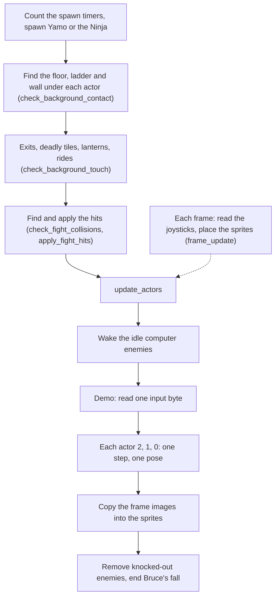
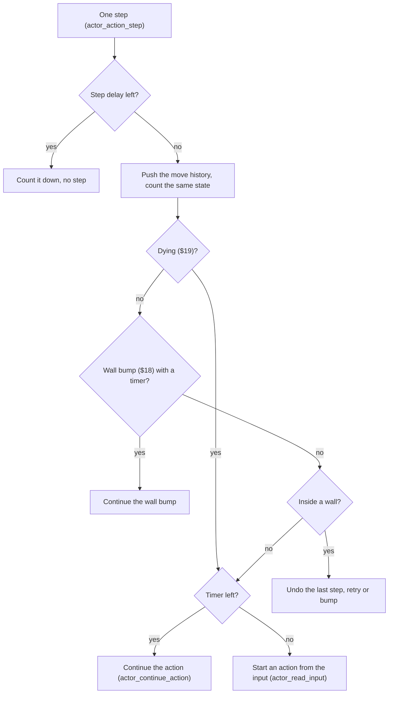
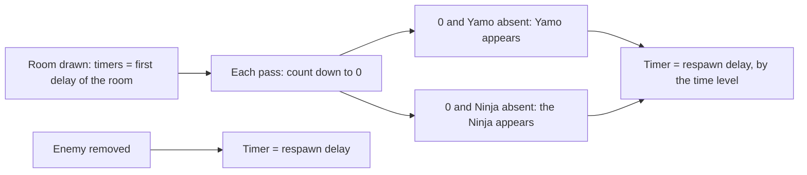
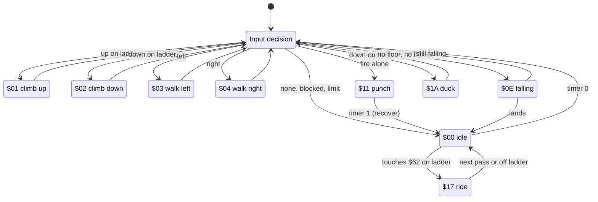
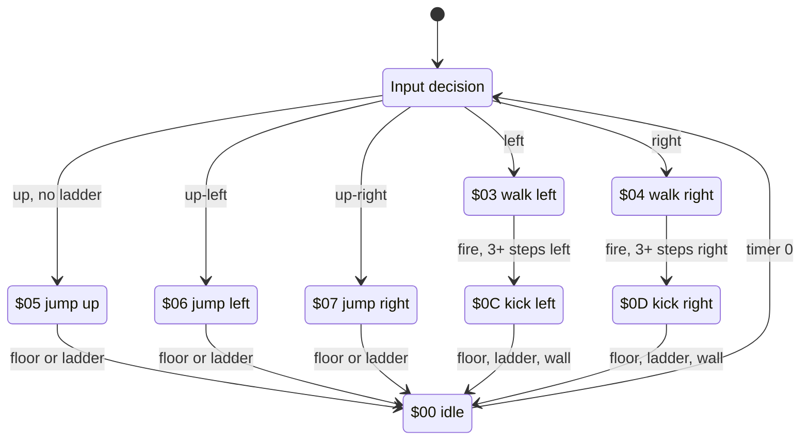
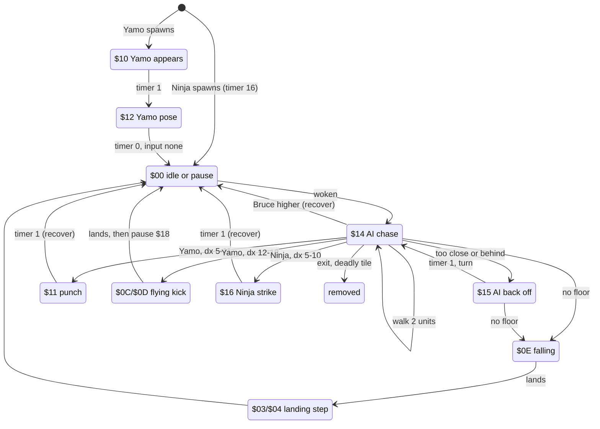
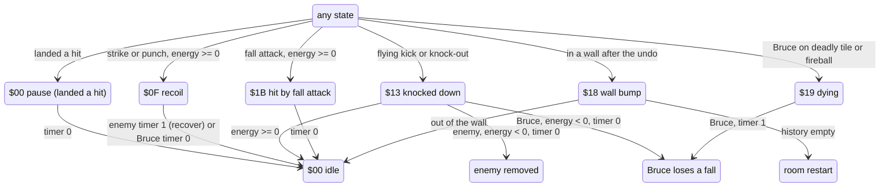

# Bruce Lee: the actors

The game has three actors: Bruce (the player), Yamo (the green sumo wrestler) and the Ninja (black, with a bokken). In each pass of the main loop, each actor in the room does one step. In a step, the actor reads its input. Bruce gets his input from the joystick, and from a recorded stream in the attract demo. The enemies get their input from the computer AI. An action state machine changes the input into walks, climbs, jumps, kicks, punches and falls.

The program needs this machine because an action lasts for several steps. During these steps, a floor, a ladder or a wall can stop the action. This page tells how the actors appear in a room and where their input comes from. It tells how the computer moves the enemies and how the state machine works. It also tells how a state becomes the picture on the screen. Fights and collisions are on [combat.md](combat.md).


Room 0 with Bruce at his start point A (`spawn_a_x` / `spawn_a_y` = `$1A`, `$C4`), before the enemies appear.

**Conventions.**

- Addresses are C64 addresses. Names are the names of the knowledge.
- An *actor* is one of three slots, index X: 0 = Bruce, 1 = Yamo, 2 = Ninja. A per-actor array has 3 bytes, `array,X`.
- A *pass* is one run of [`main_loop` `$1BC2`](../src/game/game_main_loop.asm#L23). A pass takes 3 frames (`frame_countdown` = 3). Thus the main loop does 16.7 passes each second on PAL.
- A *step* of an actor is a pass in which its step delay `actor_step_delay` is 0. In a step, `actor_action_step` does an action. T is the timer `actor_timer` of the actor at the start of the step.
- A *unit* of `actor_x` is 2 screen pixels. This is one multicolour pixel, because the sprites are X-expanded. A unit of `actor_y` is one raster line.
- Joystick values are in the CIA format, active low: bit 0 up, bit 1 down, bit 2 left, bit 3 right, `$0F` = no direction.
- A *computer enemy* is the Ninja, and Yamo when `option_yamo_player2` = 0.
- To *back off* is the AI action of state `$15`: the enemy walks to a point 15 units from Bruce.
- The *respawn delay* of a room is the delay before an enemy appears again after it leaves.
- The *time level* comes from `get_room_time_level`. It uses the high byte of `room_time`, the count of frames of play in the room. Level 0 is below `$19` (6400 frames). Level C starts at `$19`, and level V starts at `$20` (8192 frames).
- The page writes state numbers as `$00`-`$1B`. "State `$0C`/`$0D`" means the left or the right variant.
- **Observed** marks a fact that a run showed. **Code** marks a fact from the code only. **Conclusion** marks an interpretation.

## How it works

An actor stays in a room while it is active. Bruce is in the room from its start. Yamo and the Ninja appear when their spawn timers reach 0. An enemy fights Bruce. It leaves the room after a knock-out, on a deadly tile, or through an exit. One pass of the main loop does the actor work in this order (**Code**):



1. **The enemies appear.** [`tick_spawn_timers` `$0DA4`](../src/actor/actor_spawn.asm#L341) decreases the spawn timers. At zero, Yamo or the Ninja appears (see [Spawning](#spawning)). Rooms with `room_no_enemy_flag` set skip this step.
2. **The program looks at the background.** [`check_background_contact` `$5212`](../src/actor/background_contact.asm#L17) compares each sprite shape with the background pixels. It sets the flags in `actor_contact`: floor, trigger, ladder, wall. The state machine reads these flags in each step. See [combat.md](combat.md).
3. **The characters under the actors act.** [`check_background_touch` `$2E39`](../src/actor/background_touch.asm#L10) reads the characters under each actor. These are exits, deadly tiles, lanterns, and the moving character `$62` that carries an actor (state `$17`).
4. **The fights.** [`check_fight_collisions` `$29C3`](../src/actor/fight_hits.asm#L14) and `apply_fight_hits` find and apply the hits. They do not run in rooms with `room_no_enemies` set. A hit sets a new state directly.
5. **The actors act.** [`update_actors` `$179E`](../src/actor/actor_driver_text.asm#L10) wakes the idle computer enemies and takes the demo input. Then it runs one step and one pose choice for each active actor, Ninja first.
6. **The sprites.** [`build_actor_sprites` `$2584`](../src/actor/actor_sprites.asm#L12) copies the frame images of the poses. `check_actor_knockouts` removes knocked-out enemies or ends the fall of Bruce.

The raster interrupt [`frame_update` `$15A8`](../src/game/frame_update.asm#L20) reads the joysticks in each frame into `actor_joy_dir` and `actor_fire`. The main loop uses the last value (**Code**).

### One step of an actor

An action such as a jump lasts many steps. Thus each actor keeps its state and a timer from step to step. In each step, [`actor_action_step` `$1C5B`](../src/actor/actor_step.asm#L21) continues the current action or starts a new action from the input. Before that, it records the moves of the last steps. With this record, the program can undo a move into a wall.



1. `undo_retry_count` = 8. This value limits the wall undo in this step.
2. If `actor_step_delay` is not zero, the routine decreases it and returns. Thus a climb is slower than a walk. After a climb step, 3 passes follow without a step.
3. The routine pushes the move history. If record 0 of `actor_move_queue` holds a move, records 0-9 move to 1-10. Then the routine clears record 0 for the moves of this step (see [The move history](#the-move-history)). It also clears `actor_pose_done`, so this step selects a new pose.
4. `actor_same_state_count` counts how long the state stays the same. It is 6 when the state is 0 or differs from `actor_prev_state`. Else it decreases to 0. At 0, a walk or a climb gets faster. The flying kick needs a count below 4.
5. `actor_prev_state` = state.
6. State `$19` (dying) goes directly to the timer check, without the wall check.
7. State `$18` with a timer continues the wall bump in `act_wall_bump`.
8. Bit 3 of `actor_contact` tells that the actor is in a wall. Then the last step moved it there, and the wall undo starts (see [Movement and the wall undo](#movement-and-the-wall-undo)).
9. A timer that is not zero continues the timed action in [`actor_continue_action` `$2008`](../src/actor/actor_timed_actions.asm#L14), with Y = timer. A zero timer starts a new action in [`actor_read_input` `$1D7E`](../src/actor/actor_step.asm#L184).

Each path ends in a state setter. The setter stores the state, its step delay and the timer. The move primitives also set a state (`$01`-`$04`) and return. Thus a handler that calls several primitives writes its own state at its end (**Code**).

### Spawning

Bruce appears at start point A of each room. An enemy appears at point A or point B of the room, or at a random point. It appears after a delay that each room sets. An enemy that follows Bruce from the last room appears again at its old position.

| Actor | Started by | Entry state |
|---|---|---|
| Bruce | `reset_play_state` ends with `jmp spawn_actor` (X = 0, A = 0). `draw_room` then sets Bruce's `actor_state` = 0, `actor_timer` = 4, `actor_contact` = 1. | `$00` with timer 4 |
| Yamo | `update_yamo_spawn` calls `spawn_yamo` when `yamo_spawn_timer` = 0 and Yamo is not active. | `$10` with timer 10 |
| Ninja | `update_ninja_spawn` calls `spawn_ninja` when `ninja_spawn_timer` = 0 and the Ninja is not active. | `$00` with timer `$10` |

All three actors use [`spawn_actor` `$0B8E`](../src/actor/actor_spawn.asm#L20), with X = actor and A = type in bits 7-6 (`$00` Bruce, `$40` Ninja, `$80` Yamo) (**Code**):

1. `actor_flags` = A OR 1. The type 0-2 goes to `temp_y`.
2. The collision codes of the type go to `actor_collision_code_a` and `actor_collision_code_b`. `set_sprite_slot_owner` writes X into `sprite_owner` for each sprite of the actor. The fight code uses these values to find which actors touch.
3. `spawn_actor_init_fields` gives the actor a clean start:
   - state, timer and step delay 0
   - `actor_joy_dir` = `$0F` and `actor_fire` = 1 (no input)
   - `actor_contact` = 1 (floor)
   - `actor_facing` = 1 (right)
   - pose and frame 2, second pose and frame 3
   - `actor_energy` = `$24`
4. The position:
   - In the demo (`game_mode` = 0) and for Bruce: start point A of the room, `spawn_a_x` / `spawn_a_y`.
   - An enemy with `enemy_follow_x` not zero takes the saved position and energy. Then `spawn_actor_follow_bruce` clears the follow entry.
   - Yamo: the routine reads [`yamo_spawn_side` `$136F`](../src/room/room_enemy_tables.asm#L107) of the room. 0 = random side (`random_byte` bit 0). Else, when `random_byte` >= `$C0` (1 time in 4), the side is random. Else bit 7 clear = point A, and bit 7 set = point B (`spawn_b_x` / `spawn_b_y`).
   - Ninja: see the finding below.
5. `spawn_actor_set_sprites` sets the sprite pointers from `sprite_buffer_pointers`. It adds 5 when `sprite_buffer_select` is not zero. It also sets the position of the main and the overlay sprite (X × 2, Y + `$1D`) and the sprite enable bits.

**The Ninja's start side comes from Yamo's table.** The code only tests [`ninja_spawn_side` `$1333`](../src/room/room_enemy_tables.asm#L87) for zero, which means a random side. For a value that is not zero, [`spawn_actor_ninja_side` `$0C2A`](../src/actor/actor_spawn.asm#L103) uses `yamo_spawn_side` of the room, with the same 3-in-4 rule (**Code**).

[`spawn_yamo` `$0CD5`](../src/actor/actor_spawn.asm#L203) plays sound `$82` (`play_enemy_spawn_sound`) and stores the protection value `protection_result`. It calls `spawn_actor` with X = 1, A = `$80`. Then it sets state `$10`, pose `$2A`/`$2B`, frame `$6C`/`$6D` and timer `$0A`. It limits the energy to `$14` (**Code**).

[`spawn_ninja` `$0DF8`](../src/actor/actor_spawn.asm#L398) plays sound `$82` and calls `spawn_actor` with A = `$40` (the caller sets X = 2). It sets frame `$82`. It sets the second pose and frame to 0, because the Ninja has no overlay sprite. It limits the energy to 7 and sets `actor_timer` = `$10` with state 0. Then it turns him toward Bruce (`measure_distance_to_bruce`, `face_bruce`) (**Code**).

**The first frame of a new enemy is not its pose.** `spawn_yamo` and `spawn_ninja` store frames `$6C` and `$82`. These values are not `actor_frame_base` + pose (`$70`, `$8E`). `select_actor_pose` replaces them in the same pass. Before that, `check_background_contact` uses them one time (**Code**).

### The spawn timers

Each room sets how long Bruce is alone before an enemy appears. It also sets the respawn delay. The delays are in passes (3 frames). They come from the room tables (see [The spawn tables of the rooms](#the-spawn-tables-of-the-rooms)).



1. [`draw_room` `$09BC`](../src/room/draw_room.asm#L28) loads `ninja_spawn_timer` from `ninja_room_delay` and `yamo_spawn_timer` from `yamo_room_delay` (`draw_room_load_spawn_timers`). When `game_loop_count` is not zero, both timers are 3. When player 2 plays Yamo, the timer of Yamo is 8.
2. In each pass in a room with enemies, `tick_spawn_timers` decreases both timers to 0.
3. At 0, [`update_yamo_spawn` `$0D0F`](../src/actor/actor_spawn.asm#L238) and [`update_ninja_spawn` `$0DB1`](../src/actor/actor_spawn.asm#L355) make the enemy appear if it is not active. Then its timer gets the respawn delay of the room (`yamo_respawn_delay`, `ninja_respawn_delay`). Yamo gets `$30` when player 2 plays him. The time level can make the delay shorter (see [The time in the room](#the-time-in-the-room)).
4. While the enemy is active, its timer stays at 0. `remove_actor` (knock-out, deadly tile, exit) calls `reset_spawn_timer`, which loads the respawn delay again. Thus the respawn delay starts at the removal.

**The Ninja waits for a computer Yamo.** This rule applies when the Ninja's timer is 0 and Yamo is active and computer-controlled. Also `game_loop_count` must be 0, and the time level must be 0. Then `update_ninja_spawn` sets the timer to `$10` again when `random_byte` >= `$19`, which is 231 times in 256. Thus the Ninja seldom appears while a computer Yamo is in the room. In the demo `random_byte` returns 1, so the Ninja does not wait (**Code**).

In run `coll` of this page, the Ninja appeared at frame 63 and Yamo at frame 471 (**Observed**). The run starts from a snapshot of room 0, about 250 frames after the room start, and runs for 1500 frames. The room delays are 104 passes (312 frames) and 240 passes (720 frames). 312 - 250 = 62 and 720 - 250 = 470.

### The time in the room

When Bruce stays longer in a room, the enemies appear again sooner and rest less after an attack. [`room_time` `$87`](../src/constants.asm#L82) counts the frames of play in the room. It does not count in the demo or during a pause, and `draw_room` clears it. [`get_room_time_level` `$10D0`](../src/game/game_setup.asm#L252) returns C = 1 from `$19` × 256 frames (128 seconds). It returns V = 1 from `$20` × 256 frames (164 seconds) (**Code**):

| Effect | Level 0 | Level C | Level V | `game_loop_count` nonzero (level 0) | Code |
|---|---|---|---|---|---|
| Spawn timer after a spawn or a removal | table value | table value / 2 | 3 | 3 | `update_yamo_spawn`, `update_ninja_spawn`, `reset_spawn_timer` |
| The Ninja waits for a computer Yamo | yes | no | no | no | `update_ninja_spawn` |
| `actor_recover` timer, Bruce | 3 | 12 | 12 | 3 | `actor_recover` |
| `actor_recover` timer, enemy | 6 | 3 | 1 | 1 | `actor_recover` |
| Pause after landing a hit, Bruce | 3 | 8 | 10 | 3 | `apply_fight_hits` |
| Pause after landing a hit, enemy | `$18` (24) | 10 | 10 | 3 | `apply_fight_hits` |
| Pause of an enemy after its own flying kick | `$18` | 3 | 1 | 1 | `wake_idle_enemies_kick` |

When a player-2 Yamo gets no input for 7 × 256 frames, `frame_update` sets the high byte of `room_time` to `$20`. Then the room is at level V immediately (see [Yamo played by player 2](#yamo-played-by-player-2)).

### Input from the joysticks

Bruce and a player-controlled Yamo get their input from a joystick. [`actor_read_input` `$1D7E`](../src/actor/actor_step.asm#L184) compares the direction with exact values. Thus each of the eight directions starts its own action. A value with an impossible combination, for example up and down together, matches no value. This value gives the idle state (**Code**).

| `actor_joy_dir` | Direction | Action at timer 0 |
|---|---|---|
| `$0E` | up | climb up on a ladder, else jump up (`$05`) |
| `$0D` | down | climb down on a ladder. On a floor, Bruce ducks (`$1A`) and Yamo poses (`$12`). |
| `$0B` | left | walk left (`$03`). Fire after 3+ steps = flying kick left (`$0C`). |
| `$07` | right | walk right (`$04`). Fire after 3+ steps = flying kick right (`$0D`). |
| `$0A` | up-left | jump left (`$06`) |
| `$06` | up-right | jump right (`$07`) |
| `$09` | down-left | Bruce ducks facing left (`$1A`). An enemy acts as for down. |
| `$05` | down-right | Bruce ducks facing right (`$1A`). An enemy acts as for down. |
| `$0F` | none | fire = punch (`$11`), else idle |
| other | - | idle (`$00`) |

`actor_fire` = 0 means that the player presses fire. Each other value means no fire.

[`frame_update` `$15A8`](../src/game/frame_update.asm#L20) reads the joysticks in each frame of a game (`game_mode` = 1) (**Code**):

1. It saves the CIA 1 data direction registers (`cia1_ddra_save`) and sets them to input.
2. For Bruce, it reads port 1 (`CIAPRB`) for player 1 and port 2 (`CIAPRA`) for player 2 (`current_player`). The low nibble is the direction.
3. When `joystick_right_handed` of that port is 0 (left handed), the direction turns 90 degrees: new = (joy >> 2) OR `joy_rotate_bits`[joy AND 3].
4. The fire bit (bit 4) of the same port goes to `actor_fire`.
5. When `option_yamo_player2` is not zero, the other port goes to `actor_joy_dir+1` and `actor_fire+1`. The handedness of that port applies.
6. It restores the data direction registers.

[`joy_rotate_bits` `$4A85`](../src/room/room_tables.asm#L8) = `$00`, `$08`, `$04`, `$0C`. The rotation changes the directions of a left-handed player as follows (**Code**):

| Physical direction | Becomes |
|---|---|
| up | right |
| down | left |
| left | up |
| right | down |

For example, a left-handed player pushes down. The port gives `%1101` = `$0D`. `$0D` >> 2 = `%0011`. `$0D` AND 3 = 1, and `joy_rotate_bits+1` = `$08`. `%0011` OR `%1000` = `$0B` = left.

The title keys L and shift-L set left handed for port 1 and port 2. The keys R and shift-R set right handed. `title_menu_loop` writes the result to [`joystick_right_handed` `$1383`](../src/room/room_enemy_tables.asm#L114) (**Code**).

### Yamo played by player 2

The title option F5 sets [`option_yamo_player2` `$42CA`](../src/game/options_and_patterns.asm#L18). Then a second player plays Yamo against Bruce (**Code**):

- `frame_update` reads the other port into the input of Yamo (see [Input from the joysticks](#input-from-the-joysticks)).
- `wake_idle_enemies` skips Yamo, so he never enters the AI states `$14`/`$15`. He uses `actor_read_input` like Bruce.
- He cannot duck. Down on a floor gives the pose of Yamo (`yamo_start_pose`, state `$12`).
- `act_ride` gives him no automatic direction in state `$17`.
- The first spawn delay of Yamo is 8 passes, and his respawn delay is `$30` (48) passes.
- [`init_game_variables` `$0F72`](../src/game/game_setup.asm#L18) gives 9 falls instead of 4.

**When player 2 stops, the computer plays Yamo again.** When the joystick of Yamo is idle for 7 × 256 frames (`yamo_idle_time`), [`frame_update_yamo_idle` `$173F`](../src/game/frame_update.asm#L294) sets `option_yamo_player2` = 0. It sets the high byte of `room_time` to `$20`, which is the top time level. It also plays sound `$8A` and takes 5 falls from both players, but not below 0 (**Code**).

### The attract demo and room 19

In the attract demo, no player holds the joystick. [`update_actors` `$179E`](../src/actor/actor_driver_text.asm#L10) reads one byte per pass from the demo stream while `game_mode` = 0. It gives this byte to Bruce as his input (see [The demo input stream](#the-demo-input-stream)). In the demo, every actor spawns at start point A and `random_byte` returns 1. The room time does not count (**Code**).

In room 19 (the congratulations room), the game moves Bruce itself. Before each step, [`update_actors_loop` `$17BE`](../src/actor/actor_driver_text.asm#L29) writes a direction for Bruce. The direction is up (`$0E`) while the high byte of `room_time` is below 2 (512 frames). After that, the direction is none (`$0F`) (**Code**).

### The computer AI

A computer enemy has no joystick. It keeps `actor_joy_dir` = `$0F` and `actor_fire` = 1 from `spawn_actor`. With that input, `actor_read_input` gives idle. Thus all its actions come from the AI states `$14` (chase) and `$15` (back off), and from the wake-up at the start of each pass. In state `$17` (ride), `act_ride` writes left or right by its facing. Then `act_ride_finish` sets the input to `$0F`/1 again (**Code**).

#### Waking

An enemy that stands idle and rested starts to chase Bruce. [`wake_idle_enemies` `$2D7C`](../src/actor/actor_helpers.asm#L40) runs first in each pass. It examines X = 2, 1 and 0, but actor 0 is never of the Yamo or Ninja type (**Code**):

1. It skips the actor when `actor_energy` < 0.
2. Yamo counts only when `option_yamo_player2` = 0 and `actor_flags` AND `$81` = `$81`. The Ninja counts when `actor_flags` AND `$41` = `$41`.
3. It skips the actor unless `actor_state` = 0, `actor_timer` = 0 and `actor_contact` AND 5 is not zero (floor or ladder).
4. If `actor_prev_state` is `$0C`/`$0D`, the enemy just did a flying kick. Then the routine calls `actor_recover` and sets `actor_timer`. The timer is `$18`, or 3 at level C, or 1 at level V or with `game_loop_count` not zero. Thus an enemy rests after its own kick.
5. Else it sets state `$14`, timer `$14` and step delay 0.

#### The chase

In state `$14`, the enemy walks toward Bruce on his level. It attacks when Bruce is in range. [`ai_chase` `$22FA`](../src/actor/enemy_ai_states.asm#L13) measures the distance with `measure_distance_to_bruce`. `bruce_dist_y` and `bruce_dist_x` hold the absolute value, at most `$30`. Bit 7 holds the sign: Bruce is lower, or Bruce is to the right (**Code**).

1. No floor (`actor_contact` bit 0 clear): on a ladder, the enemy continues to walk (`ai_walk_forward`). Else it falls (`ai_chase_fall`, then `actor_start_fall`).
2. Bruce on another level, \|dy\| >= `$10` (`ai_other_level`): when Bruce is lower, the enemy continues to walk in its facing direction. When Bruce is higher, it calls `face_bruce` and `actor_recover`. The state becomes `$00`. After the timer, `wake_idle_enemies` starts the chase again.
3. Same level, not facing Bruce: at \|dx\| >= `$21`, the enemy turns and walks (`ai_chase_turn_around`). Else it backs off (`ai_back_off`).
4. Same level, facing Bruce: [`ai_facing_bruce` `$237B`](../src/actor/enemy_ai_states.asm#L96) selects the attack from the table below.

The enemy walks 2 units per step with `actor_walk_right_two` / `actor_walk_left_two`. The timer does not change.

The attack ranges, by \|dx\| = `bruce_dist_x` AND `$7F` (units of 2 pixels) (**Code**):

| \|dx\| | Yamo | Ninja |
|---|---|---|
| 0-4 | back off (`ai_too_close_back_off`) | back off |
| 5-10 | punch `$11` (`actor_try_punch`, refused on a ladder → recover) | bokken strike `$16`, timer 19 |
| 11 | punch `$11` | walk toward Bruce |
| 12-18 | flying kick `$0C`/`$0D` by facing, timer 12 | walk toward Bruce |
| 19 and more | walk toward Bruce | walk toward Bruce |

The hit tests need a reach of at least 6 units for a punch or a kick and 4 for the strike (see [combat.md](combat.md)). Thus a punch of Yamo at \|dx\| = 5 cannot hit (**Code**).

In run `coll`, the Ninja entered state `$14` 16 passes after he appeared (his spawn timer `$10`). He walked with `$03` inside `$14` (**Observed**).

#### Backing off

An enemy that is too close to Bruce, or has Bruce behind it, walks to a point 15 units from him. Then it turns. [`ai_back_off` `$2327`](../src/actor/enemy_ai_states.asm#L40) starts this action (**Code**):

1. The target point is the X of Bruce - 15 when Bruce is to the right (bit 7 of `bruce_dist_x`). It is the X of Bruce + 15 when he is to the left.
2. `actor_timer` = \|target - X\|, at least 5. The state is `$15`, the step delay is 0, and `actor_climb_block` = 0.
3. In each step of state `$15`, [`act_check_ai_back_off` `$23CD`](../src/actor/enemy_ai_states.asm#L146) examines the enemy. Without a floor, it falls. At timer 1, it turns, with state `$14` and timer `$80`. Else it walks 2 units in its facing direction.

The enemy backs off in its current facing. An enemy that does not face Bruce walks away from him. An enemy that faces Bruce at less than 5 units walks through him (**Code**). The enemies pass each other and Bruce, and then turn (**Conclusion**).

### Movement and the wall undo

All movement uses four move primitives. Each primitive moves one unit and sets the state of its direction. It also counts the move in record 0 of the move history. At the edge of the play area, the primitive refuses the move. It calls `actor_set_idle`, which returns from the primitive with state `$00`. Then the calling handler continues (**Code**).

| Primitive | Effect | Refused (state `$00` instead) | Record 0 count |
|---|---|---|---|
| `actor_move_up` | `actor_y` - 1, state `$01` | `actor_y` < `$2E`, or `actor_climb_block` bit 0 | `actor_move_queue+0` |
| `actor_move_down` | `actor_y` + 1, state `$02` | `actor_y` >= `$C7` | `actor_move_queue+3` |
| `actor_move_left` | `actor_x` - 1, facing 0, state `$03` | `actor_x` < `$0D` | `actor_move_queue+6` |
| `actor_move_right` | `actor_x` + 1, facing 1, state `$04` | `actor_x` >= `$A3` | `actor_move_queue+9` |

A walk moves 2 units per pass, or 3 when the same-state count is 0. This is about 33 units = 67 pixels per second. A climb moves 3-4 units per 4 passes. A fall moves 2 lines per pass (**Code**, **Observed** in run `kick`).

The program does not test for a wall before a move. It moves the actor and then reads the contact flags in the next step. When bit 3 of `actor_contact` is 1 at the start of a step, the last step moved the actor into a wall. Then [`actor_in_wall` `$1CD0`](../src/actor/actor_step.asm#L89) undoes the moves of record 1 (**Code**):

```
undo_only_down = 1
repeat record1.up times:    move_down;  undo_only_down = 0
repeat record1.down times:  move_up
repeat record1.left times:  move_right; undo_only_down = 0
repeat record1.right times: move_left;  undo_only_down = 0
drop records 0 and 1 (slots 8..43 -> 0..35), clear records 9, 10, actor_step_delay = 0
undo_retry_count -= 1
if undo_retry_count < 0 or on a ladder:           state $18, timer 64
elif undo_only_down == 1:
    if actor_prev_state == $1A:                   state $18, timer 64
    else:                                         run the step again (actor_action_run)
elif undo_retry_count == 7:                       state $18, timer 64   # first undo of this step
else: move 1 unit against the facing (turns), state $18, timer 64
```

`undo_only_down` stays 1 while the routine undoes only down moves of the last step. `undo_retry_count` is 8 at each step and decreases by 1 at each undo. It limits the retries. The undo moves count in record 0 like all moves. When the routine drops records 0 and 1, it removes these moves and the undone step (**Code**).

In state `$18`, [`act_wall_bump` `$24B7`](../src/actor/actor_hit_states.asm#L104) waits until the actor is free. When the actor is out of the wall, the state ends at the next step. When it is still in the wall, the code ORs the 40 counts of records 1-10. If the result is not zero, `act_wall_bump_undo_again` undoes the next record (**Code**).

**A wall bump with an empty move history restarts the room.** When all counts of records 1-10 are zero, [`act_wall_bump_still_in` `$24C6`](../src/actor/actor_hit_states.asm#L112) restarts the room. It calls `enter_room` with `current_actor` = 0 and `next_room` = `room`. Bruce starts at `spawn_a_x`/`spawn_a_y`. This also occurs when the stuck actor is an enemy (**Code**).

**A walk into a wall makes the actor face the other way.** The program undoes the walk immediately. The undo move goes in the other direction, so the actor turns. While the player holds the joystick, the actor shakes at the wall (**Observed**, run `wall`, see [Walking into the left wall of room 0](#walking-into-the-left-wall-of-room-0)).

### Poses

After the step, the program selects the picture of the actor. A pose is an even number. The frame of the main sprite is the first frame of the actor type plus the pose. The overlay sprite shows the next frame. [`select_actor_pose` `$2780`](../src/actor/actor_poses.asm#L18) selects the pose from the state, the facing and the timer. [`set_actor_pose` `$29A1`](../src/actor/actor_poses.asm#L324) changes the pose into the frames (**Code**).

`update_actors` calls `select_actor_pose` after the step. The routine runs one time per step. When `actor_pose_done` is not zero, the pose of the step is already set. This occurs during the step delay, after `actor_set_idle` in the idle state, and after `apply_fight_hits` gave the attacker its pause. The routine saves `actor_pose` in `actor_prev_pose`. Then it tests the state in this order (**Code**):

```
$0E $1A $19 $18 $1B $13 $10 $11 $12 $16 $0F $0C $0D $14 $15 $03 $04 $05 $06 $07 $17 $00 other
```

| State | Pose (facing left / right) | Code |
|---|---|---|
| `$00` | `$00` / `$02`. On a ladder (`actor_contact` bit 2): keep `$0A`/`$0C`, else `$0A`. | `select_pose_try_stand` |
| `$01`, `$02` (and other states not in the list) | climbing: `$0A` ↔ `$0C` alternate | `select_pose_climb_step` |
| `$03` | `$0E` ↔ `$10`. On a ladder: climbing. | `select_pose_walk_left` |
| `$04` | `$12` ↔ `$14`. On a ladder: climbing. | `select_pose_walk_right` |
| `$05` | T >= 15: `$08`, T 12-14: `$1E`, T 2-11: `$20`, T 1: `$1E`, T 0: `$08` | `select_pose_try_jump_up` |
| `$06` | T 3-11: `$24`, else `$22` | `select_pose_try_jump_left` |
| `$07` | T 3-11: `$28`, else `$26` | `select_pose_try_jump_right` |
| `$0C` | T >= 10: `$16`, else `$18` | `select_pose_try_kick_left` |
| `$0D` | T >= 10: `$1A`, else `$1C` | `select_pose_try_kick_right` |
| `$0E` | `$44`. In a wall (bit 3): `$08`. | `select_actor_pose` |
| `$0F` | `$00` / `$02` | `select_pose_try_recoil` |
| `$10` | `$2A` | `select_pose_try_yamo_appear` |
| `$11` | `$04` / `$06` | `select_pose_try_punch` |
| `$12` | `$2C` / `$2E` | `select_pose_try_yamo_pose` |
| `$13` | T >= 10: `$3C` / `$38`, else `$3E` / `$3A` | `select_pose_try_knockdown` |
| `$14`, `$15` | as `$03` / `$04` by the facing | `select_pose_try_enemy_walk_a`, `select_pose_try_enemy_walk_b` |
| `$16` | T >= 11: `$30` / `$34`, else `$32` / `$36` | `select_pose_try_enemy_strike` |
| `$17` | `actor_ride_hold` = 0: climbing, else the previous pose | `select_pose_try_ride` |
| `$18` | the previous pose. `$08` when it was `$44` or a frame is 16 pixels wide. | `select_pose_try_wall_bump` |
| `$19` | `$08` | `select_pose_try_dying` |
| `$1A` | `$40` / `$42` | `select_pose_try_crouch` |
| `$1B` | T >= 4: `$3C` / `$38`, else `$3E` / `$3A` | `select_pose_try_fall_knockdown` |

`set_actor_pose` calculates the frames as follows (**Code**):

```
actor_pose[X]   = pose
actor_pose_b[X] = pose + 1
type            = (actor_flags[X] rol 3) & 3          # 0 Bruce, 1 Ninja, 2 Yamo
actor_frame_a[X] = actor_frame_base[type] + pose     # main sprite
actor_frame_b[X] = actor_frame_a[X] + 1              # overlay sprite
```

The frame images, sizes and colours are in `frame_gfx_lo`, `frame_gfx_hi`, `frame_last_row`, `frame_colour` and `frame_is_wide`. [tables.md](reference/tables.md) of the reference decodes them. [graphics.md](graphics.md) tells how the program builds the sprites.

## The data

### The actor arrays

Each actor has one byte in each array, at `array,X`. Most arrays are in the zero page. The table gives the arrays that the state machine and this page use. The [memory map](reference/memory-map.md) of the reference gives the other arrays. These are the frame widths and colours of the sprite builder and the character cell under the actor. They also include the collision codes of the sprites and the touch mask of the fight code (**Code**).

| Name | Address | Meaning and encoding |
|---|---|---|
| `actor_flags` | `$95-$97` | Bit 0 = active. Bits 7-6 = type: `00` Bruce, `01` Ninja, `10` Yamo. Values `$01`, `$81`, `$41`. `remove_actor` clears bit 0. |
| `actor_joy_dir` | `$98-$9A` | Joystick direction, CIA format. `$0F` from `spawn_actor`. |
| `actor_fire` | `$9B-$9D` | Fire: 0 = pressed, other = released. The demo stores a whole nibble here. |
| `actor_x` | `$9E-$A0` | X position in units of 2 pixels. Sprite X = 2 × `actor_x` (bit 8 to `MSIGX`). The move primitives refuse a move below `$0D` (left) and from `$A3` (right). |
| `actor_y` | `$A1-$A3` | Y position in raster lines. Sprite Y = `actor_y` + `$1D`. The move primitives refuse a move below `$2E` (up) and from `$C7` (down). The floor of room 0 is `$C4`. |
| `actor_facing` | `$A4-$A6` | 0 = left, 1 = right. |
| `actor_contact_upper` | `$A7-$A9` | Background contact flags (bits as `actor_contact`) of the body without its last 6 rows. A falling Bruce reads bit 0. |
| `actor_ride_hold` | `$AA-$AC` | State `$17`: 1 = no ride move in this step (the pose holds), 0 after a move. |
| `actor_ride_delay` | `$AD-$AF` | State `$17`: steps until the next ride move, 4 after a move. |
| `actor_fall_drift` | `$B0-$B2` | 2 when a fall starts, shifted right in each falling step of Bruce. Nonzero = one unit of sideways drift. |
| `actor_contact` | `$B6-$B8` | Background contact. Bit 0: floor (`%01` pixels). Bit 1: trigger (`%10` pixels). Bit 2: ladder or vine (`%11` pixels of a coloured character). Bit 3: wall (`%11` pixels of a colour-0 character). 1 at spawn. |
| `actor_hit_flags` | `$BC-$BE` | Fight result of this pass. Bits 0-4: landed a hit, Ninja strike, punch, flying kick, fall attack. Bit 7: the attacker was Bruce. See [combat.md](combat.md). |
| `actor_state` | `$BF-$C1` | Action state `$00`-`$1B`. |
| `actor_prev_state` | `$C2-$C4` | State at the start of the step (the state of the previous step). |
| `actor_same_state_count` | `$CB-$CD` | 6 when the state changes or is 0, then counts down to 0 while the state stays the same. 0 = one more unit per walk or climb step. Below 4 in a walk = the flying kick is possible. |
| `actor_timer` | `$CE-$D0` | Timer of a timed action, in steps. Nonzero = `actor_continue_action` runs. |
| `actor_energy` | `$D1-$D3` | Energy, signed. `$24` (36) at spawn. Yamo at most `$14` (20), the Ninja at most 7. Negative = knocked out. See [combat.md](combat.md). |
| `actor_step_delay` | `$0106-$0108` | Passes to skip before the next step. The state setters load it from `actor_state_step_delay`. `apply_fight_hits` sets 4. |
| `actor_pose` | `$4F48-$4F4A` | Pose (even number) of the actor. |
| `actor_pose_b` | `$4F4B-$4F4D` | Pose + 1. |
| `actor_frame_a` | `$4F4E-$4F50` | Frame of the main sprite = `actor_frame_base` + pose. |
| `actor_frame_b` | `$4F51-$4F53` | Frame of the overlay sprite = frame + 1 (0 for the Ninja). |
| `actor_prev_pose` | `$4F54-$4F56` | Pose before the current choice. |
| `actor_move_queue` | `$4F57-$4FDA` | Move history: 11 records × 4 counts × 3 actors. |
| `actor_pose_done` | `$4FDB-$4FDD` | Nonzero = the pose of this step is already chosen. |

Some actor variables are outside the arrays:

- `bruce_dist_x` and `bruce_dist_y` for the AI.
- `undo_only_down` and `undo_retry_count` for the wall undo.
- `ninja_spawn_timer` and `yamo_spawn_timer`.
- `enemy_follow_x`, `enemy_follow_y` and `enemy_follow_energy`, 2 bytes each (Yamo, Ninja). They keep the enemy that follows Bruce into the next room. See [combat.md](combat.md).

**Three actor arrays do nothing.** The code writes only 0 to [`actor_climb_block` `$C8`](../src/constants.asm#L104), so this array never stops a climb. [`actor_unused_flag` `$C5`](../src/constants.asm#L103) gets `$FF` in each step outside a wall. [`actor_shown_x` `$B9`](../src/constants.asm#L99) gets the X that `show_actor_sprites` gave the sprites. No code reads these two arrays (**Code**).

### The actor types

The type of an actor sets its sprites, its frames and its collision codes. The constant tables of the actors give these values (**Code**):

| Actor (index X) | `actor_flags` | Type index | Hardware sprites (main, overlay) | `actor_frame_base` | Frames | Collision codes |
|---|---|---|---|---|---|---|
| Bruce (0) | `$01` | 0 | 0, 1 | `$00` | 0-69 | 4, 5 |
| Yamo (1) | `$81` | 2 | 2, 3 | `$46` | 70-139 | 6, 7 |
| Ninja (2) | `$41` | 1 | 4, none (`$FF`) | `$8C` | 140-209 | 3 |

`actor_main_sprite` and `actor_overlay_sprite` use the actor as index. [`actor_frame_base` `$59A5`](../src/actor/actor_frame_tables.asm#L8), `actor_collision_code_first` and `actor_collision_code_second` use the type. `collision_code_to_sprite` changes the codes 3-7 to the sprites 4, 0, 1, 2, 3. The type index (Bruce 0, Ninja 1, Yamo 2) is different from the actor index (Bruce 0, Yamo 1, Ninja 2). `spawn_actor` and `set_actor_pose` get the type from bits 7-6 of `actor_flags` with three `ROL` and `AND #$03` (**Code**).

### The move history

The move history keeps the moves of the last 11 steps with a move. For each step, it holds the count of units in each direction. The wall undo uses these counts to undo moves. [`actor_move_queue` `$4F57`](../src/constants.asm#L174) holds 11 records for each of the 3 actors. A record has 4 counts: up, down, left, right. Each count has 3 bytes, one for each actor (**Code**).

| Field | Address |
|---|---|
| count d (0 up, 1 down, 2 left, 3 right) of record r (0-10), actor X | `$4F57` + 12 × r + 3 × d + X |
| record 0 (moves of the current step), Bruce | `$4F57`, `$4F5A`, `$4F5D`, `$4F60` |
| record 1 (moves of the last step), Bruce | `$4F63`, `$4F66`, `$4F69`, `$4F6C` |
| record 10 (oldest), Bruce | `$4FCF`, `$4FD2`, `$4FD5`, `$4FD8` |

`actor_action_step` pushes and clears the records. The move primitives count into record 0 (**Code**):

```
step start:
    if record0 (up|down|left|right) != 0:
        for slot = 39 downto 0: queue[slot + 4] = queue[slot]     # records 0..9 -> 1..10
    record0 = 0, 0, 0, 0
move primitive: record0[direction] += 1
```

A step without a move does not push. Thus the history holds the last 11 steps that moved. `draw_room` clears the history. [`check_exit_edge` `$30D4`](../src/actor/touch_effects.asm#L154) also reads record 0 (`actor_move_queue`, `actor_move_queue+6`, `actor_move_queue+9`). It uses record 0 to find the direction of the move that reached the screen edge (**Code**).

### The spawn tables of the rooms

Each room has its own delays and start points. The columns come from `room_no_enemies`, `ninja_room_delay`, `ninja_respawn_delay`, `yamo_room_delay`, `yamo_respawn_delay`, `yamo_spawn_side`, `ninja_spawn_side`, `spawn_a_x`, `spawn_a_y`, `spawn_b_x` and `spawn_b_y`. [tables.md](reference/tables.md) of the reference decodes them.

The delays are in passes. "B 3/4" means point B 3 times in 4 and a random point 1 time in 4. The Ninja side follows the method of `spawn_actor`. When `ninja_spawn_side` is zero, the side is random. Else the sign of `yamo_spawn_side` sets the side (**Code**).

| Room | `room_no_enemies` | Ninja first | Ninja respawn | Yamo first | Yamo respawn | Yamo side | Ninja side | Point A (X, Y) | Point B (X, Y) |
|---|---|---|---|---|---|---|---|---|---|
| 0 | 0 | `$68` (104) | `$A0` (160) | `$F0` (240) | `$EE` (238) | B 3/4 | B 3/4 | `$1A`, `$C4` | `$9F`, `$62` |
| 1 | 0 | `$78` (120) | `$A0` (160) | `$EE` (238) | `$EE` (238) | B 3/4 | B 3/4 | `$18`, `$62` | `$95`, `$92` |
| 2 | 0 | `$78` (120) | `$A0` (160) | `$EE` (238) | `$EE` (238) | random | random | `$30`, `$C4` | `$96`, `$C4` |
| 3 | `$FF` | 0 | 0 | 0 | 0 | - | - | `$20`, `$C0` | `$38`, `$C4` |
| 4 | 0 | `$70` (112) | `$70` (112) | `$C0` (192) | `$EE` (238) | B 3/4 | B 3/4 | `$94`, `$B4` | `$96`, `$B4` |
| 5 | 0 | `$18` (24) | `$0C` (12) | `$C0` (192) | `$60` (96) | A 3/4 | A 3/4 | `$22`, `$51` | `$28`, `$C2` |
| 6 | 0 | `$30` (48) | `$30` (48) | `$A0` (160) | `$EE` (238) | random | A 3/4 | `$86`, `$B3` | `$81`, `$72` |
| 7 | 0 | `$50` (80) | `$18` (24) | `$B0` (176) | `$C0` (192) | B 3/4 | B 3/4 | `$1C`, `$44` | `$1F`, `$74` |
| 8 | `$FF` | 0 | 0 | 0 | 0 | - | - | `$14`, `$46` | - |
| 9 | `$FF` | 0 | 0 | 0 | 0 | - | - | `$12`, `$C6` | - |
| 10 | 0 | `$08` (8) | `$0C` (12) | `$30` (48) | `$30` (48) | B 3/4 | B 3/4 | `$34`, `$8C` | `$96`, `$5C` |
| 11 | `$FF` | 0 | 0 | 0 | 0 | - | - | `$40`, `$4C` | - |
| 12 | 0 | `$04` (4) | `$04` (4) | `$20` (32) | `$20` (32) | B 3/4 | B 3/4 | `$18`, `$5C` | `$70`, `$5C` |
| 13 | `$FF` | `$12` (18) | `$08` (8) | `$C0` (192) | `$EE` (238) | - | - | `$98`, `$32` | - |
| 14 | 0 | `$08` (8) | `$08` (8) | `$20` (32) | `$30` (48) | random | A 3/4 | `$18`, `$5C` | `$92`, `$BE` |
| 15 | 0 | `$08` (8) | `$08` (8) | `$30` (48) | `$50` (80) | random | random | `$1C`, `$C3` | `$7A`, `$C4` |
| 16 | 0 | `$08` (8) | `$08` (8) | `$20` (32) | `$30` (48) | A 3/4 | A 3/4 | `$18`, `$5C` | `$81`, `$8E` |
| 17 | `$FF` | `$12` (18) | `$08` (8) | `$C0` (192) | `$EE` (238) | - | - | `$18`, `$B4` | - |
| 18 | `$FF` | 0 | 0 | 0 | 0 | - | - | `$18`, `$C6` | - |
| 19 | `$FF` | 0 | 0 | 0 | 0 | - | - | `$12`, `$95` | - |

Rooms 13 and 17 have delays, but [`room_no_enemies` `$4C9E`](../src/room/room_tables.asm#L164) stops the spawn code there (**Code**).

### The demo input stream

[`demo_input_stream` `$F300`](../src/input/demo_input.asm#L12) is the input of Bruce in the attract demo. `update_actors` reads one byte per pass through `demo_input_ptr`. The stream has no end marker. The title countdown ends the demo (**Code**).

| Bits | Meaning |
|---|---|
| 3-0 | `actor_joy_dir` of Bruce (CIA format) |
| 7-4 | `actor_fire` of Bruce: only the value 0 means "fire pressed" |

The decoder (**Code**, `update_actors`):

```
if game_mode == 0:
    b = demo_input_stream[ptr]; ptr += 1
    actor_joy_dir[0] = b & $0F
    actor_fire[0]    = b >> 4
```

The first 8 bytes at `$F300` are `$17 $04 $28 $03 $08 $04 $00 $04`:

| Byte | Direction | Fire | Result in `actor_read_input` |
|---|---|---|---|
| `$17` | `$7` = right | 1 = released | walk right (`$04`) |
| `$04` | `%0100` = up+down+right | 0 = pressed | no match: idle |
| `$28` | `%1000` = up+down+left | 2 = released | no match: idle |
| `$03` | `%0011` = left+right | 0 = pressed | no match: idle |
| `$08` | `%1000` | 0 = pressed | no match: idle |
| `$04` | `%0100` | 0 = pressed | no match: idle |
| `$00` | all four | 0 = pressed | no match: idle |
| `$04` | `%0100` | 0 = pressed | no match: idle |

**The demo stream looks like (input, count) pairs, but the program reads one byte per pass.** The demo reads exactly 569 bytes (`$F300-$F538`) before its timer ends it (**Observed**, naming-stage run of the demo, recorded in the knowledge). Every second byte is `$01`-`$08`. Thus the data look like (input, count) pairs. But the program reads each byte as one input, and the count bytes act as "idle" inputs (**Conclusion**).

## The state machine

Each action of an actor is a state in `actor_state`. An action that lasts more than one step also has a timer in `actor_timer`. A state with timer 0 lasts one step. At the next step, [`actor_read_input` `$1D7E`](../src/actor/actor_step.asm#L184) selects a new action from the input. A state with a timer continues in [`actor_continue_action` `$2008`](../src/actor/actor_timed_actions.asm#L14) until the timer reaches 0, or until a floor, a ladder or a wall stops it. Hits, deadly tiles and rides change the state from outside the step (**Code**).

| State | Meaning | Actors | Timer at the start | Step delay |
|---|---|---|---|---|
| `$00` | Idle. With a timer: recovering or pausing (stands still). | all | 0, or the pause | 0 |
| `$01` | Moved up (climb up) | all | 0 | 3 |
| `$02` | Moved down (climb down) | all | 0 | 3 |
| `$03` | Moved left (walk) | all | 0 | 0 |
| `$04` | Moved right (walk) | all | 0 | 0 |
| `$05` | Jump up | Bruce, player Yamo | 15 | 0 |
| `$06` | Jump left | Bruce, player Yamo | 15 | 0 |
| `$07` | Jump right | Bruce, player Yamo | 15 | 0 |
| `$08`-`$0B` | Not used. `select_actor_pose` would give the climbing poses. | - | - | 3 |
| `$0C` | Flying kick left | Bruce, Yamo | 12 | 0 |
| `$0D` | Flying kick right | Bruce, Yamo | 12 | 0 |
| `$0E` | Falling | all | 0 | 0 |
| `$0F` | Recoil after a strike or a punch | all | 3 (strike), 4 (punch) | 0 |
| `$10` | Yamo appears | Yamo | 10 | 0 |
| `$11` | Punch | Bruce, Yamo | 4 | 0 |
| `$12` | Yamo's pose (turns to Bruce, sound `$81`) | Yamo | 16 | 0 |
| `$13` | Knocked down | all | 12 | 0 |
| `$14` | AI chase | computer enemies | `$14`, or `$80` after a back-off, kept | 0 |
| `$15` | AI back off | computer enemies | steps (>= 5) | 0 |
| `$16` | Ninja bokken strike | Ninja | 19 | 0 |
| `$17` | Ride: carried by the moving character `$62` on a ladder or vine | all | 16, kept | 0 |
| `$18` | Wall bump | all | 64 | unchanged |
| `$19` | Dying (deadly tile or fireball) | Bruce | 16 | unchanged |
| `$1A` | Duck | Bruce | 0 | 1 |
| `$1B` | Hit by a fall attack | all | 8 | 0 |

[`actor_state_step_delay` `$4A8C`](../src/room/room_tables.asm#L19) gives the step delay, 28 bytes with the state as index. Thus a climb does one step in 4 passes, and a duck does one step in 2 passes. All other states do a step in each pass (**Code**).

The naming-stage runs with the joystick in room 0 and run `coll` of this page showed these states (**Observed**):

- Fire alone gives `$11`, and `$00` after 4 steps.
- Up gives `$05`, up-left gives `$06` and down gives `$1A`.
- A walk right and then right+fire gives `$0D`.
- The Ninja runs `$14` with `$03`/`$02`/`$0E` inside.
- Yamo enters with `$10`, then `$12` at timer 1.
- A hit of the Ninja puts Bruce into `$0F`. [`apply_fight_hits_strike` `$2B9A`](../src/actor/fight_hits.asm#L297) writes this state. A kick or a knock-out puts Bruce into `$13`.
- When Bruce pushes against the left wall, he goes to `$18`.

### Moves on the ground and on ladders

`actor_read_input` starts these states for Bruce and a player-controlled Yamo when he does not jump. Each state with timer 0 returns to the input decision at its next step.



### Jumps and kicks

A jump starts from the input and continues on its timer. A flying kick starts from a walk.



**The flying kick needs a run-up.** Fire without a direction gives a punch. Fire during a walk gives a flying kick only after 3 or more walk steps in the same direction. Then `actor_same_state_count` is below 4. [`actor_walk_left_step` `$1E70`](../src/actor/actor_step.asm#L334) and `actor_walk_right_step` test this count (**Code**, **Observed** in run `kick`, see [A flying kick](#a-flying-kick)).

### The enemies

A computer enemy runs the AI states between its rests. Yamo enters with his own entry state and pose. The Ninja enters idle with a timer of 16.



`spawn_yamo` and `spawn_ninja` set the entry states, and `wake_idle_enemies` starts the chase (see [The computer AI](#the-computer-ai)).

### Hits, death and the wall

These changes come from outside the step. The fight code, the deadly tiles and the wall undo can put an actor into a new state from any state.



[`apply_fight_hits` `$2B4E`](../src/actor/fight_hits.asm#L252) writes the hit states. [`lose_fall` `$1818`](../src/game/lose_fall_game_over.asm#L14) takes a fall from Bruce, and [`enter_room` `$2F8E`](../src/actor/background_touch.asm#L222) restarts the room (**Code**).

**The knock-down slide of the Ninja is not symmetric.** A knocked-down actor slides 2 units per step against its facing. At timer 10, the Ninja slides 8 more units to the left, but only 4 more units to the right ([`act_knocked_down_slide` `$2458`](../src/actor/actor_hit_states.asm#L56), **Code**).

### The dispatch

The state machine has no address table. It uses compare chains (**Code**).

`actor_read_input` (timer 0) tests in this order. The order is important. A falling actor lands before the routine reads the joystick. The wall test comes after the moves and before the jumps.

1. `actor_prev_state` = `$0E`: landing or falling.
2. `actor_contact` AND 5 = 0 (no floor, no ladder): `actor_start_fall`.
3. The directions up `$0E`, down `$0D`, left `$0B`, right `$07`, down-left `$09` and down-right `$05`.
4. `actor_contact` bit 3 (in a wall): as no direction (`actor_input_check_jumps`).
5. The jumps up-left `$0A` and up-right `$06`.
6. No direction `$0F`: a punch with fire, else idle (`actor_input_check_none`).
7. Any other value: idle (`actor_set_idle`).

`actor_continue_action` (timer > 0) compares `actor_state` with the timed states in this order:

```
$05 $0C $0D $06 $07 $19 $17 $10 $11 $16 $14 $15 $12 $0F $13 $18
```

Most handlers follow their compare directly in the code. State `$17` goes to `act_ride`, `$14` to `ai_chase`, `$12` to `actor_continue_state` and `$18` to `act_wall_bump`. Each other state (`$00`, `$1B`) only decreases its timer in `actor_continue_state`.

Each path ends in a state setter. [`actor_set_state` `$1F92`](../src/actor/actor_step.asm#L514) is the common setter. It stores the state, timer 0 and the step delay of the state. The table gives all setters (**Code**):

| Setter | State | Timer | Step delay |
|---|---|---|---|
| `actor_set_state` | A | 0 | `actor_state_step_delay`[A] |
| `actor_set_state_timer15` | A | 15 | from the table |
| `actor_set_state_timer12` | A | 12 | from the table |
| `actor_set_state_timer4` | A | 4 (calls the 12 setter first) | from the table |
| `actor_continue_state` | A | `temp_y` - 1 | from the table |
| `actor_end_action` | `$00` | 0 | 0 |
| `actor_set_idle` | `$00` | 0 | 0. When the previous state was already 0, it also sets `actor_pose_done` (the stand pose does not advance). |
| `actor_recover` | `$00` | by the time level | 0 |
| `actor_enter_wall_bump` | `$18` | 64 | unchanged |
| `yamo_start_pose` | `$12` | 16 | 0 |
| `reset_actor_stand` | `$00` | 0 | 0 |
| `set_actor_hazard_death` | `$19` | 16 | unchanged |

The AI (`ai_back_off_start`, `ai_yamo_set_flying_kick`, `ai_ninja_attack`) and `apply_fight_hits` write `actor_state` and `actor_timer` directly.

Two details of the timed handlers (**Code**):

- `act_ride` and [`ai_walk_forward` `$2352`](../src/actor/enemy_ai_states.asm#L69) increment `temp_y` before `actor_continue_state`. Thus the timer does not decrease, and states `$14` and `$17` end only by a transition.
- In each step, the Ninja strike counts one move in record 0 of the history, but the Ninja does not move. A later wall undo moves the Ninja in the opposite direction by these moves.

**The swing sound of the punch never plays.** [`act_check_punch` `$226A`](../src/actor/actor_timed_actions.asm#L349) plays sound `$85` at timer 8. But a punch starts with timer 4 (**Code**).

### The transitions

T = `actor_timer` at the start of the step. The handler gets it in Y and in `temp_y`. "Input" means `actor_read_input` at the next step.

#### Starting an action (timer 0)

| State | Condition | Next state | Code |
|---|---|---|---|
| any | `actor_step_delay` > 0 | same (delay - 1) | `actor_action_step` |
| any but `$19` | `actor_contact` bit 3 after the move | undo, then retry or `$18` timer 64 | `actor_in_wall` |
| any, T = 0 | `actor_prev_state` = `$0E`, Bruce, upper body on `%01` pixels, `actor_fall_drift` not yet 0 | `$0E`, 1 unit drift in the facing, 2 down | `actor_bruce_falling` |
| any, T = 0 | `actor_prev_state` = `$0E`, Bruce, upper body not on `%01`, `actor_contact` AND 5 | `$00` (landed) | `actor_bruce_fall_check_floor` |
| any, T = 0 | `actor_prev_state` = `$0E`, no floor and no ladder | `$0E`, 2 down | `actor_fall_two` |
| any, T = 0 | `actor_prev_state` = `$0E`, enemy, floor or ladder | `$03`/`$04`: 1 unit in the facing | `actor_land_step_left` |
| any, T = 0 | `actor_contact` AND 5 = 0 | `$0E`, 1 down, `actor_fall_drift` = 2 | `actor_start_fall` |
| any, T = 0 | up, `actor_y` < `$2E` | `$00` | `actor_read_joystick` |
| any, T = 0 | up, on a ladder | `$01`, 3 units (4 when the same-state count is 0), sound `$80` | `actor_up_step` |
| any, T = 0 | up, not on a ladder, in a wall | `$00` | `actor_up_to_idle` |
| any, T = 0 | up, not on a ladder | `$05`, T = 15, sound `$80` | `actor_up_to_idle` |
| any, T = 0 | down, on a ladder (or no floor), `actor_y` < `$C7` | `$02`, 3-4 units, sound `$80` | `actor_climb_down` |
| any, T = 0 | down, on a ladder, `actor_y` >= `$C7` | `$00` | `actor_climb_down` |
| any, T = 0 | down on a floor, Bruce | `$1A` in his facing (`$00` at the X limit) | `actor_bruce_duck` |
| any, T = 0 | down on a floor, Yamo | `$12`, T = 16 | `actor_enemy_down` |
| any, T = 0 | down on a floor, Ninja | `$00` | `actor_enemy_down` |
| any, T = 0 | left, `actor_x` < `$0D` | `$00` | `actor_input_check_left` |
| any, T = 0 | left | `$03`, 2 units (3 when the same-state count is 0), sound `$80` | `actor_walk_left_two` |
| `$03` | left, same-state count < 4, fire | `$0C`, T = 12, facing left | `actor_walk_left_step` |
| any, T = 0 | right, `actor_x` >= `$A3` | `$00` | `actor_input_check_right` |
| any, T = 0 | right | `$04`, 2-3 units, sound `$80` | `actor_walk_right_two` |
| `$04` | right, same-state count < 4, fire | `$0D`, T = 12, facing right | `actor_walk_right_step` |
| any, T = 0 | down-left, Bruce on a floor, `actor_x` < `$A2` | `$1A`, facing left | `actor_duck_face_left` |
| any, T = 0 | down-right, Bruce on a floor, `actor_x` >= `$10` | `$1A`, facing right | `actor_duck_face_right` |
| any, T = 0 | down-left/down-right, Bruce on a ladder or at the limit | `$00` | `actor_input_no_action` |
| any, T = 0 | down-left/down-right, enemy | as down on a floor | `actor_enemy_down` |
| any, T = 0 | up-left/up-right, in a wall | `$00` | `actor_input_check_jumps` |
| any, T = 0 | up-left/up-right, on a ladder | `$00` | `actor_input_check_up_left` |
| any, T = 0 | up-left | `$06`, T = 15, facing left, sound `$80` | `actor_input_check_up_left` |
| any, T = 0 | up-right | `$07`, T = 15, facing right, sound `$80` | `actor_input_check_up_right` |
| any, T = 0 | none and fire, not on a ladder | `$11`, T = 4 | `actor_try_punch` |
| any, T = 0 | anything else | `$00` | `actor_set_idle` |

#### Jumps, kicks and punches

| State | Condition | Next state | Code |
|---|---|---|---|
| `$05` | on a ladder | `$00` | `actor_continue_action` |
| `$05` | T = 15-13 (crouch) or T = 1 | `$05` | `act_jump_up_continue` |
| `$05` | T = 12 | `$05`, 4 units up | `act_jump_up_rise` |
| `$05` | T = 11-8 | `$05`, 2 units up | `act_jump_up_rise_two` |
| `$05` | T = 7-2, on a floor | `$00` | `actor_continue_action` |
| `$05` | T = 7-2 | `$05`, 2 units down | `actor_continue_action` |
| `$0C` | on a ladder or in a wall | `$00` | `act_check_kick_left` |
| `$0C` | T = 12 | sound `$84`, then as T = 11 | `act_check_kick_left` |
| `$0C` | T = 12-10 | `$0C`, 1 up, 1 left | `act_kick_left_phase` |
| `$0C` | T = 9-3 | `$0C`, 1 left | `act_kick_left_fly` |
| `$0C` | T = 2-1, on a floor | `$00` | `act_kick_left_descend` |
| `$0C` | T = 2-1 | `$0C`, 1 down, 1 left | `act_end_if_nonzero` |
| `$0D` | as `$0C`, mirrored | `$0D` / `$00` | `act_check_kick_right` |
| `$06` | on a ladder | `$00` | `act_check_jump_left` |
| `$06` | T = 15-11 | `$06`, 2 up, 2 left | `act_check_jump_left` |
| `$06` | T = 10 | `$06`, 1 up, 2 left | `act_jump_left_rise_one` |
| `$06` | T = 9-7 | `$06`, 2 left | `act_jump_left_glide` |
| `$06` | T = 6-1, on a floor | `$00` | `act_jump_left_descend` |
| `$06` | T = 6 | `$06`, 2 left, 1 down | `act_jump_left_descend` |
| `$06` | T = 5-1 | `$06`, 2 left, 2 down | `act_jump_left_descend` |
| `$07` | as `$06`, mirrored | `$07` / `$00` | `act_check_jump_right` |
| `$11` | on a ladder or in a wall | `$00` | `act_strike_in_wall` |
| `$11` | T = 1 | `$00` with the recovery timer | `act_punch_check_end` |
| `$11` | otherwise | `$11` | `act_punch_check_end` |

#### The enemy states

| State | Condition | Next state | Code |
|---|---|---|---|
| `$10` | T = 1 | `$12`, T = 16, faces Bruce, sound `$81` | `yamo_start_pose` |
| `$10` | otherwise | `$10` | `act_check_yamo_appear` |
| `$12` | T > 0 | `$12` | `act_check_yamo_pose` |
| `$16` | in a wall | `$00` | `act_strike_in_wall` |
| `$16` | T = 12 | sound `$85` | `act_strike_phase` |
| `$16` | T = 1 | `$00` with the recovery timer | `act_strike_end` |
| `$16` | otherwise | `$16`, 1 move counted in the facing direction, no movement | `act_strike_check_end` |
| `$14` | see [The chase](#the-chase) | `$14`, `$15`, `$11`, `$0C`/`$0D`, `$16`, `$0E`, `$00` | `ai_chase` |
| `$15` | no floor | `$0E` | `ai_chase_fall` |
| `$15` | T = 1 | `$14`, T = `$80`, facing turned | `act_check_ai_back_off` |
| `$15` | otherwise | `$15`, 2 units in the facing | `ai_back_off_walk` |
| `$00` | computer enemy, T = 0, floor or ladder, energy >= 0, previous state not `$0C`/`$0D` | `$14`, T = `$14` | `wake_idle_enemies_check` |
| `$00` | computer enemy, T = 0, previous state `$0C`/`$0D` | `$00`, T = `$18` / 3 / 1 | `wake_idle_enemies_kick` |
| `$00`, `$1B` | T > 0 | same, T - 1 | `actor_continue_state` |

#### Hits, death, rides and the wall

| State | Condition | Next state | Code |
|---|---|---|---|
| any | landed a hit (`actor_hit_flags` bit 0) | `$00`, delay 4, pause (see [The time in the room](#the-time-in-the-room)) | `apply_fight_hits` |
| any | Ninja strike landed, energy >= 0 | `$0F`, T = 3 | `apply_fight_hits_strike` |
| any | punch landed, energy >= 0 | `$0F`, T = 4 | `apply_fight_hits_punch` |
| any | flying kick landed, energy >= 0 | `$13`, T = 12 | `apply_fight_hits_kick` |
| any | fall attack landed, energy >= 0 | `$1B`, T = 8 | `apply_fight_hits_fall` |
| any | energy < 0 after a hit | `$13`, T = 12 | `apply_fight_ko` |
| `$0F` | Bruce, or enemy with T >= 2 | `$0F`, pushed 2 units against the facing (facing kept) | `act_recoil_push` |
| `$0F` | enemy, T = 1 | `$00` with the recovery timer | `act_recoil_end` |
| `$13` | Bruce, or `actor_energy` < 0, or T >= 2 | `$13`, 1 down without floor, slides 2 units against the facing. At T = 10 the Ninja slides 8 more left or 4 more right. | `act_knocked_down_fall` |
| `$13` | enemy, `actor_energy` >= 0, T = 1 | `$00` with the recovery timer | `act_knocked_down_end` |
| `$13` | enemy, `actor_energy` < 0, T = 0 | removed | `check_actor_knockouts` |
| `$13` | Bruce, `actor_energy` < 0, T = 0 | `lose_fall` | `check_actor_knockouts_bruce` |
| Bruce, not `$19` | deadly tile (not room 18) | `$19`, T = 16 | `touch_deadly_tile` |
| Bruce, not `$19` | fireball sprite 6/7 touches sprite 0/1 in room 18 | `$19`, T = 16 | `room18_frame_fireballs` |
| `$19` | Bruce, T = 1 | `lose_fall` | `act_dying_lose_fall` |
| `$19` | otherwise | `$19` | `act_continue_far` |
| enemy | deadly tile, exit marker | removed | `touch_deadly_tile`, `enter_room` |
| any, not `$19` | touches `$62` with `actor_contact` bit 2 | `$17`, T = 16, delay 0 | `touch_climb_tile` |
| `$17` | off the ladder (`actor_contact` bit 2 clear) | `$00` | `act_ride` |
| `$17` | every 5th step | `$17`, 2 units in the joystick direction | `act_ride_move` |
| `$17` | `anim_chars_delay` = 1 | `$17`, carried 2 units down (`anim_chars_direction` nonzero) or up | `act_ride_carry` |
| `$17` | each pass | `$00` before the touch test. `$17` again, T = 16, when it still touches `$62`. | `check_background_touch`, `touch_climb_tile` |
| `$18` | out of the wall | `$18`, T = 0, then input | `act_wall_bump` |
| `$18` | in the wall, history not empty | undo again, then retry or `$18` | `act_wall_bump_undo_again` |
| `$18` | in the wall, history empty | room restart, Bruce at point A | `act_wall_bump_still_in` |

## Worked examples

### A flying kick

Run `kick` of this page starts from the room 0 snapshot. It holds the joystick right for 30 frames, then right+fire. The trace records the writes to `actor_state`, `actor_timer`, `actor_x` and `actor_y` of Bruce (**Observed**).

| Frame | `actor_timer` before | Writes | Meaning |
|---|---|---|---|
| 3-27 | 0 | `actor_x` +2 per pass, state `$04` (frames 24, 27: +3) | walk right, the same-state count reached 0 |
| 1 (kick trace) | 0 | state `$0D`, timer 12 (three times) | `actor_walk_right_step` sees fire after 3+ steps. `actor_walk_right_two` calls it 3 times. |
| 3, 6, 9 | 12, 11, 10 | `actor_y` = `$C4`→`$C3`→`$C2`→`$C1`, `actor_x` +1, state `$0D` | rise phase |
| 12-30 | 9-3 | `actor_x` +1 per step, `actor_x` = `$38` at frame 30 | flight phase |
| 34, 37 | 2, 1 | `actor_y` = `$C2`, `$C3`, `actor_x` +1 | descent, no floor yet |
| 40 | 0 | `actor_y` = `$C4`, state `$02`, then `$0E` | no floor in the contact flags: `actor_start_fall` |
| 43 | 0 | state `$00` | `actor_bruce_fall_check_floor`: landed |

The kick moved Bruce from `actor_x` = `$2E` to `$3A` (12 units = 24 pixels), and 3 lines up and down. The move primitives write state `$01`/`$02`/`$04` first. Then `actor_continue_state` writes `$0D`.

### Walking into the left wall of room 0

Run `wall` of this page starts from the room 0 snapshot with the joystick left (**Observed**):

1. Bruce walks left from `actor_x` = `$1A`, 2 units per pass (state `$03`).
2. At `actor_x` = `$0E`, the contact flags are `$09` (floor and wall). The run stops at [`actor_in_wall` `$1CD0`](../src/actor/actor_step.asm#L89). The history of Bruce holds records 1-6 = (0, 0, 2, 0), six steps of 2 units left. Record 1 left is at [`actor_move_queue+$15` `$4F6C`](../src/constants.asm#L174).
3. The undo moves right 2 units: `actor_x` = `$10`, `actor_facing` = 1 (right). After the pop, records 0-4 = (0, 0, 2, 0). `undo_only_down` = 0 and `undo_retry_count` = 7. Thus the code enters state `$18` with timer `$40` immediately, without a push.
4. At the next step, Bruce is out of the wall, and `act_wall_bump` ends the state (timer 0). At the step after, the joystick still gives left. Thus he walks 2 units into the wall again. The cycle repeats each 3 steps (frames 5-9, 14-18, 23-...).

The player sees Bruce shake against the wall and turn right at each undo (**Conclusion**).

### Pose to frame for Yamo

Yamo (`actor_flags` = `$81`) in state `$12` facing right gets pose `$2E`. The type is 2, and [`actor_frame_base+2` `$59A7`](../src/actor/actor_frame_tables.asm#L9) = `$46`. Frame a = `$46` + `$2E` = `$74` (116), and frame b = `$75` (117). `build_actor_sprites` copies frame 116 into sprite 2 and frame 117 into sprite 3. The routine also calculates the overlay frame of the Ninja. But `build_actor_sprites` builds no overlay for actor 2 (**Code**).

## Still open

- What is the moving character `$62` of state `$17` on the screen in each room: a moving vine or a conveyor? A run in rooms 4, 5, 6, 8, 9 or 11 with a screenshot during a ride can answer this question.
- Is the `actor_contact_upper` test of a falling Bruce ([`actor_bruce_falling` `$1D99`](../src/actor/actor_step.asm#L200)) meant as a drift at the edge of a ledge? A run that walks Bruce over the edge of a ledge and traces `actor_x` in state `$0E` can show it.
- What were the unused states `$08`-`$0B` for? Their step delay is 3, like a climb. No code sets them.
