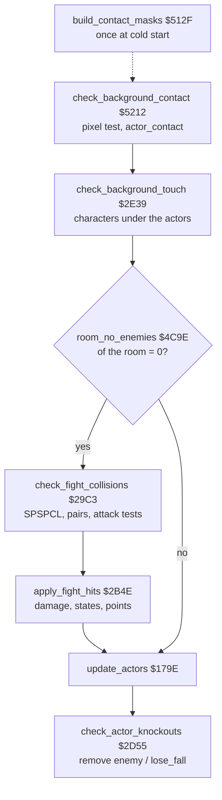
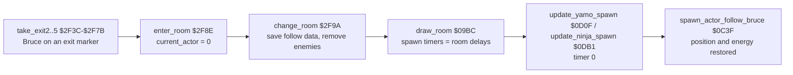

# Bruce Lee: collisions and combat

This page tells how the program finds contacts: between the actors (the hardware sprite collision register) and between an actor and the background (a pixel test of the sprite shape against the room characters). It then tells how a contact becomes a hit, how much energy a hit costs, how an actor is knocked out, which points Bruce gets, how fall attacks work (with a bug that repeats a knock-out), and how an enemy follows Bruce into the next room. The actors, their arrays and the action states are on [actors.md](actors.md).

**Scope.**

- Sprite-sprite collisions: [`check_fight_collisions`](../src/fight_hits.asm#L14) [`$29C3`](reference/modules/fight_hits.md#check_fight_collisions), [`check_fight_pair`](../src/fight_hits.asm#L89) [`$2A36`](reference/modules/fight_hits.md#check_fight_pair), [`check_attack_reach`](../src/fight_hits.asm#L412) [`$2C54`](reference/modules/fight_hits.md#check_attack_reach), [`register_hit`](../src/fight_hits.asm#L237) [`$2B3E`](reference/modules/fight_hits.md#register_hit).
- The background contact test: [`build_contact_masks`](../src/frame_builder.asm#L16) [`$512F`](reference/modules/frame_builder.md#build_contact_masks) (cold start), [`check_background_contact`](../src/background_contact.asm#L17) [`$5212`](reference/modules/background_contact.md#check_background_contact) (each pass) and its helpers.
- Hits, damage, energy, knock-out and points: [`apply_fight_hits`](../src/fight_hits.asm#L252) [`$2B4E`](reference/modules/fight_hits.md#apply_fight_hits), [`apply_fight_ko`](../src/fight_hits.asm#L384) [`$2C24`](reference/modules/fight_hits.md#apply_fight_ko), [`check_actor_knockouts`](../src/actor_helpers.asm#L8) [`$2D55`](reference/modules/actor_helpers.md#check_actor_knockouts), [`add_score`](../src/score.asm#L52) [`$3175`](reference/modules/score.md#add_score).
- Fall attacks and the knock-out loop bug.
- The enemy that follows Bruce: [`change_room`](../src/background_touch.asm#L234) [`$2F9A`](reference/modules/background_touch.md#change_room), [`spawn_actor_follow_bruce`](../src/actor_spawn.asm#L114) [`$0C3F`](reference/modules/actor_spawn.md#spawn_actor_follow_bruce).
- Sources: `src/fight_hits.asm`, `src/actor_helpers.asm`, `src/background_contact.asm`, `src/frame_builder.asm`, `src/actor_workspace.asm`, `src/room_enemy_tables.asm`, `src/background_touch.asm`, `src/actor_spawn.asm`.

**Conventions.**

- Addresses are C64 addresses. Names are the names of the knowledge.
- An *actor* is slot X: 0 = Bruce, 1 = Yamo, 2 = Ninja. In a fight test, X is the *victim* and Y the *attacker*.
- A *pass* is one run of [`main_loop`](../src/game_main_loop.asm#L23) [`$1BC2`](reference/modules/game_main_loop.md#main_loop) (3 frames). A *step* is a pass in which an actor acts (see [actors.md](actors.md)).
- A *unit* of [`actor_x`](../src/constants.asm#L90) is 2 screen pixels, which is one multicolour pixel. A unit of [`actor_y`](../src/constants.asm#L91) is one raster line.
- A *pixel code* is a 2-bit multicolour pixel: `%01`, `%10`, `%11` (and `%00` = background). A *nibble* is two pixel codes side by side.
- A *coloured* character has colour RAM bits 0-2 not 0; a *dark* character has colour 0 there.
- **Observed** marks a fact that a run showed. **Code** marks a fact from the code only. **Conclusion** marks an interpretation.

## 1. Overview



1. At cold start, [`build_contact_masks`](../src/frame_builder.asm#L16) [`$512F`](reference/modules/frame_builder.md#build_contact_masks) makes a 96-byte contact mask for every pose frame.
2. Each pass, [`check_background_contact`](../src/background_contact.asm#L17) [`$5212`](reference/modules/background_contact.md#check_background_contact) sets [`actor_contact`](../src/constants.asm#L98) [`$B6`](reference/variables.md#actor_contact) and [`actor_contact_upper`](../src/constants.asm#L93) [`$A7`](reference/variables.md#actor_contact_upper) of each active actor from a pixel test.
3. [`check_background_touch`](../src/background_touch.asm#L10) [`$2E39`](reference/modules/background_touch.md#check_background_touch) tests the character codes under each actor (exits, deadly tiles, lanterns, the moving character `$62`). It is described with the rooms; this page only gives its use of the contact flags (section 3.6).
4. In rooms with enemies, [`check_fight_collisions`](../src/fight_hits.asm#L14) [`$29C3`](reference/modules/fight_hits.md#check_fight_collisions) reads [`SPSPCL`](../src/constants.asm#L229) [`$D01E`](reference/variables.md#SPSPCL), finds the actor pairs that touch, and sets [`actor_hit_flags`](../src/constants.asm#L100) [`$BC`](reference/variables.md#actor_hit_flags). It continues into [`apply_fight_hits`](../src/fight_hits.asm#L252) [`$2B4E`](reference/modules/fight_hits.md#apply_fight_hits).
5. After the actors move, [`check_actor_knockouts`](../src/actor_helpers.asm#L8) [`$2D55`](reference/modules/actor_helpers.md#check_actor_knockouts) removes a knocked-out enemy or ends Bruce's fall.

## 2. Sprite-sprite collisions

### 2.1 The sprites of the actors

| Actor | Main sprite | Overlay sprite | Collision codes ([`actor_collision_code_first`](../src/actor_frame_tables.asm#L13) [`$59A8`](reference/modules/actor_frame_tables.md#actor_collision_code_first) / [`actor_collision_code_second`](../src/actor_frame_tables.asm#L17) [`$59AB`](reference/modules/actor_frame_tables.md#actor_collision_code_second)) | [`SPSPCL`](../src/constants.asm#L229) bits that count as the actor |
|---|---|---|---|---|
| Bruce | 0 (yellow) | 1 (black) | 4 / 5 | `$03` |
| Yamo | 2 (green) | 3 (black) | 6 / 7 | `$0C` |
| Ninja | 4 (black) | none | 3 / 0 | `$30` (sprites 4 and 5) |

[`set_sprite_slot_owner`](../src/actor_spawn.asm#L420) [`$0E21`](reference/modules/actor_spawn.md#set_sprite_slot_owner) turns a code into a sprite with [`collision_code_to_sprite`](../src/actor_frame_tables.asm#L22) [`$59AE`](reference/modules/actor_frame_tables.md#collision_code_to_sprite) (3 → 4, 4 → 0, 5 → 1, 6 → 2, 7 → 3) and writes the actor into [`sprite_owner`](../src/constants.asm#L167) [`$4F40`](reference/variables.md#sprite_owner). [`reset_play_state`](../src/play_init.asm#L19) [`$0763`](reference/modules/play_init.md#reset_play_state) sets all five owners to `$FF`; [`remove_actor`](../src/touch_effects.asm#L38) [`$3001`](reference/modules/touch_effects.md#remove_actor) sets the owners of the removed actor to `$FF`.

### 2.2 Finding the pairs ([`check_fight_collisions`](../src/fight_hits.asm#L14) [`$29C3`](reference/modules/fight_hits.md#check_fight_collisions))

1. Clear [`actor_touch_mask`](../src/constants.asm#L97) [`$B3`](reference/variables.md#actor_touch_mask) and [`actor_hit_flags`](../src/constants.asm#L100) [`$BC`](reference/variables.md#actor_hit_flags) of the three actors.
2. Read [`SPSPCL`](../src/constants.asm#L229) [`$D01E`](reference/variables.md#SPSPCL) (the read clears it) into [`sprite_collisions`](../src/constants.asm#L62) [`$67`](reference/variables.md#sprite_collisions). Zero: return (no [`apply_fight_hits`](../src/fight_hits.asm#L252) in this pass).
3. Bruce bits (`$03`) and Yamo bits (`$0C`) set: Bruce touches sprite 3, Yamo touches sprite 1.
4. Bruce bits and Ninja bits (`$30`) set: Bruce touches sprite 4, the Ninja touches sprite 1.
5. Yamo bits and Ninja bits set: Yamo touches sprite 4, the Ninja touches sprite 3.
6. [`check_fight_scan`](../src/fight_hits.asm#L70) [`$2A1F`](reference/modules/fight_hits.md#check_fight_scan): for each victim X = 2, 1, 0 and each set bit Y (0-4) of `actor_touch_mask,X`, run [`check_fight_pair`](../src/fight_hits.asm#L89) [`$2A36`](reference/modules/fight_hits.md#check_fight_pair) with the sprite number Y. The owner of sprite Y is the attacker.
7. `jmp apply_fight_hits`.

[`actor_touch_mask`](../src/constants.asm#L97) format:

| Bit | Sprite | Owner |
|---|---|---|
| 1 | 1 (Bruce's overlay) | Bruce |
| 3 | 3 (Yamo's overlay) | Yamo |
| 4 | 4 (the Ninja) | Ninja |

The register says only which sprites collided, not with which other sprite. The code guesses the pairs from the groups. With all three groups set, every pair counts as touching (**Code**). Yamo and the Ninja can therefore hit each other: a flying kick of Yamo can knock the Ninja down, without points (**Code**).

**Observed** (run `coll` of this page: Bruce stands still in room 0 for 1500 frames; the trace records `A` at [`check_fight_collisions_found`](../src/fight_hits.asm#L26) [`$29D4`](reference/modules/fight_hits.md#check_fight_collisions_found)): the values read were `$12` (sprites 1 and 4: Bruce and the Ninja), `$1C` (Yamo and the Ninja), `$1D`, `$1E` and `$1F`. A value with only `$03` or only `$0C` never came, so the main and the overlay sprite of one actor do not collide with each other (**Conclusion**: their pixels do not overlap).

[`room18_frame_fireballs`](../src/wizard_room.asm#L45) [`$3D1D`](reference/modules/wizard_room.md#room18_frame_fireballs) also reads [`SPSPCL`](../src/constants.asm#L229): in room 18 (the wizard) a fireball sprite (6 or 7) on sprite 0 or 1 starts Bruce's death. Room 18 has [`room_no_enemies`](../src/room_tables.asm#L164) set, so the two readers never run in the same room.

### 2.3 The attack tests ([`check_fight_pair`](../src/fight_hits.asm#L89) [`$2A36`](reference/modules/fight_hits.md#check_fight_pair))

The victim X is not hit in states `$18` (wall bump), `$1A` (duck), `$0F` (recoil), `$13` (knocked down), `$19` (dying), `$1B` (hit by a fall attack). The attacker is `sprite_owner,Y`; `$FF` (free) gives no hit. An attacker in state `$1B` does not hit. Then the attacker's state selects the test:

| Attacker state | Window | Distance test | Extra test | Sound | Hit bit of the victim | Bit 7 when the attacker is Bruce | [`register_hit`](../src/fight_hits.asm#L237) |
|---|---|---|---|---|---|---|---|
| `$16` Ninja strike | timer < 8 | reach >= 4 | - | `$87` | 1 | no | yes |
| `$11` punch | always | reach >= 6 | \|dy\| < `$16` | `$86` | 2 | yes | yes |
| `$0C`/`$0D` flying kick | timer < 10 | reach >= 6 | - | `$86` | 3 | yes | yes |
| `$0E` falling (fall attack) | always | victim Y - attacker Y >= `$0A` | `fall_attack_budget,Y` > 0 (decremented); no bit 4 yet on either actor; victim not in `$0C`, `$0D`, `$11` | `$86` | 4 | yes | no |

[`check_attack_reach`](../src/fight_hits.asm#L412) [`$2C54`](reference/modules/fight_hits.md#check_attack_reach): A = victim X - attacker X when the attacker faces right, attacker X - victim X when it faces left. Then `CMP attack_reach` `$61`. A hit needs carry set and N clear: the victim is in front of the attacker at a distance from [`attack_reach`](../src/constants.asm#L56) to [`attack_reach`](../src/constants.asm#L56) + `$7F` units (**Code**). A victim behind the attacker gives a negative distance and no hit.

[`register_hit`](../src/fight_hits.asm#L237) [`$2B3E`](reference/modules/fight_hits.md#register_hit): the attacker gets `actor_hit_flags,Y` bit 0 (it landed a hit), and the victim turns to face the attacker (`actor_facing,X` = `actor_facing,Y` XOR 1).

[`actor_hit_flags`](../src/constants.asm#L100) [`$BC`](reference/variables.md#actor_hit_flags) format:

| Bit | Meaning |
|---|---|
| 0 | This actor landed a hit (attacker) |
| 1 | Hit by a Ninja strike |
| 2 | Hit by a punch |
| 3 | Hit by a flying kick |
| 4 | Hit by a fall attack |
| 7 | The hit came from Bruce (it scores) |

Worked example: the Ninja (X = 2, facing left, [`actor_x`](../src/constants.asm#L90) = `$23`) strikes Bruce ([`actor_x`](../src/constants.asm#L90) = `$1A`) with timer 7. The Ninja is the attacker Y. A = `$23` - `$1A` = `$09` (facing left, no negation). `$09` >= 4 and `$09` - 4 = `$05` is positive: hit. Bruce gets bit 1, the Ninja bit 0, Bruce turns to face right.

## 3. The background contact test

### 3.1 What it gives

[`check_background_contact`](../src/background_contact.asm#L17) [`$5212`](reference/modules/background_contact.md#check_background_contact) lays the shape of the actor's current frame over the room characters and records which pixel codes are under the body. The room graphics use the pixel codes as surface types (**Conclusion** from the result bits and their users):

| Bit of [`actor_contact`](../src/constants.asm#L98) | Set when the body covers | Used as |
|---|---|---|
| 0 | `%01` pixels | floor |
| 1 | `%10` pixels | trigger: lanterns, deadly tiles and traps count only when it is set ([`touch_tile_gate`](../src/constants.asm#L43) [`$53`](reference/variables.md#touch_tile_gate)) |
| 2 | `%11` pixels of a coloured character | ladder or vine |
| 3 | `%11` pixels of a dark character | wall |

[`actor_contact_upper`](../src/constants.asm#L93) [`$A7`](reference/variables.md#actor_contact_upper) has the same bits for the body without its last 6 rows.

### 3.2 The contact masks (built at cold start)

A contact mask is the shape of one pose (both sprites) as multicolour pixels. Each set pixel of the 1-bit frame shape becomes the pixel code `%11` (one sprite pixel is 2 screen pixels wide because the sprites are X-expanded, so it covers one multicolour pixel).

| Bytes | Content |
|---|---|
| `+$00-$1F` | Column 0: mask rows 0-31, 4 multicolour pixels per byte (sprite pixels 0-3) |
| `+$20-$3F` | Column 1: sprite pixels 4-7 |
| `+$40-$5F` | Column 2: sprite pixels 8-11 (only for 16-pixel frames: the high nibble of the second byte) |

Rows from the frame height to 31 are 0. A 16-pixel frame loses its last 4 pixels (the low nibble of its second byte) in the mask.

Where the masks are: [`contact_mask_addr_lo`](../src/room_enemy_tables.asm#L15) [`$1167`](reference/modules/room_enemy_tables.md#contact_mask_addr_lo) / [`contact_mask_addr_hi`](../src/room_enemy_tables.asm#L44) [`$1239`](reference/modules/room_enemy_tables.md#contact_mask_addr_hi), 210 entries, index = frame number. An even frame (the main sprite of a pose) points at its mask in `$9000-$9FBF` (over the room charset sources, which are expanded before) or in `contact_masks_high` `$C000-$CADF`. An odd frame (the overlay sprite) points at the scratch block [`shift_mask_col0`](../src/constants.asm#L207) [`$CAE0`](reference/variables.md#shift_mask_col0), or has high byte 0 when the pose has no second sprite (the Ninja). Several frames share one mask.

Decoder (**Code**, [`build_contact_masks`](../src/frame_builder.asm#L16) [`$512F`](reference/modules/frame_builder.md#build_contact_masks), [`expand_contact_mask`](../src/frame_builder.asm#L93) [`$517E`](reference/modules/frame_builder.md#expand_contact_mask), [`double_pixel_nibble`](../src/frame_builder.asm#L168) [`$51FF`](reference/modules/frame_builder.md#double_pixel_nibble)):

```
for X = $D1 downto 1 step 2:                    # odd frame X, even frame X-1
    if contact_mask_addr_hi[X] != 0: expand(X)  # into shift_mask_col0 ($CAE0)
    else: clear 96 bytes at $CAE0
    expand(X-1)                                 # into its own mask address
    mask(X-1)[i] |= $CAE0[i] for i = 0..95       # both sprites in one mask
expand(F):
    for row = 0 .. frame_last_row[F]:
        b = shape byte
        col0[row] = double(b >> 4); col1[row] = double(b & $0F)
        col2[row] = wide ? double(second_byte >> 4) : 0
    rows frame_last_row+1 .. 31 of the three columns = 0
double(n):  bit k of n (k = 0..3) -> bits 2k+1..2k   # %1011 -> %11001111
```

[`build_contact_masks`](../src/frame_builder.asm#L16) first loops for ever unless [`prot_signature_a`](../src/protection_key_page.asm#L26) [`$CF8F`](reference/modules/protection_key_page.md#prot_signature_a) = `$B9` and [`prot_signature_b`](../src/protection_key_page.asm#L45) [`$CFAF`](reference/modules/protection_key_page.md#prot_signature_b) is equal to it (see the protection page of the reference). It uses [`current_actor`](../src/constants.asm#L41) [`$51`](reference/variables.md#current_actor) as the frame counter and [`demo_input_ptr`](../src/constants.asm#L24) [`$1D`](reference/variables.md#demo_input_ptr) as the row count, both free at cold start.

Worked example: the mask of frame 2 (Bruce standing, facing right) at [`contact_mask_addr_lo+2`](../src/room_enemy_tables.asm#L15)/[`contact_mask_addr_hi+2`](../src/room_enemy_tables.asm#L44) = `$60`/`$90` = `$9060`. Frame 2 is 12 rows of 1 byte ([`bruce_frame_02`](../src/bruce_frames_b.asm#L207) = `$00 $10 $30 $28 ...`); frame 3, its overlay, is 21 rows ([`bruce_frame_03`](../src/bruce_frames_b.asm#L220) = `$30 $60 $48 $50 ...`).

| Row | Frame 2 | Frame 3 | OR | Column 0 | Column 1 |
|---|---|---|---|---|---|
| 0 | `$00` | `$30` | `%0011 0000` | double(`%0011`) = `$0F` | `$00` |
| 1 | `$10` | `$60` | `%0111 0000` | double(`%0111`) = `$3F` | `$00` |
| 2 | `$30` | `$48` | `%0111 1000` | `$3F` | double(`%1000`) = `$C0` |

**Observed** (run `contact` below): with Bruce at pixel offset 2, the shifted buffer shows row 0 as `$00 $F0` and row 1 as `$03 $F0` in columns 0 and 1: the same bytes moved 2 multicolour pixels to the right.

### 3.3 The test of one actor

For each active actor X = 2, 1, 0 ([`check_background_contact`](../src/background_contact.asm#L17) [`$5212`](reference/modules/background_contact.md#check_background_contact), [`contact_actor`](../src/constants.asm#L40) [`$50`](reference/variables.md#contact_actor)):

1. Pixel offsets: [`contact_pixel_x`](../src/constants.asm#L22) [`$1B`](reference/variables.md#contact_pixel_x) = ([`actor_x`](../src/constants.asm#L90) - 12) AND 3, [`contact_pixel_y`](../src/constants.asm#L23) [`$1C`](reference/variables.md#contact_pixel_y) = ([`actor_y`](../src/constants.asm#L91) - 29) AND 7.
2. Character position: [`actor_cell_col`](../src/constants.asm#L113) = ([`actor_x`](../src/constants.asm#L90) - 12) / 4, [`actor_cell_row`](../src/constants.asm#L114) = ([`actor_y`](../src/constants.asm#L91) - 29) / 8. Character row r is screen row r + 1 ([`char_row_screen_lo`](../src/char_row_tables.asm#L8) [`$50E7`](reference/modules/char_row_tables.md#char_row_screen_lo) starts at `$8C28`).
3. [`build_shift_mask`](../src/background_contact.asm#L98) [`$52AD`](reference/modules/background_contact.md#build_shift_mask): copy the mask of [`actor_frame_a`](../src/constants.asm#L171) into [`shift_mask_col0`](../src/constants.asm#L207) [`$CAE0`](reference/variables.md#shift_mask_col0) to [`shift_mask_col3`](../src/constants.asm#L210) [`$CB40`](reference/variables.md#shift_mask_col3) (`$CAE0-$CB5F`: 4 columns of 32 rows), [`contact_pixel_y`](../src/constants.asm#L23) rows lower, and shift it [`contact_pixel_x`](../src/constants.asm#L22) multicolour pixels to the right. Offset 3 is done as one column right and one pixel left; the pixels that move into column 3 are not tested.
4. [`contact_last_row`](../src/constants.asm#L161) [`$4F39`](reference/variables.md#contact_last_row) = [`contact_pixel_y`](../src/constants.asm#L23) + 21; [`contact_upper_end_row`](../src/constants.asm#L160) [`$4F38`](reference/variables.md#contact_upper_end_row) = that - 6. So 21 mask rows are tested, and the "upper" result stops 6 rows before the end.
5. [`clear_contact_tables`](../src/background_contact.asm#L483) [`$55AB`](reference/modules/background_contact.md#clear_contact_tables).
6. For 4 character rows (mask rows 0-7, 8-15, 16-23, 24-31): [`fetch_char_row`](../src/background_contact.asm#L165) [`$530A`](reference/modules/background_contact.md#fetch_char_row) reads the 3 characters of the row under mask columns 0-2 and their colour RAM, and patches the charset address of each into [`scan_col0`](../src/background_contact.asm#L227)/[`scan_col1`](../src/background_contact.asm#L245)/[`scan_col2`](../src/background_contact.asm#L263). [`scan_mask_rows`](../src/background_contact.asm#L225) [`$537E`](reference/modules/background_contact.md#scan_mask_rows) then tests the rows.
7. Per mask row and column: v = charset byte AND mask byte. Nonzero v: `contact_colN[v >> 4]` and `contact_colN[v AND $0F]` become nonzero (entry 0 is ignored).
8. At [`contact_upper_end_row`](../src/constants.asm#L160): [`evaluate_contact`](../src/background_contact.asm#L336) [`$5431`](reference/modules/background_contact.md#evaluate_contact) → [`actor_contact_upper`](../src/constants.asm#L93). At [`contact_last_row`](../src/constants.asm#L161): [`evaluate_contact`](../src/background_contact.asm#L336) → [`actor_contact`](../src/constants.asm#L98), and the next actor.

Pseudo-code:

```
for X in 2, 1, 0 if active:
    buf = mask[actor_frame_a[X]] shifted by (px, py)
    clear contact_col0..2, lit0..2
    for r in 0..3:
        for c in 0..2:
            ch[c] = screen[row + r + 1][col + c]           # col + c >= 40: character 0
            set_lit(c, colour_ram[row + r + 1][col + c] & 7 != 0)
        for y in 8r .. 8r+7:
            for c in 0..2:
                v = charset[ch[c] * 8 + (y - 8r)] & buf[c][y]
                if v: table[c][v >> 4] = 1; table[c][v & 15] = 1
            if y + 1 == py + 15: actor_contact_upper[X] = evaluate()
            if y + 1 == py + 21: actor_contact[X] = evaluate(); next X
```

The charset is the room charset at [`room_charset_hi`](../src/constants.asm#L73) [`$7C`](reference/variables.md#room_charset_hi) × 256 (`$A000`, `$A800`, `$B000` or `$B800`).

### 3.4 The contact tables and the colour trick

[`contact_col0`](../src/constants.asm#L153) [`$4EED`](reference/variables.md#contact_col0), [`contact_col1`](../src/constants.asm#L154) [`$4F04`](reference/variables.md#contact_col1), [`contact_col2`](../src/constants.asm#L155) [`$4F1B`](reference/variables.md#contact_col2): 23 bytes each, one per mask column.

| Entry | Meaning (state after [`evaluate_contact`](../src/background_contact.asm#L336)) |
|---|---|
| 0 | Not used (a nibble of value 0) |
| 1-15 | The nibble value was seen. For the values with a `%11` pixel (3, 7, 11, 12, 13, 14, 15): seen in a dark character. |
| 16-22 | The values 3, 7, 11, 12, 13, 14, 15 seen in a coloured character. |

The scan does not look at the colour per hit. Instead, [`check_col0_colour`](../src/background_contact.asm#L508) [`$55D7`](reference/modules/background_contact.md#check_col0_colour) (and the column 1 and 2 versions) keep a state [`contact_col0_lit`](../src/constants.asm#L156) [`$4F32`](reference/variables.md#contact_col0_lit) per column. When the column moves from a dark to a coloured character or back, [`swap_col0_pairs`](../src/background_contact.asm#L518) [`$55E6`](reference/modules/background_contact.md#swap_col0_pairs) swaps the entries 3/16, 7/17, 11/18, 12/19, 13/20, 14/21, 15/22. While a column is in the coloured state, new hits of those values land in what are, after the swap back, entries 16-22. [`evaluate_contact`](../src/background_contact.asm#L336) swaps every column back to the dark state first. [`scan_upper_body`](../src/background_contact.asm#L296) [`$53E4`](reference/modules/background_contact.md#scan_upper_body) saves the states in [`contact_lit_saved`](../src/constants.asm#L159) [`$4F35`](reference/variables.md#contact_lit_saved) around its early evaluation.

[`evaluate_contact`](../src/background_contact.asm#L336) [`$5431`](reference/modules/background_contact.md#evaluate_contact) ORs the entries of each class and packs the four counters [`contact_count_c01`](../src/constants.asm#L163) [`$4F3C`](reference/variables.md#contact_count_c01) to [`contact_count_c11_dark`](../src/constants.asm#L166) [`$4F3F`](reference/variables.md#contact_count_c11_dark):

| Class | Entries | Bit |
|---|---|---|
| `%01` | 1, 4, 5, 6, 7, 9, 13, and 17, 20 | 0 |
| `%10` | 2, 6, 8, 9, 10, 11, 14, and 18, 21 | 1 |
| `%11` coloured | 16-22 | 2 |
| `%11` dark | 3, 7, 11, 12, 13, 14, 15 | 3 |

```
actor_contact = c11_dark << 3 | c11_lit << 2 | c10 << 1 | c01
```

The `%01` test of column 1 reads [`contact_col0+17`](../src/constants.asm#L153) instead of [`contact_col1+17`](../src/constants.asm#L154) (**Code**, [`evaluate_test_c01`](../src/background_contact.asm#L358) [`$545C`](reference/modules/background_contact.md#evaluate_test_c01)). A nibble `%01 %11` (value 7) in a coloured character under mask column 1 therefore does not count as floor.

### 3.5 Worked example: Bruce on the floor of room 0

**Observed**, run `contact` of this page: room 0 snapshot, stop at [`contact_return`](../src/background_contact.asm#L92) [`$52AC`](reference/modules/background_contact.md#contact_return) (after the test of Bruce).

| Value | Data |
|---|---|
| [`actor_x`](../src/constants.asm#L90), [`actor_y`](../src/constants.asm#L91) | `$1A`, `$C4` |
| [`contact_pixel_x`](../src/constants.asm#L22), [`contact_pixel_y`](../src/constants.asm#L23) | 2, 7 |
| [`actor_cell_col`](../src/constants.asm#L113) | 3 (character columns 3-5) |
| character rows | 20-23 = screen rows 21-24 |
| [`contact_last_row`](../src/constants.asm#L161), [`contact_upper_end_row`](../src/constants.asm#L160) | 28, 22 |
| characters under the feet | screen row 23: `$11` (empty); screen row 24: `$91`, colour RAM `$8` (dark) |
| charset `$A000` + `$91` × 8 | `$00 $00 $55 $55 $AA $AA $FF $FF` |

Mask rows 24-27 are rows 0-3 of character `$91`. Only rows 26 and 27 (the feet) are set in the mask. They meet the rows `$55` = `%01 %01 %01 %01`:

| Mask row | Column | Mask | Char byte | v | Entries |
|---|---|---|---|---|---|
| 26 | 0 | `$03` | `$55` | `$01` | 1 |
| 26 | 1 | `$C3` | `$55` | `$41` | 4, 1 |
| 26 | 2 | `$C0` | `$55` | `$40` | 4 |
| 27 | 0 | `$0F` | `$55` | `$05` | 5 |
| 27 | 1 | `$C3` | `$55` | `$41` | 4, 1 |
| 27 | 2 | `$F0` | `$55` | `$50` | 5 |

Observed tables: [`contact_col0`](../src/constants.asm#L153) entries 1, 5; [`contact_col1`](../src/constants.asm#L154) entries 1, 4; [`contact_col2`](../src/constants.asm#L155) entries 4, 5. All are in the `%01` class, so [`actor_contact`](../src/constants.asm#L98) = `$01` (floor) and [`actor_contact_upper`](../src/constants.asm#L93) = `$00`. The scan stops at mask row 28, before the `%10` and `%11` rows of the floor character.

### 3.6 Users of the contact bits

| Bit | Users (**Code**) |
|---|---|
| 0 floor | falling and landing, jumps and kicks end on a floor, ducking, [`wake_idle_enemies`](../src/actor_helpers.asm#L40) [`$2D7C`](reference/modules/actor_helpers.md#wake_idle_enemies), the AI chase |
| 1 trigger | [`check_background_touch`](../src/background_touch.asm#L10) [`$2E39`](reference/modules/background_touch.md#check_background_touch) → [`touch_tile_gate`](../src/constants.asm#L43) [`$53`](reference/variables.md#touch_tile_gate): lanterns, deadly tiles, trap tiles |
| 2 ladder | climbing, jumps end on a ladder, no punch or jump on a ladder, climbing poses, [`touch_climb_tile`](../src/touch_effects.asm#L194) [`$310C`](reference/modules/touch_effects.md#touch_climb_tile) |
| 3 wall | the wall undo of [`actor_action_step`](../src/actor_step.asm#L21) [`$1C5B`](reference/modules/actor_step.md#actor_action_step), kicks and punches end, the falling pose `$08` |
| upper bit 0 | [`actor_bruce_falling`](../src/actor_step.asm#L200) [`$1D99`](reference/modules/actor_step.md#actor_bruce_falling): the sideways drift of a falling Bruce |

## 4. Damage and energy

### 4.1 [`apply_fight_hits`](../src/fight_hits.asm#L252) [`$2B4E`](reference/modules/fight_hits.md#apply_fight_hits)

For each actor X = 2, 1, 0 ([`current_actor`](../src/constants.asm#L41) = X), in this order:

1. Bit 0 (landed a hit): [`actor_state`](../src/constants.asm#L101) = 0, [`actor_step_delay`](../src/constants.asm#L132) = 4, [`actor_pose_done`](../src/constants.asm#L175) set, and a pause in [`actor_timer`](../src/constants.asm#L106) by the time level (table in section 4.2).
2. Bit 1 (Ninja strike): energy - 2. Negative: knock-out. Else state `$0F`, timer 3.
3. Bit 2 (punch): Bruce's hit scores 100. Energy - 3. Negative: knock-out. Else state `$0F`, timer 4.
4. Bit 3 (flying kick): Bruce's hit scores 75. Energy - 7. Negative: knock-out. Else state `$13`, timer 12.
5. Bit 4 (fall attack): Bruce's hit scores 50. Energy - 5. Negative: knock-out. Else state `$1B`, timer 8.

A victim with several bits in one pass takes all the damage; the last state written stays. A knock-out after bit 1, 2 or 3 goes to [`apply_fight_ko`](../src/fight_hits.asm#L384) and continues at bit 4 (the later bits 2 and 3 are skipped).

| Attack | Damage | Victim state, timer | Points (Bruce's hit) | Code |
|---|---|---|---|---|
| Ninja strike | 2 | `$0F` recoil, 3 | - | [`apply_fight_hits_strike`](../src/fight_hits.asm#L297) [`$2B9A`](reference/modules/fight_hits.md#apply_fight_hits_strike) |
| Punch | 3 | `$0F` recoil, 4 | 100 | [`apply_fight_hits_punch`](../src/fight_hits.asm#L311) [`$2BB1`](reference/modules/fight_hits.md#apply_fight_hits_punch) |
| Flying kick | 7 | `$13` knocked down, 12 | 75 | [`apply_fight_hits_kick`](../src/fight_hits.asm#L332) [`$2BD5`](reference/modules/fight_hits.md#apply_fight_hits_kick) |
| Fall attack | 5 | `$1B`, 8 | 50 | [`apply_fight_hits_fall`](../src/fight_hits.asm#L354) [`$2BF9`](reference/modules/fight_hits.md#apply_fight_hits_fall) |
| Knock-out (energy < 0) | - | `$13`, 12 | Yamo 450, Ninja 200 | [`apply_fight_ko`](../src/fight_hits.asm#L384) [`$2C24`](reference/modules/fight_hits.md#apply_fight_ko) |

### 4.2 The attacker's pause

| Time level ([`get_room_time_level`](../src/game_setup.asm#L253) [`$10D0`](reference/modules/game_setup.md#get_room_time_level)) | Bruce | Enemy |
|---|---|---|
| 0, [`game_loop_count`](../src/constants.asm#L30) = 0 | 3 | `$18` (24) |
| 0, [`game_loop_count`](../src/constants.asm#L30) nonzero | 3 | 3 |
| C (room time >= 6400 frames) | 8 | 10 |
| V (room time >= 8192 frames) | 10 | 10 |

The enemy path stores 2 first ([`apply_fight_hits_pause_short`](../src/fight_hits.asm#L279) [`$2B7F`](reference/modules/fight_hits.md#apply_fight_hits_pause_short)) and then falls into the Bruce code ([`apply_fight_hits_pause_by_time`](../src/fight_hits.asm#L282) [`$2B83`](reference/modules/fight_hits.md#apply_fight_hits_pause_by_time)), which overwrites it (**Code**). During the pause the attacker stands (state `$00` with a timer). A fall attack sets no bit 0, so the faller gets no pause.

### 4.3 Energy

[`actor_energy`](../src/constants.asm#L107) [`$D1-$D3`](reference/variables.md#actor_energy) is signed.

| Actor | Start | Cap | Set by |
|---|---|---|---|
| Bruce | `$24` (36) | - | [`spawn_actor`](../src/actor_spawn.asm#L20) [`$0B8E`](reference/modules/actor_spawn.md#spawn_actor); [`lose_fall`](../src/lose_fall_game_over.asm#L14) [`$1818`](reference/modules/lose_fall_game_over.md#lose_fall) sets all three to `$24` |
| Yamo | `$24` → `$14` (20) | `$14` | [`spawn_yamo`](../src/actor_spawn.asm#L203) [`$0CD5`](reference/modules/actor_spawn.md#spawn_yamo) caps after [`spawn_actor`](../src/actor_spawn.asm#L20) (also a carried energy) |
| Ninja | `$24` → 7 | 7 | [`spawn_ninja`](../src/actor_spawn.asm#L398) [`$0DF8`](reference/modules/actor_spawn.md#spawn_ninja) |

Hits needed to bring the energy below 0: Bruce 19 strikes, 13 punches or 6 kicks; Yamo 7 punches or 3 kicks; the Ninja 3 punches or 2 kicks (energy below 0, **Code**).

Each pass, [`main_loop_update`](../src/game_main_loop.asm#L37) [`$1BDF`](reference/modules/game_main_loop.md#main_loop_update) clears bit 6 of Yamo's energy (`AND #$BF`) and bits 3-6 of the Ninja's (`AND #$87`). Bit 7 (knocked out) stays. A positive Ninja energy is therefore at most 7, and a positive Yamo energy at most `$3F` (**Code**). The caps are below these limits, so the masks only change wrapped values (section 6).

### 4.4 Knock-out

1. [`apply_fight_ko`](../src/fight_hits.asm#L384) [`$2C24`](reference/modules/fight_hits.md#apply_fight_ko): when bit 7 is set (Bruce hit), Yamo (X = 1) gives 256 + 194 = 450 points (two [`add_score`](../src/score.asm#L52) calls), the Ninja 200. The victim gets state `$13`, timer 12. Then `jmp apply_fight_hits_fall`.
2. The knocked-down handler slides the actor for 12 steps ([`act_check_knocked_down`](../src/actor_hit_states.asm#L37) [`$2440`](reference/modules/actor_hit_states.md#act_check_knocked_down); a knocked-out enemy does not recover at timer 1).
3. [`check_actor_knockouts`](../src/actor_helpers.asm#L8) [`$2D55`](reference/modules/actor_helpers.md#check_actor_knockouts) (end of the pass): for an active actor with energy < 0, except while state `$13` or `$19` has a timer: an enemy is removed ([`remove_actor`](../src/touch_effects.asm#L38) [`$3001`](reference/modules/touch_effects.md#remove_actor), which restarts its spawn timer); Bruce loses a fall ([`check_actor_knockouts_bruce`](../src/actor_helpers.asm#L33) [`$2D79`](reference/modules/actor_helpers.md#check_actor_knockouts_bruce) → [`lose_fall`](../src/lose_fall_game_over.asm#L14) [`$1818`](reference/modules/lose_fall_game_over.md#lose_fall)).

**Observed** (run `coll`): Bruce standing still in room 0 was hit by the Ninja (state `$0F` from [`apply_fight_hits_strike`](../src/fight_hits.asm#L297) [`$2B9A`](reference/modules/fight_hits.md#apply_fight_hits_strike)), by punches (`$0F` from [`apply_fight_hits_punch`](../src/fight_hits.asm#L311) [`$2BB1`](reference/modules/fight_hits.md#apply_fight_hits_punch)) and by kicks (`$13` from [`apply_fight_hits_kick`](../src/fight_hits.asm#L332) [`$2BD5`](reference/modules/fight_hits.md#apply_fight_hits_kick)); at frame 1306 a knock-out set `$13` ([`apply_fight_ko_knockdown`](../src/fight_hits.asm#L402) [`$2C47`](reference/modules/fight_hits.md#apply_fight_ko_knockdown)), and at frame 1376 Bruce was spawned again with energy `$24` and the status line showed FALLS 03.

### 4.5 Points

[`add_score`](../src/score.asm#L52) [`$3175`](reference/modules/score.md#add_score) adds A at byte X of the 24-bit [`score`](../src/constants.asm#L31) [`$41`](reference/variables.md#score) (X = 2: units, X = 1: × 256). A sum such as 450 needs two calls.

| Event | Points | Code |
|---|---|---|
| Bruce's punch hits | 100 | [`apply_fight_hits_punch`](../src/fight_hits.asm#L311) [`$2BB1`](reference/modules/fight_hits.md#apply_fight_hits_punch) |
| Bruce's flying kick hits | 75 | [`apply_fight_hits_kick`](../src/fight_hits.asm#L332) [`$2BD5`](reference/modules/fight_hits.md#apply_fight_hits_kick) |
| Bruce's fall attack hits | 50 | [`apply_fight_hits_fall`](../src/fight_hits.asm#L354) [`$2BF9`](reference/modules/fight_hits.md#apply_fight_hits_fall) |
| Bruce knocks out Yamo | 450 (`$01` at byte 1 + `$C2` at byte 2) | [`apply_fight_ko`](../src/fight_hits.asm#L384) [`$2C24`](reference/modules/fight_hits.md#apply_fight_ko) |
| Bruce knocks out the Ninja | 200 | [`apply_fight_ko_ninja`](../src/fight_hits.asm#L398) [`$2C40`](reference/modules/fight_hits.md#apply_fight_ko_ninja) |
| A lantern taken | 125 | [`check_lantern_pickup`](../src/lantern_pickup.asm#L15) [`$331C`](reference/modules/lantern_pickup.md#check_lantern_pickup) |
| First visit of a room, per player | 2000 | [`draw_room`](../src/draw_room.asm#L28) [`$09BC`](reference/modules/draw_room.md#draw_room) |
| A band bonus in room 13 | 500 | [`room13_frame_award_bonus`](../src/room_frames_12_17.asm#L70) [`$3EAF`](reference/modules/room_frames_12_17.md#room13_frame_award_bonus) |
| The wizard defeated | 3000 | [`room18_frame`](../src/wizard_room.asm#L13) [`$3CDC`](reference/modules/wizard_room.md#room18_frame) |

Enemy hits score nothing. **Observed** (run `ko2`, see section 6): from a score of 2000, a punch knock-out of Yamo gave 2550 (100 + 450), a kick knock-out 2525 (75 + 450), a fall attack without knock-out 2050.

## 5. Fall attacks

A fall attack is a falling actor (state `$0E`) that lands on another one ([`check_fight_fall`](../src/fight_hits.asm#L200) [`$2AFA`](reference/modules/fight_hits.md#check_fight_fall)):

1. The victim must be `$0A` or more lines below the attacker (victim [`actor_y`](../src/constants.asm#L91) - attacker [`actor_y`](../src/constants.asm#L91) >= `$0A`, signed).
2. `fall_attack_budget,Y` `$4F45` must be nonzero. It is decremented here, before the other tests, so a refused test also uses it.
3. Neither actor has bit 4 already in this pass. The victim is not in `$0C`, `$0D` or `$11` (a kicking or punching victim is safe).
4. Hit sound `$86`, victim bit 4 (and bit 7 for Bruce). No [`register_hit`](../src/fight_hits.asm#L237): the faller gets no pause and the victim does not turn.

[`frame_update`](../src/frame_update.asm#L20) [`$15A8`](reference/modules/frame_update.md#frame_update) counts [`fall_attack_refill_timer`](../src/actor_workspace.asm#L8) [`$4EEC`](reference/modules/actor_workspace.md#fall_attack_refill_timer) down every frame. At 0 it sets the budget of all three actors to 2. So each actor can land at most 2 fall-attack tests per 256 frames (5.1 seconds) (**Code**).

### 5.1 The knock-out loop bug

[`apply_fight_ko`](../src/fight_hits.asm#L384) [`$2C24`](reference/modules/fight_hits.md#apply_fight_ko) ends with `jmp apply_fight_hits_fall`. That code tests bit 4 again. When the knock-out came from a fall attack, bit 4 is still set, so the fall attack applies again: -5 energy, +50 points, knock-out again, +450 (Yamo) or +200 (Ninja). The loop ends only when the energy wraps from below -128 to a positive value (**Code**):

```
loop:                                  # apply_fight_hits_fall $2BF9
    if hit_flags & $10 == 0: next actor
    if hit_flags & $80: score += 50
    energy -= 5
    if energy >= 0 (signed): state $1B, timer 8; next actor
    if hit_flags & $80: score += 450 (Yamo) / 200 (Ninja)
    state $13, timer 12
    goto loop                          # apply_fight_ko ends with jmp
```

For Yamo with energy 3: the energy after hit k is 3 - 5k. It is negative for k = 1 to 26 and wraps at k = 27 to 3 - 135 + 256 = 124 = `$7C`. So 27 hits × 50 + 26 knock-outs × 450 = 13050 points.

**Observed**, run `ko2` of this page (the same run file as the naming stage): the room 12 snapshot, at `$1C23` (the call of [`check_fight_collisions`](../src/fight_hits.asm#L14)) the run writes [`actor_hit_flags+1`](../src/constants.asm#L100) [`$BD`](reference/variables.md#actor_hit_flags) = `$90` (bit 7 + bit 4: Bruce's fall attack on Yamo) and [`actor_energy+1`](../src/constants.asm#L107) [`$D2`](reference/variables.md#actor_energy) = 3, and runs [`apply_fight_hits`](../src/fight_hits.asm#L252) [`$2B4E`](reference/modules/fight_hits.md#apply_fight_hits) to [`main_loop_actors`](../src/game_main_loop.asm#L77) [`$1C26`](reference/modules/game_main_loop.md#main_loop_actors).

| Case | Hit flags of Yamo | Energy before | Score after (from 2000) | Energy after | State, timer |
|---|---|---|---|---|---|
| fall attack, knock-out | `$90` | 3 | `$003ACA` = 15050 (+13050) | `$7C` (124) | `$1B`, 8 |
| flying kick, knock-out | `$88` | 3 | `$0009DD` = 2525 | `$FC` (-4) | `$13`, 12 |
| fall attack, no knock-out | `$90` | 20 | `$000802` = 2050 | `$0F` (15) | `$1B`, 8 |
| punch, knock-out | `$84` | 2 | `$0009F6` = 2550 | `$FF` (-1) | `$13`, 12 |

Run `ko3` of this page goes on one pass after the first case: [`main_loop_update`](../src/game_main_loop.asm#L37) [`$1BDF`](reference/modules/game_main_loop.md#main_loop_update) masks Yamo's energy to `$7C` AND `$BF` = `$3C` (60). Yamo then lies in state `$1B` for 8 steps and stands up with 60 energy, three times his cap. A fall attack that knocks out an enemy gives Bruce 13050 points (Yamo, from energy 3) and leaves the enemy alive. **Conclusion:** the per-pass energy masks of the main loop limit the damage of this bug for the Ninja (energy at most 7 again) and partly for Yamo.

## 6. The enemy that follows Bruce

When Bruce takes an exit, every active enemy follows him into the next room.



1. [`change_room`](../src/background_touch.asm#L234) [`$2F9A`](reference/modules/background_touch.md#change_room) stores Bruce's entry position (A, Y) in [`actor_x`](../src/constants.asm#L90)/[`actor_y`](../src/constants.asm#L91) and sets [`room`](../src/constants.asm#L28) = [`next_room`](../src/constants.asm#L38).
2. For X = 2, 1 ([`change_room_enemy_loop`](../src/background_touch.asm#L241) [`$2FA5`](reference/modules/background_touch.md#change_room_enemy_loop)): an active enemy gets `enemy_follow_energy-1,X` = its energy, `enemy_follow_x-1,X` = Bruce's entry X, `enemy_follow_y-1,X` = Bruce's entry Y. An absent enemy gets 0 ([`change_room_enemy_absent`](../src/background_touch.asm#L252) [`$2FB9`](reference/modules/background_touch.md#change_room_enemy_absent)). Then [`remove_actor`](../src/touch_effects.asm#L38).
3. [`reset_spawn_timer`](../src/actor_spawn.asm#L274) [`$0D42`](reference/modules/actor_spawn.md#reset_spawn_timer) (X = 0: both), stack reset, [`draw_room`](../src/draw_room.asm#L28) [`$09BC`](reference/modules/draw_room.md#draw_room), [`build_actor_sprites`](../src/actor_sprites.asm#L12), `jmp main_loop`.
4. [`draw_room`](../src/draw_room.asm#L28) loads the first-visit delays of the new room ([`ninja_room_delay`](../src/room_enemy_tables.asm#L75) [`$130B`](reference/modules/room_enemy_tables.md#ninja_room_delay), [`yamo_room_delay`](../src/room_enemy_tables.asm#L94) [`$1347`](reference/modules/room_enemy_tables.md#yamo_room_delay)). In a room with [`room_no_enemies`](../src/room_tables.asm#L164) it clears [`enemy_follow_x`](../src/constants.asm#L84) of both enemies: nobody follows into those rooms.
5. When the spawn timer runs out, [`spawn_actor`](../src/actor_spawn.asm#L20) finds [`enemy_follow_x`](../src/constants.asm#L84) nonzero ([`spawn_actor_enemy`](../src/actor_spawn.asm#L78) [`$0BFA`](reference/modules/actor_spawn.md#spawn_actor_enemy)): the enemy appears at Bruce's entry point with the saved energy, and the follow entry is cleared. [`spawn_yamo`](../src/actor_spawn.asm#L203)/[`spawn_ninja`](../src/actor_spawn.asm#L398) then apply the energy caps.

[`enemy_follow_x`](../src/constants.asm#L84) [`$8B`](reference/variables.md#enemy_follow_x) (2 bytes), [`enemy_follow_y`](../src/constants.asm#L85) [`$8D`](reference/variables.md#enemy_follow_y), [`enemy_follow_energy`](../src/constants.asm#L86) [`$8F`](reference/variables.md#enemy_follow_energy): the code indexes them with X = 1 or 2 as `enemy_follow_x-1,X`, so +0 is Yamo and +1 the Ninja. [`reset_play_state`](../src/play_init.asm#L19) [`$0763`](reference/modules/play_init.md#reset_play_state) and [`lose_fall`](../src/lose_fall_game_over.asm#L14) [`$1818`](reference/modules/lose_fall_game_over.md#lose_fall) clear [`enemy_follow_x`](../src/constants.asm#L84).

Worked example (**Code**): Bruce leaves room 0 by exit marker 2 while Yamo is active with energy `$0C`. [`exit2_dest_room`](../src/room_tables.asm#L78) [`$4B5E`](reference/modules/room_tables.md#exit2_dest_room) = 1, [`exit2_entry_x`](../src/room_tables.asm#L121) [`$4BFE`](reference/modules/room_tables.md#exit2_entry_x) = `$10`, [`exit2_entry_y`](../src/room_tables.asm#L126) [`$4C12`](reference/modules/room_tables.md#exit2_entry_y) = `$92`. [`change_room`](../src/background_touch.asm#L234) stores [`enemy_follow_x`](../src/constants.asm#L84) = `$10`, [`enemy_follow_y`](../src/constants.asm#L85) = `$92`, [`enemy_follow_energy`](../src/constants.asm#L86) = `$0C`. Room 1's [`yamo_room_delay`](../src/room_enemy_tables.asm#L94) is `$EE` (238 passes), so 14.3 seconds later Yamo appears at Bruce's entry point (`$10`, `$92`) with energy 12, not at a start point of room 1.

Details (**Code**):

- The follower appears at the place where Bruce entered, after the normal first delay of the room. If Bruce stays near the door, the enemy appears next to him.
- In the demo [`spawn_actor`](../src/actor_spawn.asm#L20) puts every actor at start point A and does not clear the follow entry.
- A knocked-out enemy that is still lying (state `$13`, energy < 0) also follows. Its negative energy is above the caps as an unsigned number, so [`spawn_yamo`](../src/actor_spawn.asm#L203)/[`spawn_ninja`](../src/actor_spawn.asm#L398) give it the full cap (20 or 7).
- A wall-bump room restart ([`act_wall_bump_still_in`](../src/actor_hit_states.asm#L112) [`$24C6`](reference/modules/actor_hit_states.md#act_wall_bump_still_in)) goes through [`enter_room`](../src/background_touch.asm#L222) and [`change_room`](../src/background_touch.asm#L234) too, so the active enemies "follow" into the same room and reappear at Bruce's start point.
- An enemy on an exit marker is only removed ([`enter_room`](../src/background_touch.asm#L222) with [`current_actor`](../src/constants.asm#L41) nonzero). [`enter_room`](../src/background_touch.asm#L222) drops one return address and jumps to [`check_background_touch_next`](../src/background_touch.asm#L34) [`$2E68`](reference/modules/background_touch.md#check_background_touch_next); the return into [`check_background_touch`](../src/background_touch.asm#L10) [`$2E39`](reference/modules/background_touch.md#check_background_touch) stays on the stack, so after the loop the code returns into the middle of [`check_background_touch`](../src/background_touch.asm#L10) once more and runs the tile check of Bruce again one tile row lower.

## 7. Findings

| Finding | Evidence |
|---|---|
| A fall attack that knocks out an enemy repeats until the energy wraps: 13050 points for one hit on Yamo with energy 3, and Yamo stands up with 60 energy. | **Observed** runs `ko2`, `ko3` |
| [`SPSPCL`](../src/constants.asm#L229) gives only sprite groups; the code guesses the pairs, so Yamo and the Ninja can hit each other. | **Code** [`check_fight_yamo_ninja`](../src/fight_hits.asm#L56) [`$2A07`](reference/modules/fight_hits.md#check_fight_yamo_ninja) |
| A ducking Bruce (`$1A`) cannot be hit by anything. | **Code** [`check_fight_pair`](../src/fight_hits.asm#L89) [`$2A36`](reference/modules/fight_hits.md#check_fight_pair) |
| The contact test of column 1 reads [`contact_col0+17`](../src/constants.asm#L153) for the `%01` class. | **Code** [`evaluate_test_c01`](../src/background_contact.asm#L358) [`$545C`](reference/modules/background_contact.md#evaluate_test_c01) |
| Pixels of a 16-pixel frame beyond 12 pixels, and pixels shifted into column 3, are never tested against the background. | **Code** [`expand_contact_mask`](../src/frame_builder.asm#L93) [`$517E`](reference/modules/frame_builder.md#expand_contact_mask), [`build_shift_mask`](../src/background_contact.asm#L98) [`$52AD`](reference/modules/background_contact.md#build_shift_mask) |
| The fall-attack budget is used by every test that reaches the counter, also a refused one. | **Code** [`check_fight_fall`](../src/fight_hits.asm#L200) [`$2AFA`](reference/modules/fight_hits.md#check_fight_fall) |
| A following enemy that was knocked out reappears with full energy. | **Code** [`spawn_yamo`](../src/actor_spawn.asm#L203) [`$0CD5`](reference/modules/actor_spawn.md#spawn_yamo) |
| An enemy that takes an exit leaves a return address on the stack; Bruce's tile check runs once more. | **Code** [`enter_room`](../src/background_touch.asm#L222) [`$2F8E`](reference/modules/background_touch.md#enter_room) |

## 8. Still open

- A natural fall attack in play: whether a falling Bruce reaches `$0A` lines above an enemy in the rooms with ledges. A run in room 1 or 7 that drops Bruce on the Ninja can show it.
- The actual screen effect of the stack imbalance of [`enter_room`](../src/background_touch.asm#L222) (no crash was seen in the coverage runs). A run where the Ninja walks off an exit edge can trace [`check_tile_row`](../src/background_touch.asm#L41) [`$2E6E`](reference/modules/background_touch.md#check_tile_row).
- Whether the energy masks of the main loop were added against the knock-out loop or for another reason.
