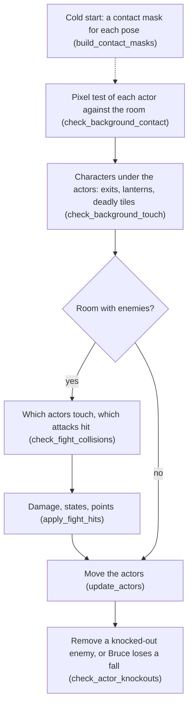
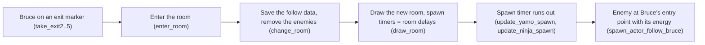

# Bruce Lee: collisions and combat

Bruce, Yamo and the Ninja fight with punches, flying kicks and the Ninja's bokken strike. They also attack when they fall onto each other. They stand on floors, climb ladders and vines, hit walls, and step on lanterns and deadly tiles. Thus the program must know two kinds of contact in each pass. It must know which actors touch each other, and which background pixels are under each actor. The VIC-II sprite collision register gives the first. A pixel test of each sprite shape against the room characters gives the second. This page tells how the two tests work, how a touch becomes a hit, and how a hit costs energy and gives points. It also tells how an actor gets a knock-out and how fall attacks work, with a bug that repeats a knock-out. Last, it tells how an enemy follows Bruce into the next room. The page [actors.md](actors.md) gives the actors, their arrays and their action states.

**Conventions.**

- Addresses are C64 addresses. Names are the names of the knowledge.
- An *actor* is slot X: 0 = Bruce, 1 = Yamo, 2 = Ninja. In a fight test, X is the *victim* and Y the *attacker*.
- A *pass* is one run of `main_loop` (3 frames, see [main_loop.md](main_loop.md)). A *step* is a pass in which an actor acts (see [actors.md](actors.md)).
- A *unit* of `actor_x` is 2 screen pixels, which is one multicolour pixel. A unit of `actor_y` is one raster line.
- A *pixel code* is a 2-bit multicolour pixel: `%01`, `%10`, `%11` (and `%00` = background). A *nibble* is two pixel codes side by side.
- A *coloured* character has colour RAM bits 0-2 not 0. A *dark* character has colour 0 there.
- A *contact mask* is the shape of one pose (both sprites of the actor) as multicolour pixels. The cold start makes each mask one time.
- **Observed** marks a fact that a run showed. **Code** marks a fact from the code only. **Conclusion** marks an interpretation.

## How it works

In each pass, the program first finds where each actor stands. Then it finds whether the actors hit each other, and then it moves them. At the end of the pass, it removes the actors with a knock-out. The fight part runs only in rooms with enemies.



1. **One time, at cold start,** [`build_contact_masks` `$512F`](../src/frame_builder.asm#L16) makes a 96-byte contact mask for each pose frame. The pass test then needs no sprite decoding. (**Code**)
2. **In each pass,** [`check_background_contact` `$5212`](../src/background_contact.asm#L17) puts the mask of each active actor over the room characters. It sets `actor_contact` and `actor_contact_upper`: floor, trigger, ladder and wall. (**Code**)
3. **The characters under each actor** go to `check_background_touch`. It tests them for exits, deadly tiles, lanterns and the moving character `$62`. The page [rooms.md](rooms.md) tells about it. This page gives only its use of the contact bits. (**Code**)
4. **In a room with enemies,** [`check_fight_collisions` `$29C3`](../src/fight_hits.asm#L14) reads the sprite collision register and finds the pairs of actors that touch. It tests each attack and sets `actor_hit_flags`. Then it jumps to [`apply_fight_hits` `$2B4E`](../src/fight_hits.asm#L252). That routine decreases the energy, sets the hit states and adds the points. (**Code**)
5. **After the actors move,** [`check_actor_knockouts` `$2D55`](../src/actor_helpers.asm#L8) removes an enemy with a knock-out. For Bruce, it ends the life with a lost fall. (**Code**)

### Which actors touch

The VIC-II register `SPSPCL` tells which sprites collided with a different sprite since the last read. It does not tell which sprite was the other one. The program draws each actor with one or two sprites. Thus the program first puts the bits into groups, one group for each actor:

| Actor | Main sprite | Overlay sprite | Collision codes (first / second) | `SPSPCL` bits of the actor |
|---|---|---|---|---|
| Bruce | 0 (yellow) | 1 (black) | 4 / 5 | `$03` |
| Yamo | 2 (green) | 3 (black) | 6 / 7 | `$0C` |
| Ninja | 4 (black) | none | 3 / 0 | `$30` (sprites 4 and 5) |

The collision codes are in `actor_collision_code_first` and `actor_collision_code_second`. `set_sprite_slot_owner` changes a code into a sprite number with `collision_code_to_sprite` (3 → 4, 4 → 0, 5 → 1, 6 → 2, 7 → 3). Then it writes the actor into [`sprite_owner` `$4F40`](../src/constants.asm#L167). `reset_play_state` sets all five owners to `$FF`. `remove_actor` sets the owners of the removed actor to `$FF`. Thus a sprite number gives its actor, and a free sprite gives no actor. (**Code**)

`check_fight_collisions` does these steps (**Code**):

1. It clears `actor_touch_mask` and `actor_hit_flags` of the three actors.
2. It reads `SPSPCL` into `sprite_collisions`. The read clears the register.
3. When the value is 0, the routine returns. Then `apply_fight_hits` does not run in this pass.
4. For each pair of groups with bits set, it sets bits in `actor_touch_mask`. Each actor of the pair gets the bit of the sprite of the other actor.
5. The pairs are Bruce with Yamo, Bruce with the Ninja, and Yamo with the Ninja.
6. `check_fight_scan` takes each victim X = 2, 1, 0 and each set bit Y (0-4) of its touch mask.
7. It tests the pair. The owner of sprite Y is the attacker.
8. At the end, it jumps to `apply_fight_hits`.

**The pairs are a guess, so Yamo and the Ninja can hit each other.** The register gives only the groups. When all three groups are set, each pair counts as a touch, although possibly only Bruce touched each enemy. The code tests Yamo and the Ninja against each other, as any other pair. Thus a flying kick of Yamo can knock down the Ninja, without points. (**Code**, `check_fight_yamo_ninja`)

**Observed** in run `coll`: Bruce stands still in room 0 for 1500 frames. The trace records `A` at [`check_fight_collisions_found` `$29D4`](../src/fight_hits.asm#L26). The values were `$12` (sprites 1 and 4: Bruce and the Ninja), `$1C` (Yamo and the Ninja), `$1D`, `$1E` and `$1F`. No value with only `$03` or only `$0C` came. Thus the main sprite and the overlay sprite of one actor do not collide with each other (**Conclusion**: their pixels do not overlap).

One other routine reads `SPSPCL`: [`room18_frame_fireballs` `$3D1D`](../src/wizard_room.asm#L45). In room 18 (the wizard), a fireball sprite (6 or 7) on sprite 0 or 1 starts the death of Bruce. Room 18 has its `room_no_enemies` entry set. Thus the two readers never run in the same room. (**Code**)

### The attack tests

A touch is a hit only when two conditions are true. The attacker must be in an attack pose at the correct time, and the victim must stand in front of it. [`check_fight_pair` `$2A36`](../src/fight_hits.asm#L89) does these tests for one victim X and one sprite Y.

First, the routine stops when the victim cannot get a hit. These are the states `$18` (wall bump), `$1A` (duck), `$0F` (recoil), `$13` (knocked down), `$19` (dying) and `$1B` (hit by a fall attack). **A ducking Bruce cannot get a hit from anything**, also not from a fall attack (**Code**). Then the attacker is `sprite_owner,Y`. A free sprite (`$FF`) gives no hit, and an attacker in state `$1B` gives no hit. The state of the attacker selects the test:

| Attacker state | Window | Distance test | Extra test | Sound | Hit bit of the victim | Bit 7 when the attacker is Bruce | `register_hit` |
|---|---|---|---|---|---|---|---|
| `$16` Ninja strike | timer < 8 | reach >= 4 | - | `$87` | 1 | no | yes |
| `$11` punch | always | reach >= 6 | \|dy\| < `$16` | `$86` | 2 | yes | yes |
| `$0C`/`$0D` flying kick | timer < 10 | reach >= 6 | - | `$86` | 3 | yes | yes |
| `$0E` falling (fall attack) | always | victim Y - attacker Y >= `$0A` | `fall_attack_budget,Y` > 0 (decremented). No bit 4 yet on either actor. Victim not in `$0C`, `$0D`, `$11`. | `$86` | 4 | yes | no |

[`check_attack_reach` `$2C54`](../src/fight_hits.asm#L412) measures the reach. When the attacker faces right, it calculates A = victim X - attacker X. When the attacker faces left, it calculates A = attacker X - victim X. Then it compares A with `attack_reach`. A hit needs carry set and N clear. Then the victim is in front of the attacker, at a distance from `attack_reach` to `attack_reach` + `$7F` units. A victim behind the attacker gives a negative distance and no hit. (**Code**)

For a strike, a punch or a kick, [`register_hit` `$2B3E`](../src/fight_hits.asm#L237) gives the attacker bit 0 of `actor_hit_flags,Y` (it landed a hit). It also turns the victim to the attacker (`actor_facing,X` = `actor_facing,Y` XOR 1). A fall attack does not call it. The worked example below decodes one strike of the Ninja. (**Code**)

### The background contact test

The room graphics use the four multicolour pixel codes as types of surface. `check_background_contact` puts the contact mask of the current frame of the actor over the room characters. It records which pixel codes are under the body (**Conclusion** from the result bits and their users):

| Bit of `actor_contact` | Set when the body covers | Used as |
|---|---|---|
| 0 | `%01` pixels | floor |
| 1 | `%10` pixels | trigger: lanterns, deadly tiles and traps count only when it is set (`touch_tile_gate`) |
| 2 | `%11` pixels of a coloured character | ladder or vine |
| 3 | `%11` pixels of a dark character | wall |

`actor_contact_upper` has the same bits for the body without its last 6 rows. Thus the code can find the difference between the feet and the remaining body.

[`check_background_contact` `$5212`](../src/background_contact.asm#L17) tests each active actor X = 2, 1, 0 in these steps (**Code**):

1. **Pixel offsets.** `contact_pixel_x` = (`actor_x` - 12) AND 3 and `contact_pixel_y` = (`actor_y` - 29) AND 7. They give the position of the sprite in its character cell.
2. **Character position.** `actor_cell_col` = (`actor_x` - 12) / 4 and `actor_cell_row` = (`actor_y` - 29) / 8.
3. **Screen row.** Character row r is screen row r + 1, because `char_row_screen_lo` starts at `$8C28`.
4. **Shift the mask.** [`build_shift_mask` `$52AD`](../src/background_contact.asm#L98) copies the mask of `actor_frame_a` into the buffer `shift_mask_col0` to `shift_mask_col3`.
5. **The buffer.** It is `$CAE0-$CB5F`: 4 columns of 32 rows. The copy is `contact_pixel_y` rows lower.
6. **The shift.** `build_shift_mask` moves the mask `contact_pixel_x` multicolour pixels to the right. For offset 3, it moves one column right and one pixel left.
7. **Set the end rows.** `contact_last_row` = `contact_pixel_y` + 21, and `contact_upper_end_row` = that value - 6.
8. **Tested rows.** Thus the test reads 21 mask rows. The upper result stops 6 rows before the end.
9. **Clear the contact tables** (`clear_contact_tables`).
10. **Read 4 character rows** (mask rows 0-7, 8-15, 16-23, 24-31). For each, `fetch_char_row` reads the 3 characters under mask columns 0-2.
11. **Patch the scan code.** `fetch_char_row` also reads the colour RAM, and writes the charset address of each character into the scan code.
12. **Scan the rows.** [`scan_mask_rows` `$537E`](../src/background_contact.asm#L225) calculates v = charset byte AND mask byte, for each mask row and column.
13. **Mark the nibbles.** When v is not 0, the entries `v >> 4` and `v AND $0F` of the contact table of that column become nonzero. The code ignores entry 0.
14. **Evaluate.** At `contact_upper_end_row`, `evaluate_contact` writes `actor_contact_upper`. At `contact_last_row`, it writes `actor_contact`, and the test goes to the next actor.

```
for X in 2, 1, 0 if active:
    buf = mask[actor_frame_a[X]] shifted by (px, py)
    clear contact_col0..2, lit0..2
    for r in 0..3:
        for c in 0..2:
            ch[c] = screen[row + r + 1][col + c]           # col + c >= 40: character 0
            set_lit(c, colour_ram[row + r + 1][col + c] & 7 != 0)
        for y in 8r .. 8r+7:
            for c in 0..2:
                v = charset[ch[c] * 8 + (y - 8r)] & buf[c][y]
                if v: table[c][v >> 4] = 1; table[c][v & 15] = 1
            if y + 1 == py + 15: actor_contact_upper[X] = evaluate()
            if y + 1 == py + 21: actor_contact[X] = evaluate(); next X
```

The charset is the room charset at `room_charset_hi` × 256 (`$A000`, `$A800`, `$B000` or `$B800`). (**Code**)

**Some pixels of an actor never get a test against the background.** A 16-pixel frame loses its last 4 pixels when the code makes the mask. The scan also does not read the pixels that the shift moves into column 3. (**Code**, `expand_contact_mask`, `build_shift_mask`)

### Dark and coloured characters

A `%11` pixel is a ladder in a coloured character and a wall in a dark character. Thus the test must know the colour of the character under each hit. But the scan does not read the colour for each hit. Instead, each column has a state (`contact_col0_lit` and the two others). The layout of the tables is under [The data](#the-data). (**Code**)

When a column moves from a dark to a coloured character, [`swap_col0_pairs` `$55E6`](../src/background_contact.asm#L518) swaps pairs of entries in the contact table. It also swaps them when the column moves back. The pairs are 3/16, 7/17, 11/18, 12/19, 13/20, 14/21 and 15/22. The versions for column 1 and 2 do the same. In the coloured state, new hits of those nibble values go into entries that become 16-22 after the swap back. (**Code**)

[`evaluate_contact` `$5431`](../src/background_contact.asm#L336) first swaps each column back to the dark state. Then it does an OR of the entries of each class. It packs the four counters `contact_count_c01` to `contact_count_c11_dark` into the result. `scan_upper_body` keeps the column states in `contact_lit_saved` while it evaluates the upper body early. (**Code**)

```
actor_contact = c11_dark << 3 | c11_lit << 2 | c10 << 1 | c01
```

**The floor test of column 1 reads column 0.** For the `%01` class, [`evaluate_test_c01` `$545C`](../src/background_contact.asm#L358) reads `contact_col0+17`. The correct entry is `contact_col1+17`. Thus a nibble `%01 %11` (value 7) in a coloured character under mask column 1 does not count as floor. (**Code**)

The contact bits have these users (**Code**):

| Bit | Users |
|---|---|
| 0 floor | falling and landing, jumps and kicks end on a floor, ducking, `wake_idle_enemies`, the AI chase |
| 1 trigger | `check_background_touch` → `touch_tile_gate`: lanterns, deadly tiles, trap tiles |
| 2 ladder | climbing, jumps end on a ladder, no punch or jump on a ladder, climbing poses, `touch_climb_tile` |
| 3 wall | the wall undo of `actor_action_step`, kicks and punches end, the falling pose `$08` |
| upper bit 0 | `actor_bruce_falling`: the sideways drift of a falling Bruce |

### Damage and the attacker's pause

A hit decreases the energy of the victim and pushes the victim back or down. The attacker stands still for a short time, so that it cannot hit again immediately. [`apply_fight_hits` `$2B4E`](../src/fight_hits.asm#L252) does this for each actor X = 2, 1, 0 (`current_actor` = X), in this order (**Code**):

1. Bit 0 (landed a hit): `actor_state` = 0, `actor_step_delay` = 4 and `actor_pose_done` set.
2. Bit 0 also sets a pause in `actor_timer` by the time level (table below).
3. Bit 1 (Ninja strike): energy - 2. Negative: knock-out. Else state `$0F`, timer 3.
4. Bit 2 (punch): Bruce's hit scores 100. Energy - 3. Negative: knock-out. Else state `$0F`, timer 4.
5. Bit 3 (flying kick): Bruce's hit scores 75. Energy - 7. Negative: knock-out. Else state `$13`, timer 12.
6. Bit 4 (fall attack): Bruce's hit scores 50. Energy - 5. Negative: knock-out. Else state `$1B`, timer 8.

A victim with several bits in one pass gets all the damage, and the last state that the code writes stays. A knock-out after bit 1, 2 or 3 goes to `apply_fight_ko` and continues at bit 4. Thus the code does not apply the later bits 2 and 3. (**Code**)

| Attack | Damage | Victim state, timer | Points (Bruce's hit) | Code |
|---|---|---|---|---|
| Ninja strike | 2 | `$0F` recoil, 3 | - | `apply_fight_hits_strike` |
| Punch | 3 | `$0F` recoil, 4 | 100 | `apply_fight_hits_punch` |
| Flying kick | 7 | `$13` knocked down, 12 | 75 | `apply_fight_hits_kick` |
| Fall attack | 5 | `$1B`, 8 | 50 | `apply_fight_hits_fall` |
| Knock-out (energy < 0) | - | `$13`, 12 | Yamo 450, Ninja 200 | `apply_fight_ko` |

The pause of the attacker increases with the time that Bruce stays in the room (`get_room_time_level`):

| Time level | Bruce | Enemy |
|---|---|---|
| 0, `game_loop_count` = 0 | 3 | `$18` (24) |
| 0, `game_loop_count` nonzero | 3 | 3 |
| C (room time >= 6400 frames) | 8 | 10 |
| V (room time >= 8192 frames) | 10 | 10 |

For a short pause, the enemy path first stores 2 ([`apply_fight_hits_pause_short` `$2B7F`](../src/fight_hits.asm#L279)). Then it continues into the code of the pause of Bruce, which writes over the 2. During the pause, the attacker stands (state `$00` with a timer). A fall attack sets no bit 0, so the attacker of a fall attack gets no pause. (**Code**)

### Energy and knock-outs

`actor_energy` is a signed value. An actor with a negative energy has a knock-out.

| Actor | Start | Cap | Set by |
|---|---|---|---|
| Bruce | `$24` (36) | - | `spawn_actor`. `lose_fall` sets all three to `$24`. |
| Yamo | `$24` → `$14` (20) | `$14` | `spawn_yamo` caps after `spawn_actor` (also a carried energy) |
| Ninja | `$24` → 7 | 7 | `spawn_ninja` |

These hits decrease the energy below 0 (**Code**):

- Bruce: 19 strikes, 13 punches or 6 kicks.
- Yamo: 7 punches or 3 kicks.
- The Ninja: 3 punches or 2 kicks.

In each pass, [`main_loop_update` `$1BDF`](../src/game_main_loop.asm#L37) clears bit 6 of the energy of Yamo (`AND #$BF`). It also clears bits 3-6 of the energy of the Ninja (`AND #$87`). Bit 7 (knock-out) stays. Thus a positive Ninja energy is at most 7, and a positive Yamo energy is at most `$3F`. The caps are below these limits, so the masks change only wrapped values (see the fall-attack bug below). (**Code**)

A knock-out has three steps (**Code**):

1. [`apply_fight_ko` `$2C24`](../src/fight_hits.asm#L384) adds points when bit 7 is set (Bruce's hit). Yamo (X = 1) gives 450, the Ninja 200.
2. For Yamo, the 450 points are 256 + 194, in two `add_score` calls.
3. The victim gets state `$13`, timer 12. Then the code jumps to `apply_fight_hits_fall`.
4. The handler `act_check_knocked_down` moves the actor along the floor for 12 steps. An enemy with a knock-out does not recover at timer 1.
5. At the end of the pass, [`check_actor_knockouts` `$2D55`](../src/actor_helpers.asm#L8) takes each active actor with energy < 0.
6. It does not take an actor while state `$13` or `$19` still has a timer.
7. It removes an enemy with `remove_actor`, which starts the spawn timer again.
8. Bruce loses a fall: `check_actor_knockouts_bruce` calls [`lose_fall` `$1818`](../src/lose_fall_game_over.asm#L14).

**Observed** in run `coll`: Bruce stood still in room 0. The Ninja hit him (state `$0F` from `apply_fight_hits_strike`). Punches hit him (`$0F` from `apply_fight_hits_punch`), and kicks hit him (`$13` from `apply_fight_hits_kick`). At frame 1306, a knock-out set `$13` (`apply_fight_ko_knockdown`). At frame 1376, Bruce came back with energy `$24`, and the status line showed FALLS 03.

### Points

Only the hits of Bruce give points. The hits of the enemies give no points. [`add_score` `$3175`](../src/score.asm#L52) adds A at byte X of the 24-bit `score` (X = 2: units, X = 1: × 256). Thus a sum such as 450 needs two calls. For comparison, the table also gives the points outside the fights. (**Code**)

| Event | Points | Code |
|---|---|---|
| Bruce's punch hits | 100 | `apply_fight_hits_punch` |
| Bruce's flying kick hits | 75 | `apply_fight_hits_kick` |
| Bruce's fall attack hits | 50 | `apply_fight_hits_fall` |
| Bruce knocks out Yamo | 450 (`$01` at byte 1 + `$C2` at byte 2) | `apply_fight_ko` |
| Bruce knocks out the Ninja | 200 | `apply_fight_ko_ninja` |
| A lantern taken | 125 | `check_lantern_pickup` |
| First visit of a room, per player | 2000 | `draw_room` |
| A band bonus in room 13 | 500 | `room13_frame_award_bonus` |
| The wizard defeated | 3000 | `room18_frame` |

**Observed** in run `ko2` (see the fall attacks below): the score started at 2000. A punch knock-out of Yamo gave 2550 (100 + 450). A kick knock-out gave 2525 (75 + 450). A fall attack without knock-out gave 2050.

### Fall attacks

An actor that falls (state `$0E`) onto a different actor attacks it. [`check_fight_fall` `$2AFA`](../src/fight_hits.asm#L200) does the test (**Code**):

1. The victim must be `$0A` or more lines below the attacker. The test is victim `actor_y` - attacker `actor_y` >= `$0A`, signed.
2. `fall_attack_budget,Y` must be nonzero. The code decreases it here, before the other tests.
3. Neither actor has bit 4 already in this pass.
4. The victim is not in `$0C`, `$0D` or `$11`. Thus a victim that kicks or punches is safe.
5. Hit sound `$86`, victim bit 4 (and bit 7 for Bruce).
6. No `register_hit`: the attacker gets no pause, and the victim does not turn.

**The fall-attack budget decreases for each test that gets to the counter, also for a refused test.** The decrement comes before the tests of steps 3 and 4. [`frame_update` `$15A8`](../src/frame_update.asm#L20) decreases `fall_attack_refill_timer` in each frame. At 0, it sets the budget of all three actors to 2. Thus each actor can land at most 2 fall-attack tests in 256 frames (5.1 seconds). (**Code**)

**A knock-out by a fall attack repeats.** [`apply_fight_ko` `$2C24`](../src/fight_hits.asm#L384) ends with a jump to [`apply_fight_hits_fall` `$2BF9`](../src/fight_hits.asm#L354), and that code tests bit 4 again. After a knock-out from a fall attack, bit 4 is still set. Thus the fall attack applies again: -5 energy, +50 points, a new knock-out, and +450 (Yamo) or +200 (Ninja). The loop ends only when the energy wraps from below -128 to a positive value (**Code**).
For Yamo with energy 3, the energy after hit k is 3 - 5k. It is negative for k = 1 to 26. At k = 27, it wraps to 3 - 135 + 256 = 124 = `$7C`. Thus Bruce gets 27 hits × 50 + 26 knock-outs × 450 = 13050 points, and the enemy stays alive (**Observed** in runs `ko2` and `ko3` below).

```
loop:                                  # apply_fight_hits_fall $2BF9
    if hit_flags & $10 == 0: next actor
    if hit_flags & $80: score += 50
    energy -= 5
    if energy >= 0 (signed): state $1B, timer 8; next actor
    if hit_flags & $80: score += 450 (Yamo) / 200 (Ninja)
    state $13, timer 12
    goto loop                          # apply_fight_ko ends with jmp
```

**Observed** in run `ko2`, which is the same run file as the naming stage. The run starts from the room 12 snapshot. At `$1C23` (the call of `check_fight_collisions`), it writes [`actor_hit_flags+1` `$BD`](../src/constants.asm#L100) = `$90`. This value is bit 7 + bit 4: a fall attack of Bruce on Yamo. The run also writes [`actor_energy+1` `$D2`](../src/constants.asm#L107) = 3. Then it runs `apply_fight_hits` to [`main_loop_actors` `$1C26`](../src/game_main_loop.asm#L77). The other three cases change only the hit flags and the energy:

| Case | Hit flags of Yamo | Energy before | Score after (from 2000) | Energy after | State, timer |
|---|---|---|---|---|---|
| fall attack, knock-out | `$90` | 3 | `$003ACA` = 15050 (+13050) | `$7C` (124) | `$1B`, 8 |
| flying kick, knock-out | `$88` | 3 | `$0009DD` = 2525 | `$FC` (-4) | `$13`, 12 |
| fall attack, no knock-out | `$90` | 20 | `$000802` = 2050 | `$0F` (15) | `$1B`, 8 |
| punch, knock-out | `$84` | 2 | `$0009F6` = 2550 | `$FF` (-1) | `$13`, 12 |

**Observed** in run `ko3`, which continues one pass after the first case. `main_loop_update` masks the energy of Yamo to `$7C` AND `$BF` = `$3C` (60). Yamo then stays in state `$1B` for 8 steps, and then stands with 60 energy. That is three times his cap. Thus a fall attack with a knock-out gives Bruce 13050 points (Yamo, from energy 3), and the enemy stays alive. **Conclusion:** the energy masks of the main loop limit the damage of this bug. They limit it for the Ninja (energy at most 7 again) and partly for Yamo.

### The enemy that follows Bruce

When Bruce goes through an exit, each active enemy follows him into the next room. The enemy comes later, at the place where Bruce came in, with the energy that it had.



1. [`change_room` `$2F9A`](../src/background_touch.asm#L234) stores the entry position of Bruce (A, Y) in `actor_x` and `actor_y`.
2. It sets `room` = `next_room`.
3. For X = 2, 1, an active enemy gets `enemy_follow_energy-1,X` = its energy.
4. It also gets `enemy_follow_x-1,X` = the entry X of Bruce and `enemy_follow_y-1,X` = the entry Y of Bruce.
5. An absent enemy gets 0. Then `remove_actor` removes the enemy.
6. Then come `reset_spawn_timer` (X = 0: both), a stack reset, `draw_room`, `build_actor_sprites`, and a jump to `main_loop`.
7. `draw_room` loads the first-visit delays of the new room (`ninja_room_delay`, `yamo_room_delay`).
8. In a room with `room_no_enemies`, `draw_room` clears `enemy_follow_x` of the two enemies. No enemy follows into those rooms.
9. When the spawn timer gets to 0, `spawn_actor` finds `enemy_follow_x` nonzero ([`spawn_actor_follow_bruce` `$0C3F`](../src/actor_spawn.asm#L114)).
10. The enemy comes at the entry point of Bruce with the saved energy. The code clears the follow entry.
11. `spawn_yamo` and `spawn_ninja` then apply the energy caps.

The enemy comes at the place where Bruce came in, after the usual first delay of the room. If Bruce stays near the door, the enemy comes next to him. In the demo, `spawn_actor` puts each actor at start point A and does not clear the follow entry. (**Code**)

**A following enemy with a knock-out comes back with full energy.** An enemy with a knock-out that is still on the floor (state `$13`, energy < 0) also follows. As an unsigned number, its negative energy is above the caps. Thus `spawn_yamo` and `spawn_ninja` give it the full cap (20 or 7). (**Code**)

A wall-bump restart of the room (`act_wall_bump_still_in`) also goes through `enter_room` and `change_room`. Thus the active enemies "follow" into the same room and come back at the start point of Bruce. (**Code**)

**An enemy that goes through an exit leaves a return address on the stack.** The code only removes an enemy on an exit marker (`enter_room` with `current_actor` nonzero). [`enter_room` `$2F8E`](../src/background_touch.asm#L222) removes one return address from the stack and jumps to `check_background_touch_next`. The return address into `check_background_touch` stays on the stack. After the loop, the code thus returns into the middle of `check_background_touch` again. Then it does the tile check of Bruce one more time, one tile row lower. (**Code**)

## The data

### The hit flags

[`actor_hit_flags` `$BC`](../src/constants.asm#L100) holds one byte for each actor with the fight result of this pass. `check_fight_collisions` clears it and sets it. `apply_fight_hits` reads it.

| Bit | Meaning |
|---|---|
| 0 | This actor landed a hit (attacker) |
| 1 | Hit by a Ninja strike |
| 2 | Hit by a punch |
| 3 | Hit by a flying kick |
| 4 | Hit by a fall attack |
| 7 | The hit came from Bruce (it scores) |

### The touch mask

[`actor_touch_mask` `$B3`](../src/constants.asm#L97) holds one byte for each actor: the sprites of the other actors that it touches. The bit number is the sprite number. Thus the owner of that sprite in `sprite_owner` is the attacker.

| Bit | Sprite | Owner |
|---|---|---|
| 1 | 1 (Bruce's overlay) | Bruce |
| 3 | 3 (Yamo's overlay) | Yamo |
| 4 | 4 (the Ninja) | Ninja |

### The contact masks

A contact mask holds the two sprites of one pose. Each set pixel of the 1-bit frame shape becomes the pixel code `%11`. The sprites are X-expanded, so one sprite pixel is 2 screen pixels wide and covers one multicolour pixel. A mask is 96 bytes:

| Bytes | Content |
|---|---|
| `+$00-$1F` | Column 0: mask rows 0-31, 4 multicolour pixels per byte (sprite pixels 0-3) |
| `+$20-$3F` | Column 1: sprite pixels 4-7 |
| `+$40-$5F` | Column 2: sprite pixels 8-11 (only for 16-pixel frames: the high nibble of the second byte) |

Rows from the frame height to 31 are 0. A 16-pixel frame loses its last 4 pixels (the low nibble of its second byte) in the mask. (**Code**)

The tables [`contact_mask_addr_lo` `$1167`](../src/room_enemy_tables.asm#L15) and `contact_mask_addr_hi` give the mask of each frame. They have 210 entries, and the index is the frame number. These are the targets (**Code**):

- An even frame (the main sprite of a pose) points to its mask in `$9000-$9FBF` or in `contact_masks_high` `$C000-$CADF`.
- The area `$9000-$9FBF` is on top of the sources of the room charsets. The cold start expands these sources before it makes the masks.
- An odd frame (the overlay sprite) points to the scratch block `shift_mask_col0` at `$CAE0`.
- An odd frame has high byte 0 when the pose has no second sprite (the Ninja).
- Several frames use the same mask.

[`build_contact_masks` `$512F`](../src/frame_builder.asm#L16) makes the masks with `expand_contact_mask` and `double_pixel_nibble` (**Code**):

```
for X = $D1 downto 1 step 2:                    # odd frame X, even frame X-1
    if contact_mask_addr_hi[X] != 0: expand(X)  # into shift_mask_col0 ($CAE0)
    else: clear 96 bytes at $CAE0
    expand(X-1)                                 # into its own mask address
    mask(X-1)[i] |= $CAE0[i] for i = 0..95       # both sprites in one mask
expand(F):
    for row = 0 .. frame_last_row[F]:
        b = shape byte
        col0[row] = double(b >> 4); col1[row] = double(b & $0F)
        col2[row] = wide ? double(second_byte >> 4) : 0
    rows frame_last_row+1 .. 31 of the three columns = 0
double(n):  bit k of n (k = 0..3) -> bits 2k+1..2k   # %1011 -> %11001111
```

`build_contact_masks` first loops for ever unless `prot_signature_a` = `$B9` and `prot_signature_b` has the same value (check 1 on [protection.md](protection.md)). It uses `current_actor` as the frame counter and `demo_input_ptr` as the row count. At cold start, the two are free. (**Code**)

### The contact tables

[`contact_col0` `$4EED`](../src/constants.asm#L153), `contact_col1` and `contact_col2` are 23 bytes each, one table for each mask column. An entry is the value of a nibble that the scan saw:

| Entry | Meaning (state after `evaluate_contact`) |
|---|---|
| 0 | Not used (a nibble of value 0) |
| 1-15 | The nibble value was seen. For the values with a `%11` pixel (3, 7, 11, 12, 13, 14, 15): seen in a dark character. |
| 16-22 | The values 3, 7, 11, 12, 13, 14, 15 seen in a coloured character. |

`evaluate_contact` does an OR of these entries of the three tables into the four classes. Each class gives one bit of [`actor_contact` `$B6`](../src/constants.asm#L98):

| Class | Entries | Bit |
|---|---|---|
| `%01` | 1, 4, 5, 6, 7, 9, 13, and 17, 20 | 0 |
| `%10` | 2, 6, 8, 9, 10, 11, 14, and 18, 21 | 1 |
| `%11` coloured | 16-22 | 2 |
| `%11` dark | 3, 7, 11, 12, 13, 14, 15 | 3 |

### The follow data

[`enemy_follow_x` `$8B`](../src/constants.asm#L84), `enemy_follow_y` and `enemy_follow_energy` are 2 bytes each. The code reads them with X = 1 or 2 as `enemy_follow_x-1,X`. Thus +0 is Yamo and +1 is the Ninja. A nonzero `enemy_follow_x` tells that the enemy follows. `reset_play_state` and `lose_fall` clear `enemy_follow_x`. (**Code**)

## Worked examples

### A strike of the Ninja on Bruce

The Ninja (X = 2, facing left, `actor_x` = `$23`) strikes Bruce (`actor_x` = `$1A`) with timer 7. The timer is below 8, so the strike is in its window. The Ninja is the attacker Y. [`check_attack_reach` `$2C54`](../src/fight_hits.asm#L412) calculates A = `$23` - `$1A` = `$09` (facing left, no negation). `$09` >= 4, and `$09` - 4 = `$05` is positive: a hit. (**Code**)

Bruce gets bit 1, the Ninja gets bit 0, and Bruce turns to the right. In `apply_fight_hits`, the Ninja stands and pauses. Bruce loses 2 energy and recoils (state `$0F`, timer 3). (**Code**)

### The contact mask of frame 2

Frame 2 is Bruce standing, facing right. `contact_mask_addr_lo+2` and `contact_mask_addr_hi+2` are `$60` and `$90`, so its mask is at `$9060`. Frame 2 is 12 rows of 1 byte (`bruce_frame_02` = `$00 $10 $30 $28 ...`). Frame 3, its overlay, is 21 rows (`bruce_frame_03` = `$30 $60 $48 $50 ...`). (**Code**)

| Row | Frame 2 | Frame 3 | OR | Column 0 | Column 1 |
|---|---|---|---|---|---|
| 0 | `$00` | `$30` | `%0011 0000` | double(`%0011`) = `$0F` | `$00` |
| 1 | `$10` | `$60` | `%0111 0000` | double(`%0111`) = `$3F` | `$00` |
| 2 | `$30` | `$48` | `%0111 1000` | `$3F` | double(`%1000`) = `$C0` |

**Observed** in run `contact` (next example): Bruce is at pixel offset 2. The shifted buffer shows row 0 as `$00 $F0` and row 1 as `$03 $F0` in columns 0 and 1. These are the same bytes, 2 multicolour pixels to the right.

### Bruce on the floor of room 0

**Observed** in run `contact`: the run starts from the room 0 snapshot. It stops at [`contact_return` `$52AC`](../src/background_contact.asm#L92), after the test of Bruce.

| Value | Data |
|---|---|
| `actor_x`, `actor_y` | `$1A`, `$C4` |
| `contact_pixel_x`, `contact_pixel_y` | 2, 7 |
| `actor_cell_col` | 3 (character columns 3-5) |
| character rows | 20-23 = screen rows 21-24 |
| `contact_last_row`, `contact_upper_end_row` | 28, 22 |
| characters under the feet | screen row 23: `$11` (empty). Screen row 24: `$91`, colour RAM `$8` (dark). |
| charset `$A000` + `$91` × 8 | `$00 $00 $55 $55 $AA $AA $FF $FF` |

Mask rows 24-27 are rows 0-3 of character `$91`. In the mask, only rows 26 and 27 (the feet) have set pixels. They meet the rows `$55` = `%01 %01 %01 %01`:

| Mask row | Column | Mask | Char byte | v | Entries |
|---|---|---|---|---|---|
| 26 | 0 | `$03` | `$55` | `$01` | 1 |
| 26 | 1 | `$C3` | `$55` | `$41` | 4, 1 |
| 26 | 2 | `$C0` | `$55` | `$40` | 4 |
| 27 | 0 | `$0F` | `$55` | `$05` | 5 |
| 27 | 1 | `$C3` | `$55` | `$41` | 4, 1 |
| 27 | 2 | `$F0` | `$55` | `$50` | 5 |

The run showed these entries in the tables:

- `contact_col0`: entries 1 and 5.
- `contact_col1`: entries 1 and 4.
- `contact_col2`: entries 4 and 5.

All are in the `%01` class. Thus `actor_contact` = `$01` (floor) and `actor_contact_upper` = `$00`. The scan stops at mask row 28, before the `%10` and `%11` rows of the floor character.

### Yamo follows Bruce into room 1

Bruce goes out of room 0 through exit marker 2 while Yamo is active with energy `$0C`. For room 0, the exit tables give `exit2_dest_room` = 1, `exit2_entry_x` = `$10` and `exit2_entry_y` = `$92`. [`change_room` `$2F9A`](../src/background_touch.asm#L234) stores `enemy_follow_x` = `$10`, `enemy_follow_y` = `$92` and `enemy_follow_energy` = `$0C`. In room 1, `yamo_room_delay` is `$EE` (238 passes). Thus Yamo comes 14.3 seconds later at the entry point of Bruce (`$10`, `$92`) with energy 12. He does not come at a start point of room 1. (**Code**)

## Still open

- A natural fall attack in play: can a falling Bruce get to `$0A` lines above an enemy in the rooms with ledges? A run in room 1 or 7 that drops Bruce on the Ninja can show it.
- The screen effect of the stack imbalance of `enter_room`. The coverage runs showed no crash. A run where the Ninja walks off an exit edge can trace [`check_tile_row` `$2E6E`](../src/background_touch.asm#L41).
- Did the authors add the energy masks of the main loop against the knock-out loop, or for a different reason?
