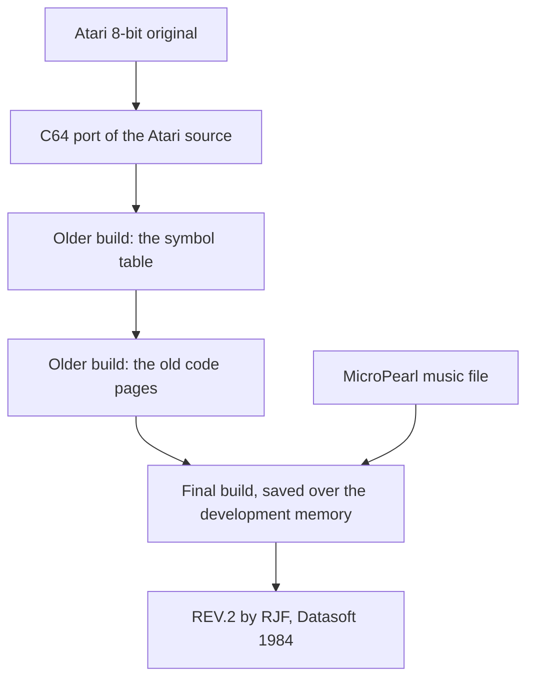

# Bruce Lee: the development

This page tells how Ron J. Fortier and Datasoft made the C64 version of *Bruce Lee*. The program and the bytes around it give the evidence. The release image holds about 6 KB of bytes that no code of the game reads. These bytes include copies of older builds, a part of the assembler source text and a part of the symbol table. They also include the data file of a music editor, old code and old charsets. Other bytes are old sound effects, an older demo recording and Atari 8-bit key codes. The rebuild keeps these bytes out of the game, and the knowledge keeps them in the spaces `bank1` to `bank7`.

**Observed** marks a fact that a run or a byte compare showed. **Code** marks a fact from the code or the bytes only. **Conclusion** marks an interpretation.

**Conventions.**
- Addresses are C64 addresses. Names are the names of the knowledge.
- A *leftover* is a block of the release image that no code of the game reads. Each leftover is in a space of its own (`bank1` to `bank7`), so it has no line in the source. This page gives its name, its space and its address, for example `old_demo_input_stream` in bank4 at `$F200`.
- The *final build* is the build that made the game in the image. An *older build* is an earlier build that left bytes in a leftover.
- A *source label* is a name of the original assembler source, in upper case, for example PLOFS.

## The authors and the version

The game names its author and its version in two places. The title screen shows "DATASOFT PRESENTS", "BRUCE LEE" and "BY RON J FORTIER" in big logo characters. During a game, the V key shows a version line in the top row of the screen: "BRUCE LEE (C) 1984 DATASOFT REV.2 BY RJF". [`toggle_credit_line` `$1B68`](../src/status_and_keys.asm#L94) copies the 40 characters of [`version_banner` `$4707`](../src/messages_rooms.asm#L266) into the row. The next V press clears the row again (**Code**).

So the C64 game is revision 2, by Ron J. Fortier (RJF), and Datasoft published it in 1984. The image does not tell what changed from revision 1 (**Code**).

The Datasoft title picture names one more person. It reads "PROGRAMMED BY RON J FORTIER" and "GRAPHIC ART BY KELLY DAY" (**Observed**: the picture in the TBC intro). The game bytes do not hold the picture or this credit. Only the TBC release holds the picture, and the rebuild shows it at the start ([releases.md](releases.md)).

The title tune plays on a player by another author. [`music_player_credit` `$E315`](../src/music_player.asm#L50) holds the text " MICROPEARL MUSIC PLAYER  COPYRIGHT 1983 JOHN A. FITZPATRICK ". No code reads this text (**Code**). The section on the music file below tells how the tune came into the game.

## The tools and the computer of the development

### Assembler source text in Apple II format

`$5900-$59A4` holds 165 bytes of assembler source text. The knowledge names the lines in bank1, from `source_text_char96_dfb1_tail` on. Without bit 7, the bytes read as follows (**Observed**: byte decode of the release file):

```
[ DFB $]0F,$33,$FF,$FF       <- starts in the middle of a line at $5900
 DFB $FF,$0C,$03,$C3
* CHAR 97
 DFB $F0,$C0,$00,$00
 DFB $3F,$FC,$F0,$03
* CHAR 98
 DFB $FA,$FA,$FE,$FE
 DFB $FA,$3A,$BA,$AA
* CHAR 99
 DFB $FF,$CF,$F[F,$FF]       <- cut by actor_frame_base at $59A5
```

The text is the end of the source file of a room charset. Each tile has a comment line `* CHAR n` and two `DFB` lines of 4 bytes. The first line gives rows 0-3 of the tile, and the second line gives rows 4-7. The game expands these two parts into the two halves of a double-height character. The 31 bytes in the text are equal to tiles 96-99 of [`room_charset_d` `$9C00`](../src/room_charset_d.asm#L8), the wizard-flash tiles of room 18 (**Observed**). So the authors kept even the graphics as assembler source, one tile at a time (**Conclusion**).

The format of the text is the format of an Apple II assembler (**Code**: the bytes):

| Item | Bytes |
|---|---|
| Characters | ASCII with bit 7 set (`$C4` = D) |
| Field separator | `$A0`, a space with bit 7 set |
| Space inside a comment | `$20` |
| End of line | `$8D`, a carriage return with bit 7 set |
| Comment line | starts with `*` |
| Data directive | `DFB` |

High-bit ASCII, `$8D` line ends, `*` comments and `DFB` are the conventions of Apple II assemblers. So an assembler of this type made the game, and its source text was in memory when the image was saved (**Conclusion**). The bytes do not show which assembler it was. They also do not show if it ran on an Apple II or on a C64 (see Still open).

### The music editor

The block `$E800-$EC8F` was the data file of the MicroPearl music editor. The editor made the file at `$4000`, and the build loaded it `$A800` higher. The header `music_file_header` in bank4 at `$E800` holds five words in the addresses of the editor. Each word plus `$A800` gives a start or an end of the title tune (**Observed**):

| Word | + `$A800` | What is there in the game |
|---|---|---|
| `$406A` | `$E86A` | The start of voice 0 in the file, 102 bytes before the voice 0 that the game plays. |
| `$417D` | `$E97D` | `music_title_voice1`. |
| `$4231` | `$EA31` | `music_title_voice2`. |
| `$42AD` | `$EAAD` | The end of song 0. |
| `$4490` | `$EC90` | The end of the data. |

The player never reads the header. It uses [`music_song_table` `$E8C0`](../src/music_songs.asm#L7), and the build put this table over the start of the old voice 0 (**Code**). So the composer made the tune in the editor, and the authors put the file into the game as binary data (**Conclusion**).

### A C64 bitmap tool in memory

`$88FC-$8AFF` in bank2 holds the end of a C64 program. The program was assembled for `$C8FC-$CAFF` and stored `$4000` lower. Its `JSR`s to `$C9B1`, `$C9BA` and `$C9C1` go to the routines at `$89B1`, `$89BA` and `$89C1` (**Code**). Its key table `tool_key_table` in bank2 at `$8A81` holds 23 records of a PETSCII key and a handler. The keys include RUN/STOP, the cursor keys, F1-F7, the digits 1-4, CTRL-A, CTRL-D, RETURN, HOME and SPACE. The remaining routines do these tasks (**Code**):

- They pack a picture with a run-length code.
- They unpack a picture into a window of 32 x 12 cells of a bitmap at `$2000`.
- They scroll the window.
- They show or hide a sprite cursor.

The program is a C64 graphics editor, not a part of the game. The game has no bitmap. Its room maps also use the opposite run-length code, where bit 7 clear gives a run (**Code**). The tool was in the memory of the machine with the build, next to the symbol table. Who wrote the tool and what it drew is not known (**Conclusion**).

## Other versions of the program

Bruce Lee was first an Atari 8-bit game. `atari_digit_key_codes` in bank1 at `$4CBA` holds `32 1F 1E 1A 18 1D 1B 33 35 30`. `atari_shift_digit_key_codes` at `$4CC4` holds the same bytes plus `$40` (**Observed**). These bytes are the Atari keyboard codes of the keys 0-9. On the Atari, SHIFT adds `$40`, so the second row is SHIFT+0 to SHIFT+9 (**Conclusion**: platform knowledge).

No code reads these bytes. [`scan_keyboard` `$139E`](../src/keyboard_scan.asm#L24) gives each key as a C64 matrix index, and as matrix indexes these bytes are other keys (**Code**). The table is between two C64 tables, [`anim_step_delay` `$4CB2`](../src/room_tables.asm#L171) and `room_lantern_count_init` (**Code**).

So the authors made the C64 version from the Atari source, and a table of the Atari version stayed in it (**Conclusion**). The C64 game has no digit keys.

## Old versions in the image

Most leftovers are in memory that the game uses as work space but does not load. These areas are the following:

- The actor workspace at `$4EED`, which [`init_game_variables` `$0F72`](../src/game_setup.asm#L18) clears.
- The sprite buffers at `$8180`.
- The text font at `$8800`, which [`cold_start` `$0400`](../src/cold_start.asm#L22) builds.
- The screen at `$8C00`.
- The gaps between the parts of the music code and the sound code.

The final source declared these areas as reserved space, and the assembler did not write them. So the older memory content stayed in the image (**Conclusion**).

**The game does not need any leftover.** [tests/leftovers_unused.json](../tests/leftovers_unused.json) runs the release file twice. On one side, it fills each leftover block with `$A5` at the game entry. Then it plays the title music, the attract demo and room 0. It also goes into rooms 3, 4, 8, 13, 15, 18 and 19 and plays in each room. Memory, the chips and the screen are equal at all 10 checkpoints (**Observed**: PASS).

### The image is a memory dump

Three blocks are copies of the final program at a wrong address (**Observed**: byte compares):

| Leftover | Space | Equal to the game bytes | Offset |
|---|---|---|---|
| `shifted_messages_copy` | bank1 | `$4731-$492A`: messages, pointer helpers, room palettes, the room draw step, the font builder and the game IRQ. | +`$7BC` |
| `shifted_room_lists_copy` | bank1 | `$4CF2-$4EC4`: the lantern lists and the room init handlers. | +`$A3B` |
| `shifted_room_map_19_tail` | bank2 | `$8157-$817F`: the last 41 bytes of `room_map_19`. | +`$29` |

The copies hold the final addresses. The copy at `$4FE8` calls `JSR $478D` and reads `LDA $480B,X`. The lantern pointers point to the lantern lists of the game. So these blocks are the final layout at a higher address, not older builds that ran there (**Code**).

The first copy has one more trace. Its copy of message `$62` reads `DATASO`, six zero bytes and `SENTS` (**Observed**). This is the original text "DATASOFT PRESENTS" of [`msg_presents` `$4770`](../src/messages_rooms.asm#L322). The SAEGER release changed this text to "DIABOLO  PRESENTS". The six zero bytes, and nine more at `$4FDE`, are game variables in the workspace. The final build writes these variables with initial zeros (**Code**).

Some gaps hold a repeated pattern with stray bits, the content of C64 DRAM after power-on (**Observed**). Examples are `micropearl_gap_e009` in bank4, between the parts of the music code, and `demo_area_uninitialised` in bank4 at `$F539`, after the demo input. So someone saved the block `$E000-$F5FF` as whole pages from the memory of a C64. The pages held old data and noise between the parts of the game (**Conclusion**). The text at `$5900` also starts in the middle of a line at the start of a page. So whole pages were written over the text (**Observed**).

### Old code

Pages `$EF-$F1` hold three parts of the code pages `$29-$2B` of an older build, `$C600` higher than where they ran (**Code**). The evidence: the old `animate_scrolling_chars` writes `STA $2BFF`, and `$2BFF` is the operand of its own `LDA $0400,X` at `$F1FE`. So that code ran at `$2B60`. The effect players 2 and 3 later took the remaining bytes of these pages.

| Leftover in bank4 | Ran at | The same code in the final build |
|---|---|---|
| `old_check_fight_pair_tail` | `$2940` | The second half of `check_fight_pair`. |
| `old_apply_fight_hits_pause` | `$2A61` | The end of the pause setting of `apply_fight_hits`. |
| `old_scroll_chars_pause_end` | `$2B60` | `animate_scrolling_chars`, from its pause to the copy loop. |

The old [`animate_scrolling_chars` `$2C70`](../src/animated_chars.asm#L12) has the same logic as the final routine, but each address is different. The old [`check_fight_pair` `$2A36`](../src/fight_hits.asm#L89) does not have one test. The final routine first checks if a fall attack hit the attacker (state `$1B`). Then it checks the other states (**Code**).

The addresses show how the program grew between this build and the final build (**Code**: the comments of the leftovers):

| What | Old | Final | Shift |
|---|---|---|---|
| Zero page from `$26` up | `$BC` (actor states) | `$BF` | +3 |
| A helper | `JSR $1922` | `JSR $199F` | +`$7D` |
| The fight code | `$2940` | `$2A3E` | +`$FE` |
| The pause setting, the char animation | `$2A61`, `$2B60` | `$2B8F`, `$2C8D` | +`$12E`, +`$12D` |
| The pattern tables of the char animation | `$4173` | `$42F1` | +`$17E` |
| The step delay table, the hit table | `$4B55`, `$4DE2` | `$4CB2`, `$4F40` | +`$15D`, +`$15E` |

The authors added zero-page variables at low addresses. They added code before the fight code. They removed about `$21` bytes of data between `$4200` and `$4B00` (**Conclusion**). These shifts are small, and the shifts of the symbol table build are large (`$E89` and `$1462`, below). So at least two older builds left bytes in the image (**Conclusion**).

### Old charsets and sprite masks

`$8E80-$8FFF` in bank2 holds tiles 0-47 of an older [`room_charset_a` `$9000`](../src/room_charset_a.asm#L12), `$180` lower than the charset of the game. 380 of the 384 bytes are equal. In the game, row 7 of tiles 24, 25, 26 and 45 has more pixels (**Observed**). This old charset covers the last byte of the symbol table, so it came into memory after the table (**Observed**).

`$81B0-$83FF` in bank2 holds tiles 54-127 of an older [`room_charset_c` `$9800`](../src/room_charset_c.asm#L6), `$1800` lower. Tiles 63-94 differ only in the right-most pixel of each row. Tiles 95-127 differ in more pixels (**Observed**). So the authors still changed the room charsets late in the work (**Conclusion**).

`plantb_sprite_bit_masks` in bank1 at `$59B3` holds `01 02 04 08 10`. `pleortb_sprite_flip_masks` at `$59B8` holds the same bits EOR `$1F` (**Observed**). The symbol table names them PLANTB and PLEORTB and marks both as referenced, so code of that build used them. No code of the final build reads them. The final build uses [`sprite_set_bit` `$2773`](../src/actor_sprites.asm#L325) and `sprite_clear_bit`, with full 8-bit masks (**Code**). So the authors wrote the sprite mask code again, and the old 5-bit tables stayed in the source (**Conclusion**).

### The earlier demo recording

`old_demo_input_stream` in bank4 at `$F200` is an older recording of the attract demo. It has one byte of joystick and fire for each pass. Its first 120 bytes are equal to the 11 bytes before [`demo_input_stream` `$F300`](../src/demo_input.asm#L12) and the first 109 bytes after it. After these bytes, the two recordings are different (**Observed**). The game starts to read at `$F300`. So it never reads the 11 bytes before `$F300`, `demo_input_prefix` in bank4 at `$F2F5` (**Code**).

So the authors recorded or changed the demo again late in the work, and they kept its first passes. They put the final recording at an address where the bytes that the game uses start at `$F300` (**Conclusion**). The final recording is also too short. The demo reads up to `$F538`. So in its last 37 passes, it reads the power-on noise after the recording as input (**Observed**: the demo run of [game_flow.md](game_flow.md)).

### The MicroPearl music file and the title tune edit

The header of the music file says that voice 0 of the title tune started at `$E86A`. `old_title_voice0_start` in bank4 at `$E872` holds 78 bytes, equal to bytes 8-85 of [`music_title_voice0` `$E8D0`](../src/music_songs.asm#L16). The unused game bytes `$E86E-$E86F` are bytes 4-5 of the same copy (**Observed**). From `$E86A` to the end of voice 0, the file has 275 bytes. The voice 0 of the game has 173 bytes (**Code**).

In the editor, voice 0 had a first part of 102 bytes. This part was about 5.6 bars that repeated the opening bass figure. Played from `$E86A`, the bass would be that far behind voices 1 and 2. The authors corrected this with a new pointer, not with a new file. The song table points voice 0 to `$E8D0`. The build put the song table and the playlist variables over the unused first part (**Conclusion**).

The file also holds a second song (**Observed**):

- `music_file_stub_stream` at `$EAAD` is a six-byte stream. It sets the volume and an instrument, plays one rest and stops. It is like the empty voice of a new song.
- `music_file_song1_voice0` at `$EAB3` is the start of a full copy of the title tune with the short voice 0.
- Entry 1 of the song table points to `$EAB3`, `$EB60` and `$EC14`. The distances between these addresses are the lengths of the three title voices.
- The end of the data in the header, `$EC90`, is the end of that copy.

Effect player 1 and the effect data are over most of this copy, and no code selects song 1 (**Code**).

### Old sound effects

Bank4 holds four parts of the effect data of an older build (**Observed**: byte compares, and a decode with the effect stream format):

- `old_effect_stream` at `$EE83` is a rattle of 19 frames. It changes the waveform in each frame and jumps between pitches, like a shorter `sfx_wizard_defeated_stream`. No entry of [`sfx_stream_table` `$EBE5`](../src/sfx_data.asm#L6) points to it.
- `old_lantern_stream_copy` at `$EED6` is a copy of [`sfx_lantern_stream` `$EE19`](../src/sfx_data.asm#L146), directly after the rattle. In the older build, the lantern sound was at this address.
- `old_passage_stream_tail` at `$F155` is the end of [`sfx_passage_opens_stream` `$ED60`](../src/sfx_data.asm#L107). It has the note `$4A` (C#7) where the final stream has `$48` (B6).
- `old_kick_stream_bytes` at `$F055` is a copy of 11 bytes of the kick sound.

So the authors tuned and removed effects late in the work. In the final build, the passage sound ends two semitones lower, and the rattle is not there (**Conclusion**).

## The original names

### The symbol table fragment

`$8B00-$8E7F` in bank2 holds 896 bytes of the symbol table of an older build. Each entry has a length byte, the name in plain ASCII and the value, low byte first (**Observed**: byte decode):

| Offset | Size | Content |
|---|---|---|
| 0 | 1 | Bits 0-6: the length n of the name. Bit 7: the build referenced the label. |
| 1 | n | The name. |
| n+1 | 2 | The value. |

An example: `$8B04` holds `86 4E 4E 54 48 4C 54 FE 4A`. This is a referenced label of 6 characters, NNTHLT, with the value `$4AFE`. The table holds 88 full entries and the end of one more entry at `$8B00` (**Observed**). The pages of the bitmap tool cover the start of the table. The old charset A covers the high byte of the last entry (**Observed**). The entries are in the order of definition, so the values increase.

Two offsets give the address in the final build for each value (**Observed**). The knowledge names each entry in bank2, from `sym_partial_dn` to `sym_aydownr12`, and gives its final address.

| Source labels | Offset | The final build |
|---|---|---|
| PLOFS, PLTBLL, PLTBLH, PLOFST | +`$E89` | `actor_frame_base`, `actor_collision_code_first`, `actor_collision_code_second`, `collision_code_to_sprite` |
| PLANTB, PLEORTB | +`$E89` | The unused masks at `$59B3` and `$59B8`. |
| IMGL, IMGH, NOB, PLCLR, PLSIZE | +`$E89` | `frame_gfx_lo`, `frame_gfx_hi`, `frame_last_row`, `frame_colour`, `frame_is_wide` |
| 46 frame labels, ADOWNL11 to ARUNR22 | +`$1462` | Bruce's frames 0-3, 8-9 and 14-67. |
| NNTH*, TNTH*, REORIENT, BSH* | +`$E89` | Nothing. The address is in the source text page. |
| YKICK*, AYDOWN* | +`$1462` | Nothing. The address is inside other frames. |

The table names are short codes in upper case (**Conclusion** from the names and their final meaning):

- PL is a player or an actor: PLOFS is the frame offset, PLCLR the colour and PLSIZE the width.
- IMGL and IMGH give the image address of a frame.
- NOB is the number of bytes of a frame.
- NZPZEND has the same value as PLOFS. By its name, it marks the end of a zone outside zero page.

NNTH, TNTH and REORIENT are three bytes apart, one byte for each actor. BSHIU, BSHXP and BSHYP are three objects, each with an in-use flag, an X position and a Y position. None of these labels has a counterpart in the final build (**Code**).

### The frame naming scheme

A frame label has the form `<prefix><action><side><phase><part>` (**Observed** from the 46 frame labels and their frames):

- The action: one of eight words. The table under this list gives the frames of each action.
- The side: L or R, the two facings. JUMP and CLIMB have no side.
- The phase: the first digit, 1 or 2. CLIMB has 0. DUCK and STOP have one phase.
- The part: the last digit. 1 is the first sprite of a pose, the yellow layer and an even frame. 2 is the second sprite, the black layer and an odd frame. An example: ADOWNL11 is 56, ADOWNL12 is 57 and ADOWNL21 is 58.
- The prefix: A on all actions of Bruce except DUCK, and B on DUCK. Y is on a second KICK set, and AY on a second DOWN set.

| Action | Bruce's frames |
|---|---|
| STOP | 0-3 |
| CLIMB | 8-9 |
| RUN | 14-21 |
| KICK | 22-29 |
| JUMP | 30-33 |
| LEAP | 34-41 |
| DOWN | 56-63 |
| DUCK | 64-67 |

STOP is standing, and KICK is the flying kick. The DOWN frames show Bruce as he falls and as he lies on the floor. The DUCK frames show him flat on the floor.

In the old build, Bruce's frames came directly after the tables: PLSIZE `$4E36` + 210 = `$4F08` = ADOWNL11. In the final build, the Yamo frames and the first Ninja frames, `$5D91-$6369`, are between the tables and [`bruce_frame_56` `$636A`](../src/bruce_frames.asm#L8). Their length, `$5D9`, is exactly the difference of the two offsets, `$1462` - `$E89` (**Code**). The YKICK and AYDOWN sets came after Bruce's frames. The final Yamo frames start with his flying kick and then his frames on the floor. These are the same two sets in the same order (**Code**).

So Y is very probably Yamo. The authors first drew his frames after Bruce's frames. Later they drew them again and moved them in front of Bruce's frames. Bruce's punch and climbing frames then took the free space (**Conclusion**). The meaning of A and B is not proven (see Still open).

### A typo that stayed: ADWONL22

The entry at `$8C32` is ADWONL22, a typo for ADOWNL22. It is the only entry with bit 7 clear, so the build never referenced it (**Observed**). Its value plus `$1462` is `$63C1`. At this address, `adwonl22_frame` in bank1 holds 42 bytes that are equal to [`bruce_frame_59` `$67D3`](../src/bruce_frames_b.asm#L332). The frame tables point frame 59 to `$67D3`, and nothing points to `$63C1` (**Code**).

The author typed this frame with a wrong label. A reference to ADOWNL22 did not find it. So the author added a copy with the correct name after the Bruce frames. The frame with the wrong label stayed in the source (**Conclusion**).

### Names of the knowledge from the table

The knowledge keeps the source labels as comments, not as names. Each of the 46 Bruce frames with a label has the comment "Original source label …" in [src/bruce_frames.asm](../src/bruce_frames.asm) and [src/bruce_frames_b.asm](../src/bruce_frames_b.asm). The names of the knowledge tell the content. An example is `actor_frame_base` for PLOFS, and `frame_is_wide` for PLSIZE. Some leftover names contain the source label (**Code**):

- `plantb_sprite_bit_masks`, `pleortb_sprite_flip_masks` and `adwonl22_frame` in bank1.
- `sym_<label>` for each entry of the symbol table in bank2.

## Unused and unfinished parts

The game and its image hold texts, code and data that nothing uses (**Code**: no pointer and no code reads them):

- **Plain-text title and game over texts.** `unused_text_bruce_lee`, `unused_text_by` and `unused_text_ron_j_fortier` are in bank1 at `$4563`. `unused_text_game_over` and `unused_text_player` are at `$4598`. They have the message format of [`print_message` `$17E2`](../src/actor_driver_text.asm#L59), but no entry of `message_ptrs` points to them. The final title and game over screens show these words with logo characters and big letters. So an earlier version printed them as plain text. The graphics replaced the pointers, but the bytes stayed (**Conclusion**).
- **PLAYER 1 and PLAYER 2.** [`msg_unused_player_1` `$46F5`](../src/messages_rooms.asm#L257) and `msg_unused_player_2` are messages with pointers, but no code prints them.
- **A reversed vector routine.** `reversed_vector_install_code` in bank1 at `$10F8` holds 11 bytes. Read backwards to the RTS of [`empty_init_hook` `$10F7`](../src/game_setup.asm#L284), they are a routine that copies 6 bytes from `$1117` to the 6502 vectors at `$FFFA`. In the forward order, the RTS comes first, so the call from `cold_start` only returns. The vectors come with the image. An earlier build set the vectors with this routine. What reversed the bytes is not known (**Conclusion**).
- **A jump that nothing uses.** [`unused_jump_reset_vector` `$1117`](../src/interrupt_entry.asm#L30) is code at the address where the reversed routine reads its vectors.
- **Unused bytes in the variables.** `zero_bytes_after_fireball_masks` in bank1 at `$4326` holds eight zero bytes inside the variable block of the game. The single bytes at `$4391` and `$479F` are also unused.
- **Unused music and text.** The music credit, song 1, the stub stream and the DATASOFT PRESENTS message are not used (see the sections above).

The scenario in the section on old versions fills the leftovers of the image with other bytes. The game runs the same without them (**Observed**).

The image also holds traces of the original release and of the cracks. These traces are the following:

- The unread bytes of the protection key page (bank3).
- The encoded last stage of the original protected loader (bank6, decoded in bank7).
- A tape loader with a RAM tool (bank5).

They are not part of the development. [releases.md](releases.md) and [protection.md](protection.md) tell about them.

## Conclusion



The leftovers tell this story of the development (**Conclusion**):

1. **A port from the Atari.** The authors made Bruce Lee for the C64 from the Atari 8-bit source. An Atari key table stayed in the C64 code.
2. **Tools with Apple II conventions.** The authors typed the source as text for an assembler with Apple II conventions, also the graphics. Its source text and symbol table were in memory when the image was saved.
3. **Short names with a system.** From the start, the frame labels give the action, the facing, the phase and the sprite layer, for example ADOWNL11.
4. **The layout grew.** After the symbol table build, about 3.7 KB of code and data came in front of the actor tables. The frames of Yamo moved from after the frames of Bruce to before them. A later build still moved code by `$7D-$12E` bytes and added a test to the fight code.
5. **Late changes.** The authors changed the room charsets, the sprite masks, the sound effects and the attract demo near the release. They made the title tune shorter in the editor and corrected the game with a pointer, not with a new file.
6. **New screens.** The first title screen and game over screen printed plain text. The logo and the big letters came later.
7. **A memory dump, not a clean assembly.** Someone saved the image from the memory of the development machine. In the space that the source only reserved, the image holds displaced copies, old data and power-on noise.

## Still open

- Which assembler made the game? Merlin fits the format best. Did it run on an Apple II or on a C64?
- What were NNTH*, TNTH*, REORIENT and BSH*? Are the three BSH objects an earlier version of the two fireballs?
- What do the prefixes A and B mean? What did the YKICK and AYDOWN frames look like? Only their sizes are known.
- Who wrote the C64 bitmap tool, and what did it draw?
- How did the shifted copies (+`$7BC`, +`$A3B`, +`$29`) come into memory? Was room map 19 once 41 bytes longer?
- Do the old code pages, the old demo recording and the symbol table come from two older builds or from more?
- What did the Atari version use the digit keys for?
- What changed between revision 1 and revision 2?
- Do the TBC and DC releases hold the same leftover bytes as SAEGER? A byte compare of the leftover ranges in the three release files can show it.
