# Bruce Lee: the game flow and the order of the rooms

This page gives the top-level state machine of the program, from the cold start to the title, the demo, a game, the 20 rooms and back to the title. It also decodes the exit tables into the map of the rooms.

**Scope.**

- The states of the program and the code of each transition: cold start, title, attract demo, game start, room play, room change, a lost fall, the PLAYER n screen, game over, the congratulations room and the next game loop.
- The two-player alternation and the F1 restart.
- The four exit tables, decoded for all 20 rooms, the place of each exit marker and the condition that opens it.
- Sources: [title_demo_start.asm](../src/title_demo_start.asm), [title_menu.asm](../src/title_menu.asm), [lose_fall_game_over.asm](../src/lose_fall_game_over.asm), [background_touch.asm](../src/background_touch.asm), [touch_effects.asm](../src/touch_effects.asm), [room_tables.asm](../src/room_tables.asm), [draw_room.asm](../src/draw_room.asm), [ending_room.asm](../src/ending_room.asm), [wizard_room.asm](../src/wizard_room.asm), the room frame handlers in [room_frames_0_7.asm](../src/room_frames_0_7.asm), [room_frames_8_11.asm](../src/room_frames_8_11.asm) and [room_frames_12_17.asm](../src/room_frames_12_17.asm).

**Conventions.**

- Addresses are C64 addresses. Names are the names of the knowledge.
- A *frame* is one PAL frame (1/50 s). A *pass* is one run of [`main_loop`](../src/game_main_loop.asm#L23) [`$1BC2`](reference/modules/game_main_loop.md#main_loop) (at least 3 frames).
- *Room play* is [`main_loop`](../src/game_main_loop.asm#L23) [`$1BC2`](reference/modules/game_main_loop.md#main_loop) with [`game_mode`](../src/constants.asm#L134) [`$0104`](reference/variables.md#game_mode) = 1. The *demo* is the same loop with [`game_mode`](../src/constants.asm#L134) = 0.
- A *fall* is a life. [`falls_left`](../src/constants.asm#L31) [`$0028`](reference/variables.md#falls_left) counts them ("FALLS" on the status line).
- A room is *cleared* when it has no lanterns left: [`room_lanterns_left`](../src/constants.asm#L33) [`$002A`](reference/variables.md#room_lanterns_left) + room = 0.
- An *exit marker* is a map character 2, 3, 4 or 5 (the top character of a cell). Marker N uses the exit tables of set N.
- A *cell* is a double-height map character. Cell row R is screen rows 2R-1 and 2R (rows 0 and 1 are the status line). Cell columns are 0-39.
- *Entry X/Y* is the position of Bruce in the new room, in actor units: sprite X = 2 * X, sprite Y = Y + `$1D`.
- **Observed** marks a fact that a run showed. **Code** marks a fact from the code only. **Conclusion** marks an interpretation.

## 1. The state machine of the program

~~~mermaid
stateDiagram-v2
  state "Cold start cold_start $0400" as Cold
  state "Restart restart_to_title $050F" as Restart
  state "Title show_title_screen $0584 / title_menu_loop $08B1" as Title
  state "Demo start_attract_demo $0531" as Demo
  state "New game start_new_game $070E" as NewGame
  state "PLAYER n show_player_screen $0EA7" as Player
  state "Room play main_loop $1BC2" as Play
  state "Room change change_room $2F9A" as Change
  state "Paused toggle_pause $1A22" as Paused
  state "Lost fall lose_fall $1818" as Lose
  state "Next turn next_turn $182A" as Turn
  state "Game over game_over $188E" as Over
  state "Room 19 room19_frame $4272" as Congrats
  [*] --> Cold
  Cold --> Restart
  Restart --> Title
  Title --> Demo: title_countdown = 0
  Demo --> Restart: fire port 1 or F1
  Demo --> Title: Bruce loses a fall
  Title --> NewGame: F7 or fire port 1
  NewGame --> Player
  Player --> Play: room 0
  Play --> Change: exit marker at the edge
  Change --> Play
  Play --> Paused: SPACE, fire, idle
  Paused --> Play: SPACE or fire
  Play --> Lose: Bruce dies or is knocked out
  Lose --> Turn: falls left
  Lose --> Over: no falls left
  Turn --> Player
  Over --> Turn: other player has falls
  Over --> Title: after 318 frames
  Play --> Congrats: exit of room 18
  Congrats --> Play: countdown 0, room 0, next loop
  Play --> Restart: F1
~~~

The diagram has a few transitions more in the table: the restart of a room after a wall bump, the room 11 shortcut and a protection failure.

| State | Condition | Next state | Code |
|---|---|---|---|
| (load) | the loader jumps to the entry | Cold start | [`cold_start`](../src/cold_start.asm#L22) [`$0400`](reference/modules/cold_start.md#cold_start) |
| Cold start | random table, fonts, charsets and contact masks built | Restart | [`cold_start`](../src/cold_start.asm#L22) falls into [`restart_to_title`](../src/title_demo_start.asm#L9) [`$050F`](reference/modules/title_demo_start.md#restart_to_title) |
| Restart | always: stack reset, music stopped, [`init_game_variables`](../src/game_setup.asm#L18) [`$0F72`](reference/modules/game_setup.md#init_game_variables), [`reset_play_state`](../src/play_init.asm#L19) [`$0763`](reference/modules/play_init.md#reset_play_state) | Title | [`restart_to_title`](../src/title_demo_start.asm#L9) [`$050F`](reference/modules/title_demo_start.md#restart_to_title) jumps to [`show_title_screen`](../src/title_demo_start.asm#L83) [`$0584`](reference/modules/title_demo_start.md#show_title_screen) |
| Title | [`title_countdown`](../src/constants.asm#L39) [`$0049`](reference/variables.md#title_countdown) = 0 (2400 frames without an option key) | Demo | [`title_menu_loop`](../src/title_menu.asm#L14) [`$08B1`](reference/modules/title_menu.md#title_menu_loop) jumps to [`start_attract_demo`](../src/title_demo_start.asm#L32) [`$0531`](reference/modules/title_demo_start.md#start_attract_demo) |
| Title | F3, F5, L, R, shift-L, shift-R | Title (option changed, countdown restarted) | [`title_menu_option_changed`](../src/title_menu.asm#L68) [`$0916`](reference/modules/title_menu.md#title_menu_option_changed) |
| Title | F7, or fire on port 1 | New game | [`title_menu_start_game`](../src/title_menu.asm#L52) [`$08FC`](reference/modules/title_menu.md#title_menu_start_game): fire released, 16 frames, RTS; [`show_title_screen`](../src/title_demo_start.asm#L83) falls into [`start_new_game`](../src/title_demo_start.asm#L283) [`$070E`](reference/modules/title_demo_start.md#start_new_game) |
| Demo | always: options saved, one player and a computer Yamo, [`game_mode`](../src/constants.asm#L134) [`$0104`](reference/variables.md#game_mode) = 0, room 0 | Room play (demo) | [`start_attract_demo`](../src/title_demo_start.asm#L32) [`$0531`](reference/modules/title_demo_start.md#start_attract_demo) jumps to [`main_loop`](../src/game_main_loop.asm#L23) [`$1BC2`](reference/modules/game_main_loop.md#main_loop) |
| Demo | fire on port 1 or F1 | Restart | [`check_demo_abort`](../src/pause_status_line.asm#L7) [`$19B8`](reference/modules/pause_status_line.md#check_demo_abort), [`demo_abort_to_title`](../src/pause_status_line.asm#L24) [`$19DD`](reference/modules/pause_status_line.md#demo_abort_to_title) |
| Demo | Bruce loses a fall ([`game_mode`](../src/constants.asm#L134) = 0) | Title, with the title tune ([`title_music_skip_count`](../src/title_menu.asm#L163) [`$09BB`](reference/modules/title_menu.md#title_music_skip_count) = 0) | [`lose_fall`](../src/lose_fall_game_over.asm#L14) [`$1818`](reference/modules/lose_fall_game_over.md#lose_fall) jumps to [`show_title_screen`](../src/title_demo_start.asm#L83) [`$0584`](reference/modules/title_demo_start.md#show_title_screen) |
| New game | always: [`current_player`](../src/constants.asm#L14) [`$0003`](reference/variables.md#current_player) = 0, music stopped | PLAYER n | [`start_new_game`](../src/title_demo_start.asm#L283) [`$070E`](reference/modules/title_demo_start.md#start_new_game) calls [`show_player_screen`](../src/title_player_screens.asm#L71) [`$0EA7`](reference/modules/title_player_screens.md#show_player_screen) |
| PLAYER n | 64 frames (128 with two players) | Room play, room 0 | [`start_new_game`](../src/title_demo_start.asm#L283) [`$070E`](reference/modules/title_demo_start.md#start_new_game): [`init_game_variables`](../src/game_setup.asm#L18) [`$0F72`](reference/modules/game_setup.md#init_game_variables), [`reset_play_state`](../src/play_init.asm#L19) [`$0763`](reference/modules/play_init.md#reset_play_state), [`draw_room`](../src/draw_room.asm#L28) [`$09BC`](reference/modules/draw_room.md#draw_room), [`main_loop`](../src/game_main_loop.asm#L23) [`$1BC2`](reference/modules/game_main_loop.md#main_loop) |
| Room play | Bruce touches an exit marker at the matching screen edge | Room change | [`handle_touched_tile`](../src/background_touch.asm#L61) [`$2E89`](reference/modules/background_touch.md#handle_touched_tile), [`take_exit2`](../src/background_touch.asm#L178) [`$2F3C`](reference/modules/background_touch.md#take_exit2)..[`take_exit5`](../src/background_touch.asm#L210) [`$2F7B`](reference/modules/background_touch.md#take_exit5), [`check_exit_edge`](../src/touch_effects.asm#L154) [`$30D4`](reference/modules/touch_effects.md#check_exit_edge), [`enter_room`](../src/background_touch.asm#L222) [`$2F8E`](reference/modules/background_touch.md#enter_room) |
| Room change | always: enemies remember their energy and follow, stack reset, room drawn | Room play | [`change_room`](../src/background_touch.asm#L234) [`$2F9A`](reference/modules/background_touch.md#change_room): [`draw_room`](../src/draw_room.asm#L28) [`$09BC`](reference/modules/draw_room.md#draw_room), then [`main_loop`](../src/game_main_loop.asm#L23) [`$1BC2`](reference/modules/game_main_loop.md#main_loop) |
| Room change | the new room is 11 and rooms 12, 14 and 16 are cleared | Room change to room 13 | [`draw_room`](../src/draw_room.asm#L28) [`$09BC`](reference/modules/draw_room.md#draw_room) calls [`place_bruce_at_room_start`](../src/room_misc_support.asm#L11) [`$3217`](reference/modules/room_misc_support.md#place_bruce_at_room_start) with X = 13 |
| Room play | Bruce bumps into a wall with no move history left | Room change to the same room, start position | [`act_wall_bump_still_in`](../src/actor_hit_states.asm#L112) [`$24C6`](reference/modules/actor_hit_states.md#act_wall_bump_still_in) jumps to [`enter_room`](../src/background_touch.asm#L222) [`$2F8E`](reference/modules/background_touch.md#enter_room) |
| Room play | SPACE, fire of the current player while paused, or 32768 frames without input | Paused | [`toggle_pause`](../src/pause_status_line.asm#L69) [`$1A22`](reference/modules/pause_status_line.md#toggle_pause), [`check_pause_fire`](../src/pause_status_line.asm#L53) [`$1A08`](reference/modules/pause_status_line.md#check_pause_fire), [`frame_update`](../src/frame_update.asm#L20) [`$1634`](../src/frame_update.asm#L105) (see [interrupts.md](interrupts.md)) |
| Room play | Bruce's dying state `$19` ends, or Bruce's energy is below 0 (knocked out) | Lost fall | [`act_dying_lose_fall`](../src/actor_timed_actions.asm#L209) [`$217A`](reference/modules/actor_timed_actions.md#act_dying_lose_fall), [`check_actor_knockouts_bruce`](../src/actor_helpers.asm#L33) [`$2D79`](reference/modules/actor_helpers.md#check_actor_knockouts_bruce) |
| Lost fall | [`falls_left`](../src/constants.asm#L31) [`$0028`](reference/variables.md#falls_left) - 1 >= 0 | Next turn | [`lose_fall_count`](../src/lose_fall_game_over.asm#L20) [`$1826`](reference/modules/lose_fall_game_over.md#lose_fall_count) falls into [`next_turn`](../src/lose_fall_game_over.asm#L23) [`$182A`](reference/modules/lose_fall_game_over.md#next_turn) |
| Lost fall | [`falls_left`](../src/constants.asm#L31) [`$0028`](reference/variables.md#falls_left) - 1 < 0 | Game over | [`lose_fall_count`](../src/lose_fall_game_over.asm#L20) [`$1826`](reference/modules/lose_fall_game_over.md#lose_fall_count): BMI [`game_over`](../src/lose_fall_game_over.asm#L82) [`$188E`](reference/modules/lose_fall_game_over.md#game_over) |
| Next turn | always: energy `$24` for all actors; with two players and the other player not out, [`current_player`](../src/constants.asm#L14) [`$0003`](reference/variables.md#current_player) changes | PLAYER n, then room play in the room of the (new) player | [`next_turn`](../src/lose_fall_game_over.asm#L23) [`$182A`](reference/modules/lose_fall_game_over.md#next_turn), [`show_player_screen`](../src/title_player_screens.asm#L71) [`$0EA7`](reference/modules/title_player_screens.md#show_player_screen), [`next_turn_enter_room`](../src/lose_fall_game_over.asm#L72) [`$1886`](reference/modules/lose_fall_game_over.md#next_turn_enter_room): [`reset_play_state`](../src/play_init.asm#L19) [`$0763`](reference/modules/play_init.md#reset_play_state), [`place_bruce_at_room_start`](../src/room_misc_support.asm#L11) [`$3217`](reference/modules/room_misc_support.md#place_bruce_at_room_start) |
| Game over | 254 frames; two players and the other player has falls ([`inactive_player_state`](../src/fireball_text_score_vars.asm#L89) [`$439F`](reference/modules/fireball_text_score_vars.md#inactive_player_state) >= 0) | Next turn | [`game_over_wait`](../src/lose_fall_game_over.asm#L195) [`$1968`](reference/modules/lose_fall_game_over.md#game_over_wait) jumps to [`next_turn`](../src/lose_fall_game_over.asm#L23) [`$182A`](reference/modules/lose_fall_game_over.md#next_turn) |
| Game over | 254 + 64 frames, no other player | Title | [`game_over_to_title`](../src/lose_fall_game_over.asm#L204) [`$1979`](reference/modules/lose_fall_game_over.md#game_over_to_title) jumps to [`show_title_screen`](../src/title_demo_start.asm#L83) [`$0584`](reference/modules/title_demo_start.md#show_title_screen) |
| Room play (room 18) | the wizard defeat sequence has ended and Bruce takes the right exit (marker 3) | Room change to room 19 | [`room18_wizard_gone`](../src/wizard_room.asm#L115) [`$3D9B`](reference/modules/wizard_room.md#room18_wizard_gone) draws the exit; [`take_exit3`](../src/background_touch.asm#L189) [`$2F51`](reference/modules/background_touch.md#take_exit3) |
| Room 19 | [`title_countdown`](../src/constants.asm#L39) [`$0049`](reference/variables.md#title_countdown) = 0 (1112 frames after [`room19_init`](../src/ending_room.asm#L7) [`$425F`](reference/modules/ending_room.md#room19_init)) | Room play, room 0, next game loop | [`room19_frame`](../src/ending_room.asm#L27) [`$4272`](reference/modules/ending_room.md#room19_frame): [`game_loop_count`](../src/constants.asm#L34) [`$0040`](reference/variables.md#game_loop_count) + 1, [`reset_lantern_counts`](../src/game_setup.asm#L242) [`$10C5`](reference/modules/game_setup.md#reset_lantern_counts), [`reset_all_lanterns`](../src/lantern_pickup.asm#L147) [`$33CA`](reference/modules/lantern_pickup.md#reset_all_lanterns), [`reset_unvisited_rooms`](../src/game_setup.asm#L268) [`$10E0`](reference/modules/game_setup.md#reset_unvisited_rooms), [`place_bruce_at_room_start`](../src/room_misc_support.asm#L11) [`$3217`](reference/modules/room_misc_support.md#place_bruce_at_room_start) with X = 0 |
| Room play, paused | F1 | Restart | [`handle_game_keys`](../src/status_and_keys.asm#L57) [`$1B29`](reference/modules/status_and_keys.md#handle_game_keys) jumps to [`restart_to_title`](../src/title_demo_start.asm#L9) [`$050F`](reference/modules/title_demo_start.md#restart_to_title) |
| Room play (room 10) | protection: [`D6510`](../src/constants.asm#L11) [`$0000`](reference/variables.md#D6510) is not `$EF` | Title, with the maps of rooms 0, 1 and 5 damaged | [`room10_frame_protection_check`](../src/room_frames_8_11.asm#L289) [`$3CA7`](reference/modules/room_frames_8_11.md#room10_frame_protection_check) |

**Observed** (runs from the cold start snapshot, PAL):

- [`restart_to_title`](../src/title_demo_start.asm#L9) [`$050F`](reference/modules/title_demo_start.md#restart_to_title) ran 79 frames after [`cold_start`](../src/cold_start.asm#L22) [`$0400`](reference/modules/cold_start.md#cold_start), [`show_title_screen`](../src/title_demo_start.asm#L83) [`$0584`](reference/modules/title_demo_start.md#show_title_screen) 2 frames later.
- [`start_attract_demo`](../src/title_demo_start.asm#L32) [`$0531`](reference/modules/title_demo_start.md#start_attract_demo) ran 2394 frames after a [`title_countdown`](../src/constants.asm#L39) [`$0049`](reference/variables.md#title_countdown) of `$095C`.
- The demo ended about 1714 frames after [`start_attract_demo`](../src/title_demo_start.asm#L32) [`$0531`](reference/modules/title_demo_start.md#start_attract_demo): Bruce was knocked out ([`actor_state`](../src/constants.asm#L105) [`$00BF`](reference/variables.md#actor_state) = `$13`) and [`check_actor_knockouts_bruce`](../src/actor_helpers.asm#L33) [`$2D79`](reference/modules/actor_helpers.md#check_actor_knockouts_bruce) jumped to [`lose_fall`](../src/lose_fall_game_over.asm#L14) [`$1818`](reference/modules/lose_fall_game_over.md#lose_fall). At that time [`demo_input_ptr`](../src/constants.asm#L28) [`$001D`](reference/variables.md#demo_input_ptr) was `$F539`: 569 bytes of [`demo_input_stream`](../src/demo_input.asm#L10) [`$F300`](reference/modules/demo_input.md#demo_input_stream) had been read.
- With F7 written into [`key_code`](../src/constants.asm#L137) [`$0109`](reference/variables.md#key_code) ([`key_ready`](../src/constants.asm#L140) [`$010C`](reference/variables.md#key_ready) = 1) on the title, [`start_new_game`](../src/title_demo_start.asm#L283) [`$070E`](reference/modules/title_demo_start.md#start_new_game) ran after 15 frames, the PLAYER 1 screen lasted 64 frames, [`draw_room`](../src/draw_room.asm#L28) [`$09BC`](reference/modules/draw_room.md#draw_room) followed and the first pass of [`main_loop`](../src/game_main_loop.asm#L23) [`$1BC2`](reference/modules/game_main_loop.md#main_loop) came 5 frames later.

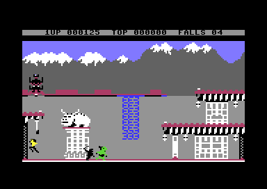

The attract demo in room 0. It plays with the recorded input of [`demo_input_stream`](../src/demo_input.asm#L10) [`$F300`](reference/modules/demo_input.md#demo_input_stream).

### 1.1 A lost fall and two players

1. [`lose_fall`](../src/lose_fall_game_over.asm#L14) [`$1818`](reference/modules/lose_fall_game_over.md#lose_fall) silences the sound. In the demo it goes to the title.
2. It decrements [`falls_left`](../src/constants.asm#L31) [`$0028`](reference/variables.md#falls_left). Below 0 it goes to [`game_over`](../src/lose_fall_game_over.asm#L82) [`$188E`](reference/modules/lose_fall_game_over.md#game_over).
3. [`next_turn`](../src/lose_fall_game_over.asm#L23) [`$182A`](reference/modules/lose_fall_game_over.md#next_turn) sets [`actor_energy`](../src/constants.asm#L111) [`$00D1`](reference/variables.md#actor_energy) of all three actors to `$24`, clears [`enemy_follow_x`](../src/constants.asm#L88) [`$008B`](reference/variables.md#enemy_follow_x) and the fireball sprites.
4. With two players ([`option_two_players`](../src/options_and_patterns.asm#L14) [`$42C9`](reference/modules/options_and_patterns.md#option_two_players) = 1) and the other player not out ([`inactive_player_state`](../src/fireball_text_score_vars.asm#L89) [`$439F`](reference/modules/fireball_text_score_vars.md#inactive_player_state), the parked [`falls_left`](../src/constants.asm#L31), >= 0), [`current_player`](../src/constants.asm#L14) [`$0003`](reference/variables.md#current_player) changes. So the turn passes after every lost fall. **Code**
5. [`show_player_screen`](../src/title_player_screens.asm#L71) [`$0EA7`](reference/modules/title_player_screens.md#show_player_screen) shows PLAYER 1 or PLAYER 2.
6. On a change of the player, [`next_turn_swap_block_loop`](../src/lose_fall_game_over.asm#L52) [`$1862`](reference/modules/lose_fall_game_over.md#next_turn_swap_block_loop) swaps the player block `$0028-$0043` with [`inactive_player_state`](../src/fireball_text_score_vars.asm#L89) [`$439F`](reference/modules/fireball_text_score_vars.md#inactive_player_state). The block holds [`falls_left`](../src/constants.asm#L31) [`$0028`](reference/variables.md#falls_left), [`room`](../src/constants.asm#L32) [`$0029`](reference/variables.md#room), [`room_lanterns_left`](../src/constants.asm#L33) [`$002A`](reference/variables.md#room_lanterns_left), [`game_loop_count`](../src/constants.asm#L34) [`$0040`](reference/variables.md#game_loop_count) and the score. [`swap_player_lanterns`](../src/game_setup.asm#L96) [`$0FED`](reference/modules/game_setup.md#swap_player_lanterns) swaps the lantern flags of all rooms, and [`bonus_fall_next_score`](../src/fireball_text_score_vars.asm#L73) [`$4392`](reference/modules/fireball_text_score_vars.md#bonus_fall_next_score) is swapped too.
7. [`reset_play_state`](../src/play_init.asm#L19) [`$0763`](reference/modules/play_init.md#reset_play_state) draws the game screen and spawns Bruce. [`place_bruce_at_room_start`](../src/room_misc_support.asm#L11) [`$3217`](reference/modules/room_misc_support.md#place_bruce_at_room_start) puts him at the start point of [`room`](../src/constants.asm#L32) [`$0029`](reference/variables.md#room) ([`spawn_a_x`](../src/room_tables.asm#L101) [`$4BAE`](reference/modules/room_tables.md#spawn_a_x), [`spawn_a_y`](../src/room_tables.asm#L106) [`$4BC2`](reference/modules/room_tables.md#spawn_a_y)) and enters the room.

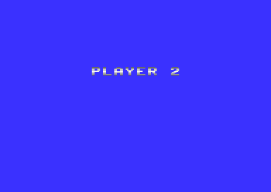

The PLAYER 2 screen of a two-player game: the turn has passed to player 2 after a lost fall.

**Conclusion.** Each player keeps his own room, lanterns, falls, score and game loop. After game over of one player, the other player plays on alone: [`game_over`](../src/lose_fall_game_over.asm#L82) [`$188E`](reference/modules/lose_fall_game_over.md#game_over) goes to [`next_turn`](../src/lose_fall_game_over.asm#L23) [`$182A`](reference/modules/lose_fall_game_over.md#next_turn), which changes [`current_player`](../src/constants.asm#L14) and swaps the blocks.

The game over screen of [`game_over`](../src/lose_fall_game_over.asm#L82) [`$188E`](reference/modules/lose_fall_game_over.md#game_over): GAME OVER, PLAYER 1 and the score in big digits.

### 1.2 The next game loop

[`room19_frame`](../src/ending_room.asm#L27) [`$4272`](reference/modules/ending_room.md#room19_frame) starts the next loop when its countdown ends. [`game_loop_count`](../src/constants.asm#L34) [`$0040`](reference/variables.md#game_loop_count) > 0 makes the game harder. **Code**

| Effect | Code |
|---|---|
| Yamo and the Ninja come at once in every room: both spawn timers = 3 | [`draw_room`](../src/draw_room.asm#L28) [`$09BC`](reference/modules/draw_room.md#draw_room) |
| Yamo respawns after 3 passes | [`update_yamo_spawn`](../src/actor_spawn.asm#L238) [`$0D0F`](reference/modules/actor_spawn.md#update_yamo_spawn) |
| An enemy pauses only 1 step after an attack | [`actor_recover`](../src/actor_timed_actions.asm#L376) [`$228C`](reference/modules/actor_timed_actions.md#actor_recover) |
| An enemy that has hit pauses a short time (not `$18` steps) | [`apply_fight_hits`](../src/fight_hits.asm#L252) [`$2B4E`](reference/modules/fight_hits.md#apply_fight_hits) |
| An idle enemy pauses only a short time | [`wake_idle_enemies`](../src/actor_helpers.asm#L40) [`$2D7C`](reference/modules/actor_helpers.md#wake_idle_enemies) |
| The floor movers of room 13 get longer tracks | [`room13_init`](../src/room_specific_init.asm#L159) [`$34C3`](reference/modules/room_specific_init.md#room13_init) |
| All lanterns are back, the first-visit bonus (2000 points) and the room 13 height bonuses of the current player are back | [`room19_frame`](../src/ending_room.asm#L27) [`$4272`](reference/modules/ending_room.md#room19_frame) |

## 2. The exit tables

[`handle_touched_tile`](../src/background_touch.asm#L61) [`$2E89`](reference/modules/background_touch.md#handle_touched_tile) checks the 3 characters under and beside each actor, on two cell rows. A character 2, 3, 4 or 5 jumps to [`take_exit2`](../src/background_touch.asm#L178) [`$2F3C`](reference/modules/background_touch.md#take_exit2), [`take_exit3`](../src/background_touch.asm#L189) [`$2F51`](reference/modules/background_touch.md#take_exit3), [`take_exit4`](../src/background_touch.asm#L199) [`$2F66`](reference/modules/background_touch.md#take_exit4) or [`take_exit5`](../src/background_touch.asm#L210) [`$2F7B`](reference/modules/background_touch.md#take_exit5). Each one first calls [`check_exit_edge`](../src/touch_effects.asm#L154) [`$30D4`](reference/modules/touch_effects.md#check_exit_edge). **Code**

| Edge | Condition of [`check_exit_edge`](../src/touch_effects.asm#L154) [`$30D4`](reference/modules/touch_effects.md#check_exit_edge) |
|---|---|
| Left | [`actor_x`](../src/constants.asm#L94) [`$009E`](reference/variables.md#actor_x) < `$10` and the actor moves left |
| Right | [`actor_x`](../src/constants.asm#L94) [`$009E`](reference/variables.md#actor_x) > `$A1` and the actor moves right |
| Bottom | [`actor_y`](../src/constants.asm#L95) [`$00A1`](reference/variables.md#actor_y) > `$C5` and the actor falls (state `$0E`) |
| Top | [`actor_y`](../src/constants.asm#L95) [`$00A1`](reference/variables.md#actor_y) < `$31` and the actor moves up |
| Room 11 | always allowed (the three doors are in the middle of the room) |

Then the handler reads the tables of its set with X = [`room`](../src/constants.asm#L32) [`$0029`](reference/variables.md#room): the new room to [`next_room`](../src/constants.asm#L42) [`$004E`](reference/variables.md#next_room), the entry Y and the entry X. An entry X of 0 means "no exit": [`take_exit2`](../src/background_touch.asm#L178), [`take_exit3`](../src/background_touch.asm#L189) and [`take_exit4`](../src/background_touch.asm#L199) go on with the next set. [`take_exit5`](../src/background_touch.asm#L210) has no next set: it enters the room with X = 0. [`enter_room`](../src/background_touch.asm#L222) [`$2F8E`](reference/modules/background_touch.md#enter_room) removes an enemy ([`remove_actor`](../src/touch_effects.asm#L38)) or, for Bruce, goes to [`change_room`](../src/background_touch.asm#L234) [`$2F9A`](reference/modules/background_touch.md#change_room). **Code**

### 2.1 Layout

| Table | Address | Size | Entry |
|---|---|---|---|
| [`exit2_dest_room`](../src/room_tables.asm#L78) / [`exit3_dest_room`](../src/room_tables.asm#L83) / [`exit4_dest_room`](../src/room_tables.asm#L88) / [`exit5_dest_room`](../src/room_tables.asm#L95) | `$4B5E` / `$4B72` / `$4B86` / `$4B9A` | 20 bytes each | the new room, index = current room |
| [`exit2_entry_x`](../src/room_tables.asm#L121) / [`exit3_entry_x`](../src/room_tables.asm#L131) / [`exit4_entry_x`](../src/room_tables.asm#L141) / [`exit5_entry_x`](../src/room_tables.asm#L151) | `$4BFE` / `$4C26` / `$4C4E` / `$4C76` | 20 bytes each | Bruce's X in the new room; 0 = no exit |
| [`exit2_entry_y`](../src/room_tables.asm#L126) / [`exit3_entry_y`](../src/room_tables.asm#L136) / [`exit4_entry_y`](../src/room_tables.asm#L146) / [`exit5_entry_y`](../src/room_tables.asm#L156) | `$4C12` / `$4C3A` / `$4C62` / `$4C8A` | 20 bytes each | Bruce's Y in the new room |

Decoder:

~~~text
N = touched character (2, 3, 4 or 5)          ; handle_touched_tile
loop:
  if not check_exit_edge(actor): stop        ; carry set: no exit
  next_room = exitN_dest_room[room]
  y = exitN_entry_y[room]; x = exitN_entry_x[room]
  if x == 0 and N < 5: N = N + 1; goto loop  ; fall through to the next set
  enter_room(x, y)                           ; Bruce: change_room; enemy: remove_actor
~~~

Worked example, room 0, marker 2: [`exit2_dest_room`](../src/room_tables.asm#L78) [`$4B5E`](reference/modules/room_tables.md#exit2_dest_room) = `$01`, [`exit2_entry_x`](../src/room_tables.asm#L121) [`$4BFE`](reference/modules/room_tables.md#exit2_entry_x) = `$10`, [`exit2_entry_y`](../src/room_tables.asm#L126) [`$4C12`](reference/modules/room_tables.md#exit2_entry_y) = `$92`. Bruce leaves room 0 at the right edge (the marker is at cell row 8, column 39) and enters room 1 at X = `$10` (left edge), Y = `$92`.

### 2.2 All entries

Each cell: new room (entry X, entry Y). "-" = entry X is 0.

| Room | Marker 2 | Marker 3 | Marker 4 | Marker 5 |
|---|---|---|---|---|
| 0 | 1 (`$10`, `$92`) | - | - | 1 (`$0F`, `$62`) |
| 1 | 0 (`$A0`, `$92`) | 5 (`$2C`, `$32`) | 0 (`$A1`, `$62`) | 2 (`$10`, `$62`) |
| 2 | - | - | 1 (`$A1`, `$62`) | 3 (`$10`, `$C4`) |
| 3 | - | 10 (`$10`, `$B0`) | 2 (`$A1`, `$C5`) | 0 (`$10`, `$62`) |
| 4 | 5 (`$10`, `$C2`) | 7 (`$1F`, `$32`) | - | - |
| 5 | 4 (`$9C`, `$51`) | 6 (`$10`, `$40`) | 6 (`$10`, `$74`) | 1 (`$58`, `$66`) |
| 6 | 5 (`$A0`, `$80`) | 5 (`$A0`, `$66`) | 2 (`$16`, `$51`) | 0 (`$20`, `$51`) |
| 7 | 0 (`$30`, `$51`) | 8 (`$0F`, `$46`) | 8 (`$10`, `$C0`) | 0 (`$20`, `$51`) |
| 8 | 7 (`$A0`, `$74`) | 9 (`$10`, `$53`) | 7 (`$A1`, `$B5`) | 9 (`$0F`, `$C6`) |
| 9 | 8 (`$A0`, `$47`) | 8 (`$A0`, `$C0`) | 6 (`$9D`, `$C7`) | - |
| 10 | 3 (`$A0`, `$C4`) | 11 (`$10`, `$C4`) | - | - |
| 11 | 10 (`$A0`, `$5A`) | 12 (`$10`, `$5C`) | 14 (`$10`, `$5E`) | 16 (`$10`, `$5C`) |
| 12 | - | 11 (`$34`, `$BE`) | 14 (`$10`, `$BE`) | - |
| 13 | 15 (`$10`, `$C3`) | - | - | - |
| 14 | - | 11 (`$50`, `$BE`) | 12 (`$A0`, `$BE`) | 16 (`$10`, `$BE`) |
| 15 | 13 (`$A0`, `$C4`) | 17 (`$10`, `$B3`) | - | - |
| 16 | - | 11 (`$80`, `$BE`) | 14 (`$A0`, `$BE`) | - |
| 17 | 15 (`$A0`, `$93`) | 18 (`$10`, `$C6`) | - | - |
| 18 | 17 (`$A0`, `$44`) | 19 (`$10`, `$96`) | - | - |
| 19 | - | - | - | - |

### 2.3 The exits in play

A table entry is used only when its marker is on the screen. The markers come from the room map (decoded from [`room_map_ptr_lo`](../src/room_tables.asm#L69) [`$4B34`](reference/modules/room_tables.md#room_map_ptr_lo) / [`room_map_ptr_hi`](../src/room_tables.asm#L73) [`$4B49`](reference/modules/room_tables.md#room_map_ptr_hi)) or are drawn later by the frame handler of the room ([`room_frame_handlers`](../src/room_dispatch.asm#L28) [`$4EC4`](reference/modules/room_dispatch.md#room_frame_handlers)). Many map markers stand behind a wall; a passage that the room code opens makes them reachable. **Code** (map decode and handler code); the runtime screen of room 6 (`rooms/room06.vsf`) showed only marker 2 at cell row 6, column 0. **Observed**

| Room | Marker | Place (cell row, column) | Leads to | Condition | Code |
|---|---|---|---|---|---|
| 0 | 2 | 8, 39 (right) | 1 | none | map |
| 0 | 5 | 5, 39 (right) | 1 | none | map |
| 1 | 2 | 8, 0 (left) | 0 | none | map |
| 1 | 4 | 5, 0 (left) | 0 | none | map |
| 1 | 5 | 5, 39 (right) | 2 | none | map |
| 1 | 3 | 12, 19-21 (trapdoor in the floor) | 5 | rooms 0, 1 and 2 cleared while room 6 is not cleared | [`room01_frame`](../src/room_frames_0_7.asm#L42) [`$3679`](reference/modules/room_frames_0_7.md#room01_frame), [`msg_trapdoor_open_4`](../src/messages_rooms.asm#L17) [`$45BC`](reference/modules/messages_rooms.md#msg_trapdoor_open_4) |
| 2 | 4 | 5, 0 (left) | 1 | none | map |
| 2 | 5 | 11, 39 (floor, right) | 3 | room 6 cleared | [`room02_frame`](../src/room_frames_0_7.asm#L75) [`$36A6`](reference/modules/room_frames_0_7.md#room02_frame), [`msg_room2_gap_top`](../src/messages_rooms.asm#L48) [`$45D8`](reference/modules/messages_rooms.md#msg_room2_gap_top) |
| 3 | 4 | 11, 0 (left) | 2 | none | map |
| 3 | 3 | 12, 31-33 (trapdoor) | 10 | room 3 cleared | [`room03_frame`](../src/room_frames_0_7.asm#L136) [`$3702`](reference/modules/room_frames_0_7.md#room03_frame), [`msg_trapdoor_open_4`](../src/messages_rooms.asm#L17) [`$45BC`](reference/modules/messages_rooms.md#msg_trapdoor_open_4) |
| 4 | 2 | 4, 39 (right) | 5 | none | map |
| 4 | 3 | 12, 1-4 (floor) | 7 | none | map |
| 5 | 3 | 4, 39 (right) | 6 | none | map |
| 5 | 4 | 7, 39 (right) | 6 | none | map |
| 5 | 2 | 11, 0 (left) | 4 | lantern of row 10, column 2 taken: passage at column 0 and the marker | [`room05_frame`](../src/room_frames_0_7.asm#L378) [`$38AB`](reference/modules/room_frames_0_7.md#room05_frame), [`msg_room5_gap_edge`](../src/messages_rooms.asm#L29) [`$45C6`](reference/modules/messages_rooms.md#msg_room5_gap_edge) |
| 5 | 5 | 2, 35 (top) | 1 | room 6 cleared and the lantern of row 3, column 28 or 38 taken | [`room05_frame`](../src/room_frames_0_7.asm#L378) [`$38AB`](reference/modules/room_frames_0_7.md#room05_frame), [`msg_room5_opening`](../src/messages_rooms.asm#L44) [`$45D4`](reference/modules/messages_rooms.md#msg_room5_opening) |
| 6 | 2 | 6, 0 (left) | 5 | room 6 cleared opens the passage at row 5, column 1 | [`room06_frame`](../src/room_frames_0_7.asm#L519) [`$39AA`](reference/modules/room_frames_0_7.md#room06_frame), [`open_passage_ledge`](../src/passage_open.asm#L54) [`$3AA0`](reference/modules/passage_open.md#open_passage_ledge) |
| 7 | 3 | 6, 39 (right) | 8 | the 6 lanterns of row 5 taken open the passage at row 5, column 38 | [`room07_frame`](../src/room_frames_0_7.asm#L542) [`$39C3`](reference/modules/room_frames_0_7.md#room07_frame) |
| 7 | 4 | 10, 39 (right) | 8 | none | map |
| 8 | 2 | 3, 0 (left) | 7 | none | map |
| 8 | 4 | 11, 0 (left) | 7 | the lantern of row 7, column 6 taken opens the passage at row 10, column 1 | [`room08_frame`](../src/room_frames_8_11.asm#L16) [`$3AD4`](reference/modules/room_frames_8_11.md#room08_frame) |
| 8 | 3 | 3, 39 (right) | 9 | room 8 cleared and two lanterns of row 10 in room 9 taken open the passage at row 2, column 38 | [`room08_frame`](../src/room_frames_8_11.asm#L16) [`$3AD4`](reference/modules/room_frames_8_11.md#room08_frame) |
| 8 | 5 | 11, 39 (right) | 9 | rooms 7 and 8 cleared open the passage at row 10, column 38 | [`room08_frame`](../src/room_frames_8_11.asm#L16) [`$3AD4`](reference/modules/room_frames_8_11.md#room08_frame) |
| 9 | 2 | 4, 0 (left) | 8 | none | map |
| 9 | 3 | 11, 0 (left) | 8 | none | map |
| 9 | 4 | 2, 36-37 (top) | 6 | room 9 cleared | [`room09_frame`](../src/room_frames_8_11.asm#L149) [`$3BB2`](reference/modules/room_frames_8_11.md#room09_frame), [`msg_room9_opening`](../src/messages_rooms.asm#L40) [`$45CF`](reference/modules/messages_rooms.md#msg_room9_opening) |
| 10 | 2 | 11, 0 (left) | 3 | none | map |
| 10 | 3 | 5, 39 (right) | 11 | lanterns of row 4, column 1 and row 7, column 30 taken open the passage at row 4, column 38 | [`room10_frame`](../src/room_frames_8_11.asm#L278) [`$3C90`](reference/modules/room_frames_8_11.md#room10_frame), [`open_passage_dark`](../src/passage_open.asm#L69) [`$3AB4`](reference/modules/passage_open.md#open_passage_dark) |
| 11 | 2 | 11, 0 (left) | 10 | none | map |
| 11 | 3 | 7, 9-12 (door) | 12 | none | map |
| 11 | 4 | 7, 18-21 (door) | 14 | none | map |
| 11 | 5 | 7, 27-30 (door) | 16 | none | map |
| 12 | 4 | 11, 39 (right) | 14 | lantern of row 10, column 36 taken opens the passage at row 10, column 38 | [`room12_frame`](../src/room_frames_12_17.asm#L11) [`$3E4C`](reference/modules/room_frames_12_17.md#room12_frame) |
| 12 | 3 | 8, 39 (right) | 11 | room 12 cleared and two lanterns of row 10 in room 14 taken open the passage at row 7, column 38 | [`room12_frame`](../src/room_frames_12_17.asm#L11) [`$3E4C`](reference/modules/room_frames_12_17.md#room12_frame) |
| 13 | 2 | 11, 39 (right) | 15 | none | map |
| 14 | 4 | 11, 0 (left) | 12 | none | map |
| 14 | 5 | 11, 39 (right) | 16 | none | map |
| 14 | 3 | 5, 39 (right) | 11 | the two lanterns of row 7 taken open the passage at row 4, column 38 | [`room14_frame`](../src/room_frames_12_17.asm#L88) [`$3ECC`](reference/modules/room_frames_12_17.md#room14_frame) |
| 15 | 2 | 11, 0 (left) | 13 | none | map |
| 15 | 3 | 7-8, 39 (right) | 17 | room 15 cleared | [`room15_frame`](../src/room_frames_12_17.asm#L106) [`$3EE6`](reference/modules/room_frames_12_17.md#room15_frame), [`msg_room15_ladder_mid`](../src/messages_rooms.asm#L288) [`$473A`](reference/modules/messages_rooms.md#msg_room15_ladder_mid), [`msg_room15_ladder_top`](../src/messages_rooms.asm#L292) [`$473E`](reference/modules/messages_rooms.md#msg_room15_ladder_top) |
| 16 | 4 | 11, 0 (left) | 14 | none | map |
| 16 | 3 | 8, 0 (left) | 11 | room 16 cleared opens the passage at row 7, column 1 | [`room16_frame`](../src/room_frames_12_17.asm#L166) [`$3F5B`](reference/modules/room_frames_12_17.md#room16_frame) |
| 17 | 2 | 10, 0 (left) | 15 | none | map |
| 17 | 3 | 3, 39 (right, top) | 18 | none | map |
| 18 | 2 | 11, 0 (left) | 17 | closed when the lantern of the wizard is taken: character 6 replaces the marker | map; [`room18_frame`](../src/wizard_room.asm#L13) [`$3CDC`](reference/modules/wizard_room.md#room18_frame), [`msg_wizard_left_marker`](../src/messages_rooms.asm#L316) [`$476E`](reference/modules/messages_rooms.md#msg_wizard_left_marker) |
| 18 | 3 | 11, 39 (right) | 19 | the defeat sequence of the wizard has ended | [`room18_wizard_gone`](../src/wizard_room.asm#L115) [`$3D9B`](reference/modules/wizard_room.md#room18_wizard_gone), [`msg_wizard_exit_top`](../src/messages_rooms.asm#L302) [`$4749`](reference/modules/messages_rooms.md#msg_wizard_exit_top) |
| 11 | - | - | 13 | entering room 11 with rooms 12, 14 and 16 cleared | [`draw_room`](../src/draw_room.asm#L28) [`$09BC`](reference/modules/draw_room.md#draw_room) |
| 19 | - | - | 0 | the countdown of the room ends (next game loop) | [`room19_frame`](../src/ending_room.asm#L27) [`$4272`](reference/modules/ending_room.md#room19_frame) |

**Unused entries.** No marker of the map and no room code gives marker 5 in room 3, markers 3, 4 and 5 in room 6, or markers 2 and 5 in room 7. These six table entries are never used. **Conclusion**

### 2.4 The map of the rooms

~~~mermaid
flowchart LR
  R0["room 0"] -->|right x2| R1["room 1"]
  R1 -->|left x2| R0
  R1 -->|right| R2["room 2"]
  R2 -->|left| R1
  R1 -->|trapdoor: rooms 0-2 cleared, room 6 not| R5["room 5"]
  R2 -->|floor: room 6 cleared| R3["room 3"]
  R3 -->|left| R2
  R5 -->|top: room 6 cleared + lantern| R1
  R5 -->|right x2| R6["room 6"]
  R6 -->|left: room 6 cleared| R5
  R5 -->|left: lantern| R4["room 4"]
  R4 -->|right| R5
  R4 -->|floor| R7["room 7"]
  R7 -->|right x2| R8["room 8"]
  R8 -->|left x2| R7
  R8 -->|right x2: passages| R9["room 9"]
  R9 -->|left x2| R8
  R9 -->|top: room 9 cleared| R6
  R3 -->|trapdoor: room 3 cleared| R10["room 10"]
  R10 -->|left| R3
  R10 -->|right: 2 lanterns| R11["room 11"]
  R11 -->|left| R10
  R11 -->|door| R12["room 12"]
  R11 -->|door| R14["room 14"]
  R11 -->|door| R16["room 16"]
  R12 -->|right| R11
  R12 -->|right| R14
  R14 -->|left| R12
  R14 -->|right| R11
  R14 -->|right| R16
  R16 -->|left| R14
  R16 -->|left: cleared| R11
  R11 -->|rooms 12, 14, 16 cleared| R13["room 13"]
  R13 -->|right| R15["room 15"]
  R15 -->|left| R13
  R15 -->|right: cleared| R17["room 17"]
  R17 -->|left| R15
  R17 -->|right| R18["room 18"]
  R18 -->|left, until the lantern| R17
  R18 -->|right: wizard defeated| R19["room 19"]
  R19 -->|next game loop| R0
~~~

**Conclusion.** The way through the game: rooms 0, 1 and 2, down to room 5 and room 6, back through room 2 to room 3 when room 6 is cleared, and from room 5 to rooms 4, 7, 8 and 9. Room 3, when cleared, leads down to rooms 10 and 11. Room 11 is a hub with three doors to rooms 12, 14 and 16. With these three rooms cleared, room 11 sends Bruce to room 13, the falling room, and on to rooms 15, 17, the wizard in room 18 and the congratulations in room 19.

**Conclusion.** Room 5 can be reached first only through the trapdoor of room 1: rooms 4 and 6, the other ways in, are reached through room 5. So room 6 is never cleared before the trapdoor opens the first time. After room 6 is cleared, the trapdoor stays closed on a later visit of room 1, and the way from room 5 back to room 1 is the top opening of room 5.

### 2.5 The rooms

Each image was taken about 250 frames after Bruce entered the room.

| | | | |
|---|---|---|---|
| 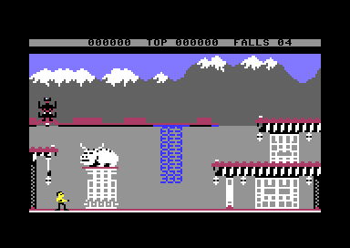 room 0 | 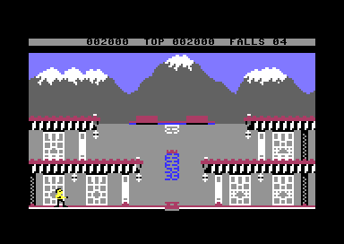 room 1 | 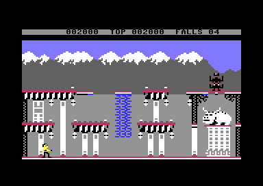 room 2 | 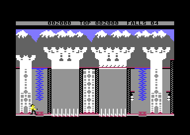 room 3 |
| 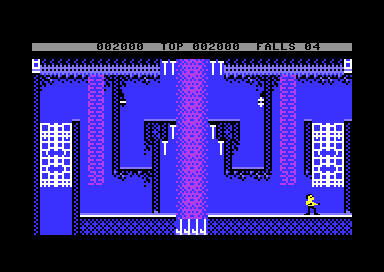 room 4 | 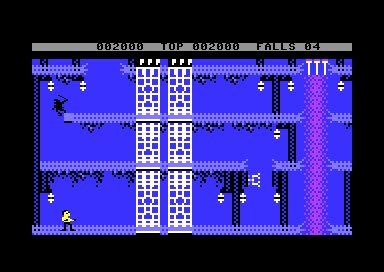 room 5 | 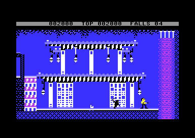 room 6 | 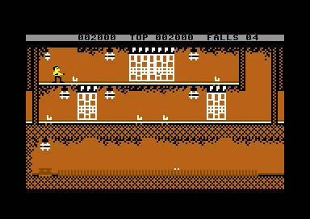 room 7 |
| 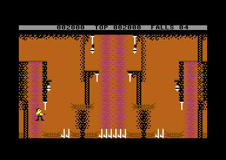 room 8 | 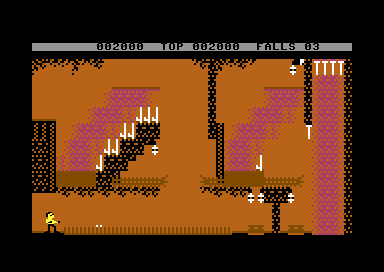 room 9 | 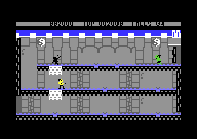 room 10 | 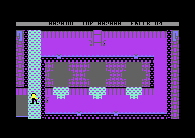 room 11 |
| 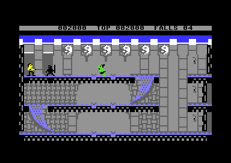 room 12 | 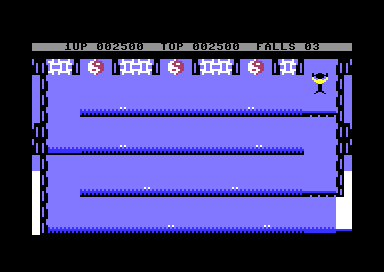 room 13 | 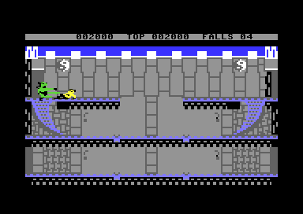 room 14 | 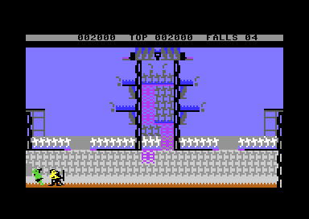 room 15 |
| 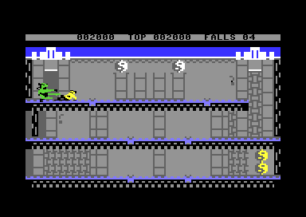 room 16 | 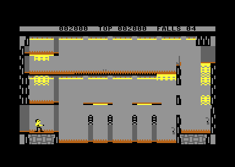 room 17 | 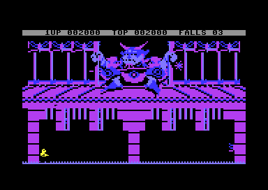 room 18 |  room 19 |

## 3. Still open

- How Bruce reaches the marker 3 of room 17 at cell row 3, column 39 (top right), and whether the tiles of [`room17_frame`](../src/room_frames_12_17.asm#L188) [`$3F71`](reference/modules/room_frames_12_17.md#room17_frame) (row 10, columns 24 and 37) are part of that way. A playthrough run of room 17 with the lanterns taken can answer it.
- Room 18 has the characters 4 and 5 in the picture of the wizard (cell rows 2-9). Its marker 4 and 5 entries are 0, so [`take_exit5`](../src/background_touch.asm#L210) [`$2F7B`](reference/modules/background_touch.md#take_exit5) would enter room 0 at X = 0, Y = 0. [`check_exit_edge`](../src/touch_effects.asm#L154) [`$30D4`](reference/modules/touch_effects.md#check_exit_edge) probably never allows it there. A run with Bruce at the top edge of room 18 can check it.
