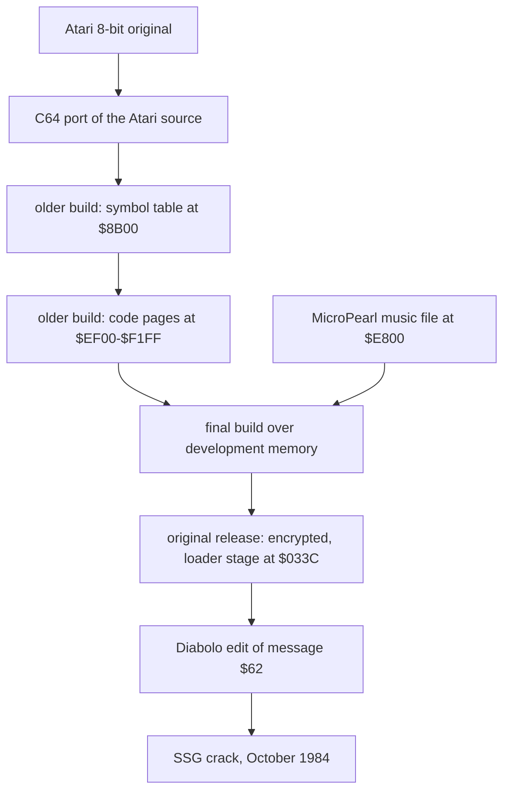

# Leftovers: what the image tells about the development

The release file of Bruce Lee holds more than the game. About 6 KB of the memory image are bytes that no code of
the game reads: copies of older builds, a piece of the assembler source text, the assembler symbol table, an old
music file, older code, old sound effects, an older demo recording, Atari key codes and uninitialised RAM. The
rebuild keeps the game in [src/](../src/) and these bytes as separate sources in [leftovers/](../leftovers/README.md).
This page lists every leftover block, decodes the important ones and tells what they show about how the game was
made.

## Scope and conventions

**Scope.**

- Every block of the original memory image that the game does not need, with its origin and its source file in
  `leftovers/`.
- The decoded content of the important blocks, with the evidence.
- What the blocks tell about the development process, the original release and the crackers.
- Not covered: the code of the crack intro, mover and relocator (removed earlier), and the code of the tape tools
  at `$FE00` (crack tooling, described in a few lines only).
- Sources: [leftovers/](../leftovers/README.md) (generated from the knowledge spaces bank1-bank4, bank6 and
  bank7), [tests/leftovers_unused.json](../tests/leftovers_unused.json),
  [tests/original_loader_stage_033c.json](../tests/original_loader_stage_033c.json),
  [tests/crack_leftover_a000.json](../tests/crack_leftover_a000.json).

**Conventions.**

- Addresses are C64 addresses. Names of the game are the names of the knowledge, written `` `name` `$ADDR` ``.
- A *leftover* is a block of the original memory image that no code of the game reads. Names of leftovers live
  only in the leftover sources; they are written in backticks without an address, or as a link to their file.
- The *image* is the memory of the game at its entry (`$0400`), captured from the release file. The *release
  file* is `original/bruce_lee.prg` on the disk `original/saeger.d64`.
- The *final build* is the build that made the game in the image. An *older build* is any earlier build whose
  bytes survive in the leftovers.
- *Source labels* are the names of the original assembler source, in upper case (for example PLOFS). They come
  from the symbol table at `$8B00`.
- **Observed** marks a fact that a run or a byte comparison showed. **Code** marks a fact from the code only.
  **Conclusion** marks an interpretation.

## 1. How the leftovers were found and taken out

1. The analysis classified each range of the image by its use: code that runs, data that code reads, work RAM
   that code writes before it reads it, and bytes that nothing reads. **Code**
2. The unread ranges were compared with the rest of the image, with the release file and with each other. Most of
   them are copies of game bytes at another address, older versions of game data or code, or text and tables of
   the build tools. **Observed**
3. The scenario [tests/leftovers_unused.json](../tests/leftovers_unused.json) runs the release file twice. On one
   side it fills every leftover block with `$A5` at the game entry: 28 blocks, and four single unused bytes inside
   the game (`$4391`, `$479F`, `$E86A`, `$E86E-$E86F`). It then plays the title music, the demo and room 0, enters rooms
   3, 4, 8, 13, 15, 18 and 19 through [`change_room`](../src/background_touch.asm#L234) [`$2F9A`](reference/modules/background_touch.md#change_room) and plays in each. It compares memory, the chips and the screen at 10 checkpoints. The
   filled blocks are not compared. **Observed**: all 10 checkpoints PASS. So the game needs none of the leftover
   bytes.
4. Two more scenarios cover the ranges outside the image that the crack relocator fills:
   [tests/crack_leftover_a000.json](../tests/crack_leftover_a000.json) (`$A000-$A9FF`, a copy of the crack
   relocator and duplicates of the `$CF00` and `$E000` pages) and
   [tests/original_loader_stage_033c.json](../tests/original_loader_stage_033c.json) (`$033C-$03FE`, the loader stage of
   section 12). **Observed**: both PASS.
5. The source in `src/` was generated again without the leftover blocks. [src/main.asm](../src/main.asm) now has
   24 segments with gaps at the leftovers, and [src/loader.asm](../src/loader.asm) copies only these segments.
   **Code**
6. The leftover blocks stay in the knowledge, in their own spaces. The c64-source generator writes them as
   sources in `leftovers/<folder>/`, one folder per space ([leftovers/README.md](../leftovers/README.md)). Each
   source assembles with ACME to the same bytes as the image (**Observed**: checked for bank1-bank4; bank6 equals
   the release file bytes, and bank7 equals bank6 decoded). The game parts of a space are `!fill` lines of zeros.

Many leftovers lie in RAM that the game uses as work space: the actor workspace at `$4EED` (cleared by
[`init_game_variables`](../src/game_setup.asm#L18) [`$0F72`](reference/modules/game_setup.md#init_game_variables)), the sprite buffers
`$8180-$83FF` ([`sprite_buf_a_spr0`](../src/constants.asm#L183) [`$8180`](reference/variables.md#sprite_buf_a_spr0)), the text font
`$8800-$8BFF` that [`cold_start`](../src/cold_start.asm#L22) [`$0400`](reference/modules/cold_start.md#cold_start) builds, and the screen `$8C00-$8FFF`. The
final build declared these areas as reserved space and did not write them, so the older bytes stayed in the image.
**Conclusion**

## 2. Catalogue of the blocks

Origin: *development* = left by the development (the build machine, the tools, older builds); *original release*
= part of the publisher's protected release; *unknown* = the bytes do not show it; *crack* = added by a cracker.

| Address | Size | Origin | What it is | Source |
|---|---|---|---|---|
| `$10F8-$1102` | 11 | unknown | A vector install routine stored in reverse byte order (section 11). | [reversed_vector_install.asm](../leftovers/build_10f8_63ea/reversed_vector_install.asm) |
| `$4326-$432D` | 8 | development | 8 zero bytes inside the variable block, between [`fireball_shape_mask`](../src/fireball_shape.asm#L8) [`$4322`](reference/modules/fireball_shape.md#fireball_shape_mask) and [`fireball_active`](../src/fireball_text_score_vars.asm#L8) [`$432E`](reference/modules/fireball_text_score_vars.md#fireball_active). Space of a removed variable. | [zero_bytes_after_fireball_masks.asm](../leftovers/build_10f8_63ea/zero_bytes_after_fireball_masks.asm) |
| `$4563-$457D` | 27 | development | Texts `BRUCE LEE`, `BY`, `RON J FORTIER` in message format, without a pointer (section 7). | [unused_title_texts.asm](../leftovers/build_10f8_63ea/unused_title_texts.asm) |
| `$4598-$45A9` | 18 | development | Texts `GAME OVER`, `PLAYER ` in message format, without a pointer (section 7). | [unused_game_over_texts.asm](../leftovers/build_10f8_63ea/unused_game_over_texts.asm) |
| `$4CBA-$4CCD` | 20 | development | Atari 8-bit key codes of the keys 0-9 and SHIFT+0-9 (section 10). | [atari_digit_key_codes.asm](../leftovers/build_10f8_63ea/atari_digit_key_codes.asm) |
| `$4EED-$4FE7` | 251 | development | Copy of the game bytes `$4731-$482B` at +`$7BC`: messages, pointer helpers, colour tables; message `$62` still reads DATASOFT PRESENTS (section 5). | [shifted_messages_copy.asm](../leftovers/build_10f8_63ea/shifted_messages_copy.asm) |
| `$4FE8-$50E6` | 255 | development | The rest of the same copy: game bytes `$482C-$492A` (room pointer tables, room draw step, font builder, game IRQ). | [shifted_draw_irq_copy.asm](../leftovers/build_10f8_63ea/shifted_draw_irq_copy.asm) |
| `$572D-$58FF` | 467 | development | Copy of the game bytes `$4CF2-$4EC4` at +`$A3B`: lantern lists, room init handlers (section 5). | [shifted_room_lists_copy.asm](../leftovers/build_10f8_63ea/shifted_room_lists_copy.asm) |
| `$5900-$59A4` | 165 | development | Assembler source text of room charset D, tiles 96-99 (section 3). | [assembler_source_text.asm](../leftovers/build_10f8_63ea/assembler_source_text.asm) |
| `$59B3-$59BC` | 10 | development | The old sprite mask tables PLANTB and PLEORTB (section 6.3). | [old_sprite_mask_tables.asm](../leftovers/build_10f8_63ea/old_sprite_mask_tables.asm) |
| `$63C1-$63EA` | 42 | development | Bruce frame ADWONL22: a misspelt, unreferenced copy of frame 59 (section 4.4). | [adwonl22_unused_frame.asm](../leftovers/build_10f8_63ea/adwonl22_unused_frame.asm) |
| `$8180-$81A8` | 41 | development | The last 41 bytes of [`room_map_19`](../src/room_maps_15_19.asm#L158) [`$7FE0`](reference/modules/room_maps_15_19.md#room_map_19) again, 41 bytes higher. | [old_charset_c_under_sprite_buffers.asm](../leftovers/build_8180_8fff/old_charset_c_under_sprite_buffers.asm) |
| `$81A9-$81AF` | 7 | development | Zero bytes. | same file |
| `$81B0-$83FF` | 592 | development | Tiles 54-127 of an older room charset C (section 6.2). | same file |
| `$8800-$88FB` | 252 | unknown | `$05`, then zeros: they cut into the start of the tool below. | [c64_bitmap_tool_fragment.asm](../leftovers/build_8180_8fff/c64_bitmap_tool_fragment.asm) |
| `$88FC-$8AFF` | 516 | unknown | The end of a C64 bitmap editor tool, assembled for `$C8FC-$CAFF` (section 13). | same file |
| `$8B00-$8E7F` | 896 | development | The assembler symbol table of an older build, 89 entries (section 4). | [assembler_symbol_table.asm](../leftovers/build_8180_8fff/assembler_symbol_table.asm) |
| `$8E80-$8FFF` | 384 | development | Tiles 0-47 of an older room charset A (section 6.2). | [old_charset_a_under_screen.asm](../leftovers/build_8180_8fff/old_charset_a_under_screen.asm) |
| `$CF00-$CF78` | 121 | unknown | Power-on RAM of the protection key page, before the key bytes (section 14). | [key_page_unread_head.asm](../leftovers/key_page_cf00/key_page_unread_head.asm) |
| `$CFBB-$CFFF` | 69 | unknown | Power-on RAM of the key page, after the key bytes. | [key_page_unread_tail.asm](../leftovers/key_page_cf00/key_page_unread_tail.asm) |
| `$E009-$E0FF` | 247 | development | Uninitialised RAM after the music API jumps (section 14). | [micropearl_gap_e009.asm](../leftovers/build_e009_f5ff/micropearl_gap_e009.asm) |
| `$E131-$E1FF` | 207 | development | Uninitialised RAM after the music voice state. | [micropearl_gap_e131.asm](../leftovers/build_e009_f5ff/micropearl_gap_e131.asm) |
| `$E2E9-$E2FF` | 23 | development | Uninitialised RAM after [`music_resonance`](../src/music_frequency_table.asm#L53) [`$E2E8`](reference/modules/music_frequency_table.md#music_resonance). | [micropearl_gap_e2e9.asm](../leftovers/build_e009_f5ff/micropearl_gap_e2e9.asm) |
| `$E7BE-$E7FF` | 66 | development | Uninitialised RAM after the music player code. | [music_file_header.asm](../leftovers/build_e009_f5ff/music_file_header.asm) |
| `$E800-$E809` | 10 | development | The header of the MicroPearl music file (section 8.1). | same file |
| `$E872-$E8BF` | 78 | development | The start of the longer voice 0 of the music file (section 8.2). | [old_title_voice0_start.asm](../leftovers/build_e009_f5ff/old_title_voice0_start.asm) |
| `$EAAD-$EAFF` | 83 | development | A 6-byte stub stream and the start of song 1, a copy of the title tune (section 8.3). | [music_file_song1.asm](../leftovers/build_e009_f5ff/music_file_song1.asm) |
| `$EE83-$EED5` | 83 | development | An effect stream of an older build, no table entry (section 9). | [old_effect_stream.asm](../leftovers/build_e009_f5ff/old_effect_stream.asm) |
| `$EED6-$EF3F` | 106 | development | A copy of [`sfx_lantern_stream`](../src/sfx_data.asm#L146) [`$EE19`](reference/modules/sfx_data.md#sfx_lantern_stream). | [old_lantern_stream_copy.asm](../leftovers/build_e009_f5ff/old_lantern_stream_copy.asm) |
| `$EF40-$EF6F` | 48 | development | Code of an older build: the end of [`check_fight_pair`](../src/fight_hits.asm#L89) (section 6.1). | [old_check_fight_pair.asm](../leftovers/build_e009_f5ff/old_check_fight_pair.asm) |
| `$F055-$F06F` | 27 | development | Kick effect bytes and the end of the old pause code of [`apply_fight_hits`](../src/fight_hits.asm#L252). | [old_kick_bytes_and_hits.asm](../leftovers/build_e009_f5ff/old_kick_bytes_and_hits.asm) |
| `$F155-$F15F` | 11 | development | The tail of an older passage-open effect (section 9). | [old_scroll_chars_and_demo.asm](../leftovers/build_e009_f5ff/old_scroll_chars_and_demo.asm) |
| `$F160-$F1FF` | 160 | development | Code of an older build: [`animate_scrolling_chars`](../src/animated_chars.asm#L12) (section 6.1). | same file |
| `$F200-$F2F4` | 245 | development | An older recording of the attract demo input (section 9). | same file |
| `$F2F5-$F2FF` | 11 | development | The first 11 bytes of the final demo recording, which the game skips. | same file |
| `$F539-$F5FF` | 199 | development | Uninitialised RAM after the demo input. | [demo_area_uninitialised.asm](../leftovers/build_e009_f5ff/demo_area_uninitialised.asm) |
| `$033C-$038E` | 83 | original release | The last stage of the original protected loader, encoded (section 12). Outside the image; the release file carries it. | [original_loader_stage_encoded.asm](../leftovers/original_loader_stage_encoded/original_loader_stage_encoded.asm), decoded: [original_loader_stage.asm](../leftovers/original_loader_stage/original_loader_stage.asm) |
| `$FE00-$FFF9` | 506 | crack | Tape turbo loader and a RAM-under-ROM utility (section 16). Not in `leftovers/`. | none |

## 3. The assembler source text (charset D tiles)

`$5900-$59A4` holds 165 bytes of assembler source text. **Observed** (decoded with bit 7 removed; `·` marks a
`$20` byte, a plain space is `$A0`; each line ends with `$8D`):

```
$5900  [ DFB $]0F,$33,$FF,$FF        <- starts in the middle of a line
$590F   DFB $FF,$0C,$03,$C3
$5924  *·CHAR·97
$592E   DFB $F0,$C0,$00,$00
$5943   DFB $3F,$FC,$F0,$03
$5958  *·CHAR·98
$5962   DFB $FA,$FA,$FE,$FE
$5977   DFB $FA,$3A,$BA,$AA
$598C  *·CHAR·99
$5996   DFB $FF,$CF,$F[F,$FF]        <- cut by actor_frame_base at $59A5
```

**The format.**

| Item | Bytes |
|---|---|
| Character | ASCII with bit 7 set (`$C4` = D, `$A4` = $) |
| Field separator (label / opcode / operand) | `$A0` (a space with bit 7 set) |
| Space inside a comment | `$20` |
| End of line | `$8D` (carriage return with bit 7 set) |
| Comment line | starts with `*` (`$AA`) |
| Data directive | `DFB` (define byte) |

Worked example: the line at `$592E` is `A0 C4 C6 C2 A0 A4 C6 B0 AC A4 C3 B0 AC A4 B0 B0 AC A4 B0 B0 8D` = separator,
`DFB`, separator, `$F0,$C0,$00,$00`, end of line.

- **Observed.** The data are tiles 96-99 of [`room_charset_d`](../src/room_charset_d.asm#L8) [`$9C00`](reference/graphics.md#room_charset_d)
  (`$9F00-$9F1F`). All 31 bytes that the text shows are equal. Room charset C differs in tiles 97-99.
- **Observed.** Each tile is a comment line `* CHAR n` and two `DFB` lines of 4 bytes. The first line holds rows
  0-3 of the tile (character n of the expanded charset), the second rows 4-7 (character n+128). The number n is the
  tile index 0-127, as the game uses it.
- **Conclusion.** This is the tail of the source file of charset D, the wizard-flash tiles of room 18. The
  developer kept each charset as assembler source, one comment and two `DFB` lines per tile (about 52 bytes of text
  per tile, about 6.6 KB per charset).
- **Conclusion.** High-bit ASCII, `$8D` line ends, `DFB`, `*` comments and `$A0` field separators with `$20` inside
  comments are the conventions of Apple II assemblers. Merlin stores its source this way and fits best; this is
  not proven.
- **Observed.** The text starts in the middle of a line at a page start (`$5900`), under a copy that ends at
  `$58FF`. **Conclusion.** The memory was written in whole pages over the text.

## 4. The assembler symbol table

`$8B00-$8E7F` holds 896 bytes of the symbol table of an older build: 89 entries with the source labels of the
actor tables and of the Bruce frames. Source:
[assembler_symbol_table.asm](../leftovers/build_8180_8fff/assembler_symbol_table.asm).

### 4.1 The format

| Offset | Size | Content |
|---|---|---|
| 0 | 1 | bits 0-6: length n of the name; bit 7: the label is referenced |
| 1 | n | the name, plain ASCII (bit 7 clear) |
| n+1 | 2 | the value, low byte first |

The entries follow in the order of definition, so the values rise. **Observed**

Decoder:

```
p = start of an entry
while p < end:
    n    = mem[p] & $7F
    used = mem[p] & $80
    name = mem[p+1 .. p+n]
    value = mem[p+n+1] + 256 * mem[p+n+2]
    p = p + n + 3
```

Worked example: `$8B04` = `86 4E 4E 54 48 4C 54 FE 4A`. `$86` = length 6, bit 7 set (referenced). The name is
`4E 4E 54 48 4C 54` = NNTHLT. The value is `$4AFE`.

- **Observed.** The table starts in the middle of an entry: `$8B00` = `44 4E FB 4A` is the end of a name ("DN") and
  its value `$4AFB`. The tool pages `$8800-$8AFF` cover the start of the table.
- **Observed.** The last entry, AYDOWNR12 at `$8E75`, lost the high byte of its value to the old charset A at
  `$8E80`. Its low byte `$C6` is kept; the 24-byte step of the entries before it gives `$53C6`.

### 4.2 The mapping to the final build

Two offsets map every value with a counterpart onto the final build. **Observed**

- The eleven table labels PLOFS .. PLSIZE + `$E89` = the actor and frame tables of the final build.
- The frame labels ADOWNL11 .. ARUNR22 + `$1462` = the Bruce frames of the final build (all 46 exact).
- The labels before PLOFS land in the source text block `$5900-$59A4`; the YKICK and AYDOWN labels land inside
  other frames. They have no counterpart.

Flag 1 = bit 7 set (the build referenced the label). "Offset" is the offset that maps the old value to the final
address.

| Entry | Source label | Flag | Old value | Offset | Final address | Final meaning |
|---|---|---|---|---|---|---|
| `$8B00` | DN (cut: NNTHDN?) | - | `$4AFB` | +$E89 | `$5984` | none: in the assembler source text block |
| `$8B04` | NNTHLT | 1 | `$4AFE` | +$E89 | `$5987` | none: in the assembler source text block |
| `$8B0D` | NNTHRT | 1 | `$4B01` | +$E89 | `$598A` | none: in the assembler source text block |
| `$8B16` | TNTHUP | 1 | `$4B04` | +$E89 | `$598D` | none: in the assembler source text block |
| `$8B1F` | TNTHDN | 1 | `$4B07` | +$E89 | `$5990` | none: in the assembler source text block |
| `$8B28` | TNTHLT | 1 | `$4B0A` | +$E89 | `$5993` | none: in the assembler source text block |
| `$8B31` | TNTHRT | 1 | `$4B0D` | +$E89 | `$5996` | none: in the assembler source text block |
| `$8B3A` | REORIENT | 1 | `$4B10` | +$E89 | `$5999` | none: in the assembler source text block |
| `$8B45` | BSHIU1 | 1 | `$4B13` | +$E89 | `$599C` | none: in the assembler source text block |
| `$8B4E` | BSHIU2 | 1 | `$4B14` | +$E89 | `$599D` | none: in the assembler source text block |
| `$8B57` | BSHIU3 | 1 | `$4B15` | +$E89 | `$599E` | none: in the assembler source text block |
| `$8B60` | BSHXP1 | 1 | `$4B16` | +$E89 | `$599F` | none: in the assembler source text block |
| `$8B69` | BSHXP2 | 1 | `$4B17` | +$E89 | `$59A0` | none: in the assembler source text block |
| `$8B72` | BSHXP3 | 1 | `$4B18` | +$E89 | `$59A1` | none: in the assembler source text block |
| `$8B7B` | BSHYP1 | 1 | `$4B19` | +$E89 | `$59A2` | none: in the assembler source text block |
| `$8B84` | BSHYP2 | 1 | `$4B1A` | +$E89 | `$59A3` | none: in the assembler source text block |
| `$8B8D` | BSHYP3 | 1 | `$4B1B` | +$E89 | `$59A4` | none: in the assembler source text block |
| `$8B96` | NZPZEND | 1 | `$4B1C` | +$E89 | `$59A5` | [`actor_frame_base`](../src/actor_frame_tables.asm#L8) [`$59A5`](reference/modules/actor_frame_tables.md#actor_frame_base) (same value as PLOFS) |
| `$8BA0` | PLOFS | 1 | `$4B1C` | +$E89 | `$59A5` | [`actor_frame_base`](../src/actor_frame_tables.asm#L8) [`$59A5`](reference/modules/actor_frame_tables.md#actor_frame_base) |
| `$8BA8` | PLTBLL | 1 | `$4B1F` | +$E89 | `$59A8` | [`actor_collision_code_first`](../src/actor_frame_tables.asm#L13) [`$59A8`](reference/modules/actor_frame_tables.md#actor_collision_code_first) |
| `$8BB1` | PLTBLH | 1 | `$4B22` | +$E89 | `$59AB` | [`actor_collision_code_second`](../src/actor_frame_tables.asm#L17) [`$59AB`](reference/modules/actor_frame_tables.md#actor_collision_code_second) |
| `$8BBA` | PLOFST | 1 | `$4B25` | +$E89 | `$59AE` | [`collision_code_to_sprite`](../src/actor_frame_tables.asm#L22) [`$59AE`](reference/modules/actor_frame_tables.md#collision_code_to_sprite) |
| `$8BC3` | PLANTB | 1 | `$4B2A` | +$E89 | `$59B3` | leftover: [old_sprite_mask_tables.asm](../leftovers/build_10f8_63ea/old_sprite_mask_tables.asm) |
| `$8BCC` | PLEORTB | 1 | `$4B2F` | +$E89 | `$59B8` | leftover: [old_sprite_mask_tables.asm](../leftovers/build_10f8_63ea/old_sprite_mask_tables.asm) |
| `$8BD6` | IMGL | 1 | `$4B34` | +$E89 | `$59BD` | [`frame_gfx_lo`](../src/actor_frame_gfx_tables.asm#L10) [`$59BD`](reference/modules/actor_frame_gfx_tables.md#frame_gfx_lo) |
| `$8BDD` | IMGH | 1 | `$4C06` | +$E89 | `$5A8F` | [`frame_gfx_hi`](../src/actor_frame_gfx_tables.asm#L39) [`$5A8F`](reference/modules/actor_frame_gfx_tables.md#frame_gfx_hi) |
| `$8BE4` | NOB | 1 | `$4CD8` | +$E89 | `$5B61` | [`frame_last_row`](../src/actor_frame_gfx_tables.asm#L71) [`$5B61`](reference/modules/actor_frame_gfx_tables.md#frame_last_row) |
| `$8BEA` | PLCLR | 1 | `$4DAA` | +$E89 | `$5C33` | [`frame_colour`](../src/actor_frame_gfx_tables.asm#L102) [`$5C33`](reference/modules/actor_frame_gfx_tables.md#frame_colour) |
| `$8BF2` | PLSIZE | 1 | `$4E36` | +$E89 | `$5CBF` | [`frame_is_wide`](../src/actor_frame_gfx_tables.asm#L124) [`$5CBF`](reference/modules/actor_frame_gfx_tables.md#frame_is_wide) |
| `$8BFB` | ADOWNL11 | 1 | `$4F08` | +$1462 | `$636A` | frame 56: [`bruce_frame_56`](../src/bruce_frames.asm#L8) [`$636A`](reference/modules/bruce_frames.md#bruce_frame_56) |
| `$8C06` | ADOWNL21 | 1 | `$4F14` | +$1462 | `$6376` | frame 58: [`bruce_frame_58`](../src/bruce_frames.asm#L14) [`$6376`](reference/modules/bruce_frames.md#bruce_frame_58) |
| `$8C11` | ADOWNR11 | 1 | `$4F29` | +$1462 | `$638B` | frame 60: [`bruce_frame_60`](../src/bruce_frames.asm#L21) [`$638B`](reference/modules/bruce_frames.md#bruce_frame_60) |
| `$8C1C` | ADOWNR21 | 1 | `$4F35` | +$1462 | `$6397` | frame 62: [`bruce_frame_62`](../src/bruce_frames.asm#L27) [`$6397`](reference/modules/bruce_frames.md#bruce_frame_62) |
| `$8C27` | ADOWNL12 | 1 | `$4F4A` | +$1462 | `$63AC` | frame 57: [`bruce_frame_57`](../src/bruce_frames.asm#L34) [`$63AC`](reference/modules/bruce_frames.md#bruce_frame_57) |
| `$8C32` | ADWONL22 | 0 | `$4F5F` | +$1462 | `$63C1` | leftover: [adwonl22_unused_frame.asm](../leftovers/build_10f8_63ea/adwonl22_unused_frame.asm) (= the bytes of frame 59) |
| `$8C3D` | ADOWNR12 | 1 | `$4F89` | +$1462 | `$63EB` | frame 61: [`bruce_frame_61`](../src/bruce_frames_b.asm#L8) [`$63EB`](reference/modules/bruce_frames_b.md#bruce_frame_61) |
| `$8C48` | ADOWNR22 | 1 | `$4F9E` | +$1462 | `$6400` | frame 63: [`bruce_frame_63`](../src/bruce_frames_b.asm#L15) [`$6400`](reference/modules/bruce_frames_b.md#bruce_frame_63) |
| `$8C53` | BDUCKR1 | 1 | `$4FC8` | +$1462 | `$642A` | frame 66: [`bruce_frame_66`](../src/bruce_frames_b.asm#L25) [`$642A`](reference/modules/bruce_frames_b.md#bruce_frame_66) |
| `$8C5D` | BDUCKR2 | 1 | `$4FDD` | +$1462 | `$643F` | frame 67: [`bruce_frame_67`](../src/bruce_frames_b.asm#L32) [`$643F`](reference/modules/bruce_frames_b.md#bruce_frame_67) |
| `$8C67` | BDUCKL1 | 1 | `$5007` | +$1462 | `$6469` | frame 64: [`bruce_frame_64`](../src/bruce_frames_b.asm#L39) [`$6469`](reference/modules/bruce_frames_b.md#bruce_frame_64) |
| `$8C71` | BDUCKL2 | 1 | `$501C` | +$1462 | `$647E` | frame 65: [`bruce_frame_65`](../src/bruce_frames_b.asm#L46) [`$647E`](reference/modules/bruce_frames_b.md#bruce_frame_65) |
| `$8C7B` | ALEAPL11 | 1 | `$5046` | +$1462 | `$64A8` | frame 34: [`bruce_frame_34`](../src/bruce_frames_b.asm#L53) [`$64A8`](reference/modules/bruce_frames_b.md#bruce_frame_34) |
| `$8C86` | ALEAPL12 | 1 | `$5052` | +$1462 | `$64B4` | frame 35: [`bruce_frame_35`](../src/bruce_frames_b.asm#L59) [`$64B4`](reference/modules/bruce_frames_b.md#bruce_frame_35) |
| `$8C91` | ALEAPR11 | 1 | `$5067` | +$1462 | `$64C9` | frame 38: [`bruce_frame_38`](../src/bruce_frames_b.asm#L66) [`$64C9`](reference/modules/bruce_frames_b.md#bruce_frame_38) |
| `$8C9C` | ALEAPL21 | 1 | `$5073` | +$1462 | `$64D5` | frame 36: [`bruce_frame_36`](../src/bruce_frames_b.asm#L72) [`$64D5`](reference/modules/bruce_frames_b.md#bruce_frame_36) |
| `$8CA7` | ALEAPR21 | 1 | `$507F` | +$1462 | `$64E1` | frame 40: [`bruce_frame_40`](../src/bruce_frames_b.asm#L78) [`$64E1`](reference/modules/bruce_frames_b.md#bruce_frame_40) |
| `$8CB2` | ALEAPR12 | 1 | `$508B` | +$1462 | `$64ED` | frame 39: [`bruce_frame_39`](../src/bruce_frames_b.asm#L84) [`$64ED`](reference/modules/bruce_frames_b.md#bruce_frame_39) |
| `$8CBD` | ALEAPL22 | 1 | `$50A0` | +$1462 | `$6502` | frame 37: [`bruce_frame_37`](../src/bruce_frames_b.asm#L91) [`$6502`](reference/modules/bruce_frames_b.md#bruce_frame_37) |
| `$8CC8` | ALEAPR22 | 1 | `$50B5` | +$1462 | `$6517` | frame 41: [`bruce_frame_41`](../src/bruce_frames_b.asm#L98) [`$6517`](reference/modules/bruce_frames_b.md#bruce_frame_41) |
| `$8CD3` | AJUMP11 | 1 | `$50CA` | +$1462 | `$652C` | frame 30: [`bruce_frame_30`](../src/bruce_frames_b.asm#L105) [`$652C`](reference/modules/bruce_frames_b.md#bruce_frame_30) |
| `$8CDD` | AJUMP21 | 1 | `$50D9` | +$1462 | `$653B` | frame 32/68: [`bruce_frame_32`](../src/bruce_frames_b.asm#L112) [`$653B`](reference/modules/bruce_frames_b.md#bruce_frame_32) |
| `$8CE7` | ACLIMB01 | 1 | `$50E5` | +$1462 | `$6547` | frame 8: [`bruce_frame_08`](../src/bruce_frames_b.asm#L118) [`$6547`](reference/modules/bruce_frames_b.md#bruce_frame_08) |
| `$8CF2` | AJUMP12 | 1 | `$50F1` | +$1462 | `$6553` | frame 31: [`bruce_frame_31`](../src/bruce_frames_b.asm#L124) [`$6553`](reference/modules/bruce_frames_b.md#bruce_frame_31) |
| `$8CFC` | AJUMP22 | 1 | `$5106` | +$1462 | `$6568` | frame 33/69: [`bruce_frame_33`](../src/bruce_frames_b.asm#L131) [`$6568`](reference/modules/bruce_frames_b.md#bruce_frame_33) |
| `$8D06` | ACLIMB02 | 1 | `$511B` | +$1462 | `$657D` | frame 9: [`bruce_frame_09`](../src/bruce_frames_b.asm#L138) [`$657D`](reference/modules/bruce_frames_b.md#bruce_frame_09) |
| `$8D11` | AKICKR21 | 1 | `$5130` | +$1462 | `$6592` | frame 28: [`bruce_frame_28`](../src/bruce_frames_b.asm#L145) [`$6592`](reference/modules/bruce_frames_b.md#bruce_frame_28) |
| `$8D1C` | AKICKR22 | 1 | `$513C` | +$1462 | `$659E` | frame 29: [`bruce_frame_29`](../src/bruce_frames_b.asm#L151) [`$659E`](reference/modules/bruce_frames_b.md#bruce_frame_29) |
| `$8D27` | AKICKR12 | 1 | `$5160` | +$1462 | `$65C2` | frame 27: [`bruce_frame_27`](../src/bruce_frames_b.asm#L160) [`$65C2`](reference/modules/bruce_frames_b.md#bruce_frame_27) |
| `$8D32` | AKICKL12 | 1 | `$5175` | +$1462 | `$65D7` | frame 23: [`bruce_frame_23`](../src/bruce_frames_b.asm#L167) [`$65D7`](reference/modules/bruce_frames_b.md#bruce_frame_23) |
| `$8D3D` | AKICKL22 | 1 | `$518A` | +$1462 | `$65EC` | frame 25: [`bruce_frame_25`](../src/bruce_frames_b.asm#L174) [`$65EC`](reference/modules/bruce_frames_b.md#bruce_frame_25) |
| `$8D48` | AKICKR11 | 1 | `$51AE` | +$1462 | `$6610` | frame 26: [`bruce_frame_26`](../src/bruce_frames_b.asm#L183) [`$6610`](reference/modules/bruce_frames_b.md#bruce_frame_26) |
| `$8D53` | AKICKL11 | 1 | `$51BD` | +$1462 | `$661F` | frame 22: [`bruce_frame_22`](../src/bruce_frames_b.asm#L189) [`$661F`](reference/modules/bruce_frames_b.md#bruce_frame_22) |
| `$8D5E` | AKICKL21 | 1 | `$51CC` | +$1462 | `$662E` | frame 24: [`bruce_frame_24`](../src/bruce_frames_b.asm#L195) [`$662E`](reference/modules/bruce_frames_b.md#bruce_frame_24) |
| `$8D69` | ASTOPL1 | 1 | `$51D8` | +$1462 | `$663A` | frame 0/42/44/46/48/50/52/54: [`bruce_frame_00`](../src/bruce_frames_b.asm#L201) [`$663A`](reference/modules/bruce_frames_b.md#bruce_frame_00) |
| `$8D73` | ASTOPR1 | 1 | `$51E4` | +$1462 | `$6646` | frame 2: [`bruce_frame_02`](../src/bruce_frames_b.asm#L207) [`$6646`](reference/modules/bruce_frames_b.md#bruce_frame_02) |
| `$8D7D` | ASTOPL2 | 1 | `$51F0` | +$1462 | `$6652` | frame 1/43/45/47/49/51/53/55: [`bruce_frame_01`](../src/bruce_frames_b.asm#L213) [`$6652`](reference/modules/bruce_frames_b.md#bruce_frame_01) |
| `$8D87` | ASTOPR2 | 1 | `$5205` | +$1462 | `$6667` | frame 3: [`bruce_frame_03`](../src/bruce_frames_b.asm#L220) [`$6667`](reference/modules/bruce_frames_b.md#bruce_frame_03) |
| `$8D91` | ARUNL11 | 1 | `$521A` | +$1462 | `$667C` | frame 14: [`bruce_frame_14`](../src/bruce_frames_b.asm#L227) [`$667C`](reference/modules/bruce_frames_b.md#bruce_frame_14) |
| `$8D9B` | ARUNL21 | 1 | `$5228` | +$1462 | `$668A` | frame 16: [`bruce_frame_16`](../src/bruce_frames_b.asm#L233) [`$668A`](reference/modules/bruce_frames_b.md#bruce_frame_16) |
| `$8DA5` | ARUNR11 | 1 | `$5236` | +$1462 | `$6698` | frame 18: [`bruce_frame_18`](../src/bruce_frames_b.asm#L239) [`$6698`](reference/modules/bruce_frames_b.md#bruce_frame_18) |
| `$8DAF` | ARUNR21 | 1 | `$5244` | +$1462 | `$66A6` | frame 20: [`bruce_frame_20`](../src/bruce_frames_b.asm#L245) [`$66A6`](reference/modules/bruce_frames_b.md#bruce_frame_20) |
| `$8DB9` | ARUNL12 | 1 | `$5252` | +$1462 | `$66B4` | frame 15: [`bruce_frame_15`](../src/bruce_frames_b.asm#L251) [`$66B4`](reference/modules/bruce_frames_b.md#bruce_frame_15) |
| `$8DC3` | ARUNL22 | 1 | `$5269` | +$1462 | `$66CB` | frame 17: [`bruce_frame_17`](../src/bruce_frames_b.asm#L258) [`$66CB`](reference/modules/bruce_frames_b.md#bruce_frame_17) |
| `$8DCD` | ARUNR12 | 1 | `$5280` | +$1462 | `$66E2` | frame 19: [`bruce_frame_19`](../src/bruce_frames_b.asm#L265) [`$66E2`](reference/modules/bruce_frames_b.md#bruce_frame_19) |
| `$8DD7` | ARUNR22 | 1 | `$5297` | +$1462 | `$66F9` | frame 21: [`bruce_frame_21`](../src/bruce_frames_b.asm#L272) [`$66F9`](reference/modules/bruce_frames_b.md#bruce_frame_21) |
| `$8DE1` | YKICKL11 | 1 | `$52AE` | +$1462 | `$6710` | none: inside [`bruce_frame_07`](../src/bruce_frames_b.asm#L278) |
| `$8DEC` | YKICKL12 | 1 | `$52C6` | +$1462 | `$6728` | none: inside [`bruce_frame_05`](../src/bruce_frames_b.asm#L284) (+3) |
| `$8DF7` | YKICKL21 | 1 | `$52D7` | +$1462 | `$6739` | none: inside [`bruce_frame_05`](../src/bruce_frames_b.asm#L284) (+20) |
| `$8E02` | YKICKL22 | 1 | `$52E9` | +$1462 | `$674B` | none: inside [`bruce_frame_12`](../src/bruce_frames_b.asm#L295) (+2) |
| `$8E0D` | YKICKR11 | 1 | `$52FF` | +$1462 | `$6761` | none: inside [`bruce_frame_06`](../src/bruce_frames_b.asm#L300) (+12) |
| `$8E18` | YKICKR12 | 1 | `$5317` | +$1462 | `$6779` | none: inside [`bruce_frame_06`](../src/bruce_frames_b.asm#L300) (+36) |
| `$8E23` | YKICKR21 | 1 | `$5328` | +$1462 | `$678A` | none: inside [`bruce_frame_04`](../src/bruce_frames_b.asm#L309) (+11) |
| `$8E2E` | YKICKR22 | 1 | `$5339` | +$1462 | `$679B` | none: inside [`bruce_frame_04`](../src/bruce_frames_b.asm#L309) (+28) |
| `$8E39` | AYDOWNL11 | 1 | `$534E` | +$1462 | `$67B0` | none: inside [`bruce_frame_11`](../src/bruce_frames_b.asm#L318) (+7) |
| `$8E45` | AYDOWNL12 | 1 | `$5366` | +$1462 | `$67C8` | none: inside [`bruce_frame_13`](../src/bruce_frames_b.asm#L324) (+10) |
| `$8E51` | AYDOWNL21 | 1 | `$537E` | +$1462 | `$67E0` | none: inside [`bruce_frame_59`](../src/bruce_frames_b.asm#L330) (+13) |
| `$8E5D` | AYDOWNL22 | 1 | `$5396` | +$1462 | `$67F8` | none: inside [`bruce_frame_59`](../src/bruce_frames_b.asm#L330) (+37) |
| `$8E69` | AYDOWNR11 | 1 | `$53AE` | +$1462 | `$6810` | none: inside [`ninja_frame_00`](../src/ninja_frames_b.asm#L7) (+19) |
| `$8E75` | AYDOWNR12 | 1 | `$53C6` (high byte lost) | +$1462 | `$6828` | none: inside [`ninja_frame_16`](../src/ninja_frames_b.asm#L19) (+1) |

### 4.3 The naming scheme

**Observed** from the 89 names and their final meanings:

- Frame labels have the form `<prefix><ACTION><side><phase><part>`.
  - ACTION: DOWN (on the floor: frames 56-63), DUCK (64-67), LEAP (34-41), JUMP (30-33), CLIMB (8-9), KICK (22-29),
    STOP (standing: 0-3), RUN (14-21).
  - side: L or R, facing left or right. JUMP and CLIMB have none.
  - phase: the first digit, animation phase 1 or 2 (CLIMB has 0).
  - part: the last digit. 1 = the first sprite of the pose (the yellow layer, even frame number), 2 = the second
    sprite (the black layer, odd frame number). Example: ADOWNL11 = 56, ADOWNL12 = 57, ADOWNL21 = 58,
    ADOWNL22 = 59. DUCK and STOP have one phase only: BDUCKL1 = 64, BDUCKL2 = 65.
  - prefix: A on all Bruce actions except DUCK; B on DUCK; Y on a second KICK set (YKICK); AY on a second DOWN set
    (AYDOWN). The Y and AY frames follow all A and B frames and have no counterpart in the final build.
- Table labels: PL = an actor ("player"). PLOFS = frame base per actor type, PLTBLL / PLTBLH = collision code of
  the first / second sprite, PLOFST = collision code to sprite, PLANTB / PLEORTB = AND / EOR masks per sprite,
  PLCLR = frame colour, PLSIZE = frame width. IMGL / IMGH = frame image address low / high. NOB = number of bytes
  (rows) of a frame. NZPZEND has the value of PLOFS; by its name it marks the end of a non-zero-page zone.
- Earlier labels: NNTH{UP,DN,LT,RT}, TNTH{UP,DN,LT,RT} and REORIENT are 3 bytes apart (one byte per actor);
  BSHIU1-3, BSHXP1-3 and BSHYP1-3 are three objects with an in-use flag, an X and a Y position. They have no
  counterpart in the final build.
- Style: upper case, at most 9 characters, no underscores; direction and phase are letters and digits.

**Conclusion (weak).** The prefix may name a frame set rather than an actor. Y could stand for Yamo, whose kick and
fall frames could have followed Bruce's in the old build; the final build has the Yamo frames in front of
Bruce's. The sizes of the old YKICK / AYDOWN frames match no final frame, so this stays open. The three BSH
objects may be an earlier three-fireball version (the final has two fireballs at
[`fireball_active`](../src/fireball_text_score_vars.asm#L8) [`$432E`](reference/modules/fireball_text_score_vars.md#fireball_active)); the bytes do not show it.

### 4.4 ADWONL22: the typo and the unused frame

- **Observed.** The entry at `$8C32` is ADWONL22, a typo for ADOWNL22. It is the only entry with bit 7 clear: the
  build never referenced it. Its value `$4F5F` + `$1462` = `$63C1`.
- **Observed.** `$63C1-$63EA` holds 42 bytes in frame format (21 rows of 2 bytes). They are equal to
  [`bruce_frame_59`](../src/bruce_frames_b.asm#L330) [`$67D3`](reference/modules/bruce_frames_b.md#bruce_frame_59). [`frame_gfx_lo`](../src/actor_frame_gfx_tables.asm#L10) [`$59BD`](reference/modules/actor_frame_gfx_tables.md#frame_gfx_lo) and
  [`frame_gfx_hi`](../src/actor_frame_gfx_tables.asm#L39) [`$5A8F`](reference/modules/actor_frame_gfx_tables.md#frame_gfx_hi) point frame 59 to `$67D3`; nothing points to `$63C1`.
- **Observed.** In the ADOWN group the source order is L11, L21, R11, R21, L12, L22, R12, R22 (frames 56, 58, 60, 62,
  57, 59, 61, 63). ADWONL22 stands in the place of frame 59.

The frame (the black layer of the pose "on the floor, upper body raised"; `#` = a set pixel):

```
row  bytes  pixels
  7  30 00  ..##............
  8  C0 00  ##..............
  9  90 00  #..#............
 10  A0 00  #.#.............
 13  00 C0  ........##......
 14  0C C0  ....##..##......
 15  09 C0  ....#..###......
 16  01 F0  .......#####....
 17  03 30  ......##..##....
 18  07 30  .....###..##....
 19  CF FC  ##..##########..
 20  CF FC  ##..##########..
```

Rows 0-6, 11 and 12 are empty.

**Conclusion.** The frame was typed with a misspelt label. A reference to ADOWNL22 did not find it, so a correctly
named copy was added at the end of the Bruce frames, where the old build had the YKICK / AYDOWN frames. The
misspelt original stayed in the source, unreferenced. The typo was worked around, not fixed.

## 5. The shifted copies of the final layout

Three blocks are copies of the final program, stored at a wrong address. **Observed**

| Leftover | Equal to the game bytes | Offset | Notes |
|---|---|---|---|
| `$4EED-$50E6` | `$4731-$492A` | +`$7BC` | 486 of 506 bytes equal; DATASOFT text; 15 bytes zeroed |
| `$572D-$58FF` | `$4CF2-$4EC4` | +`$A3B` | all 467 bytes equal; cut by game code below and source text above |
| `$8180-$81A8` | `$8157-$817F` | +`$29` | the end of [`room_map_19`](../src/room_maps_15_19.asm#L158) [`$7FE0`](reference/modules/room_maps_15_19.md#room_map_19) |

- **Observed.** The copies hold the final addresses. The copy at `$4FE8` calls `JSR $478D`
  ([`inc_data_ptr`](../src/pointer_helpers.asm#L15) [`$478D`](reference/modules/pointer_helpers.md#inc_data_ptr)) and reads `LDA $480B,X`
  ([`room_palette_ptr`](../src/room_palettes.asm#L75) [`$480B`](reference/modules/room_palettes.md#room_palette_ptr)); the lantern pointers at `$572D` point to
  [`lantern_list_room0`](../src/lantern_lists.asm#L21) [`$4D0C`](reference/modules/lantern_lists.md#lantern_list_room0) and up. So they are the final layout stored at another
  address, not older builds that ran there.
- **Observed.** `$4FE8-$50E6` is byte for byte the game's `$482C-$492A`: the end of
  [`room_palette_ptr`](../src/room_palettes.asm#L75) [`$480B`](reference/modules/room_palettes.md#room_palette_ptr), [`room_split_list_ptr`](../src/room_palettes.asm#L82) [`$4833`](reference/modules/room_palettes.md#room_split_list_ptr),
  [`room_draw_step_cell`](../src/draw_helpers.asm#L9) [`$485B`](reference/modules/draw_helpers.md#room_draw_step_cell), [`build_double_height_font`](../src/draw_helpers.asm#L51) [`$4892`](reference/modules/draw_helpers.md#build_double_height_font),
  [`irq_game_bottom`](../src/game_irq.asm#L12) [`$48C1`](reference/modules/game_irq.md#irq_game_bottom) and the first 12 bytes of
  [`irq_game_playfield`](../src/game_irq.asm#L62) [`$491E`](reference/modules/game_irq.md#irq_game_playfield). The code did not change.
- **Observed.** In the +`$7BC` copy, message `$62` ([`msg_presents`](../src/messages_rooms.asm#L321) [`$4770`](reference/modules/messages_rooms.md#msg_presents)) reads
  differently:

| Bytes | The game ([`msg_presents`](../src/messages_rooms.asm#L321) [`$4770`](reference/modules/messages_rooms.md#msg_presents)) | The copy (`$4F2C`) |
|---|---|---|
| 0-5 | `44 49 41 42 4F 4C` `DIABOL` | `44 41 54 41 53 4F` `DATASO` |
| 6-11 | `4F 20 20 50 52 45` `O  PRE` | `00 00 00 00 00 00` |
| 12-16 | `53 45 4E 54 53` `SENTS` | `53 45 4E 54 53` `SENTS` |
| 17 | `A0` | `A0` |

- **Observed.** The 6 zero bytes `$4F32-$4F37` are exactly the game variables
  [`contact_col0_lit`](../src/constants.asm#L160) [`$4F32`](reference/variables.md#contact_col0_lit) .. [`contact_lit_saved`](../src/constants.asm#L163) [`$4F35`](reference/variables.md#contact_lit_saved)
  and their neighbours; the 9 zero bytes `$4FDE-$4FE6` are [`burst_trap_timer`](../src/constants.asm#L180) [`$4FDE`](reference/variables.md#burst_trap_timer) ..
  [`burst_trap_row`](../src/constants.asm#L182) [`$4FE4`](reference/variables.md#burst_trap_row) (3 bytes each). The other bytes of the workspace show the
  copy. [`init_game_variables`](../src/game_setup.asm#L18) [`$0F72`](reference/modules/game_setup.md#init_game_variables) and
  [`reset_play_state`](../src/play_init.asm#L19) [`$0763`](reference/modules/play_init.md#reset_play_state) had not run when the image was taken
  ([`sprite_owner`](../src/constants.asm#L171) [`$4F40`](reference/variables.md#sprite_owner) holds copy bytes, not `$FF`).
- **Conclusion.** The final source declares these 15 bytes with initial values (zero) and the rest of the actor
  workspace as reserved space, which the assembler does not write. So the copy shows through, and the final
  build wrote zeros into the middle of it.
- **Conclusion.** The copy was made before message `$62` was changed to DIABOLO. The original text was
  DATASOFT PRESENTS (17 characters). See section 16.
- **Observed.** `$572D` is the first byte after [`check_background_contact`](../src/background_contact.asm#L17)
  `$5212` (`$5212-$572C`), which covers the lower part of the +`$A3B` copy; the source text page at `$5900` covers
  its upper part.
- **Conclusion.** The offsets differ, so the copies come from different events of the build: parts of the program
  were loaded or moved to wrong addresses, and the final image was saved over that memory. Whether map 19 was once
  41 bytes longer (the +`$29` block) or the block is another displaced copy, the bytes do not decide.

## 6. Older build fragments

### 6.1 Old code at `$EF40-$F1FF`

Pages `$EF-$F1` hold code pages `$29-$2B` of an older build, displaced by `$C600`. **Code**: the old
[`animate_scrolling_chars`](../src/animated_chars.asm#L12) at `$F1CF` / `$F1D6` writes `STA $2BFF` / `STA $2C00`, the operand of its own
`LDA $0400,X` at `$F1FE`; so that code ran at `$2B60`. The effect players 2
([`sfx_voice2_state`](../src/sfx_voice2.asm#L6) [`$EF70`](reference/modules/sfx_voice2.md#sfx_voice2_state)) and 3 ([`sfx_voice3_state`](../src/sfx_voice3.asm#L6) [`$F070`](reference/modules/sfx_voice3.md#sfx_voice3_state))
were later placed over the rest of these pages.

| Fragment | Ran at | Final code |
|---|---|---|
| `$EF40-$EF6F` | `$2940` | the second half of [`check_fight_pair`](../src/fight_hits.asm#L89) [`$2A36`](reference/modules/fight_hits.md#check_fight_pair) (`$2A3E-$2A71`) |
| `$F061-$F06F` | `$2A61` | the end of the pause setting in [`apply_fight_hits`](../src/fight_hits.asm#L252) [`$2B4E`](reference/modules/fight_hits.md#apply_fight_hits) (`$2B8E-$2B9B`) |
| `$F160-$F1FF` | `$2B60` | [`animate_scrolling_chars`](../src/animated_chars.asm#L12) [`$2C70`](reference/modules/animated_chars.md#animate_scrolling_chars), from the end of its pause through the copy loop (`$2C8D-$2D2D`) |

The old [`check_fight_pair`](../src/fight_hits.asm#L89) against the final one:

| Old (ran at `$2940`) | Final (`$2A3E`) |
|---|---|
| `CMP #$1A/$0F/$13/$19/$1B`, `BEQ $292D` | the same, `BEQ` [`check_fight_scan_next_bit`](../src/fight_hits.asm#L79) [`$2A2B`](reference/modules/fight_hits.md#check_fight_scan_next_bit) |
| `LDA $4DE2,Y` / `BMI` | `LDA $4F40,Y` / `BMI` |
| `TAY` / `LDA $BC,Y` | `TAY` / `LDA $BF,Y` |
| - | `CMP #$1B` / `BEQ`: new test, the attacker was hit by a fall attack |
| `CMP #$16, #$11, #$0D, #$0C, #$0E` | the same |
| `CMP #$0E` / `BEQ ...` | `CMP #$0E` / `BNE +3` / `JMP` [`check_fight_fall`](../src/fight_hits.asm#L200) [`$2AFA`](reference/modules/fight_hits.md#check_fight_fall) |

The old [`animate_scrolling_chars`](../src/animated_chars.asm#L12) has the same logic as the final one; every address differs:

| Old | Final | Meaning |
|---|---|---|
| `$79/$7A/$7B` | `$7C/$7D/$7E` | charset high byte, pattern pointer |
| `$61 $62 $63` | `$64 $65 $66` | phase, direction, delay |
| `$5D`, `$4E`, `$26` | `$60`, `$51`, `$29` | delay value, current actor, room number |
| `$05-$08` | `$06-$09` | row pointers |
| `$4173` / `$418B` | `$42F1` / `$4309` | pattern tables of rooms 0-9 / 10-19 |
| `$41A3`, `$423D/$423E` | `$4321`, `$43BB/$43BC` | speed index, character position |
| `$4B55` | `$4CB2` ([`anim_step_delay`](../src/room_tables.asm#L171) [`$4CB2`](reference/modules/room_tables.md#anim_step_delay)) | delay table |
| `JSR $1922` | `JSR $199F` | helper |
| `$2BFF/$2C00` (self-modified) | `$2D2C/$2D2D` ([`animate_scrolling_chars_src`](../src/animated_chars.asm#L124) [`$2D2C`](reference/modules/animated_chars.md#animate_scrolling_chars_src)) | source operand |

**Conclusion (the address shifts).** From this older build to the final one:

- zero page variables moved up by 1 at `$05-$08` and by 3 from `$26` up: new variables were inserted low in zero
  page;
- code moved up by `$7D` at `$1922`, `$FE` at `$2940`, `$12E` / `$12D` at `$2A61` / `$2B60`;
- data moved up by `$17E` at `$41xx-$42xx` and `$15D` / `$15E` at `$4B55` / `$4DE2`, so about `$21` bytes were removed
  between `$4300` and `$4B00`;
- the fight code gained the state `$1B` test.

This build is much closer to the final one than the symbol table build (section 4: offsets `$E89` and `$1462`).
So at least two older builds left bytes in the image. **Conclusion**

### 6.2 Old charsets

- **Observed.** `$8E80-$8FFF` = tiles 0-47 of an older room charset A, `$180` below
  [`room_charset_a`](../src/room_charset_a.asm#L12) [`$9000`](reference/graphics.md#room_charset_a). 380 of 384 bytes are equal; row 7 of tiles 24, 25, 26 and 45
  is `$FC/$F3/$CF/$FC` here and `$FF` in the game. It covers the high byte of the last symbol table entry, so it was
  written after the symbol table.
- **Observed.** `$81B0-$83FF` = tiles 54-127 of an older room charset C, `$1800` below
  [`room_charset_c`](../src/room_charset_c.asm#L6) [`$9800`](reference/graphics.md#room_charset_c) (tile n at `$8000` + 8n). Tiles 54-62, 67, 76 and 83 are
  equal. Tiles 63-94 differ only in bit 0: the right-most pixel of a row is `%01`/`%11` here and `%00`/`%10` in the
  game. Tiles 95-127 differ in bits 0, 3 and 4. Example, tile 70 row 1: old `22333311`, final `223333..`.
- **Conclusion.** The room charsets were still being retouched late. An earlier memory layout placed charset C at
  `$8000` and charset A at `$8E80`.

### 6.3 Old sprite masks PLANTB and PLEORTB

- **Observed.** `$59B3` = `01 02 04 08 10` and `$59B8` = `1E 1D 1B 17 0F` (`$1F` EOR each bit). The symbol table names
  them PLANTB (`$4B2A`) and PLEORTB (`$4B2F`); + `$E89` gives `$59B3` and `$59B8`, the offset that maps PLOFS ..
  PLSIZE onto [`actor_frame_base`](../src/actor_frame_tables.asm#L8) [`$59A5`](reference/modules/actor_frame_tables.md#actor_frame_base) ..
  [`frame_is_wide`](../src/actor_frame_gfx_tables.asm#L124) [`$5CBF`](reference/modules/actor_frame_gfx_tables.md#frame_is_wide).
- **Observed.** Both have bit 7 set in the symbol table: code of that build used them. **Code**: no code of the final
  build reads them. The final build uses [`sprite_set_bit`](../src/actor_sprites.asm#L325) [`$2773`](reference/modules/actor_sprites.md#sprite_set_bit) (`$01-$10`) and
  [`sprite_clear_bit`](../src/actor_sprites.asm#L328) [`$2778`](reference/modules/actor_sprites.md#sprite_clear_bit) (`$FE,$FD,$FB,$F7,$EF`).
- **Conclusion.** The sprite mask code was rewritten with full 8-bit masks, and the old 5-bit tables stayed in the
  source.

### 6.4 The earlier demo recording

- **Observed.** `$F200-$F277` (120 bytes) = `$F2F5-$F36C`: the 11 bytes before
  [`demo_input_stream`](../src/demo_input.asm#L10) [`$F300`](reference/modules/demo_input.md#demo_input_stream) and its first 109 bytes. After that the two recordings differ.

```
old   $F278: 02 00 04 00 04 FE 00 D4 19 00 00 09 02 40 49 50 00 00 09 02 40 49 50 ...
final $F36D: 04 00 04 00 04 FE 03 E0 05 41 41 41 07 02 FE 00 D4 19 00 00 00 04 40 09 D0 ...
```

- **Observed.** The 11-byte prefix `04 2C 02 2A 08 21 04 17 04 21 04` stands before both streams (at `$F200` and at
  `$F2F5`). The game starts to read at `$F300`, so the prefix of the final recording is never read.
- **Conclusion.** The attract demo was recorded (or edited) again late. The final recording keeps the first 120
  passes of the earlier one, and it was placed so that the bytes the game uses start at `$F300`.

## 7. The plain-text title and game over texts

| Address | Text (`$A0` ends a message) | Source |
|---|---|---|
| `$4563` | `BRUCE LEE` | `unused_text_bruce_lee` |
| `$456D` | `BY` | `unused_text_by` |
| `$4570` | `RON J FORTIER` | `unused_text_ron_j_fortier` |
| `$4598` | `GAME OVER` | `unused_text_game_over` |
| `$45A2` | `PLAYER ` (the space is for the digit) | `unused_text_player` |

- **Code.** They are in the message format of [`print_message`](../src/actor_driver_text.asm#L59) [`$17E2`](reference/modules/actor_driver_text.md#print_message). No entry of
  [`message_ptrs`](../src/messages.asm#L11) [`$43BE`](reference/modules/messages.md#message_ptrs) points to them, and no code reads them. They lie
  between real messages: [`msg_joy2_right_handed`](../src/messages.asm#L87) [`$453E`](reference/modules/messages.md#msg_joy2_right_handed) ends at `$4562`, and
  [`msg_paused`](../src/messages_paused.asm#L6) [`$457E`](reference/modules/messages_paused.md#msg_paused) follows.
- **Observed.** The final title shows BRUCE LEE, DATASOFT PRESENTS and BY RON J FORTIER in logo characters
  ([`title_logo_row2`](../src/banners.asm#L20) [`$4A0D`](reference/modules/banners.md#title_logo_row2) and its neighbours). The game over screen draws GAME OVER and
  PLAYER n with big letters ([`game_over_letters_top`](../src/options_and_patterns.asm#L28) [`$42CD`](reference/modules/options_and_patterns.md#game_over_letters_top),
  [`player_banner_top`](../src/banners.asm#L36) [`$4A5D`](reference/modules/banners.md#player_banner_top)).
- **Conclusion.** An earlier version printed the title credits and the GAME OVER / PLAYER n screens as plain text
  with [`print_message`](../src/actor_driver_text.asm#L59) [`$17E2`](reference/modules/actor_driver_text.md#print_message). When the logo and the big letters came, the
  pointers were taken out, but the bytes stayed. The game still has messages `$52` / `$53` "PLAYER 1" / "PLAYER 2"
  with pointers and no caller ([`msg_unused_player_1`](../src/messages_rooms.asm#L257) [`$46F5`](reference/modules/messages_rooms.md#msg_unused_player_1),
  [`msg_unused_player_2`](../src/messages_rooms.asm#L261) [`$46FE`](reference/modules/messages_rooms.md#msg_unused_player_2)).

## 8. The MicroPearl music file

The title tune was made with the MicroPearl music editor ([`music_player_credit`](../src/music_player.asm#L41)
`$E315`: "MICROPEARL MUSIC PLAYER COPYRIGHT 1983 JOHN A. F..."). The block `$E800-$EC8F` was the data file of that
editor, made at `$4000` and loaded `$A800` higher. The game build then put its own tables over parts of the file.

### 8.1 The file header

`$E800-$E809` holds five words. **Observed**

| Address | Word | + `$A800` | What is there in the game |
|---|---|---|---|
| `$E800` | `$406A` | `$E86A` | 102 bytes before [`music_title_voice0`](../src/music_songs.asm#L16) [`$E8D0`](reference/modules/music_songs.md#music_title_voice0): the start of the file's voice 0 |
| `$E802` | `$417D` | `$E97D` | [`music_title_voice1`](../src/music_songs.asm#L40) [`$E97D`](reference/modules/music_songs.md#music_title_voice1) |
| `$E804` | `$4231` | `$EA31` | [`music_title_voice2`](../src/music_songs.asm#L65) [`$EA31`](reference/modules/music_songs.md#music_title_voice2) |
| `$E806` | `$42AD` | `$EAAD` | the byte after the end of voice 2 (`$EAAC` = `$FF`): end of song 0 |
| `$E808` | `$4490` | `$EC90` | the byte after song 1: end of the data |

The header is 10 bytes. `$400A` + `$A800` = [`music_instruments`](../src/music_data.asm#L8) [`$E80A`](reference/modules/music_data.md#music_instruments) (8 instruments,
64 bytes), `$404A` + `$A800` = [`music_filter_presets`](../src/music_data.asm#L19) [`$E84A`](reference/modules/music_data.md#music_filter_presets) (32 bytes), `$406A` = the first
stream. **Code**: the player never reads the header; it uses [`music_song_table`](../src/music_songs.asm#L7) [`$E8C0`](reference/modules/music_songs.md#music_song_table).

File layout:

| File (`$4000`) | Game (`$E800`) | Content |
|---|---|---|
| `$4000` | `$E800` | header, 5 words |
| `$400A` | `$E80A` | 8 instruments |
| `$404A` | `$E84A` | 8 filter presets |
| `$406A` | `$E86A` | song 0 voice 0 (275 bytes) |
| `$417D` | `$E97D` | song 0 voice 1 |
| `$4231` | `$EA31` | song 0 voice 2 |
| `$42AD` | `$EAAD` | 6-byte stub stream |
| `$42B3` | `$EAB3` | song 1: voices 0, 1, 2 (173 + 180 + 124 bytes) |
| `$4490` | `$EC90` | end |

### 8.2 The longer voice 0 and the title tune edit

- **Observed.** `$E872-$E8BF` (78 bytes) = [`music_title_voice0+8`](../src/music_songs.asm#L16) [`$E8D8`](reference/modules/music_songs.md#music_title_voice0) .. `$E925` (its
  bytes 8-85). The game bytes `$E86E-$E86F` (`C0 02`, unused) are bytes 4-5 of the same copy. So the file's voice 0
  started at `$E86A`, as the header says.
- **Observed.** Decoded, bytes 0-85: `9C A2 B3 A6 C0 02 08 AD E0 02 A8`, then eighths B2 B3 F#3 G3 (6 times), E3 E4 (4
  times), B2 B3 F#3 G3, B2: 37 notes, 296 ticks.
- **Code.** From `$E86A` to the end of voice 0 at `$E97C` there are 275 bytes; the game's voice 0 (`$E8D0-$E97C`) has 173.
  So in the file, voice 0 was a 102-byte first part followed by the current voice 0.
- **Conclusion.** Between two versions of the title tune, voice 0 lost a first part of about 5.6 bars that repeated
  the opening bass figure. Played from `$E86A`, the bass would run that far behind voices 1 and 2. The fix was a new
  pointer, not a new file: song 0 voice 0 = `$E8D0`, and the build laid the song table
  ([`music_song_table`](../src/music_songs.asm#L7) [`$E8C0`](reference/modules/music_songs.md#music_song_table)) and the playlist variables
  ([`music_playlist_pos`](../src/music_data.asm#L31) [`$E86C`](reference/modules/music_data.md#music_playlist_pos) .. [`music_playlist_end`](../src/music_data.asm#L39) [`$E871`](reference/modules/music_data.md#music_playlist_end))
  over the dead part.

### 8.3 Song 1

- **Observed.** `$EAAD-$EAB2` = `9F A1 B0 A4 00 FF`: volume 15, sawtooth, instrument 0, articulation 0, one rest, end.
  It stands at the header's "end of song 0" address.
- **Observed.** `$EAB3-$EAFF` (77 bytes) = [`music_title_voice0`](../src/music_songs.asm#L16) [`$E8D0`](reference/modules/music_songs.md#music_title_voice0) .. `$E91C`. Entry 1
  of [`music_song_table`](../src/music_songs.asm#L7) [`$E8C0`](reference/modules/music_songs.md#music_song_table) points to `$EAB3`, `$EB60` and `$EC14`: `$EAB3` + 173 = `$EB60`,
  `$EB60` + 180 = `$EC14`, `$EC14` + 124 = `$EC90` = the header's end of data.
- **Conclusion.** Song 1 was a full copy of the title tune with the short voice 0: the tune as fixed in the editor.
  The 6-byte stub looks like the empty voice of a new song. Effect player 1
  ([`sfx_voice1_state`](../src/sfx_voice1.asm#L6) [`$EB00`](reference/modules/sfx_voice1.md#sfx_voice1_state)) and the effect data were placed over `$EB00-$EC8F`; song 1
  points into them, and no code selects it.

## 9. Old sound effects and the old demo

Decoded with the effect stream format (durations in frames):

```
EE83 02 01 38 81      1 fr G5  noise
EE87 02 01 25 51      1 fr C4  pulse+triangle
EE8B 06 01 3D 06 41   1 fr C6  pulse width $019A, pulse
EE90 02 01 25 81      1 fr C4  noise
EE94 02 01 31 51      1 fr C5  pulse+triangle
EE98 06 01 22 08 41   1 fr A3  pulse width $0334, pulse
EE9D 02 01 35 81      1 fr E5  noise
EEA1 02 01 1E 51      1 fr F3  pulse+triangle
EEA5 06 01 38 04 41   1 fr G5  pulse width $04CE, pulse
EEAA 02 01 3F 81      1 fr D6  noise
EEAE 02 01 3D 51      1 fr C6  pulse+triangle
EEB2 06 01 20 14 41   1 fr G3  pulse width $0668, pulse
EEB7 02 01 38 81      1 fr G5  noise
EEBB 02 01 24 51      1 fr B3  pulse+triangle
EEBF 06 01 3F 04 41   1 fr D6  pulse width $04CE, pulse
EEC4 02 01 3D 81      1 fr C6  noise
EEC8 02 01 40 51      1 fr D#6 pulse+triangle
EECC 06 01 2C 08 41   1 fr G4  pulse width $0334, pulse
EED1 02 01 2E 81      1 fr A4  noise
EED5 00               end after 19 frames
```

- **Observed.** `$EE83-$EED5`: a 19-frame rattle that changes waveform every frame and jumps between pitches, close
  to [`sfx_wizard_defeated_stream`](../src/sfx_data.asm#L116) [`$ED8E`](reference/modules/sfx_data.md#sfx_wizard_defeated_stream) but with random pitches. It sets no ADSR. No entry of
  [`sfx_stream_table`](../src/sfx_data.asm#L6) [`$EBE5`](reference/modules/sfx_data.md#sfx_stream_table) points to it.
- **Observed.** `$EED6-$EF3F` = [`sfx_lantern_stream`](../src/sfx_data.asm#L146) [`$EE19`](reference/modules/sfx_data.md#sfx_lantern_stream) .. `$EE82` (106 bytes).
- **Observed.** `$F055-$F05F` = [`sfx_kick_stream+14`](../src/sfx_data.asm#L59) [`$EC9E`](reference/modules/sfx_data.md#sfx_kick_stream) .. `$ECA8`.
- **Observed.** `$F155-$F15F` = `02 01 00 51 04 2F 4A 08 08 41 02`, the tail of
  [`sfx_passage_opens_stream`](../src/sfx_data.asm#L107) [`$ED60`](reference/modules/sfx_data.md#sfx_passage_opens_stream) (`$ED7F-$ED89`: `... 2F 48 ...`) with note `$4A` (C#7)
  where the final stream has `$48` (B6).
- **Conclusion.** The effect data of an older build went on past `$EE82`. Effects were tuned and removed late: the
  passage-open sound ended 2 semitones higher, and the rattle effect was dropped. Both 11-byte fragments start right
  after the end of an effect player (`$F054`, `$F154`), which suggests an intermediate layout with effect data after
  players 2 and 3; this is not proven.
- The old demo recording is in section 6.4.

## 10. The Atari 8-bit key codes

`$4CBA-$4CCD` = `32 1F 1E 1A 18 1D 1B 33 35 30` and `72 5F 5E 5A 58 5D 5B 73 75 70`. **Observed**

- These are the Atari 400/800/XL keyboard codes (the values of `CH`, `$02FC`) of the keys 0-9. On the Atari, SHIFT
  adds `$40`: the second row is SHIFT+0 .. SHIFT+9. **Conclusion** (platform knowledge)
- **Code.** No code reads them. The C64 game reads keys as C64 matrix indexes
  ([`scan_keyboard`](../src/keyboard_scan.asm#L24) [`$139E`](reference/modules/keyboard_scan.md#scan_keyboard), [`key_code`](../src/constants.asm#L137) [`$0109`](reference/variables.md#key_code)); as matrix
  indexes these bytes are unrelated keys.
- **Observed.** The table lies right after [`anim_step_delay`](../src/room_tables.asm#L171) [`$4CB2`](reference/modules/room_tables.md#anim_step_delay) and before
  [`room_lantern_count_init`](../src/lantern_counts.asm#L7) [`$4CCE`](reference/modules/lantern_counts.md#room_lantern_count_init).
- **Conclusion.** Bruce Lee was first an Atari 8-bit game. This table is data of the Atari version that stayed in the
  source. So the C64 version was ported from the Atari source, not written again from scratch. The C64 game has no
  digit keys.

## 11. The backwards vector routine

- **Observed.** `$10F8-$1102` = `F7 10 CA FF FA 9D 11 17 BD 05 A2`. The byte before, `$10F7`, is `60`, the RTS of
  [`empty_init_hook`](../src/game_setup.asm#L284) [`$10F7`](reference/modules/game_setup.md#empty_init_hook). Read backwards from `$1102` to `$10F7`, the 12 bytes are a
  complete routine:

```
A2 05      LDX #$05
BD 17 11   LDA $1117,X
9D FA FF   STA $FFFA,X
CA         DEX
10 F7      BPL -9        ; back to LDA
60         RTS
```

- It would copy 6 bytes from `$1117` to the 6502 vectors NMI, RESET and IRQ at `$FFFA-$FFFF`.
- **Code.** [`cold_start`](../src/cold_start.asm#L22) [`$0400`](reference/modules/cold_start.md#cold_start) calls `$10F7` after
  [`build_contact_masks`](../src/frame_builder.asm#L16) [`$512F`](reference/modules/frame_builder.md#build_contact_masks). Stored forward, the RTS comes first, so the call only
  returns. The vectors come with the image ([`hw_nmi_vector`](../src/hardware_vectors.asm#L7) [`$FFFA`](reference/modules/hardware_vectors.md#hw_nmi_vector) = `$1116`,
  [`hw_irq_vector`](../src/hardware_vectors.asm#L11) [`$FFFE`](reference/modules/hardware_vectors.md#hw_irq_vector) = [`irq_entry`](../src/interrupt_entry.asm#L10) [`$1103`](reference/modules/interrupt_entry.md#irq_entry)), and the
  bytes at `$1117` are code ([`unused_jump_reset_vector`](../src/interrupt_entry.asm#L30) [`$1117`](reference/modules/interrupt_entry.md#unused_jump_reset_vector): `JMP ($FFFC)`), not
  vectors.
- **Observed.** The reversed order is in the release file too (file address `$15F8` = `$10F8` + `$500`).
- **Conclusion.** An earlier build installed the vectors by code from a table at `$1117`. In the final build the
  routine is dead. The reversal makes it a harmless RTS and keeps [`irq_entry`](../src/interrupt_entry.asm#L10) [`$1103`](reference/modules/interrupt_entry.md#irq_entry)
  at its address. What reversed the bytes is not known.

## 12. The original protected loader stage at `$033C`

The release file carries 83 bytes at file `$A63C`; the crack relocator copies them to the tape buffer
`$033C-$038E` (the bytes up to `$03FE` are zero). **Observed** They are not crack code. They are the last stage of the
original protected loader, in encoded form.

- **Observed.** The bytes are XOR-chained: plain byte p[i] = s[i] XOR s[i+1], the last one against the zero after it.
- Decoded ([original_loader_stage.asm](../leftovers/original_loader_stage/original_loader_stage.asm)):

```
033C  LDA #$60 / STA $80          ; RTS at $0080: the protection mark
0340  $FB/$FC = $0400, $FD/$FE = $2000
0350  LDX #$9D / LDY #$00         ; 157 pages
0354  EOR ($FB),Y / EOR ($FD),Y / STA $0400,Y / INY / BNE
035E  INC $FE / CPX #$9D / BEQ +2 / INC $FC / INC $035A / DEX / BNE $0354
036C  JSR $0400                   ; cold_start
036F  LDA $0100,X / STA $0101,X / INX / BNE    ; shift the stack page
0378  LDX #$4E / EOR $033B,X / DEX / BNE       ; XOR of its own 78 bytes
0380  TAY / LDA $05E2 / STA $033C,X / INX / BNE ; wipe $033C-$043B
```

- **Code.** The loop builds `$0400-$A0FF` page by page: new byte = previous result XOR the byte of the page below XOR
  the byte `$1C00` higher in `$2000-$BCFF`. It decrypts an image loaded at `$2000-$BCFF` into the game at
  `$0400-$A0FF`, then starts [`cold_start`](../src/cold_start.asm#L22) [`$0400`](reference/modules/cold_start.md#cold_start). The code after the `JSR` runs only if
  the game returns.
- **Code.** The stage writes `$60` (RTS) to `$0080`. [`cold_start`](../src/cold_start.asm#L22) [`$0440`](../src/cold_start.asm#L68) executes
  `JSR $0080`, and [`build_masks_done`](../src/frame_builder.asm#L76) [`$517B`](reference/modules/frame_builder.md#build_masks_done) ends with `JMP $0080`. So the `$0080` RTS mark
  that the protection needs ([protection.md](protection.md)) comes from this stage. The marks `$00` = `$EF` and `$02` =
  `$32` are not set here.
- **Conclusion.** The dump holds the stage in its encoded form next to the decrypted game. How the cracker got both
  is open.

## 13. The C64 bitmap tool fragment

- **Observed.** `$88FC-$8A7C` is 6502 code assembled for `$C8FC-$CA7C` (stored `$4000` lower): its `JSR`s to `$C9B1`,
  `$C9BA`, `$C9C1` hit the routines at `$89B1`, `$89BA`, `$89C1`. A key table at `$8A81-$8AC6` holds 23 records
  [PETSCII key, handler low, high]: RUN/STOP, the cursor keys, F1-F7, O, 1-4, CTRL-A, CTRL-D, RETURN, HOME, SPACE,
  R, UP ARROW, LEFT ARROW and S.
- **Code.** The routines: the end of a run-length packer (`tool_rle_pack_tail`); a run-length unpacker into a bitmap
  window at `$2160` (`tool_rle_unpack_picture`, key CTRL-D: 0 = end, bit 7 set = a run of n AND `$7F` copies, else n
  literal bytes); a window scroll left (`tool_scroll_window_left`, RETURN); a sprite cursor toggle at `$0800`
  (`tool_toggle_cursor_sprite`, S). The window is 32 cells wide and 12 character rows high in a bitmap at `$2000`.
- **Conclusion.** A C64 multicolour bitmap editor (keys 1-4 suggest four colours) with a sprite cursor, run-length
  save and load, and scrolling. Its run-length code is the inverse of the game's room maps (in the game, bit 7 clear
  = a run, `$80` = end). The game has no bitmap.
- **Observed.** It is not the crack: the release file's crack code contains none of these routines, and the tool
  bytes exist only here. The tool pages cover the start of the symbol table at `$8B00`, and the zeros
  `$8801-$88FB` cut into the tool.
- **Conclusion.** A C64 graphics tool was in the memory of the machine that held the build. Whether Datasoft wrote
  it or it was a third-party tool, the bytes do not show. Origin: unknown.

## 14. Power-on RAM noise

- **Observed.** The key page bytes that no check reads (`$CF00-$CF78`, `$CFBB-$CFFF`) run in 32-byte blocks of `$FF`
  and `$00` with a 64-byte period; 29 of 190 bytes have stray bits, some at the same offset in each period. Only the
  key bytes `$CF79-$CFB8` break the pattern. No match with the game, no code, no text.
- **Observed.** The gaps of the music pages (`$E009-$E0FF`, `$E131-$E1FF`, `$E2E9-$E2FF`, `$E7BE-$E7FF`) repeat 4-byte
  motifs in 16- and 32-byte groups with single stray bits. The same style is in `$8AC7-$8AFF` of the tool block.
  `$F514-$F5FF` after the demo is a `$FF`/`$00` fill with a 128-byte period.
- **Conclusion.** This is the content of C64 DRAM after power-on, never written. The `$E000-$F5FF` block was saved as
  whole pages from the memory of the development machine, with old data and noise between the parts of the game.
  For the key page the bytes cannot tell whose machine it was.
- **Observed.** The demo reads up to `$F538`: its last 37 passes read this noise as input (the run of
  [game_flow.md](game_flow.md)).

## 15. What the leftovers tell about the development process



1. **The port.** **Observed**: Atari 8-bit key codes lie in a C64 table area (section 10). **Code**: no code reads
   them. **Conclusion**: the C64 version was made from the Atari source, and unused Atari data survived.
2. **The assembler.** **Observed**: source text with high-bit ASCII, `$A0` separators, `$8D` line ends and `DFB`
   (section 3), and a symbol table of [length | flag][name][value] entries in definition order (section 4).
   **Code**: no code reads them. **Conclusion**: the game was assembled with an Apple II-style assembler (Merlin
   fits best), and memory that had held its source text and symbol table became part of the saved image.
3. **Graphics as source.** **Observed**: the charset tiles were source text, one `* CHAR n` comment and two `DFB`
   lines per tile, in the 4+4-row layout that the game expands to double-height characters (section 3).
   **Conclusion**: the tiles were typed or converted as hex data, tile by tile.
4. **Names.** **Observed**: the source labels are short upper-case codes (PLOFS, IMGL, ADOWNL11) with action, side,
   phase and sprite part in the name (section 4.3). **Conclusion**: the frames were organised by action and by the
   two sprite layers from the start.
5. **The layout grew.** **Observed**: in the symbol table build the actor tables were `$E89` lower and the Bruce
   frames `$1462` lower, right after the tables (section 4.2). **Conclusion**: about 3.7 KB of code and data were
   added in front of the tables later, and 1497 bytes of Yamo and Ninja frames were placed between the tables and
   the Bruce frames. The YKICK / AYDOWN frames after Bruce's were replaced.
6. **Late code changes.** **Code**: the old code pages (section 6.1) show zero page variables inserted, code moved by
   `$7D-$12E`, data by `$15D-$17E`, and a new attacker test in [`check_fight_pair`](../src/fight_hits.asm#L89). **Observed**: PLANTB / PLEORTB were
   referenced in the old build and are unused now (section 6.3). **Conclusion**: the fight code and the sprite mask
   code were still changing late, and at least two older builds left bytes in the image.
7. **Screens redesigned.** **Observed**: plain-text BRUCE LEE / BY / RON J FORTIER / GAME OVER / PLAYER texts without
   pointers (section 7). **Conclusion**: the early title and game over screens used the message printer; the logo
   and the big letters came later.
8. **Typos worked around.** **Observed**: ADWONL22 is unreferenced and its bytes are frame 59 (section 4.4).
   **Conclusion**: the misspelt frame was copied, not renamed.
9. **Graphics retouched late.** **Observed**: older room charsets A and C with pixel differences (section 6.2).
   **Conclusion**: the room graphics, mostly the wizard room, were edited until late.
10. **Music from a tool.** **Code**: the tune is a MicroPearl editor file loaded at `$E800`, with the game's tables laid
    over its dead parts (section 8). **Conclusion**: the music was composed in the editor and imported as a binary
    file. The tune was shortened in the editor, and the build pointed song 0 at the new voice 0 instead of importing
    the file again.
11. **Effects and demo tuned late.** **Observed**: an unused effect stream, a passage-open tail 2 semitones higher and
    an older demo recording that shares its first 120 bytes with the final one (sections 6.4 and 9).
    **Conclusion**: sound effects were tuned and dropped, and the demo was recorded again, close to the release.
12. **The image is a memory dump.** **Observed**: displaced copies of the final layout (+`$7BC`, +`$A3B`, +`$29`), cuts
    at page boundaries (`$5900`, `$8B00`), power-on noise between the parts, and 15 zero bytes of initialised variables
    inside a copy (sections 5 and 14). **Conclusion**: the release image was saved from the memory of the development
    machine, not from a clean assembly. The assembler did not write reserved space, so earlier memory content stayed.
    Some transfers worked in whole 256-byte pages.
13. **Tools on the C64.** **Observed**: a C64 bitmap editor in memory next to the symbol table (section 13).
    **Conclusion**: if the tool belongs to the development, C64 tools were used next to the Apple-style assembler.
14. **Vectors.** **Code**: the vector install routine exists only reversed; the game relies on the vectors in the
    image (section 11). **Conclusion**: an earlier build set the vectors by code.
15. **The original release.** **Code**: the last loader stage decrypts the game from `$2000-$BCFF` and writes the
    `$0080` RTS mark (section 12). **Conclusion**: the publisher's release was encrypted and tied the game to its loader
    through zero-page marks.

## 16. Crackers and re-crack

- **SSG.** **Observed**: the release file is the Saeger Soft Group crack. Its BASIC line is `1984 SYS 2161 SSG`, and
  its intro says "CRACKED IN OKTOBER 1984 BY SAEGER SOFT GROUP". Its mover and relocator place the image and write the
  loader marks (`$0080` = RTS, `$02` = `$32`, `$00` = `$EF`); all protection checks stay in the game.
- **Diabolo.** **Observed**: message `$62` ([`msg_presents`](../src/messages_rooms.asm#L321) [`$4770`](reference/modules/messages_rooms.md#msg_presents)) reads
  `DIABOLO  PRESENTS` (two spaces keep the length), where the development copy at `$4F2C` reads DATASOFT PRESENTS
  (section 5). The edit is inside the game image that SSG packed. **Code**: no code prints message `$62`, so the edit
  changes nothing on the screen.
- **Tape tools at `$FE00-$FFF9`** (space bank5, not in `leftovers/`). A tape turbo loader: an IRQ bit reader on the
  tape FLAG line, a LOAD vector hook for device 1 and a boot installer. Next to it, a utility that swaps
  `$CA00-$CFFF` with RAM under the KERNAL. They reached the file because the cracker saved the whole page
  `$FE00-$FFFF` to keep the game vectors at `$FFFA`. No game code and no SSG code calls them. Crack or release
  tooling, not development.
- **Conclusion.** The release is a re-crack. The image that SSG packed already carried another cracker's edit
  (DIABOLO), so SSG did not start from a clean dump of the original. SSG's work is the packaging (intro, mover,
  relocator) around a memory image. The tape tools in RAM, the loader stage in the tape buffer and the relocator's
  device number 1 (tape) point to a tape version as the source of that image; the bytes cannot tell whether it was
  Diabolo's crack or the tape original.

## 17. Still open

- What reversed the vector install routine at `$10F7-$1102`, and whether `$1117-$111C` was once a vector table.
- The meaning of the prefixes A, B, Y and AY, and what the YKICK and AYDOWN frames looked like (only their sizes are
  known).
- What NNTH*, TNTH*, REORIENT and BSH* were; whether BSH is an earlier three-fireball version.
- Whether the game was assembled on an Apple II and transferred, or with an Apple-style assembler on the C64.
- Who wrote the C64 bitmap tool, and what it drew.
- The process that made the shifted copies (+`$7BC`, +`$A3B`, +`$29`) and placed the old charsets at `$8000` and
  `$8E80`. Whether room map 19 was once 41 bytes longer.
- Whether the old code pages, the old demo recording and the symbol table come from two older builds or more.
- What the Atari version used the digit keys for.
- Whose machine filled the unread bytes of the key page: the publisher's or a cracker's.
- How the encoded loader stage survived next to the decrypted game, and where `$00` = `$EF` and `$02` = `$32` came
  from in the original.
- The name of the tape turbo tool; whether SSG got Diabolo's crack or only a copy with Diabolo's edit.
