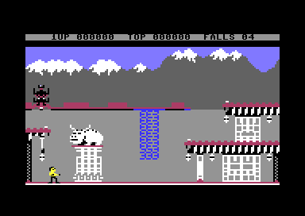

# Bruce Lee: the main loop, the status line, the score and the turns

This page describes one pass of the main loop, the keys of a game, the pause, the status line, the score, the loss
of a fall, the change of players in a two-player game and the game over.

## 1. Scope

- The main loop: [`main_loop`](../src/game_main_loop.asm#L23) [`$1BC2`](reference/modules/game_main_loop.md#main_loop).
- The keys and the pause: [`handle_game_keys`](../src/status_and_keys.asm#L57) [`$1B29`](reference/modules/status_and_keys.md#handle_game_keys), [`pause_debounce`](../src/pause_status_line.asm#L36) [`$19EC`](reference/modules/pause_status_line.md#pause_debounce), [`check_pause_fire`](../src/pause_status_line.asm#L53) [`$1A08`](reference/modules/pause_status_line.md#check_pause_fire),
  [`toggle_pause`](../src/pause_status_line.asm#L69) [`$1A22`](reference/modules/pause_status_line.md#toggle_pause), the idle timer and the screen saver in [`frame_update`](../src/frame_update.asm#L20) [`$15A8`](reference/modules/frame_update.md#frame_update).
- The status line: [`reset_play_state`](../src/play_init.asm#L19) [`$0763`](reference/modules/play_init.md#reset_play_state), [`blink_player_label`](../src/pause_status_line.asm#L147) [`$1A96`](reference/modules/pause_status_line.md#blink_player_label), [`show_falls_count`](../src/status_and_keys.asm#L10) [`$1AED`](reference/modules/status_and_keys.md#show_falls_count).
- The score: [`add_score`](../src/score.asm#L52) [`$3175`](reference/modules/score.md#add_score), [`add_pending_score`](../src/score.asm#L8) [`$312C`](reference/modules/score.md#add_pending_score), [`score_to_bcd`](../src/room_misc_support.asm#L142) [`$32DC`](reference/modules/room_misc_support.md#score_to_bcd), [`update_high_score`](../src/score.asm#L65) [`$3184`](reference/modules/score.md#update_high_score),
  [`show_high_score`](../src/score.asm#L112) [`$31C2`](reference/modules/score.md#show_high_score).
- The turns: [`lose_fall`](../src/lose_fall_game_over.asm#L14) [`$1818`](reference/modules/lose_fall_game_over.md#lose_fall), [`next_turn`](../src/lose_fall_game_over.asm#L23) [`$182A`](reference/modules/lose_fall_game_over.md#next_turn), [`game_over`](../src/lose_fall_game_over.asm#L82) [`$188E`](reference/modules/lose_fall_game_over.md#game_over).
- Sources: `src/game_main_loop.asm`, `src/status_and_keys.asm`, `src/pause_status_line.asm`, `src/score.asm`,
  `src/lose_fall_game_over.asm`, `src/frame_update.asm`, `src/game_setup.asm`.
- The start of a game, the demo and the PLAYER n screen are on the page [startup_title.md](startup_title.md).

**Conventions.**
- Addresses are C64 addresses. Names are the names of the knowledge.
- A *frame* is one raster interrupt (50 per second on PAL). A *pass* is one run of [`main_loop`](../src/game_main_loop.asm#L23) [`$1BC2`](reference/modules/game_main_loop.md#main_loop).
- A *fall* is a life of Bruce. The status line calls them FALLS.
- The *player block* is zero page `$28-$43`, from [`falls_left`](../src/constants.asm#L31) [`$0028`](reference/variables.md#falls_left) to [`score+2`](../src/constants.asm#L35) [`$0043`](reference/variables.md#score): the state of the player
  who plays now.
- Scores are 24-bit binary numbers, high byte first.
- **Observed** marks a fact that a run showed. **Code** marks a fact from the code only. **Conclusion** marks an
  interpretation.
- The runs named on this page are runs of c64-testing from the snapshot `explore1/entry.vsf`. "Run d1-flow" plays a
  two-player game with a pause and two game overs. "Run d1-top" sets the score seven times in a game.

## 2. Overview of a pass

~~~mermaid
flowchart TB
  A["main_loop $1BC2: frame_countdown = 3"] --> B["check_demo_abort $19B8"]
  B --> C{"game_mode $0104 = 1?"}
  C -- yes --> D["handle_game_keys $1B29"]
  D --> E["pause_debounce $19EC"]
  E --> F["check_pause_fire $1A08"]
  F --> G{"pause_state bit 7?"}
  G -- paused --> W["main_loop_wait_frame $1C32"]
  G -- no --> H
  C -- demo --> H["main_loop_update $1BDF: energy masks, blink_player_label $1A96, flicker_lantern_flames $40BC"]
  H --> I{"room_no_enemy_flag $007A = 0?"}
  I -- yes --> J["tick_spawn_timers $0DA4, update_yamo_spawn $0D0F, update_ninja_spawn $0DB1"]
  I -- no --> K
  J --> K["main_loop_toggle_phase $1BFE"]
  K --> L["run_room_frame_handler $3A6F"]
  L --> M["check_background_contact $5212"]
  M --> N["check_background_touch $2E39"]
  N --> O["main_loop_protection_check $1C13"]
  O --> P["check_fight_collisions $29C3 (rooms with enemies)"]
  P --> Q["update_high_score $3184"]
  Q --> R["update_actors $179E"]
  R --> S["build_actor_sprites $2584, check_actor_knockouts $2D55"]
  S --> W
  W --> A
~~~

### 2.1 The pacing

The pass starts with [`frame_countdown`](../src/constants.asm#L38) [`$0048`](reference/variables.md#frame_countdown) = 3. [`frame_update`](../src/frame_update.asm#L20) [`$15A8`](reference/modules/frame_update.md#frame_update), the frame work of the game interrupt
([`irq_game_bottom`](../src/game_irq.asm#L12) [`$48C1`](reference/modules/game_irq.md#irq_game_bottom)), counts it down by 1 in each frame until 0 ([`frame_update_dec_countdowns`](../src/frame_update.asm#L156) [`$1672`](reference/modules/frame_update.md#frame_update_dec_countdowns)). The
pass ends in [`main_loop_wait_frame`](../src/game_main_loop.asm#L83) [`$1C32`](reference/modules/game_main_loop.md#main_loop_wait_frame), which waits for 0. So a pass takes 3 frames, about 16.7 passes per
second on PAL. **Code.**

**Conclusion:** when a pass needs more than 3 frames, the count is already 0 at the end and the next pass starts at
once. The game then runs slower; it does not skip work.

The interrupt does the work of each frame: the sound effects, the sprite positions, the joysticks, the counters and
the idle timer. The main loop does the game logic.

### 2.2 The steps of a pass

**Code.**

1. [`frame_countdown`](../src/constants.asm#L38) [`$0048`](reference/variables.md#frame_countdown) = 3.
2. [`check_demo_abort`](../src/pause_status_line.asm#L7) [`$19B8`](reference/modules/pause_status_line.md#check_demo_abort). In the demo, fire on port 1 or F1 jumps to [`restart_to_title`](../src/title_demo_start.asm#L9) [`$050F`](reference/modules/title_demo_start.md#restart_to_title). In a game it
   returns at once.
3. When [`game_mode`](../src/constants.asm#L134) [`$0104`](reference/variables.md#game_mode) = 1 (a game): [`handle_game_keys`](../src/status_and_keys.asm#L57) [`$1B29`](reference/modules/status_and_keys.md#handle_game_keys) (section 3), [`pause_debounce`](../src/pause_status_line.asm#L36) [`$19EC`](reference/modules/pause_status_line.md#pause_debounce) and
   [`check_pause_fire`](../src/pause_status_line.asm#L53) [`$1A08`](reference/modules/pause_status_line.md#check_pause_fire) (section 4). When bit 7 of [`pause_state`](../src/constants.asm#L135) [`$0105`](reference/variables.md#pause_state) is set, the pass jumps to step 15.
4. [`main_loop_update`](../src/game_main_loop.asm#L37) [`$1BDF`](reference/modules/game_main_loop.md#main_loop_update) clears bit 6 of Yamo's [`actor_energy+1`](../src/constants.asm#L111) [`$00D2`](reference/variables.md#actor_energy) and bits 3-6 of the Ninja's
   [`actor_energy+2`](../src/constants.asm#L111) [`$00D3`](reference/variables.md#actor_energy). Bit 7 (knocked out) stays.
5. [`blink_player_label`](../src/pause_status_line.asm#L147) [`$1A96`](reference/modules/pause_status_line.md#blink_player_label) blinks 1UP or 2UP (section 5).
6. [`flicker_lantern_flames`](../src/room_hazard_draw.asm#L96) [`$40BC`](reference/modules/room_hazard_draw.md#flicker_lantern_flames) animates the lantern flames.
7. When [`room_no_enemy_flag`](../src/constants.asm#L75) [`$007A`](reference/variables.md#room_no_enemy_flag) = 0: [`tick_spawn_timers`](../src/actor_spawn.asm#L341) [`$0DA4`](reference/modules/actor_spawn.md#tick_spawn_timers), [`update_yamo_spawn`](../src/actor_spawn.asm#L238) [`$0D0F`](reference/modules/actor_spawn.md#update_yamo_spawn) and
   [`update_ninja_spawn`](../src/actor_spawn.asm#L355) [`$0DB1`](reference/modules/actor_spawn.md#update_ninja_spawn) bring the enemies into the room.
8. [`main_loop_toggle_phase`](../src/game_main_loop.asm#L52) [`$1BFE`](reference/modules/game_main_loop.md#main_loop_toggle_phase) toggles [`pass_parity`](../src/constants.asm#L76) [`$007B`](reference/variables.md#pass_parity) between 1 and 0. Room handlers use it to act on
   every second pass.
9. [`run_room_frame_handler`](../src/passage_open.asm#L18) [`$3A6F`](reference/modules/passage_open.md#run_room_frame_handler) runs the code of the room.
10. [`check_background_contact`](../src/background_contact.asm#L17) [`$5212`](reference/modules/background_contact.md#check_background_contact) sets the terrain flags of each actor from its pixels and the background.
11. [`check_background_touch`](../src/background_touch.asm#L10) [`$2E39`](reference/modules/background_touch.md#check_background_touch) checks the tiles under the actors: lanterns, exits, deadly tiles. An exit goes
    to [`change_room`](../src/background_touch.asm#L234) [`$2F9A`](reference/modules/background_touch.md#change_room), which draws the next room, resets the stack and jumps to [`main_loop`](../src/game_main_loop.asm#L23) [`$1BC2`](reference/modules/game_main_loop.md#main_loop).
12. [`main_loop_protection_check`](../src/game_main_loop.asm#L67) [`$1C13`](reference/modules/game_main_loop.md#main_loop_protection_check) stores [`prot_key_tick`](../src/protection_key_page.asm#L14) [`$CF7A`](reference/modules/protection_key_page.md#prot_key_tick) EOR [`prot_key_tick_pair`](../src/protection_key_page.asm#L36) [`$CF9A`](reference/modules/protection_key_page.md#prot_key_tick_pair) in
    [`protection_check_value`](../src/actor_step.asm#L623) [`$2007`](reference/modules/actor_step.md#protection_check_value). [`actor_play_step_sound`](../src/actor_step.asm#L556) [`$1FC4`](reference/modules/actor_step.md#actor_play_step_sound) checks this value later.
13. When [`room_no_enemies`](../src/room_tables.asm#L164) [`$4C9E`](reference/modules/room_tables.md#room_no_enemies) of the room is 0: [`check_fight_collisions`](../src/fight_hits.asm#L14) [`$29C3`](reference/modules/fight_hits.md#check_fight_collisions).
14. [`update_high_score`](../src/score.asm#L65) [`$3184`](reference/modules/score.md#update_high_score) (section 6.4), [`update_actors`](../src/actor_driver_text.asm#L10) [`$179E`](reference/modules/actor_driver_text.md#update_actors) (input, AI and the action of each actor),
    [`build_actor_sprites`](../src/actor_sprites.asm#L12) [`$2584`](reference/modules/actor_sprites.md#build_actor_sprites) and [`check_actor_knockouts`](../src/actor_helpers.asm#L8) [`$2D55`](reference/modules/actor_helpers.md#check_actor_knockouts). A knocked-out Bruce goes to [`lose_fall`](../src/lose_fall_game_over.asm#L14)
    `$1818` (section 7).
15. [`main_loop_wait_frame`](../src/game_main_loop.asm#L83) [`$1C32`](reference/modules/game_main_loop.md#main_loop_wait_frame) waits until [`frame_countdown`](../src/constants.asm#L38) [`$0048`](reference/variables.md#frame_countdown) = 0, then jumps to [`main_loop`](../src/game_main_loop.asm#L23) [`$1BC2`](reference/modules/game_main_loop.md#main_loop).

The pass has more exits that do not return: F1 ([`restart_to_title`](../src/title_demo_start.asm#L9) [`$050F`](reference/modules/title_demo_start.md#restart_to_title)), a room change ([`change_room`](../src/background_touch.asm#L234) [`$2F9A`](reference/modules/background_touch.md#change_room)),
and a lost fall ([`check_actor_knockouts`](../src/actor_helpers.asm#L8) [`$2D55`](reference/modules/actor_helpers.md#check_actor_knockouts) or [`act_dying_lose_fall`](../src/actor_timed_actions.asm#L209) [`$217A`](reference/modules/actor_timed_actions.md#act_dying_lose_fall) in [`update_actors`](../src/actor_driver_text.asm#L10) [`$179E`](reference/modules/actor_driver_text.md#update_actors)). Each
exit that continues the game resets the stack and enters [`main_loop`](../src/game_main_loop.asm#L23) [`$1BC2`](reference/modules/game_main_loop.md#main_loop) again.

## 3. The keys of a game

[`handle_game_keys`](../src/status_and_keys.asm#L57) [`$1B29`](reference/modules/status_and_keys.md#handle_game_keys) runs in each pass of a game, also while the game is paused. It sets [`key_scan_mode`](../src/constants.asm#L142)
`$010E` = 1, so [`scan_keyboard`](../src/keyboard_scan.asm#L24) [`$139E`](reference/modules/keyboard_scan.md#scan_keyboard) decodes only four keys: it drives the column of each key and compares port B
with the exact row pattern of [`game_key_matrix`](../src/keyboard_scan.asm#L156). Any other key gives code `$6F`. A held key gives one code only.
The routine clears [`key_ready`](../src/constants.asm#L140) [`$010C`](reference/variables.md#key_ready), removes the shift bit and stores the code in [`last_game_key`](../src/constants.asm#L40) [`$004B`](reference/variables.md#last_game_key),
which no code reads. **Code.**

| Key | Code | Action | Code path |
|---|---|---|---|
| F1 | `$04` | restart: back to the title | [`handle_game_keys`](../src/status_and_keys.asm#L57) [`$1B29`](reference/modules/status_and_keys.md#handle_game_keys) jumps to [`restart_to_title`](../src/title_demo_start.asm#L9) [`$050F`](reference/modules/title_demo_start.md#restart_to_title) |
| S | `$0D` | [`title_music_off`](../src/room_enemy_tables.asm#L118) [`$1385`](reference/modules/room_enemy_tables.md#title_music_off) EOR 1; [`title_music_skip_count`](../src/title_menu.asm#L163) [`$09BB`](reference/modules/title_menu.md#title_music_skip_count) = 0 | [`handle_game_keys_check_s`](../src/status_and_keys.asm#L73) [`$1B4A`](reference/modules/status_and_keys.md#handle_game_keys_check_s) |
| SPACE | `$3C` | pause on / off | [`handle_game_keys_pause`](../src/status_and_keys.asm#L89) [`$1B65`](reference/modules/status_and_keys.md#handle_game_keys_pause) jumps to [`toggle_pause`](../src/pause_status_line.asm#L69) [`$1A22`](reference/modules/pause_status_line.md#toggle_pause) |
| V | `$1F` | the credit line on / off | [`toggle_credit_line`](../src/status_and_keys.asm#L94) [`$1B68`](reference/modules/status_and_keys.md#toggle_credit_line) |

- **S** does not change the sound of the game. [`title_music_off`](../src/room_enemy_tables.asm#L118) [`$1385`](reference/modules/room_enemy_tables.md#title_music_off) has one reader, the title
  ([`show_title_screen`](../src/title_demo_start.asm#L83) [`$0584`](reference/modules/title_demo_start.md#show_title_screen)). S also sets the count of the title tune to 0, so the next title plays the tune
  when the tune is on. **Code.**
- **V**: when screen row 0 starts with character `$20`, [`toggle_credit_line`](../src/status_and_keys.asm#L94) [`$1B68`](reference/modules/status_and_keys.md#toggle_credit_line) copies the 40 characters of
  [`version_banner`](../src/messages_rooms.asm#L266) [`$4707`](reference/modules/messages_rooms.md#version_banner) ("BRUCE LEE (C) 1984 DATASOFT REV.2 BY RJF") to row 0. Else
  [`toggle_credit_line_clear`](../src/status_and_keys.asm#L105) [`$1B7B`](reference/modules/status_and_keys.md#toggle_credit_line_clear) fills row 0 with `$20`. [`reset_play_state`](../src/play_init.asm#L19) [`$0763`](reference/modules/play_init.md#reset_play_state) fills row 0 with `$20`.
  In the text font, `$20` is the solid block that the cold start made, drawn in black. **Code.**
- **F1** restarts the program state but keeps [`top_score`](../src/fireball_text_score_vars.asm#L56) [`$4388`](reference/modules/fireball_text_score_vars.md#top_score), the options and the handedness. **Code.**
- The demo has no keys but F1: [`check_demo_abort`](../src/pause_status_line.asm#L7) [`$19B8`](reference/modules/pause_status_line.md#check_demo_abort) scans with the same mode and reacts to F1 only.

The game screen after V: the credit line in row 0 and the status line in row 1. The 1UP mark is in its dark phase.
**Observed.**

## 4. The pause, the idle timer and the screen saver

### 4.1 The variables

| Name | Address | Layout |
|---|---|---|
| [`pause_state`](../src/constants.asm#L135) | `$0105` | Bit 7 = paused. Bits 0-2 = the debounce count, 6 after each change. |
| [`idle_timer`](../src/constants.asm#L81) | `$0082` | Units of 256 frames without input, `$00-$7F`. At `$80` the game pauses itself. `$FE` while the screen saver runs. |
| [`room_band_colours`](../src/constants.asm#L150) | `$0153` | 20 colours of the raster bands of the room. The screen saver changes them. |
| [`palette_backup`](../src/room_palettes.asm#L21) | `$47B4` | 20 bytes, the copy of the band colours while the screen saver runs. |

### 4.2 The parts

- **The debounce.** [`pause_debounce`](../src/pause_status_line.asm#L36) [`$19EC`](reference/modules/pause_status_line.md#pause_debounce) lowers the count in each pass: 6, 5, 3, 1, 0 (it subtracts 1 from bits
  1-2 and drops bit 0). While it runs, [`last_game_key`](../src/constants.asm#L40) [`$004B`](reference/variables.md#last_game_key) = `$FF`. [`check_pause_fire`](../src/pause_status_line.asm#L53) [`$1A08`](reference/modules/pause_status_line.md#check_pause_fire) acts only at
  count 0. The count does not block SPACE.
- **Fire ends the pause.** [`check_pause_fire`](../src/pause_status_line.asm#L53) [`$1A08`](reference/modules/pause_status_line.md#check_pause_fire) reads the fire button of the current player: port 1
  ([`CIAPRB`](../src/constants.asm#L276)) for player 1, port 2 ([`CIAPRA`](../src/constants.asm#L275)) for player 2. Fire while not paused does nothing.
- **[`toggle_pause`](../src/pause_status_line.asm#L69) [`$1A22`](reference/modules/pause_status_line.md#toggle_pause)** sets [`pause_state`](../src/constants.asm#L135) [`$0105`](reference/variables.md#pause_state) = ([`pause_state`](../src/constants.asm#L135) EOR `$80`) OR 6.
  - Into the pause: [`show_paused`](../src/pause_status_line.asm#L88) [`$1A42`](reference/modules/pause_status_line.md#show_paused) sets [`up_blink_timer`](../src/fireball_text_score_vars.asm#L103) [`$43BD`](reference/modules/fireball_text_score_vars.md#up_blink_timer) = `$11` and calls [`blink_player_label`](../src/pause_status_line.asm#L147)
    `$1A96` (the label shows and stays), sets [`idle_timer`](../src/constants.asm#L81) [`$0082`](reference/variables.md#idle_timer) = `$51`, and prints "** PAUSED **" (message `$0B`,
    [`show_paused_message`](../src/status_and_keys.asm#L141) [`$1BA4`](reference/modules/status_and_keys.md#show_paused_message)) on the status line from column 15.
  - Out of the pause: [`clear_paused_message`](../src/status_and_keys.asm#L154) [`$1BB6`](reference/modules/status_and_keys.md#clear_paused_message) prints 12 blanks over it. When [`idle_timer`](../src/constants.asm#L81) [`$0082`](reference/variables.md#idle_timer) is
    negative, [`stop_screen_saver`](../src/game_setup.asm#L151) [`$103B`](reference/modules/game_setup.md#stop_screen_saver) restores the band colours. [`idle_timer`](../src/constants.asm#L81) = 0. [`print_top_label`](../src/pause_status_line.asm#L170) [`$1ABB`](reference/modules/pause_status_line.md#print_top_label) and
    [`show_high_score`](../src/score.asm#L112) [`$31C2`](reference/modules/score.md#show_high_score) draw TOP and the top score again, because the message covered them.
- **The idle timer.** [`frame_update`](../src/frame_update.asm#L20) [`$15A8`](reference/modules/frame_update.md#frame_update) adds 1 to [`idle_timer`](../src/constants.asm#L81) [`$0082`](reference/variables.md#idle_timer) every 256 frames while it is positive.
  Any direction or fire on Bruce's joystick or on the joystick of a player-moved Yamo resets it to 0, but not while
  paused. In the demo it is reset in each frame. When it reaches `$80` (32768 frames, about 11 minutes), the code at
  [`frame_update`](../src/frame_update.asm#L20) [`$1634`](../src/frame_update.asm#L105) sets [`pause_state`](../src/constants.asm#L135) [`$0105`](reference/variables.md#pause_state) = `$86`, calls [`show_paused`](../src/pause_status_line.asm#L88) [`$1A42`](reference/modules/pause_status_line.md#show_paused) and [`start_screen_saver`](../src/game_setup.asm#L139)
  `$102B`.
- **The screen saver.** [`start_screen_saver`](../src/game_setup.asm#L139) [`$102B`](reference/modules/game_setup.md#start_screen_saver) copies [`room_band_colours`](../src/constants.asm#L150) [`$0153`](reference/variables.md#room_band_colours) to [`palette_backup`](../src/room_palettes.asm#L21) [`$47B4`](reference/modules/room_palettes.md#palette_backup)
  and sets [`idle_timer`](../src/constants.asm#L81) [`$0082`](reference/variables.md#idle_timer) = `$FE`. While [`idle_timer`](../src/constants.asm#L81) is negative, [`frame_update`](../src/frame_update.asm#L20) [`$15A8`](reference/modules/frame_update.md#frame_update) computes each band
  colour in each frame as ([`palette_backup`](../src/room_palettes.asm#L21)+x EOR [`frame_count_256`](../src/constants.asm#L80) [`$0080`](reference/variables.md#frame_count_256)) AND `$F7`, so the colours change.
- **While paused,** the pass runs only steps 1-3 of section 2.2. The interrupt still runs: the sprites stay, the
  sound effects play on, [`room_time`](../src/constants.asm#L86) [`$0087`](reference/variables.md#room_time) stops. F1, S, V and SPACE work.
- **The paused game also starts the screen saver.** [`show_paused`](../src/pause_status_line.asm#L88) [`$1A42`](reference/modules/pause_status_line.md#show_paused) sets [`idle_timer`](../src/constants.asm#L81) [`$0082`](reference/variables.md#idle_timer) = `$51`, and
  input does not reset it while paused, so it reaches `$80` after 47 * 256 = 12032 frames (about 4 minutes).

### 4.3 The state machine

~~~mermaid
stateDiagram-v2
  state "Playing: pause_state $00" as Play
  state "Pausing: $86 to $81" as InDeb
  state "Paused: $80" as Paused
  state "Screen saver: $80, idle_timer $FE" as Saver
  state "Resuming: $06 to $01" as OutDeb
  [*] --> Play
  Play --> InDeb: SPACE (toggle_pause $1A22)
  Play --> InDeb: idle_timer = $80 (frame_update $1634), saver on
  InDeb --> Paused: 4 passes (pause_debounce $19EC)
  InDeb --> OutDeb: SPACE
  Paused --> OutDeb: SPACE, or fire of the current player
  Paused --> Saver: idle_timer = $80
  Saver --> OutDeb: SPACE, or fire of the current player
  OutDeb --> Play: 4 passes
  OutDeb --> InDeb: SPACE
~~~

| State | Condition | Next state | Code |
|---|---|---|---|
| Playing | SPACE | Pausing (`$86`) | [`handle_game_keys_pause`](../src/status_and_keys.asm#L89) [`$1B65`](reference/modules/status_and_keys.md#handle_game_keys_pause), [`toggle_pause`](../src/pause_status_line.asm#L69) [`$1A22`](reference/modules/pause_status_line.md#toggle_pause), [`show_paused`](../src/pause_status_line.asm#L88) [`$1A42`](reference/modules/pause_status_line.md#show_paused) |
| Playing | [`idle_timer`](../src/constants.asm#L81) [`$0082`](reference/variables.md#idle_timer) reaches `$80` | Pausing (`$86`) with the screen saver | [`frame_update`](../src/frame_update.asm#L20) [`$1634`](../src/frame_update.asm#L105), [`start_screen_saver`](../src/game_setup.asm#L139) [`$102B`](reference/modules/game_setup.md#start_screen_saver) |
| Pausing | count 6, 5, 3, 1 in 4 passes | Paused (`$80`) | [`pause_debounce`](../src/pause_status_line.asm#L36) [`$19EC`](reference/modules/pause_status_line.md#pause_debounce) |
| Pausing | SPACE | Resuming (`$06`) | [`toggle_pause`](../src/pause_status_line.asm#L69) [`$1A22`](reference/modules/pause_status_line.md#toggle_pause) |
| Paused | SPACE, or fire on the port of [`current_player`](../src/constants.asm#L14) [`$0003`](reference/variables.md#current_player) | Resuming (`$06`) | [`check_pause_fire`](../src/pause_status_line.asm#L53) [`$1A08`](reference/modules/pause_status_line.md#check_pause_fire), [`toggle_pause`](../src/pause_status_line.asm#L69) [`$1A22`](reference/modules/pause_status_line.md#toggle_pause) |
| Paused | [`idle_timer`](../src/constants.asm#L81) [`$0082`](reference/variables.md#idle_timer) reaches `$80` (12032 frames) | Screen saver | [`frame_update`](../src/frame_update.asm#L20) [`$1634`](../src/frame_update.asm#L105) (sets `$86` again) |
| Screen saver | SPACE or fire | Resuming (`$06`), colours restored | [`toggle_pause`](../src/pause_status_line.asm#L69) [`$1A22`](reference/modules/pause_status_line.md#toggle_pause), [`stop_screen_saver`](../src/game_setup.asm#L151) [`$103B`](reference/modules/game_setup.md#stop_screen_saver) |
| Resuming | count 6, 5, 3, 1 in 4 passes | Playing (`$00`) | [`pause_debounce`](../src/pause_status_line.asm#L36) [`$19EC`](reference/modules/pause_status_line.md#pause_debounce) |
| any | F1 | the title | [`restart_to_title`](../src/title_demo_start.asm#L9) [`$050F`](reference/modules/title_demo_start.md#restart_to_title) |

**Observed** (run d1-flow): after SPACE, [`pause_state`](../src/constants.asm#L135) [`$0105`](reference/variables.md#pause_state) was `$85`, `$83`, `$81`, `$80`, `$80` at 3-frame
steps, with [`idle_timer`](../src/constants.asm#L81) [`$0082`](reference/variables.md#idle_timer) = `$51` and [`up_blink_timer`](../src/fireball_text_score_vars.asm#L103) [`$43BD`](reference/modules/fireball_text_score_vars.md#up_blink_timer) = `$10`. After fire on port 1, it was `$01`
12 frames later, and [`idle_timer`](../src/constants.asm#L81) was 0. At the first pass of a game [`pause_state`](../src/constants.asm#L135) is `$01`, because
[`init_game_variables`](../src/game_setup.asm#L18) [`$0F72`](reference/modules/game_setup.md#init_game_variables) writes 1 to `$0100-$0107`.

The paused game: "** PAUSED **" covers TOP and the top score on the status line. **Observed.**

### 4.4 The idle Yamo of player 2

When player 2 moves Yamo ([`option_yamo_player2`](../src/options_and_patterns.asm#L18) [`$42CA`](reference/modules/options_and_patterns.md#option_yamo_player2) = 1) and gives no input for 7 * 256 frames,
[`frame_update_yamo_idle`](../src/frame_update.asm#L295) [`$173F`](reference/modules/frame_update.md#frame_update_yamo_idle) gives Yamo back to the computer. It counts in [`yamo_idle_time`](../src/constants.asm#L87) [`$0089`](reference/variables.md#yamo_idle_time) only in a
game, not paused, in a room with enemies. Then it sets [`option_yamo_player2`](../src/options_and_patterns.asm#L18) [`$42CA`](reference/modules/options_and_patterns.md#option_yamo_player2) = 0, the high byte of
[`room_time`](../src/constants.asm#L86) [`$0087`](reference/variables.md#room_time) = `$20`, plays [`play_open_sound`](../src/wizard_fireballs.asm#L183) [`$424F`](reference/modules/wizard_fireballs.md#play_open_sound), and takes 5 falls (not below 0) from [`falls_left`](../src/constants.asm#L31)
`$0028` and from the parked player in [`inactive_player_state`](../src/fireball_text_score_vars.asm#L89) [`$439F`](reference/modules/fireball_text_score_vars.md#inactive_player_state). **Code.** **Conclusion:** the 5 falls are the
extra falls of the opponent mode, which starts with 9 falls instead of 4.

## 5. The status line

[`reset_play_state`](../src/play_init.asm#L19) [`$0763`](reference/modules/play_init.md#reset_play_state) draws the status line at each start of a game, a turn and a fall. Screen row 1 holds it,
one screen row high, in [`text_font`](../src/constants.asm#L193) [`$8800`](reference/variables.md#text_font). Digits are characters `$10-$19`. **Code.**

| Columns | Content | Written by |
|---|---|---|
| 2 | L when joystick 1 is left handed | [`frame_update`](../src/frame_update.asm#L20) [`$15A8`](reference/modules/frame_update.md#frame_update), each frame |
| 4-6 | 1UP or 2UP, blinking | [`blink_player_label`](../src/pause_status_line.asm#L147) [`$1A96`](reference/modules/pause_status_line.md#blink_player_label) (messages 1 and 2; message 0 blanks it) |
| 8-13 | the score, 6 digits | [`show_score`](../src/score.asm#L39) [`$315A`](reference/modules/score.md#show_score) (screen offsets `$30`, `$32`, `$34`) |
| 16-18 | TOP | [`print_top_label`](../src/pause_status_line.asm#L170) [`$1ABB`](reference/modules/pause_status_line.md#print_top_label) (message 3) |
| 20-25 | the top score, 6 digits | [`show_high_score`](../src/score.asm#L112) [`$31C2`](reference/modules/score.md#show_high_score) (offsets `$3C`, `$3E`, `$40`) |
| 28-32 | FALLS | [`print_falls_label`](../src/pause_status_line.asm#L177) [`$1AC7`](reference/modules/pause_status_line.md#print_falls_label) (message 5) |
| 34-35 | the falls, 2 digits | [`show_falls_count`](../src/status_and_keys.asm#L10) [`$1AED`](reference/modules/status_and_keys.md#show_falls_count) (offset `$4A`) |
| 37 | L when joystick 2 is left handed and in use | [`frame_update`](../src/frame_update.asm#L20) [`$15A8`](reference/modules/frame_update.md#frame_update), each frame |
| 15-26 | "** PAUSED **" over TOP and the top score | [`show_paused_message`](../src/status_and_keys.asm#L141) [`$1BA4`](reference/modules/status_and_keys.md#show_paused_message) |

Screen row 0 holds the credit line or the black bar (section 3).

- **The blink.** [`blink_player_label`](../src/pause_status_line.asm#L147) [`$1A96`](reference/modules/pause_status_line.md#blink_player_label) decrements [`up_blink_timer`](../src/fireball_text_score_vars.asm#L103) [`$43BD`](reference/modules/fireball_text_score_vars.md#up_blink_timer) in each pass. At 0 it sets `$20`
  and prints 3 blanks. At `$10` it prints message 1 + [`current_player`](../src/constants.asm#L14) [`$0003`](reference/variables.md#current_player). So the label is 16 passes on and 16
  passes off, a period of 96 frames. **Code.**
- **The falls.** [`show_falls_count`](../src/status_and_keys.asm#L10) [`$1AED`](reference/modules/status_and_keys.md#show_falls_count) converts [`falls_left`](../src/constants.asm#L31) [`$0028`](reference/variables.md#falls_left) (0-99) to two decimal digits by repeated
  subtraction of 10 ([`show_falls_tens_loop`](../src/status_and_keys.asm#L16) [`$1AF7`](reference/modules/status_and_keys.md#show_falls_tens_loop)). It packs them into one BCD byte and prints it with
  [`print_hex_byte`](../src/status_and_keys.asm#L116) [`$1B84`](reference/modules/status_and_keys.md#print_hex_byte). **Code.**
- **The digits.** [`print_bcd_byte`](../src/status_and_keys.asm#L39) [`$1B17`](reference/modules/status_and_keys.md#print_bcd_byte) prints a BCD byte as two characters: nibble OR `$10`. [`print_hex_byte`](../src/status_and_keys.asm#L116)
  `$1B84` does the same, and maps nibbles A-F to `$21-$26` (the letters). Only the unused [`debug_show_values`](../src/pause_status_line.asm#L187)
  `$1AD1` passes real hexadecimal values. **Code.**

The status line at the start of a game: 1UP 000000 TOP 000000 FALLS 04. **Observed.**

## 6. The score

### 6.1 The format

| Name | Address | Layout |
|---|---|---|
| [`score`](../src/constants.asm#L35) | `$0041` | 24-bit binary, high byte first. The last 3 bytes of the player block. |
| [`points_to_add`](../src/constants.asm#L30) | `$0025` | 24-bit binary, high byte first, the points of one addition. |
| [`top_score`](../src/fireball_text_score_vars.asm#L56) | `$4388` | 24-bit binary, high byte first. One top score for both players and all games since the load. |
| [`bonus_fall_first_score`](../src/fireball_text_score_vars.asm#L62) | `$438B` | `00 9C 40` = 40000, the score of the first extra fall. |
| [`bonus_fall_score_step`](../src/fireball_text_score_vars.asm#L66) | `$438E` | `00 75 30` = 30000, the step between extra falls. |
| [`bonus_fall_next_score`](../src/fireball_text_score_vars.asm#L73) | `$4392` | 24-bit, the score of the next extra fall of the current player. |
| [`bonus_fall_next_score_other`](../src/fireball_text_score_vars.asm#L77) | `$4395` | the same for the parked player. |
| [`bcd_conv_binary`](../src/fireball_text_score_vars.asm#L82) | `$4398` | 3 bytes, the work copy of the binary value. |
| [`bcd_conv_digits`](../src/fireball_text_score_vars.asm#L84) | `$439B` | 4 bytes, 8 BCD digits, high first. `+1..+3` are printed as 6 digits. |

### 6.2 Adding points

[`add_score`](../src/score.asm#L52) [`$3175`](reference/modules/score.md#add_score) takes A = points and X = the byte: 2 for units, 1 for multiples of 256. It clears
[`points_to_add`](../src/constants.asm#L30) [`$0025`](reference/variables.md#points_to_add), stores A at [`points_to_add`](../src/constants.asm#L30)+X and jumps to [`add_pending_score`](../src/score.asm#L8) [`$312C`](reference/modules/score.md#add_pending_score). That adds the three
bytes with carry from the low byte (X = 2) to the high byte, checks the extra fall (section 6.5) and calls
[`show_score`](../src/score.asm#L39) [`$315A`](reference/modules/score.md#show_score). A sum above 255 needs two calls. **Code.**

| Event | Points | Calls |
|---|---|---|
| a punch of Bruce hits | 100 | [`apply_fight_hits`](../src/fight_hits.asm#L252) [`$2BBF`](../src/fight_hits.asm#L319) |
| a kick of Bruce hits | 75 | [`apply_fight_hits`](../src/fight_hits.asm#L252) [`$2BE3`](../src/fight_hits.asm#L340) |
| a fall attack of Bruce hits | 50 | [`apply_fight_hits`](../src/fight_hits.asm#L252) [`$2C07`](../src/fight_hits.asm#L362) |
| Bruce knocks out Yamo | 256 + 194 = 450 | [`apply_fight_hits`](../src/fight_hits.asm#L252) [`$2C33`](../src/fight_hits.asm#L393), `$2C3A` |
| Bruce knocks out the Ninja | 200 | [`apply_fight_hits`](../src/fight_hits.asm#L252) [`$2C44`](../src/fight_hits.asm#L401) |
| a lantern | 125 | [`handle_touched_tile`](../src/background_touch.asm#L61) [`$2F31`](../src/background_touch.asm#L170) |
| the first visit of a room | 1792 + 208 = 2000 | [`draw_room`](../src/draw_room.asm#L28) [`$0A20`](../src/draw_room.asm#L78), `$0A27` |
| a height band of room 13 | 256 + 244 = 500 | [`room13_frame`](../src/room_frames_12_17.asm#L41) [`$3EB2`](../src/room_frames_12_17.asm#L73), `$3EB9` |
| the wizard is defeated | 184 + 2816 = 3000 | [`room18_frame`](../src/wizard_room.asm#L13) [`$3D04`](../src/wizard_room.asm#L34), `$3D0B` |

### 6.3 Binary to BCD

[`score_to_bcd`](../src/room_misc_support.asm#L142) [`$32DC`](reference/modules/room_misc_support.md#score_to_bcd) converts [`score`](../src/constants.asm#L35) [`$0041`](reference/variables.md#score), and [`show_high_score`](../src/score.asm#L112) [`$31C2`](reference/modules/score.md#show_high_score) converts [`top_score`](../src/fireball_text_score_vars.asm#L56) [`$4388`](reference/modules/fireball_text_score_vars.md#top_score) with
the same method. **Code.**

~~~
bin = score (24 bits); bcd = 0 (4 bytes)
SED
repeat 24 times:
    shift bin left by 1 (the top bit goes to carry)
    bcd = bcd + bcd + carry      ; ADC of each BCD byte with itself, low byte first
CLD (PLP restores the flag of the caller)
print bcd+1, bcd+2, bcd+3 as 6 digits
~~~

**Worked example.** The demo scores 125: [`score`](../src/constants.asm#L35) [`$0041`](reference/variables.md#score) = `00 00 7D`. The first 16 bits are 0, so the BCD value
stays 0. The low byte is `$7D` = `0111 1101`:

| Bit | 0 | 1 | 1 | 1 | 1 | 1 | 0 | 1 |
|---|---|---|---|---|---|---|---|---|
| BCD after the step | 0 | 1 | 3 | 7 | 15 | 31 | 62 | 125 |

[`bcd_conv_digits`](../src/fireball_text_score_vars.asm#L84) [`$439B`](reference/modules/fireball_text_score_vars.md#bcd_conv_digits) = `00 00 01 25`, and the status line shows 000125. **Observed** (run d1-flow: the score
`00 00 7D` at the end of the demo; the demo screenshot on [startup_title.md](startup_title.md) shows 000125).

**Conclusion:** the status line shows 6 of the 8 BCD digits, so a score of 1,000,000 or more shows only its low 6
digits.

### 6.4 The top score

[`update_high_score`](../src/score.asm#L65) [`$3184`](reference/modules/score.md#update_high_score) runs in each pass. **Code.**

1. In the demo ([`game_mode`](../src/constants.asm#L134) [`$0104`](reference/variables.md#game_mode) = 0) it only calls [`show_score`](../src/score.asm#L39) [`$315A`](reference/modules/score.md#show_score).
2. A protection check: when [`prot_key_trap1`](../src/protection_key_page.asm#L16) [`$CF7B`](reference/modules/protection_key_page.md#prot_key_trap1) = [`prot_key_trap1_pair`](../src/protection_key_page.asm#L38) [`$CF9B`](reference/modules/protection_key_page.md#prot_key_trap1_pair), and the same for the trap 2
   and trap 3 pairs, it jumps through [`io1_dummy`](../src/constants.asm#L287) [`$DE00`](reference/variables.md#io1_dummy) and crashes. With the right key bytes the first pair
   differs.
3. [`update_high_score_compare_loop`](../src/score.asm#L91) [`$31A6`](reference/modules/score.md#update_high_score_compare_loop) compares [`top_score`](../src/fireball_text_score_vars.asm#L56) [`$4388`](reference/modules/fireball_text_score_vars.md#top_score) with [`score`](../src/constants.asm#L35) [`$0041`](reference/variables.md#score) from the high byte.
   The first byte that differs decides. This is a correct 24-bit compare.
4. When the score is higher, [`update_high_score_store`](../src/score.asm#L102) [`$31B8`](reference/modules/score.md#update_high_score_store) copies 4 bytes from [`score`](../src/constants.asm#L35) [`$0041`](reference/variables.md#score) to [`top_score`](../src/fireball_text_score_vars.asm#L56)
   `$4388`, and falls into [`show_high_score`](../src/score.asm#L112) [`$31C2`](reference/modules/score.md#show_high_score).

The fourth byte is a bug, see section 6.5.

### 6.5 Extra falls and their two bugs

[`check_extra_fall_loop`](../src/score.asm#L18) [`$313A`](reference/modules/score.md#check_extra_fall_loop) runs after each addition. When the score reaches [`bonus_fall_next_score`](../src/fireball_text_score_vars.asm#L73) [`$4392`](reference/modules/fireball_text_score_vars.md#bonus_fall_next_score),
[`award_extra_fall`](../src/score.asm#L25) [`$3146`](reference/modules/score.md#award_extra_fall) adds [`bonus_fall_score_step`](../src/fireball_text_score_vars.asm#L66) [`$438E`](reference/modules/fireball_text_score_vars.md#bonus_fall_score_step) to the limit, adds 1 to [`falls_left`](../src/constants.asm#L31) [`$0028`](reference/variables.md#falls_left) and
calls [`show_falls_count`](../src/status_and_keys.asm#L10) [`$1AED`](reference/modules/status_and_keys.md#show_falls_count). [`init_game_variables`](../src/game_setup.asm#L18) [`$0F72`](reference/modules/game_setup.md#init_game_variables) sets the limit of both players to
[`bonus_fall_first_score`](../src/fireball_text_score_vars.asm#L62) [`$438B`](reference/modules/fireball_text_score_vars.md#bonus_fall_first_score). **Code.** The intent: an extra fall at 40000, 70000, 100000 and so on.

~~~
for x in 0..2:                              ; high byte first
    if score[x] < limit[x]: no extra fall    ; BCC show_score
award: limit += step; falls_left += 1
~~~

**Bug 1: the compare is per byte.** The loop needs each byte of the score to be at least the byte of the limit. It
never stops early when a higher byte is greater. **Code.**

| Score | Bytes | Limit bytes | Byte test | Result |
|---|---|---|---|---|
| 40960 | `00 A0 00` | `00 9C 40` | `00` >= `00`, `A0` >= `9C`, `00` < `40` | no extra fall |
| 41060 (one more punch) | `00 A0 64` | `00 9C 40` | all bytes >= | extra fall, limit becomes `01 11 70` (70000) |
| 70500 | `01 13 64` | `01 11 70` | `64` < `70` | no extra fall |

**Conclusion:** an extra fall never comes early, but it often comes late, at a later addition whose low bytes are
high enough. All bytes being greater or equal implies that the score is greater or equal.

**Bug 2: a new top score changes the first limit.** [`update_high_score_store`](../src/score.asm#L102) [`$31B8`](reference/modules/score.md#update_high_score_store) copies 4 bytes, [`score`](../src/constants.asm#L35)
`$0041-$0043` and zero page `$44`, to [`top_score`](../src/fireball_text_score_vars.asm#L56) [`$4388-$438A`](reference/modules/fireball_text_score_vars.md#top_score) and [`bonus_fall_first_score`](../src/fireball_text_score_vars.asm#L62) [`$438B`](reference/modules/fireball_text_score_vars.md#bonus_fall_first_score). `$44` is
[`raster_split_index`](../src/constants.asm#L36) [`$0044`](reference/variables.md#raster_split_index), the index of the raster split in the game interrupt. The next game copies the
damaged value to the limits. **Code.**

- **Observed** (run d1-top): in a game, the score was set seven times above the top score. After each store,
  [`top_score`](../src/fireball_text_score_vars.asm#L56) [`$4388`](reference/modules/fireball_text_score_vars.md#top_score) held `00 00 xx 02 9C 40`: [`bonus_fall_first_score`](../src/fireball_text_score_vars.asm#L62) [`$438B`](reference/modules/fireball_text_score_vars.md#bonus_fall_first_score) was `02 9C 40` each time.
- **Conclusion:** after a game with a new top score, the first extra fall of each later game is at `$029C40` =
  171072 points, not 40000. With bug 1, it also needs the middle byte to be `$9C` or more.

### 6.6 Other changes of the falls

| Change | Code |
|---|---|
| 4 falls at the game start, 9 when player 2 moves Yamo | [`init_game_variables`](../src/game_setup.asm#L18) [`$0F72`](reference/modules/game_setup.md#init_game_variables) |
| +1 at each extra fall of the score | [`award_extra_fall`](../src/score.asm#L25) [`$3146`](reference/modules/score.md#award_extra_fall) |
| +1 at a pickup in room 16, at most 5 per player ([`extra_fall_pickups_left`](../src/lantern_lists.asm#L109) [`$4E95`](reference/modules/lantern_lists.md#extra_fall_pickups_left)) | [`collect_room16_bonus`](../src/touch_effects.asm#L8) [`$2FD6`](reference/modules/touch_effects.md#collect_room16_bonus) |
| -5 for both players when player 2 stops moving Yamo | [`frame_update_yamo_idle`](../src/frame_update.asm#L295) [`$173F`](reference/modules/frame_update.md#frame_update_yamo_idle) |
| -1 at each lost fall | [`lose_fall`](../src/lose_fall_game_over.asm#L14) [`$1818`](reference/modules/lose_fall_game_over.md#lose_fall) |

## 7. Lose a fall, the turns and the game over

### 7.1 The player block

[`lose_fall`](../src/lose_fall_game_over.asm#L14) [`$1818`](reference/modules/lose_fall_game_over.md#lose_fall) exchanges these 28 bytes with [`inactive_player_state`](../src/fireball_text_score_vars.asm#L89) [`$439F`](reference/modules/fireball_text_score_vars.md#inactive_player_state) when the turn passes to the other
player. [`init_game_variables`](../src/game_setup.asm#L18) [`$0F72`](reference/modules/game_setup.md#init_game_variables) copies the start values to [`inactive_player_state`](../src/fireball_text_score_vars.asm#L89) at each game start.

| Bytes | Name | Meaning | At the game start (Observed, run d1-flow) |
|---|---|---|---|
| `$28` | [`falls_left`](../src/constants.asm#L31) | falls left; negative = this player is out | `04` |
| `$29` | [`room`](../src/constants.asm#L32) | the room of the player | `00` |
| `$2A-$3D` | [`room_lanterns_left`](../src/constants.asm#L33) | lanterns not yet taken, one byte per room | `06 06 0A 02 02 0A 08 0D 04 05 03 03 03 00 04 06 02 02 01 00` |
| `$3E-$3F` | (no name) | two bytes of the block | `00 00` |
| `$40` | [`game_loop_count`](../src/constants.asm#L34) | completed loops of the game | `00` |
| `$41-$43` | [`score`](../src/constants.asm#L35) | the score | `00 00 00` |

Other state of a player is kept in other ways. **Code.**

| State | How each player keeps it |
|---|---|
| the present flag of each lantern | [`swap_player_lanterns`](../src/game_setup.asm#L96) [`$0FED`](reference/modules/game_setup.md#swap_player_lanterns) exchanges it with [`parked_lantern_flags`](../src/constants.asm#L153) [`$0340`](reference/variables.md#parked_lantern_flags) |
| [`bonus_fall_next_score`](../src/fireball_text_score_vars.asm#L73) [`$4392`](reference/modules/fireball_text_score_vars.md#bonus_fall_next_score) | [`next_turn_swap_score_loop`](../src/lose_fall_game_over.asm#L63) [`$1875`](reference/modules/lose_fall_game_over.md#next_turn_swap_score_loop) exchanges it with [`bonus_fall_next_score_other`](../src/fireball_text_score_vars.asm#L77) [`$4395`](reference/modules/fireball_text_score_vars.md#bonus_fall_next_score_other) |
| [`room_unvisited`](../src/constants.asm#L152) [`$0300`](reference/variables.md#room_unvisited) | one byte per room and player, index room * 2 + [`current_player`](../src/constants.asm#L14) |
| [`room13_band_bonus`](../src/constants.asm#L149) [`$014B`](reference/variables.md#room13_band_bonus) | 4 bytes per player, index [`current_player`](../src/constants.asm#L14) * 4 |
| [`extra_fall_pickups_left`](../src/lantern_lists.asm#L109) [`$4E95`](reference/modules/lantern_lists.md#extra_fall_pickups_left) | one byte per player, index [`current_player`](../src/constants.asm#L14) |

### 7.2 The steps

[`lose_fall`](../src/lose_fall_game_over.asm#L14) [`$1818`](reference/modules/lose_fall_game_over.md#lose_fall) is called when Bruce's death ends ([`act_dying_lose_fall`](../src/actor_timed_actions.asm#L209) [`$217A`](reference/modules/actor_timed_actions.md#act_dying_lose_fall)) or when Bruce is knocked out
([`check_actor_knockouts`](../src/actor_helpers.asm#L8) [`$2D55`](reference/modules/actor_helpers.md#check_actor_knockouts)). It never returns. **Code.**

1. [`stop_all_sounds`](../src/sound_request.asm#L63) [`$255E`](reference/modules/sound_request.md#stop_all_sounds).
2. In the demo ([`game_mode`](../src/constants.asm#L134) [`$0104`](reference/variables.md#game_mode) = 0): [`title_music_skip_count`](../src/title_menu.asm#L163) [`$09BB`](reference/modules/title_menu.md#title_music_skip_count) = 0, then [`show_title_screen`](../src/title_demo_start.asm#L83) [`$0584`](reference/modules/title_demo_start.md#show_title_screen).
3. [`lose_fall_count`](../src/lose_fall_game_over.asm#L20) [`$1826`](reference/modules/lose_fall_game_over.md#lose_fall_count) decrements [`falls_left`](../src/constants.asm#L31) [`$0028`](reference/variables.md#falls_left). A negative result goes to [`game_over`](../src/lose_fall_game_over.asm#L82) [`$188E`](reference/modules/lose_fall_game_over.md#game_over).
4. [`next_turn`](../src/lose_fall_game_over.asm#L23) [`$182A`](reference/modules/lose_fall_game_over.md#next_turn): [`actor_energy`](../src/constants.asm#L111) [`$00D1`](reference/variables.md#actor_energy) of the three actors = `$24`, [`enemy_follow_x`](../src/constants.asm#L88) [`$008B`](reference/variables.md#enemy_follow_x) = 0 (no enemy
   follows Bruce), [`clear_fireball_sprites`](../src/wizard_fireballs.asm#L171) [`$423F`](reference/modules/wizard_fireballs.md#clear_fireball_sprites).
5. In a two-player game, when the parked player is not out ([`inactive_player_state`](../src/fireball_text_score_vars.asm#L89) [`$439F`](reference/modules/fireball_text_score_vars.md#inactive_player_state) is positive):
   [`current_player`](../src/constants.asm#L14) [`$0003`](reference/variables.md#current_player) EOR 1.
6. [`next_turn_player_screen`](../src/lose_fall_game_over.asm#L40) [`$184B`](reference/modules/lose_fall_game_over.md#next_turn_player_screen): [`show_player_screen`](../src/title_player_screens.asm#L71) [`$0EA7`](reference/modules/title_player_screens.md#show_player_screen) shows PLAYER n, also in a one-player game. Then
   the screen is blanked.
7. With the same condition as step 5: [`next_turn_swap_block_loop`](../src/lose_fall_game_over.asm#L52) [`$1862`](reference/modules/lose_fall_game_over.md#next_turn_swap_block_loop) exchanges the player block with
   [`inactive_player_state`](../src/fireball_text_score_vars.asm#L89) [`$439F`](reference/modules/fireball_text_score_vars.md#inactive_player_state), [`swap_player_lanterns`](../src/game_setup.asm#L96) [`$0FED`](reference/modules/game_setup.md#swap_player_lanterns) exchanges the lanterns, and
   [`next_turn_swap_score_loop`](../src/lose_fall_game_over.asm#L63) [`$1875`](reference/modules/lose_fall_game_over.md#next_turn_swap_score_loop) exchanges the limits of the extra falls.
8. [`next_turn_enter_room`](../src/lose_fall_game_over.asm#L72) [`$1886`](reference/modules/lose_fall_game_over.md#next_turn_enter_room): [`reset_play_state`](../src/play_init.asm#L19) [`$0763`](reference/modules/play_init.md#reset_play_state) draws the game screen and the status line of this
   player and spawns Bruce. X = [`room`](../src/constants.asm#L32) [`$0029`](reference/variables.md#room), and [`place_bruce_at_room_start`](../src/room_misc_support.asm#L11) [`$3217`](reference/modules/room_misc_support.md#place_bruce_at_room_start) enters that room at its
   start point. That ends in [`main_loop`](../src/game_main_loop.asm#L23) [`$1BC2`](reference/modules/game_main_loop.md#main_loop).

So a fall restarts the room. In a two-player game the players take turns after each lost fall, and each player
goes on in his own room.

### 7.3 The game over

[`game_over`](../src/lose_fall_game_over.asm#L82) [`$188E`](reference/modules/lose_fall_game_over.md#game_over) shows the game over screen of the current player. **Code.**

1. [`clear_fireball_sprites`](../src/wizard_fireballs.asm#L171) [`$423F`](reference/modules/wizard_fireballs.md#clear_fireball_sprites), [`clear_text_screen`](../src/pause_status_line.asm#L104) [`$1A56`](reference/modules/pause_status_line.md#clear_text_screen). SEI, the screen is blanked, the sprites are off.
2. [`irq_vector`](../src/cold_start.asm#L31) [`$0408`](reference/modules/cold_start.md#irq_vector) = [`irq_title_frame`](../src/screen_raster_irqs.asm#L81) [`$152C`](reference/modules/screen_raster_irqs.md#irq_title_frame) at raster line `$FB`. Blue border and background, colour RAM
   `$0F`, rows 12-24 white, rows 0-9 filled with `$DC`.
3. [`game_over_text_loop`](../src/lose_fall_game_over.asm#L126) [`$18F0`](reference/modules/lose_fall_game_over.md#game_over_text_loop) copies 18 characters of [`game_over_letters_top`](../src/options_and_patterns.asm#L28) [`$42CD`](reference/modules/options_and_patterns.md#game_over_letters_top) and
   [`game_over_letters_bottom`](../src/options_and_patterns.asm#L34) [`$42DF`](reference/modules/options_and_patterns.md#game_over_letters_bottom) to rows 1-2 from column 11: GAME OVER in big letters.
4. [`game_over_digit_loop`](../src/lose_fall_game_over.asm#L144) [`$1909`](reference/modules/lose_fall_game_over.md#game_over_digit_loop) patches the digit of the player into the PLAYER banner. The loop runs only once
   (DEY/BPL from Y = 0), so only the first character of each half is copied.
5. [`game_over_player_loop`](../src/lose_fall_game_over.asm#L153) [`$191A`](reference/modules/lose_fall_game_over.md#game_over_player_loop) copies PLAYER n to rows 5-6 from column 12.
6. [`score_to_bcd`](../src/room_misc_support.asm#L142) [`$32DC`](reference/modules/room_misc_support.md#score_to_bcd), then [`game_over_score_loop`](../src/lose_fall_game_over.asm#L173) [`$1942`](reference/modules/lose_fall_game_over.md#game_over_score_loop) draws 6 big digits on rows 8-9 from column 14 with
   [`draw_big_digit`](../src/lose_fall_game_over.asm#L214) [`$1984`](reference/modules/lose_fall_game_over.md#draw_big_digit) (2 x 2 characters, the first is `$B4` + digit * 4).
7. The screen goes on. [`game_over_wait`](../src/lose_fall_game_over.asm#L195) [`$1968`](reference/modules/lose_fall_game_over.md#game_over_wait) waits 254 frames.
8. In a two-player game, when the parked player is not out: jump to [`next_turn`](../src/lose_fall_game_over.asm#L23) [`$182A`](reference/modules/lose_fall_game_over.md#next_turn), the turn of the other
   player.
9. Else [`game_over_to_title`](../src/lose_fall_game_over.asm#L204) [`$1979`](reference/modules/lose_fall_game_over.md#game_over_to_title) waits 64 more frames and jumps to [`show_title_screen`](../src/title_demo_start.asm#L83) [`$0584`](reference/modules/title_demo_start.md#show_title_screen).

**Conclusion:** the bug of step 4 does not show. The second character keeps the value of the last PLAYER n screen,
and that screen always showed the same player. **Observed** (run d1-flow): the game over screens of player 1 and of
player 2 both showed the right digit.

### 7.4 The state machine of the turns

~~~mermaid
stateDiagram-v2
  state "Playing: main_loop $1BC2" as Play
  state "lose_fall $1818" as Lose
  state "next_turn $182A" as Next
  state "Switch: current_player EOR 1" as Switch
  state "PLAYER n: show_player_screen $0EA7" as PScreen
  state "Swap the player block $1862" as Swap
  state "Enter the room: next_turn_enter_room $1886" as Enter
  state "game_over $188E" as Over
  state "show_title_screen $0584" as Title
  [*] --> Play: start_new_game $070E
  Play --> Lose: Bruce dies or is knocked out
  Lose --> Title: demo
  Lose --> Over: falls_left negative
  Lose --> Next: falls_left 0 or more
  Next --> Switch: two players, other player in
  Next --> PScreen: else
  Switch --> PScreen
  PScreen --> Swap: two players, other player in
  PScreen --> Enter: else
  Swap --> Enter
  Enter --> Play
  Over --> Next: two players, other player in, 254 frames
  Over --> Title: else, 254 + 64 frames
~~~

"Other player in" means [`option_two_players`](../src/options_and_patterns.asm#L14) [`$42C9`](reference/modules/options_and_patterns.md#option_two_players) = 1 and [`inactive_player_state`](../src/fireball_text_score_vars.asm#L89) [`$439F`](reference/modules/fireball_text_score_vars.md#inactive_player_state) positive.

| State | Condition | Next state | Code |
|---|---|---|---|
| Playing | Bruce's death ends | [`lose_fall`](../src/lose_fall_game_over.asm#L14) [`$1818`](reference/modules/lose_fall_game_over.md#lose_fall) | [`act_dying_lose_fall`](../src/actor_timed_actions.asm#L209) [`$217A`](reference/modules/actor_timed_actions.md#act_dying_lose_fall) |
| Playing | Bruce's energy is negative | [`lose_fall`](../src/lose_fall_game_over.asm#L14) [`$1818`](reference/modules/lose_fall_game_over.md#lose_fall) | [`check_actor_knockouts`](../src/actor_helpers.asm#L8) [`$2D55`](reference/modules/actor_helpers.md#check_actor_knockouts) |
| [`lose_fall`](../src/lose_fall_game_over.asm#L14) | [`game_mode`](../src/constants.asm#L134) [`$0104`](reference/variables.md#game_mode) = 0 | the title, tune next | [`lose_fall`](../src/lose_fall_game_over.asm#L14) [`$1818`](reference/modules/lose_fall_game_over.md#lose_fall) |
| [`lose_fall`](../src/lose_fall_game_over.asm#L14) | [`falls_left`](../src/constants.asm#L31) [`$0028`](reference/variables.md#falls_left) negative after the decrement | [`game_over`](../src/lose_fall_game_over.asm#L82) [`$188E`](reference/modules/lose_fall_game_over.md#game_over) | [`lose_fall_count`](../src/lose_fall_game_over.asm#L20) [`$1826`](reference/modules/lose_fall_game_over.md#lose_fall_count) |
| [`lose_fall`](../src/lose_fall_game_over.asm#L14) | [`falls_left`](../src/constants.asm#L31) 0 or more | [`next_turn`](../src/lose_fall_game_over.asm#L23) [`$182A`](reference/modules/lose_fall_game_over.md#next_turn) | [`lose_fall_count`](../src/lose_fall_game_over.asm#L20) [`$1826`](reference/modules/lose_fall_game_over.md#lose_fall_count) |
| [`next_turn`](../src/lose_fall_game_over.asm#L23) | other player in | Switch, then PLAYER n | [`next_turn`](../src/lose_fall_game_over.asm#L23) [`$182A`](reference/modules/lose_fall_game_over.md#next_turn) |
| [`next_turn`](../src/lose_fall_game_over.asm#L23) | else | PLAYER n of the same player | [`next_turn_player_screen`](../src/lose_fall_game_over.asm#L40) [`$184B`](reference/modules/lose_fall_game_over.md#next_turn_player_screen) |
| PLAYER n | other player in | swap the blocks, then enter the room | [`next_turn_swap_block_loop`](../src/lose_fall_game_over.asm#L52) [`$1862`](reference/modules/lose_fall_game_over.md#next_turn_swap_block_loop) |
| PLAYER n | else | enter the room | [`next_turn_enter_room`](../src/lose_fall_game_over.asm#L72) [`$1886`](reference/modules/lose_fall_game_over.md#next_turn_enter_room) |
| Enter the room | always | Playing | [`place_bruce_at_room_start`](../src/room_misc_support.asm#L11) [`$3217`](reference/modules/room_misc_support.md#place_bruce_at_room_start) |
| [`game_over`](../src/lose_fall_game_over.asm#L82) | other player in | [`next_turn`](../src/lose_fall_game_over.asm#L23) [`$182A`](reference/modules/lose_fall_game_over.md#next_turn) | [`game_over_wait`](../src/lose_fall_game_over.asm#L195) [`$1968`](reference/modules/lose_fall_game_over.md#game_over_wait) |
| [`game_over`](../src/lose_fall_game_over.asm#L82) | else | the title | [`game_over_to_title`](../src/lose_fall_game_over.asm#L204) [`$1979`](reference/modules/lose_fall_game_over.md#game_over_to_title) |

**Observed** (run d1-flow, two players): player 1 started with [`falls_left`](../src/constants.asm#L31) [`$0028`](reference/variables.md#falls_left) set to 0 and lost a fall. The
game went to [`game_over`](../src/lose_fall_game_over.asm#L82) [`$188E`](reference/modules/lose_fall_game_over.md#game_over), then to [`next_turn`](../src/lose_fall_game_over.asm#L23) [`$182A`](reference/modules/lose_fall_game_over.md#next_turn) and to the PLAYER 2 screen. In the turn of player 2,
[`current_player`](../src/constants.asm#L14) [`$0003`](reference/variables.md#current_player) = 1, the player block held the start values of player 2, and [`inactive_player_state`](../src/fireball_text_score_vars.asm#L89)
`$439F` started with `$FF` (player 1 out). When player 2 lost his last fall, the game went to [`game_over`](../src/lose_fall_game_over.asm#L82) [`$188E`](reference/modules/lose_fall_game_over.md#game_over)
and then to the title, with [`option_two_players`](../src/options_and_patterns.asm#L14) [`$42C9`](reference/modules/options_and_patterns.md#option_two_players) still 1.

## 8. Findings

| Finding | Evidence |
|---|---|
| A new top score writes [`raster_split_index`](../src/constants.asm#L36) [`$0044`](reference/variables.md#raster_split_index) into [`bonus_fall_first_score`](../src/fireball_text_score_vars.asm#L62) [`$438B`](reference/modules/fireball_text_score_vars.md#bonus_fall_first_score); the first extra fall of later games moves from 40000 to 171072. | Observed: run d1-top (value 2 in 7 of 7 stores). Code: [`update_high_score_store`](../src/score.asm#L102) [`$31B8`](reference/modules/score.md#update_high_score_store). |
| The test of the extra fall compares the score per byte, so extra falls come late. | Code: [`check_extra_fall_loop`](../src/score.asm#L18) [`$313A`](reference/modules/score.md#check_extra_fall_loop). |
| The S key does not change the sound of the game; it switches only the title tune. | Code: one reader of [`title_music_off`](../src/room_enemy_tables.asm#L118) [`$1385`](reference/modules/room_enemy_tables.md#title_music_off). |
| A paused game starts the screen saver about 4 minutes after the pause; a game without input pauses itself after about 11 minutes. | Code: [`show_paused`](../src/pause_status_line.asm#L88) [`$1A42`](reference/modules/pause_status_line.md#show_paused) and [`frame_update`](../src/frame_update.asm#L20) [`$15A8`](reference/modules/frame_update.md#frame_update). |
| "** PAUSED **" covers TOP and the top score, so the end of the pause draws them again. | Observed: the pause screenshot. Code: [`toggle_pause`](../src/pause_status_line.asm#L69) [`$1A22`](reference/modules/pause_status_line.md#toggle_pause). |
| In a two-player game the players take turns after each lost fall, and each player keeps his own room, lanterns and score. | Observed: run d1-flow. Code: section 7.1. |
| [`game_over_digit_loop`](../src/lose_fall_game_over.asm#L144) [`$1909`](reference/modules/lose_fall_game_over.md#game_over_digit_loop) copies only one character of the big digit; the error never shows. | Observed: run d1-flow. Code. |
| [`last_game_key`](../src/constants.asm#L40) [`$004B`](reference/variables.md#last_game_key) is written by three routines and read by none. | Code. |

## 9. Still open

- The two bytes `$3E-$3F` of the player block have no name, and no use of them is known. A watchpoint run through a
  full game loop can show if any code writes them.
- Whether [`raster_split_index`](../src/constants.asm#L36) [`$0044`](reference/variables.md#raster_split_index) is always 2 when [`update_high_score`](../src/score.asm#L65) [`$3184`](reference/modules/score.md#update_high_score) runs, also in rooms with more
  raster bands. A run that stores a top score in each room can show it.
- How often a pass takes more than 3 frames, for example in room 18 with the fireballs. A trace of [`main_loop`](../src/game_main_loop.asm#L23)
  `$1BC2` with the raster line can measure it.
