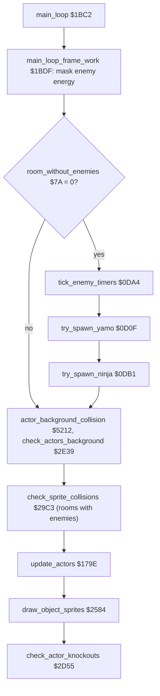
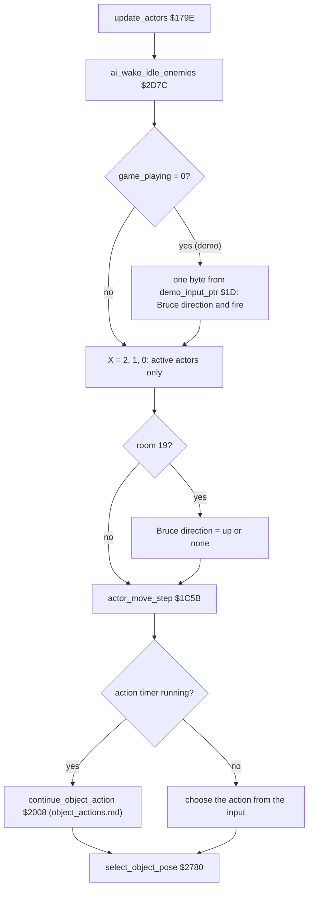
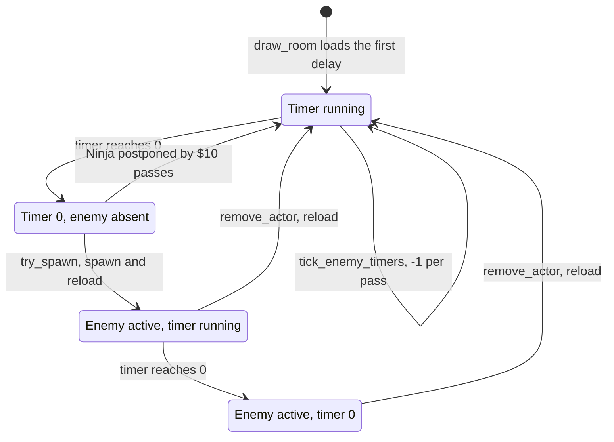

# Bruce Lee: the actors

This page covers:
- the actor variable tables: one column per actor (position, state, energy, facing, timers, input), with their readers and writers;
- the set-up of an actor ([`init_actor`](../../src/actors.asm#L6) [`$0B8E`](../reference/modules/actors.md#init_actor)), the spawn points and the per-room enemy tables;
- the enemy spawn timers ([`tick_enemy_timers`](../../src/actors.asm#L304) [`$0DA4`](../reference/modules/actors.md#tick_enemy_timers), [`try_spawn_yamo`](../../src/actors.asm#L207) [`$0D0F`](../reference/modules/actors.md#try_spawn_yamo), [`try_spawn_ninja`](../../src/actors.asm#L315) [`$0DB1`](../reference/modules/actors.md#try_spawn_ninja)) and how enemies follow Bruce into the next room;
- the input of each actor: the joysticks (ports, left-handed mode, the human Yamo), the computer enemies, and the demo input stream;
- the movement step and the choice of an action from the input ([`actor_move_step`](../../src/actor_movement.asm#L32) [`$1C5B`](../reference/modules/actor_movement.md#actor_move_step)).

The action state machine itself (jumps, kicks, punches, climbing, the enemy states) is on [object_actions.md](object_actions.md). Hits and sprite collisions are on [combat_collision.md](combat_collision.md). The sprite frames and the sprite registers are on [sprites.md](sprites.md). How rooms are entered and left is on [room_flow.md](room_flow.md).

Sources: [actors.asm](../reference/modules/actors.md), [actor_room_tables.asm](../reference/modules/actor_room_tables.md), [actor_input.asm](../reference/modules/actor_input.md), [actor_movement.asm](../reference/modules/actor_movement.md), [actor_checks.asm](../reference/modules/actor_checks.md), [actor_vars.asm](../reference/modules/actor_vars.md), [demo_input.asm](../reference/modules/demo_input.md); the joystick read in [frame_update.asm](../reference/modules/frame_update.md). Assets: [demo_input.json](../../assets/demo_input.json), [sprites/](../../assets/sprites/).

**Conventions.**
- Addresses are C64 addresses. Names are the names of the knowledge.
- A *pass* is one run of [`main_loop`](../../src/main_loop.asm#L6) [`$1BC2`](../reference/modules/main_loop.md#main_loop); at most one pass every 3 frames. A *frame* is one video frame: one run of the raster IRQ chain (50 per second on PAL). [`game_frame_update`](../../src/frame_update.asm#L6) [`$15A8`](../reference/modules/frame_update.md#game_frame_update) runs once per frame.
- An *actor* is one of the three moving figures. The actor number is the index X into the actor tables: actor 0 = Bruce, actor 1 = Yamo, actor 2 = Ninja. Actor 1 = Yamo and actor 2 = Ninja rest on the colours and on the opponent option ([report.md](../../report.md)); no run confirmed the names. The type bits in [`actor_flags`](../../src/constants.asm#L82) [`$0095`](../reference/variables.md#actor_flags) are `$00` Bruce, `$80` Yamo, `$40` Ninja.
- A *column table* is a 3-byte table with one byte per actor: `+0` Bruce, `+1` Yamo, `+2` Ninja.
- A *room* is a screen, number 0-19 in [`current_room`](../../src/constants.asm#L28) [`$0029`](../reference/variables.md#current_room). A *fall* is a life. *Demo* is the attract mode ([`game_playing`](../../src/constants.asm#L120) [`$0104`](../reference/variables.md#game_playing) = 0).
- *Spawn point A* is ([`room_spawn_x`](../../src/room_tables.asm#L156) [`$4BAE`](../reference/modules/room_tables.md#room_spawn_x), [`room_spawn_y`](../../src/room_tables.asm#L161) [`$4BC2`](../reference/modules/room_tables.md#room_spawn_y)) of the room; *spawn point B* is ([`room_alt_spawn_x`](../../src/room_tables.asm#L166) [`$4BD6`](../reference/modules/room_tables.md#room_alt_spawn_x), [`room_alt_spawn_y`](../../src/room_tables.asm#L171) [`$4BEA`](../reference/modules/room_tables.md#room_alt_spawn_y)).
- A joystick value is the low nibble of the CIA port, active low: bit 0 up, bit 1 down, bit 2 left, bit 3 right; a 0 bit = pressed. `$0F` = no direction. Fire is 0 = pressed.
- **Observed** marks a fact that a run showed (the coverage `cov_all.bin` of all runs, or a named run). **Code** marks a fact from the code only. **Conclusion** marks an interpretation.

## 1. Overview

One pass of [`main_loop`](../../src/main_loop.asm#L6) [`$1BC2`](../reference/modules/main_loop.md#main_loop) runs the actors in this order (**Code**):



[`update_actors`](../../src/actor_input.asm#L6) [`$179E`](../reference/modules/actor_input.md#update_actors) is the actor part of the pass:



The input reaches the actors on three paths (**Code**):
- The joysticks are read once per frame in [`read_joysticks`](../../src/frame_update.asm#L139) [`$1689`](../reference/modules/frame_update.md#read_joysticks) (part of [`game_frame_update`](../../src/frame_update.asm#L6) [`$15A8`](../reference/modules/frame_update.md#game_frame_update)) into [`actor_joy_dir`](../../src/constants.asm#L83) [`$0098`](../reference/variables.md#actor_joy_dir) and [`actor_joy_fire`](../../src/constants.asm#L84) [`$009B`](../reference/variables.md#actor_joy_fire): Bruce always, the Yamo only with a human opponent.
- In the demo, [`update_actors`](../../src/actor_input.asm#L6) [`$179E`](../reference/modules/actor_input.md#update_actors) writes Bruce's input from the demo stream at `$F300`.
- The computer enemies get no joystick values. [`ai_wake_idle_enemies`](../../src/actor_checks.asm#L33) [`$2D7C`](../reference/modules/actor_checks.md#ai_wake_idle_enemies) puts an idle enemy into the chase state `$14`, and the enemy states of [object_actions.md](object_actions.md) move it.

## 2. The actor tables

### 2.1 Column tables in zero page and page 1

All of these have 3 bytes, one per actor. "Readers" and "writers" name the routines of the source that use the table (found in the source with an indexed or a fixed operand). The reference lists fewer readers and writers, because it does not list every indexed access.

| Name | Address | Layout and meaning | Written by | Read by |
|---|---|---|---|---|
| [`actor_flags`](../../src/constants.asm#L82) | `$0095` | Bit 0 = active. Bits 7-6 = type: `$00` Bruce, `$80` Yamo, `$40` Ninja. | [`init_actor`](../../src/actors.asm#L6) [`$0B8E`](../reference/modules/actors.md#init_actor) (type OR 1), [`remove_actor`](../../src/background_touch.asm#L280) [`$3001`](../reference/modules/background_touch.md#remove_actor) (clears bit 0) | [`update_actors`](../../src/actor_input.asm#L6), [`try_spawn_yamo`](../../src/actors.asm#L207), [`try_spawn_ninja`](../../src/actors.asm#L315), [`ai_wake_idle_enemies`](../../src/actor_checks.asm#L33), [`check_actor_knockouts`](../../src/actor_checks.asm#L6), [`enter_room`](../../src/background_touch.asm#L210), [`draw_object_sprites`](../../src/sprite_render.asm#L6), [`update_sprite_registers`](../../src/sprite_render.asm#L60), [`actor_background_collision`](../../src/collision.asm#L149), [`check_actors_background`](../../src/background_touch.asm#L6), [`start_attack_recovery`](../../src/object_actions.asm#L356), [`select_object_pose`](../../src/object_pose.asm#L6) |
| [`actor_joy_dir`](../../src/constants.asm#L83) | `$0098` | Joystick value of the actor (low nibble, active low). [`init_actor`](../../src/actors.asm#L6) sets `$0F`. | [`read_joysticks`](../../src/frame_update.asm#L139) [`$1689`](../reference/modules/frame_update.md#read_joysticks) (Bruce, a human Yamo), [`update_actors`](../../src/actor_input.asm#L6) [`$179E`](../reference/modules/actor_input.md#update_actors) (demo, room 19), [`init_actor`](../../src/actors.asm#L6), [`action_climb`](../../src/object_actions.asm#L205) [`$2180`](../reference/modules/object_actions.md#action_climb) (`$07`/`$0B` for a computer enemy; `$0F` after each climbing step) | [`actor_move_step`](../../src/actor_movement.asm#L32) [`$1C5B`](../reference/modules/actor_movement.md#actor_move_step), [`continue_object_action`](../../src/object_actions.asm#L6) [`$2008`](../reference/modules/object_actions.md#continue_object_action), [`idle_reset_check`](../../src/frame_update.asm#L227) [`$1723`](../reference/modules/frame_update.md#idle_reset_check), [`human_yamo_idle_check`](../../src/frame_update.asm#L243) [`$173F`](../reference/modules/frame_update.md#human_yamo_idle_check) |
| [`actor_joy_fire`](../../src/constants.asm#L84) | `$009B` | Fire button: 0 = pressed, any other value = released. [`init_actor`](../../src/actors.asm#L6) sets 1. | [`read_joysticks`](../../src/frame_update.asm#L139), [`update_actors`](../../src/actor_input.asm#L6) (demo), [`init_actor`](../../src/actors.asm#L6), [`action_climb`](../../src/object_actions.asm#L205) (1 after each climbing step) | [`actor_left_or_fire_move`](../../src/actor_movement.asm#L327) [`$1E70`](../reference/modules/actor_movement.md#actor_left_or_fire_move), [`actor_right_or_fire_move`](../../src/actor_movement.asm#L365) [`$1EB1`](../reference/modules/actor_movement.md#actor_right_or_fire_move), the no-direction test at `$1F76`, [`idle_reset_check`](../../src/frame_update.asm#L227), [`human_yamo_idle_check`](../../src/frame_update.asm#L243) |
| [`actor_x`](../../src/constants.asm#L85) | `$009E` | X in 2-pixel units. Sprite X = 2 × [`actor_x`](../../src/constants.asm#L85) (carry into [`MSIGX`](../../src/constants.asm#L157)). Moves keep it in `$0C-$A3`. | [`init_actor`](../../src/actors.asm#L6), [`actor_move_left`](../../src/actor_movement.asm#L341) [`$1E86`](../reference/modules/actor_movement.md#actor_move_left), [`actor_move_right`](../../src/actor_movement.asm#L377) [`$1EC4`](../reference/modules/actor_movement.md#actor_move_right), [`enter_room`](../../src/background_touch.asm#L210) [`$2F8E`](../reference/modules/background_touch.md#enter_room) | [`calc_delta_to_bruce`](../../src/actor_checks.asm#L92) [`$2DDD`](../reference/modules/actor_checks.md#calc_delta_to_bruce), [`actor_char_coords`](../../src/actor_movement.asm#L6) [`$1C39`](../reference/modules/actor_movement.md#actor_char_coords), [`update_sprite_registers`](../../src/sprite_render.asm#L60) [`$25E2`](../reference/modules/sprite_render.md#update_sprite_registers), [`enter_room`](../../src/background_touch.asm#L210), [`check_exit_direction`](../../src/background_touch.asm#L392) [`$30D4`](../reference/modules/background_touch.md#check_exit_direction), [`start_attack_recovery`](../../src/object_actions.asm#L356), [`actor_background_collision`](../../src/collision.asm#L149), [`room18_wizard_update`](../../src/room_update.asm#L909), [`update_fireballs`](../../src/fireballs.asm#L6) and others |
| [`actor_y`](../../src/constants.asm#L86) | `$00A1` | Y in pixels. Sprite Y = [`actor_y`](../../src/constants.asm#L86) + `$1D`. Moves keep it in `$2D-$C7`. | [`init_actor`](../../src/actors.asm#L6), [`actor_move_up`](../../src/actor_movement.asm#L253) [`$1DF2`](../reference/modules/actor_movement.md#actor_move_up), [`actor_move_down`](../../src/actor_movement.asm#L294) [`$1E39`](../reference/modules/actor_movement.md#actor_move_down), [`enter_room`](../../src/background_touch.asm#L210) | [`calc_delta_to_bruce`](../../src/actor_checks.asm#L92), [`actor_char_coords`](../../src/actor_movement.asm#L6), [`update_sprite_registers`](../../src/sprite_render.asm#L60), [`enter_room`](../../src/background_touch.asm#L210), [`check_exit_direction`](../../src/background_touch.asm#L392), [`check_sprite_collisions`](../../src/combat_hits.asm#L6), [`room13_update`](../../src/room_update.asm#L1117), [`room16_bonus_fall`](../../src/background_touch.asm#L253) |
| [`actor_facing`](../../src/constants.asm#L87) | `$00A4` | 0 = left, 1 = right. [`init_actor`](../../src/actors.asm#L6) sets 1. | [`init_actor`](../../src/actors.asm#L6), [`actor_move_left`](../../src/actor_movement.asm#L341), [`actor_move_right`](../../src/actor_movement.asm#L377), the down-left/down-right input, [`face_toward_bruce`](../../src/actor_checks.asm#L137) [`$2E1C`](../reference/modules/actor_checks.md#face_toward_bruce), [`continue_object_action`](../../src/object_actions.asm#L6), [`start_attack_recovery`](../../src/object_actions.asm#L356), [`mark_hit_landed`](../../src/combat_hits.asm#L218) | [`actor_move_step`](../../src/actor_movement.asm#L32), [`actor_undo_moves`](../../src/actor_movement.asm#L98), [`update_sprite_registers`](../../src/sprite_render.asm#L60), [`select_object_pose`](../../src/object_pose.asm#L6), [`continue_object_action`](../../src/object_actions.asm#L6), [`start_attack_recovery`](../../src/object_actions.asm#L356), [`distance_ahead_of_attacker`](../../src/combat_hits.asm#L383), [`mark_hit_landed`](../../src/combat_hits.asm#L218) |
| [`actor_upper_contact`](../../src/constants.asm#L88) | `$00A7` | Background contact bits of the upper 15 sprite rows (same bits as [`actor_contact`](../../src/constants.asm#L92)). | [`test_char_row`](../../src/collision.asm#L348) [`$537E`](../reference/modules/collision.md#test_char_row) | [`actor_move_step`](../../src/actor_movement.asm#L32) (falling Bruce), [`animate_scrolling_chars`](../../src/animated_chars.asm#L6) |
| [`actor_climb_moved`](../../src/constants.asm#L89) | `$00AA` | Set while a climbing step moved the actor. | [`touch_char_62`](../../src/background_touch.asm#L430) [`$310C`](../reference/modules/background_touch.md#touch_char_62), [`continue_object_action`](../../src/object_actions.asm#L6) | [`continue_object_action`](../../src/object_actions.asm#L6), [`select_object_pose`](../../src/object_pose.asm#L6) |
| [`actor_climb_delay`](../../src/constants.asm#L90) | `$00AD` | Steps until the next climbing move. | [`continue_object_action`](../../src/object_actions.asm#L6) | [`continue_object_action`](../../src/object_actions.asm#L6) |
| (no name) | `$00B0` | Falling Bruce: steps left in which an upper-body contact pushes him sideways. Set to 2 by [`actor_descend_two_steps`](../../src/actor_movement.asm#L225) [`$1DC4`](../reference/modules/actor_movement.md#actor_descend_two_steps), halved by `LSR` at `$1D9F`. | [`actor_move_step`](../../src/actor_movement.asm#L32) | [`actor_move_step`](../../src/actor_movement.asm#L32) |
| [`actor_collisions`](../../src/constants.asm#L91) | `$00B3` | Sprite collision partner bits. | [`check_sprite_collisions`](../../src/combat_hits.asm#L6) [`$29C3`](../reference/modules/combat_hits.md#check_sprite_collisions) | [`check_sprite_collisions`](../../src/combat_hits.asm#L6) ([combat_collision.md](combat_collision.md)) |
| [`actor_contact`](../../src/constants.asm#L92) | `$00B6` | Background contact bits of the whole sprite: bit 0 colour 1 (floor), bit 1 colour 2, bit 2 colour 3 in room-coloured cells (climbable), bit 3 colour 3 in `$F8` cells (obstacle). [`init_actor`](../../src/actors.asm#L6) sets 1. | [`eval_contact_classes`](../../src/collision.asm#L451) [`$5431`](../reference/modules/collision.md#eval_contact_classes), [`init_actor`](../../src/actors.asm#L6), [`draw_room`](../../src/room_draw.asm#L6) [`$09BC`](../reference/modules/room_draw.md#draw_room) (Bruce = 1) | [`actor_move_step`](../../src/actor_movement.asm#L32) and its helpers, [`ai_wake_idle_enemies`](../../src/actor_checks.asm#L33), [`check_actors_background`](../../src/background_touch.asm#L6), [`continue_object_action`](../../src/object_actions.asm#L6), [`select_object_pose`](../../src/object_pose.asm#L6), [`start_attack_recovery`](../../src/object_actions.asm#L356), [`touch_char_62`](../../src/background_touch.asm#L430) |
| [`actor_shown_x`](../../src/constants.asm#L93) | `$00B9` | X used for the sprite registers. | [`update_sprite_registers`](../../src/sprite_render.asm#L60) | (none found) |
| [`actor_hit_flags`](../../src/constants.asm#L94) | `$00BC` | Hits of this step. | [`check_sprite_collisions`](../../src/combat_hits.asm#L6), [`mark_hit_landed`](../../src/combat_hits.asm#L218) | [`check_sprite_collisions`](../../src/combat_hits.asm#L6), [`mark_hit_landed`](../../src/combat_hits.asm#L218) ([combat_collision.md](combat_collision.md)) |
| [`actor_state`](../../src/constants.asm#L95) | `$00BF` | Action number (the state of [object_actions.md](object_actions.md)). 0 = idle. | [`actor_set_action`](../../src/actor_movement.asm#L498) [`$1F92`](../reference/modules/actor_movement.md#actor_set_action) and its variants, [`actor_undo_moves`](../../src/actor_movement.asm#L98) [`$1CD4`](../reference/modules/actor_movement.md#actor_undo_moves), [`init_actor`](../../src/actors.asm#L6), [`spawn_yamo`](../../src/actors.asm#L177) [`$0CD5`](../reference/modules/actors.md#spawn_yamo) (`$10`), [`ai_wake_idle_enemies`](../../src/actor_checks.asm#L33) (= `$14`), [`draw_room`](../../src/room_draw.asm#L6) (Bruce = 0), [`reset_actor_state`](../../src/actor_checks.asm#L129) [`$2E10`](../reference/modules/actor_checks.md#reset_actor_state), [`continue_object_action`](../../src/object_actions.asm#L6), [`start_attack_recovery`](../../src/object_actions.asm#L356), [`mark_hit_landed`](../../src/combat_hits.asm#L218), [`set_character_hit_state`](../../src/room_tiles.asm#L32) [`$407D`](../reference/modules/room_tiles.md#set_character_hit_state), [`touch_char_62`](../../src/background_touch.asm#L430) | [`actor_move_step`](../../src/actor_movement.asm#L32), [`ai_wake_idle_enemies`](../../src/actor_checks.asm#L33), [`check_actor_knockouts`](../../src/actor_checks.asm#L6), [`check_actors_background`](../../src/background_touch.asm#L6), [`check_exit_direction`](../../src/background_touch.asm#L392), [`check_sprite_collisions`](../../src/combat_hits.asm#L6), [`continue_object_action`](../../src/object_actions.asm#L6), [`select_object_pose`](../../src/object_pose.asm#L6), [`start_attack_recovery`](../../src/object_actions.asm#L356), [`touch_char_62`](../../src/background_touch.asm#L430), [`room18_wizard_update`](../../src/room_update.asm#L909) |
| [`actor_prev_state`](../../src/constants.asm#L96) | `$00C2` | Action of the last step. [`actor_move_step`](../../src/actor_movement.asm#L32) copies [`actor_state`](../../src/constants.asm#L95) here at the start of each step. | [`actor_move_step`](../../src/actor_movement.asm#L32) [`$1CB3`](../../src/actor_movement.asm#L79) | [`actor_move_step`](../../src/actor_movement.asm#L32), [`actor_left_or_fire_move`](../../src/actor_movement.asm#L327), [`actor_right_or_fire_move`](../../src/actor_movement.asm#L365), [`actor_set_idle`](../../src/actor_movement.asm#L491) [`$1F89`](../reference/modules/actor_movement.md#actor_set_idle), [`actor_undo_moves`](../../src/actor_movement.asm#L98), [`ai_wake_idle_enemies`](../../src/actor_checks.asm#L33) |
| (no name) | `$00C5` | Set to `$FF` at `$1D73` on each step without an obstacle. | [`actor_move_step`](../../src/actor_movement.asm#L32) | (none found) |
| (no name) | `$00C8` | Bit 0 blocks [`actor_move_up`](../../src/actor_movement.asm#L253) ([`$1DF8`](../../src/actor_movement.asm#L257)). | [`actor_move_step`](../../src/actor_movement.asm#L32) ([`$1CD2`](../../src/actor_movement.asm#L96), `$1D6F`), [`enemy_start_walk`](../../src/object_actions.asm#L456) [`$234F`](../../src/object_actions.asm#L482): always 0 | [`actor_move_up`](../../src/actor_movement.asm#L253) |
| [`actor_anim_step`](../../src/constants.asm#L97) | `$00CB` | Counts 6 down to 0 while the same action goes on; 6 again when the action changes or the actor is idle. At 0, walking and climbing move 3 units per step instead of 2. | [`actor_move_step`](../../src/actor_movement.asm#L32) `$1CA9`/`$1CAF` | [`actor_move_step`](../../src/actor_movement.asm#L32) and its helpers |
| [`actor_state_timer`](../../src/constants.asm#L98) | `$00CE` | Lock time of the action. Not 0 = [`actor_move_step`](../../src/actor_movement.asm#L32) runs [`continue_object_action`](../../src/object_actions.asm#L6) instead of reading the input. | [`actor_set_action`](../../src/actor_movement.asm#L498) (0), [`actor_set_action_timer_0f`](../../src/actor_movement.asm#L507) [`$1FA0`](../reference/modules/actor_movement.md#actor_set_action_timer_0f), [`actor_set_action_timer_0c`](../../src/actor_movement.asm#L516) [`$1FAE`](../reference/modules/actor_movement.md#actor_set_action_timer_0c), [`actor_set_action_timer_04`](../../src/actor_movement.asm#L525) [`$1FBC`](../reference/modules/actor_movement.md#actor_set_action_timer_04), [`actor_undo_moves`](../../src/actor_movement.asm#L98) (= `$40`), [`init_actor`](../../src/actors.asm#L6) (0), [`spawn_yamo`](../../src/actors.asm#L177) (= `$0A`), [`spawn_ninja`](../../src/actors.asm#L355) [`$0DF8`](../reference/modules/actors.md#spawn_ninja) (`$10`), [`ai_wake_idle_enemies`](../../src/actor_checks.asm#L33), [`draw_room`](../../src/room_draw.asm#L6) (Bruce = 4), [`reset_actor_state`](../../src/actor_checks.asm#L129), [`continue_object_action`](../../src/object_actions.asm#L6), [`start_attack_recovery`](../../src/object_actions.asm#L356), [`mark_hit_landed`](../../src/combat_hits.asm#L218), [`set_character_hit_state`](../../src/room_tiles.asm#L32), [`touch_char_62`](../../src/background_touch.asm#L430) | [`actor_move_step`](../../src/actor_movement.asm#L32), [`actor_undo_moves`](../../src/actor_movement.asm#L98), [`ai_wake_idle_enemies`](../../src/actor_checks.asm#L33), [`check_actor_knockouts`](../../src/actor_checks.asm#L6), [`check_sprite_collisions`](../../src/combat_hits.asm#L6), [`continue_object_action`](../../src/object_actions.asm#L6), [`select_object_pose`](../../src/object_pose.asm#L6), [`start_attack_recovery`](../../src/object_actions.asm#L356) |
| [`actor_energy`](../../src/constants.asm#L99) | `$00D1` | Energy. `$24` at the start of a fall; Yamo at most `$14`, Ninja at most `$07`. Negative = knocked out. Each pass [`main_loop_frame_work`](../../src/main_loop.asm#L18) [`$1BDF`](../reference/modules/main_loop.md#main_loop_frame_work) ANDs the Yamo byte with `$BF` and the Ninja byte with `$87`. | [`init_actor`](../../src/actors.asm#L6) (= `$24`), [`spawn_yamo`](../../src/actors.asm#L177), [`spawn_ninja`](../../src/actors.asm#L355) (caps), [`next_player_turn`](../../src/game_over.asm#L15) [`$182A`](../reference/modules/game_over.md#next_player_turn) (all `$24`), [`main_loop`](../../src/main_loop.asm#L6), [`mark_hit_landed`](../../src/combat_hits.asm#L218) | [`check_actor_knockouts`](../../src/actor_checks.asm#L6) [`$2D55`](../reference/modules/actor_checks.md#check_actor_knockouts), [`ai_wake_idle_enemies`](../../src/actor_checks.asm#L33), [`enter_room`](../../src/background_touch.asm#L210), [`main_loop`](../../src/main_loop.asm#L6), [`spawn_yamo`](../../src/actors.asm#L177), [`spawn_ninja`](../../src/actors.asm#L355), [`start_attack_recovery`](../../src/object_actions.asm#L356), [`mark_hit_landed`](../../src/combat_hits.asm#L218) |
| [`actor_body_wide`](../../src/constants.asm#L100), [`actor_overlay_wide`](../../src/constants.asm#L101), [`actor_body_colour`](../../src/constants.asm#L102), [`actor_overlay_colour`](../../src/constants.asm#L103), [`actor_frame_height`](../../src/constants.asm#L104) | `$00D4`, `$00D7`, `$00DA`, `$00DD`, `$00E0` | Sprite drawing values of the current frame. | [`draw_object_sprites`](../../src/sprite_render.asm#L6) [`$2584`](../reference/modules/sprite_render.md#draw_object_sprites), [`setup_frame_source`](../../src/sprite_render.asm#L251) | [`draw_object_sprites`](../../src/sprite_render.asm#L6), [`update_sprite_registers`](../../src/sprite_render.asm#L60), [`select_object_pose`](../../src/object_pose.asm#L6) ([sprites.md](sprites.md)) |
| [`actor_char_col`](../../src/constants.asm#L105) | `$00E6` | Character column = ([`actor_x`](../../src/constants.asm#L85) - `$0C`) / 4. | [`actor_char_coords`](../../src/actor_movement.asm#L6) [`$1C39`](../reference/modules/actor_movement.md#actor_char_coords), [`actor_background_collision`](../../src/collision.asm#L149) | [`actor_background_collision`](../../src/collision.asm#L149), [`check_three_cells`](../../src/background_touch.asm#L36), [`setup_char_row_test`](../../src/collision.asm#L291) |
| [`actor_char_row`](../../src/constants.asm#L106) | `$00E9` | Character row = ([`actor_y`](../../src/constants.asm#L86) - `$0C`) / 16; in room 13 ([`actor_y`](../../src/constants.asm#L86) + 4 - `$0C`) / 16. | [`actor_char_coords`](../../src/actor_movement.asm#L6), [`actor_background_collision`](../../src/collision.asm#L149), [`check_actors_background`](../../src/background_touch.asm#L6) | [`check_actors_background`](../../src/background_touch.asm#L6), [`check_three_cells`](../../src/background_touch.asm#L36), [`collect_lantern_at`](../../src/lanterns.asm#L6), [`trigger_floor_trap`](../../src/background_touch.asm#L341), [`setup_char_row_test`](../../src/collision.asm#L291) |
| [`actor_slot_sprite_a`](../../src/constants.asm#L107) | `$00EC` | [`actor_type_sprite_a`](../../src/sprite_data.asm#L32) [`$59A8`](../reference/modules/sprite_data.md#actor_type_sprite_a) of the actor's type (Bruce 4, Ninja 3, Yamo 6). The key of its [`sprite_owner`](../../src/actor_vars.asm#L184) [`$4F40`](../reference/modules/actor_vars.md#sprite_owner) entry. | [`init_actor`](../../src/actors.asm#L6) [`$0B9D`](../../src/actors.asm#L16) | [`remove_actor`](../../src/background_touch.asm#L280) [`$3023`](../../src/background_touch.asm#L295) |
| [`actor_slot_sprite_b`](../../src/constants.asm#L108) | `$00EF` | [`actor_type_sprite_b`](../../src/sprite_data.asm#L35) [`$59AB`](../reference/modules/sprite_data.md#actor_type_sprite_b) of the type (Bruce 5, Ninja 0 = none, Yamo 7). | [`init_actor`](../../src/actors.asm#L6) [`$0BA7`](../../src/actors.asm#L20) | [`remove_actor`](../../src/background_touch.asm#L280) [`$302F`](../../src/background_touch.asm#L301) |
| [`actor_step_delay`](../../src/constants.asm#L122) | `$0106` | Passes to wait before the next step. [`actor_set_action`](../../src/actor_movement.asm#L498) loads it from [`action_delay_table`](../../src/room_tables.asm#L78) [`$4A8C`](../reference/modules/room_tables.md#action_delay_table). | [`actor_set_action`](../../src/actor_movement.asm#L498) and its variants, [`actor_move_step`](../../src/actor_movement.asm#L32) (count down), [`actor_undo_moves`](../../src/actor_movement.asm#L98), [`init_actor`](../../src/actors.asm#L6), [`init_game_vars`](../../src/game_vars.asm#L6), [`draw_room`](../../src/room_draw.asm#L6), [`ai_wake_idle_enemies`](../../src/actor_checks.asm#L33), [`reset_actor_state`](../../src/actor_checks.asm#L129), [`continue_object_action`](../../src/object_actions.asm#L6), [`start_attack_recovery`](../../src/object_actions.asm#L356), [`mark_hit_landed`](../../src/combat_hits.asm#L218), [`touch_char_62`](../../src/background_touch.asm#L430) | [`actor_move_step`](../../src/actor_movement.asm#L32) [`$1C5F`](../../src/actor_movement.asm#L35) |

The two bytes [`undo_down_only`](../../src/constants.asm#L74) [`$0085`](../reference/variables.md#undo_down_only) and [`undo_rounds_left`](../../src/constants.asm#L75) [`$0086`](../reference/variables.md#undo_rounds_left) are temporaries of [`actor_undo_moves`](../../src/actor_movement.asm#L98) (section 6.3).

The words floor, climbable and obstacle for contact bits 0, 2 and 3 are a **Conclusion** from how [`actor_move_step`](../../src/actor_movement.asm#L32) uses them (section 6).

**Code:** the `$00C8` bit test in [`actor_move_up`](../../src/actor_movement.asm#L253) never blocks. Every store to `$00C8` stores 0. `$00C5` has no reader.

### 2.2 Column tables in `actor_vars.asm`

| Name | Address | Layout and meaning | Written by | Read by |
|---|---|---|---|---|
| [`sprite_owner`](../../src/actor_vars.asm#L184) | `$4F40` | 5 bytes, one per VIC sprite 3-7 (index from [`sprite_owner_slot`](../../src/sprite_data.asm#L38) [`$59AE`](../reference/modules/sprite_data.md#sprite_owner_slot)): the actor that owns it, `$FF` = free. | [`set_actor_slot_owner`](../../src/actors.asm#L375) [`$0E21`](../reference/modules/actors.md#set_actor_slot_owner), [`remove_actor`](../../src/background_touch.asm#L280), [`init_game_screen`](../../src/game_setup.asm#L6) [`$0763`](../reference/modules/game_setup.md#init_game_screen) (all `$FF`) | [`check_sprite_collisions`](../../src/combat_hits.asm#L6) |
| [`actor_hit_budget`](../../src/actor_vars.asm#L191) | `$4F45` | Hits an actor can take in the current time slice; 2 again when [`hit_budget_countdown`](../../src/actor_vars.asm#L6) [`$4EEC`](../reference/modules/actor_vars.md#hit_budget_countdown) runs out. | [`game_frame_update`](../../src/frame_update.asm#L6), [`check_sprite_collisions`](../../src/combat_hits.asm#L6) | [`check_sprite_collisions`](../../src/combat_hits.asm#L6) ([combat_collision.md](combat_collision.md)) |
| [`actor_frame_rel_a`](../../src/actor_vars.asm#L198), [`actor_frame_rel_b`](../../src/actor_vars.asm#L205) | `$4F48`, `$4F4B` | Frame number of layer A and layer B, relative to the type's base. [`init_actor`](../../src/actors.asm#L6) sets 2 and 3. | [`init_actor`](../../src/actors.asm#L6), [`spawn_yamo`](../../src/actors.asm#L177) (`$2A`/`$2B`), [`spawn_ninja`](../../src/actors.asm#L355) (B = 0), [`set_object_pose`](../../src/object_pose.asm#L311) | [`select_object_pose`](../../src/object_pose.asm#L6), [`set_object_pose`](../../src/object_pose.asm#L311), [`update_sprite_registers`](../../src/sprite_render.asm#L60) |
| [`actor_frame_a`](../../src/actor_vars.asm#L212), [`actor_frame_b`](../../src/actor_vars.asm#L219) | `$4F4E`, `$4F51` | Absolute frame of layer A and B (index into the frame tables). [`init_actor`](../../src/actors.asm#L6) sets 2 and 3. | [`init_actor`](../../src/actors.asm#L6), [`spawn_yamo`](../../src/actors.asm#L177) (`$6C`/`$6D`), [`spawn_ninja`](../../src/actors.asm#L355) (`$82`/0), [`set_object_pose`](../../src/object_pose.asm#L311) | [`draw_object_sprites`](../../src/sprite_render.asm#L6), [`actor_background_collision`](../../src/collision.asm#L149) |
| [`actor_prev_frame_rel`](../../src/actor_vars.asm#L224) | `$4F54` | [`actor_frame_rel_a`](../../src/actor_vars.asm#L198) before the last pose change. | [`select_object_pose`](../../src/object_pose.asm#L6) | [`select_object_pose`](../../src/object_pose.asm#L6) |
| [`actor_move_counters`](../../src/actor_vars.asm#L227) | `$4F57` | Start of a 132-byte move record (`$4F57-$4FDA`): 44 slots of 3 bytes (one per actor), byte = `$4F57` + 3 × slot + actor. Slots 0-3 count the moves of the current step: up, down ([`actor_moved_down`](../../src/actor_vars.asm#L230) [`$4F5A`](../reference/modules/actor_vars.md#actor_moved_down)), left ([`actor_moved_left`](../../src/actor_vars.asm#L233) [`$4F5D`](../reference/modules/actor_vars.md#actor_moved_left)), right ([`actor_moved_right`](../../src/actor_vars.asm#L236) [`$4F60`](../reference/modules/actor_vars.md#actor_moved_right)). | [`actor_move_up`](../../src/actor_movement.asm#L253), [`actor_move_down`](../../src/actor_movement.asm#L294), [`actor_move_left`](../../src/actor_movement.asm#L341), [`actor_move_right`](../../src/actor_movement.asm#L377), [`actor_move_step`](../../src/actor_movement.asm#L32) (clears them), [`actor_undo_moves`](../../src/actor_movement.asm#L98), [`continue_object_action`](../../src/object_actions.asm#L6), [`start_attack_recovery`](../../src/object_actions.asm#L356), [`draw_room`](../../src/room_draw.asm#L6) (clears all 132 bytes) | [`actor_move_step`](../../src/actor_movement.asm#L32), [`check_exit_direction`](../../src/background_touch.asm#L392), [`start_attack_recovery`](../../src/object_actions.asm#L356), [`continue_object_action`](../../src/object_actions.asm#L6) |
| [`actor_move_history`](../../src/actor_vars.asm#L239) | `$4F63` | Slots 4-43: the moves of the 10 steps before, 4 slots per step, newest first. | [`actor_move_step`](../../src/actor_movement.asm#L32) (shifts up 4 slots), [`actor_undo_moves`](../../src/actor_movement.asm#L98) (shifts down 8 slots) | [`actor_undo_moves`](../../src/actor_movement.asm#L98), [`action_blocked_step`](../../src/object_actions.asm#L681) [`$24B7`](../reference/modules/object_actions.md#action_blocked_step), [`start_attack_recovery`](../../src/object_actions.asm#L356) |
| [`actor_frame_updated`](../../src/actor_vars.asm#L280) | `$4FDB` | Not 0 once the pose was chosen in this step. Cleared by [`actor_move_step`](../../src/actor_movement.asm#L32). | [`actor_move_step`](../../src/actor_movement.asm#L32), [`actor_set_idle`](../../src/actor_movement.asm#L491), [`select_object_pose`](../../src/object_pose.asm#L6), [`mark_hit_landed`](../../src/combat_hits.asm#L218) | [`actor_set_idle`](../../src/actor_movement.asm#L491), [`select_object_pose`](../../src/object_pose.asm#L6), [`mark_hit_landed`](../../src/combat_hits.asm#L218) |

### 2.3 Spawn, follow and input variables

| Name | Address | Layout and meaning | Written by | Read by |
|---|---|---|---|---|
| [`ninja_spawn_timer`](../../src/constants.asm#L47) | `$005D` | Passes until the Ninja may spawn. | [`draw_room`](../../src/room_draw.asm#L6) [`$0A51`](../../src/room_draw.asm#L83), [`reset_enemy_timer`](../../src/actors.asm#L239) [`$0D42`](../reference/modules/actors.md#reset_enemy_timer) (and [`reset_ninja_timer`](../../src/actors.asm#L274) [`$0D76`](../reference/modules/actors.md#reset_ninja_timer)), [`tick_enemy_timers`](../../src/actors.asm#L304), [`try_spawn_ninja`](../../src/actors.asm#L315) | [`tick_enemy_timers`](../../src/actors.asm#L304), [`try_spawn_ninja`](../../src/actors.asm#L315) |
| [`yamo_spawn_timer`](../../src/constants.asm#L48) | `$005E` | Passes until the Yamo may spawn. | [`draw_room`](../../src/room_draw.asm#L6) [`$0A56`](../../src/room_draw.asm#L85), [`reset_yamo_timer`](../../src/actors.asm#L243) [`$0D46`](../reference/modules/actors.md#reset_yamo_timer), [`tick_enemy_timers`](../../src/actors.asm#L304), [`try_spawn_yamo`](../../src/actors.asm#L207) | [`tick_enemy_timers`](../../src/actors.asm#L304), [`try_spawn_yamo`](../../src/actors.asm#L207) |
| [`delta_y_to_bruce`](../../src/constants.asm#L51) | `$0062` | \|actor y - Bruce y\|, at most `$30`; bit 7 = Bruce is below. | [`calc_delta_to_bruce`](../../src/actor_checks.asm#L92) [`$2DDD`](../reference/modules/actor_checks.md#calc_delta_to_bruce) | [`enemy_walk_step`](../../src/object_actions.asm#L485) [`$2352`](../reference/modules/object_actions.md#enemy_walk_step), [`start_attack_recovery`](../../src/object_actions.asm#L356) |
| [`delta_x_to_bruce`](../../src/constants.asm#L52) | `$0063` | \|actor x - Bruce x\|, at most `$30`; bit 7 = Bruce is to the right. | [`calc_delta_to_bruce`](../../src/actor_checks.asm#L92) | [`face_toward_bruce`](../../src/actor_checks.asm#L137) [`$2E1C`](../reference/modules/actor_checks.md#face_toward_bruce), [`action_enemy_chase`](../../src/object_actions.asm#L425) [`$22F3`](../reference/modules/object_actions.md#action_enemy_chase), [`enemy_walk_step`](../../src/object_actions.asm#L485), [`start_attack_recovery`](../../src/object_actions.asm#L356) |
| [`room_timer`](../../src/constants.asm#L77) | `$0088` | Time in the room in 256-frame units, up to `$80`. Sets the spawn level (section 4.2). | [`game_frame_update`](../../src/frame_update.asm#L6), [`draw_room`](../../src/room_draw.asm#L6) (0), [`human_yamo_idle_check`](../../src/frame_update.asm#L243) (= `$20`) | [`get_room_time_level`](../../src/room_state.asm#L110) [`$10D0`](../reference/modules/room_state.md#get_room_time_level), [`update_actors`](../../src/actor_input.asm#L6) (room 19) |
| [`yamo_idle_timer`](../../src/constants.asm#L78) | `$0089` | 16-bit count of frames without input from a human Yamo. | [`human_yamo_idle_check`](../../src/frame_update.asm#L243) [`$173F`](../reference/modules/frame_update.md#human_yamo_idle_check), [`init_game_vars`](../../src/game_vars.asm#L6) | [`human_yamo_idle_check`](../../src/frame_update.asm#L243) |
| [`enemy_entry_x`](../../src/constants.asm#L79) | `$008B` | 2 bytes (+0 Yamo, +1 Ninja): x where the enemy appears after it followed Bruce; 0 = no follow. | [`enter_room`](../../src/background_touch.asm#L210) [`$2FB1`](../../src/background_touch.asm#L232), [`actor_use_entry_pos`](../../src/actors.asm#L97) [`$0C3F`](../reference/modules/actors.md#actor_use_entry_pos) (clears), [`draw_room`](../../src/room_draw.asm#L6) (no-enemy rooms), [`init_game_screen`](../../src/game_setup.asm#L6), [`next_player_turn`](../../src/game_over.asm#L15) | [`actor_pick_spawn`](../../src/actors.asm#L61) [`$0BFA`](../reference/modules/actors.md#actor_pick_spawn) (as `yamo_idle_timer+1,X`) |
| [`enemy_entry_y`](../../src/constants.asm#L80) | `$008D` | 2 bytes: y of that point (Bruce's entry y). | [`enter_room`](../../src/background_touch.asm#L210) | [`actor_use_entry_pos`](../../src/actors.asm#L97) |
| [`enemy_saved_energy`](../../src/constants.asm#L81) | `$008F` | 2 bytes: the energy of the enemy when Bruce left the room. | [`enter_room`](../../src/background_touch.asm#L210) | [`actor_use_entry_pos`](../../src/actors.asm#L97) |
| [`demo_input_ptr`](../../src/constants.asm#L24) | `$001D` | Pointer into the demo stream. [`build_frame_mask`](../../src/collision.asm#L64) [`$517E`](../reference/modules/collision.md#build_frame_mask) uses the low byte as a row counter at init, before the demo. | [`start_demo`](../../src/restart.asm#L24) [`$0531`](../reference/modules/restart.md#start_demo), [`title_screen`](../../src/title.asm#L6) [`$0584`](../reference/modules/title.md#title_screen) (both = `$F300`), [`update_actors`](../../src/actor_input.asm#L6) (+1 per pass) | [`update_actors`](../../src/actor_input.asm#L6) |
| [`current_actor`](../../src/constants.asm#L40) | `$0051` | The actor that a loop works on. [`init_actor`](../../src/actors.asm#L6) sets it to X. | many | many |
| [`human_opponent_mode`](../../src/variables.asm#L11) | `$42CA` | 0 = COMPUTER, 1 = OPPONENT (F5 on the title): a human plays the Yamo. | [`title_toggle_opponent`](../../src/title_menu.asm#L54) (F5), [`start_demo`](../../src/restart.asm#L24) (0 during the demo), [`title_screen`](../../src/title.asm#L6) (restores it), [`human_yamo_idle_check`](../../src/frame_update.asm#L243) (back to 0) | [`read_joysticks`](../../src/frame_update.asm#L139), [`ai_wake_idle_enemies`](../../src/actor_checks.asm#L33), [`try_spawn_yamo`](../../src/actors.asm#L207), [`reset_yamo_timer`](../../src/actors.asm#L243), [`try_spawn_ninja`](../../src/actors.asm#L315), [`draw_room`](../../src/room_draw.asm#L6), [`action_climb`](../../src/object_actions.asm#L205), [`init_game_vars`](../../src/game_vars.asm#L6) |
| [`joy_handedness_p1`](../../src/actor_room_tables.asm#L99) | `$1383` | Joystick mode of port 1: not 0 = normal, 0 = left-handed. | [`title_handedness_keys`](../../src/title_menu.asm#L95) [`$0956`](../reference/modules/title_menu.md#title_handedness_keys) (L = 0, R = 1) | [`read_joysticks`](../../src/frame_update.asm#L139), [`game_frame_update`](../../src/frame_update.asm#L6) (marker) |
| [`joy_handedness_p2`](../../src/actor_room_tables.asm#L102) | `$1384` | Joystick mode of port 2. | [`title_handedness_keys`](../../src/title_menu.asm#L95) (Shift-L = 0, Shift-R = 1) | [`read_joysticks`](../../src/frame_update.asm#L139), [`game_frame_update`](../../src/frame_update.asm#L6) (marker) |

### 2.4 Constant tables

| Name | Address | Layout | Read by |
|---|---|---|---|
| [`actor_type_sprite_a`](../../src/sprite_data.asm#L32) / [`actor_type_sprite_b`](../../src/sprite_data.asm#L35) | `$59A8` / `$59AB` | 3 bytes each, index = type number (0 Bruce, 1 Ninja, 2 Yamo): `$04,$03,$06` / `$05,$00,$07`. | [`init_actor`](../../src/actors.asm#L6) |
| [`actor_body_sprite`](../../src/sprite_render.asm#L299) / [`actor_overlay_sprite`](../../src/sprite_render.asm#L306) | `$276D` / `$2770` | Per actor: hardware sprite of the body (0, 2, 4) and of the overlay (1, 3, `$FF` = none). | [`init_actor`](../../src/actors.asm#L6), [`remove_actor`](../../src/background_touch.asm#L280), [sprites.md](sprites.md) |
| [`action_delay_table`](../../src/room_tables.asm#L78) | `$4A8C` | Per action number: [`actor_step_delay`](../../src/constants.asm#L122) value. 3 for actions 1, 2 and 8-`$0B`; 0 for the others. | [`actor_set_action`](../../src/actor_movement.asm#L498) and its variants, [`continue_action_state`](../../src/object_actions.asm#L719) |
| [`joystick_rotate_bits`](../../src/room_tables.asm#L68) | `$4A85` | 4 bytes `$00,$08,$04,$0C`: the new left/right bits for the old up/down bits (section 5.1). | [`read_joysticks`](../../src/frame_update.asm#L139) |
| Per-room enemy tables | `$130B-$1382` | Six tables of 20 bytes (section 3.4). | [`draw_room`](../../src/room_draw.asm#L6), [`init_actor`](../../src/actors.asm#L6), the spawn routines |
| [`demo_input_data`](../../src/demo_input.asm#L6) | `$F300` | One input byte per pass (section 5.4). | [`update_actors`](../../src/actor_input.asm#L6) |

## 3. Actor set-up

### 3.1 [`init_actor`](../../src/actors.asm#L6) [`$0B8E`](../reference/modules/actors.md#init_actor)

Input: X = actor, A = type bits (`$00` Bruce, `$80` Yamo, `$40` Ninja). Callers: [`init_game_screen`](../../src/game_setup.asm#L6) [`$082A`](../../src/game_setup.asm#L95) (Bruce), [`spawn_yamo`](../../src/actors.asm#L177) [`$0CE5`](../../src/actors.asm#L186), [`spawn_ninja`](../../src/actors.asm#L355) [`$0DFD`](../../src/actors.asm#L358). **Code**; all its paths are **Observed** in the coverage.

1. [`actor_flags`](../../src/constants.asm#L82),X = A OR 1 (active).
2. Three `ROL`s and `AND #$03` turn the type bits into the type number: Bruce 0, Ninja 1, Yamo 2.
3. [`actor_slot_sprite_a`](../../src/constants.asm#L107),X = [`actor_type_sprite_a`](../../src/sprite_data.asm#L32),type; [`set_actor_slot_owner`](../../src/actors.asm#L375) [`$0E21`](../reference/modules/actors.md#set_actor_slot_owner) writes X into the [`sprite_owner`](../../src/actor_vars.asm#L184) entry of that sprite. The same for [`actor_slot_sprite_b`](../../src/constants.asm#L108), when it is not 0.
4. [`actor_state`](../../src/constants.asm#L95), [`actor_state_timer`](../../src/constants.asm#L98), [`actor_step_delay`](../../src/constants.asm#L122) = 0. [`actor_joy_dir`](../../src/constants.asm#L83) = `$0F` (no direction), [`actor_joy_fire`](../../src/constants.asm#L84) = 1 (released), [`actor_contact`](../../src/constants.asm#L92) = 1 (floor), [`actor_facing`](../../src/constants.asm#L87) = 1 (right).
5. [`actor_frame_rel_a`](../../src/actor_vars.asm#L198) = [`actor_frame_a`](../../src/actor_vars.asm#L212) = 2, [`actor_frame_rel_b`](../../src/actor_vars.asm#L205) = [`actor_frame_b`](../../src/actor_vars.asm#L219) = 3. [`actor_energy`](../../src/constants.asm#L99) = `$24`. [`current_actor`](../../src/constants.asm#L40) = X.
6. The start position:
   - in the demo, and always for Bruce: spawn point A of [`current_room`](../../src/constants.asm#L28) ([`actor_use_spawn_a`](../../src/actors.asm#L50) [`$0BE7`](../reference/modules/actors.md#actor_use_spawn_a));
   - for an enemy: see 3.3 ([`actor_pick_spawn`](../../src/actors.asm#L61) [`$0BFA`](../reference/modules/actors.md#actor_pick_spawn)).
7. [`actor_place_sprites`](../../src/actors.asm#L105) [`$0C4D`](../reference/modules/actors.md#actor_place_sprites): the sprite pointers of the body and overlay sprite (from [`sprite_pointer_table`](../../src/sprite_render.asm#L289) [`$2763`](../reference/modules/sprite_render.md#sprite_pointer_table), +5 when [`sprite_buffer_select`](../../src/sprite_render.asm#L331) [`$277D`](../reference/modules/sprite_render.md#sprite_buffer_select) is 1), sprite X = 2 × [`actor_x`](../../src/constants.asm#L85) with the high bit in [`MSIGX`](../../src/constants.asm#L157), sprite Y = [`actor_y`](../../src/constants.asm#L86) + `$1D`, and the enable bits in [`SPENA`](../../src/constants.asm#L160).

[`init_actor`](../../src/actors.asm#L6) runs for Bruce only at the start of a game, of the demo and of each turn ([`init_game_screen`](../../src/game_setup.asm#L6)). On a room change [`enter_room`](../../src/background_touch.asm#L210) [`$2F8E`](../reference/modules/background_touch.md#enter_room) only moves Bruce. [`draw_room`](../../src/room_draw.asm#L6) [`$09BC`](../reference/modules/room_draw.md#draw_room) resets Bruce's action for every room: [`actor_contact`](../../src/constants.asm#L92) = 1, [`actor_state_timer`](../../src/constants.asm#L98) = 4, [`actor_state`](../../src/constants.asm#L95) = 0, [`actor_step_delay`](../../src/constants.asm#L122) = 0 ([`draw_room_reset_bruce`](../../src/room_draw.asm#L97) [`$0A6B`](../reference/modules/room_draw.md#draw_room_reset_bruce)).

### 3.2 [`spawn_yamo`](../../src/actors.asm#L177) [`$0CD5`](../reference/modules/actors.md#spawn_yamo) and [`spawn_ninja`](../../src/actors.asm#L355) [`$0DF8`](../reference/modules/actors.md#spawn_ninja)

| Step | [`spawn_yamo`](../../src/actors.asm#L177) [`$0CD5`](../reference/modules/actors.md#spawn_yamo) (X = 1) | [`spawn_ninja`](../../src/actors.asm#L355) [`$0DF8`](../reference/modules/actors.md#spawn_ninja) (X = 2) |
|---|---|---|
| Sound | [`play_sound_82`](../../src/room_state.asm#L86) [`$10B5`](../reference/modules/room_state.md#play_sound_82) | [`play_sound_82`](../../src/room_state.asm#L86) |
| Protection | [`protection_key`](../../src/actor_room_tables.asm#L6) [`$1166`](../reference/modules/actor_room_tables.md#protection_key) = signature XOR ([protection.md](protection.md)) | - |
| [`init_actor`](../../src/actors.asm#L6) with A | `$80` | `$40` |
| Action | [`actor_state`](../../src/constants.asm#L95) = `$10` (wait to appear), [`actor_state_timer`](../../src/constants.asm#L98) = `$0A` | [`actor_state`](../../src/constants.asm#L95) stays 0, [`actor_state_timer`](../../src/constants.asm#L98) = `$10` |
| Frames | rel A/B = `$2A`/`$2B`, A/B = `$6C`/`$6D` | A = `$82`, rel B = B = 0 |
| Energy cap | at most `$14` | at most `$07` |
| Facing | right (from [`init_actor`](../../src/actors.asm#L6)) | [`calc_delta_to_bruce`](../../src/actor_checks.asm#L92) [`$2DDD`](../reference/modules/actor_checks.md#calc_delta_to_bruce), then [`face_toward_bruce`](../../src/actor_checks.asm#L137) [`$2E1C`](../reference/modules/actor_checks.md#face_toward_bruce): toward Bruce |

The cap matters for an enemy that follows Bruce: it keeps its saved energy, but never more than the cap.

### 3.3 The spawn point of an enemy

```
actor_pick_spawn ($0BFA):
  if enemy_entry_x[X-1] != 0:                 ; it followed Bruce
      actor_x = enemy_entry_x[X-1]; actor_y = enemy_entry_y[X-1]
      actor_energy = enemy_saved_energy[X-1]; enemy_entry_x[X-1] = 0
  else:
      pref = yamo_entry_preference[room] if X == 1 else ninja_entry_preference[room]
      if pref == 0 or random_byte() >= $C0:   ; 1 time out of 4
          point = A or B, by bit 0 of random_byte()
      else:                                    ; 3 times out of 4
          point = A if yamo_entry_preference[room] >= 0 else B   ; also for the Ninja
```

**Code:** for the Ninja, [`actor_pick_spawn_ninja`](../../src/actors.asm#L86) [`$0C2A`](../reference/modules/actors.md#actor_pick_spawn_ninja) tests [`ninja_entry_preference`](../../src/actor_room_tables.asm#L79) [`$1333`](../reference/modules/actor_room_tables.md#ninja_entry_preference) for 0, and then takes the side from the sign of [`yamo_entry_preference`](../../src/actor_room_tables.asm#L94) [`$136F`](../reference/modules/actor_room_tables.md#yamo_entry_preference). **Conclusion:** the Ninja table holds its own signs (`$02` and `$80`), so this read of the Yamo table looks like a slip in the original. In rooms 5 and 16 the Ninja table says B (`$80`) but the Ninja comes in at A; in rooms 0, 1, 7 and 10 it says A (`$02`) but the Ninja comes in at B.

**Code:** in the demo [`random_byte`](../../src/interrupts.asm#L75) [`$1159`](../reference/modules/interrupts.md#random_byte) returns 1, and [`init_actor`](../../src/actors.asm#L6) takes spawn point A for every actor. **Observed** in the `modes` run: in the demo of room 0, the Yamo and the Ninja stand at the bottom left, where spawn point A of room 0 is (`$1A`, `$C4`).

### 3.4 The per-room enemy tables

Each table has 20 bytes, one per room. The delays count passes. The spawn points are in [room_tables.asm](../reference/modules/room_tables.md).

| Table | Address | Use |
|---|---|---|
| [`ninja_first_spawn_delay`](../../src/actor_room_tables.asm#L69) | `$130B` | [`ninja_spawn_timer`](../../src/constants.asm#L47) when the room is drawn |
| [`ninja_respawn_delay`](../../src/actor_room_tables.asm#L74) | `$131F` | reload after a spawn and after a removal |
| [`ninja_entry_preference`](../../src/actor_room_tables.asm#L79) | `$1333` | 0 = random spawn point; not 0 = the side from [`yamo_entry_preference`](../../src/actor_room_tables.asm#L94) (3.3) |
| [`yamo_first_spawn_delay`](../../src/actor_room_tables.asm#L84) | `$1347` | [`yamo_spawn_timer`](../../src/constants.asm#L48) when the room is drawn (8 with a human Yamo) |
| [`yamo_respawn_delay`](../../src/actor_room_tables.asm#L89) | `$135B` | reload after a spawn and after a removal (`$30` with a human Yamo) |
| [`yamo_entry_preference`](../../src/actor_room_tables.asm#L94) | `$136F` | 0 = random; positive = A, negative = B (3 times out of 4) |
| [`room_no_combat_flags`](../../src/room_tables.asm#L217) | `$4C9E` | not 0 = no enemies: no timers, no spawns, no follow |

The values, decoded from the image (delays in decimal passes; a pass takes at least 3 frames):

| Room | No enemies | Spawn A (x, y) | Spawn B (x, y) | Yamo first / respawn | Yamo side | Ninja first / respawn | Ninja side |
|---|---|---|---|---|---|---|---|
| 0 | | `$1A`, `$C4` | `$9F`, `$62` | 240 / 238 | B | 104 / 160 | B (table `$02`) |
| 1 | | `$18`, `$62` | `$95`, `$92` | 238 / 238 | B | 120 / 160 | B (table `$02`) |
| 2 | | `$30`, `$C4` | `$96`, `$C4` | 238 / 238 | random | 120 / 160 | random |
| 3 | yes | `$20`, `$C0` | `$38`, `$C4` | 0 / 0 | random | 0 / 0 | random |
| 4 | | `$94`, `$B4` | `$96`, `$B4` | 192 / 238 | B | 112 / 112 | B |
| 5 | | `$22`, `$51` | `$28`, `$C2` | 192 / 96 | A | 24 / 12 | A (table `$80`) |
| 6 | | `$86`, `$B3` | `$81`, `$72` | 160 / 238 | random | 48 / 48 | A |
| 7 | | `$1C`, `$44` | `$1F`, `$74` | 176 / 192 | B | 80 / 24 | B (table `$02`) |
| 8 | yes | `$14`, `$46` | - | 0 / 0 | random | 0 / 0 | random |
| 9 | yes | `$12`, `$C6` | - | 0 / 0 | random | 0 / 0 | random |
| 10 | | `$34`, `$8C` | `$96`, `$5C` | 48 / 48 | B | 8 / 12 | B (table `$02`) |
| 11 | yes | `$40`, `$4C` | - | 0 / 0 | random | 0 / 0 | random |
| 12 | | `$18`, `$5C` | `$70`, `$5C` | 32 / 32 | B | 4 / 4 | B |
| 13 | yes | `$98`, `$32` | - | 192 / 238 | random | 18 / 8 | random |
| 14 | | `$18`, `$5C` | `$92`, `$BE` | 32 / 48 | random | 8 / 8 | A |
| 15 | | `$1C`, `$C3` | `$7A`, `$C4` | 48 / 80 | random | 8 / 8 | random |
| 16 | | `$18`, `$5C` | `$81`, `$8E` | 32 / 48 | A | 8 / 8 | A (table `$80`) |
| 17 | yes | `$18`, `$B4` | - | 192 / 238 | random | 18 / 8 | random |
| 18 | yes | `$18`, `$C6` | - | 0 / 0 | random | 0 / 0 | random |
| 19 | yes | `$12`, `$95` | - | 0 / 0 | random | 0 / 0 | random |

"A" and "B" in the side columns hold 3 times out of 4. The Ninja side is the one the code takes. "(table ...)" marks the rooms where the Ninja table says the other side. Spawn point A is also Bruce's start point ([`init_actor`](../../src/actors.asm#L6), [`respawn_in_room`](../../src/room_entry_traps.asm#L6) [`$3217`](../reference/modules/room_entry_traps.md#respawn_in_room)). The delays of rooms 13 and 17 are never used, because those rooms have no enemies. The room handlers are on [rooms_00_09.md](rooms_00_09.md) and [rooms_10_19.md](rooms_10_19.md).

### 3.5 Following Bruce into the next room

**Code** (the room side is on [room_flow.md](room_flow.md)):
1. When Bruce takes an exit, [`enter_room_enemy_loop`](../../src/background_touch.asm#L225) [`$2FA5`](../reference/modules/background_touch.md#enter_room_enemy_loop) looks at the Ninja and then the Yamo. An active enemy stores its energy in [`enemy_saved_energy`](../../src/constants.asm#L81) and Bruce's entry point in [`enemy_entry_x`](../../src/constants.asm#L79) / [`enemy_entry_y`](../../src/constants.asm#L80). An inactive one gets [`enemy_entry_x`](../../src/constants.asm#L79) = 0. Both are removed.
2. [`draw_room`](../../src/room_draw.asm#L6) loads the first spawn delays of the new room. In a room without enemies it clears [`enemy_entry_x`](../../src/constants.asm#L79).
3. When the timer runs out, [`init_actor`](../../src/actors.asm#L6) places the enemy at Bruce's entry point with its saved energy, capped by [`spawn_yamo`](../../src/actors.asm#L177) / [`spawn_ninja`](../../src/actors.asm#L355), and clears [`enemy_entry_x`](../../src/constants.asm#L79).
4. [`next_player_turn`](../../src/game_over.asm#L15) and [`init_game_screen`](../../src/game_setup.asm#L6) clear [`enemy_entry_x`](../../src/constants.asm#L79): no enemy follows after a lost fall.

## 4. The enemy spawn timers

### 4.1 The state machine of one enemy slot



| State | Condition | Next state | Code |
|---|---|---|---|
| (room entry) | always | Timer running | [`draw_room_spawn_timers`](../../src/room_draw.asm#L81) [`$0A4E`](../reference/modules/room_draw.md#draw_room_spawn_timers): first delay; 3 for both when [`game_cycle`](../../src/constants.asm#L30) [`$0040`](../reference/variables.md#game_cycle) ≠ 0; Yamo 8 with a human Yamo |
| Timer running | each pass in a room with enemies, not paused | Timer running (-1) | [`tick_enemy_timers`](../../src/actors.asm#L304) [`$0DA4`](../reference/modules/actors.md#tick_enemy_timers) |
| Timer 0, absent | Yamo: always | Enemy active | [`try_spawn_yamo`](../../src/actors.asm#L207) [`$0D0F`](../reference/modules/actors.md#try_spawn_yamo) → [`spawn_yamo`](../../src/actors.asm#L177), timer = [`yamo_respawn_delay`](../../src/actor_room_tables.asm#L89) (= `$30` with a human Yamo), then the level rule |
| Timer 0, absent | Ninja: the Yamo is active, [`game_cycle`](../../src/constants.asm#L30) = 0, computer Yamo, level 0, and [`random_byte`](../../src/interrupts.asm#L75) ≥ `$19` | Timer running (`$10`) | [`try_spawn_ninja`](../../src/actors.asm#L315) [`$0DD2`](../../src/actors.asm#L331) |
| Timer 0, absent | Ninja: otherwise | Enemy active | [`ninja_spawn_check`](../../src/actors.asm#L334) [`$0DD7`](../reference/modules/actors.md#ninja_spawn_check) → [`spawn_ninja`](../../src/actors.asm#L355), timer = [`ninja_respawn_delay`](../../src/actor_room_tables.asm#L74), then the level rule |
| Enemy active | the enemy is removed (knock-out, deadly char, exit) | Timer running | [`remove_actor`](../../src/background_touch.asm#L280) [`$3001`](../reference/modules/background_touch.md#remove_actor) → [`reset_enemy_timer`](../../src/actors.asm#L239) [`$0D42`](../reference/modules/actors.md#reset_enemy_timer): respawn delay of [`current_room`](../../src/constants.asm#L28) and the level rule |

**Conclusion:** the timer is reloaded at the spawn, so it usually runs out while the enemy is still there. What counts for the player is the reload at the removal: the respawn delay is the time from a knock-out to the next spawn. While a computer Yamo is in the room and the room time is below `$19`, [`try_spawn_ninja`](../../src/actors.asm#L315) puts off each Ninja spawn by 16 passes with a chance of 231 in 256 ([`random_byte`](../../src/interrupts.asm#L75) ≥ `$19`), so the Ninja seldom joins the Yamo early.

### 4.2 The level rule

[`get_room_time_level`](../../src/room_state.asm#L110) [`$10D0`](../reference/modules/room_state.md#get_room_time_level) reads [`room_timer`](../../src/constants.asm#L77) [`$0088`](../reference/variables.md#room_timer) (256-frame units of play in the room) (**Code**):

| [`room_timer`](../../src/constants.asm#L77) | Flags | Effect on a reloaded spawn timer |
|---|---|---|
| < `$19` (less than 6400 frames, 128 s) | C = 0, V = 0 | the table value; but 3 when [`game_cycle`](../../src/constants.asm#L30) ≠ 0 |
| `$19-$1F` | C = 1, V = 0 | the table value halved ([`yamo_timer_halve`](../../src/actors.asm#L229) [`$0D3A`](../reference/modules/actors.md#yamo_timer_halve), [`ninja_timer_halve`](../../src/actors.asm#L349) [`$0DF5`](../reference/modules/actors.md#ninja_timer_halve), [`yamo_timer_halve_on_reset`](../../src/actors.asm#L266) [`$0D6F`](../reference/modules/actors.md#yamo_timer_halve_on_reset), [`ninja_timer_halve_on_reset`](../../src/actors.asm#L292) [`$0D96`](../reference/modules/actors.md#ninja_timer_halve_on_reset)) |
| ≥ `$20` (8192 frames, 164 s) | V = 1 | 3 ([`yamo_timer_minimum`](../../src/actors.asm#L234) [`$0D3D`](../reference/modules/actors.md#yamo_timer_minimum), [`ninja_timer_minimum`](../../src/actors.asm#L296) [`$0D99`](../reference/modules/actors.md#ninja_timer_minimum)) |

The halving branches are not executed in any run (`; not executed` in the source). [`reset_yamo_timer`](../../src/actors.asm#L243) [`$0D46`](../reference/modules/actors.md#reset_yamo_timer) and [`reset_ninja_timer`](../../src/actors.asm#L274) [`$0D76`](../reference/modules/actors.md#reset_ninja_timer) read the table through an operand that they patch ([`yamo_delay_ptr_lo`](../../src/actors.asm#L251) [`$0D56`](../reference/modules/actors.md#yamo_delay_ptr_lo), [`ninja_delay_ptr_lo`](../../src/actors.asm#L282) [`$0D86`](../reference/modules/actors.md#ninja_delay_ptr_lo)); this has the same effect as an indexed read.

## 5. The input of the actors

### 5.1 The joysticks: [`read_joysticks`](../../src/frame_update.asm#L139) [`$1689`](../reference/modules/frame_update.md#read_joysticks)

[`read_joysticks`](../../src/frame_update.asm#L139) runs once per frame inside [`game_frame_update`](../../src/frame_update.asm#L6) [`$15A8`](../reference/modules/frame_update.md#game_frame_update). It saves the CIA 1 data direction registers in [`saved_cia1_ddra`](../../src/actor_movement.asm#L571) [`$2005`](../reference/modules/actor_movement.md#saved_cia1_ddra) / [`saved_cia1_ddrb`](../../src/actor_movement.asm#L573) [`$2006`](../reference/modules/actor_movement.md#saved_cia1_ddrb), sets both ports to input, and restores them at [`joystick_read_done`](../../src/frame_update.asm#L222) [`$1717`](../reference/modules/frame_update.md#joystick_read_done). In the demo ([`game_playing`](../../src/constants.asm#L120) = 0) it reads nothing. **Code**; the path for normal handedness is **Observed**.

| Actor | Condition | Direction from | Fire from | Handedness byte |
|---|---|---|---|---|
| Bruce | player 1 ([`current_player`](../../src/constants.asm#L10) [`$0003`](../reference/variables.md#current_player) = 0) | [`CIAPRB`](../../src/constants.asm#L231) [`$DC01`](../reference/variables.md#CIAPRB) (port 1) | port 1 bit 4 | [`joy_handedness_p1`](../../src/actor_room_tables.asm#L99) [`$1383`](../reference/modules/actor_room_tables.md#joy_handedness_p1) |
| Bruce | player 2 ([`current_player`](../../src/constants.asm#L10) = 1) | [`CIAPRA`](../../src/constants.asm#L230) [`$DC00`](../reference/variables.md#CIAPRA) (port 2) | port 2 bit 4 | [`joy_handedness_p2`](../../src/actor_room_tables.asm#L102) [`$1384`](../reference/modules/actor_room_tables.md#joy_handedness_p2) |
| Yamo | [`human_opponent_mode`](../../src/variables.asm#L11) ≠ 0, player 1 plays Bruce | port 2 | port 2 bit 4 | [`joy_handedness_p2`](../../src/actor_room_tables.asm#L102) |
| Yamo | [`human_opponent_mode`](../../src/variables.asm#L11) ≠ 0, player 2 plays Bruce | port 1 | port 1 bit 4 | [`joy_handedness_p1`](../../src/actor_room_tables.asm#L99) |
| Ninja | never | - | - | - |

So in a one-player game against a human, Bruce is on port 1 and the Yamo on port 2. The handedness byte belongs to the port, not to the actor.

**Left-handed mode** (handedness byte = 0, `$16B3`, not executed in any run). The joystick is turned a quarter turn:

```
new = (old >> 2) | joystick_rotate_bits[old & 3]
```

| Pressed | Gives | Why |
|---|---|---|
| left (bit 2) | up (bit 0) | `old >> 2` moves bits 2-3 to bits 0-1 |
| right (bit 3) | down (bit 1) | as above |
| up (bit 0) | right | [`joystick_rotate_bits+2`](../../src/room_tables.asm#L68) = `$04`: bit 3 = 0 |
| down (bit 1) | left | [`joystick_rotate_bits+1`](../../src/room_tables.asm#L68) = `$08`: bit 2 = 0 |

[`game_frame_update`](../../src/frame_update.asm#L6) shows the char `$2C` as a marker at screen offset `$2A` for port 1 and `$4D` for port 2 (port 2 only with a human Yamo or two players) while the mode is left-handed.

**Idle.** [`idle_reset_check`](../../src/frame_update.asm#L227) [`$1723`](../reference/modules/frame_update.md#idle_reset_check) clears [`idle_timer`](../../src/constants.asm#L71) [`$0082`](../reference/variables.md#idle_timer) (the auto-pause and screen saver of [interrupts.md](interrupts.md)) in the demo, or when this test finds input (**Code**):

```
if (actor_joy_dir OR actor_joy_dir+1) != $0F: clear     ; a direction
if (actor_joy_fire AND actor_joy_fire+1) == 0: clear    ; a fire button
```

The bits are active low, so the OR shows a direction only when Bruce and the Yamo press the same one. [`init_game_vars`](../../src/game_vars.asm#L6) clears zero page, so before the first Yamo of a game both Yamo bytes are 0, and the fire test clears [`idle_timer`](../../src/constants.asm#L71) on every frame. After a computer Yamo was set up, its bytes stay `$0F` and 1. **Conclusion:** from then on only Bruce's fire button resets [`idle_timer`](../../src/constants.asm#L71). A player who moves without fire for 128 × 256 frames (about 11 minutes on PAL) gets the auto-pause.

**The human Yamo goes back to the computer** ([`human_yamo_idle_check`](../../src/frame_update.asm#L243) [`$173F`](../reference/modules/frame_update.md#human_yamo_idle_check); **Observed** in the coverage, except the branches for fewer than 5 falls at `$177F` and `$178F`). In a room with enemies, while not paused, each frame with no direction and no fire on the Yamo's port counts [`yamo_idle_timer`](../../src/constants.asm#L78) up; any input clears it. At `$0700` frames (1792 frames, about 36 s on PAL):
1. [`human_opponent_mode`](../../src/variables.asm#L11) = 0: from now on the computer moves the Yamo.
2. [`room_timer`](../../src/constants.asm#L77) = `$20`: the spawn timers of this room go to the minimum (4.2).
3. [`play_sound_8a`](../../src/final_room.asm#L6) [`$424F`](../reference/modules/final_room.md#play_sound_8a).
4. Both players lose 5 falls ([`falls_left`](../../src/constants.asm#L27) [`$0028`](../reference/variables.md#falls_left) and the copy in [`other_player_state`](../../src/variables.asm#L152) [`$439F`](../reference/modules/variables.md#other_player_state)), down to 0; [`print_falls_count`](../../src/status.asm#L200) [`$1AED`](../reference/modules/status.md#print_falls_count). A game with a human opponent starts with 9 falls instead of 4 ([`init_game_vars`](../../src/game_vars.asm#L6) [`$0F72`](../reference/modules/game_vars.md#init_game_vars)), so this takes it back to 4.

### 5.2 Room 19

In room 19 [`update_actors`](../../src/actor_input.asm#L6) overwrites Bruce's [`actor_joy_dir`](../../src/constants.asm#L83) before each actor step: up (`$0E`) while [`room_timer`](../../src/constants.asm#L77) < 2, then none (`$0F`) (**Code**). The up path is **Observed** in the coverage; no run executed the store of `$0F` at `$17D4`. The player has no control in the end room.

### 5.3 The computer enemies

A computer enemy is the Ninja, and the Yamo when [`human_opponent_mode`](../../src/variables.asm#L11) = 0.

**[`ai_wake_idle_enemies`](../../src/actor_checks.asm#L33) [`$2D7C`](../reference/modules/actor_checks.md#ai_wake_idle_enemies)** runs first in each [`update_actors`](../../src/actor_input.asm#L6). For X = 2, 1, 0 (**Code**, all branches **Observed** except `$2DD3`):
1. Skip the actor when [`actor_energy`](../../src/constants.asm#L99) is negative.
2. Take it when it is an active Yamo ([`actor_flags`](../../src/constants.asm#L82) AND `$81` = `$81`) and [`human_opponent_mode`](../../src/variables.asm#L11) = 0, or an active Ninja ([`actor_flags`](../../src/constants.asm#L82) AND `$41` = `$41`). Bruce never matches.
3. Take it only when it is idle: [`actor_state`](../../src/constants.asm#L95) = 0 and [`actor_state_timer`](../../src/constants.asm#L98) = 0, and on a floor or a climbable cell ([`actor_contact`](../../src/constants.asm#L92) AND 5 ≠ 0).
4. If its last action was a flying kick ([`actor_prev_state`](../../src/constants.asm#L96) = `$0C` or `$0D`): [`start_attack_recovery`](../../src/object_actions.asm#L356) [`$228C`](../reference/modules/object_actions.md#start_attack_recovery), then [`actor_state_timer`](../../src/constants.asm#L98) = `$18`; 1 when the level is ≥ `$20` or [`game_cycle`](../../src/constants.asm#L30) ≠ 0; 3 when the level is `$19-$1F`.
5. Otherwise: [`actor_state`](../../src/constants.asm#L95) = `$14` (chase), [`actor_state_timer`](../../src/constants.asm#L98) = `$14`, [`actor_step_delay`](../../src/constants.asm#L122) = 0.

From state `$14` on, [`actor_move_step`](../../src/actor_movement.asm#L32) sees a running timer and calls [`continue_object_action`](../../src/object_actions.asm#L6). The chase ([`action_enemy_chase`](../../src/object_actions.asm#L425) [`$22F3`](../reference/modules/object_actions.md#action_enemy_chase)), the walk (`$15`) and the attacks are on [object_actions.md](object_actions.md). They use these helpers of this subsystem:

| Helper | Address | What it does |
|---|---|---|
| [`calc_delta_to_bruce`](../../src/actor_checks.asm#L92) | `$2DDD` | [`delta_y_to_bruce`](../../src/constants.asm#L51) and [`delta_x_to_bruce`](../../src/constants.asm#L52): the distance to Bruce, at most `$30`, bit 7 = Bruce is below / to the right. |
| [`face_toward_bruce`](../../src/actor_checks.asm#L137) | `$2E1C` | [`actor_facing`](../../src/constants.asm#L87) = 1 when bit 7 of [`delta_x_to_bruce`](../../src/constants.asm#L52) is set, else 0. |
| [`reset_actor_state`](../../src/actor_checks.asm#L129) | `$2E10` | [`actor_state`](../../src/constants.asm#L95), [`actor_state_timer`](../../src/constants.asm#L98) and [`actor_step_delay`](../../src/constants.asm#L122) = 0. |
| [`actor_left_two_steps`](../../src/actor_movement.asm#L324) / [`actor_right_two_steps`](../../src/actor_movement.asm#L362) | `$1E6D` / `$1EAE` | 2 moves left / right (used by [`enemy_walk_step`](../../src/object_actions.asm#L485) [`$2352`](../reference/modules/object_actions.md#enemy_walk_step)). |
| [`actor_still_fire_move`](../../src/actor_movement.asm#L484) | `$1F7E` | Punch `$11` with timer 4, unless the actor is on a climbable cell. |
| [`actor_descend_two_steps`](../../src/actor_movement.asm#L225) | `$1DC4` | 2 moves down and the fall action `$0E`. |

**Code:** the computer enemies never get joystick values: their [`actor_joy_dir`](../../src/constants.asm#L83) stays `$0F` from [`init_actor`](../../src/actors.asm#L6). One exception: in the climbing action `$17`, [`action_climb`](../../src/object_actions.asm#L205) [`$2194`](../../src/object_actions.asm#L218) writes `$07` (right) or `$0B` (left) from the facing into [`actor_joy_dir`](../../src/constants.asm#L83) of a computer enemy (no run executed it). After each climbing step [`action_climb`](../../src/object_actions.asm#L205) sets [`actor_joy_dir`](../../src/constants.asm#L83) = `$0F` and [`actor_joy_fire`](../../src/constants.asm#L84) = 1 for any actor; for Bruce and a human Yamo the next frame reads the joystick again.

### 5.4 The demo input stream

[`start_demo`](../../src/restart.asm#L24) [`$0531`](../reference/modules/restart.md#start_demo) and [`title_screen`](../../src/title.asm#L6) [`$0584`](../reference/modules/title.md#title_screen) set [`demo_input_ptr`](../../src/constants.asm#L24) [`$001D`](../reference/variables.md#demo_input_ptr) to [`demo_input_data`](../../src/demo_input.asm#L6) [`$F300`](../reference/modules/demo_input.md#demo_input_data). In the demo, each [`update_actors`](../../src/actor_input.asm#L6) reads one byte and moves the pointer on by one (**Code**, **Observed** in the coverage):

| Bits | Goes to | Meaning |
|---|---|---|
| 0-3 | [`actor_joy_dir`](../../src/constants.asm#L83) [`$0098`](../reference/variables.md#actor_joy_dir) (Bruce) | joystick value, active low |
| 4-7 | [`actor_joy_fire`](../../src/constants.asm#L84) [`$009B`](../reference/variables.md#actor_joy_fire) (Bruce) | 0 = fire pressed, 1-15 = released |

- The pointer moves on every pass, also while Bruce's action timer runs and the byte has no effect.
- The stream has no end marker and no length. The asset region is `$F300-$F538` (569 bytes).
- The enemies in the demo are computer enemies ([`start_demo`](../../src/restart.asm#L24) clears [`human_opponent_mode`](../../src/variables.asm#L11)).

**Code:** of the 569 bytes, 416 hold a direction that no joystick can give (for example up and down at the same time). [`actor_move_step`](../../src/actor_movement.asm#L32) compares the value with the nine values of a joystick, and any other value gives idle. The others are: left 48, no direction 34 (one with fire), up-right 29, up-left 27, down-right 6, down-left 4, right 3, up 2. **Conclusion:** the stream looks like (value, length) pairs of another format ([assets/README.md](../../assets/README.md) says the same), so the demo Bruce stands still in most passes.

**Worked example: the first 16 bytes at `$F300`** (from `unpacked/image.bin`, the same as `demo_input.json`). The action column is what [`actor_move_step`](../../src/actor_movement.asm#L32) chooses when Bruce is free: action timer 0, on the floor, not on a climbable or obstacle cell.

| Pass | Address | Byte | Direction bits (pressed) | Fire | Action chosen |
|---|---|---|---|---|---|
| 0 | `$F300` | `$17` | `$7`: right | released | walk right, action 4: 2 moves, 3 at [`actor_anim_step`](../../src/constants.asm#L97) = 0 |
| 1 | `$F301` | `$04` | `$4`: up, down, right | pressed | idle (not a joystick value) |
| 2 | `$F302` | `$28` | `$8`: up, down, left | released | idle |
| 3 | `$F303` | `$03` | `$3`: left, right | pressed | idle |
| 4 | `$F304` | `$08` | `$8`: up, down, left | pressed | idle |
| 5 | `$F305` | `$04` | `$4`: up, down, right | pressed | idle |
| 6 | `$F306` | `$00` | `$0`: all four | pressed | idle |
| 7 | `$F307` | `$04` | `$4` | pressed | idle |
| 8 | `$F308` | `$28` | `$8` | released | idle |
| 9 | `$F309` | `$01` | `$1`: down, left, right | pressed | idle |
| 10 | `$F30A` | `$2A` | `$A`: up, left | released | jump left, action 6 with timer `$0F` |
| 11 | `$F30B` | `$02` | `$2`: up, left, right | pressed | (ignored while the jump timer runs) |
| 12 | `$F30C` | `$1C` | `$C`: up, down | released | (ignored) |
| 13 | `$F30D` | `$04` | `$4` | pressed | (ignored) |
| 14 | `$F30E` | `$18` | `$8` | released | (ignored) |
| 15 | `$F30F` | `$04` | `$4` | pressed | (ignored) |

Byte `$17` in detail: low nibble `$7` = `%0111`, so bit 3 (right) is 0 = pressed and bits 0-2 are released. High nibble `$1` is not 0, so fire is released. [`actor_joy_dir`](../../src/constants.asm#L83) = `$07`, and the right test at `$1E9A` takes it.

Bruce's first step in a room is locked: [`draw_room`](../../src/room_draw.asm#L6) sets his [`actor_state_timer`](../../src/constants.asm#L98) to 4. Which byte meets the first free step is in **Still open**.

## 6. Movement and the choice of an action

### 6.1 [`actor_move_step`](../../src/actor_movement.asm#L32) [`$1C5B`](../reference/modules/actor_movement.md#actor_move_step)

Called by [`update_actors`](../../src/actor_input.asm#L6) for each active actor, with X = actor. **Code**; the coverage marks which branches ran (**Observed**).

1. [`undo_rounds_left`](../../src/constants.asm#L75) [`$0086`](../reference/variables.md#undo_rounds_left) = 8.
2. If [`actor_step_delay`](../../src/constants.asm#L122),X ≠ 0: count it down and return. The actor waits this pass.
3. [`actor_frame_updated`](../../src/actor_vars.asm#L280),X = 0.
4. If the actor moved in the last step (any of the four counters ≠ 0): shift the move record up by 4 slots (40 bytes, `$1C79`), so the last step goes into [`actor_move_history`](../../src/actor_vars.asm#L239). Then clear the four counters of the new step.
5. [`actor_anim_step`](../../src/constants.asm#L97): 6 when the action is 0 or changed; else count down to 0 and stay there.
6. [`actor_prev_state`](../../src/constants.asm#L96) = [`actor_state`](../../src/constants.asm#L95).
7. Action `$19` (dying): go to step 9. Action `$18` with a running timer: [`action_blocked_step`](../../src/object_actions.asm#L681) [`$24B7`](../reference/modules/object_actions.md#action_blocked_step) ([object_actions.md](object_actions.md)).
8. If [`actor_contact`](../../src/constants.asm#L92) bit 3 is set (the actor overlaps an obstacle): [`actor_undo_moves`](../../src/actor_movement.asm#L98) [`$1CD4`](../reference/modules/actor_movement.md#actor_undo_moves) (6.3). Else `$00C8`,X = 0 and `$00C5`,X = `$FF`.
9. If [`actor_state_timer`](../../src/constants.asm#L98) ≠ 0: [`continue_object_action`](../../src/object_actions.asm#L6) [`$2008`](../reference/modules/object_actions.md#continue_object_action) runs one step of the current action. Return.
10. If the last action was the fall `$0E` (6.4): go on falling or land.
11. If there is no floor ([`actor_contact`](../../src/constants.asm#L92) AND 5 = 0): [`actor_descend_two_steps`](../../src/actor_movement.asm#L225) [`$1DC4`](../reference/modules/actor_movement.md#actor_descend_two_steps): start the fall.
12. On the floor: choose the action from [`actor_joy_dir`](../../src/constants.asm#L83) and [`actor_joy_fire`](../../src/constants.asm#L84) (6.2).

### 6.2 How the input picks an action

The test chain starts at `$1DCA`. The first matching row wins. "Contact" is [`actor_contact`](../../src/constants.asm#L92),X. Bit 2 = a climbable cell, bit 3 = an obstacle cell.

| [`actor_joy_dir`](../../src/constants.asm#L83) | Test | Action and timer | Moves | Run |
|---|---|---|---|---|
| `$0E` up | y < `$2E`: idle | contact bit 2: action 1 (climb up), each [`actor_move_up`](../../src/actor_movement.asm#L253) [`$1DF2`](../reference/modules/actor_movement.md#actor_move_up); else bit 3: idle; else action 5 (jump up), timer `$0F` ([`actor_up_or_jump`](../../src/actor_movement.asm#L248) [`$1DEC`](../reference/modules/actor_movement.md#actor_up_or_jump)) | 2 calls, 3 at [`actor_anim_step`](../../src/constants.asm#L97) = 0; sound `$80` | Observed |
| `$0D` down | contact bit 2 set, or bit 0 clear | action 2 (climb down), [`actor_move_down`](../../src/actor_movement.asm#L294) [`$1E39`](../reference/modules/actor_movement.md#actor_move_down), y < `$C7` | 2 or 3 moves; sound `$80` | not run |
| `$0D` down | on a plain floor | Bruce: action `$1A` in his facing direction; Yamo: [`enemy_appear_facing_player`](../../src/object_actions.asm#L312) [`$2244`](../reference/modules/object_actions.md#enemy_appear_facing_player) | none | not run |
| `$0B` left | x < `$0D`: idle | [`actor_left_or_fire_move`](../../src/actor_movement.asm#L327) [`$1E70`](../reference/modules/actor_movement.md#actor_left_or_fire_move): action `$0C` (flying kick left), timer `$0C`, when the last action was 3, [`actor_anim_step`](../../src/constants.asm#L97) < 4 and fire is pressed; else action 3 (walk left) | 2 or 3 moves of 1 unit; sound `$80` | walk Observed; kick not run |
| `$07` right | x ≥ `$A3`: idle | [`actor_right_or_fire_move`](../../src/actor_movement.asm#L365) [`$1EB1`](../reference/modules/actor_movement.md#actor_right_or_fire_move): action `$0D` (flying kick right), timer `$0C`, the same way; else action 4 (walk right) | 2 or 3 moves; sound `$80` | walk Observed; kick not run |
| `$09` down-left | Bruce only; contact bit 2 set or bit 0 clear: idle; x ≥ `$A2`: idle | [`actor_facing`](../../src/constants.asm#L87) = 0, action `$1A` | none | Observed |
| `$05` down-right | Bruce only; as above, x < `$10`: idle | [`actor_facing`](../../src/constants.asm#L87) = 1, action `$1A` | none | Observed |
| (down-left / down-right of an enemy) | the Yamo, no contact bit 2 | [`enemy_appear_facing_player`](../../src/object_actions.asm#L312) (action `$12`, timer `$10`, sound `$81`) | none | not run |
| `$0A`, `$06` or `$0F` | contact bit 3 set (`$1F2C`) | the `$0A` and `$06` rows are skipped, only the `$0F` row is tested | | not run |
| `$0A` up-left | contact bit 2: idle | [`actor_facing`](../../src/constants.asm#L87) = 0, sound `$80`, action 6 (jump left), timer `$0F` | none | Observed |
| `$06` up-right | contact bit 2: idle | [`actor_facing`](../../src/constants.asm#L87) = 1, sound `$80`, action 7 (jump right), timer `$0F` | none | Observed |
| `$0F` none | fire pressed, no contact bit 2 | [`actor_still_fire_move`](../../src/actor_movement.asm#L484) [`$1F7E`](../reference/modules/actor_movement.md#actor_still_fire_move): action `$11` (punch), timer 4 | none | Observed |
| anything else | | [`actor_set_idle`](../../src/actor_movement.asm#L491) [`$1F89`](../reference/modules/actor_movement.md#actor_set_idle): action 0; [`actor_frame_updated`](../../src/actor_vars.asm#L280) +1 when the actor was idle already | none | Observed |

- The action names come from [object_actions.md](object_actions.md). **Conclusion:** action `$1A` is a crouch: it has no timer, so it lasts while the stick is held, and its poses `$40`/`$42` ([`select_object_pose`](../../src/object_pose.asm#L6) [`$27A6`](../../src/object_pose.asm#L26)) have pixels only in the bottom rows.
- Sound `$80` is the step sound. [`play_sound_80_checked`](../../src/actor_movement.asm#L531) [`$1FC4`](../reference/modules/actor_movement.md#play_sound_80_checked) also runs two protection checks ([protection.md](protection.md)).
- Walking gets faster (**Code**): from the 8th step of a walk in one direction [`actor_anim_step`](../../src/constants.asm#L97) is 0, and the input code makes 3 moves instead of 2. A flying kick needs fire from the 5th step of a walk on ([`actor_anim_step`](../../src/constants.asm#L97) < 4).
- [`actor_set_action`](../../src/actor_movement.asm#L498) [`$1F92`](../reference/modules/actor_movement.md#actor_set_action) stores the action, loads [`actor_step_delay`](../../src/constants.asm#L122) from [`action_delay_table`](../../src/room_tables.asm#L78) [`$4A8C`](../reference/modules/room_tables.md#action_delay_table) and clears the timer. [`actor_set_action_timer_0f`](../../src/actor_movement.asm#L507) [`$1FA0`](../reference/modules/actor_movement.md#actor_set_action_timer_0f), [`actor_set_action_timer_0c`](../../src/actor_movement.asm#L516) [`$1FAE`](../reference/modules/actor_movement.md#actor_set_action_timer_0c) and [`actor_set_action_timer_04`](../../src/actor_movement.asm#L525) [`$1FBC`](../reference/modules/actor_movement.md#actor_set_action_timer_04) set the timer to `$0F`, `$0C` and 4. Climbing (actions 1 and 2) has a delay of 3, so a climbing actor moves on every 4th pass.

### 6.3 The single moves and [`actor_undo_moves`](../../src/actor_movement.asm#L98) [`$1CD4`](../reference/modules/actor_movement.md#actor_undo_moves)

| Move | Address | Limit (blocked = idle) | Effect |
|---|---|---|---|
| [`actor_move_up`](../../src/actor_movement.asm#L253) | `$1DF2` | [`actor_y`](../../src/constants.asm#L86) ≥ `$2E`, `$00C8` bit 0 clear | [`actor_y`](../../src/constants.asm#L86) - 1, up counter + 1, action 1 |
| [`actor_move_down`](../../src/actor_movement.asm#L294) | `$1E39` | [`actor_y`](../../src/constants.asm#L86) < `$C7` | [`actor_y`](../../src/constants.asm#L86) + 1, [`actor_moved_down`](../../src/actor_vars.asm#L230) + 1, action 2 |
| [`actor_move_left`](../../src/actor_movement.asm#L341) | `$1E86` | [`actor_x`](../../src/constants.asm#L85) ≥ `$0D` | [`actor_x`](../../src/constants.asm#L85) - 1, [`actor_moved_left`](../../src/actor_vars.asm#L233) + 1, facing 0, action 3 |
| [`actor_move_right`](../../src/actor_movement.asm#L377) | `$1EC4` | [`actor_x`](../../src/constants.asm#L85) < `$A3` | [`actor_x`](../../src/constants.asm#L85) + 1, [`actor_moved_right`](../../src/actor_vars.asm#L236) + 1, facing 1, action 4 |

One move is 1 pixel in y and 1 unit (2 pixels) in x. A blocked move jumps to [`actor_move_blocked`](../../src/actor_movement.asm#L338) [`$1E83`](../reference/modules/actor_movement.md#actor_move_blocked) → [`actor_set_idle`](../../src/actor_movement.asm#L491). The actions of [object_actions.md](object_actions.md) call the same moves and then store their own action number ([`continue_action_state`](../../src/object_actions.asm#L719)).

[`actor_undo_moves`](../../src/actor_movement.asm#L98) [`$1CD4`](../reference/modules/actor_movement.md#actor_undo_moves) runs when the actor overlaps an obstacle (contact bit 3). It is also the second half of [`action_blocked_step`](../../src/object_actions.asm#L681) [`$24B7`](../reference/modules/object_actions.md#action_blocked_step).
1. [`undo_down_only`](../../src/constants.asm#L74) [`$0085`](../reference/variables.md#undo_down_only) = 1.
2. Take back the moves of the last step (slots 4-7): each up move with a move down, each down move with a move up, each left move with a move right, each right move with a move left. Taking back an up, left or right move sets [`undo_down_only`](../../src/constants.asm#L74) to 0.
3. Shift the move record down by 8 slots: the step before the last becomes the current step. Clear the last 8 slots and [`actor_step_delay`](../../src/constants.asm#L122).
4. Count [`undo_rounds_left`](../../src/constants.asm#L75) down. When it goes negative, or the actor is on a climbable cell: action `$18`, timer `$40`.
5. If only down moves were taken back ([`undo_down_only`](../../src/constants.asm#L74) = 1): action `$18` when the last action was `$1A`; else run the whole step again from step 3 of 6.1, which takes back the next older step.
6. Else: in the first round action `$18`; in a later round, first one move against the facing (facing left: right; facing right: left, not run), then action `$18` with timer `$40`.

**Conclusion:** a falling actor that lands inside an obstacle is pushed back up along its fall, step by step, up to 9 steps. Action `$18` then keeps taking back moves while the overlap lasts. With an empty history, [`action_blocked_step`](../../src/object_actions.asm#L681) puts Bruce back at spawn point A through [`enter_room`](../../src/background_touch.asm#L210).

### 6.4 The fall `$0E`

When the last action was `$0E` and the timer is 0 (`$1D7E`, **Code**, **Observed** except `$1DAD`):
- **An enemy:** without floor contact ([`actor_contact`](../../src/constants.asm#L92) AND 5 = 0) it falls 2 more pixels (action `$0E`). On a floor it makes one move in its facing direction, which ends the fall with action 3 or 4.
- **Bruce:** when his upper body touches colour 1 ([`actor_upper_contact`](../../src/constants.asm#L88) bit 0), `$00B0` is halved; while it is not 0 he moves one unit in his facing direction. Then he falls on. Without an upper contact, a floor contact ends the fall (idle); else he falls 2 more pixels.
- **Starting a fall:** [`actor_descend_two_steps`](../../src/actor_movement.asm#L225) [`$1DC4`](../reference/modules/actor_movement.md#actor_descend_two_steps) sets `$00B0` = 2, moves down 2 pixels and sets action `$0E` (no timer, no delay).

## 7. The knock-out check

[`check_actor_knockouts`](../../src/actor_checks.asm#L6) [`$2D55`](../reference/modules/actor_checks.md#check_actor_knockouts) runs at the end of each pass (**Code**, **Observed**). For X = 2, 1, 0, an active actor with negative [`actor_energy`](../../src/constants.asm#L99) is out, unless it is in action `$13` (knocked down) or `$19` (dying) with a running timer:
- Bruce: [`bruce_knocked_out`](../../src/actor_checks.asm#L30) [`$2D79`](../reference/modules/actor_checks.md#bruce_knocked_out) → [`lose_fall`](../../src/game_over.asm#L6) [`$1818`](../reference/modules/game_over.md#lose_fall) ([room_flow.md](room_flow.md));
- an enemy: [`remove_actor`](../../src/background_touch.asm#L280) [`$3001`](../reference/modules/background_touch.md#remove_actor), which also reloads its spawn timer (4.1).

How energy is lost is on [combat_collision.md](combat_collision.md).

## 8. Worked example: the Yamo enters room 0

Room 0, a game with a computer Yamo, [`game_cycle`](../../src/constants.asm#L30) = 0, no follow (**Code**, decoded from the image):
1. [`draw_room`](../../src/room_draw.asm#L6) loads [`yamo_spawn_timer`](../../src/constants.asm#L48) = [`yamo_first_spawn_delay+0`](../../src/actor_room_tables.asm#L84) [`$1347`](../reference/modules/actor_room_tables.md#yamo_first_spawn_delay) = `$F0` (240) and [`ninja_spawn_timer`](../../src/constants.asm#L47) = [`ninja_first_spawn_delay+0`](../../src/actor_room_tables.asm#L69) [`$130B`](../reference/modules/actor_room_tables.md#ninja_first_spawn_delay) = `$68` (104).
2. After 104 passes (at least 312 frames, about 6 s) [`ninja_spawn_timer`](../../src/constants.asm#L47) is 0. The Yamo is not active yet, so [`spawn_ninja`](../../src/actors.asm#L355) runs. [`ninja_spawn_timer`](../../src/constants.asm#L47) = [`ninja_respawn_delay+0`](../../src/actor_room_tables.asm#L74) [`$131F`](../reference/modules/actor_room_tables.md#ninja_respawn_delay) = `$A0` (160).
3. The Ninja's side: [`ninja_entry_preference+0`](../../src/actor_room_tables.asm#L79) [`$1333`](../reference/modules/actor_room_tables.md#ninja_entry_preference) = `$02` ≠ 0. With [`random_byte`](../../src/interrupts.asm#L75) < `$C0` the sign of [`yamo_entry_preference+0`](../../src/actor_room_tables.asm#L94) [`$136F`](../reference/modules/actor_room_tables.md#yamo_entry_preference) = `$80` gives spawn point B: [`room_alt_spawn_x+0`](../../src/room_tables.asm#L166) [`$4BD6`](../reference/modules/room_tables.md#room_alt_spawn_x) = `$9F`, [`room_alt_spawn_y+0`](../../src/room_tables.asm#L171) [`$4BEA`](../reference/modules/room_tables.md#room_alt_spawn_y) = `$62`. Sprite X = 2 × `$9F` = `$13E` (bit 8 in [`MSIGX`](../../src/constants.asm#L157)), sprite Y = `$62` + `$1D` = `$7F`.
4. After 240 passes [`yamo_spawn_timer`](../../src/constants.asm#L48) is 0 and [`spawn_yamo`](../../src/actors.asm#L177) runs: the same side choice gives B for 3 of 4 spawns. [`yamo_spawn_timer`](../../src/constants.asm#L48) = [`yamo_respawn_delay+0`](../../src/actor_room_tables.asm#L89) [`$135B`](../reference/modules/actor_room_tables.md#yamo_respawn_delay) = `$EE` (238).
5. When Bruce knocks the Yamo out, [`remove_actor`](../../src/background_touch.asm#L280) reloads 238 passes. After 128 s in the room the reload is halved to 119; after 164 s it is 3.

## 9. Still open

- Which demo byte meets Bruce's first free step ([`draw_room`](../../src/room_draw.asm#L6) sets his timer to 4), and how far the demo reads the stream before it ends — a demo run with a breakpoint at `$1DCA` that logs [`demo_input_ptr`](../../src/constants.asm#L24) until [`lose_fall`](../../src/game_over.asm#L6) or the demo exit.
- Whether action `$1A` is the crouch of the game manual — a run that holds down-left in room 0 and takes a screenshot.
- The left-handed remap (`$16B3`) — a run with L on the title and a joystick held up on port 1, then a read of [`actor_joy_dir`](../../src/constants.asm#L83).
- The idle test of directions ([`idle_reset_check`](../../src/frame_update.asm#L227) [`$1723`](../reference/modules/frame_update.md#idle_reset_check)) — a run that walks Bruce without fire after the first Yamo spawn and reads [`idle_timer`](../../src/constants.asm#L71) every 256 frames.
- Why the `$0F` store of room 19 (`$17D4`) never ran — a run of room 19 that logs [`room_timer`](../../src/constants.asm#L77) and Bruce's [`actor_flags`](../../src/constants.asm#L82) until the end of the room.
- The down input (`$1E17-$1E58`) and the flying kick from a walk (`$1F64-$1F75`) — a run that walks Bruce 3 steps and presses fire, and one that presses down on a ladder.
- The halving of the spawn timers (`$0D3A`, `$0D6F`, `$0D96`, `$0DF5`) — a run that stays more than 128 s in room 0 and knocks out an enemy.
- The meaning of [`actor_slot_sprite_a`](../../src/constants.asm#L107) / [`actor_slot_sprite_b`](../../src/constants.asm#L108) and [`sprite_owner`](../../src/actor_vars.asm#L184) (VIC sprites 3-7 against the hardware sprites 0-4 of [`actor_body_sprite`](../../src/sprite_render.asm#L299)) — see [sprites.md](sprites.md); a run with a watchpoint on [`sprite_owner`](../../src/actor_vars.asm#L184) [`$4F40`](../reference/modules/actor_vars.md#sprite_owner) during a fight.
