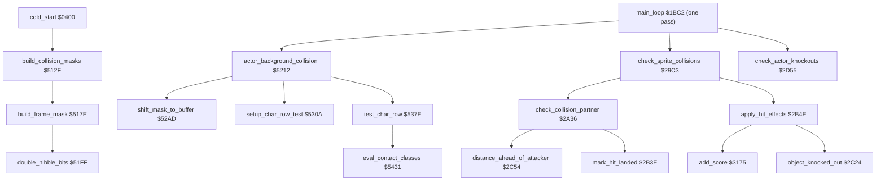
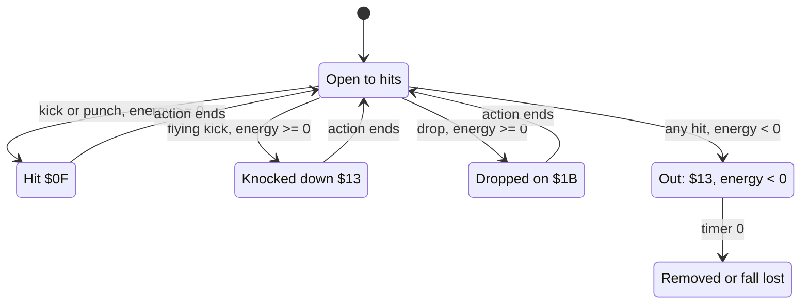

# Bruce Lee: combat and collision

Up: [the documentation](../README.md)

This page describes how *Bruce Lee* (Datasoft 1984, C64 REV.2) finds out what an actor touches, and what a hit does.

**Scope.**
- the 96-byte pixel collision masks: where they are, how [`build_collision_masks`](../../src/collision.asm#L21) [`$512F`](../reference/modules/collision.md#build_collision_masks) builds them at start, their byte layout and a worked example;
- the original bug that rooms 4, 7, 10, 13, 17 and 18 write 2 bytes into collision mask 0;
- the actor-background pixel collision [`actor_background_collision`](../../src/collision.asm#L149) [`$5212`](../reference/modules/collision.md#actor_background_collision): the contact bits in [`actor_contact`](../../src/constants.asm#L92) [`$B6`](../reference/variables.md#actor_contact) and [`actor_upper_contact`](../../src/constants.asm#L88) [`$A7`](../reference/variables.md#actor_upper_contact);
- the sprite-sprite collision [`check_sprite_collisions`](../../src/combat_hits.asm#L6) [`$29C3`](../reference/modules/combat_hits.md#check_sprite_collisions): which attack hits which actor;
- the damage, the energy and the knock-out ([`apply_hit_effects`](../../src/combat_hits.asm#L227) [`$2B4E`](../reference/modules/combat_hits.md#apply_hit_effects)), and the points for hits;
- the check of the report.md bug that [`add_score`](../../src/score.asm#L47) [`$3175`](../reference/modules/score.md#add_score) does not keep X.

Not on this page: what the game does with the contact bits at exits, lanterns and deadly tiles ([room_flow.md](room_flow.md)), the frames and the sprite renderer ([sprites.md](sprites.md)), the action states of the actors ([object_actions.md](object_actions.md)), the actor tables and spawning ([actors.md](actors.md)), the score itself ([main_loop.md](main_loop.md)), the protection bytes ([protection.md](protection.md)) and the sound effects ([sound.md](sound.md)). The rooms are on [../rooms.md](../rooms.md), the room map decoder on [room_pipeline.md](room_pipeline.md).

**Sources.**
- Modules: [combat_hits.asm](../reference/modules/combat_hits.md) (`$29C3-$2C6F`), [collision.asm](../reference/modules/collision.md) (`$50E7-$58FF`), [actor_vars.asm](../reference/modules/actor_vars.md) (`$4EEC-$50E6`). Also [actor_checks.asm](../reference/modules/actor_checks.md), [actor_room_tables.asm](../reference/modules/actor_room_tables.md) and [sprite_data.asm](../reference/modules/sprite_data.md).
- The image `unpacked/image.bin`. The masks on this page are computed from it with the build code.
- The runs: `rooms` (one snapshot per room). The coverage of all runs is in the source as `; not executed` marks.
- The assets: the frame sheets in `assets/sprites/`, the mask address table `assets/tables/actor_frame_addr.json`.

**Conventions.**
- Addresses are C64 addresses. Names are the names of the knowledge.
- A *pass* is one run of [`main_loop`](../../src/main_loop.asm#L6) [`$1BC2`](../reference/modules/main_loop.md#main_loop), at most one pass every 3 frames. A *frame* is one video frame: one run of the raster IRQ chain (50 per second on PAL).
- An *actor* is a moving figure, numbered by its index into the actor tables: actor 0 = Bruce, actor 1 = Yamo, actor 2 = Ninja. The names of actors 1 and 2 rest on their colours and on the opponent option (report.md).
- A *frame* of an actor (f, 0-209) is an entry of the frame tables; a *pose* is the pair of the even frame f and the odd frame f+1 ([sprites.md](sprites.md)).
- The *attacker* is the actor whose attack state lands; the *victim* is the actor that it hits.
- An *mc pixel* is a multicolour pixel: 2 screen pixels, 2 bits of a char bitmap.
- **Observed** marks a fact that a run showed. **Code** marks a fact from the code only. **Conclusion** marks an interpretation.

## 1. Overview



1. At start, [`cold_start`](../../src/init.asm#L6) [`$0400`](../reference/modules/init.md#cold_start) calls [`build_collision_masks`](../../src/collision.asm#L21) [`$512F`](../reference/modules/collision.md#build_collision_masks) at `$04F0`, after the charset expansion. It builds one 96-byte mask per pose (section 3).
2. Each pass, [`main_loop_room_and_actors`](../../src/main_loop.asm#L40) [`$1C0A`](../reference/modules/main_loop.md#main_loop_room_and_actors) calls [`actor_background_collision`](../../src/collision.asm#L149) [`$5212`](../reference/modules/collision.md#actor_background_collision). It ANDs the mask of each active actor with the char bitmaps under it and sets the contact bits (section 4). [`check_actors_background`](../../src/background_touch.asm#L6) [`$2E39`](../reference/modules/background_touch.md#check_actors_background) uses them next ([room_flow.md](room_flow.md)).
3. Then [`main_loop`](../../src/main_loop.asm#L6) calls [`check_sprite_collisions`](../../src/combat_hits.asm#L6) [`$29C3`](../reference/modules/combat_hits.md#check_sprite_collisions) at `$1C23`, unless [`room_no_combat_flags`](../../src/room_tables.asm#L217) [`$4C9E`](../reference/modules/room_tables.md#room_no_combat_flags) of the room is non-zero (rooms 3, 8, 9, 11, 13, 17, 18 and 19). It turns [`SPSPCL`](../../src/constants.asm#L169) [`$D01E`](../reference/variables.md#SPSPCL) into hits (section 5) and applies them (section 6).
4. At the end of the pass, [`check_actor_knockouts`](../../src/actor_checks.asm#L6) [`$2D55`](../reference/modules/actor_checks.md#check_actor_knockouts) removes a knocked-out enemy or makes Bruce lose a fall (section 6.4).

**Code** for all steps. **Observed** (coverage of all runs): every routine in the diagram ran.

## 2. The catalogue

### 2.1 Tables and buffers

| Name | Address | Layout | Readers | Writers |
|---|---|---|---|---|
| [`actor_frame_addr_lo`](../../src/actor_room_tables.asm#L9) / [`actor_frame_addr_hi`](../../src/actor_room_tables.asm#L38) | `$1167-$1238` / `$1239-$130A` | 210 + 210 bytes: the mask address of frame f. Even f: the mask of the pose. Odd f: `$CAE0` ([`mask_buffer`](../../src/constants.asm#L150)) or `$00E0` (high byte 0 = no overlay). | [`build_collision_masks`](../../src/collision.asm#L21) [`$512F`](../reference/modules/collision.md#build_collision_masks), [`build_frame_mask`](../../src/collision.asm#L64) [`$517E`](../reference/modules/collision.md#build_frame_mask), [`actor_background_collision`](../../src/collision.asm#L149) [`$5212`](../reference/modules/collision.md#actor_background_collision) | — |
| collision masks | `$9000-$9FBF`, `$C000-$CADF` | 71 masks of 96 bytes (42 + 29), section 3.2. The area `$9000-$9FBF` held [`charset_src_0`](../../src/room_charset_src.asm#L6) [`$9000`](../reference/graphics.md#charset_src_0) before. [`frame_masks`](../../src/constants.asm#L149) [`$C000`](../reference/variables.md#frame_masks) names the second area. | [`shift_mask_to_buffer`](../../src/collision.asm#L228) [`$52AD`](../reference/modules/collision.md#shift_mask_to_buffer) | [`build_collision_masks`](../../src/collision.asm#L21) |
| [`mask_buffer`](../../src/constants.asm#L150) | `$CAE0-$CB5F` | At start: the scratch mask of the odd frame. Each pass: 4 columns of 32 rows, the mask shifted to the char grid. `$CB60-$CB66` get overflow zeros. | [`build_collision_masks`](../../src/collision.asm#L21), [`test_char_row`](../../src/collision.asm#L348) [`$537E`](../reference/modules/collision.md#test_char_row) | [`build_frame_mask`](../../src/collision.asm#L64), [`shift_mask_to_buffer`](../../src/collision.asm#L228) |
| [`frame_src_lo`](../../src/sprite_data.asm#L43) / [`frame_src_hi`](../../src/sprite_data.asm#L72) | `$59BD` / `$5A8F` | 210 + 210 bytes: the graphics address of frame f ([sprites.md](sprites.md)). | [`build_frame_mask`](../../src/collision.asm#L64) | — |
| [`frame_height`](../../src/sprite_data.asm#L101) | `$5B61` | 210 bytes: h. The mask gets h+1 rows. | [`build_frame_mask`](../../src/collision.asm#L64) | — |
| [`frame_wide_flag`](../../src/sprite_data.asm#L150) | `$5CBF` | 210 bytes: 0 = 8 bits wide, else 16 bits wide. | [`build_frame_mask`](../../src/collision.asm#L64) | — |
| [`screen_row_lo`](../../src/collision.asm#L6) / [`screen_row_hi`](../../src/collision.asm#L11) / [`colour_row_hi`](../../src/collision.asm#L16) | `$50E7` / `$50FF` / `$5117` | 24 bytes each: screen and colour RAM address of screen rows 1-24 (index i = row i+1). | [`get_collision_row_ptrs`](../../src/collision.asm#L609) [`$55C5`](../reference/modules/collision.md#get_collision_row_ptrs) | — |
| [`sprite_owner_slot`](../../src/sprite_data.asm#L38) | `$59AE` | 5 bytes `$04 $00 $01 $02 $03`: id 3-7 → slot of [`sprite_owner`](../../src/actor_vars.asm#L184). | [`set_actor_slot_owner`](../../src/actors.asm#L375) [`$0E21`](../reference/modules/actors.md#set_actor_slot_owner) | — |
| [`actor_body_sprite`](../../src/sprite_render.asm#L299) / [`actor_overlay_sprite`](../../src/sprite_render.asm#L306) | `$276D` / `$2770` | 3 bytes each: the hardware sprites of each actor: 0/1 (Bruce), 2/3 (Yamo), 4/none `$FF` (Ninja). | renderer ([sprites.md](sprites.md)), [`remove_actor`](../../src/background_touch.asm#L280) [`$3001`](../reference/modules/background_touch.md#remove_actor) | — |

### 2.2 Variables

| Name | Address | Layout | Writers | Readers |
|---|---|---|---|---|
| [`mask_shift_x`](../../src/constants.asm#L22) / [`mask_shift_y`](../../src/constants.asm#L23) | `$1B` / `$1C` | Fine X (0-3 mc pixels) and fine Y (0-7 lines) of the actor in its char cell. | [`actor_background_collision`](../../src/collision.asm#L149) | [`shift_mask_to_buffer`](../../src/collision.asm#L228) |
| [`nibble_bits`](../../src/constants.asm#L25) | `$1F` | The bits that [`double_nibble_bits`](../../src/collision.asm#L133) shifts out. | [`build_frame_mask`](../../src/collision.asm#L64) | [`double_nibble_bits`](../../src/collision.asm#L133) |
| [`collision_actor`](../../src/constants.asm#L39) | `$50` | The actor in [`actor_background_collision`](../../src/collision.asm#L149). | [`actor_background_collision`](../../src/collision.asm#L149) | the collision routines |
| [`current_actor`](../../src/constants.asm#L40) | `$51` | The actor in [`apply_hit_effects`](../../src/combat_hits.asm#L227); the frame counter in [`build_collision_masks`](../../src/collision.asm#L21). | both | both |
| [`temp_y`](../../src/constants.asm#L41) | `$52` | The slot Y in [`check_collision_partner`](../../src/combat_hits.asm#L76); the next buffer row in [`test_char_row`](../../src/collision.asm#L348). | both | both |
| [`attack_reach`](../../src/constants.asm#L50) | `$61` | The minimum distance in front of the attacker (section 5.4). | [`partner_kicks`](../../src/combat_hits.asm#L111) [`$2A7B`](../reference/modules/combat_hits.md#partner_kicks), [`partner_punches`](../../src/combat_hits.asm#L135) [`$2AA5`](../reference/modules/combat_hits.md#partner_punches), [`partner_flying_kicks`](../../src/combat_hits.asm#L161) [`$2AD4`](../reference/modules/combat_hits.md#partner_flying_kicks) | [`distance_ahead_of_attacker`](../../src/combat_hits.asm#L383) [`$2C54`](../reference/modules/combat_hits.md#distance_ahead_of_attacker) |
| [`sprite_collisions`](../../src/constants.asm#L56) | `$67` | Copy of [`SPSPCL`](../../src/constants.asm#L169) [`$D01E`](../reference/variables.md#SPSPCL). | [`check_sprite_collisions`](../../src/combat_hits.asm#L6) | [`check_sprite_collisions`](../../src/combat_hits.asm#L6) |
| [`actor_upper_contact`](../../src/constants.asm#L88) | `$A7-$A9` | Per actor: contact bits of the first 15 sprite rows (bits as [`actor_contact`](../../src/constants.asm#L92)). | [`record_upper_contact`](../../src/collision.asm#L414) [`$53E4`](../reference/modules/collision.md#record_upper_contact) | actor movement ([actors.md](actors.md)) |
| [`actor_collisions`](../../src/constants.asm#L91) | `$B3-$B5` | Per actor: the partner bits of this pass. Bit n = slot n of [`sprite_owner`](../../src/actor_vars.asm#L184) (section 5.2). | [`check_sprite_collisions`](../../src/combat_hits.asm#L6) | [`collision_object_loop`](../../src/combat_hits.asm#L61) [`$2A21`](../reference/modules/combat_hits.md#collision_object_loop) |
| [`actor_contact`](../../src/constants.asm#L92) | `$B6-$B8` | Per actor: background contact bits (section 4.4). | [`eval_contact_classes`](../../src/collision.asm#L451) [`$5431`](../reference/modules/collision.md#eval_contact_classes) | actor movement, [`handle_touched_char`](../../src/background_touch.asm#L53) ([room_flow.md](room_flow.md)) |
| [`actor_hit_flags`](../../src/constants.asm#L94) | `$BC-$BE` | Per actor: the hits of this pass (section 6.1). | [`check_sprite_collisions`](../../src/combat_hits.asm#L6), [`mark_hit_landed`](../../src/combat_hits.asm#L218) [`$2B3E`](../reference/modules/combat_hits.md#mark_hit_landed) | [`apply_hit_effects`](../../src/combat_hits.asm#L227), [`object_knocked_out`](../../src/combat_hits.asm#L356) [`$2C24`](../reference/modules/combat_hits.md#object_knocked_out) |
| [`actor_energy`](../../src/constants.asm#L99) | `$D1-$D3` | Per actor: energy, signed. Negative = knocked out. | [`apply_hit_effects`](../../src/combat_hits.asm#L227), [`init_actor`](../../src/actors.asm#L6) [`$0B8E`](../reference/modules/actors.md#init_actor) (`$24`), [`spawn_yamo`](../../src/actors.asm#L177) [`$0CD5`](../reference/modules/actors.md#spawn_yamo) (at most `$14`), [`spawn_ninja`](../../src/actors.asm#L355) [`$0DF8`](../reference/modules/actors.md#spawn_ninja) (at most 7), [`main_loop_frame_work`](../../src/main_loop.asm#L18) [`$1BDF`](../reference/modules/main_loop.md#main_loop_frame_work) | [`apply_hit_effects`](../../src/combat_hits.asm#L227), [`check_actor_knockouts`](../../src/actor_checks.asm#L6) [`$2D55`](../reference/modules/actor_checks.md#check_actor_knockouts) |
| [`actor_char_col`](../../src/constants.asm#L105) / [`actor_char_row`](../../src/constants.asm#L106) | `$E6` / `$E9` | Per actor: char column and char row under the mask (row index 0 = screen row 1). | [`actor_background_collision`](../../src/collision.asm#L149) | [`setup_char_row_test`](../../src/collision.asm#L291) [`$530A`](../reference/modules/collision.md#setup_char_row_test), [`check_actors_background`](../../src/background_touch.asm#L6) |
| [`hit_budget_countdown`](../../src/actor_vars.asm#L6) | `$4EEC` | Counts down once per frame; at 0 the budgets are refilled. | [`game_frame_update`](../../src/frame_update.asm#L6) [`$15A8`](../reference/modules/frame_update.md#game_frame_update) | [`game_frame_update`](../../src/frame_update.asm#L6) |
| [`contact_classes_col0`](../../src/actor_vars.asm#L9) / [`contact_classes_col1`](../../src/actor_vars.asm#L56) / [`contact_classes_col2`](../../src/actor_vars.asm#L103) | `$4EED` / `$4F04` / `$4F1B` | 23 bytes each: the class flags of mask column 0-2 (section 4.3). | [`test_char_row`](../../src/collision.asm#L348), the swap routines | [`eval_contact_classes`](../../src/collision.asm#L451) |
| [`class_layout_alt`](../../src/actor_vars.asm#L150) | `$4F32-$4F34` | Per mask column: 1 while the column uses the room-colour layout. | [`check_col0_colour`](../../src/collision.asm#L619) [`$55D7`](../reference/modules/collision.md#check_col0_colour) and the others | the swap routines |
| [`class_layout_saved`](../../src/actor_vars.asm#L157) | `$4F35-$4F37` | Copy of [`class_layout_alt`](../../src/actor_vars.asm#L150) at the upper-contact row. | [`record_upper_contact`](../../src/collision.asm#L414) | [`record_upper_contact`](../../src/collision.asm#L414) |
| [`upper_contact_row_end`](../../src/actor_vars.asm#L164) / [`contact_row_end`](../../src/actor_vars.asm#L167) / [`char_row_end`](../../src/actor_vars.asm#L170) | `$4F38` / `$4F39` / `$4F3A` | Buffer rows: fine Y + 15, fine Y + 21, and the end of the current char row (8, 16, 24, 32). | [`actor_background_collision`](../../src/collision.asm#L149) | [`test_char_row`](../../src/collision.asm#L348) |
| [`contact_group_hits`](../../src/actor_vars.asm#L173) | `$4F3B-$4F3F` | Bytes 1-4: 1 when a class of colour 1, colour 2, room colour 3, `$F8` colour 3 was seen. | [`eval_contact_classes`](../../src/collision.asm#L451) | [`eval_contact_classes`](../../src/collision.asm#L451) |
| [`sprite_owner`](../../src/actor_vars.asm#L184) | `$4F40-$4F44` | 5 slots: the actor that owns the slot, `$FF` = free (section 5.2). | [`set_actor_slot_owner`](../../src/actors.asm#L375), [`remove_actor`](../../src/background_touch.asm#L280), [`init_game_screen`](../../src/game_setup.asm#L6) | [`check_collision_partner`](../../src/combat_hits.asm#L76) [`$2A36`](../reference/modules/combat_hits.md#check_collision_partner) |
| [`actor_hit_budget`](../../src/actor_vars.asm#L191) | `$4F45-$4F47` | Per actor: drops that it may still land (section 5.5). | [`game_frame_update`](../../src/frame_update.asm#L6) (2), [`partner_drops_on`](../../src/combat_hits.asm#L181) [`$2AFA`](../reference/modules/combat_hits.md#partner_drops_on) (-1) | [`partner_drops_on`](../../src/combat_hits.asm#L181) |
| [`actor_frame_a`](../../src/actor_vars.asm#L212) | `$4F4E-$4F50` | Per actor: the even frame of the pose. Selects the mask. | animation ([sprites.md](sprites.md)) | [`actor_background_collision`](../../src/collision.asm#L149) |

The other variables of `actor_vars.asm` (frames, move history, map-cell animation) are on [actors.md](actors.md), [sprites.md](sprites.md) and [room_flow.md](room_flow.md).

## 3. The collision masks (data format)

### 3.1 Where the masks are

- [`actor_frame_addr_lo`](../../src/actor_room_tables.asm#L9) [`$1167`](../reference/modules/actor_room_tables.md#actor_frame_addr_lo) / [`actor_frame_addr_hi`](../../src/actor_room_tables.asm#L38) [`$1239`](../reference/modules/actor_room_tables.md#actor_frame_addr_hi) give the mask of each frame.
- 71 distinct even-frame addresses: 42 in `$9000-$9FBF`, 29 in `$C000-$CADF`. Poses with the same graphics share a mask: frames 0 and 42-54 all use `$9000`, and frame 140 and 18 more Ninja frames use `$C480`. **Code** (decoded from the image).
- *Collision mask 0* is the mask at `$9000`. It belongs to frames 0/1, Bruce's first pose. **Conclusion:** it is the standing pose at the top left of the sheet below (the rows of section 3.4 show its shape).
- The masks are built once. No other code writes them. **Code.**


The sheet of Bruce's frames. The mask of a pose is the OR of the two frames of the pose.

### 3.2 The byte layout

A mask is 96 bytes: 3 columns of 32 bytes, column-major.

| Bytes | Meaning |
|---|---|
| `+$00-$1F` | Column 0: row r in byte r. The left 8 screen pixels (4 mc pixels) of the frame. |
| `+$20-$3F` | Column 1: the next 8 screen pixels. |
| `+$40-$5F` | Column 2: always 0 (see below). |

- Row r of the mask is row r of the sprite: the renderer copies frame row r into sprite row r ([sprites.md](sprites.md)). Rows h+1 to 31 are 0. **Code.**
- Each frame bit becomes a `%11` pair. A frame bit is 2 screen pixels wide (X-expanded sprite), so one pair is one mc pixel of the chars. **Code** ([`double_nibble_bits`](../../src/collision.asm#L133) [`$51FF`](../reference/modules/collision.md#double_nibble_bits)).
- Column 0 holds the high nibble of the frame's left byte, column 1 the low nibble. **Code.**
- **Code: column 2 is always 0.** For a wide frame, [`build_wide_mask_row`](../../src/collision.asm#L112) [`$51DA`](../reference/modules/collision.md#build_wide_mask_row) loads the right byte and shifts it 4 times, but then calls [`double_nibble_bits`](../../src/collision.asm#L133), which reads [`nibble_bits`](../../src/constants.asm#L25) [`$1F`](../reference/variables.md#nibble_bits) and not A. [`nibble_bits`](../../src/constants.asm#L25) is empty after the two nibbles of the left byte. So the mask has only the left 8 frame bits of a wide frame.

### 3.3 The build

[`build_collision_masks`](../../src/collision.asm#L21) [`$512F`](../reference/modules/collision.md#build_collision_masks):
1. Waits until [`protection_sig_a+22`](../../src/protection_signature.asm#L23) [`$CF8F`](../reference/modules/protection_signature.md#protection_sig_a) = `$B9` and [`protection_sig_b+22`](../../src/protection_signature.asm#L41) [`$CFAF`](../reference/modules/protection_signature.md#protection_sig_b) = the same byte ([protection.md](protection.md)).
2. X = `$D1` (209). For each odd frame X, from 209 down to 1 ([`mask_build_loop`](../../src/collision.asm#L28) [`$513D`](../reference/modules/collision.md#mask_build_loop), X kept in [`current_actor`](../../src/constants.asm#L40) [`$51`](../reference/variables.md#current_actor)):
   1. If [`actor_frame_addr_hi`](../../src/actor_room_tables.asm#L38) of X is not 0, [`build_frame_mask`](../../src/collision.asm#L64) builds frame X into its address, [`mask_buffer`](../../src/constants.asm#L150) [`$CAE0`](../reference/variables.md#mask_buffer). Else `$514A` clears [`mask_buffer`](../../src/constants.asm#L150).
   2. [`mask_build_even`](../../src/collision.asm#L41) [`$5154`](../reference/modules/collision.md#mask_build_even): X - 1. [`build_frame_mask`](../../src/collision.asm#L64) builds the even frame into its own address.
   3. `$5169`: the 96 bytes of [`mask_buffer`](../../src/constants.asm#L150) are ORed into the even mask.
3. Ends with `JMP $0080`; [`colour_cycle_counter`](../../src/constants.asm#L70) [`$0080`](../reference/variables.md#colour_cycle_counter) holds an RTS then ([room_pipeline.md](room_pipeline.md) section 3.2).

[`build_frame_mask`](../../src/collision.asm#L64) [`$517E`](../reference/modules/collision.md#build_frame_mask) (X = frame):

```
src  = frame_src[X]                      ; work_ptr_a $04
n    = frame_height[X] + 1               ; kept in demo_input_ptr $1D
col0 = actor_frame_addr[X]               ; work_ptr_b $06
col1 = col0 + $20                        ; work_ptr_c $08
col2 = col0 + $40                        ; $0A/$0B
for r = 0 .. n-1:
    nibble_bits = src[r]                 ; wide: the moving pointer gives src[2r]
    col1[r] = double_nibble_bits()       ; low nibble
    col0[r] = double_nibble_bits()       ; high nibble
    col2[r] = 0                          ; wide: double_nibble_bits() of the empty $1F = 0
    (wide: inc_ptr_04, load src[2r+1] >> 4, value not used)
for r = n .. 31: col0[r] = col1[r] = col2[r] = 0
```

[`double_nibble_bits`](../../src/collision.asm#L133) [`$51FF`](../reference/modules/collision.md#double_nibble_bits): shifts 4 bits out of [`nibble_bits`](../../src/constants.asm#L25), bit 0 first. Bit n of the nibble becomes bits 2n+1 and 2n of A.

### 3.4 A worked example: collision mask 0

Frame 0 (`frame_src` = `$663A`, h = `$0B`, narrow) and frame 1 (`$6652`, h = `$14`, narrow) make the mask at `$9000`. Frame 1 is built into [`mask_buffer`](../../src/constants.asm#L150) first and ORed in.

Row 9, by hand:
1. Frame 0 row 9 is `$36` = `%0011 0110`. Frame 1 row 9 is `$88` = `%1000 1000`.
2. Frame 0: low nibble `%0110` → `%00 11 11 00` = `$3C` into column 1. High nibble `%0011` → `%00 00 11 11` = `$0F` into column 0.
3. Frame 1: low nibble `%1000` → `$C0`; high nibble `%1000` → `$C0`.
4. OR: column 0 = `$0F | $C0` = `$CF`, column 1 = `$3C | $C0` = `$FC`.

All rows (column 2 is 0 in every row; `#` = a set mask bit):

```
row  frame0 frame1  col0 col1   bits of col0, col1
 0     00     0C     00   F0    ........####....
 1     08     06     00   FC    ........######..
 2     0C     12     03   FC    ......########..
 3     14     0A     03   FC    ......########..
 4     1C     02     03   FC    ......########..
 5     1C     00     03   F0    ......######....
 6     0C     00     00   F0    ........####....
 7     0E     00     00   FC    ........######..
 8     1E     00     03   FC    ......########..
 9     36     88     CF   FC    ##..##########..
10     72     8C     FF   FC    ##############..
11     1C     00     03   F0    ......######....
12     --     1C     03   F0    ......######....
13     --     1C     03   F0    ......######....
14     --     34     0F   30    ....####..##....
15     --     24     0C   30    ....##....##....
16     --     24     0C   30    ....##....##....   <- $9010 / $9030
17     --     24     0C   30    ....##....##....   <- $9011 / $9031
18     --     24     0C   30    ....##....##....
19     --     66     3C   3C    ..####....####..
20     --     E7     FC   3F    ######....######
21-31                00   00
```

**Observed:** in the `rooms` run, the 20 room snapshots hold these bytes at `$9000-$9FBF` and `$C000-$CADF`, byte for byte, with one exception: `$9010/$9011` (next section).

### 3.5 Original bug: six rooms write 2 bytes into collision mask 0

- The room maps of rooms 4, 7, 10, 13, 17 and 18 decode to 442 cells; the others to 440 (11 rows of 40). **Code** (decoded from the image with the rules of [room_pipeline.md](room_pipeline.md) section 2.3).
- The decoder writes the top char of a cell through [`work_ptr_a`](../../src/constants.asm#L11) [`$04`](../reference/variables.md#work_ptr_a) (start `$8C78`) and the bottom char through [`work_ptr_c`](../../src/constants.asm#L13) [`$08`](../reference/variables.md#work_ptr_c) (start `$8CA0`); both move 80 bytes per row of 40 cells ([`room_draw_next_cell`](../../src/charset_expand.asm#L6) [`$485B`](../reference/modules/charset_expand.md#room_draw_next_cell)). After 440 cells they point at `$8FE8` and `$9010`. **Code.**
- The two extra cells are tile 0 without bit 7. [`room_literal_store`](../../src/room_draw.asm#L165) [`$0AEA`](../reference/modules/room_draw.md#room_literal_store) / [`room_run_store`](../../src/room_draw.asm#L185) [`$0B12`](../reference/modules/room_draw.md#room_run_store) write `$00` to `$8FE8/$8FE9` and `$00 | $80` = `$80` to `$9010/$9011`. **Code.**
- `$9010/$9011` are column 0, rows 16 and 17 of collision mask 0. Their bytes `$0C $0C` become `$80 $80`.
- **Observed:** in the `rooms` run, `$9010/$9011` = `$80 $80` in the snapshots of rooms 4, 7, 10, 13, 17 and 18, and `$0C $0C` in the other 14. The `r17_freeze` and `room_special` snapshots (rooms 17 and 18) also hold `$80 $80`.
- Nothing rebuilds the masks, so the damage stays until the next cold start. **Code.**

**Conclusion** (the effect):
- Rows 16-17 of the pose lose the left leg pixel (`$0C`, mc pixel 2 of column 0).
- They gain bit 7 of column 0 alone: half of the leftmost mc pixel. An AND with a `%10` or `%11` pixel there gives the nibble `%1000`, class 8, which counts as colour 2 (section 4.3). So a colour-3 pixel at that place sets contact bit 1, which the lantern and the deadly-tile checks use ([room_flow.md](room_flow.md)).
- The effect is 2 pixel rows of one pose. No run showed a change in play.

## 4. The actor-background pixel collision

### 4.1 [`actor_background_collision`](../../src/collision.asm#L149) [`$5212`](../reference/modules/collision.md#actor_background_collision)

For X = 2 down to 0 ([`collision_actor_loop`](../../src/collision.asm#L151) [`$5214`](../reference/modules/collision.md#collision_actor_loop), X in [`collision_actor`](../../src/constants.asm#L39) [`$50`](../reference/variables.md#collision_actor)):
1. Skips the actor when bit 0 of [`actor_flags`](../../src/constants.asm#L82) [`$95`](../reference/variables.md#actor_flags) (active) is clear.
2. `$521F`: c = [`actor_x`](../../src/constants.asm#L85) - `$0C`, stored in [`actor_char_col`](../../src/constants.asm#L105) [`$E6`](../reference/variables.md#actor_char_col); [`mask_shift_x`](../../src/constants.asm#L22) [`$1B`](../reference/variables.md#mask_shift_x) = c AND 3. r = [`actor_y`](../../src/constants.asm#L86) - `$1D`, stored in [`actor_char_row`](../../src/constants.asm#L106) [`$E9`](../reference/variables.md#actor_char_row); [`mask_shift_y`](../../src/constants.asm#L23) [`$1C`](../reference/variables.md#mask_shift_y) = r AND 7.
3. Patches the mask address of [`actor_frame_a`](../../src/actor_vars.asm#L212) [`$4F4E`](../reference/modules/actor_vars.md#actor_frame_a) into [`mask_copy_loop`](../../src/collision.asm#L249) [`$52CB`](../reference/modules/collision.md#mask_copy_loop) and calls [`shift_mask_to_buffer`](../../src/collision.asm#L228) [`$52AD`](../reference/modules/collision.md#shift_mask_to_buffer) (section 4.2).
4. `$5248`: [`contact_row_end`](../../src/actor_vars.asm#L167) [`$4F39`](../reference/modules/actor_vars.md#contact_row_end) = fine Y + `$15`; [`upper_contact_row_end`](../../src/actor_vars.asm#L164) [`$4F38`](../reference/modules/actor_vars.md#upper_contact_row_end) = fine Y + `$0F`.
5. [`clear_contact_classes`](../../src/collision.asm#L595) [`$55AB`](../reference/modules/collision.md#clear_contact_classes) clears the 3 x 23 class flags and [`class_layout_alt`](../../src/actor_vars.asm#L150) [`$4F32`](../reference/modules/actor_vars.md#class_layout_alt).
6. [`actor_char_col`](../../src/constants.asm#L105) = c / 4; [`actor_char_row`](../../src/constants.asm#L106) = r / 8. [`temp_y`](../../src/constants.asm#L41) [`$52`](../reference/variables.md#temp_y) = 0 (the buffer row).
7. Four char rows: [`char_row_end`](../../src/actor_vars.asm#L170) [`$4F3A`](../reference/modules/actor_vars.md#char_row_end) = 8, 16, 24, 32. For each: [`setup_char_row_test`](../../src/collision.asm#L291) [`$530A`](../reference/modules/collision.md#setup_char_row_test), then [`test_char_row`](../../src/collision.asm#L348) [`$537E`](../reference/modules/collision.md#test_char_row). [`actor_char_row`](../../src/constants.asm#L106) + 1 before the second, third and fourth.
8. [`test_char_row`](../../src/collision.asm#L348) ends the actor early at [`contact_row_end`](../../src/actor_vars.asm#L167) ([`finish_actor_contact`](../../src/collision.asm#L445) [`$5429`](../reference/modules/collision.md#finish_actor_contact) drops the return address and jumps to [`collision_next_actor`](../../src/collision.asm#L220) [`$52A4`](../reference/modules/collision.md#collision_next_actor)).

**Code: the grid.** [`actor_x`](../../src/constants.asm#L85) is in 2-pixel units and the sprite X is 2·[`actor_x`](../../src/constants.asm#L85), so one [`actor_x`](../../src/constants.asm#L85) unit is one mc pixel and 4 units are one char. The sprite Y is [`actor_y`](../../src/constants.asm#L86) + `$1D`; screen row 1 starts at char row index 0 of [`screen_row_lo`](../../src/collision.asm#L6) [`$50E7`](../reference/modules/collision.md#screen_row_lo).

**Code:** the mask is at [`actor_x`](../../src/constants.asm#L85) for every frame. [`apply_sprite_registers`](../../src/sprite_render.asm#L64) [`$25E8`](../reference/modules/sprite_render.md#apply_sprite_registers) draws a wide body frame 8 units further left when the actor faces left. [`actor_background_collision`](../../src/collision.asm#L149) does not.

### 4.2 [`shift_mask_to_buffer`](../../src/collision.asm#L228) [`$52AD`](../reference/modules/collision.md#shift_mask_to_buffer)

The buffer [`mask_buffer`](../../src/constants.asm#L150) [`$CAE0`](../reference/variables.md#mask_buffer) has 4 columns of 32 rows (`+$00`, `+$20`, `+$40`, `+$60`).
1. Writes [`mask_shift_y`](../../src/constants.asm#L23) zero bytes (`$52B0`).
2. When [`mask_shift_x`](../../src/constants.asm#L22) = 3, writes 32 more zero bytes, so the mask starts one column to the right.
3. [`mask_copy_loop`](../../src/collision.asm#L249) [`$52CB`](../reference/modules/collision.md#mask_copy_loop) copies the 96 mask bytes. Column k, row r lands at buffer row r + fine Y of column k (k + 1 for fine X 3). The overflow zeros reach `$CB66`.
4. Fine X 1 or 2: shifts the 32 rows of columns 0-2 right by 2·fine X bits (LSR, ROR, ROR).
5. Fine X 3: shifts columns 0-3 left by 2 bits (ASL column 3, ROL 2, ROL 1, ROL 0). With the one-column offset this is a shift right by 6 bits.

So bit pairs of the buffer line up with the mc pixels of the chars under the actor. **Code.**

### 4.3 [`setup_char_row_test`](../../src/collision.asm#L291) [`$530A`](../reference/modules/collision.md#setup_char_row_test) and [`test_char_row`](../../src/collision.asm#L348) [`$537E`](../reference/modules/collision.md#test_char_row)

[`setup_char_row_test`](../../src/collision.asm#L291), for the char row [`actor_char_row`](../../src/constants.asm#L106):
1. [`get_collision_row_ptrs`](../../src/collision.asm#L609) [`$55C5`](../reference/modules/collision.md#get_collision_row_ptrs): [`work_ptr_a`](../../src/constants.asm#L11) [`$04`](../reference/variables.md#work_ptr_a) = the screen row, [`colour_ptr_b`](../../src/constants.asm#L16) [`$12`](../reference/variables.md#colour_ptr_b) = the colour RAM row.
2. For columns [`actor_char_col`](../../src/constants.asm#L105) + 0, 1, 2: [`check_col0_colour`](../../src/collision.asm#L619) [`$55D7`](../reference/modules/collision.md#check_col0_colour) / [`check_col1_colour`](../../src/collision.asm#L668) [`$5649`](../reference/modules/collision.md#check_col1_colour) / [`check_col2_colour`](../../src/collision.asm#L717) [`$56BB`](../reference/modules/collision.md#check_col2_colour) choose the class layout of the mask column (below). Then the char code c of the cell gives the bitmap address [`charset_hi`](../../src/constants.asm#L67) [`$7C`](../reference/variables.md#charset_hi) · 256 + 8·c, minus [`temp_y`](../../src/constants.asm#L41). It is patched into [`test_row_loop`](../../src/collision.asm#L350) [`$5380`](../reference/modules/collision.md#test_row_loop), [`test_col1`](../../src/collision.asm#L367) [`$539A`](../reference/modules/collision.md#test_col1), [`test_col2`](../../src/collision.asm#L384) [`$53B4`](../reference/modules/collision.md#test_col2).
3. A third column at screen column 40 or more reads as char 0 (`$535A`, not executed).

[`test_char_row`](../../src/collision.asm#L348), for buffer rows y = [`temp_y`](../../src/constants.asm#L41) up to [`char_row_end`](../../src/actor_vars.asm#L170) - 1:
1. For mask column k = 0, 1, 2: v = bitmap byte AND buffer byte. If v is not 0, `contact_classes_colk[v >> 4]` and `contact_classes_colk[v AND $0F]` get a non-zero value (the nibble itself; nibble 0 stores 0).
2. At y + 1 = [`upper_contact_row_end`](../../src/actor_vars.asm#L164): [`record_upper_contact`](../../src/collision.asm#L414) [`$53E4`](../reference/modules/collision.md#record_upper_contact) saves the layouts, runs [`eval_contact_classes`](../../src/collision.asm#L451), copies [`actor_contact`](../../src/constants.asm#L92) into [`actor_upper_contact`](../../src/constants.asm#L88) [`$A7`](../reference/variables.md#actor_upper_contact), and swaps back the columns that were in the room-colour layout.
3. At y + 1 = [`contact_row_end`](../../src/actor_vars.asm#L167): [`finish_actor_contact`](../../src/collision.asm#L445) runs [`eval_contact_classes`](../../src/collision.asm#L451) and ends the actor.

A nibble is 2 mc pixels. Its value is the colour pattern of the 2 pixels under the mask: `%01` colour 1, `%10` colour 2, `%11` colour 3. In multicolour text mode `%01` is `$D022`, `%10` is `$D023` and `%11` is the colour RAM colour (bits 0-2).

**Class layouts.** Classes with a `%11` pixel (3, 7, 11, 12, 13, 14, 15) have two slots: one for cells whose colour RAM has bits 0-2 = 0 (the `$F8` cells of the room map, [room_pipeline.md](room_pipeline.md)), one for cells in the room colour. `check_colk_colour` swaps entries 3↔16, 7↔17, 11↔18, 12↔19, 13↔20, 14↔21 and 15↔22 of the column ([`swap_col0_classes`](../../src/collision.asm#L629) [`$55E6`](../reference/modules/collision.md#swap_col0_classes), [`swap_col1_classes`](../../src/collision.asm#L678) [`$5658`](../reference/modules/collision.md#swap_col1_classes), [`swap_col2_classes`](../../src/collision.asm#L727) [`$56CA`](../reference/modules/collision.md#swap_col2_classes)) when the cell has colour bits set. [`eval_contact_classes`](../../src/collision.asm#L451) swaps every column back first. After that, entries 0-15 hold the `$F8` cells and entries 16-22 the room-colour cells.

### 4.4 [`eval_contact_classes`](../../src/collision.asm#L451) [`$5431`](../reference/modules/collision.md#eval_contact_classes) and the contact bits

| [`actor_contact`](../../src/constants.asm#L92) bit | Meaning | Class entries ORed (each column) | [`contact_group_hits`](../../src/actor_vars.asm#L173) |
|---|---|---|---|
| 0 | a colour-1 pixel | 1, 4, 5, 6, 7, 9, 13, 17, 20 | +1 |
| 1 | a colour-2 pixel | 2, 6, 8, 9, 10, 11, 14, 18, 21 | +2 |
| 2 | a colour-3 pixel in a room-colour cell | 16-22 | +3 |
| 3 | a colour-3 pixel in a `$F8` cell | 3, 7, 11-15 | +4 |

- [`actor_contact`](../../src/constants.asm#L92) gets bit 3 from +4, bit 2 from +3, bit 1 from +2, bit 0 from +1 (`$5590`). **Code.**
- [`actor_contact`](../../src/constants.asm#L92) covers the first 21 sprite rows; [`actor_upper_contact`](../../src/constants.asm#L88) the first 15. **Code.**
- **Code: original bug at [`eval_contact_classes`](../../src/collision.asm#L451) [`$5486`](../../src/collision.asm#L488).** The colour-1 test of column 1 reads [`contact_classes_col0+17`](../../src/actor_vars.asm#L9) [`$4EFE`](../reference/modules/actor_vars.md#contact_classes_col0) (column 0, entry 17) a second time instead of [`contact_classes_col1+17`](../../src/actor_vars.asm#L56) [`$4F15`](../reference/modules/actor_vars.md#contact_classes_col1). So class 7 (`%01 %11`) in a room-colour cell under mask column 1 does not set bit 0.
- Readers: bit 1 gates lanterns and deadly chars in [`handle_touched_char`](../../src/background_touch.asm#L53) ([room_flow.md](room_flow.md) sections 5 and 6.1). **Conclusion** (from the comments of the action states in `object_actions.asm`): bit 0 acts as the floor, bit 2 as a climbable surface, bit 3 as an obstacle ([object_actions.md](object_actions.md), [actors.md](actors.md)).

## 5. Sprite collisions and hits

### 5.1 [`check_sprite_collisions`](../../src/combat_hits.asm#L6) [`$29C3`](../reference/modules/combat_hits.md#check_sprite_collisions)

```
actor_collisions[0..2] = 0; actor_hit_flags[0..2] = 0
s = SPSPCL                       ; reading clears the register
if s == 0: return                ; no hits are applied
sprite_collisions = s
if s & $03:                      ; Bruce's sprites 0/1
    if s & $0C: coll[0] |= $08; coll[1] |= $02     ; $29E6 Bruce - Yamo
    if s & $30: coll[0] |= $10; coll[2] |= $02     ; $29FB Bruce - Ninja
if s & $0C and s & $30:
    coll[1] |= $10; coll[2] |= $08                  ; $2A07 Yamo - Ninja
for X = 2 downto 0:              ; collision_object_loop $2A21, the victim
    for Y = 0 .. 4:              ; the slot, bits shifted out of $4C
        if bit Y of coll[X]: check_collision_partner(X, Y)
apply_hit_effects()              ; $2A33
```

- [`SPSPCL`](../../src/constants.asm#L169) gives only the sprites that touched something, not the pairs. When all three actors touch, every pair is flagged. **Code.** **Conclusion:** two actors that overlap a third can get a hit from each other without touching.
- [`SPSPCL`](../../src/constants.asm#L169) collects the collisions of every frame since the last read. It is read once per pass. **Code.**
- Sprite 5 is in the Bruce-Ninja test (`$30`), but it is no actor sprite: [`actor_overlay_sprite`](../../src/sprite_render.asm#L306) [`$2770`](../reference/modules/sprite_render.md#actor_overlay_sprite) holds 1, 3 and `$FF`. **Code.**
- [`room18_wizard_alive`](../../src/room_update.asm#L939) [`$3D1D`](../reference/modules/room_update.md#room18_wizard_alive) reads [`SPSPCL`](../../src/constants.asm#L169) too, for the fireballs. Room 18 skips [`check_sprite_collisions`](../../src/combat_hits.asm#L6), so the two reads do not meet. **Code.**

**Worked example** ([`SPSPCL`](../../src/constants.asm#L169) = `$13`: sprites 0, 1 and 4): [`actor_collisions`](../../src/constants.asm#L91) = `$10`, 0, `$02`. For X = 2 (the Ninja), bit 1 → slot 1 → Bruce is the attacker. For X = 0 (Bruce), bit 4 → slot 4 → the Ninja is the attacker. **Code.**

### 5.2 The slots of [`sprite_owner`](../../src/actor_vars.asm#L184) [`$4F40`](../reference/modules/actor_vars.md#sprite_owner)

[`init_actor`](../../src/actors.asm#L6) [`$0B8E`](../reference/modules/actors.md#init_actor) takes two ids per actor type from [`actor_type_sprite_a`](../../src/sprite_data.asm#L32) [`$59A8`](../reference/modules/sprite_data.md#actor_type_sprite_a) / [`actor_type_sprite_b`](../../src/sprite_data.asm#L35) [`$59AB`](../reference/modules/sprite_data.md#actor_type_sprite_b). [`set_actor_slot_owner`](../../src/actors.asm#L375) [`$0E21`](../reference/modules/actors.md#set_actor_slot_owner) maps each id through [`sprite_owner_slot`](../../src/sprite_data.asm#L38) [`$59AE`](../reference/modules/sprite_data.md#sprite_owner_slot) to a slot and stores the actor there.

| Slot | Id | Owner | Bit in [`actor_collisions`](../../src/constants.asm#L91) |
|---|---|---|---|
| 0 | 4 | Bruce (layer A) | — |
| 1 | 5 | Bruce (layer B) | `$02` |
| 2 | 6 | Yamo (layer A) | — |
| 3 | 7 | Yamo (layer B) | `$08` |
| 4 | 3 | Ninja | `$10` |

- The ids are not hardware sprites. The hardware sprites are in [`actor_body_sprite`](../../src/sprite_render.asm#L299) [`$276D`](../reference/modules/sprite_render.md#actor_body_sprite) / [`actor_overlay_sprite`](../../src/sprite_render.asm#L306) [`$2770`](../reference/modules/sprite_render.md#actor_overlay_sprite) ([sprites.md](sprites.md)). **Code.**
- [`remove_actor`](../../src/background_touch.asm#L280) [`$3001`](../reference/modules/background_touch.md#remove_actor) and [`init_game_screen`](../../src/game_setup.asm#L6) [`$0763`](../reference/modules/game_setup.md#init_game_screen) free the slots (`$FF`). A free slot gives no hit. **Code.**
- **Observed:** the `rooms` snapshot of room 5 (Bruce alone) holds [`sprite_owner`](../../src/actor_vars.asm#L184) = `00 00 FF FF FF`.

### 5.3 [`check_collision_partner`](../../src/combat_hits.asm#L76) [`$2A36`](../reference/modules/combat_hits.md#check_collision_partner)

X = the victim, Y = the slot.
1. Saves Y in [`temp_y`](../../src/constants.asm#L41) [`$52`](../reference/variables.md#temp_y).
2. Skips a victim in state `$0F` (hit), `$13` (knocked down), `$18`, `$19` (dying), `$1A` or `$1B` (dropped on).
3. Y = [`sprite_owner`](../../src/actor_vars.asm#L184)+slot: the attacker. `$FF`: no hit.
4. Dispatches on [`actor_state`](../../src/constants.asm#L95) [`$BF`](../reference/variables.md#actor_state) of the attacker: `$1B` no hit; `$16` → [`partner_kicks`](../../src/combat_hits.asm#L111) [`$2A7B`](../reference/modules/combat_hits.md#partner_kicks); `$11` → [`partner_punches`](../../src/combat_hits.asm#L135) [`$2AA5`](../reference/modules/combat_hits.md#partner_punches); `$0D` or `$0C` → [`partner_flying_kicks`](../../src/combat_hits.asm#L161) [`$2AD4`](../reference/modules/combat_hits.md#partner_flying_kicks); `$0E` → [`partner_drops_on`](../../src/combat_hits.asm#L181) [`$2AFA`](../reference/modules/combat_hits.md#partner_drops_on); any other state no hit.
5. Each path returns to `$2A76`, which loads Y from [`temp_y`](../../src/constants.asm#L41) and goes on with the next bit.

There is no test of sides: any actor can hit any other, also Yamo the Ninja. **Code.**

### 5.4 Which attack hits

| Attacker state | Condition | [`attack_reach`](../../src/constants.asm#L50) | Sound | Victim bit | Attacker bit 0 | Victim bit 7 if the attacker is actor 0 |
|---|---|---|---|---|---|---|
| `$16` kick | [`actor_state_timer`](../../src/constants.asm#L98) of the attacker < 8 | 4 | [`play_sound_effect`](../../src/sound_effects.asm#L6) [`$2509`](../reference/modules/sound_effects.md#play_sound_effect) with Y = `$87` | 1 (`$02`) | yes | no |
| `$11` punch | \|[`actor_y`](../../src/constants.asm#L86) attacker - [`actor_y`](../../src/constants.asm#L86) victim\| < `$16` | 6 | [`play_sound_86`](../../src/actor_checks.asm#L148) [`$2E29`](../reference/modules/actor_checks.md#play_sound_86) | 2 (`$04`) | yes | yes (`$2ACE`) |
| `$0C`/`$0D` flying kick | timer of the attacker < `$0A` | 6 | [`play_sound_86`](../../src/actor_checks.asm#L148) | 3 (`$08`) | yes | yes (`$2AF4`) |
| `$0E` drop | see 5.5 | — | [`play_sound_86`](../../src/actor_checks.asm#L148) | 4 (`$10`) | no | yes (`$2B37`) |

[`distance_ahead_of_attacker`](../../src/combat_hits.asm#L383) [`$2C54`](../reference/modules/combat_hits.md#distance_ahead_of_attacker) (Y = attacker, X = victim):
```
d = actor_x[Y] - actor_x[X]
if actor_facing[Y] == 1: d = -d          ; facing right
compare d with attack_reach               ; C = d >= reach, N = bit 7 of d - reach
```
The callers take the hit only when C is set and N is clear: reach ≤ d and d - reach < `$80`. So the victim must be in front of the attacker and at least 4 units (kick) or 6 units (punch, flying kick) away. A unit is 2 screen pixels. **Code.**

[`mark_hit_landed`](../../src/combat_hits.asm#L218) [`$2B3E`](../reference/modules/combat_hits.md#mark_hit_landed) (kick, punch, flying kick): sets bit 0 of [`actor_hit_flags`](../../src/constants.asm#L94) of the attacker, and turns the victim to face the attacker ([`actor_facing`](../../src/constants.asm#L87) of the victim = attacker's facing XOR 1). **Code.**

**Code:** the only code that starts state `$16` is the enemy AI of state `$14`, at `$23C4` in `object_actions.asm` ([object_actions.md](object_actions.md)). Bruce punches ([`actor_still_fire_move`](../../src/actor_movement.asm#L484) [`$1F7E`](../reference/modules/actor_movement.md#actor_still_fire_move)) and flying-kicks. So the missing bit 7 of the kick costs Bruce no points.

**Observed** (coverage): the kick, punch and flying-kick hits ran. The `ora #$80` of Bruce's hits (`$2ACE`, `$2AF4`) and the drop path after `$2B04` never ran: the runs had no real fighting by Bruce.

### 5.5 The drop [`partner_drops_on`](../../src/combat_hits.asm#L181) [`$2AFA`](../reference/modules/combat_hits.md#partner_drops_on)

The attacker is in state `$0E`, the fall that the movement code sets at [`actor_undo_moves`](../../src/actor_movement.asm#L98) [`$1DBF`](../../src/actor_movement.asm#L222) (also through [`actor_descend_two_steps`](../../src/actor_movement.asm#L225) [`$1DC4`](../reference/modules/actor_movement.md#actor_descend_two_steps)). All of these must hold, in this order:
1. [`actor_y`](../../src/constants.asm#L86) victim - [`actor_y`](../../src/constants.asm#L86) attacker ≥ `$0A` and < `$80` (the attacker is at least 10 lines higher).
2. [`actor_hit_budget`](../../src/actor_vars.asm#L191) [`$4F45`](../reference/modules/actor_vars.md#actor_hit_budget) of the attacker is not 0. It is decremented here, also when a later test fails.
3. The victim has no bit 4 yet, and the attacker has no bit 4 (it is not dropped on itself in this pass).
4. The victim is not in state `$0C`, `$0D` (flying kick) or `$11` (punch).

[`game_frame_update`](../../src/frame_update.asm#L6) [`$15A8`](../reference/modules/frame_update.md#game_frame_update) sets [`actor_hit_budget`](../../src/actor_vars.asm#L191) of all three actors to 2 when [`hit_budget_countdown`](../../src/actor_vars.asm#L6) [`$4EEC`](../reference/modules/actor_vars.md#hit_budget_countdown) is 0, and decrements the countdown every frame. So an actor can land at most 2 drops per 256 frames (about 5 seconds on PAL). **Code.**

## 6. Damage, energy and knock-out

### 6.1 [`apply_hit_effects`](../../src/combat_hits.asm#L227) [`$2B4E`](../reference/modules/combat_hits.md#apply_hit_effects)

For X = 2 down to 0 (X kept in [`current_actor`](../../src/constants.asm#L40) [`$51`](../reference/variables.md#current_actor)), the bits of [`actor_hit_flags`](../../src/constants.asm#L94) in this order:

| Bit | Event | Points if bit 7 | [`actor_energy`](../../src/constants.asm#L99) | New state, [`actor_state_timer`](../../src/constants.asm#L98) | Code |
|---|---|---|---|---|---|
| 0 | the actor landed a hit | — | — | `$00`; [`actor_step_delay`](../../src/constants.asm#L122) [`$0106`](../reference/variables.md#actor_step_delay) = 4; timer from the table in 6.2; [`actor_frame_updated`](../../src/actor_vars.asm#L280) [`$4FDB`](../reference/modules/actor_vars.md#actor_frame_updated) + 1 | `$2B52` |
| 1 | kicked | — | −2 | `$0F`, 3 | `$2B9A` |
| 2 | punched | 100 (`$64`) | −3 | `$0F`, 4 | `$2BB1` |
| 3 | flying-kicked | 75 (`$4B`) | −7 | `$13`, `$0C` | `$2BD5` |
| 4 | dropped on | 50 (`$32`) | −5 | `$1B`, 8 | `$2BF9` |
| — | energy < 0 after bit 1-4 | 450 (actor 1) or 200 (actor 2) | — | `$13`, `$0C` | [`object_knocked_out`](../../src/combat_hits.asm#L356) [`$2C24`](../reference/modules/combat_hits.md#object_knocked_out) |

- Several bits can be set in one pass. A later bit overwrites the state of an earlier one. **Code.**
- Points go to the score through [`add_score`](../../src/score.asm#L47) [`$3175`](../reference/modules/score.md#add_score) ([main_loop.md](main_loop.md) section 10). Bit 7 is set only for a punch, a flying kick or a drop by actor 0, so only Bruce scores. **Code.**
- The knock-out score of actor 1 is two calls: `$01` to the middle byte (256) and `$C2` (194) to the low byte. **Code.**
- **Observed** (coverage): bits 0-3 and the knock-out without points ran (enemies hitting Bruce). Every [`add_score`](../../src/score.asm#L47) path, bit 4 and the timers at `$2B79` and `$2B8A-$2B95` never ran.

### 6.2 The recovery timer (bit 0)

The timer depends on [`get_room_time_level`](../../src/room_state.asm#L110) [`$10D0`](../reference/modules/room_state.md#get_room_time_level) (V = [`room_timer`](../../src/constants.asm#L77) [`$88`](../reference/variables.md#room_timer) ≥ `$20`; C = ≥ `$19`) and on [`game_cycle`](../../src/constants.asm#L30) [`$40`](../reference/variables.md#game_cycle):

| [`room_timer`](../../src/constants.asm#L77) | Bruce | Enemy, [`game_cycle`](../../src/constants.asm#L30) = 0 | Enemy, [`game_cycle`](../../src/constants.asm#L30) ≠ 0 |
|---|---|---|---|
| < `$19` | 3 | `$18` | 3 |
| `$19-$1F` | 8 | `$0A` | `$0A` |
| ≥ `$20` | `$0A` | `$0A` | `$0A` |

- **Code:** the enemy path stores 2 at `$2B7F` and then falls into the timer choice of Bruce at `$2B83`, which overwrites it. The 2 is never kept.
- **Conclusion:** after a hit, an enemy stays idle longer early in the first game cycle; Bruce stays idle longer late in a room. [`room_timer`](../../src/constants.asm#L77) counts every 256 frames of play ([`room_timer_tick`](../../src/frame_update.asm#L66) [`$1614`](../reference/modules/frame_update.md#room_timer_tick)), so `$19` is about 128 s and `$20` about 164 s on PAL.

### 6.3 Original bug: a knock-out by a drop loops

[`object_knocked_out`](../../src/combat_hits.asm#L356) [`$2C24`](../reference/modules/combat_hits.md#object_knocked_out) ends with `JMP $2BF9` (`$2C51`), the test of bit 4. When bit 4 is set, the drop is applied again: 50 points (with bit 7), energy −5, and a knock-out again while the energy is negative. **Code.**

The loop ends only when the energy wraps from below −128 to a positive value:

| Energy before the drop | Knock-outs | Energy after | State after |
|---|---|---|---|
| 0, 1 | 25 | `$7E`, `$7F` | `$1B`, timer 8 |
| 2, 3, 4 | 26 | `$7B`, `$7C`, `$7D` | `$1B`, timer 8 |
| 5 or more | 0 (no knock-out) | energy − 5 | `$1B`, timer 8 |

**Conclusion** (from the code; no run reached this path):
- A drop on an actor with energy 0-4 does not knock it out. It gets a large positive energy instead. [`main_loop_frame_work`](../../src/main_loop.asm#L18) [`$1BDF`](../reference/modules/main_loop.md#main_loop_frame_work) masks the enemies on the next pass: Yamo AND `$BF` → `$3B-$3F` (59-63), Ninja AND `$87` → `$03-$07`. Bruce keeps `$7B-$7F` (123-127); he starts a life with `$24` (36).
- When Bruce drops on Yamo, the loop adds 26 or 27 × 50 plus 25 or 26 × 450 points: 12550 or 13050. On the Ninja: 6300 or 6550.
- A knock-out by a kick, a punch or a flying kick also jumps to `$2BF9`. It loops only when bit 4 is set in the same pass.

### 6.4 After the hit: [`check_actor_knockouts`](../../src/actor_checks.asm#L6) [`$2D55`](../reference/modules/actor_checks.md#check_actor_knockouts)

At the end of each pass, for each active actor: when the state is `$13` or `$19` and its timer is not 0, nothing happens. Else, when [`actor_energy`](../../src/constants.asm#L99) is negative, an enemy is removed ([`remove_actor`](../../src/background_touch.asm#L280) [`$3001`](../reference/modules/background_touch.md#remove_actor)) and Bruce loses a fall ([`lose_fall`](../../src/game_over.asm#L6) [`$1818`](../reference/modules/game_over.md#lose_fall), [room_flow.md](room_flow.md) section 6). **Code.**

### 6.5 The state machine of a victim



| State | Condition | Next state | Code |
|---|---|---|---|
| any state except `$0F`, `$13`, `$18`, `$19`, `$1A`, `$1B` | kicked or punched, energy ≥ 0 | `$0F` | [`mark_hit_landed`](../../src/combat_hits.asm#L218) [`$2BA9`](../../src/combat_hits.asm#L281), `$2BCD` |
| as above | flying-kicked, energy ≥ 0 | `$13`, timer `$0C` | [`mark_hit_landed`](../../src/combat_hits.asm#L218) [`$2BF1`](../../src/combat_hits.asm#L324) |
| as above | dropped on, energy ≥ 0 (also after the loop of 6.3) | `$1B`, timer 8 | [`mark_hit_landed`](../../src/combat_hits.asm#L218) [`$2C15`](../../src/combat_hits.asm#L345) |
| as above | energy < 0 after a hit | `$13`, timer `$0C` | [`object_knocked_out`](../../src/combat_hits.asm#L356) [`$2C47`](../../src/combat_hits.asm#L376) |
| `$13` with energy < 0 | timer 0 | enemy removed, or Bruce loses a fall | [`check_actor_knockouts`](../../src/actor_checks.asm#L6) [`$2D55`](../reference/modules/actor_checks.md#check_actor_knockouts) |
| `$0F`, `$13`, `$1B` | the action ends | other states | [object_actions.md](object_actions.md) |

## 7. The report.md bug that [`add_score`](../../src/score.asm#L47) does not keep X

- [`add_score`](../../src/score.asm#L47) [`$3175`](../reference/modules/score.md#add_score) returns with X = `$FF`: it ends in [`show_score`](../../src/score.asm#L35) [`$315A`](../reference/modules/score.md#show_score), and [`score_to_bcd`](../../src/score_bcd_regsave.asm#L6) [`$32DC`](../reference/modules/score_bcd_regsave.md#score_to_bcd) counts X down to `$FF`. It also changes Y. **Code.**
- The callers in [`apply_hit_effects`](../../src/combat_hits.asm#L227) load X again from [`current_actor`](../../src/constants.asm#L40) [`$51`](../reference/variables.md#current_actor) right after each call: `$2BC2` (after `$2BBF`), `$2BE6` (after `$2BE3`), `$2C0A` (after `$2C07`), and `$2C47` after the knock-out calls. [`apply_hit_effects`](../../src/combat_hits.asm#L227) stores X there at `$2B50`, and [`add_score`](../../src/score.asm#L47) does not write [`current_actor`](../../src/constants.asm#L40). **Code.**
- So the lost X does no harm in `combat_hits.asm`. The bug in report.md is not a bug. [main_loop.md](main_loop.md) section 10.1 comes to the same result.
- The lantern caller [`pick_up_lantern`](../../src/background_touch.asm#L131) [`$2F04`](../reference/modules/background_touch.md#pick_up_lantern) saves and restores the registers around the call ([`save_registers`](../../src/score_bcd_regsave.asm#L35) [`$330E`](../reference/modules/score_bcd_regsave.md#save_registers) / [`restore_registers`](../../src/score_bcd_regsave.asm#L41) [`$3315`](../reference/modules/score_bcd_regsave.md#restore_registers)). **Code.**

## 8. Still open

- Whether the stray bit of collision mask 0 (section 3.5) ever changes a contact in rooms 4, 7, 10, 13, 17 or 18 — a run that stands Bruce in pose 0 next to a colour-3 pixel at sprite rows 16-17 after visiting room 4, with a watchpoint on [`actor_contact`](../../src/constants.asm#L92) [`$B6`](../reference/variables.md#actor_contact).
- Whether the mask of a wide frame lines up with the drawn sprite when the actor faces left (section 4.1) — a run that shows a wide pose facing left, with a dump of [`mask_buffer`](../../src/constants.asm#L150) [`$CAE0`](../reference/variables.md#mask_buffer) and the screen.
- The drop knock-out loop (section 6.3) — a run in which Bruce falls onto an enemy with energy 0-4 (or an enemy onto Bruce), with a breakpoint at [`object_knocked_out`](../../src/combat_hits.asm#L356) [`$2C24`](../reference/modules/combat_hits.md#object_knocked_out) and a watch on [`actor_energy`](../../src/constants.asm#L99) [`$D1`](../reference/variables.md#actor_energy) and [`score`](../../src/constants.asm#L31) [`$41`](../reference/variables.md#score).
- The game meaning of states `$18` and `$1A`, which the victim test skips — the action state runs of [object_actions.md](object_actions.md).
- Whether sprite 5 can be on in a room with combat and so count as a Ninja collision — a run with a watchpoint on [`SPENA`](../../src/constants.asm#L160) [`$D015`](../reference/variables.md#SPENA) in the combat rooms.
- None of Bruce's hits ran in the coverage. A fighting run (Bruce punches and flying-kicks Yamo and the Ninja) would show the points of section 6.1.
