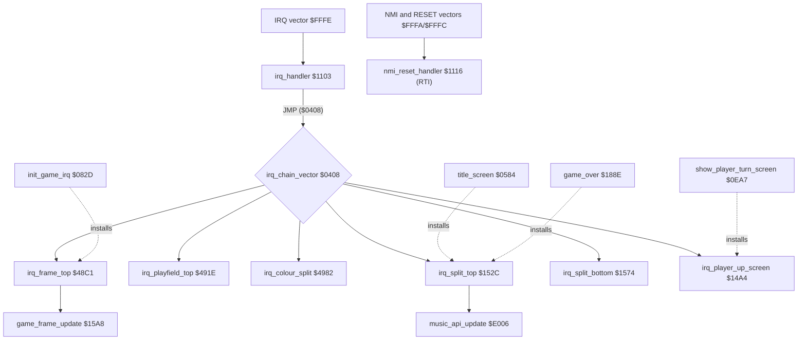
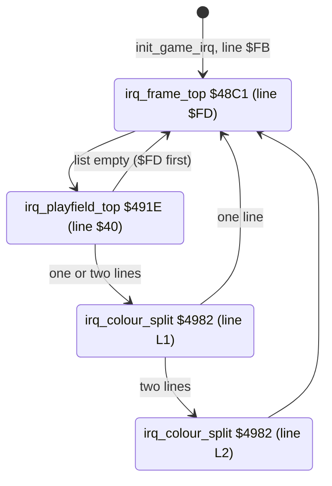
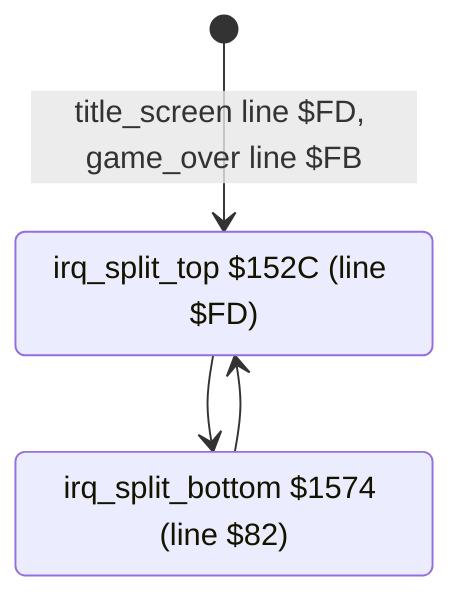

# Bruce Lee: the interrupt chain

This page covers:
- the CPU vectors at `$FFFA-$FFFF`, the IRQ entry [`irq_handler`](../../src/interrupts.asm#L6) [`$1103`](../reference/modules/interrupts.md#irq_handler) and its dispatch through [`irq_chain_vector`](../../src/init.asm#L15) [`$0408`](../reference/modules/init.md#irq_chain_vector), and the NMI/RESET stub [`nmi_reset_handler`](../../src/interrupts.asm#L21) [`$1116`](../reference/modules/interrupts.md#nmi_reset_handler);
- the raster IRQ chain of the game (status line, room charset, colour splits) and the chains of the title, game-over and player-up screens;
- which routine installs which chain, and on which raster line;
- the per-frame work of [`game_frame_update`](../../src/frame_update.asm#L6) [`$15A8`](../reference/modules/frame_update.md#game_frame_update), and the frame countdown that paces [`main_loop`](../../src/main_loop.asm#L6) [`$1BC2`](../reference/modules/main_loop.md#main_loop);
- [`random_byte`](../../src/interrupts.asm#L75) [`$1159`](../reference/modules/interrupts.md#random_byte) and the sprite buffer clears in `interrupts.asm`;
- the PAL freeze bug of [`draw_room`](../../src/room_draw.asm#L6) [`$09BC`](../reference/modules/room_draw.md#draw_room), seen from the interrupt side.

**Sources.**
- `src/interrupts.asm`, `src/raster_irq_screens.asm`, `src/frame_update.asm`, `src/raster_irq_game.asm`, `src/room_split_tables.asm`, `src/vectors.asm`, and the installers in `src/game_setup.asm`, `src/title.asm`, `src/player_turn.asm` and `src/game_over.asm`.
- The reference: [interrupts.asm](../reference/modules/interrupts.md), [raster_irq_screens.asm](../reference/modules/raster_irq_screens.md), [frame_update.asm](../reference/modules/frame_update.md), [raster_irq_game.asm](../reference/modules/raster_irq_game.md), [room_split_tables.asm](../reference/modules/room_split_tables.md), [vectors.asm](../reference/modules/vectors.md).
- The table [assets/tables/irq_chain.json](../../assets/tables/irq_chain.json): every handler and every place that sets the next handler.
- The image `unpacked/image.bin`, the coverage of all runs, and the runs `vic` and `r17_freeze`.

**Conventions.**
- Addresses are C64 addresses. Names are the names of the knowledge.
- A *frame* is one video frame: one run of the raster IRQ chain (50 per second on PAL). A *pass* is one run of [`main_loop`](../../src/main_loop.asm#L6) [`$1BC2`](../reference/modules/main_loop.md#main_loop), at most one pass every 3 frames.
- A *handler* is one raster IRQ routine of a chain. A *chain* is the cycle of handlers of one screen mode. A handler *installs* the next one when it writes [`irq_chain_vector`](../../src/init.asm#L15) and `$D012`.
- *Line* means a raster line. Screen row n covers lines `$33`+8n to `$3A`+8n.
- *Demo* is the attract mode ([`game_playing`](../../src/constants.asm#L120) = 0). An *actor* is a moving figure; actor 0 = Bruce, actor 1 = Yamo (this rests on the colours and the opponent option, see report.md).
- **Observed** marks a fact that a run showed (also the coverage of the runs). **Code** marks a fact from the code only. **Conclusion** marks an interpretation.

## 1. Overview

A solid arrow is a call or a jump. A dotted arrow means "writes the handler into [`irq_chain_vector`](../../src/init.asm#L15)".

| Part | Role |
|---|---|
| [`hw_irq_vector`](../../src/vectors.asm#L9) [`$FFFE`](../reference/modules/vectors.md#hw_irq_vector) | IRQ -> [`irq_handler`](../../src/interrupts.asm#L6) [`$1103`](../reference/modules/interrupts.md#irq_handler). |
| [`hw_nmi_vector`](../../src/vectors.asm#L5) [`$FFFA`](../reference/modules/vectors.md#hw_nmi_vector), [`hw_reset_vector`](../../src/vectors.asm#L7) [`$FFFC`](../reference/modules/vectors.md#hw_reset_vector) | NMI and RESET -> [`nmi_reset_handler`](../../src/interrupts.asm#L21) [`$1116`](../reference/modules/interrupts.md#nmi_reset_handler). |
| [`irq_handler`](../../src/interrupts.asm#L6) [`$1103`](../reference/modules/interrupts.md#irq_handler) | Saves A, X, Y and jumps through [`irq_chain_vector`](../../src/init.asm#L15) [`$0408`](../reference/modules/init.md#irq_chain_vector). |
| [`irq_frame_top`](../../src/raster_irq_game.asm#L6) [`$48C1`](../reference/modules/raster_irq_game.md#irq_frame_top), [`irq_playfield_top`](../../src/raster_irq_game.asm#L54) [`$491E`](../reference/modules/raster_irq_game.md#irq_playfield_top), [`irq_colour_split`](../../src/raster_irq_game.asm#L107) [`$4982`](../reference/modules/raster_irq_game.md#irq_colour_split) | The game chain (game and demo). |
| [`irq_split_top`](../../src/raster_irq_screens.asm#L74) [`$152C`](../reference/modules/raster_irq_screens.md#irq_split_top), [`irq_split_bottom`](../../src/raster_irq_screens.asm#L112) [`$1574`](../reference/modules/raster_irq_screens.md#irq_split_bottom) | The chain of the title and game-over screens. |
| [`irq_player_up_screen`](../../src/raster_irq_screens.asm#L6) [`$14A4`](../reference/modules/raster_irq_screens.md#irq_player_up_screen) | The one-handler chain of the player-up screen. |
| [`game_frame_update`](../../src/frame_update.asm#L6) [`$15A8`](../reference/modules/frame_update.md#game_frame_update) | The per-frame work of the game chain. |
| [`init_game_irq`](../../src/game_setup.asm#L97) [`$082D`](../reference/modules/game_setup.md#init_game_irq), [`title_screen`](../../src/title.asm#L6) [`$0584`](../reference/modules/title.md#title_screen), [`game_over`](../../src/game_over.asm#L67) [`$188E`](../reference/modules/game_over.md#game_over), [`show_player_turn_screen`](../../src/player_turn.asm#L6) [`$0EA7`](../reference/modules/player_turn.md#show_player_turn_screen) | The installers (section 4). |

## 2. The catalogue

| Name | Address | Layout | Read by | Written by |
|---|---|---|---|---|
| [`hw_nmi_vector`](../../src/vectors.asm#L5) | `$FFFA-$FFFF` | Three words: NMI `$1116`, RESET `$1116`, IRQ `$1103`. | the CPU | none (part of the image) |
| [`irq_chain_vector`](../../src/init.asm#L15) / [`irq_vector_hi`](../../src/init.asm#L16) | `$0408/$0409` | Address of the next handler. The two bytes are the operand of the `AND #$EF` in [`cold_start`](../../src/init.asm#L6) [`$0400`](../reference/modules/init.md#cold_start), reused as a variable. | [`irq_handler`](../../src/interrupts.asm#L6) [`$1113`](../../src/interrupts.asm#L19) | every handler and installer (section 4) |
| [`frame_countdown`](../../src/constants.asm#L34) | `$48` | Frames to wait. -1 per frame down to 0. | [`main_loop_wait`](../../src/main_loop.asm#L59) [`$1C32`](../reference/modules/main_loop.md#main_loop_wait) and every wait loop | [`main_loop`](../../src/main_loop.asm#L6) [`$1BC2`](../reference/modules/main_loop.md#main_loop) (3), the waits; -1 by [`irq_split_top`](../../src/raster_irq_screens.asm#L74), [`irq_player_up_screen`](../../src/raster_irq_screens.asm#L6) and [`game_frame_update`](../../src/frame_update.asm#L6) |
| [`attract_countdown`](../../src/constants.asm#L35) / [`title_timeout_hi`](../../src/constants.asm#L36) | `$49/$4A` | 16-bit frame countdown. | [`title_menu_loop`](../../src/title_menu.asm#L6) [`$08B1`](../reference/modules/title_menu.md#title_menu_loop), room 19 | [`title_wait_input`](../../src/title.asm#L174) [`$06FA`](../reference/modules/title.md#title_wait_input) (`$0960`); -1 by [`irq_split_top`](../../src/raster_irq_screens.asm#L74) and [`game_frame_update`](../../src/frame_update.asm#L6) |
| [`raster_colours`](../../src/constants.asm#L136) | `$0153-$015E` | 4 triplets of `$D021/$D022/$D023` for the colour bands. | [`irq_playfield_top`](../../src/raster_irq_game.asm#L54), [`irq_colour_split`](../../src/raster_irq_game.asm#L107) | [`irq_frame_top`](../../src/raster_irq_game.asm#L6) (every frame), the screen saver in [`game_frame_update`](../../src/frame_update.asm#L6) |
| [`current_raster_splits`](../../src/room_colours.asm#L50) | `$47F5-$47F8` | Lines where the next triplet starts, ended by `$FD`. | [`irq_schedule_split`](../../src/raster_irq_game.asm#L80) [`$4953`](../reference/modules/raster_irq_game.md#irq_schedule_split), [`irq_colour_split`](../../src/raster_irq_game.asm#L107) | [`irq_frame_top`](../../src/raster_irq_game.asm#L6) (4 bytes, every frame) |
| [`room_split_colour_ptrs`](../../src/room_split_tables.asm#L6) | `$480B-$4832` | 20 words: the band colours of each room. | [`irq_frame_top`](../../src/raster_irq_game.asm#L6) | none |
| [`room_raster_line_ptrs`](../../src/room_split_tables.asm#L16) | `$4833-$485A` | 20 words: the line list of each room. | [`irq_frame_top`](../../src/raster_irq_game.asm#L6) | none |
| [`split_index`](../../src/constants.asm#L32) | `$44` | Index of the next line in [`current_raster_splits`](../../src/room_colours.asm#L50). | [`irq_schedule_split`](../../src/raster_irq_game.asm#L80), [`irq_colour_split`](../../src/raster_irq_game.asm#L107) | [`irq_playfield_top`](../../src/raster_irq_game.asm#L54), [`irq_colour_split`](../../src/raster_irq_game.asm#L107), [`game_frame_update`](../../src/frame_update.asm#L6) (0) |
| [`split_colour_offset`](../../src/constants.asm#L111) | `$F4` | Offset of the next triplet in [`raster_colours`](../../src/constants.asm#L136): 3, 6, 9. | [`irq_colour_split`](../../src/raster_irq_game.asm#L107) | [`irq_playfield_top`](../../src/raster_irq_game.asm#L54) (3), [`irq_colour_split`](../../src/raster_irq_game.asm#L107) (+3) |
| [`room_charset_d018`](../../src/constants.asm#L109) | `$F2` | `$D018` of the playfield: `$38`, `$3A`, `$3C` or `$3E`. | [`irq_playfield_top`](../../src/raster_irq_game.asm#L54), [`game_frame_update`](../../src/frame_update.asm#L6) | [`init_game_screen`](../../src/game_setup.asm#L6) [`$0763`](../reference/modules/game_setup.md#init_game_screen), [`draw_room`](../../src/room_draw.asm#L6) [`$09BC`](../reference/modules/room_draw.md#draw_room), room 18 |
| [`charset_hi`](../../src/constants.asm#L67) | `$7C` | High byte of the room charset: `$A0`, `$A8`, `$B0`, `$B8`. | the char animations | [`game_frame_update`](../../src/frame_update.asm#L6) (every frame) |
| [`random_ptr`](../../src/constants.asm#L18) | `$16/$17` | Pointer into [`random_table`](../../src/constants.asm#L137) [`$0200`](../reference/variables.md#random_table). Only the low byte moves. | [`random_byte`](../../src/interrupts.asm#L75) | [`restart_to_title`](../../src/restart.asm#L6) [`$050F`](../reference/modules/restart.md#restart_to_title); +1 by [`random_byte`](../../src/interrupts.asm#L75) and [`game_frame_update`](../../src/frame_update.asm#L6) |
| [`idle_ticks`](../../src/constants.asm#L69) | `$7F` | Frame counter; its wrap is the 256-frame tick. | [`game_frame_update`](../../src/frame_update.asm#L6) | [`game_frame_update`](../../src/frame_update.asm#L6) |
| [`idle_timer`](../../src/constants.asm#L71) | `$82` | Idle time in 256-frame steps. Bit 7 = screen saver on (`$FE`). | [`game_frame_update`](../../src/frame_update.asm#L6), [`toggle_pause`](../../src/status.asm#L77) [`$1A22`](../reference/modules/status.md#toggle_pause) | [`game_frame_update`](../../src/frame_update.asm#L6), [`show_paused`](../../src/status.asm#L94) [`$1A42`](../reference/modules/status.md#show_paused) (`$51`), [`save_raster_colours`](../../src/room_state.asm#L6) [`$102B`](../reference/modules/room_state.md#save_raster_colours) (`$FE`), [`restore_raster_colours`](../../src/room_state.asm#L18) [`$103B`](../reference/modules/room_state.md#restore_raster_colours) (0) |
| [`colour_cycle_counter`](../../src/constants.asm#L70) | `$80/$81` | 16-bit count of 256-frame ticks. The low byte is the screen saver XOR. | [`game_frame_update`](../../src/frame_update.asm#L6) | [`game_frame_update`](../../src/frame_update.asm#L6) |
| [`saver_xor`](../../src/constants.asm#L72) / [`saver_mask`](../../src/constants.asm#L73) | `$83/$84` | XOR value and AND mask (`$F7`) of the screen saver. | [`game_frame_update`](../../src/frame_update.asm#L6) | [`game_frame_update`](../../src/frame_update.asm#L6) |
| [`saved_band_colours`](../../src/room_colours.asm#L16) | `$47B4-$47C7` | Copy of the 20 bytes at `$0153`, made when the screen saver starts. | [`game_frame_update`](../../src/frame_update.asm#L6), [`restore_raster_colours`](../../src/room_state.asm#L18) | [`save_raster_colours`](../../src/room_state.asm#L6) |
| [`room_timer_lo`](../../src/constants.asm#L76) / [`room_timer`](../../src/constants.asm#L77) | `$87/$88` | Frames in the room; [`room_timer`](../../src/constants.asm#L77) counts 256-frame steps up to `$80`. | the spawn timers | [`game_frame_update`](../../src/frame_update.asm#L6), room entry |
| [`hit_budget_countdown`](../../src/actor_vars.asm#L6) | `$4EEC` | -1 per frame. At 0, [`actor_hit_budget`](../../src/actor_vars.asm#L191) [`$4F45`](../reference/modules/actor_vars.md#actor_hit_budget) is set to 2 for the three actors. | [`game_frame_update`](../../src/frame_update.asm#L6) | [`game_frame_update`](../../src/frame_update.asm#L6) |
| [`yamo_idle_timer`](../../src/constants.asm#L78) | `$89/$8A` | Frames with no input on the port of a human Yamo. | [`game_frame_update`](../../src/frame_update.asm#L6) | [`game_frame_update`](../../src/frame_update.asm#L6) |
| [`saved_cia1_ddra`](../../src/actor_movement.asm#L571) / [`saved_cia1_ddrb`](../../src/actor_movement.asm#L573) | `$2005/$2006` | The CIA 1 data direction registers during the joystick read. | [`game_frame_update`](../../src/frame_update.asm#L6) | [`game_frame_update`](../../src/frame_update.asm#L6) |

## 3. The entry: vectors, [`irq_handler`](../../src/interrupts.asm#L6) and the NMI stub

The game runs with `$01` = `$35`: the KERNAL ROM is off and the I/O is on, so the CPU takes its vectors from RAM at `$FFFA-$FFFF` (**Observed** in the `vic` run: `$01` = `$35`, `$FFFA-$FFFF` = `16 11 16 11 03 11`).

**[`irq_handler`](../../src/interrupts.asm#L6) [`$1103`](../reference/modules/interrupts.md#irq_handler)**, step by step (**Code**):
1. PHA, TXA, PHA, TYA, PHA: it saves A, X and Y.
2. TSX, then `LDA $0104,X` at `$110A`. With X = the stack pointer, `$0104,X` is the status byte that the CPU pushed with the interrupt. The knowledge writes the operand as [`game_playing`](../../src/constants.asm#L120), because [`game_playing`](../../src/constants.asm#L120) is also `$0104`. It is not that variable here.
3. `AND #$00` at `$110C`. In the KERNAL this is `AND #$10`, the test of the BRK flag. With `#$00` the result is always 0, so the `JMP ($DE00)` at `$1110` is never taken (**Observed**: no run executed `$1110`). report.md lists this byte as a possible crack patch.
4. [`irq_dispatch`](../../src/interrupts.asm#L18) [`$1113`](../reference/modules/interrupts.md#irq_dispatch): `JMP (irq_chain_vector)`.

Each handler ends with PLA, TAY, PLA, TAX, PLA, RTI. [`irq_handler`](../../src/interrupts.asm#L6) does not clear the decimal flag; only [`game_frame_update`](../../src/frame_update.asm#L6) does (CLD at `$15A8`). See section 9.3.

**[`nmi_reset_handler`](../../src/interrupts.asm#L21) [`$1116`](../reference/modules/interrupts.md#nmi_reset_handler)** is one RTI (`$40`). The bytes after it are `JMP ($FFFC)` and `JMP ($0000)`; nothing reaches them.
- NMI: [`init_game_irq`](../../src/game_setup.asm#L97) [`$082D`](../reference/modules/game_setup.md#init_game_irq) and [`keyboard_init`](../../src/keyboard.asm#L6) [`$1386`](../reference/modules/keyboard.md#keyboard_init) write `$7F` to `$DD0D`, so CIA 2 gives no NMI. The RESTORE key still gives an NMI, and the RTI ignores it (**Code**; no run pressed RESTORE).
- RESET: **Conclusion.** A hardware reset maps the KERNAL ROM in, so the CPU reads the ROM vector. The RAM word [`hw_reset_vector`](../../src/vectors.asm#L7) [`$FFFC`](../reference/modules/vectors.md#hw_reset_vector) is not used.

**CIA interrupts** are off in the game: [`init_game_irq`](../../src/game_setup.asm#L97) writes `$7F` to `$DC0D` and `$DD0D` and reads both to clear pending flags. Every handler writes `$D01A` = 1 (raster only) and `$D019` = 1 (acknowledge). So the only IRQ source is the VIC raster compare (**Code**).

## 4. Who installs which chain

| Installer | Place | Handler | First line | I flag at the write |
|---|---|---|---|---|
| [`title_screen`](../../src/title.asm#L6) [`$0584`](../reference/modules/title.md#title_screen) | [`title_screen`](../../src/title.asm#L6) [`$05DA`](../../src/title.asm#L44) | [`irq_split_top`](../../src/raster_irq_screens.asm#L74) [`$152C`](../reference/modules/raster_irq_screens.md#irq_split_top) | `$FD` | set (SEI at `$0584`, CLI at [`title_wait_input`](../../src/title.asm#L174) [`$070A`](../../src/title.asm#L182)) |
| [`game_over`](../../src/game_over.asm#L67) [`$188E`](../reference/modules/game_over.md#game_over) | [`game_over`](../../src/game_over.asm#L67) [`$18A2`](../../src/game_over.asm#L76) | [`irq_split_top`](../../src/raster_irq_screens.asm#L74) [`$152C`](../reference/modules/raster_irq_screens.md#irq_split_top) | `$FB` | set (SEI at `$1894`, CLI at `$1963`) |
| [`show_player_turn_screen`](../../src/player_turn.asm#L6) [`$0EA7`](../reference/modules/player_turn.md#show_player_turn_screen) | [`show_player_turn_screen`](../../src/player_turn.asm#L6) [`$0F00`](../../src/player_turn.asm#L49) | [`irq_player_up_screen`](../../src/raster_irq_screens.asm#L6) [`$14A4`](../reference/modules/raster_irq_screens.md#irq_player_up_screen) | `$63` | set (SEI at `$0EA7`, CLI at `$0F31`) |
| [`init_game_irq`](../../src/game_setup.asm#L97) [`$082D`](../reference/modules/game_setup.md#init_game_irq) (from [`init_game_screen`](../../src/game_setup.asm#L6) [`$0763`](../reference/modules/game_setup.md#init_game_screen)) | [`init_game_irq`](../../src/game_setup.asm#L97) [`$083C`](../../src/game_setup.asm#L104) | [`irq_frame_top`](../../src/raster_irq_game.asm#L6) [`$48C1`](../reference/modules/raster_irq_game.md#irq_frame_top) | `$FB` | depends on the caller, see below |

Inside the chains (**Code**):

| Handler | Next handler | Next line |
|---|---|---|
| [`irq_split_top`](../../src/raster_irq_screens.asm#L74) [`$152C`](../reference/modules/raster_irq_screens.md#irq_split_top) | [`irq_split_bottom`](../../src/raster_irq_screens.asm#L112) [`$1574`](../reference/modules/raster_irq_screens.md#irq_split_bottom) | `$82` |
| [`irq_split_bottom`](../../src/raster_irq_screens.asm#L112) [`$1574`](../reference/modules/raster_irq_screens.md#irq_split_bottom) | [`irq_split_top`](../../src/raster_irq_screens.asm#L74) [`$152C`](../reference/modules/raster_irq_screens.md#irq_split_top) | `$FD` |
| [`irq_player_up_screen`](../../src/raster_irq_screens.asm#L6) [`$14A4`](../reference/modules/raster_irq_screens.md#irq_player_up_screen) | itself (the vector is not written) | `$63` |
| [`irq_frame_top`](../../src/raster_irq_game.asm#L6) [`$48C1`](../reference/modules/raster_irq_game.md#irq_frame_top) | [`irq_playfield_top`](../../src/raster_irq_game.asm#L54) [`$491E`](../reference/modules/raster_irq_game.md#irq_playfield_top) | `$40` |
| [`irq_playfield_top`](../../src/raster_irq_game.asm#L54) [`$491E`](../reference/modules/raster_irq_game.md#irq_playfield_top) | [`irq_colour_split`](../../src/raster_irq_game.asm#L107) [`$4982`](../reference/modules/raster_irq_game.md#irq_colour_split), or [`irq_frame_top`](../../src/raster_irq_game.asm#L6) when the first line in [`current_raster_splits`](../../src/room_colours.asm#L50) is `$FD` | [`current_raster_splits+0`](../../src/room_colours.asm#L50) |
| [`irq_colour_split`](../../src/raster_irq_game.asm#L107) [`$4982`](../reference/modules/raster_irq_game.md#irq_colour_split) | itself, or [`irq_frame_top`](../../src/raster_irq_game.asm#L6) after the last line | the next entry of [`current_raster_splits`](../../src/room_colours.asm#L50) |

**The callers of [`init_game_screen`](../../src/game_setup.asm#L6)** and the chain that each one leaves (**Code**):
- [`restart_to_title`](../../src/restart.asm#L6) [`$050F`](../reference/modules/restart.md#restart_to_title) (with SEI): it installs [`irq_frame_top`](../../src/raster_irq_game.asm#L6), then [`title_screen`](../../src/title.asm#L6) replaces it with [`irq_split_top`](../../src/raster_irq_screens.asm#L74) before the next CLI. [`irq_frame_top`](../../src/raster_irq_game.asm#L6) does not run there.
- [`start_demo`](../../src/restart.asm#L24) [`$0531`](../reference/modules/restart.md#start_demo) (with SEI): the game chain starts at the CLI before `JMP main_loop`.
- [`start_game`](../../src/title.asm#L185) [`$070E`](../reference/modules/title.md#start_game) and [`respawn_after_fall`](../../src/game_over.asm#L62) [`$1886`](../reference/modules/game_over.md#respawn_after_fall): they run after [`show_player_turn_screen`](../../src/player_turn.asm#L6), which returns with the I flag clear. So [`init_game_irq`](../../src/game_setup.asm#L97) switches from [`irq_player_up_screen`](../../src/raster_irq_screens.asm#L6) to [`irq_frame_top`](../../src/raster_irq_game.asm#L6) while IRQs are enabled. See section 9.2.

The leftover copy of `$482C-$492A` at `$4FE8-$50E6` (report.md) also holds a write of [`irq_playfield_top`](../../src/raster_irq_game.asm#L54) at `$5087`. No run executed it (**Observed**: coverage 0).

## 5. The chains, frame by frame

All handlers write `$D011` the same way: `LDA $D011 / AND #$7F / STA $D011`. This clears bit 8 of the raster compare and keeps the other bits. In the game `$D011` reads `$1B` (display on, 25 rows, Y scroll 3) (**Observed** in the `vic` run, room 1). `$D018` reads back with bit 0 set: `$38` reads `$39`.

### 5.1 The game (and the demo)

| Handler | IRQ line | When it writes | `$D011` | Next `$D012` | `$D018` | `$D021` | Other writes |
|---|---|---|---|---|---|---|---|
| [`irq_frame_top`](../../src/raster_irq_game.asm#L6) [`$48C1`](../reference/modules/raster_irq_game.md#irq_frame_top) | `$FD` (253); `$FB` on the first frame | at once, in the lower border | AND `$7F` | `$40` | `$32`: screen `$8C00`, charset `$8800` (status font) | `$FC` (grey, status line) | copies the band colours and lines (section 6.1), then calls [`game_frame_update`](../../src/frame_update.asm#L6) [`$15A8`](../reference/modules/frame_update.md#game_frame_update) |
| [`irq_playfield_top`](../../src/raster_irq_game.asm#L54) [`$491E`](../reference/modules/raster_irq_game.md#irq_playfield_top) | `$40` (64) | [`irq_wait_line_42`](../../src/raster_irq_game.asm#L56) [`$4920`](../reference/modules/raster_irq_game.md#irq_wait_line_42) waits for line `$42`, then about 51 cycles: late in line `$42`, the last line of screen row 1 | AND `$7F` | [`current_raster_splits+0`](../../src/room_colours.asm#L50) (or `$FD`) | [`room_charset_d018`](../../src/constants.asm#L109): `$38` (`$A000`), `$3A` (`$A800`), `$3C` (`$B000`) or `$3E` (`$B800`) | [`raster_colours+0`](../../src/constants.asm#L136) | `$D022` = [`raster_colours+1`](../../src/constants.asm#L136), `$D023` = [`raster_colours+2`](../../src/constants.asm#L136); [`split_index`](../../src/constants.asm#L32) = 0, [`split_colour_offset`](../../src/constants.asm#L111) = 3 |
| [`irq_colour_split`](../../src/raster_irq_game.asm#L107) [`$4982`](../reference/modules/raster_irq_game.md#irq_colour_split) | L, from the room list | [`irq_split_wait_line`](../../src/raster_irq_game.asm#L118) [`$4991`](../reference/modules/raster_irq_game.md#irq_split_wait_line): at line L+3 at once, or at line L+2 after about 51 cycles | AND `$7F` | the next L, or `$FD` | - | triplet byte 0 | `$D022`, `$D023` = triplet bytes 1, 2; [`split_colour_offset`](../../src/constants.asm#L111) + 3, [`split_index`](../../src/constants.asm#L32) + 1 |

**Code**, with the line arithmetic as **Conclusion**:
- Screen rows 0-1 (lines `$33-$42`) use the status font and `$D021` = `$FC`. Their colour RAM is 0, so only `$D021` matters for them.
- From row 2 (line `$43`) the room charset and triplet 0 are shown.
- Each listed line L gives a new triplet from about line L+3.
- The lines of each room, the colours of each band and the measured band starts are in [room_pipeline.md, section 4.2](room_pipeline.md#7-the-colour-bands-of-a-room). This page does not repeat them.
- The chain has 2, 3 or 4 IRQs per frame: 2 for a room without a line list, 3 for rooms 10, 12, 14 and 16, 4 for rooms 0-3 and 15 (from the lists in room_pipeline.md).
- `$D020` (border) is not written by the game chain. [`init_game_screen`](../../src/game_setup.asm#L6) sets it.

[`irq_schedule_split`](../../src/raster_irq_game.asm#L80) [`$4953`](../reference/modules/raster_irq_game.md#irq_schedule_split) is the common tail of [`irq_playfield_top`](../../src/raster_irq_game.asm#L54) and [`irq_colour_split`](../../src/raster_irq_game.asm#L107). It acknowledges the IRQ, sets `$D012` = `current_raster_splits[split_index]`, and when that value is `$FD` it installs [`irq_frame_top`](../../src/raster_irq_game.asm#L6) ([`irq_schedule_frame_top`](../../src/raster_irq_game.asm#L100) [`$4975`](../reference/modules/raster_irq_game.md#irq_schedule_frame_top)). [`irq_return`](../../src/raster_irq_game.asm#L92) [`$496F`](../reference/modules/raster_irq_game.md#irq_return) ends the IRQ.

### 5.2 The title and the game-over screen

| Handler | IRQ line | `$D011` | Next `$D012` | `$D018` | `$D016` | `$D021` | Other work |
|---|---|---|---|---|---|---|---|
| [`irq_split_top`](../../src/raster_irq_screens.asm#L74) [`$152C`](../reference/modules/raster_irq_screens.md#irq_split_top) | `$FD` (253) | AND `$7F` | `$82` | `$30`: screen `$8C00`, charset `$8000` | `$18`: multicolour, 40 columns, X scroll 0 | not written | [`frame_countdown`](../../src/constants.asm#L34) - 1; [`attract_countdown`](../../src/constants.asm#L35)/[`title_timeout_hi`](../../src/constants.asm#L36) - 1; [`music_api_update`](../../src/music_player.asm#L13) [`$E006`](../reference/modules/music_player.md#music_api_update) |
| [`irq_split_bottom`](../../src/raster_irq_screens.asm#L112) [`$1574`](../reference/modules/raster_irq_screens.md#irq_split_bottom) | `$82` (130) | AND `$7F` | `$FD` | `$32`: charset `$8800` | `$16`: multicolour, 38 columns, X scroll 6 | not written | a delay of 4 DEX before the writes |

- **Conclusion** from the line arithmetic: the `$D018` change of [`irq_split_bottom`](../../src/raster_irq_screens.asm#L112) comes in line `$82`, the last line of screen row 9. So rows 0-9 use charset `$8000` and rows 10-24 use `$8800`.
- **Observed** in the `vic` run on the title, line 249: `$D018` reads `$33` (= `$32`), X scroll 6, background colours 6, 15, 15.
- The colours are set once by the installer. [`title_screen`](../../src/title.asm#L6): `$D020` = `$D021` = `$F6`, `$D022` = `$D023` = `$FF`. [`game_over`](../../src/game_over.asm#L67): `$D020` = `$D021` = `$06`, `$D022` = `$D023` = `$0F` (**Code**).
- The music player runs only in this chain. In the game the sound comes from [`game_frame_update`](../../src/frame_update.asm#L6) (see [sound.md](sound.md)).

### 5.3 The player-up screen

[`irq_player_up_screen`](../../src/raster_irq_screens.asm#L6) [`$14A4`](../reference/modules/raster_irq_screens.md#irq_player_up_screen) is the only handler. It keeps [`irq_chain_vector`](../../src/init.asm#L15) and rearms line `$63` (**Code**):
1. `$14A4-$14B6`: it waits for line `$6E` (go at once) or line `$6D` (then a delay of 10 DEX).
2. It writes `$D022` seven times, with [`raster_delay`](../../src/raster_irq_screens.asm#L67) [`$1526`](../reference/modules/raster_irq_screens.md#raster_delay) between the writes: `$FB`, `$FC`, `$FF`, `$F1`, `$FF`, `$FC`, `$FB`. The gaps are 2, 2, 2, 1, 2 and 2 delays.
3. `$D018` = `$30` (charset `$8000`), `$D016` = `$18`.
4. `$D01A` = `$D019` = 1, `$D011` AND `$7F`, `$D012` = `$63`.
5. [`frame_countdown`](../../src/constants.asm#L34) - 1 when it is not 0.

[`raster_delay`](../../src/raster_irq_screens.asm#L67) is JSR, `LDX #$0A`, ten DEX/BNE and RTS: 6 + 2 + 49 + 6 = 63 cycles, one PAL line (a bad line takes longer). So the seven colours are bands of about 2 lines over lines `$6D-$7A`, screen rows 7-8. [`show_player_turn_screen`](../../src/player_turn.asm#L6) puts the "PLAYER n" banner on these rows ([`screen_ram+$124`](../../src/vic_bank2.asm#L376) [`$8D24`](../reference/modules/vic_bank2.md#screen_ram) and [`screen_ram+$14C`](../../src/vic_bank2.asm#L376) [`$8D4C`](../reference/modules/vic_bank2.md#screen_ram)). **Conclusion:** the bands are a grey-white shine over the banner. `$D021` = `$06` comes from [`show_player_turn_screen`](../../src/player_turn.asm#L6).

This chain has no sound and no countdown other than [`frame_countdown`](../../src/constants.asm#L34). [`show_player_turn_screen`](../../src/player_turn.asm#L6) waits 64 frames (128 with two players) on it.

## 6. The per-frame work

### 6.1 [`irq_frame_top`](../../src/raster_irq_game.asm#L6) [`$48C1`](../reference/modules/raster_irq_game.md#irq_frame_top)

1. `$D018` = `$32`, `$D021` = `$FC`.
2. Installs [`irq_playfield_top`](../../src/raster_irq_game.asm#L54), acknowledges, `$D011` AND `$7F`, `$D012` = `$40`.
3. Reads the two room pointers: [`room_split_colour_ptrs`](../../src/room_split_tables.asm#L6) + 2 × [`current_room`](../../src/constants.asm#L28) into `$0A/$0B`, [`room_raster_line_ptrs`](../../src/room_split_tables.asm#L16) + 2 × [`current_room`](../../src/constants.asm#L28) into `$0C/$0D`.
4. [`irq_copy_room_colours`](../../src/raster_irq_game.asm#L36) [`$4904`](../reference/modules/raster_irq_game.md#irq_copy_room_colours): for Y = 11 down to 0, `raster_colours[Y]` = colours[Y]; for Y < 4 also `current_raster_splits[Y]` = lines[Y]. The bytes after the `$FD` end are copied too and not used.
5. `JSR game_frame_update` `$15A8`, then the RTI.

Because of step 4, a change of [`current_room`](../../src/constants.asm#L28) shows in the bands from the next frame. Any write to [`raster_colours`](../../src/constants.asm#L136) by the main loop is lost at the next frame, except through the screen saver of [`game_frame_update`](../../src/frame_update.asm#L6), which runs after the copy (**Code**).

### 6.2 [`game_frame_update`](../../src/frame_update.asm#L6) [`$15A8`](../reference/modules/frame_update.md#game_frame_update), step by step

All steps are **Code**; the coverage notes are **Observed**.

1. CLD. [`split_index`](../../src/constants.asm#L32) = 0.
2. X = [`current_room`](../../src/constants.asm#L28). [`sfx_v1_update`](../../src/sfx_voice1.asm#L13) [`$EB03`](../reference/modules/sfx_voice1.md#sfx_v1_update), [`sfx_v2_update`](../../src/sfx_voice2.asm#L13) [`$EF73`](../reference/modules/sfx_voice2.md#sfx_v2_update), [`sfx_v3_update`](../../src/sfx_voice3.asm#L13) [`$F073`](../reference/modules/sfx_voice3.md#sfx_v3_update): one step of each sound effect voice. Details: [sound.md](sound.md).
3. [`random_ptr`](../../src/constants.asm#L18) + 1 (section 8).
4. [`update_sprite_registers`](../../src/sprite_render.asm#L60) [`$25E2`](../reference/modules/sprite_render.md#update_sprite_registers): when the main loop has drawn new sprite images, it writes them to the VIC. Details: [sprites.md](sprites.md).
5. Hit budget: when [`hit_budget_countdown`](../../src/actor_vars.asm#L6) is 0, [`actor_hit_budget`](../../src/actor_vars.asm#L191) [`$4F45`](../reference/modules/actor_vars.md#actor_hit_budget) = 2 for actors 0-2. Then [`hit_budget_countdown`](../../src/actor_vars.asm#L6) - 1, so this happens every 256 frames. Details: [combat_collision.md](combat_collision.md).
6. [`charset_hi`](../../src/constants.asm#L67) from [`room_charset_d018`](../../src/constants.asm#L109): `$38` -> `$A0`, `$3A` -> `$A8`, `$3C` -> `$B0`, others -> `$B8`.
7. Left-handed markers: [`screen_ram+$2A`](../../src/vic_bank2.asm#L376) [`$8C2A`](../reference/modules/vic_bank2.md#screen_ram) = `$2C` when [`joy_handedness_p1`](../../src/actor_room_tables.asm#L99) [`$1383`](../reference/modules/actor_room_tables.md#joy_handedness_p1) is 0, else 0. [`screen_ram+$4D`](../../src/vic_bank2.asm#L376) [`$8C4D`](../reference/modules/vic_bank2.md#screen_ram) the same for [`joy_handedness_p2`](../../src/actor_room_tables.asm#L102) [`$1384`](../reference/modules/actor_room_tables.md#joy_handedness_p2), but only with [`human_opponent_mode`](../../src/variables.asm#L11) or [`two_player_mode`](../../src/variables.asm#L9); otherwise 0. **Observed**: no run executed the `$2C` paths (`$15F7`, `$160F`).
8. [`room_timer_tick`](../../src/frame_update.asm#L66) [`$1614`](../reference/modules/frame_update.md#room_timer_tick): while [`game_playing`](../../src/constants.asm#L120) ≠ 0 and [`pause_state`](../../src/constants.asm#L121) bit 7 is clear, [`room_timer_lo`](../../src/constants.asm#L76) + 1; on its wrap [`room_timer`](../../src/constants.asm#L77) + 1 until it reaches `$80`. Details: [main_loop.md](main_loop.md) and [room_flow.md](room_flow.md).
9. [`idle_timer_tick`](../../src/frame_update.asm#L77) [`$1628`](../reference/modules/frame_update.md#idle_timer_tick): [`idle_ticks`](../../src/constants.asm#L69) + 1. On its wrap (every 256 frames):
   - when [`idle_timer`](../../src/constants.asm#L71) < `$80`: [`idle_timer`](../../src/constants.asm#L71) + 1. When it becomes `$80`: [`pause_state`](../../src/constants.asm#L121) = `$86`, [`show_paused`](../../src/status.asm#L94) [`$1A42`](../reference/modules/status.md#show_paused), [`save_raster_colours`](../../src/room_state.asm#L6) [`$102B`](../reference/modules/room_state.md#save_raster_colours) (which sets [`idle_timer`](../../src/constants.asm#L71) = `$FE`);
   - [`colour_cycle_counter`](../../src/constants.asm#L70) + 1 (16 bits).
10. [`screen_saver_colours`](../../src/frame_update.asm#L95) [`$1645`](../reference/modules/frame_update.md#screen_saver_colours): when [`idle_timer`](../../src/constants.asm#L71) bit 7 is set, [`idle_timer`](../../src/constants.asm#L71) = `$FE`, [`saver_mask`](../../src/constants.asm#L73) = `$F7`, [`saver_xor`](../../src/constants.asm#L72) = [`colour_cycle_counter`](../../src/constants.asm#L70), and for X = `$13` down to 0: `raster_colours[X]` = (`saved_band_colours[X]` XOR [`saver_xor`](../../src/constants.asm#L72)) AND `$F7`. **Conclusion:** the bands then show colours 0-7 only, and they change every 256 frames.
11. [`protection_ddr_check`](../../src/frame_update.asm#L118) [`$166A`](../reference/modules/frame_update.md#protection_ddr_check): when `$00` is not `$EF`, it jumps back to step 9 and never leaves the IRQ. Details: [protection.md](protection.md).
12. [`frame_countdowns_tick`](../../src/frame_update.asm#L124) [`$1672`](../reference/modules/frame_update.md#frame_countdowns_tick): [`frame_countdown`](../../src/constants.asm#L34) - 1 when not 0; [`attract_countdown`](../../src/constants.asm#L35)/[`title_timeout_hi`](../../src/constants.asm#L36) - 1 as one 16-bit value when not 0.
13. [`read_joysticks`](../../src/frame_update.asm#L139) [`$1689`](../reference/modules/frame_update.md#read_joysticks): saves `$DC02/$DC03` in [`saved_cia1_ddra`](../../src/actor_movement.asm#L571)/[`saved_cia1_ddrb`](../../src/actor_movement.asm#L573) and sets both ports to input. Only when [`game_playing`](../../src/constants.asm#L120) ≠ 0:
    - Bruce: direction from `$DC01` (port 1) for player 0 or `$DC00` (port 2) for player 1, the low nibble, turned through [`joystick_rotate_bits`](../../src/room_tables.asm#L68) [`$4A85`](../reference/modules/room_tables.md#joystick_rotate_bits) when the player is left-handed, into [`actor_joy_dir`](../../src/constants.asm#L83). Fire (bit 4) of the same port into [`actor_joy_fire`](../../src/constants.asm#L84) (0 = pressed).
    - With [`human_opponent_mode`](../../src/variables.asm#L11): the other port into [`actor_joy_dir+1`](../../src/constants.asm#L83) and [`actor_joy_fire+1`](../../src/constants.asm#L84).
    - In the demo the joysticks are not read here.
14. [`protection_marker_check`](../../src/frame_update.asm#L209) [`$1703`](../reference/modules/frame_update.md#protection_marker_check): when `$02` is not `$32`, it fills memory downward and never returns. Details: [protection.md](protection.md).
15. [`joystick_read_done`](../../src/frame_update.asm#L222) [`$1717`](../reference/modules/frame_update.md#joystick_read_done): restores `$DC02/$DC03`. **Conclusion:** the save and restore let the IRQ read the sticks in the middle of a keyboard scan of the main loop.
16. [`idle_reset_check`](../../src/frame_update.asm#L227) [`$1723`](../reference/modules/frame_update.md#idle_reset_check): [`idle_timer`](../../src/constants.asm#L71) = 0 in the demo, or when the game is not paused and ([`actor_joy_dir`](../../src/constants.asm#L83) OR [`actor_joy_dir+1`](../../src/constants.asm#L83)) ≠ `$0F`, or [`actor_joy_fire`](../../src/constants.asm#L84) AND [`actor_joy_fire+1`](../../src/constants.asm#L84) = 0.
17. [`human_yamo_idle_check`](../../src/frame_update.asm#L243) [`$173F`](../reference/modules/frame_update.md#human_yamo_idle_check): only in a room with enemies, not paused, in a game, with [`human_opponent_mode`](../../src/variables.asm#L11). When Yamo's port shows no direction and no fire, [`yamo_idle_timer`](../../src/constants.asm#L78) + 1; any input sets it to 0. At `$0700` frames (about 36 s on PAL): [`human_opponent_mode`](../../src/variables.asm#L11) = 0, [`room_timer`](../../src/constants.asm#L77) = `$20`, [`play_sound_8a`](../../src/final_room.asm#L6) [`$424F`](../reference/modules/final_room.md#play_sound_8a), [`falls_left`](../../src/constants.asm#L27) and [`other_player_state`](../../src/variables.asm#L152) - 5 each (not below 0), [`print_falls_count`](../../src/status.asm#L200) [`$1AED`](../reference/modules/status.md#print_falls_count). **Observed**: the coverage shows that this path ran (`$1768-$1794`), but not the "below 5" branches.

**The idle timer and the screen saver** (**Code**, the times as **Conclusion** for PAL):
- Unpaused, with no input: [`idle_timer`](../../src/constants.asm#L71) goes from 0 to `$80` in 128 × 256 = 32768 frames, about 11 minutes. Then the game pauses itself and the screen saver starts.
- Paused: [`show_paused`](../../src/status.asm#L94) sets [`idle_timer`](../../src/constants.asm#L71) = `$51`, and step 16 no longer clears it. The screen saver starts after 47 × 256 = 12032 frames, about 4 minutes.
- [`toggle_pause`](../../src/status.asm#L77) [`$1A22`](../reference/modules/status.md#toggle_pause) ends it: [`restore_raster_colours`](../../src/room_state.asm#L18) [`$103B`](../reference/modules/room_state.md#restore_raster_colours) when [`idle_timer`](../../src/constants.asm#L71) bit 7 is set, then [`idle_timer`](../../src/constants.asm#L71) = 0.
- **Observed**: no run reached the screen saver (`$1634-$163E` and `$164D-$1669` are not executed).

## 7. The frame countdown and the pace of [`main_loop`](../../src/main_loop.asm#L6)

[`frame_countdown`](../../src/constants.asm#L34) [`$48`](../reference/variables.md#frame_countdown) is the only clock of the main code (**Code**):
1. [`main_loop`](../../src/main_loop.asm#L6) [`$1BC2`](../reference/modules/main_loop.md#main_loop) sets [`frame_countdown`](../../src/constants.asm#L34) = 3 at the start of each pass.
2. The pass runs. Each frame, [`game_frame_update`](../../src/frame_update.asm#L6) (step 12) subtracts 1.
3. [`main_loop_wait`](../../src/main_loop.asm#L59) [`$1C32`](../reference/modules/main_loop.md#main_loop_wait) loops until [`frame_countdown`](../../src/constants.asm#L34) is 0, then the next pass starts.

So a pass starts at most every 3 frames (16.7 passes per second on PAL). A pass that takes longer than 3 frames finds the countdown at 0 and goes on at once. The other waits use the same counter: the title menu (16 and 4 frames), [`show_player_turn_screen`](../../src/player_turn.asm#L6) (64 or 128), the game-over screen (254 frames, then 64), the restart key (6). Each screen mode has one handler that decrements it once per frame: [`game_frame_update`](../../src/frame_update.asm#L6), [`irq_split_top`](../../src/raster_irq_screens.asm#L74) or [`irq_player_up_screen`](../../src/raster_irq_screens.asm#L6).

**Conclusion:** when the chain stops, every wait loop of the program hangs. That is how the PAL freeze shows (section 9.1). Details of the pass: [main_loop.md](main_loop.md).

## 8. [`random_byte`](../../src/interrupts.asm#L75) and the sprite buffer clears

**[`random_byte`](../../src/interrupts.asm#L75) [`$1159`](../reference/modules/interrupts.md#random_byte)** (**Code**):
1. In the demo ([`game_playing`](../../src/constants.asm#L120) = 0) it returns 1. So the demo plays the same way each time.
2. Else it increments [`random_ptr`](../../src/constants.asm#L18) and returns `(random_ptr),Y`.

- [`random_table`](../../src/constants.asm#L137) [`$0200`](../reference/variables.md#random_table) holds 256 samples of SID voice 3 noise, read once by [`cold_start`](../../src/init.asm#L6) [`$0400`](../reference/modules/init.md#cold_start). [`restart_to_title`](../../src/restart.asm#L6) [`$050F`](../reference/modules/restart.md#restart_to_title) points [`random_ptr`](../../src/constants.asm#L18) at it.
- [`game_frame_update`](../../src/frame_update.asm#L6) also increments [`random_ptr`](../../src/constants.asm#L18) each frame. So the value depends on the frame at which the caller runs.
- Only the low byte moves, and the caller's Y is added. **Conclusion:** with Y > 0 the read can go past `$02FF` into `$0300`.
- Callers: [`init_actor`](../../src/actors.asm#L6) [`$0B8E`](../reference/modules/actors.md#init_actor), [`try_spawn_ninja`](../../src/actors.asm#L315) [`$0DB1`](../reference/modules/actors.md#try_spawn_ninja), [`flicker_lights`](../../src/light_flicker.asm#L6) [`$40BC`](../reference/modules/light_flicker.md#flicker_lights), [`update_fireballs`](../../src/fireballs.asm#L6) [`$4133`](../reference/modules/fireballs.md#update_fireballs), [`room18_defeat_effect`](../../src/room_update.asm#L1019) [`$3DAF`](../reference/modules/room_update.md#room18_defeat_effect) and [`room19_congratulations_update`](../../src/final_room.asm#L34) [`$4272`](../reference/modules/final_room.md#room19_congratulations_update).
- A protection failure writes `$9A` (TXS) over its first byte ([`play_sound_80_checked`](../../src/actor_movement.asm#L531) [`$1FE2`](../../src/actor_movement.asm#L548)). Details: [protection.md](protection.md).

**The sprite buffer clears** (**Code**; they keep A and X):
- [`clear_sprite_blocks_8_9_13_14`](../../src/interrupts.asm#L43) [`$1131`](../reference/modules/interrupts.md#clear_sprite_blocks_8_9_13_14) clears `$8200-$827F` and `$8340-$83BF`.
- [`clear_sprite_blocks_10_15`](../../src/interrupts.asm#L59) [`$1145`](../reference/modules/interrupts.md#clear_sprite_blocks_10_15) clears `$8280-$82BF` and `$83C0-$83FF`.
- [`remove_actor`](../../src/background_touch.asm#L280) [`$3001`](../reference/modules/background_touch.md#remove_actor) calls both. Details: [sprites.md](sprites.md) and [actors.md](actors.md).
- [`clear_sprite_blocks_6_7_11_12`](../../src/interrupts.asm#L26) [`$111D`](../reference/modules/interrupts.md#clear_sprite_blocks_6_7_11_12) (`$8180-$81FF`, `$82C0-$833F`) has no caller.

These routines are in `interrupts.asm` only because of their address. They do not run in an IRQ.

## 9. Hazards of the chain

### 9.1 The PAL freeze of [`draw_room`](../../src/room_draw.asm#L6)

The facts of the run are on the room pages: [rooms.md, section 3](../rooms.md#3-findings) and [room_pipeline.md](room_pipeline.md). This is the IRQ side.

1. Reading `$D011` gives bit 8 of the current line in bit 7. Writing `$D011` sets bit 8 of the raster compare. All handlers clear it (`AND #$7F`).
2. [`draw_room`](../../src/room_draw.asm#L6) writes `$D011` without that AND, at [`draw_room`](../../src/room_draw.asm#L6) [`$09BC`](../reference/modules/room_draw.md#draw_room) (display off) and [`room_decode_done`](../../src/room_draw.asm#L199) [`$0B33`](../../src/room_draw.asm#L202) (display on).
3. [`enter_room`](../../src/background_touch.asm#L210) [`$2F8E`](../reference/modules/background_touch.md#enter_room) calls [`draw_room`](../../src/room_draw.asm#L6) between SEI (`$2FC5`) and CLI (`$2FD2`). Masked, the raster match of the pending handler is latched in `$D019`, and the handler runs at the CLI. That handler clears bit 8 again.
4. On lines 256-311 the pending handler is [`irq_playfield_top`](../../src/raster_irq_game.asm#L54) at line `$40`, because [`irq_frame_top`](../../src/raster_irq_game.asm#L6) ran at line `$FD`. A write on these lines makes the compare `$140` (320). A PAL frame has 312 lines, so the match never comes.
5. **Conclusion:** the chain dies when the closing write at `$0B33` runs on lines 256-311 and no match was latched during the redraw. That is the case when the first write at `$09BC` also ran on lines 256-311: the compare is then `$140` for the whole redraw.
6. Then no handler runs again. [`frame_countdown`](../../src/constants.asm#L34) stays at its value, [`main_loop_wait`](../../src/main_loop.asm#L59) [`$1C32`](../reference/modules/main_loop.md#main_loop_wait) loops for ever, and the sound, the joysticks and the timers stop with the chain.

**Observed** in the `r17_freeze` run: after the room 17 redraw, [`irq_chain_vector`](../../src/init.asm#L15) stays `$491E` ([`irq_playfield_top`](../../src/raster_irq_game.asm#L54)), [`frame_countdown`](../../src/constants.asm#L34) stays 3, the I flag is clear, and the PC stays in [`main_loop_wait`](../../src/main_loop.asm#L59). The rooms page has the lines of the two writes.

**Code:** the same unmasked write of `$D011` is also in [`restart_to_title`](../../src/restart.asm#L6), [`start_demo`](../../src/restart.asm#L24), [`title_screen`](../../src/title.asm#L6), [`title_wait_input`](../../src/title.asm#L174), [`start_game`](../../src/title.asm#L185), [`show_player_turn_screen`](../../src/player_turn.asm#L6), [`show_next_turn_screen`](../../src/game_over.asm#L31) [`$184B`](../reference/modules/game_over.md#show_next_turn_screen) and [`game_over`](../../src/game_over.asm#L67) (display on/off). **Conclusion:** each of them can set bit 8 in the same way. The writes in [`start_game`](../../src/title.asm#L185) and [`show_next_turn_screen`](../../src/game_over.asm#L31) are followed by [`init_game_irq`](../../src/game_setup.asm#L97), which clears it. Only the [`draw_room`](../../src/room_draw.asm#L6) case was seen.

### 9.2 The vector change while IRQs are enabled

[`init_game_irq`](../../src/game_setup.asm#L97) writes the low byte (`$083C`) and then the high byte (`$0841`) of [`irq_chain_vector`](../../src/init.asm#L15). After [`show_player_turn_screen`](../../src/player_turn.asm#L6) the I flag is clear, and the pending IRQ is [`irq_player_up_screen`](../../src/raster_irq_screens.asm#L6) at line `$63` (**Code**). **Conclusion:** an IRQ between the two stores would jump to `$14C1`, the middle of an instruction of [`irq_player_up_screen`](../../src/raster_irq_screens.asm#L6). The window is a few cycles once per game start and per fall, so it is rare. No run showed it.

### 9.3 The decimal flag in the IRQ

The score code runs with the D flag set (**Observed** in `r17_freeze`: D = 1 at `$3306`). [`irq_handler`](../../src/interrupts.asm#L6) does not clear it. [`irq_playfield_top`](../../src/raster_irq_game.asm#L54) and [`irq_colour_split`](../../src/raster_irq_game.asm#L107) run before any CLD, and [`irq_colour_split`](../../src/raster_irq_game.asm#L107) adds 3 to [`split_colour_offset`](../../src/constants.asm#L111) with ADC. **Conclusion:** in decimal mode 3 + 3 and 6 + 3 give the same result, so the bands are not affected. [`game_frame_update`](../../src/frame_update.asm#L6) starts with CLD, and the RTI restores the flag.

### 9.4 The idle test

In step 16 of section 6.2, the two directions are combined with OR. A direction nibble is active low, so the OR differs from `$0F` only when Bruce and actor 1 press the same direction. **Conclusion:** Bruce's stick alone clears [`idle_timer`](../../src/constants.asm#L71) only through the fire button. With a computer Yamo, [`actor_joy_dir+1`](../../src/constants.asm#L83) holds the AI direction. No run measured this.

## 10. Worked example: one frame in room 0

Decoded from the image (**Code**). [`room_split_colour_ptrs+0`](../../src/room_split_tables.asm#L6) = `$47C8` ([`room_band_colours`](../../src/room_colours.asm#L25)). [`room_raster_line_ptrs+0`](../../src/room_split_tables.asm#L16) = `$47F9` ([`room_raster_split_lists`](../../src/room_colours.asm#L53)). [`room_charset_d018`](../../src/constants.asm#L109) = `$38` (rooms 0-9).

| Bytes | Values |
|---|---|
| `$47C8-$47D3` (colours) | `FB F1 FE` `FB F2 F1` `FC F2 F1` `F6 FE F1` |
| `$47F9-$47FC` (lines, 4 bytes copied) | `78 97 FD 78` |

| Line | Handler | Writes |
|---|---|---|
| `$FD` | [`irq_frame_top`](../../src/raster_irq_game.asm#L6) | `$D018` = `$32`, `$D021` = `$FC`, `$D011` AND `$7F`, `$D012` = `$40`; `$0153-$015E` = the 12 colours, `$47F5-$47F8` = `78 97 FD 78`; [`game_frame_update`](../../src/frame_update.asm#L6) |
| `$40`, writes at `$42` | [`irq_playfield_top`](../../src/raster_irq_game.asm#L54) | `$D018` = `$38` (charset `$A000`), `$D021/$D022/$D023` = `FB F1 FE`; `$D012` = `$78` |
| `$78`, writes at `$7A/$7B` | [`irq_colour_split`](../../src/raster_irq_game.asm#L107) | `$D021/$D022/$D023` = `FB F2 F1`; `$D012` = `$97` |
| `$97`, writes at `$99/$9A` | [`irq_colour_split`](../../src/raster_irq_game.asm#L107) | `$D021/$D022/$D023` = `FC F2 F1`; `$D012` = `$FD`, installs [`irq_frame_top`](../../src/raster_irq_game.asm#L6) |

The fourth triplet `F6 FE F1` is copied every frame and never shown. Room 0 thus has 4 IRQs per frame. The meaning of the bands is on [room_pipeline.md](room_pipeline.md#7-the-colour-bands-of-a-room).

## 11. Still open

- The RESTORE key with the NMI stub: a run that presses RESTORE in the game and checks that nothing changes.
- The screen saver: a run of 32768 frames with no input (or a pause of 12032 frames) that captures [`raster_colours`](../../src/constants.asm#L136) and the screen.
- The left-handed markers at `$8C2A/$8C4D`: a run with L or R on the title, then a game.
- The idle test of section 9.4: a run that moves only Bruce's stick (no fire) and watches [`idle_timer`](../../src/constants.asm#L71) [`$82`](../reference/variables.md#idle_timer).
- How long [`game_frame_update`](../../src/frame_update.asm#L6) runs, and whether it ever delays [`irq_playfield_top`](../../src/raster_irq_game.asm#L54): a profile of one frame with the sound and a human Yamo.
- The race of section 9.2: a run that breaks at [`init_game_irq`](../../src/game_setup.asm#L97) [`$0841`](../../src/game_setup.asm#L106) with the raster near line `$63`.
- Whether the freeze can happen at the other unmasked `$D011` writes (section 9.1): runs that start [`start_demo`](../../src/restart.asm#L24) and [`title_wait_input`](../../src/title.asm#L174) on lines 256-311.
