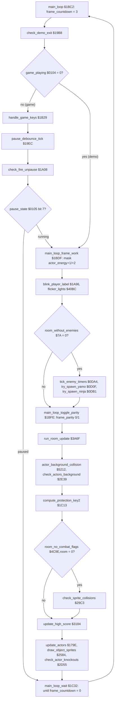
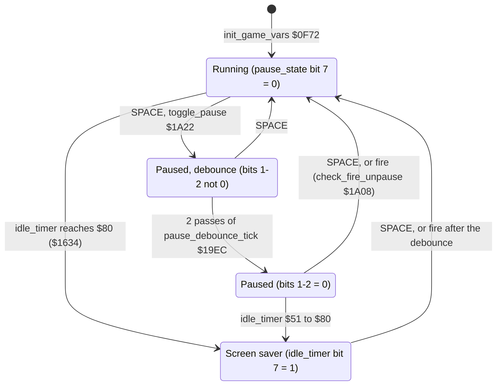

# Bruce Lee: the main loop and the game controls

Up: [the documentation](../README.md)

This page covers:
- the order of the work in one pass of [`main_loop`](../../src/main_loop.asm#L6) [`$1BC2`](../reference/modules/main_loop.md#main_loop), and its wait;
- the status line: score, high score, falls, the blinking player label and the version line;
- pause and unpause, the screen saver after idle time, and the demo exit;
- the in-game keys (F1, S, SPACE, V) and the keyboard scanner, with its title mode and its game mode;
- the dispatch of the actor updates ([`update_actors`](../../src/actor_input.asm#L6) [`$179E`](../reference/modules/actor_input.md#update_actors); the actors themselves are in [actors.md](actors.md));
- the game variables, the player block and the two-player swap;
- the loss of a fall, the change of player and the game-over screen;
- the score, the extra falls from score, the high score and the BCD conversion.

The room-level state machine of the game (exits, death, respawn, the end of the game) is in [room_flow.md](room_flow.md). This page does not repeat it.

**Sources.**
- Modules: [main_loop.asm](../reference/modules/main_loop.md), [status.asm](../reference/modules/status.md), [keyboard.asm](../reference/modules/keyboard.md), [actor_input.asm](../reference/modules/actor_input.md), [game_vars.asm](../reference/modules/game_vars.md), [game_over.asm](../reference/modules/game_over.md), [score.asm](../reference/modules/score.md), [score_bcd_regsave.asm](../reference/modules/score_bcd_regsave.md), [variables.asm](../reference/modules/variables.md).
- The per-frame half of the pause and of the screen saver is in [`game_frame_update`](../../src/frame_update.asm#L6) [`$15A8`](../reference/modules/frame_update.md#game_frame_update) ([frame_update.asm](../reference/modules/frame_update.md), described in [interrupts.md](interrupts.md)).
- The texts of the status line are messages of [`print_message`](../../src/text.asm#L6) [`$17E2`](../reference/modules/text.md#print_message): see [text_messages.md](text_messages.md) and `assets/text/messages.json`.
- Runs: `modes` (title keys, two players, pause, S and V keys, idle, game over, F1), `explore1`, and the coverage of all runs.

**Conventions.**
- Addresses are C64 addresses. Names are the names of the knowledge.
- A *pass* is one run of [`main_loop`](../../src/main_loop.asm#L6) [`$1BC2`](../reference/modules/main_loop.md#main_loop); at most one pass every 3 frames.
- A *frame* is one video frame: one run of the raster IRQ chain (50 per second on PAL).
- An *actor* is a moving figure, numbered by its index into the actor tables: actor 0 = Bruce, actor 1 = Yamo, actor 2 = Ninja. Actors 1 and 2 rest on the colours and the opponent option (report.md).
- A *fall* is a life (the status line says FALLS). The *player block* is zero page `$28-$43` of one player.
- A *message* is a string printed by [`print_message`](../../src/text.asm#L6) [`$17E2`](../reference/modules/text.md#print_message). *Demo* is the attract mode ([`game_playing`](../../src/constants.asm#L120) = 0).
- The status line is screen row 1 (`$8C28-$8C4F`). "Column" is a column of the screen, 0-39.
- **Observed** marks a fact that a run showed (a screenshot or the coverage). **Code** marks a fact from the code only. **Conclusion** marks an interpretation.
- The VICE of the runs holds `$DC00`/`$DC01` bits low (bug #2202). The runs therefore wrote the key codes into [`key_code`](../../src/constants.asm#L123) [`$0109`](../reference/variables.md#key_code) and [`key_pending`](../../src/constants.asm#L126) [`$010C`](../reference/variables.md#key_pending). The handling of a key is observed. The scanner itself never ran.

## 1. Overview: one pass



The calls, and the page that describes each one:

| Step | Call | Page |
|---|---|---|
| Demo exit | [`check_demo_exit`](../../src/status.asm#L18) [`$19B8`](../reference/modules/status.md#check_demo_exit) | section 6 |
| Game keys and pause | [`handle_game_keys`](../../src/status.asm#L236) [`$1B29`](../reference/modules/status.md#handle_game_keys), [`pause_debounce_tick`](../../src/status.asm#L46) [`$19EC`](../reference/modules/status.md#pause_debounce_tick), [`check_fire_unpause`](../../src/status.asm#L63) [`$1A08`](../reference/modules/status.md#check_fire_unpause) | sections 5 and 6 |
| Player label | [`blink_player_label`](../../src/status.asm#L149) [`$1A96`](../reference/modules/status.md#blink_player_label) | section 4 |
| Light flicker | [`flicker_lights`](../../src/light_flicker.asm#L6) [`$40BC`](../reference/modules/light_flicker.md#flicker_lights) | [rooms_00_09.md](rooms_00_09.md) |
| Enemy timers and spawning | [`tick_enemy_timers`](../../src/actors.asm#L304) [`$0DA4`](../reference/modules/actors.md#tick_enemy_timers), [`try_spawn_yamo`](../../src/actors.asm#L207) [`$0D0F`](../reference/modules/actors.md#try_spawn_yamo), [`try_spawn_ninja`](../../src/actors.asm#L315) [`$0DB1`](../reference/modules/actors.md#try_spawn_ninja) | [actors.md](actors.md), [room_flow.md](room_flow.md) |
| Room frame handler | [`run_room_update`](../../src/room_update.asm#L571) [`$3A6F`](../reference/modules/room_update.md#run_room_update) | [rooms_00_09.md](rooms_00_09.md), [rooms_10_19.md](rooms_10_19.md) |
| Background contacts, exits, lanterns | [`actor_background_collision`](../../src/collision.asm#L149) [`$5212`](../reference/modules/collision.md#actor_background_collision), [`check_actors_background`](../../src/background_touch.asm#L6) [`$2E39`](../reference/modules/background_touch.md#check_actors_background) | [combat_collision.md](combat_collision.md), [room_flow.md](room_flow.md) |
| Protection key | [`compute_protection_key2`](../../src/main_loop.asm#L44) [`$1C13`](../reference/modules/main_loop.md#compute_protection_key2) | [protection.md](protection.md) |
| Sprite collisions and hits | [`check_sprite_collisions`](../../src/combat_hits.asm#L6) [`$29C3`](../reference/modules/combat_hits.md#check_sprite_collisions) | [combat_collision.md](combat_collision.md) |
| Score display and high score | [`update_high_score`](../../src/score.asm#L57) [`$3184`](../reference/modules/score.md#update_high_score) | section 10 |
| Actor input and movement | [`update_actors`](../../src/actor_input.asm#L6) [`$179E`](../reference/modules/actor_input.md#update_actors) | section 7, [actors.md](actors.md), [object_actions.md](object_actions.md) |
| Actor sprites | [`draw_object_sprites`](../../src/sprite_render.asm#L6) [`$2584`](../reference/modules/sprite_render.md#draw_object_sprites) | [sprites.md](sprites.md) |
| Knock-outs | [`check_actor_knockouts`](../../src/actor_checks.asm#L6) [`$2D55`](../reference/modules/actor_checks.md#check_actor_knockouts) | [room_flow.md](room_flow.md) |

**Entries and early exits.** Three places jump to [`main_loop`](../../src/main_loop.asm#L6) [`$1BC2`](../reference/modules/main_loop.md#main_loop): [`start_game`](../../src/title.asm#L185) [`$070E`](../reference/modules/title.md#start_game), [`start_demo`](../../src/restart.asm#L24) [`$0531`](../reference/modules/restart.md#start_demo) and [`enter_room`](../../src/background_touch.asm#L210) [`$2F8E`](../reference/modules/background_touch.md#enter_room) (**Code**). [`enter_room`](../../src/background_touch.asm#L210) sets the stack to `$FF`, draws the new room and starts a new pass. So a room change ends the pass in [`check_actors_background`](../../src/background_touch.asm#L6) [`$2E39`](../reference/modules/background_touch.md#check_actors_background). A lost fall ends the pass in [`check_actor_knockouts`](../../src/actor_checks.asm#L6) [`$2D55`](../reference/modules/actor_checks.md#check_actor_knockouts) or in [`action_dying`](../../src/object_actions.asm#L190) [`$216B`](../reference/modules/object_actions.md#action_dying): both jump to [`lose_fall`](../../src/game_over.asm#L6) [`$1818`](../reference/modules/game_over.md#lose_fall), which does not return (section 9).

## 2. The catalogue

The variables of this page. The per-room variables are in [room_flow.md](room_flow.md) section 10.

| Name | Address | Layout | Written by | Read by |
|---|---|---|---|---|
| [`frame_countdown`](../../src/constants.asm#L34) | `$48` | 1 byte. Frames left in the pass. | [`main_loop`](../../src/main_loop.asm#L6) [`$1BC4`](../../src/main_loop.asm#L8) (= 3), the wait loops | [`main_loop_wait`](../../src/main_loop.asm#L59) [`$1C32`](../reference/modules/main_loop.md#main_loop_wait); -1 per frame in [`frame_countdowns_tick`](../../src/frame_update.asm#L124) [`$1672`](../reference/modules/frame_update.md#frame_countdowns_tick) |
| [`game_playing`](../../src/constants.asm#L120) | `$0104` | 1 byte. 0 = demo, 1 = game. | [`init_game_vars`](../../src/game_vars.asm#L6) [`$0F8D`](../../src/game_vars.asm#L25) (= 1), [`start_demo`](../../src/restart.asm#L24) [`$0556`](../../src/restart.asm#L41) (LSR → 0) | [`main_loop`](../../src/main_loop.asm#L6), [`check_demo_exit`](../../src/status.asm#L18), [`update_actors`](../../src/actor_input.asm#L6), [`lose_fall`](../../src/game_over.asm#L6), [`update_high_score`](../../src/score.asm#L57) |
| [`pause_state`](../../src/constants.asm#L121) | `$0105` | Bit 7 = paused. Bits 1-2 = debounce (0-3). Bit 0: rest of the count, no meaning. | [`toggle_pause`](../../src/status.asm#L77) [`$1A29`](../../src/status.asm#L81), [`pause_debounce_tick`](../../src/status.asm#L46) [`$19EC`](../reference/modules/status.md#pause_debounce_tick), [`game_frame_update`](../../src/frame_update.asm#L6) [`$1636`](../../src/frame_update.asm#L86) (= `$86`) | [`main_loop`](../../src/main_loop.asm#L6) [`$1BD7`](../../src/main_loop.asm#L15), [`check_fire_unpause`](../../src/status.asm#L63), [`game_frame_update`](../../src/frame_update.asm#L6) |
| [`idle_timer`](../../src/constants.asm#L71) | `$82` | Idle time in steps of 256 frames. `$80-$FF` = screen saver on (held at `$FE`). | [`toggle_pause`](../../src/status.asm#L77) [`$1A3A`](../../src/status.asm#L90) (= 0), [`show_paused`](../../src/status.asm#L94) [`$1A4C`](../../src/status.asm#L99) (= `$51`), [`save_raster_colours`](../../src/room_state.asm#L6) [`$102B`](../reference/modules/room_state.md#save_raster_colours) (= `$FE`), [`restore_raster_colours`](../../src/room_state.asm#L18) [`$103B`](../reference/modules/room_state.md#restore_raster_colours) (= 0), [`game_frame_update`](../../src/frame_update.asm#L6) | [`game_frame_update`](../../src/frame_update.asm#L6), [`toggle_pause`](../../src/status.asm#L77) [`$1A31`](../../src/status.asm#L84) |
| [`player_tag_blink_timer`](../../src/variables.asm#L165) | `$43BD` | 1 byte, counts passes `$20` → 0. | [`blink_player_label`](../../src/status.asm#L149) [`$1A96`](../reference/modules/status.md#blink_player_label), [`show_paused`](../../src/status.asm#L94) [`$1A42`](../reference/modules/status.md#show_paused) and [`init_game_screen`](../../src/game_setup.asm#L6) (= `$11`) | [`blink_player_label`](../../src/status.asm#L149) |
| [`frame_parity`](../../src/constants.asm#L66) | `$7B` | 0/1, flips each pass. | [`main_loop_toggle_parity`](../../src/main_loop.asm#L32) [`$1BFE`](../reference/modules/main_loop.md#main_loop_toggle_parity) | room handlers ([room_flow.md](room_flow.md)) |
| [`key_code`](../../src/constants.asm#L123) | `$0109` | Last key: column·8 + row; bit 7 = SHIFT; `$FF` = none. | [`keyboard_init`](../../src/keyboard.asm#L6) [`$1386`](../reference/modules/keyboard.md#keyboard_init), [`keyboard_scan`](../../src/keyboard.asm#L18) [`$139E`](../reference/modules/keyboard.md#keyboard_scan) | [`handle_game_keys`](../../src/status.asm#L236), [`check_demo_exit`](../../src/status.asm#L18), [`title_menu_loop`](../../src/title_menu.asm#L6) [`$08B1`](../reference/modules/title_menu.md#title_menu_loop) |
| [`key_pending`](../../src/constants.asm#L126) | `$010C` | 1 = a new key in [`key_code`](../../src/constants.asm#L123). | [`keyboard_scan`](../../src/keyboard.asm#L18); the readers clear it | [`handle_game_keys`](../../src/status.asm#L236), [`check_demo_exit`](../../src/status.asm#L18), [`title_menu_loop`](../../src/title_menu.asm#L6) |
| [`key_scanned`](../../src/constants.asm#L124) / [`key_shift`](../../src/constants.asm#L125) / [`key_columns`](../../src/constants.asm#L127) | `$010A` / `$010B` / `$010D` | Scan work bytes: the code found, SHIFT held, the column mask. | [`keyboard_scan`](../../src/keyboard.asm#L18) | [`keyboard_scan`](../../src/keyboard.asm#L18) |
| [`key_scan_mode`](../../src/constants.asm#L128) | `$010E` | 0 = full matrix (title), 1 = the four game keys. | [`title_menu_loop`](../../src/title_menu.asm#L6) (0), [`check_demo_exit`](../../src/status.asm#L18) and [`handle_game_keys`](../../src/status.asm#L236) (1) | [`keyboard_scan`](../../src/keyboard.asm#L18) [`$13E7`](../../src/keyboard.asm#L54) |
| [`last_key`](../../src/constants.asm#L37) | `$4B` | The game key without SHIFT; `$FF` during the debounce. | [`handle_game_keys`](../../src/status.asm#L236) [`$1B41`](../../src/status.asm#L248), [`pause_debounce_tick`](../../src/status.asm#L46) [`$1A05`](../../src/status.asm#L59), [`init_game_screen`](../../src/game_setup.asm#L6) | none (section 5) |
| [`sound_toggle`](../../src/actor_room_tables.asm#L105) | `$1385` | 0 = title tune on, 1 = off. | [`handle_game_keys`](../../src/status.asm#L236) [`$1B53`](../../src/status.asm#L257) (S key) | [`title_screen`](../../src/title.asm#L6) [`$06BD`](../../src/title.asm#L147) |
| [`score`](../../src/constants.asm#L31) | `$41-$43` | 24-bit binary, high byte first. Player block. | [`add_score_and_check_bonus`](../../src/score.asm#L6) [`$312C`](../reference/modules/score.md#add_score_and_check_bonus) | [`show_score`](../../src/score.asm#L35), [`update_high_score`](../../src/score.asm#L57), [`score_to_bcd`](../../src/score_bcd_regsave.asm#L6) |
| [`score_add`](../../src/constants.asm#L26) | `$25-$27` | 24-bit value to add, high byte first. | [`add_score`](../../src/score.asm#L47) [`$3175`](../reference/modules/score.md#add_score) | [`add_score_and_check_bonus`](../../src/score.asm#L6) |
| [`falls_left`](../../src/constants.asm#L27) | `$28` | Falls left, signed. Player block. | [`init_game_vars`](../../src/game_vars.asm#L6) (4 or 9), [`lose_fall`](../../src/game_over.asm#L6) (-1), [`add_score_and_check_bonus`](../../src/score.asm#L6) (+1), room 16 object (+1) | [`print_falls_count`](../../src/status.asm#L200), [`lose_fall`](../../src/game_over.asm#L6) |
| [`high_score`](../../src/variables.asm#L106) | `$4388-$438A` | 24-bit binary, high byte first. Not reset by a new game. | [`store_high_score`](../../src/score.asm#L87) [`$31B8`](../reference/modules/score.md#store_high_score) | [`update_high_score`](../../src/score.asm#L57), [`show_high_score`](../../src/score.asm#L95) |
| [`first_extra_life_score`](../../src/variables.asm#L112) | `$438B-$438D` | `$009C40` = 40000. | [`store_high_score`](../../src/score.asm#L87) [`$31B8`](../reference/modules/score.md#store_high_score) (byte 0, a bug: section 10) | [`init_game_vars`](../../src/game_vars.asm#L6) |
| [`extra_life_interval`](../../src/variables.asm#L118) | `$438E-$4390` | `$007530` = 30000. | — | [`add_score_and_check_bonus`](../../src/score.asm#L6) |
| [`next_extra_life_score`](../../src/variables.asm#L126) / [`other_next_extra_life_score`](../../src/variables.asm#L132) | `$4392` / `$4395` | 3 + 3 bytes: the next extra-fall score of the current and of the waiting player. | [`init_game_vars`](../../src/game_vars.asm#L6), [`add_score_and_check_bonus`](../../src/score.asm#L6), [`swap_extra_life_loop`](../../src/game_over.asm#L52) [`$1875`](../reference/modules/game_over.md#swap_extra_life_loop) | [`add_score_and_check_bonus`](../../src/score.asm#L6) |
| [`bcd_conv_binary`](../../src/variables.asm#L138) / [`bcd_conv_digits`](../../src/variables.asm#L144) | `$4398` / `$439B` | 3 bytes of input, shifted out; 4 bytes = 8 packed BCD digits. | [`score_to_bcd`](../../src/score_bcd_regsave.asm#L6) [`$32DC`](../reference/modules/score_bcd_regsave.md#score_to_bcd), [`show_high_score`](../../src/score.asm#L95) [`$31C2`](../reference/modules/score.md#show_high_score), [`print_falls_count`](../../src/status.asm#L200) [`$1AED`](../reference/modules/status.md#print_falls_count) | [`show_score`](../../src/score.asm#L35), [`show_high_score`](../../src/score.asm#L95), [`game_over`](../../src/game_over.asm#L67), [`print_falls_count`](../../src/status.asm#L200) |
| [`other_player_state`](../../src/variables.asm#L152) | `$439F-$43BA` | 28 bytes: the player block `$28-$43` of the waiting player. Byte 0 is that player's [`falls_left`](../../src/constants.asm#L27). | [`init_game_vars`](../../src/game_vars.asm#L6), [`swap_player_block_loop`](../../src/game_over.asm#L42) [`$1862`](../reference/modules/game_over.md#swap_player_block_loop) | [`lose_fall`](../../src/game_over.asm#L6), [`game_over`](../../src/game_over.asm#L67), [`human_yamo_idle_check`](../../src/frame_update.asm#L243) [`$173F`](../reference/modules/frame_update.md#human_yamo_idle_check) |
| [`two_player_mode`](../../src/variables.asm#L9) / [`human_opponent_mode`](../../src/variables.asm#L11) | `$42C9` / `$42CA` | 0/1: F3 and F5 on the title. | title, [`start_demo`](../../src/restart.asm#L24) (cleared) | [`lose_fall`](../../src/game_over.asm#L6), [`game_over`](../../src/game_over.asm#L67), [`init_game_vars`](../../src/game_vars.asm#L6) |

## 3. The pass step by step

[`main_loop`](../../src/main_loop.asm#L6) [`$1BC2`](../reference/modules/main_loop.md#main_loop):
1. [`frame_countdown`](../../src/constants.asm#L34) = 3. The raster IRQ counts it down by one each frame (**Code**).
2. [`check_demo_exit`](../../src/status.asm#L18) [`$19B8`](../reference/modules/status.md#check_demo_exit). It returns at once in a game (section 6).
3. In a game ([`game_playing`](../../src/constants.asm#L120) ≠ 0) only:
   1. [`handle_game_keys`](../../src/status.asm#L236) [`$1B29`](../reference/modules/status.md#handle_game_keys): F1, S, SPACE, V (section 5).
   2. [`pause_debounce_tick`](../../src/status.asm#L46) [`$19EC`](../reference/modules/status.md#pause_debounce_tick), then [`check_fire_unpause`](../../src/status.asm#L63) [`$1A08`](../reference/modules/status.md#check_fire_unpause) (section 6).
   3. While paused ([`pause_state`](../../src/constants.asm#L121) bit 7 = 1): jump to [`main_loop_wait`](../../src/main_loop.asm#L59) [`$1C32`](../reference/modules/main_loop.md#main_loop_wait). Nothing else of the pass runs.
4. [`main_loop_frame_work`](../../src/main_loop.asm#L18) [`$1BDF`](../reference/modules/main_loop.md#main_loop_frame_work): [`actor_energy+1`](../../src/constants.asm#L99) [`$D2`](../reference/variables.md#actor_energy) AND `$BF`, and [`actor_energy+2`](../../src/constants.asm#L99) [`$D3`](../reference/variables.md#actor_energy) AND `$87`. Bit 7 (knocked out) stays. **Code.** The energies of Yamo and Ninja are at most `$14` and 7 ([`spawn_yamo`](../../src/actors.asm#L177) [`$0D04`](../../src/actors.asm#L199), [`spawn_ninja`](../../src/actors.asm#L355) [`$0E0F`](../../src/actors.asm#L365)), so in normal play the masks change only a negative energy. **Conclusion**. The one exception is the knock-out loop of a drop: it can leave an enemy with a large positive energy, which the masks then cut ([combat_collision.md](combat_collision.md#63-original-bug-a-knock-out-by-a-drop-loops), **Code**). The purpose of the masks is in **Still open**.
5. [`blink_player_label`](../../src/status.asm#L149) [`$1A96`](../reference/modules/status.md#blink_player_label) (section 4) and [`flicker_lights`](../../src/light_flicker.asm#L6) [`$40BC`](../reference/modules/light_flicker.md#flicker_lights).
6. When [`room_without_enemies`](../../src/constants.asm#L65) [`$7A`](../reference/variables.md#room_without_enemies) = 0: [`tick_enemy_timers`](../../src/actors.asm#L304) [`$0DA4`](../reference/modules/actors.md#tick_enemy_timers), [`try_spawn_yamo`](../../src/actors.asm#L207) [`$0D0F`](../reference/modules/actors.md#try_spawn_yamo), [`try_spawn_ninja`](../../src/actors.asm#L315) [`$0DB1`](../reference/modules/actors.md#try_spawn_ninja).
7. [`main_loop_toggle_parity`](../../src/main_loop.asm#L32) [`$1BFE`](../reference/modules/main_loop.md#main_loop_toggle_parity): [`frame_parity`](../../src/constants.asm#L66) 0 → 1, or 1 → 0 ([`frame_parity_clear`](../../src/main_loop.asm#L38) [`$1C08`](../reference/modules/main_loop.md#frame_parity_clear)).
8. [`main_loop_room_and_actors`](../../src/main_loop.asm#L40) [`$1C0A`](../reference/modules/main_loop.md#main_loop_room_and_actors): [`run_room_update`](../../src/room_update.asm#L571) [`$3A6F`](../reference/modules/room_update.md#run_room_update) (the frame handler of [`current_room`](../../src/constants.asm#L28)), [`actor_background_collision`](../../src/collision.asm#L149) [`$5212`](../reference/modules/collision.md#actor_background_collision), [`check_actors_background`](../../src/background_touch.asm#L6) [`$2E39`](../reference/modules/background_touch.md#check_actors_background).
9. [`compute_protection_key2`](../../src/main_loop.asm#L44) [`$1C13`](../reference/modules/main_loop.md#compute_protection_key2): [`protection_key2`](../../src/actor_movement.asm#L576) [`$2007`](../reference/modules/actor_movement.md#protection_key2) = [`protection_sig_a+1`](../../src/protection_signature.asm#L23) [`$CF7A`](../reference/modules/protection_signature.md#protection_sig_a) XOR [`protection_sig_b+1`](../../src/protection_signature.asm#L41) [`$CF9A`](../reference/modules/protection_signature.md#protection_sig_b). With the image bytes `$51` and `$55` it is `$04` (nonzero = pass). [`play_sound_80_checked`](../../src/actor_movement.asm#L531) [`$1FC4`](../reference/modules/actor_movement.md#play_sound_80_checked) tests it ([protection.md](protection.md)).
10. When [`room_no_combat_flags`](../../src/room_tables.asm#L217) [`$4C9E`](../reference/modules/room_tables.md#room_no_combat_flags),room = 0: [`check_sprite_collisions`](../../src/combat_hits.asm#L6) [`$29C3`](../reference/modules/combat_hits.md#check_sprite_collisions).
11. [`update_high_score`](../../src/score.asm#L57) [`$3184`](../reference/modules/score.md#update_high_score): shows the score, and in a game updates and shows the high score (section 10).
12. [`update_actors`](../../src/actor_input.asm#L6) [`$179E`](../reference/modules/actor_input.md#update_actors) (section 7), [`draw_object_sprites`](../../src/sprite_render.asm#L6) [`$2584`](../reference/modules/sprite_render.md#draw_object_sprites), [`check_actor_knockouts`](../../src/actor_checks.asm#L6) [`$2D55`](../reference/modules/actor_checks.md#check_actor_knockouts).
13. [`main_loop_wait`](../../src/main_loop.asm#L59) [`$1C32`](../reference/modules/main_loop.md#main_loop_wait): waits until [`frame_countdown`](../../src/constants.asm#L34) = 0, then `jmp main_loop`.

**Timing.** The countdown is set at the start of the pass. A pass that takes more than 3 frames finds [`frame_countdown`](../../src/constants.asm#L34) already 0 and starts the next pass at once. So a pass lasts 3 frames or more (60 ms on PAL), and the game runs at most 16.7 passes per second. **Code.**

## 4. The status line

The status line is screen row 1. Screen row 0 is empty, or shows the version line (V key). [`init_game_screen`](../../src/game_setup.asm#L6) [`$0763`](../reference/modules/game_setup.md#init_game_screen) builds the text line tables so that text line 0 starts at `$8C00` (row 0) and text line 1 at `$8C28` (row 1). The lower half of both lines goes to `$DE00`, so a message on them is one row high (**Code**, `$0779-$078A`). An offset Y of `$28` or more on text line 0 lands on row 1.

| Columns | Address | Content | Written by |
|---|---|---|---|
| 0-39 of row 0 | `$8C00-$8C27` | Version line, or code `$20` in every cell | [`toggle_version_line`](../../src/status.asm#L270) [`$1B68`](../reference/modules/status.md#toggle_version_line), [`init_game_screen`](../../src/game_setup.asm#L6) |
| 2 | `$8C2A` | Left-handed marker of joystick 1 (code `$2C`) | [`game_frame_update`](../../src/frame_update.asm#L6) ([interrupts.md](interrupts.md)) |
| 4-6 | `$8C2C` | Message 1 "1UP" or 2 "2UP", blinking with message 0 "   " | [`blink_player_label`](../../src/status.asm#L149) [`$1A96`](../reference/modules/status.md#blink_player_label) |
| 8-13 | `$8C30-$8C35` | Score, 6 digits | [`show_score`](../../src/score.asm#L35) [`$315A`](../reference/modules/score.md#show_score) |
| 16-18 | `$8C38` | Message 3 "TOP" | [`print_top_label`](../../src/status.asm#L171) [`$1ABB`](../reference/modules/status.md#print_top_label) |
| 20-25 | `$8C3C-$8C41` | High score, 6 digits | [`show_high_score`](../../src/score.asm#L95) [`$31C2`](../reference/modules/score.md#show_high_score) |
| 15-26 | `$8C37` | Message 11 "** PAUSED **" over TOP and the high score; message 12 (12 blanks) erases it | [`print_paused`](../../src/status.asm#L312) [`$1BA4`](../reference/modules/status.md#print_paused), [`erase_paused`](../../src/status.asm#L324) [`$1BB6`](../reference/modules/status.md#erase_paused) |
| 28-32 | `$8C44` | Message 5 "FALLS" | [`print_falls_label`](../../src/status.asm#L178) [`$1AC7`](../reference/modules/status.md#print_falls_label) |
| 34-35 | `$8C4A` | Falls, 2 digits | [`print_falls_count`](../../src/status.asm#L200) [`$1AED`](../reference/modules/status.md#print_falls_count) |
| 37 | `$8C4D` | Left-handed marker of joystick 2 | [`game_frame_update`](../../src/frame_update.asm#L6) |

**Observed** in the `modes` run: in a game the line reads "1UP 000000  TOP 000000  FALLS 04". In the pause it reads "1UP 000000 ** PAUSED ** FALLS 04". In the second player's turn it reads "2UP 000000  TOP 002000  FALLS 04".

The digits are characters `$10-$19` of the text font (ASCII minus `$20`).

### 4.1 The routines

- [`blink_player_label`](../../src/status.asm#L149) [`$1A96`](../reference/modules/status.md#blink_player_label), once per pass while the game runs:
  1. [`player_tag_blink_timer`](../../src/variables.asm#L165) - 1.
  2. At 0: reload `$20`, and print message 0 (3 blanks) at text line 0, offset `$2C`.
  3. At `$10`: print message [`current_player`](../../src/constants.asm#L10)+1 ("1UP" or "2UP") there.
  So the label shows for 16 passes and is blank for 16 passes: a period of 96 frames or more, about 2 s. **Code.** [`init_game_screen`](../../src/game_setup.asm#L6) and [`show_paused`](../../src/status.asm#L94) set the timer to `$11` and call it at once, so the label shows at the start and stays on during the pause (the pause skips the blink).
- [`print_top_label`](../../src/status.asm#L171) [`$1ABB`](../reference/modules/status.md#print_top_label) and [`print_paused`](../../src/status.asm#L312) `$1BA4`/[`erase_paused`](../../src/status.asm#L324) `$1BB6` go through [`print_status_message`](../../src/status.asm#L318) [`$1BAD`](../reference/modules/status.md#print_status_message). It calls [`print_message`](../../src/text.asm#L6) with [`text_single_height`](../../src/constants.asm#L118) ≠ 0 and then clears [`text_single_height`](../../src/constants.asm#L118).
- [`print_falls_count`](../../src/status.asm#L200) [`$1AED`](../reference/modules/status.md#print_falls_count): converts [`falls_left`](../../src/constants.asm#L27) (0-99) to two BCD digits by subtracting 10 in a loop. It prints them with [`print_hex_byte`](../../src/status.asm#L289) [`$1B84`](../reference/modules/status.md#print_hex_byte) at offset `$4A`. The loop for 10 or more falls never ran (`$1AFC-$1B01`, **Observed** by the coverage).
- [`print_bcd_byte`](../../src/status.asm#L225) [`$1B17`](../reference/modules/status.md#print_bcd_byte): prints A as two digits at [`screen_ram`](../../src/vic_bank2.asm#L376) [`$8C00`](../reference/modules/vic_bank2.md#screen_ram)+Y and +Y+1, each nibble + `$10`. [`print_hex_byte`](../../src/status.asm#L289) [`$1B84`](../reference/modules/status.md#print_hex_byte) does the same, with `$1A-$1F` moved up by 7 to letters. It is used only for the falls count, which is BCD, so the letters never show.
- [`toggle_version_line`](../../src/status.asm#L270) [`$1B68`](../reference/modules/status.md#toggle_version_line) (V key): when [`screen_ram`](../../src/vic_bank2.asm#L376) [`$8C00`](../reference/modules/vic_bank2.md#screen_ram) holds `$20`, it copies the 40 bytes of [`version_text`](../../src/messages.asm#L168) [`$4707`](../reference/modules/messages.md#version_text) to row 0. Otherwise it writes `$20` to all 40 cells. The text is "BRUCE LEE (C) 1984 DATASOFT REV.2 BY RJF". **Observed** (`modes` run: V shows the line, V again removes it).
- [`debug_print_values`](../../src/status.asm#L185) [`$1AD1`](../reference/modules/status.md#debug_print_values) prints four bytes in hex at row 1. An RTS at `$1AD0` comes before it, and no code calls it (**Code**).
- [`clear_text_lines`](../../src/status.asm#L109) [`$1A56`](../reference/modules/status.md#clear_text_lines) clears text lines 0-12 with [`set_text_line_ptrs`](../../src/status.asm#L120) [`$1A67`](../reference/modules/status.md#set_text_line_ptrs) and [`clear_text_line`](../../src/status.asm#L139) [`$1A8A`](../reference/modules/status.md#clear_text_line). [`clear_text_lines_from_2`](../../src/status.asm#L104) [`$1A52`](../reference/modules/status.md#clear_text_lines_from_2) (lines 2-12) has no caller.
- [`multiply_by_8`](../../src/status.asm#L6) [`$199F`](../reference/modules/status.md#multiply_by_8) is in the same module, but its callers are [`setup_char_row_test`](../../src/collision.asm#L291) [`$531E`](../../src/collision.asm#L301) and [`animate_scrolling_chars`](../../src/animated_chars.asm#L6) [`$2D0D`](../../src/animated_chars.asm#L100). It sets the 16-bit value [`char_addr_hi`](../../src/variables.asm#L161)/[`char_addr_lo`](../../src/variables.asm#L163) `$43BB`/`$43BC` (high/low) to [`char_addr_lo`](../../src/variables.asm#L163) × 8.

## 5. The game keys and the keyboard scanner

### 5.1 [`handle_game_keys`](../../src/status.asm#L236) [`$1B29`](../reference/modules/status.md#handle_game_keys)

Once per pass in a game, also while paused:
1. [`key_scan_mode`](../../src/constants.asm#L128) = 1, [`keyboard_scan`](../../src/keyboard.asm#L18) [`$139E`](../reference/modules/keyboard.md#keyboard_scan).
2. No key pending: return.
3. [`key_pending`](../../src/constants.asm#L126) = 0. A = [`key_code`](../../src/constants.asm#L123) AND `$7F` (SHIFT is ignored), stored in [`last_key`](../../src/constants.asm#L37).
4. Dispatch on A:

| Key | Code | Action | Evidence |
|---|---|---|---|
| F1 | `$04` | `jmp restart_to_title` `$050F`: new stack, [`init_game_vars`](../../src/game_vars.asm#L6), [`init_game_screen`](../../src/game_setup.asm#L6), the title. | **Observed** (`modes` run: the title after F1) |
| S | `$0D` | [`sound_toggle`](../../src/actor_room_tables.asm#L105) XOR 1, [`title_music_countdown`](../../src/title_menu.asm#L150) [`$09BB`](../reference/modules/title_menu.md#title_music_countdown) = 0. | **Observed** (the code ran); the effect is **Code** |
| SPACE | `$3C` | `jmp toggle_pause` `$1A22` (section 6). | **Observed** (`modes` run: PAUSED shown and removed) |
| V | `$1F` | [`toggle_version_line`](../../src/status.asm#L270) [`$1B68`](../reference/modules/status.md#toggle_version_line). | **Observed** |
| other | `$6F` | return | **Code** |

**The S key does not switch off the game sound.** Only [`title_screen`](../../src/title.asm#L6) reads [`sound_toggle`](../../src/actor_room_tables.asm#L105), at `$06BD`: the title tune plays only while it is 0, on every fifth visit of the title. The S key also sets [`title_music_countdown`](../../src/title_menu.asm#L150) = 0, so with [`sound_toggle`](../../src/actor_room_tables.asm#L105) = 0 the tune plays at the next title (**Code**; no other instruction in the image reads `$1385`).

**[`last_key`](../../src/constants.asm#L37) is never read.** [`handle_game_keys`](../../src/status.asm#L236) and [`pause_debounce_tick`](../../src/status.asm#L46) write `$4B`, but no instruction reads `$4B` itself. Other routines use `$4C-$4E` ([`last_key+1`](../../src/constants.asm#L37) to [`last_key+3`](../../src/constants.asm#L37)) as work bytes (**Code**).

### 5.2 [`keyboard_scan`](../../src/keyboard.asm#L18) [`$139E`](../reference/modules/keyboard.md#keyboard_scan)

```text
keyboard_scan:
  if key_pending != 0: return                 ; the last key is not taken yet
  if ($DC00 AND $DC01) != $FF: return         ; a joystick line is low (DDRs are 0)
  keyboard_scan_lines:
    key_scanned = $FF, key_shift = 0
    DDRB = $FF, $DC01 = 0  -> read $DC00      ; all rows low: which columns have a key?
    if no column: goto keyboard_wait_release
    key_columns = $DC00
    DDRB = 0, DDRA = $FF                       ; normal direction: columns out, rows in
    if left SHIFT (column 1, row 7) or right SHIFT (column 6, row 4): key_shift = 1
    if key_scan_mode = 0: keyboard_scan_matrix   ; title
    else:                 keyboard_scan_game_keys ; game and demo
  keyboard_wait_release:
    DDRA = DDRB = 0
    if ($DC00 AND $DC01) != $FF: return        ; joystick active: decide later
    if key_scanned = key_code AND $7F: return  ; same key still held: no new event
    key_code = key_scanned OR (key_shift ? $80 : 0)
    if key_scanned != $FF: key_pending = 1
```

- **The keyboard is not read while a joystick is pushed or a fire button is held.** With both data direction registers at 0, `$DC00` and `$DC01` show only the joysticks, and any low line ends the scan (**Code**).
- **One event per key press.** A new code goes to [`key_code`](../../src/constants.asm#L123) only when it differs from the last one. A held key gives no repeat. Releasing all keys stores `$FF` (**Code**).
- **Title mode** ([`key_scan_mode`](../../src/constants.asm#L128) = 0), [`keyboard_scan_matrix`](../../src/keyboard.asm#L88) [`$142C`](../reference/modules/keyboard.md#keyboard_scan_matrix): it shifts [`key_columns`](../../src/constants.asm#L127) left, from column 7 down to 0. In the first column with a key, it tests rows 7 down to 0 with [`keyboard_bit_masks`](../../src/keyboard.asm#L162) [`$1494`](../reference/modules/keyboard.md#keyboard_bit_masks). The code is [`keyboard_column_base`](../../src/keyboard.asm#L169) [`$149C`](../reference/modules/keyboard.md#keyboard_column_base),column + row. The two SHIFT codes `$0F` and `$34` are skipped. No key gives `$FF`. The title reads F7 `$03`, F3 `$05`, F5 `$06`, L `$2A`, R `$11` (with SHIFT, `$AA` and `$91`): see [startup_title.md](startup_title.md).
- **Game mode** ([`key_scan_mode`](../../src/constants.asm#L128) = 1), [`keyboard_scan_game_keys`](../../src/keyboard.asm#L123) [`$1462`](../reference/modules/keyboard.md#keyboard_scan_game_keys): for each of the 4 pairs of [`game_key_matrix`](../../src/keyboard.asm#L146) [`$1488`](../reference/modules/keyboard.md#game_key_matrix), it writes the first byte to `$DC00` and compares `$DC01` with the second byte. A match gives the code from [`game_key_codes`](../../src/keyboard.asm#L157) [`$1490`](../reference/modules/keyboard.md#game_key_codes). No match gives `$6F`. The compare is exact, so a second key held in the same column hides the game key.

**Worked example: the game key table.** The image bytes at `$1488` are `FE EF FD DF 7F EF F7 7F`, and at `$1490` `04 0D 3C 1F`:

| Pair | `$DC00` (column low) | `$DC01` (row low) | Column, row | Key | Code |
|---|---|---|---|---|---|
| 0 | `$FE` | `$EF` | 0, 4 | F1 | `$04` = 0·8+4 |
| 1 | `$FD` | `$DF` | 1, 5 | S | `$0D` = 1·8+5 |
| 2 | `$7F` | `$EF` | 7, 4 | SPACE | `$3C` = 7·8+4 |
| 3 | `$F7` | `$7F` | 3, 7 | V | `$1F` = 3·8+7 |

The codes are the same column·8+row codes that the full-matrix decode gives, so the title and the game share one code space.

[`keyboard_init`](../../src/keyboard.asm#L6) [`$1386`](../reference/modules/keyboard.md#keyboard_init) (from [`init_game_screen`](../../src/game_setup.asm#L6)): [`key_code`](../../src/constants.asm#L123) = `$FF`, [`key_pending`](../../src/constants.asm#L126) = 0, both CIA 1 ports to input, the CIA 1 and CIA 2 interrupts off.

## 6. Pause, screen saver and demo exit

### 6.1 The state machine of the pause



| State | Condition | Next state | Code |
|---|---|---|---|
| Running | SPACE | Paused, debounce | [`toggle_pause`](../../src/status.asm#L77) [`$1A22`](../reference/modules/status.md#toggle_pause): [`pause_state`](../../src/constants.asm#L121) XOR `$80`, OR `$06`; [`show_paused`](../../src/status.asm#L94) [`$1A42`](../reference/modules/status.md#show_paused) |
| Running | no input for 128 × 256 frames | Screen saver | [`game_frame_update`](../../src/frame_update.asm#L6) [`$1634`](../../src/frame_update.asm#L85): [`pause_state`](../../src/constants.asm#L121) = `$86`, [`show_paused`](../../src/status.asm#L94), [`save_raster_colours`](../../src/room_state.asm#L6) [`$102B`](../reference/modules/room_state.md#save_raster_colours) |
| Paused, debounce | 2 passes | Paused | [`pause_debounce_tick`](../../src/status.asm#L46) [`$19EC`](../reference/modules/status.md#pause_debounce_tick) |
| Paused, debounce | SPACE | Running | [`toggle_pause`](../../src/status.asm#L77) |
| Paused | SPACE, or fire on the current player's port | Running | [`check_fire_unpause`](../../src/status.asm#L63) [`$1A08`](../reference/modules/status.md#check_fire_unpause) falls into [`toggle_pause`](../../src/status.asm#L77) |
| Paused | [`idle_timer`](../../src/constants.asm#L71) counts `$51` → `$80` (47 × 256 frames) | Screen saver | [`game_frame_update`](../../src/frame_update.asm#L6) [`$1634`](../../src/frame_update.asm#L85) |
| Screen saver | SPACE, or fire after the debounce | Running | [`toggle_pause`](../../src/status.asm#L77) [`$1A35`](../../src/status.asm#L87): [`restore_raster_colours`](../../src/room_state.asm#L18) [`$103B`](../reference/modules/room_state.md#restore_raster_colours) |

### 6.2 The steps

- [`toggle_pause`](../../src/status.asm#L77) [`$1A22`](../reference/modules/status.md#toggle_pause): [`pause_state`](../../src/constants.asm#L121) = ([`pause_state`](../../src/constants.asm#L121) XOR `$80`) OR `$06`.
  - Now paused: [`show_paused`](../../src/status.asm#L94) [`$1A42`](../reference/modules/status.md#show_paused): [`player_tag_blink_timer`](../../src/variables.asm#L165) = `$11` and [`blink_player_label`](../../src/status.asm#L149) (the label shows), [`idle_timer`](../../src/constants.asm#L71) = `$51`, [`print_paused`](../../src/status.asm#L312) (message 11 at text line 1, offset `$0F`).
  - Now running: [`erase_paused`](../../src/status.asm#L324) [`$1BB6`](../reference/modules/status.md#erase_paused). If [`idle_timer`](../../src/constants.asm#L71) is negative (screen saver on), [`restore_raster_colours`](../../src/room_state.asm#L18) [`$103B`](../reference/modules/room_state.md#restore_raster_colours). [`idle_timer`](../../src/constants.asm#L71) = 0, [`print_top_label`](../../src/status.asm#L171) [`$1ABB`](../reference/modules/status.md#print_top_label), `jmp show_high_score` `$31C2`.
- [`pause_debounce_tick`](../../src/status.asm#L46) [`$19EC`](../reference/modules/status.md#pause_debounce_tick), each pass of a game: when bits 1-2 are not 0, [`pause_state`](../../src/constants.asm#L121) = (bit 7) OR ((bits 1-2) - 1), and [`last_key`](../../src/constants.asm#L37) = `$FF`. From `$x6` or `$x7` the low bits go 6 → 5 → 3 → 1. **Code.**
- [`check_fire_unpause`](../../src/status.asm#L63) [`$1A08`](../reference/modules/status.md#check_fire_unpause): only when bits 1-2 are 0 and bit 7 is 1. It reads `$DC00`+(([`current_player`](../../src/constants.asm#L10) XOR 1) AND 1): `$DC01` (port 1) for player 1, `$DC00` (port 2) for player 2. Fire (bit 4 = 0) → [`toggle_pause`](../../src/status.asm#L77). So fire can end a pause two passes after the toggle, 6 frames or more (**Code**). Fire never starts a pause.
- While paused, the pass runs only the key handling (section 3). In [`game_frame_update`](../../src/frame_update.asm#L6), [`room_timer`](../../src/constants.asm#L77) stops, and the idle reset is skipped, so [`idle_timer`](../../src/constants.asm#L71) keeps counting (**Code**, [`room_timer_tick`](../../src/frame_update.asm#L66) [`$1614`](../reference/modules/frame_update.md#room_timer_tick) and [`idle_reset_check`](../../src/frame_update.asm#L227) [`$1723`](../reference/modules/frame_update.md#idle_reset_check)).
- F1, S and V also work while paused, because [`handle_game_keys`](../../src/status.asm#L236) runs before the pause test.

**The idle timer** (in [`game_frame_update`](../../src/frame_update.asm#L6), see [interrupts.md](interrupts.md)): every 256 frames ([`idle_ticks`](../../src/constants.asm#L69) [`$7F`](../reference/variables.md#idle_ticks) wraps) [`idle_timer`](../../src/constants.asm#L71) + 1 while it is positive. [`idle_reset_check`](../../src/frame_update.asm#L227) [`$1723`](../reference/modules/frame_update.md#idle_reset_check) sets it to 0 in the demo and, in a game that is not paused, when ([`actor_joy_dir`](../../src/constants.asm#L83) OR [`actor_joy_dir+1`](../../src/constants.asm#L83)) ≠ `$0F` or ([`actor_joy_fire`](../../src/constants.asm#L84) AND [`actor_joy_fire+1`](../../src/constants.asm#L84)) = 0. **Code.**
- Running: 0 → `$80` takes 128 × 256 = 32768 frames, about 11 minutes on PAL. Then the game pauses itself and starts the screen saver.
- Paused with SPACE: `$51` → `$80` takes 47 × 256 = 12032 frames, about 4 minutes.
- **Observed** (`modes` run): with no input, the enemies took Bruce's 4 falls within 6000 frames in room 0, and the game was over before 12000 frames. So without input the auto-pause can only come in a room without enemies (**Conclusion**). Neither the auto-pause nor the screen saver ran in any run (`$1634-$163E`, `$102B-$104A`).

**The screen saver** ([`screen_saver_colours`](../../src/frame_update.asm#L95) [`$1645`](../reference/modules/frame_update.md#screen_saver_colours)): [`save_raster_colours`](../../src/room_state.asm#L6) copies the 20 colour bands of [`raster_colours`](../../src/constants.asm#L136) [`$0153`](../reference/variables.md#raster_colours) to [`saved_band_colours`](../../src/room_colours.asm#L16) [`$47B4`](../reference/modules/room_colours.md#saved_band_colours) and sets [`idle_timer`](../../src/constants.asm#L71) = `$FE`. Then, each frame, [`raster_colours`](../../src/constants.asm#L136) = ([`saved_band_colours`](../../src/room_colours.asm#L16) XOR [`colour_cycle_counter`](../../src/constants.asm#L70) [`$80`](../reference/variables.md#colour_cycle_counter)) AND `$F7`, and [`idle_timer`](../../src/constants.asm#L71) is held at `$FE`. [`colour_cycle_counter`](../../src/constants.asm#L70) + 1 every 256 frames, so the colours change every 5.1 s, and bit 3 of each colour is clear (**Code**).

### 6.3 [`check_demo_exit`](../../src/status.asm#L18) [`$19B8`](../reference/modules/status.md#check_demo_exit)

Each pass; it acts only in the demo ([`game_playing`](../../src/constants.asm#L120) = 0):
1. Fire on port 1 (`$DC01` bit 4 = 0): go to step 3.
2. Else [`key_scan_mode`](../../src/constants.asm#L128) = 1, [`keyboard_scan`](../../src/keyboard.asm#L18). A pending key is cleared. Only F1 ([`key_code`](../../src/constants.asm#L123) = `$04`, without SHIFT) goes on; other keys are dropped.
3. [`wait_fire_release`](../../src/title_menu.asm#L88) [`$094B`](../reference/modules/title_menu.md#wait_fire_release), [`frame_countdown`](../../src/constants.asm#L34) = 6 and wait, then `jmp restart_to_title` `$050F`.

The scan of step 2 ran, but the code after a pending key and step 3 never ran (`$19D1-$19EA`, **Observed** by the coverage). In the runs the demo ended when Bruce lost a fall: [`lose_fall`](../../src/game_over.asm#L6) [`$1820`](../../src/game_over.asm#L10) jumps to [`title_screen`](../../src/title.asm#L6) [`$0584`](../reference/modules/title.md#title_screen) with [`title_music_countdown`](../../src/title_menu.asm#L150) = 0 (**Observed**).

## 7. The actor dispatch

[`update_actors`](../../src/actor_input.asm#L6) [`$179E`](../reference/modules/actor_input.md#update_actors), once per pass after [`update_high_score`](../../src/score.asm#L57):
1. [`ai_wake_idle_enemies`](../../src/actor_checks.asm#L33) [`$2D7C`](../reference/modules/actor_checks.md#ai_wake_idle_enemies) ([actors.md](actors.md)).
2. In the demo only: one byte of the demo stream at ([`demo_input_ptr`](../../src/constants.asm#L24) [`$1D`](../reference/variables.md#demo_input_ptr)). Its low nibble goes to [`actor_joy_dir`](../../src/constants.asm#L83) [`$98`](../reference/variables.md#actor_joy_dir) and its high nibble to [`actor_joy_fire`](../../src/constants.asm#L84) [`$9B`](../reference/variables.md#actor_joy_fire); then [`demo_input_ptr`](../../src/constants.asm#L24) + 1. So the demo stream gives one input per pass, not per frame. In a game, [`read_joysticks`](../../src/frame_update.asm#L139) [`$1689`](../reference/modules/frame_update.md#read_joysticks) writes these bytes each frame.
3. For X = 2, 1, 0, when [`actor_flags`](../../src/constants.asm#L82) [`$95`](../reference/variables.md#actor_flags),X bit 0 is set (the actor is active):
   - in room 19 ([`current_room`](../../src/constants.asm#L28) = `$13`): [`actor_joy_dir`](../../src/constants.asm#L83) = `$0E` (up) while [`room_timer`](../../src/constants.asm#L77) < 2, else `$0F` (no direction). The byte is Bruce's, and the code writes it before each actor's step;
   - [`actor_move_step`](../../src/actor_movement.asm#L32) [`$1C5B`](../reference/modules/actor_movement.md#actor_move_step), then [`select_object_pose`](../../src/object_pose.asm#L6) [`$2780`](../reference/modules/object_pose.md#select_object_pose) ([object_actions.md](object_actions.md), [sprites.md](sprites.md)).

The order is Ninja, Yamo, Bruce (**Code**). The loop ran in the demo and in the game runs (**Observed** by the coverage).

## 8. Game variables and the two-player swap

### 8.1 [`init_game_vars`](../../src/game_vars.asm#L6) [`$0F72`](../reference/modules/game_vars.md#init_game_vars)

Called by [`restart_to_title`](../../src/restart.asm#L6) [`$050F`](../reference/modules/restart.md#restart_to_title), [`start_demo`](../../src/restart.asm#L24) [`$0531`](../reference/modules/restart.md#start_demo) and [`start_game`](../../src/title.asm#L185) ([`title_screen`](../../src/title.asm#L6) [`$0746`](../../src/title.asm#L208)):
1. Clears zero page `$03-$F5` and `$4EED-$4FE7` (from [`contact_classes_col0`](../../src/actor_vars.asm#L9) [`$4EED`](../reference/modules/actor_vars.md#contact_classes_col0)). So the player block, [`current_player`](../../src/constants.asm#L10) and the score are 0.
2. [`yamo_idle_timer`](../../src/constants.asm#L78) `$89/$8A` = 0.
3. [`init_stack_page_flags`](../../src/game_vars.asm#L24) [`$0F8D`](../reference/modules/game_vars.md#init_stack_page_flags): `$0100-$0107` and [`room13_floor_bonus_flags`](../../src/constants.asm#L135) [`$014B-$0152`](../reference/variables.md#room13_floor_bonus_flags) = 1. This sets [`game_playing`](../../src/constants.asm#L120) = 1 and [`pause_state`](../../src/constants.asm#L121) = 1 (running), and also [`text_single_height`](../../src/constants.asm#L118) and the [`light_flicker_timers`](../../src/constants.asm#L119).
4. [`silence_all_sound`](../../src/sound_effects.asm#L55) [`$255E`](../reference/modules/sound_effects.md#silence_all_sound). [`bonus_falls_left`](../../src/room_tables.asm#L385) `$4E95/$4E96` = 5 (room 16 object, [rooms_10_19.md](rooms_10_19.md)).
5. [`reset_room_table_2a`](../../src/room_state.asm#L101) [`$10C5`](../reference/modules/room_state.md#reset_room_table_2a). [`room_entry_bonus_flags`](../../src/constants.asm#L138) [`$0300-$0327`](../reference/variables.md#room_entry_bonus_flags) = 1, except entries 0 and 1 (room 0 of both players) = 0: the first entry of each other room gives 2000 points.
6. [`reset_all_lanterns`](../../src/lanterns.asm#L126) [`$33CA`](../reference/modules/lanterns.md#reset_all_lanterns), [`init_saved_lantern_flags`](../../src/game_vars.asm#L67) [`$0FE2`](../reference/modules/game_vars.md#init_saved_lantern_flags) ([`saved_lantern_flags`](../../src/casbuf.asm#L7) [`$0340-$03A0`](../reference/modules/casbuf.md#saved_lantern_flags) = 1).
7. [`falls_left`](../../src/constants.asm#L27) = 4, or 9 with [`human_opponent_mode`](../../src/variables.asm#L11) ≠ 0.
8. [`next_extra_life_score`](../../src/variables.asm#L126) and [`other_next_extra_life_score`](../../src/variables.asm#L132) = [`first_extra_life_score`](../../src/variables.asm#L112).
9. Copies `$28-$43` to [`other_player_state`](../../src/variables.asm#L152) [`$439F`](../reference/modules/variables.md#other_player_state): the second player starts with the same block.

[`high_score`](../../src/variables.asm#L106) is not cleared: it stays from game to game until the machine is reset.

### 8.2 The player block and the swap

The block `$28-$43` holds [`falls_left`](../../src/constants.asm#L27) [`$28`](../reference/variables.md#falls_left), [`current_room`](../../src/constants.asm#L28) [`$29`](../reference/variables.md#current_room), [`room_lanterns_left`](../../src/constants.asm#L29) [`$2A-$3D`](../reference/variables.md#room_lanterns_left), two unused bytes, [`game_cycle`](../../src/constants.asm#L30) [`$40`](../reference/variables.md#game_cycle) and [`score`](../../src/constants.asm#L31) [`$41-$43`](../reference/variables.md#score). Its table is in [room_flow.md](room_flow.md) section 10.

A change of player exchanges three things (in [`lose_fall`](../../src/game_over.asm#L6), section 9):
1. [`swap_player_block_loop`](../../src/game_over.asm#L42) [`$1862`](../reference/modules/game_over.md#swap_player_block_loop): the 28 bytes of `$28-$43` with [`other_player_state`](../../src/variables.asm#L152).
2. [`swap_player_lantern_flags`](../../src/game_vars.asm#L76) [`$0FED`](../reference/modules/game_vars.md#swap_player_lantern_flags): for rooms 0-19, [`swap_room_object_bytes`](../../src/game_vars.asm#L93) [`$1007`](../reference/modules/game_vars.md#swap_room_object_bytes) exchanges byte 0 of each 4-byte lantern record (through [`lantern_list_ptrs`](../../src/room_tables.asm#L238) [`$4CE2`](../reference/modules/room_tables.md#lantern_list_ptrs)) with the next byte of [`saved_lantern_flags`](../../src/casbuf.asm#L7). A record that starts with a negative byte ends the room's list.
3. [`swap_extra_life_loop`](../../src/game_over.asm#L52) [`$1875`](../reference/modules/game_over.md#swap_extra_life_loop): [`next_extra_life_score`](../../src/variables.asm#L126) with [`other_next_extra_life_score`](../../src/variables.asm#L132).

**Observed** (`modes` run, two players): after player 1's fall the status line showed "2UP 000000 TOP 002000 FALLS 04". Player 2 had the fresh block, and the high score kept player 1's 2000.

## 9. Loss of a fall, change of player and game over

The state machine is in [room_flow.md](room_flow.md) section 6. The steps of the routines:

[`lose_fall`](../../src/game_over.asm#L6) [`$1818`](../reference/modules/game_over.md#lose_fall):
1. [`silence_all_sound`](../../src/sound_effects.asm#L55). In the demo: [`title_music_countdown`](../../src/title_menu.asm#L150) = 0 and `jmp title_screen`.
2. [`falls_left`](../../src/constants.asm#L27) - 1. Negative: [`game_over`](../../src/game_over.asm#L67) [`$188E`](../reference/modules/game_over.md#game_over).
3. [`next_player_turn`](../../src/game_over.asm#L15) [`$182A`](../reference/modules/game_over.md#next_player_turn): [`actor_energy`](../../src/constants.asm#L99) of all three actors = `$24`; [`enemy_entry_x`](../../src/constants.asm#L79) `$8B/$8C` = 0; [`clear_fireball_shapes`](../../src/fireballs.asm#L152) [`$423F`](../reference/modules/fireballs.md#clear_fireball_shapes).
4. With [`two_player_mode`](../../src/variables.asm#L9) ≠ 0 and [`other_player_state`](../../src/variables.asm#L152) ≥ 0 (the other player still has falls): [`current_player`](../../src/constants.asm#L10) XOR 1.
5. [`show_next_turn_screen`](../../src/game_over.asm#L31) [`$184B`](../reference/modules/game_over.md#show_next_turn_screen): [`show_player_turn_screen`](../../src/player_turn.asm#L6) [`$0EA7`](../reference/modules/player_turn.md#show_player_turn_screen) ("PLAYER n" for 64 frames, 128 with two players), then the screen is blanked.
6. Same condition as step 4: the swap of section 8.2.
7. [`respawn_after_fall`](../../src/game_over.asm#L62) [`$1886`](../reference/modules/game_over.md#respawn_after_fall): [`init_game_screen`](../../src/game_setup.asm#L6) [`$0763`](../reference/modules/game_setup.md#init_game_screen) (the status line again), then `jmp respawn_in_room` `$3217` with X = [`current_room`](../../src/constants.asm#L28).

[`game_over`](../../src/game_over.asm#L67) [`$188E`](../reference/modules/game_over.md#game_over):
1. [`clear_fireball_shapes`](../../src/fireballs.asm#L152), [`clear_text_lines`](../../src/status.asm#L109), SEI, screen and sprites off.
2. The IRQ chain goes to [`irq_split_top`](../../src/raster_irq_screens.asm#L74) [`$152C`](../reference/modules/raster_irq_screens.md#irq_split_top) on raster line `$FB` ([interrupts.md](interrupts.md)). Border and background 0 = 6 (blue), backgrounds 1 and 2 = `$0F`, `$D016` = `$08` (no multicolour).
3. [`fill_colour_ram`](../../src/title_menu.asm#L139) [`$09A9`](../reference/modules/title_menu.md#fill_colour_ram); colour `$F1` at `$D9E0-$DBDF`; character `$DC` at `$8C00-$8D8F`.
4. The big "GAME OVER" tiles: 18 codes from [`game_over_logo_top`](../../src/variables.asm#L18) [`$42CD`](../reference/modules/variables.md#game_over_logo_top) and [`game_over_logo_bottom`](../../src/variables.asm#L25) [`$42DF`](../reference/modules/variables.md#game_over_logo_bottom), OR `$80`, at rows 1-2, columns 11-28.
5. The player banner: the digit of [`current_player`](../../src/constants.asm#L10) from [`player_digit_top`](../../src/room_tables.asm#L60) `$4A7D`/[`player_digit_bottom`](../../src/room_tables.asm#L64) `$4A81` into [`player_banner_top+14`](../../src/room_tables.asm#L47) [`$4A6B`](../reference/modules/room_tables.md#player_banner_top), then 16 codes of [`player_banner_top`](../../src/room_tables.asm#L47) `$4A5D`/[`player_banner_bottom`](../../src/room_tables.asm#L53) `$4A6D` at rows 5-6, columns 12-27.
6. [`score_to_bcd`](../../src/score_bcd_regsave.asm#L6) [`$32DC`](../reference/modules/score_bcd_regsave.md#score_to_bcd), then 6 digits with [`draw_big_digit`](../../src/game_over.asm#L186) [`$1984`](../reference/modules/game_over.md#draw_big_digit) at rows 8-9, columns 14-25. Each digit d is 2 × 2 characters `$B4`+4·d to `$B7`+4·d.
7. Screen on, CLI, wait `$FE` frames (5.1 s).
8. With [`two_player_mode`](../../src/variables.asm#L9) ≠ 0 and [`other_player_state`](../../src/variables.asm#L152) ≥ 0: `jmp next_player_turn` (this branch never ran, `$1971-$1978`). The finished player's block now has [`falls_left`](../../src/constants.asm#L27) = `$FF`, so the next swap gives the turn to the other player for good.
9. Else wait `$40` frames and `jmp title_screen` `$0584`.

**Observed** by the coverage (`modes` run, one player): steps 1-7 and 9.

In step 5 the copy loop `$1909-$1917` runs once (`DEY`/`BPL` from Y = 0), so only the left half of the 2-character digit is written. The right half stays from the last [`show_player_turn_screen`](../../src/player_turn.asm#L6), which showed the same player (**Code**; **Conclusion**: no visible effect).

## 10. Score, extra falls and high score

### 10.1 Adding points

[`add_score`](../../src/score.asm#L47) [`$3175`](../reference/modules/score.md#add_score): A = the points, X = the byte (0 = high, 1 = middle, 2 = low). It clears [`score_add`](../../src/constants.asm#L26), stores A at [`score_add`](../../src/constants.asm#L26)+X and jumps to [`add_score_and_check_bonus`](../../src/score.asm#L6) [`$312C`](../reference/modules/score.md#add_score_and_check_bonus). A value above 255 takes two calls, one for each byte.

| Event | Points | Caller |
|---|---|---|
| Lantern | 125 (`$7D`) | [`handle_touched_char`](../../src/background_touch.asm#L53) [`$2F31`](../../src/background_touch.asm#L159) |
| First entry into a room (not room 0) | 2000 (`$07D0`) | [`draw_room`](../../src/room_draw.asm#L6) [`$0A20`](../../src/room_draw.asm#L56) |
| Room 13 floor band | 500 (`$01F4`) | [`room13_update`](../../src/room_update.asm#L1117) [`$3EB2`](../../src/room_update.asm#L1148) |
| Wizard defeated | 3000 (`$0BB8`) | [`room18_wizard_update`](../../src/room_update.asm#L909) [`$3D0B`](../../src/room_update.asm#L932) |
| Hits by Bruce on an enemy | 100, 75 or 50, by the kind of hit | [`mark_hit_landed`](../../src/combat_hits.asm#L218) [`$2BBF`](../../src/combat_hits.asm#L294), `$2BE3`, `$2C07` |
| Yamo knocked out by Bruce / Ninja knocked out by Bruce | 450 (`$01C2`) / 200 (`$C8`) | [`object_knocked_out`](../../src/combat_hits.asm#L356), calls at `$2C33` and `$2C44` |

The kinds of hit are in [combat_collision.md](combat_collision.md); the room events in [room_flow.md](room_flow.md) and the room pages.

[`add_score`](../../src/score.asm#L47) does not keep X. The callers in [`apply_hit_effects`](../../src/combat_hits.asm#L227) load X again from [`current_actor`](../../src/constants.asm#L40) right after the call (at `$2BC2`, `$2BE6`, `$2C0A` and `$2C47`). [`apply_hit_effects`](../../src/combat_hits.asm#L227) [`$2B50`](../../src/combat_hits.asm#L230) and [`object_knocked_out`](../../src/combat_hits.asm#L356) store X there first. So the lost X does no harm there (**Code**). This disagrees with the bug in report.md.

### 10.2 [`add_score_and_check_bonus`](../../src/score.asm#L6) [`$312C`](../reference/modules/score.md#add_score_and_check_bonus)

1. [`score`](../../src/constants.asm#L31) = [`score`](../../src/constants.asm#L31) + [`score_add`](../../src/constants.asm#L26), 3 bytes from the low byte, in binary.
2. For X = 0, 1, 2: if [`score`](../../src/constants.asm#L31),X < [`next_extra_life_score`](../../src/variables.asm#L126),X → [`show_score`](../../src/score.asm#L35). This is a test byte by byte, not a 24-bit compare.
3. All three bytes are at or above: [`next_extra_life_score`](../../src/variables.asm#L126) + [`extra_life_interval`](../../src/variables.asm#L118) (30000), [`falls_left`](../../src/constants.asm#L27) + 1, [`print_falls_count`](../../src/status.asm#L200). Then [`show_score`](../../src/score.asm#L35).

The thresholds are 40000, 70000, 100000 and so on. Step 3 never ran (`$3146-$3159`, **Observed** by the coverage).

**Worked example: the byte test.** Threshold 40000 = `$00 $9C $40`.
- Score 39960 (`$00 $9C $18`) + a lantern = 40085 (`$00 $9C $95`): `$00` ≥ `$00`, `$9C` ≥ `$9C`, `$95` ≥ `$40`: an extra fall.
- Score 38960 (`$00 $98 $30`) + a room bonus = 40960 (`$00 $A0 $00`): `$00` < `$40` in the low byte, so no extra fall. The next lantern gives 41085 (`$00 $A0 $7D`) and the extra fall.
- Threshold 100000 = `$01 $86 $A0`: from 100000 to 131071 each score with a low byte of `$A0` or more passes. A score of 131072 (`$02 $00 $00`) fails in the middle byte. If no score in that range passed, the extra fall waits until the middle byte is `$86` or more again, at 165536 or more.

So an extra fall can come later than its score, but it does not get lost (**Code**; **Conclusion** for the effect in play).

### 10.3 Show the score and the high score

- [`show_score`](../../src/score.asm#L35) [`$315A`](../reference/modules/score.md#show_score): [`score_to_bcd`](../../src/score_bcd_regsave.asm#L6), then [`print_bcd_byte`](../../src/status.asm#L225) of [`bcd_conv_digits+1`](../../src/variables.asm#L144) to `+3` at offsets `$30`, `$32`, `$34` (columns 8-13).
- [`update_high_score`](../../src/score.asm#L57) [`$3184`](../reference/modules/score.md#update_high_score), once per pass:
  1. Demo: [`show_score`](../../src/score.asm#L35) only.
  2. [`protection_key_check`](../../src/score.asm#L61) [`$3189`](../reference/modules/score.md#protection_key_check): it compares three pairs of [`protection_sig_a`](../../src/protection_signature.asm#L23)/[`protection_sig_b`](../../src/protection_signature.asm#L41) bytes. If all three pairs are equal, [`protection_trap_jump`](../../src/score.asm#L72) [`$31A1`](../reference/modules/score.md#protection_trap_jump) jumps through `$DE00` ([protection.md](protection.md)). With the image bytes the first pair differs (`$91`/`$A5`), so the game goes on (**Observed** by the coverage: `$3191-$31A3` never ran).
  3. Compare [`high_score`](../../src/variables.asm#L106) with [`score`](../../src/constants.asm#L31) from the high byte (a real 24-bit compare). If [`score`](../../src/constants.asm#L31) is higher: [`store_high_score`](../../src/score.asm#L87) [`$31B8`](../reference/modules/score.md#store_high_score), then [`show_high_score`](../../src/score.asm#L95).
  4. Else [`show_score`](../../src/score.asm#L35).
- [`show_high_score`](../../src/score.asm#L95) [`$31C2`](../reference/modules/score.md#show_high_score): the same BCD loop as [`score_to_bcd`](../../src/score_bcd_regsave.asm#L6), on [`high_score`](../../src/variables.asm#L106), printed at offsets `$3C-$41` (columns 20-25).

**Bug: the high score overwrites the first extra-fall score.** [`store_high_score`](../../src/score.asm#L87) [`$31B8`](../reference/modules/score.md#store_high_score) copies 4 bytes, X = 3 down to 0. [`score+3`](../../src/constants.asm#L31) [`$44`](../reference/variables.md#score) is [`split_index`](../../src/constants.asm#L32), the raster split counter of the IRQ chain. [`high_score+3`](../../src/variables.asm#L106) [`$438B`](../reference/modules/variables.md#high_score) is [`first_extra_life_score`](../../src/variables.asm#L112). So each new high score writes the current [`split_index`](../../src/constants.asm#L32) into the high byte of the first threshold (**Code**). [`init_game_vars`](../../src/game_vars.asm#L6) copies that threshold into both players' [`next_extra_life_score`](../../src/variables.asm#L126) at the start of the next game. With [`split_index`](../../src/constants.asm#L32) = k, the first extra fall of that game needs a high byte of at least k: 65536·k + 40000 points or more. [`show_high_score`](../../src/score.asm#L95) copies the 4th byte too, into [`bcd_conv_digits`](../../src/variables.asm#L144) [`$439B`](../reference/modules/variables.md#bcd_conv_digits), which it then clears; that copy does no harm.

### 10.4 [`score_to_bcd`](../../src/score_bcd_regsave.asm#L6) [`$32DC`](../reference/modules/score_bcd_regsave.md#score_to_bcd)

A shift-and-add conversion ("double dabble" with the decimal flag):

```text
bcd_conv_binary[0..2] = score[0..2]          ; high byte first
bcd_conv_digits[0..3] = 0
SED
repeat 24 times:                             ; X = $17 down to 0
  shift bcd_conv_binary left by one bit; C = the bit shifted out
  for Y = 3 down to 0:                        ; low BCD byte first
    bcd_conv_digits[Y] = bcd_conv_digits[Y] + bcd_conv_digits[Y] + C   ; decimal ADC
CLD (PLP)
```

Each step doubles the BCD number and adds the next bit. [`bcd_conv_digits`](../../src/variables.asm#L144) holds 8 digits; the game prints the low 6.

**Worked example: 2000 points.** The first entry into a room gives 2000 = `$00 $07 $D0`. After 24 steps [`bcd_conv_digits`](../../src/variables.asm#L144) = `$00 $00 $20 $00`. [`show_score`](../../src/score.asm#L35) prints `$00` → `$10 $10`, `$20` → `$12 $10`, `$00` → `$10 $10` at `$8C30-$8C35`: "002000". The same value in [`high_score`](../../src/variables.asm#L106) shows "TOP 002000" at columns 16-25, as in the `modes` run (**Observed**).

[`save_registers`](../../src/score_bcd_regsave.asm#L35) [`$330E`](../reference/modules/score_bcd_regsave.md#save_registers) and [`restore_registers`](../../src/score_bcd_regsave.asm#L41) [`$3315`](../reference/modules/score_bcd_regsave.md#restore_registers) share the module: they keep A, X and Y in [`saved_a`](../../src/constants.asm#L43)/[`saved_x`](../../src/constants.asm#L44)/[`saved_y`](../../src/constants.asm#L45) `$57-$59` for [`handle_touched_char`](../../src/background_touch.asm#L53) [`$2F07`](../../src/background_touch.asm#L134).

## 11. Still open

- What the masks of [`actor_energy+1`](../../src/constants.asm#L99) (`AND $BF`) and [`actor_energy+2`](../../src/constants.asm#L99) (`AND $87`) in each pass are for. In normal play they change only a negative energy. A run that knocks out the Yamo and the Ninja, with a watchpoint on `$D2/$D3`, can show it.
- Which value [`store_high_score`](../../src/score.asm#L87) writes into [`first_extra_life_score`](../../src/variables.asm#L112) [`$438B`](../reference/modules/variables.md#first_extra_life_score) in practice, and the first extra-fall score of the next game. A run that beats the high score, then starts a new game and reads `$438B` and `$4392`, can show it.
- The extra fall from score (`$3146-$3159`) never ran. A run that sets [`score`](../../src/constants.asm#L31) to `$00 $9C $00` and takes a lantern can show it, and also the byte test of the worked example.
- The idle auto-pause and the screen saver never ran. A run that pauses with SPACE and waits 12032 frames, with screenshots, can show them. A second run can wait 32768 frames without input in a room without enemies.
- The keyboard scanner (`$13AE-$1487`) never ran, because of the VICE bug #2202. A run on an emulator without that bug, with SPACE, S, V, F1 typed in the game and F3/F5/F7 on the title, can show it. It can also test that a held joystick blocks the keys.
- The demo exit by fire or F1 (`$19D1-$19EA`) never ran. A run that presses fire on port 1 during the demo can show it.
- The unpause by fire: the coverage cannot tell if [`check_fire_unpause`](../../src/status.asm#L63) fell into [`toggle_pause`](../../src/status.asm#L77), because SPACE also ran it. A run that pauses with SPACE and then presses fire on port 1 can show it.
- The two-player game-over branch `$1971-$1978` never ran. A two-player run in which player 1 loses all falls first can show it.
