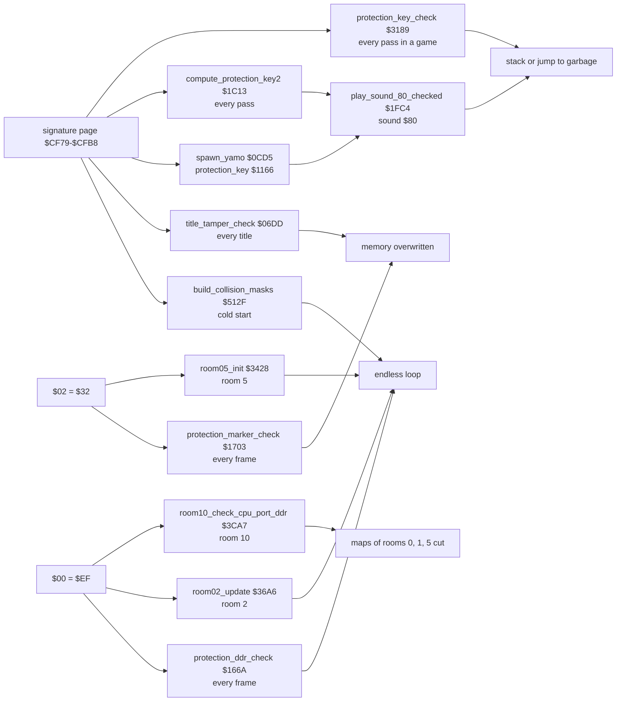
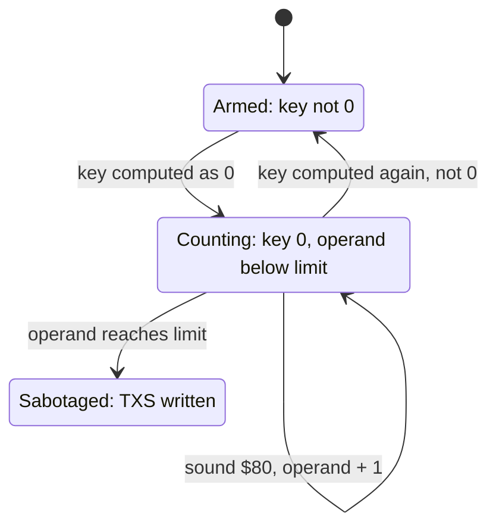

# Bruce Lee: copy protection and crack traces

This page covers:
- the checks of the original disk protection that are still in the cracked game, where each one is, what it tests, when it runs and what a failure does;
- the changes of the crack to the machine state that the game finds at its entry `$0400`, and which of them the game really needs;
- the places in the game code that may be crack patches;
- the leftover data in the file: copies of tables, unreferenced texts and message 98 "DIABOLO PRESENTS";
- the evidence that this release has no cheat and no trainer;
- the facts of `report.md` that this page corrects (section 9).

Sources: [protection_signature.asm](../reference/modules/protection_signature.md) (`$CF00-$CFFF`), [actor_room_tables.asm](../reference/modules/actor_room_tables.md) ([`protection_key`](../../src/actor_room_tables.asm#L6) [`$1166`](../reference/modules/actor_room_tables.md#protection_key)), [frame_update.asm](../reference/modules/frame_update.md), [main_loop.asm](../reference/modules/main_loop.md), [actors.asm](../reference/modules/actors.md), [actor_movement.asm](../reference/modules/actor_movement.md), [title.asm](../reference/modules/title.md), [score.asm](../reference/modules/score.md), [collision.asm](../reference/modules/collision.md), [room_init.asm](../reference/modules/room_init.md), [room_update.asm](../reference/modules/room_update.md), [interrupts.asm](../reference/modules/interrupts.md), [messages.asm](../reference/modules/messages.md). The texts are in [assets/text/messages.json](../../assets/text/messages.json). The crack's own code is in the original file `original/bruce_lee.prg` and in the full capture `unpacked/image.bin`, which still holds the crack's mover at `$C000`.

**Conventions.**
- Addresses are C64 addresses. Names are the names of the knowledge. A *file address* is an address in `original/bruce_lee.prg` as it loads at `$0801`, before the crack's mover runs.
- A *pass* is one run of [`main_loop`](../../src/main_loop.asm#L6) [`$1BC2`](../reference/modules/main_loop.md#main_loop), at most one pass every 3 frames. A *frame* is one video frame: one run of the raster IRQ chain (50 per second on PAL). The frame work of the game is [`game_frame_update`](../../src/frame_update.asm#L6) [`$15A8`](../reference/modules/frame_update.md#game_frame_update), called by [`irq_frame_top`](../../src/raster_irq_game.asm#L6) [`$48C1`](../reference/modules/raster_irq_game.md#irq_frame_top) of the game chain, so it runs in a game and in the demo.
- The *signature page* is `$CF00-$CFFF`. Its two 32-byte *blocks* are [`protection_sig_a`](../../src/protection_signature.asm#L23) [`$CF79`](../reference/modules/protection_signature.md#protection_sig_a) (`$CF79-$CF98`) and [`protection_sig_b`](../../src/protection_signature.asm#L41) [`$CF99`](../reference/modules/protection_signature.md#protection_sig_b) (`$CF99-$CFB8`). An *offset* is a position in a block: offset 1 is `$CF7A` in block A and `$CF9A` in block B.
- `$00` is the 6510 data direction register [`D6510`](../../src/constants.asm#L7) [`$0000`](../reference/variables.md#D6510). `$02` is the free zero-page byte [`protection_marker`](../../src/constants.asm#L9) [`$0002`](../reference/variables.md#protection_marker).
- A *check passes* when the game goes on in the normal way. All checks pass in this release.
- **Observed** marks a fact that a run showed: the coverage of all runs (`.c64-re-tools/local/cov_all.bin`), the entry state `unpacked/clean/entry_state.json`, or the c64-testing scenarios in `tests/`. In the coverage, a byte inside an instruction can show a read (`r`) without execution: the 6510 reads operand and next bytes. Only an executed (`x`) opcode byte means that the code ran. **Code** marks a fact from the code only. **Conclusion** marks an interpretation.

## 1. Overview

The protection has three inputs. The game itself never writes any of them.
1. The signature page: 64 bytes that the original disk protection left in memory. In this release the first stage of the crack copies the whole page from file address `$A700` to `$CF00` (loop at file address `$084F`). **Code.**
2. `$00` = `$EF`: the data direction register of the CPU port.
3. `$02` = `$32`.



The diagram shows each input, the check that reads it, and the effect of a failure. Two checks only compute a key ([`spawn_yamo`](../../src/actors.asm#L177) [`$0CD5`](../reference/modules/actors.md#spawn_yamo) and [`compute_protection_key2`](../../src/main_loop.asm#L44) [`$1C13`](../reference/modules/main_loop.md#compute_protection_key2)). The test of the keys is in [`play_sound_80_checked`](../../src/actor_movement.asm#L531) [`$1FC4`](../reference/modules/actor_movement.md#play_sound_80_checked), and its sabotage comes late (section 3.2).

## 2. The catalogue

### 2.1 The checks

| # | Check | Tests | When it runs | On failure | Evidence |
|---|---|---|---|---|---|
| 1 | [`build_collision_masks`](../../src/collision.asm#L21) [`$512F`](../reference/modules/collision.md#build_collision_masks) | [`protection_sig_a+$16`](../../src/protection_signature.asm#L23) [`$CF8F`](../reference/modules/protection_signature.md#protection_sig_a) = `$B9`, and `$CF8F` XOR [`protection_sig_b+$16`](../../src/protection_signature.asm#L41) [`$CFAF`](../reference/modules/protection_signature.md#protection_sig_b) = 0 | Once, from [`cold_start`](../../src/init.asm#L6) [`$04F0`](../../src/init.asm#L131), before the title | Branches back to `$512F` for ever: the game never reaches the title. | **Code**; the check ran (**Observed**). |
| 2 | [`title_tamper_check`](../../src/title.asm#L160) [`$06DD`](../reference/modules/title.md#title_tamper_check) | `$CF8F` XOR `$CFB1` XOR `$CF90` XOR `$CFAF` XOR `$CF91` XOR `$CFB0` = 0 | Every run of [`title_screen`](../../src/title.asm#L6) [`$0584`](../reference/modules/title.md#title_screen): at power-on, after a game over, after a lost fall in the demo, after the room 10 sabotage | [`tamper_wipe_loop`](../../src/title.asm#L169) [`$06F3`](../reference/modules/title.md#tamper_wipe_loop): endless loop that stores A at one byte of each page, page after page. | **Code**; the wipe never ran (**Observed**). |
| 3 | [`spawn_yamo`](../../src/actors.asm#L177) [`$0CD8`](../../src/actors.asm#L180) | Stores [`protection_sig_a`](../../src/protection_signature.asm#L23) [`$CF79`](../reference/modules/protection_signature.md#protection_sig_a) XOR [`protection_sig_b`](../../src/protection_signature.asm#L41) [`$CF99`](../reference/modules/protection_signature.md#protection_sig_b) in [`protection_key`](../../src/actor_room_tables.asm#L6) [`$1166`](../reference/modules/actor_room_tables.md#protection_key) | Each time the Yamo spawns ([`try_spawn_yamo`](../../src/actors.asm#L207) [`$0D1B`](../../src/actors.asm#L214)) | No test here. Check 6 tests the key. | **Code** |
| 4 | [`compute_protection_key2`](../../src/main_loop.asm#L44) [`$1C13`](../reference/modules/main_loop.md#compute_protection_key2) | Stores [`protection_sig_a+1`](../../src/protection_signature.asm#L23) [`$CF7A`](../reference/modules/protection_signature.md#protection_sig_a) XOR [`protection_sig_b+1`](../../src/protection_signature.asm#L41) [`$CF9A`](../reference/modules/protection_signature.md#protection_sig_b) in [`protection_key2`](../../src/actor_movement.asm#L576) [`$2007`](../reference/modules/actor_movement.md#protection_key2) | Every pass of [`main_loop`](../../src/main_loop.asm#L6) [`$1BC2`](../reference/modules/main_loop.md#main_loop) that is not paused | No test here. Check 6 tests the key. | **Code** |
| 5 | [`protection_key_check`](../../src/score.asm#L61) [`$3189`](../reference/modules/score.md#protection_key_check) in [`update_high_score`](../../src/score.asm#L57) [`$3184`](../reference/modules/score.md#update_high_score) | Fails when `$CF7B`/`$CF9B`, `$CF7E`/`$CF9E` and `$CF81`/`$CFA1` are three equal pairs | Every pass in a game ([`game_playing`](../../src/constants.asm#L120) not 0); not in the demo | [`protection_trap_jump`](../../src/score.asm#L72) [`$31A1`](../reference/modules/score.md#protection_trap_jump): `JMP (lde00)`, an indirect jump through the I/O area `$DE00`. | **Code**; the first pair differs, so the trap never ran (**Observed**). |
| 6 | [`play_sound_80_checked`](../../src/actor_movement.asm#L531) [`$1FC4`](../reference/modules/actor_movement.md#play_sound_80_checked) | [`protection_key`](../../src/actor_room_tables.asm#L6) [`$1166`](../reference/modules/actor_room_tables.md#protection_key) ≠ 0, then [`protection_key2`](../../src/actor_movement.asm#L576) [`$2007`](../reference/modules/actor_movement.md#protection_key2) ≠ 0 | Each time a movement routine starts sound effect `$80` (seven call sites, for example [`actor_move_up`](../../src/actor_movement.asm#L253) [`$1E29`](../../src/actor_movement.asm#L286)) | Delayed: each failing call moves the key operands by one byte; after 32 failing calls it writes `TXS` into [`random_byte`](../../src/interrupts.asm#L75) [`$1159`](../reference/modules/interrupts.md#random_byte) or over [`tamper_trap`](../../src/actor_movement.asm#L561) [`$1FFE`](../reference/modules/actor_movement.md#tamper_trap). | **Code**; the counting paths never ran (**Observed**). |
| 7 | [`protection_ddr_check`](../../src/frame_update.asm#L118) [`$166A`](../reference/modules/frame_update.md#protection_ddr_check) in [`game_frame_update`](../../src/frame_update.asm#L6) | `$00` = `$EF` | Every frame of the game chain, also while paused | `BNE idle_timer_tick` `$1628`: the IRQ loops for ever and never returns. | **Code** |
| 8 | [`room02_update`](../../src/room_update.asm#L60) [`$36A6`](../reference/modules/room_update.md#room02_update) | `$00` = `$EF` | Every pass in room 2 | Branches back to `$36A6` for ever: the main loop stops, the IRQs go on. | **Code** |
| 9 | [`room10_check_cpu_port_ddr`](../../src/room_update.asm#L879) [`$3CA7`](../reference/modules/room_update.md#room10_check_cpu_port_ddr) | `$00` = `$EF` | Every pass in room 10 | [`room10_sabotage_room_data`](../../src/room_update.asm#L884) [`$3CAF`](../reference/modules/room_update.md#room10_sabotage_room_data): writes `$80` into the first byte of [`room00_map`](../../src/room_maps.asm#L6) [`$68F9`](../reference/modules/room_maps.md#room00_map), [`room05_map`](../../src/room_maps.asm#L228) [`$6F82`](../reference/modules/room_maps.md#room05_map) and [`room01_map`](../../src/room_maps.asm#L44) [`$6A09`](../reference/modules/room_maps.md#room01_map), then jumps to [`title_screen`](../../src/title.asm#L6) [`$0584`](../reference/modules/title.md#title_screen). | **Code** |
| 10 | [`protection_marker_check`](../../src/frame_update.asm#L209) [`$1703`](../reference/modules/frame_update.md#protection_marker_check) in [`game_frame_update`](../../src/frame_update.asm#L6) | `$02` = `$32` | Every frame of the game chain | Fills memory downward from page `$02`, `$D0` pages (section 3.4). | **Code** |
| 11 | [`room05_init`](../../src/room_init.asm#L40) [`$3428`](../reference/modules/room_init.md#room05_init) | `$02` = `$32` | Each time room 5 is drawn | Branches back to `$3428` for ever. | **Code** |

All eleven check instructions executed in the recorded runs, and no failure path executed. **Observed** (coverage). The ten c64-testing scenarios pass on the original and on the rebuild. **Observed.**

### 2.2 The data

| Name | Address | Layout | Read by | Written by |
|---|---|---|---|---|
| [`protection_sig_a`](../../src/protection_signature.asm#L23) | `$CF79` | 32 bytes, block A. | checks 1, 2, 3, 4, 5 | the crack's first stage (file address `$084F`) |
| [`protection_sig_b`](../../src/protection_signature.asm#L41) | `$CF99` | 32 bytes, block B. Offsets `$10-$1F` hold the same bytes as block A. | checks 1, 2, 3, 4, 5 | the same |
| rest of the signature page | `$CF00-$CF78`, `$CFB9-$CFFF` | 121 + 71 bytes. | nothing (**Observed**: no access in any run) | the same |
| [`protection_key`](../../src/actor_room_tables.asm#L6) | `$1166` | 1 byte. `$FF` in the image, `$89` after the first Yamo spawn. | [`play_sound_80_checked`](../../src/actor_movement.asm#L531) [`$1FCE`](../../src/actor_movement.asm#L539) | [`spawn_yamo`](../../src/actors.asm#L177) [`$0CDE`](../../src/actors.asm#L183) |
| [`protection_key2`](../../src/actor_movement.asm#L576) | `$2007` | 1 byte. `$FF` in the image, `$04` after the first pass. | [`play_sound_80_checked`](../../src/actor_movement.asm#L531) [`$1FE5`](../../src/actor_movement.asm#L550) | [`compute_protection_key2`](../../src/main_loop.asm#L44) [`$1C19`](../../src/main_loop.asm#L49) |
| [`sig_a_operand`](../../src/actors.asm#L179), [`sig_b_operand`](../../src/actors.asm#L181) | `$0CD9`, `$0CDC` | Low bytes of the operands `$CF79` and `$CF99` in [`spawn_yamo`](../../src/actors.asm#L177). | the CPU, as operands | [`play_sound_80_checked`](../../src/actor_movement.asm#L531) [`$1FD3`](../../src/actor_movement.asm#L542), `$1FD6` (only when [`protection_key`](../../src/actor_room_tables.asm#L6) = 0) |
| [`compute_protection_key2+1`](../../src/main_loop.asm#L44), [`compute_protection_key2+4`](../../src/main_loop.asm#L44) | `$1C14`, `$1C17` | Low bytes of the operands `$CF7A` and `$CF9A`. | the CPU, as operands | [`play_sound_80_checked`](../../src/actor_movement.asm#L531) [`$1FEA`](../../src/actor_movement.asm#L553), `$1FED` (only when [`protection_key2`](../../src/actor_movement.asm#L576) = 0) |
| [`D6510`](../../src/constants.asm#L7) | `$0000` | CPU port DDR. `$EF` at the entry (the KERNAL default is `$2F`). | checks 7, 8, 9 | the crack's mover (`$C065` in `unpacked/image.bin`) |
| [`protection_marker`](../../src/constants.asm#L9) | `$0002` | 1 byte, `$32`. | checks 10, 11 | the crack's mover (`$C05C`) |
| [`tamper_trap`](../../src/actor_movement.asm#L561) | `$1FFE` | 1 byte of code: the opcode `$18`, CLC. | the CPU | [`play_sound_80_checked`](../../src/actor_movement.asm#L531) [`$1FFB`](../../src/actor_movement.asm#L560) writes `$9A` (`TXS`) |
| [`random_byte`](../../src/interrupts.asm#L75) | `$1159` | First byte of a routine: the opcode `$AD`, LDA. | the CPU | [`play_sound_80_checked`](../../src/actor_movement.asm#L531) [`$1FE2`](../../src/actor_movement.asm#L548) writes `$9A` (`TXS`) |
| [`start_demo`](../../src/restart.asm#L24) [`$0539`](../../src/restart.asm#L29) | `$0539` | High byte of the operand of `STA SCROLY` in [`start_demo`](../../src/restart.asm#L24) [`$0531`](../reference/modules/restart.md#start_demo) (`$D0`). | check 10, as its page count | check 10 (`DEC`) |

The entry values of [`D6510`](../../src/constants.asm#L7) [`$0000`](../reference/variables.md#D6510) and [`protection_marker`](../../src/constants.asm#L9) [`$0002`](../reference/variables.md#protection_marker) are in `unpacked/clean/entry_state.json` (field cpuPort: `$00` = 239 = `$EF`; page 0: `$02` = 50 = `$32`). **Observed.**

## 3. The step-by-step walk

### 3.1 Signature checks with an immediate failure

**[`build_collision_masks`](../../src/collision.asm#L21) [`$512F`](../reference/modules/collision.md#build_collision_masks)** (check 1, cold start).
1. `$512F`: load [`protection_sig_a+$16`](../../src/protection_signature.asm#L23) [`$CF8F`](../reference/modules/protection_signature.md#protection_sig_a).
2. `$5132`: if it is not `$B9`, branch back to step 1.
3. `$5136`: XOR with [`protection_sig_b+$16`](../../src/protection_signature.asm#L41) [`$CFAF`](../reference/modules/protection_signature.md#protection_sig_b). If the result is not 0, branch back to step 1.
4. [`mask_build_loop`](../../src/collision.asm#L28) [`$513D`](../reference/modules/collision.md#mask_build_loop): build the collision masks (see [combat_collision.md](combat_collision.md)).
5. `$517B`: `JMP colour_cycle_counter`. At this time `$0080` holds `$60` (`RTS`), so the jump returns to [`cold_start`](../../src/init.asm#L6) (section 5).

The loop of steps 1-3 does not change any byte. A wrong page therefore hangs the game before the title. **Code.**

**[`title_tamper_check`](../../src/title.asm#L160) [`$06DD`](../reference/modules/title.md#title_tamper_check)** (check 2, every title).
1. `$06DD`: X = 0.
2. `$06DF-$06EE`: A = `$CF8F` XOR `$CFB1` XOR `$CF90` XOR `$CFAF` XOR `$CF91` XOR `$CFB0`. These are the bytes at offsets `$16-$18` of both blocks.
3. `$06F1`: if A = 0, go to [`title_wait_input`](../../src/title.asm#L174) [`$06FA`](../reference/modules/title.md#title_wait_input) and the title menu.
4. Else [`tamper_wipe_loop`](../../src/title.asm#L169) [`$06F3`](../reference/modules/title.md#tamper_wipe_loop): `STA (demo_input_ptr),Y`, `INC demo_input_ptr+1`, `JMP $06F3`.

Step 4 writes the nonzero XOR value to one byte in each page, and then goes round all 256 pages again, without an end. It also writes into the I/O area at `$D000-$DFFF`. **Code.** **Conclusion:** the game stops with a damaged screen. The knowledge calls this a "memory wipe"; it is one byte per page, repeated for ever.

**[`protection_key_check`](../../src/score.asm#L61) [`$3189`](../reference/modules/score.md#protection_key_check)** (check 5, every pass in a game).
1. [`update_high_score`](../../src/score.asm#L57) [`$3184`](../reference/modules/score.md#update_high_score): in the demo ([`game_playing`](../../src/constants.asm#L120) = 0), go to [`show_score`](../../src/score.asm#L35) [`$315A`](../reference/modules/score.md#show_score). The check runs only in a game.
2. `$3189`: if `$CF7B` XOR `$CF9B` ≠ 0, go on to the high score at `$31A4`.
3. `$3191`: the same for `$CF7E`/`$CF9E`.
4. `$3199`: the same for `$CF81`/`$CFA1`.
5. All three pairs equal: [`protection_trap_jump`](../../src/score.asm#L72) [`$31A1`](../reference/modules/score.md#protection_trap_jump) `JMP (lde00)`. With `$01` = `$35` the vector comes from the I/O area 1 at `$DE00/$DE01`. **Conclusion:** without a cartridge there, the jump goes to an undefined address.

This test is the opposite of checks 1 and 2: it fails when the blocks are equal. A page of zeros, or a copy of block A over block B, makes it fail. **Code.**

### 3.2 The delayed key checks

Checks 3 and 4 compute two keys from offsets 0 and 1 of the blocks. Check 6 tests them each time sound effect `$80` starts.

```
spawn_yamo ($0CD5):                    ; check 3, each Yamo spawn
  protection_key = sig_a[sig_a_operand] XOR sig_b[sig_b_operand]   ; operands start at $CF79 / $CF99
compute_protection_key2 ($1C13):       ; check 4, each pass
  protection_key2 = $CF7A+n XOR $CF9A+n   ; n = how far $1C14/$1C17 have moved

play_sound_80_checked ($1FC4):         ; check 6
  push A, X, Y; play_sound_effect(Y=$80)          ; $1FCB
  if protection_key == 0:                         ; $1FCE
      sig_a_operand += 1; sig_b_operand += 1      ; $1FD3/$1FD6: both reads move one byte on
      if sig_a_operand >= $99:                    ; $1FDC: after 32 failing calls
          random_byte[0] = $9A (TXS)              ; $1FE2
  if protection_key2 == 0:                        ; $1FE5
      $1C14 += 1; $1C17 += 1                      ; $1FEA/$1FED
      if $1C14 >= $9A:                            ; $1FF3: after 32 failing calls
          X = 4; tamper_trap = $9A (TXS)          ; $1FF7-$1FFB, then falls into it at $1FFE
  pull Y, X, A; RTS                               ; $1FFF
```

What the two traps do (**Code**, the effect is a **Conclusion**):
- [`random_byte`](../../src/interrupts.asm#L75) [`$1159`](../reference/modules/interrupts.md#random_byte) then starts with `TXS` instead of `LDA game_playing`. The next call sets the stack pointer to the X of the caller. The `RTS` of [`random_byte`](../../src/interrupts.asm#L75) then returns to an address from the wrong place of the stack.
- At [`tamper_trap`](../../src/actor_movement.asm#L561) [`$1FFE`](../reference/modules/actor_movement.md#tamper_trap), `TXS` with X = 4 sets the stack pointer to `$04`. The three `PLA` read `$0105-$0107`, and the `RTS` returns to the address in `$0108/$0109` plus 1.

The state machine of one key (both keys work the same way, with their own operands and limit):



| State | Condition | Next state | Code |
|---|---|---|---|
| Armed | [`spawn_yamo`](../../src/actors.asm#L177) (key 1) or the pass (key 2) computes 0 | Counting | `$0CDE` / `$1C19` |
| Counting | sound effect `$80` starts | Counting, both operands + 1 | `$1FD3`/`$1FD6`, `$1FEA`/`$1FED` |
| Counting | the key is computed again from the moved operands and is not 0 | Armed | `$0CDE` / `$1C19` |
| Counting | [`sig_a_operand`](../../src/actors.asm#L179) ≥ `$99` (key 1), [`compute_protection_key2+1`](../../src/main_loop.asm#L44) ≥ `$9A` (key 2) | Sabotaged | `$1FE2` / `$1FFB` |

The operands stay moved after a return to Armed. The limits are 32 bytes after the start values `$79` and `$7A`: the last moved read is offset `$1F`, the end of block A. **Code.**

### 3.3 The checks of `$00` = `$EF`

All three read `$00` through an indexed instruction with index 0 (`LDA $00,X` or `LDX $00,Y`), not with a plain zero-page read.

**[`protection_ddr_check`](../../src/frame_update.asm#L118) [`$166A`](../reference/modules/frame_update.md#protection_ddr_check)** (check 7, every frame).
1. `$166A`: X = 0. `$166C`: A = [`D6510`](../../src/constants.asm#L7) [`$0000`](../reference/variables.md#D6510).
2. `$166E`: if A = `$EF`, go on to [`frame_countdowns_tick`](../../src/frame_update.asm#L124) [`$1672`](../reference/modules/frame_update.md#frame_countdowns_tick).
3. Else `$1670` branches back to [`idle_timer_tick`](../../src/frame_update.asm#L77) [`$1628`](../reference/modules/frame_update.md#idle_timer_tick). The code from there runs the idle timer and the screen-saver colours, and reaches the check again. `$00` does not change, so the IRQ never returns. **Code.** **Conclusion:** the main loop never runs again, because [`frame_countdown`](../../src/constants.asm#L34) is not decremented.

**[`room02_update`](../../src/room_update.asm#L60) [`$36A6`](../reference/modules/room_update.md#room02_update)** (check 8, every pass in room 2).
1. `$36A6`: Y = 0. `$36A8`: X = `$00`.
2. `$36AA`: if X ≠ `$EF`, branch back to step 1, for ever. The raster IRQ goes on, so music and frame work go on, but the pass never ends. **Code.**

**[`room10_check_cpu_port_ddr`](../../src/room_update.asm#L879) [`$3CA7`](../reference/modules/room_update.md#room10_check_cpu_port_ddr)** (check 9, every pass in room 10).
1. `$3CA7`: Y = 0. `$3CA9`: X = `$00`.
2. `$3CAB`: if X = `$EF`, go to [`room10_animate_traps`](../../src/room_update.asm#L891) [`$3CBD`](../reference/modules/room_update.md#room10_animate_traps).
3. Else [`room10_sabotage_room_data`](../../src/room_update.asm#L884) [`$3CAF`](../reference/modules/room_update.md#room10_sabotage_room_data): A = `$80`, stored at [`room00_map`](../../src/room_maps.asm#L6) [`$68F9`](../reference/modules/room_maps.md#room00_map), [`room05_map`](../../src/room_maps.asm#L228) [`$6F82`](../reference/modules/room_maps.md#room05_map) and [`room01_map`](../../src/room_maps.asm#L44) [`$6A09`](../reference/modules/room_maps.md#room01_map).
4. `$3CBA`: `JMP title_screen`.

`$80` is the end mark of a map stream (see [room_pipeline.md](room_pipeline.md)). The map streams of rooms 0, 1 and 5 then end at their first byte, so [`draw_room`](../../src/room_draw.asm#L6) [`$09BC`](../reference/modules/room_draw.md#draw_room) draws no cell of these rooms. Nothing in the game writes the map bytes back. **Code.** **Conclusion:** every later game starts in a room 0 without its map cells, until the program is loaded again. The room 10 handler is described in [rooms_10_19.md](rooms_10_19.md).

### 3.4 The checks of `$02` = `$32`

**[`protection_marker_check`](../../src/frame_update.asm#L209) [`$1703`](../reference/modules/frame_update.md#protection_marker_check)** (check 10, every frame).
1. `$1703`: A = [`protection_marker`](../../src/constants.asm#L9) [`$0002`](../reference/variables.md#protection_marker). `$1705`: if A = `$32`, go to [`joystick_read_done`](../../src/frame_update.asm#L222) [`$1717`](../reference/modules/frame_update.md#joystick_read_done).
2. `$1709`: [`work_ptr_a+1`](../../src/constants.asm#L11) = A. The fill starts in page A, at the offset [`work_ptr_a`](../../src/constants.asm#L11) + Y.
3. `$170B-$170E`: store A at `(work_ptr_a),Y` for Y down to 1.
4. `$1710`: page − 1. `$1712`: `DEC $0539`. `$1715`: if `$0539` is not 0, go to step 3.

The page count is the byte [`start_demo`](../../src/restart.asm#L24) [`$0539`](../../src/restart.asm#L29), the high byte of `STA SCROLY` (`$D0`). The fill therefore covers up to `$D0` = 208 pages below page A. It also overwrites the zero page, with the pointer [`work_ptr_a`](../../src/constants.asm#L11) [`$0004`](../reference/variables.md#work_ptr_a), and the counter byte `$0539` itself. **Code.** **Conclusion:** where the loop ends depends on the wrong value of `$02`, but the game code is destroyed in each case. The knowledge comment "never returns" is not shown by the code: the loop has an exit at `$1715`.

**[`room05_init`](../../src/room_init.asm#L40) [`$3428`](../reference/modules/room_init.md#room05_init)** (check 11, each draw of room 5).
1. `$3428`: X = 0. `$342A`: A = `$02`. `$342C`: Y = A.
2. `$342D`: if Y ≠ `$32`, branch back to step 1, for ever. **Code.**

[`room05_init`](../../src/room_init.asm#L40) runs inside [`draw_room`](../../src/room_draw.asm#L6), with the IRQs off and the screen blanked ([room_pipeline.md](room_pipeline.md)). **Conclusion:** a failure here leaves a blank screen. Room 5 is in [rooms_00_09.md](rooms_00_09.md).

## 4. Worked example: the signature page

The two blocks in the image (`unpacked/clean/image.bin`), and the XOR of each offset:

| Offset | `$00` | `$01` | `$02` | `$03` | `$04` | `$05` | `$06` | `$07` | `$08` | `$09` | `$0A` | `$0B` | `$0C` | `$0D` | `$0E` | `$0F` |
|---|---|---|---|---|---|---|---|---|---|---|---|---|---|---|---|---|
| A `$CF79+` | 91 | 51 | 91 | 46 | 31 | 1A | 11 | 45 | 44 | B4 | A2 | 91 | AC | 88 | 88 | 89 |
| B `$CF99+` | 18 | 55 | A5 | 28 | 4A | C4 | 2A | 22 | 22 | 2A | A2 | 22 | 22 | 8A | 89 | 88 |
| A XOR B | **89** | **04** | **34** | 6E | 7B | **DE** | 3B | 67 | **66** | 9E | 00 | B3 | 8E | 02 | 01 | 01 |

| Offset | `$10` | `$11` | `$12` | `$13` | `$14` | `$15` | `$16` | `$17` | `$18` | `$19` | `$1A` | `$1B` | `$1C` | `$1D` | `$1E` | `$1F` |
|---|---|---|---|---|---|---|---|---|---|---|---|---|---|---|---|---|
| A and B | E6 | 7C | C9 | F4 | 52 | DA | **B9** | **B4** | **B4** | 26 | EF | A7 | 9E | 6C | 9A | B3 |
| A XOR B | 00 | 00 | 00 | 00 | 00 | 00 | 00 | 00 | 00 | 00 | 00 | 00 | 00 | 00 | 00 | 00 |

The checks with these bytes (**Code**, computed from the image):
1. Check 1: `$CF8F` (offset `$16` of A) = `$B9`, and `$B9` XOR `$CFAF` (`$B9`) = 0. Pass.
2. Check 2: `$B9` XOR `$B4` XOR `$B4` XOR `$B9` XOR `$B4` XOR `$B4` = 0. Pass. The test holds for any page in which offsets `$16-$18` of the blocks are equal.
3. Check 3: [`protection_key`](../../src/actor_room_tables.asm#L6) [`$1166`](../reference/modules/actor_room_tables.md#protection_key) = `$91` XOR `$18` = `$89`. Not 0: pass.
4. Check 4: [`protection_key2`](../../src/actor_movement.asm#L576) [`$2007`](../reference/modules/actor_movement.md#protection_key2) = `$51` XOR `$55` = `$04`. Not 0: pass.
5. Check 5: the pairs at offsets 2, 5 and 8 give `$34`, `$DE` and `$66`. The first is already not 0: pass at `$318F`.

What the checks ask of the page: offset `$16` of both blocks is `$B9`, the XOR of offsets `$16-$18` of both blocks is 0, offsets 0 and 1 differ between the blocks, and at least one of the offsets 2, 5 and 8 differs. The equal bytes at offsets `$10-$1F` hold more than the checks need. A page of zeros passes check 2 but fails checks 1, 3, 4 and 5. **Conclusion.**

## 5. The crack's changes that the game finds at its entry

The crack's mover runs at `$C000` (stage 1 of `unpacked/image.json`). It is still in the full capture `unpacked/image.bin` at `$C000-$C0B1`, and a second copy is at `$A000`. At `$C011` it calls its setup routine `$C04D-$C0AB`, which writes the values below (`$C050-$C08D`) and copies `$C13C-$C1FF` to `$033C-$03FF`. Then it moves the game down by `$0500` bytes, and `$C048` `JMP ($C0B0)` goes to `$0400`. The mover puts the undocumented 2-byte NOP `$80` between its instructions. **Code.** The entry state has every value in the table. **Observed.**

| Address | Value | Set by the mover at | Read by the game | Needed by the game? |
|---|---|---|---|---|
| [`colour_cycle_counter`](../../src/constants.asm#L70) [`$0080`](../reference/variables.md#colour_cycle_counter) | `$60` (`RTS`) | `$C058-$C05A` | [`cold_start`](../../src/init.asm#L6) [`$0440`](../../src/init.asm#L44) (`JSR $0080`) and [`build_collision_masks`](../../src/collision.asm#L21) [`$517B`](../../src/collision.asm#L62) (`JMP $0080`) | **Yes.** Both run once, at the cold start. |
| [`D6510`](../../src/constants.asm#L7) [`$0000`](../reference/variables.md#D6510) | `$EF` | `$C065-$C067` | checks 7, 8 and 9 | **Yes.** |
| [`protection_marker`](../../src/constants.asm#L9) [`$0002`](../reference/variables.md#protection_marker) | `$32` | `$C05C-$C05E` | checks 10 and 11 | **Yes.** |
| [`warm_start_flag`](../../src/casbuf.asm#L30) [`$03FF`](../reference/modules/casbuf.md#warm_start_flag) | `$00` | `$C060-$C062`; also the copy of `$C13C-$C1FF` to `$033C-$03FF` at `$C092-$C0A7` | [`cold_start`](../../src/init.asm#L6) [`$040D`](../../src/init.asm#L19) | **Yes.** Not 0 would skip the random table, the `JSR $0080` and the font at `$0412`. |
| `$0302/$0303` | `$0400` (BASIC warm start vector to [`cold_start`](../../src/init.asm#L6)) | `$C084-$C08B` | never | **No** (see below). |
| `$0318/$0319` | `$0301` (NMI vector); `$0301` = `$40` (`RTI`) | `$C069-$C076` | never | **No** (see below). |
| `$0313`, `$BA`, `$BB` | `$01`, `$01`, `$00` | `$C079-$C081` | never (`$BA/$BB` are written by the game at `$25F7`) | **No.** |

Why `$0302` and `$0318` do not matter:
1. No game code uses `$0302/$0303` or `$0318/$0319` as a vector. The game reads and writes them only as room flags (item 3). **Code** (knowledge references).
2. After [`cold_start`](../../src/init.asm#L6) [`$04F6`](../../src/init.asm#L133) sets `$01` = `$35`, the KERNAL ROM is switched out. An NMI then goes through the RAM vector at `$FFFA` to [`nmi_reset_handler`](../../src/interrupts.asm#L21) [`$1116`](../reference/modules/interrupts.md#nmi_reset_handler) (`RTI`), not through `$0318`. **Code.**
3. `$0300-$0327` is the game table [`room_entry_bonus_flags`](../../src/constants.asm#L138) [`$0300`](../reference/variables.md#room_entry_bonus_flags). At each game start, [`init_game_vars`](../../src/game_vars.asm#L6) [`$0FA8`](../../src/game_vars.asm#L37) writes 1 to `$0302-$0327` and 0 to `$0300/$0301`. `$0302/$0303` are the flags of room 1, and `$0318/$0319` are the flags of room 12. [`draw_room`](../../src/room_draw.asm#L6) [`$0A19`](../../src/room_draw.asm#L53) clears them when the player enters the room. **Code**; `$0FA8` executed (**Observed**).

So the crack's vectors survive only until the first game or demo start. They are part of the entry state, and the rebuild's loader sets them only to equal the original.

**`$0080` in the original.** The game calls `$0080` twice at the cold start, once with `JSR` and once with `JMP`. Later it uses `$0080/$0081` as the 16-bit [`colour_cycle_counter`](../../src/constants.asm#L70), and [`game_frame_update`](../../src/frame_update.asm#L6) [`$163F`](../../src/frame_update.asm#L90) increments it every 256 frames. **Code**; `$163F` executed (**Observed**). **Conclusion:** in the original, `$0080` held a routine of the disk protection that was needed only at the start. The crack replaced it with `RTS`. Its content is not known.

## 6. Possible crack patches inside the game code

These three places look like changes to the code. Without an uncracked original they cannot be told apart from the original game. **Conclusion.**

| Place | Code | What it does | Why it may be a patch |
|---|---|---|---|
| [`irq_handler`](../../src/interrupts.asm#L6) [`$110C`](../../src/interrupts.asm#L14) | `TSX` / `LDA $0104,X` / `AND #$00` / `BEQ irq_dispatch` / `JMP (lde00)` (`$1108-$1110`) | `$0104+X` is the status byte that the IRQ pushed. `AND #$00` makes the result always 0, so the `JMP ($DE00)` at `$1110` never runs. | With `AND #$10` this is the usual test of the BRK flag. The same `JMP ($DE00)` is the failure of check 5. A patch to `#$00` turns off a BRK trap. |
| [`init_hook_rts`](../../src/room_state.asm#L139) [`$10F7`](../reference/modules/room_state.md#init_hook_rts) | `RTS`, called by [`cold_start`](../../src/init.asm#L6) [`$04F3`](../../src/init.asm#L132) right after [`build_collision_masks`](../../src/collision.asm#L21) | Nothing. | A call to an empty routine. Before it, [`reset_player_room_flags`](../../src/room_state.asm#L123) [`$10E0`](../reference/modules/room_state.md#reset_player_room_flags) is called only by code that never ran. The two bytes after it, `$10F8/$10F9`, are `$F7 $10`: the address `$10F7` itself. |
| [`dummy_table_read`](../../src/title_options.asm#L6) [`$0E2E`](../reference/modules/title_options.md#dummy_table_read) | Loads the 5 bytes [`dead_copy_values`](../../src/title_options.asm#L17) [`$0E3B`](../reference/modules/title_options.md#dead_copy_values) (`$08 $0E $80 $00 $80`) into A, in a loop with X = 4..0, and discards them. Called by [`title_screen`](../../src/title.asm#L6) [`$0598`](../../src/title.asm#L15). | Nothing. | The loop has the form of a copy loop without its `STA`. |

The coverage also shows reads in `$10F8-$1102`. No code that does them was found (`report.md`, section 5). They stay in **Still open**.

## 7. Leftover data in the file

| Range | Content | Use | Evidence |
|---|---|---|---|
| `$4FE8-$50E6` | Exact copy of `$482C-$492A` (255 bytes: the end of the raster-line pointer tables and the start of the game raster IRQ code). | No code refers to it. The coverage shows reads of `$5001-$5016` (see **Still open**). | **Code**: the bytes are equal (compared in `unpacked/clean/image.bin`). |
| `$572D-$58FF` | Exact copy of `$4CF2-$4EC4` (467 bytes of room tables). | Nothing reads it. | **Code**: the bytes are equal. **Observed**: no access. |
| [`leftover_source_text`](../../src/sprite_data.asm#L6) [`$5900`](../reference/modules/sprite_data.md#leftover_source_text) (`$5900-$59A4`) | Apple II Merlin assembler source text (`DFB $F0,$C0`, `* CHAR 97`), ASCII with bit 7 set. | Not game data. | **Code** |
| [`credits_text_unused`](../../src/messages.asm#L77) [`$4563`](../reference/modules/messages.md#credits_text_unused) | "BRUCE LEE", "BY", "RON J FORTIER". | No message pointer and no code reads it. | **Code**; **Observed**: no access. |
| [`game_over_text_unused`](../../src/messages.asm#L91) [`$4598`](../reference/modules/messages.md#game_over_text_unused) | "GAME OVER", "PLAYER ". | No message pointer and no code reads it. | **Code**; **Observed**: no access. |
| [`msg_diabolo_presents`](../../src/messages.asm#L194) [`$4770`](../reference/modules/messages.md#msg_diabolo_presents) | Message 98: "DIABOLO  PRESENTS" (two spaces), ended by `$A0`. | The pointer [`message_pointers+196`](../../src/messages.asm#L6) [`$4482`](../reference/modules/messages.md#message_pointers) holds `$4770`. No code loads 98 (`$62`) for [`print_message`](../../src/text.asm#L6) [`$17E2`](../reference/modules/text.md#print_message). | **Code**; **Observed**: the pointer and the text were never read. |

**Message 98.** The other messages of the table are status texts, title texts and room tiles ([text_messages.md](text_messages.md)). "DIABOLO PRESENTS" is a credit line of a release group, and it has a message number. **Conclusion:** either a group text written over an original string or an original leftover; the file does not tell which. The crack's own title text, at file address `$0883`, reads "CRACKED IN OKTOBER 1984 BY / SAEGER SOFT GROUP" and does not name Diabolo. **Code.**

The copies at `$4FE8` and `$572D` are copies of game data at other addresses of the same build. **Conclusion:** leftovers of the original build, not crack bytes. The crack's own leftovers are `$A000-$A9FF` (the mover's work area) and `$FE00-$FFF9` (the crack's loader). The clean image drops them (`report.md`, exception E1).

## 8. No cheat and no trainer

This release has no cheat and no trainer. The evidence:
1. **The crack's title asks nothing.** The code at file address `$0871` prints the crack text with `CHROUT`. At `$08F4-$08FB` it calls `GETIN` until the key is SPACE, then jumps to the mover. No other key is tested. **Code.**
2. **The falls.** The only decrement of [`falls_left`](../../src/constants.asm#L27) [`$0028`](../reference/variables.md#falls_left) is [`lose_fall`](../../src/game_over.asm#L6) [`$1826`](../../src/game_over.asm#L13), and the branch before it skips it only in the demo. The other writes are game rules:
   - [`init_game_vars`](../../src/game_vars.asm#L6) `$0FBE`/`$0FC7` (4 falls, or 9 with a human Yamo);
   - [`swap_player_block_loop`](../../src/game_over.asm#L42) [`$1862`](../reference/modules/game_over.md#swap_player_block_loop) (change of player);
   - [`game_frame_update`](../../src/frame_update.asm#L6) [`$1781`](../../src/frame_update.asm#L277) (5 falls less when a human Yamo is handed back to the computer);
   - [`room16_bonus_fall`](../../src/background_touch.asm#L253) [`$2FE5`](../../src/background_touch.asm#L265) and [`add_score_and_check_bonus`](../../src/score.asm#L6) [`$3155`](../../src/score.asm#L32) (extra falls).

   **Code.**
3. **The keys.** [`handle_game_keys`](../../src/status.asm#L236) [`$1B29`](../reference/modules/status.md#handle_game_keys) tests only F1 (restart), S (sound), SPACE (pause) and V (version line). [`title_menu_loop`](../../src/title_menu.asm#L6) [`$08B1`](../reference/modules/title_menu.md#title_menu_loop) tests only the start, option and handedness keys. **Code.**
4. **No patched counter.** All eleven checks and the three possible patches of section 6 are protection or neutral code. None of them changes falls, energy, time or the room. [`debug_print_values`](../../src/status.asm#L185) [`$1AD1`](../reference/modules/status.md#debug_print_values) is dead code behind an `RTS`, and it only prints values. **Code.**

So the rule "keep cheats behind a switch" has nothing to switch. The protection checks are not cheats and stay as they are (`report.md`, exception E3).

## 9. Corrections to `report.md` and to the knowledge

| `report.md` or the knowledge says | The code shows |
|---|---|
| The crack changes that the game needs include "the vectors at `$0302` and `$0318`". | The game never reads them. `$0300-$0327` is [`room_entry_bonus_flags`](../../src/constants.asm#L138), and [`init_game_vars`](../../src/game_vars.asm#L6) [`$0FA8`](../../src/game_vars.asm#L37) overwrites both vectors at each game start. Only `$0080`, `$00`, `$02` and `$03FF` are needed (section 5). |
| `$0080` = RTS "replaces the original protection routine, which [`cold_start`](../../src/init.asm#L6) calls". | [`cold_start`](../../src/init.asm#L6) calls it at `$0440`, and [`build_collision_masks`](../../src/collision.asm#L21) also jumps to it at `$517B`. After the start, the game uses `$0080/$0081` as [`colour_cycle_counter`](../../src/constants.asm#L70). That the original held a protection routine there is a conclusion only. |
| The signature page was "left by the disk protection" (knowledge comment of [`protection_sig_a`](../../src/protection_signature.asm#L23)). | In this release the crack's first stage copies it from file address `$A700` (loop at `$084F`). Where the original got it from is not in the file. |
| The signature is checked at `$0CD5` (report) or `$0CD7` (knowledge). | `$0CD5` is the start of [`spawn_yamo`](../../src/actors.asm#L177); the reads are at `$0CD8` and `$0CDB`. |
| "Some results are used as game values (`$1166`, `$2007`)" (knowledge). | [`protection_key`](../../src/actor_room_tables.asm#L6) and [`protection_key2`](../../src/actor_movement.asm#L576) are read only by the test in [`play_sound_80_checked`](../../src/actor_movement.asm#L531) [`$1FC4`](../reference/modules/actor_movement.md#play_sound_80_checked). |
| The title check is an "endless memory wipe" (knowledge). | It stores one byte per page, page after page, for ever (section 3.1). |
| Check 10 "fills memory downward with that value and never returns" (knowledge). | The fill has an exit after `$D0` pages, counted in the code byte `$0539`. It destroys the game, but it can end (section 3.4). |
| [`update_high_score`](../../src/score.asm#L57) runs "each frame in a game" (knowledge). | It runs each pass: its only caller is [`main_loop`](../../src/main_loop.asm#L6) [`$1C26`](../../src/main_loop.asm#L55). |
| The room 10 sabotage "restarts the game at `$0584`" (knowledge). | `$0584` is [`title_screen`](../../src/title.asm#L6): it goes back to the title, with three damaged maps. |
| Message 98 is printed by nothing (report). | Correct. Also the pointer `$4482` was never read in any run. |

The copies at `$4FE8-$50E6` and `$572D-$58FF` and the check addresses in report section 5 are correct.

## 10. Still open

- **What the original had at `$0080`, `$CF00` and `$00`/`$02`.** Only an uncracked original disk can show it. A run of the original loader with a watchpoint on `$0080-$00FF`, `$CF00-$CFFF`, `$00` and `$02` would answer it.
- **Whether `$110C`, `$10F7` and `$0E2E` are crack patches.** The same: a byte compare with an uncracked copy (c64-provenance).
- **What reads `$5001-$5016` and `$10F8-$1102`.** The coverage shows reads, and no code refers to them. A run with a read watchpoint on these ranges (game start, demo, one room change) would give the reading instruction.
- **What a failure does on the screen.** The effects in section 3 are from the code. A run with a wrong value, for example `$00` = `$2F` before room 10, or `$02` = 0, or a zero byte at `$CF79` and 32 movement sounds, would show each failure. It must not use the shared emulator while other runs are active.
- **The real 6510 and `$00` = `$EF`.** Bits 6 and 7 of the DDR have no port pins. The checks pass in VICE (**Observed**). A test on real hardware would show if the DDR reads back `$EF` there too.
