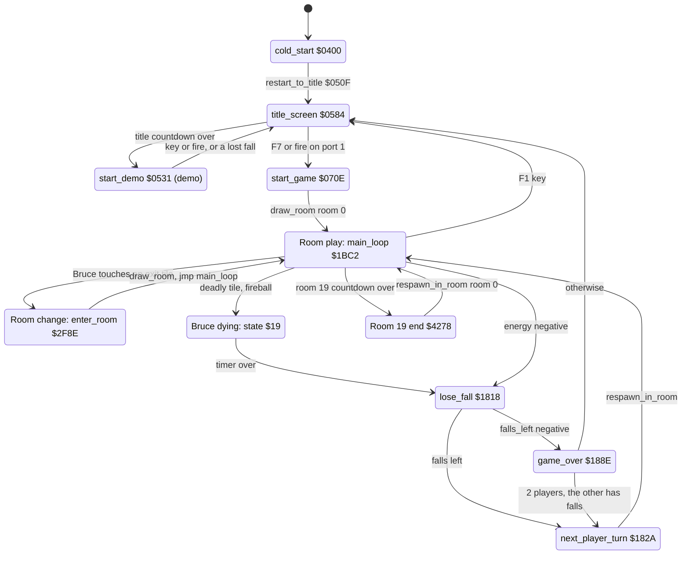
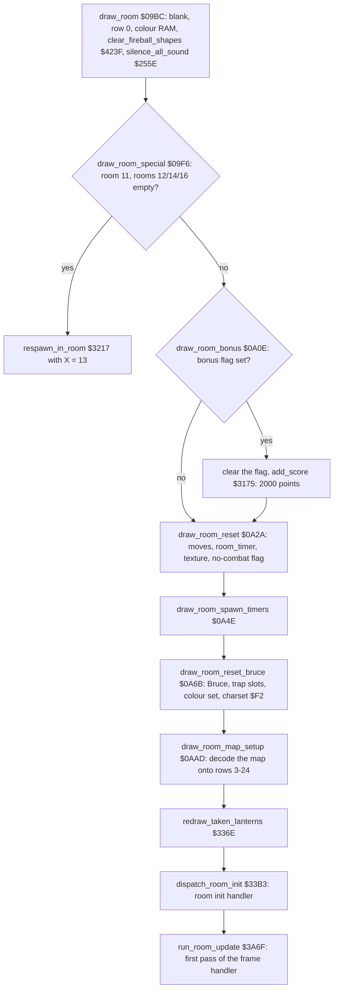
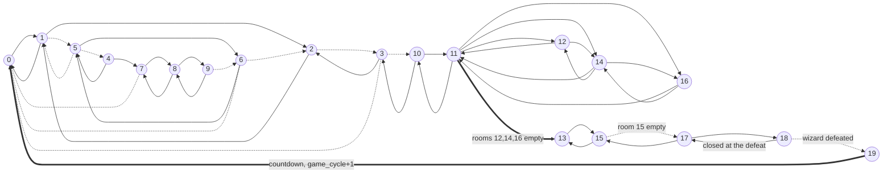
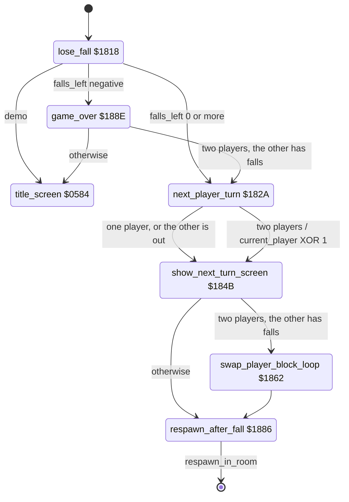

# Bruce Lee: the room flow

Up: [the rooms](../rooms.md)

This page describes the game-level state machine of *Bruce Lee* (Datasoft 1984, C64 REV.2) as far as it concerns the rooms: what every room shares.

**Scope.**
- how a game starts and reaches room 0;
- what a pass and a frame do for the room;
- the exits, the room entry and the exit graph;
- the lanterns and the score;
- death, the lost fall, the respawn and the change of player;
- the floor traps;
- the room part of the enemy spawning;
- the end of the game;
- the per-room and room-flow variables.

Not on this page: the full pass of the main loop ([main_loop.md](main_loop.md)), the raster interrupts ([interrupts.md](interrupts.md)), the actors and the spawn timers ([actors.md](actors.md)), the room data and [`draw_room`](../../src/room_draw.asm#L6) [`$09BC`](../reference/modules/room_draw.md#draw_room) in detail ([room_pipeline.md](room_pipeline.md)), and the handlers of each room ([rooms_00_09.md](rooms_00_09.md), [rooms_10_19.md](rooms_10_19.md)).

**Sources.**
- The generated source and its reference: [title.asm](../reference/modules/title.md), [restart.asm](../reference/modules/restart.md), [game_vars.asm](../reference/modules/game_vars.md), [game_over.asm](../reference/modules/game_over.md), [main_loop.asm](../reference/modules/main_loop.md), [background_touch.asm](../reference/modules/background_touch.md), [room_entry_traps.asm](../reference/modules/room_entry_traps.md), [lanterns.asm](../reference/modules/lanterns.md), [score.asm](../reference/modules/score.md), [actors.asm](../reference/modules/actors.md), [room_state.asm](../reference/modules/room_state.md), [frame_update.asm](../reference/modules/frame_update.md), [final_room.asm](../reference/modules/final_room.md), [room_draw.asm](../reference/modules/room_draw.md).
- The image `unpacked/image.bin` and the decoded rooms `assets/rooms/roomNN.json` (exits and trigger cells).
- The runs: `room_events` (all lanterns taken in each room), `room_special` (the room 11 diversion, the wizard defeat, the ending) and a run of room 16 in which Bruce died. The coverage of all runs is in the source as `; not executed` marks.

**Conventions.**
- Addresses are C64 addresses. Names are the names of the knowledge.
- A *pass* is one run of [`main_loop`](../../src/main_loop.asm#L6) [`$1BC2`](../reference/modules/main_loop.md#main_loop), at most one pass every 3 frames. A *frame* is one video frame: one run of the raster IRQ chain (50 per second on PAL).
- A *room* is a screen, number 0-19 in [`current_room`](../../src/constants.asm#L28) [`$29`](../reference/variables.md#current_room).
- An *actor* is a moving figure, numbered by its index into the actor tables: actor 0 = Bruce, actor 1 = Yamo, actor 2 = Ninja. The names of actors 1 and 2 rest on their colours and on the opponent option (report.md).
- A *fall* is a life; the status line says FALLS.
- *Demo* is the attract mode ([`game_playing`](../../src/constants.asm#L120) [`$0104`](../reference/variables.md#game_playing) = 0).
- A *text row* is a row of [`print_message`](../../src/text.asm#L6) [`$17E2`](../reference/modules/text.md#print_message); map row R is text row R+2. A *message* is a string printed by [`print_message`](../../src/text.asm#L6).
- **Observed** marks a fact that a run showed. **Code** marks a fact from the code or the image only. **Conclusion** marks an interpretation.

---

## 1. The state machine of the game

| State | Condition | Next state | Code |
|---|---|---|---|
| Cold start | always | Title | [`cold_start`](../../src/init.asm#L6) [`$0400`](../reference/modules/init.md#cold_start) falls into [`restart_to_title`](../../src/restart.asm#L6) [`$050F`](../reference/modules/restart.md#restart_to_title), which jumps to [`title_screen`](../../src/title.asm#L6) [`$0584`](../reference/modules/title.md#title_screen) |
| Title | [`attract_countdown`](../../src/constants.asm#L35) [`$49`](../reference/variables.md#attract_countdown) and [`title_timeout_hi`](../../src/constants.asm#L36) [`$4A`](../reference/variables.md#title_timeout_hi) are 0 | Demo | [`title_menu_loop`](../../src/title_menu.asm#L6) [`$08B7`](../../src/title_menu.asm#L10) |
| Title | F7, or fire on port 1 | Game start | [`title_start_pressed`](../../src/title_menu.asm#L44) [`$08FC`](../reference/modules/title_menu.md#title_start_pressed); [`title_screen`](../../src/title.asm#L6) falls into [`start_game`](../../src/title.asm#L185) [`$070E`](../reference/modules/title.md#start_game) |
| Demo | a key or fire | Title | [`check_demo_exit`](../../src/status.asm#L18) [`$19B8`](../reference/modules/status.md#check_demo_exit) (in each pass) |
| Demo | a lost fall | Title | [`lose_fall`](../../src/game_over.asm#L6) [`$1823`](../../src/game_over.asm#L11) |
| Game start | always | Room play | [`start_game`](../../src/title.asm#L185) [`$074C`](../../src/title.asm#L210) calls [`draw_room`](../../src/room_draw.asm#L6), then [`start_game`](../../src/title.asm#L185) [`$0760`](../../src/title.asm#L219) jumps to [`main_loop`](../../src/main_loop.asm#L6) |
| Room play | Bruce touches exit tile 2-5 and [`check_exit_direction`](../../src/background_touch.asm#L392) [`$30D4`](../reference/modules/background_touch.md#check_exit_direction) allows it | Room change | [`take_exit_char02`](../../src/background_touch.asm#L165) [`$2F3C`](../reference/modules/background_touch.md#take_exit_char02) .. [`take_exit_char05`](../../src/background_touch.asm#L200) [`$2F7B`](../reference/modules/background_touch.md#take_exit_char05) |
| Room change | always | Room play | [`enter_room`](../../src/background_touch.asm#L210) [`$2FCC`](../../src/background_touch.asm#L248) calls [`draw_room`](../../src/room_draw.asm#L6), [`enter_room`](../../src/background_touch.asm#L210) [`$2FD3`](../../src/background_touch.asm#L251) jumps to [`main_loop`](../../src/main_loop.asm#L6) |
| Room play | a deadly tile, or a fireball in room 18 | Bruce dying | [`set_character_hit_state`](../../src/room_tiles.asm#L32) [`$407D`](../reference/modules/room_tiles.md#set_character_hit_state) (state `$19`, timer `$10`) |
| Bruce dying | the timer of state `$19` reaches 1 | Lost fall | [`action_dying`](../../src/object_actions.asm#L190) [`$216B`](../reference/modules/object_actions.md#action_dying) |
| Room play | [`actor_energy`](../../src/constants.asm#L99) [`$D1`](../reference/variables.md#actor_energy) of Bruce is negative and no state `$13`/`$19` timer runs | Lost fall | [`check_actor_knockouts`](../../src/actor_checks.asm#L6) [`$2D55`](../reference/modules/actor_checks.md#check_actor_knockouts) |
| Lost fall | [`falls_left`](../../src/constants.asm#L27) [`$28`](../reference/variables.md#falls_left) becomes negative | Game over | [`lose_fall`](../../src/game_over.asm#L6) [`$1828`](../../src/game_over.asm#L14) |
| Lost fall | [`falls_left`](../../src/constants.asm#L27) is 0 or more | Next turn | [`next_player_turn`](../../src/game_over.asm#L15) [`$182A`](../reference/modules/game_over.md#next_player_turn) |
| Next turn | always | Room play | [`respawn_after_fall`](../../src/game_over.asm#L62) [`$1886`](../reference/modules/game_over.md#respawn_after_fall), then [`respawn_in_room`](../../src/room_entry_traps.asm#L6) [`$3217`](../reference/modules/room_entry_traps.md#respawn_in_room) |
| Game over | two players and [`other_player_state`](../../src/variables.asm#L152) [`$439F`](../reference/modules/variables.md#other_player_state) is 0 or more | Next turn | [`game_over`](../../src/game_over.asm#L67) [`$1976`](../../src/game_over.asm#L177) *(not run)* |
| Game over | otherwise | Title | [`game_over_final_wait`](../../src/game_over.asm#L178) [`$1979`](../reference/modules/game_over.md#game_over_final_wait) |
| Room play | room 19 and its countdown is 0 | Room 19 end | [`room19_congratulations_update`](../../src/final_room.asm#L34) [`$4272`](../reference/modules/final_room.md#room19_congratulations_update) |
| Room 19 end | always | Room play | [`room19_congratulations_update`](../../src/final_room.asm#L34) [`$4295`](../../src/final_room.asm#L54) jumps to [`respawn_in_room`](../../src/room_entry_traps.asm#L6) with X = 0 |
| Room play | F1 | Title | [`handle_game_keys`](../../src/status.asm#L236) [`$1B29`](../reference/modules/status.md#handle_game_keys) |

All rows are **Code**. The keys and the demo exit are described in [main_loop.md](main_loop.md).

---

## 2. Game start: to room 0

[`start_game`](../../src/title.asm#L185) [`$070E`](../reference/modules/title.md#start_game) runs after F7 or fire on the title (**Code**):
1. It blanks the screen and the sprites, sets [`current_player`](../../src/constants.asm#L10) [`$03`](../reference/variables.md#current_player) = 0, stops the music, and keeps the options in [`saved_two_player_mode`](../../src/variables.asm#L13) [`$42CB`](../reference/modules/variables.md#saved_two_player_mode) and [`saved_human_opponent_mode`](../../src/variables.asm#L15) [`$42CC`](../reference/modules/variables.md#saved_human_opponent_mode).
2. [`show_player_turn_screen`](../../src/player_turn.asm#L6) [`$0EA7`](../reference/modules/player_turn.md#show_player_turn_screen): the "PLAYER 1" screen for 64 frames (128 with two players).
3. The stack = `$FD`, then [`init_game_vars`](../../src/game_vars.asm#L6) [`$0F72`](../reference/modules/game_vars.md#init_game_vars):
   - it clears zero page `$03-$F5`, so [`current_room`](../../src/constants.asm#L28) [`$29`](../reference/variables.md#current_room) = 0 and [`game_cycle`](../../src/constants.asm#L30) [`$40`](../reference/variables.md#game_cycle) = 0;
   - it clears `$4EED-$4FE7`;
   - it sets `$0100-$0107` to 1 (so [`game_playing`](../../src/constants.asm#L120) [`$0104`](../reference/variables.md#game_playing) = 1) and [`room13_floor_bonus_flags`](../../src/constants.asm#L135) [`$014B-$0152`](../reference/variables.md#room13_floor_bonus_flags) to 1 ([`init_stack_page_flags`](../../src/game_vars.asm#L24) [`$0F8D`](../reference/modules/game_vars.md#init_stack_page_flags));
   - [`bonus_falls_left`](../../src/room_tables.asm#L385) [`$4E95`](../reference/modules/room_tables.md#bonus_falls_left) and [`bonus_falls_left+1`](../../src/room_tables.asm#L385) [`$4E96`](../reference/modules/room_tables.md#bonus_falls_left) = 5;
   - [`reset_room_table_2a`](../../src/room_state.asm#L101) [`$10C5`](../reference/modules/room_state.md#reset_room_table_2a): [`room_lanterns_left`](../../src/constants.asm#L29) [`$2A-$3D`](../reference/variables.md#room_lanterns_left) from [`room_lantern_counts`](../../src/room_tables.asm#L229) [`$4CCE`](../reference/modules/room_tables.md#room_lantern_counts);
   - [`room_entry_bonus_flags`](../../src/constants.asm#L138) [`$0300-$0327`](../reference/variables.md#room_entry_bonus_flags) = 1, except `$0300/$0301` (room 0) = 0;
   - [`reset_all_lanterns`](../../src/lanterns.asm#L126) [`$33CA`](../reference/modules/lanterns.md#reset_all_lanterns): each lantern record state = 1;
   - [`init_saved_lantern_flags`](../../src/game_vars.asm#L67) [`$0FE2`](../reference/modules/game_vars.md#init_saved_lantern_flags): [`saved_lantern_flags`](../../src/casbuf.asm#L7) [`$0340-$03A0`](../reference/modules/casbuf.md#saved_lantern_flags) = 1;
   - [`falls_left`](../../src/constants.asm#L27) [`$28`](../reference/variables.md#falls_left) = 4, or 9 with a human opponent;
   - [`next_extra_life_score`](../../src/variables.asm#L126) [`$4392`](../reference/modules/variables.md#next_extra_life_score) and [`other_next_extra_life_score`](../../src/variables.asm#L132) [`$4395`](../reference/modules/variables.md#other_next_extra_life_score) from [`first_extra_life_score`](../../src/variables.asm#L112) [`$438B`](../reference/modules/variables.md#first_extra_life_score) (`$009C40` = 40000);
   - it copies the player block `$28-$43` to [`other_player_state`](../../src/variables.asm#L152) [`$439F`](../reference/modules/variables.md#other_player_state) (28 bytes).
4. [`init_game_screen`](../../src/game_setup.asm#L6) [`$0763`](../reference/modules/game_setup.md#init_game_screen): the game IRQ, the keyboard, the text row tables, the VIC bank, the status line, then [`init_actor`](../../src/actors.asm#L6) [`$0B8E`](../reference/modules/actors.md#init_actor) for Bruce (X = 0) at [`room_spawn_x`](../../src/room_tables.asm#L156) [`$4BAE`](../reference/modules/room_tables.md#room_spawn_x) / [`room_spawn_y`](../../src/room_tables.asm#L161) [`$4BC2`](../reference/modules/room_tables.md#room_spawn_y) of room 0: (`$1A`, `$C4`) = (26, 196).
5. [`draw_room`](../../src/room_draw.asm#L6) [`$09BC`](../reference/modules/room_draw.md#draw_room) for room 0 (section 4.2), then `jmp main_loop`.

[`start_demo`](../../src/restart.asm#L24) [`$0531`](../reference/modules/restart.md#start_demo) does the same, with [`game_playing`](../../src/constants.asm#L120) = 0 ([`start_demo`](../../src/restart.asm#L24) [`$0556`](../../src/restart.asm#L41)) and the options cleared. In the demo, Bruce's input comes from [`demo_input_data`](../../src/demo_input.asm#L6) [`$F300`](../reference/modules/demo_input.md#demo_input_data), and [`lose_fall`](../../src/game_over.asm#L6) goes back to [`title_screen`](../../src/title.asm#L6) (**Code**).

---

## 3. What a pass and a frame do for the room

### 3.1 The pass

The full pass is in [main_loop.md](main_loop.md). These steps of [`main_loop`](../../src/main_loop.asm#L6) [`$1BC2`](../reference/modules/main_loop.md#main_loop) concern the room (**Code**):
1. [`main_loop`](../../src/main_loop.asm#L6) [`$1BF1`](../../src/main_loop.asm#L27): when [`room_without_enemies`](../../src/constants.asm#L65) [`$7A`](../reference/variables.md#room_without_enemies) is not 0 (a no-combat room), the pass skips [`tick_enemy_timers`](../../src/actors.asm#L304) [`$0DA4`](../reference/modules/actors.md#tick_enemy_timers), [`try_spawn_yamo`](../../src/actors.asm#L207) [`$0D0F`](../reference/modules/actors.md#try_spawn_yamo) and [`try_spawn_ninja`](../../src/actors.asm#L315) [`$0DB1`](../reference/modules/actors.md#try_spawn_ninja).
2. [`main_loop_toggle_parity`](../../src/main_loop.asm#L32) [`$1BFE`](../reference/modules/main_loop.md#main_loop_toggle_parity) flips [`frame_parity`](../../src/constants.asm#L66) [`$7B`](../reference/variables.md#frame_parity) between 0 and 1. The handlers of rooms 0-3 and 13 test it.
3. [`main_loop_room_and_actors`](../../src/main_loop.asm#L40) [`$1C0A`](../reference/modules/main_loop.md#main_loop_room_and_actors) calls [`run_room_update`](../../src/room_update.asm#L571) [`$3A6F`](../reference/modules/room_update.md#run_room_update): the frame handler of [`current_room`](../../src/constants.asm#L28).
4. [`actor_background_collision`](../../src/collision.asm#L149) [`$5212`](../reference/modules/collision.md#actor_background_collision), then [`check_actors_background`](../../src/background_touch.asm#L6) [`$2E39`](../reference/modules/background_touch.md#check_actors_background): exits, lanterns, deadly tiles, floor traps (section 4.1).
5. [`main_loop`](../../src/main_loop.asm#L6) [`$1C1E`](../../src/main_loop.asm#L51): when [`room_no_combat_flags`](../../src/room_tables.asm#L217) [`$4C9E`](../reference/modules/room_tables.md#room_no_combat_flags) of the room is not 0, the pass skips [`check_sprite_collisions`](../../src/combat_hits.asm#L6) [`$29C3`](../reference/modules/combat_hits.md#check_sprite_collisions).

Two calls leave the pass early (**Code**):
- [`check_actors_background`](../../src/background_touch.asm#L6) → [`enter_room`](../../src/background_touch.asm#L210) resets the stack (TXS `$FF`), draws the new room and jumps to [`main_loop`](../../src/main_loop.asm#L6) (section 4).
- [`action_dying`](../../src/object_actions.asm#L190) [`$216B`](../reference/modules/object_actions.md#action_dying) and [`check_actor_knockouts`](../../src/actor_checks.asm#L6) [`$2D55`](../reference/modules/actor_checks.md#check_actor_knockouts) jump to [`lose_fall`](../../src/game_over.asm#L6) [`$1818`](../reference/modules/game_over.md#lose_fall), which does not return (section 6).

### 3.2 The frame

The per-frame work is in [interrupts.md](interrupts.md). These counters of [`game_frame_update`](../../src/frame_update.asm#L6) [`$15A8`](../reference/modules/frame_update.md#game_frame_update) concern the room (**Code**):

| Counter | Rule |
|---|---|
| [`room_timer_lo`](../../src/constants.asm#L76) [`$87`](../reference/variables.md#room_timer_lo) / [`room_timer`](../../src/constants.asm#L77) [`$88`](../reference/variables.md#room_timer) | [`room_timer_tick`](../../src/frame_update.asm#L66) [`$1614`](../reference/modules/frame_update.md#room_timer_tick): while [`game_playing`](../../src/constants.asm#L120) is not 0 and the game is not paused, `$87` + 1 each frame, and at its wrap `$88` + 1 until `$88` reaches `$80`. So [`room_timer`](../../src/constants.asm#L77) counts units of 256 frames (5.12 s on PAL) since the room was drawn: [`draw_room`](../../src/room_draw.asm#L6) clears both. |
| [`attract_countdown`](../../src/constants.asm#L35) [`$49`](../reference/variables.md#attract_countdown) / [`title_timeout_hi`](../../src/constants.asm#L36) [`$4A`](../reference/variables.md#title_timeout_hi) | [`frame_countdowns_tick`](../../src/frame_update.asm#L124) [`$1672`](../reference/modules/frame_update.md#frame_countdowns_tick): a 16-bit count, -1 each frame down to 0. It is the title timeout; in the game only room 19 uses it (`$0458` frames). |
| [`yamo_idle_timer`](../../src/constants.asm#L78) [`$89`](../reference/variables.md#yamo_idle_timer) | [`human_yamo_idle_check`](../../src/frame_update.asm#L243) [`$173F`](../reference/modules/frame_update.md#human_yamo_idle_check): only with a human Yamo and only in a room with enemies, not paused. It counts the frames with no input on Yamo's port. At 7 x 256 frames: [`human_opponent_mode`](../../src/variables.asm#L11) [`$42CA`](../reference/modules/variables.md#human_opponent_mode) = 0, [`room_timer`](../../src/constants.asm#L77) = `$20`, sound `$8A`, and [`falls_left`](../../src/constants.asm#L27) and [`other_player_state`](../../src/variables.asm#L152) lose 5 each (not below 0). So the 9 falls of a game with a human opponent become the 4 of a game against the computer. |

---

## 4. Room entry and exits

### 4.1 The exits

[`check_actors_background`](../../src/background_touch.asm#L6) [`$2E39`](../reference/modules/background_touch.md#check_actors_background) runs on each pass for each active actor (2, 1, 0) that is not dying (**Code**):
- [`actor_char_coords`](../../src/actor_movement.asm#L6) [`$1C39`](../reference/modules/actor_movement.md#actor_char_coords) computes the cell row and column: (y-12)/16 and (x-12)/4, with y+4 in room 13;
- [`check_three_cells`](../../src/background_touch.asm#L36) [`$2E6E`](../reference/modules/background_touch.md#check_three_cells) passes the three chars at columns col..col+2 of that text row, and then of the row below, to [`handle_touched_char`](../../src/background_touch.asm#L53) [`$2E89`](../reference/modules/background_touch.md#handle_touched_char).

**The exit tiles** are the codes 2, 3, 4 and 5 (after AND `$7F`). Each code is an exit group with three 20-byte tables indexed by room (**Code**):

| Code | Destination | Entry x | Entry y |
|---|---|---|---|
| 2 | [`exit2_room`](../../src/room_tables.asm#L134) [`$4B5E`](../reference/modules/room_tables.md#exit2_room) | [`exit2_x`](../../src/room_tables.asm#L175) [`$4BFE`](../reference/modules/room_tables.md#exit2_x) | [`exit2_y`](../../src/room_tables.asm#L187) [`$4C12`](../reference/modules/room_tables.md#exit2_y) |
| 3 | [`exit3_room`](../../src/room_tables.asm#L140) [`$4B72`](../reference/modules/room_tables.md#exit3_room) | [`exit3_x`](../../src/room_tables.asm#L191) [`$4C26`](../reference/modules/room_tables.md#exit3_x) | [`exit3_y`](../../src/room_tables.asm#L195) [`$4C3A`](../reference/modules/room_tables.md#exit3_y) |
| 4 | [`exit4_room`](../../src/room_tables.asm#L146) [`$4B86`](../reference/modules/room_tables.md#exit4_room) | [`exit4_x`](../../src/room_tables.asm#L199) [`$4C4E`](../reference/modules/room_tables.md#exit4_x) | [`exit4_y`](../../src/room_tables.asm#L204) [`$4C62`](../reference/modules/room_tables.md#exit4_y) |
| 5 | [`exit5_room`](../../src/room_tables.asm#L151) [`$4B9A`](../reference/modules/room_tables.md#exit5_room) | [`exit5_x`](../../src/room_tables.asm#L208) [`$4C76`](../reference/modules/room_tables.md#exit5_x) | [`exit5_y`](../../src/room_tables.asm#L212) [`$4C8A`](../reference/modules/room_tables.md#exit5_y) |

[`take_exit_char02`](../../src/background_touch.asm#L165) [`$2F3C`](../reference/modules/background_touch.md#take_exit_char02), [`take_exit_char03`](../../src/background_touch.asm#L177) [`$2F51`](../reference/modules/background_touch.md#take_exit_char03), [`take_exit_char04`](../../src/background_touch.asm#L188) [`$2F66`](../reference/modules/background_touch.md#take_exit_char04) and [`take_exit_char05`](../../src/background_touch.asm#L200) [`$2F7B`](../reference/modules/background_touch.md#take_exit_char05) each call [`check_exit_direction`](../../src/background_touch.asm#L392) [`$30D4`](../reference/modules/background_touch.md#check_exit_direction) first (**Code**):

| Room | The exit is allowed when |
|---|---|
| 11 | always (C = 0) |
| the other rooms | the actor moves left ([`actor_moved_left`](../../src/actor_vars.asm#L233) [`$4F5D`](../reference/modules/actor_vars.md#actor_moved_left)) with x < `$10`, **or** moves right ([`actor_moved_right`](../../src/actor_vars.asm#L236) [`$4F60`](../reference/modules/actor_vars.md#actor_moved_right)) with x > `$A1`, **or** is in state `$0E` with y > `$C5`, **or** has [`actor_move_counters`](../../src/actor_vars.asm#L227) [`$4F57`](../reference/modules/actor_vars.md#actor_move_counters) not 0 with y < `$31` |

When an exit is allowed but its group has entry x = 0, the code goes on with the next group: 2 → 3 → 4 → 5. Group 5 always enters, also with x = 0 (**Code**).

[`enter_room`](../../src/background_touch.asm#L210) [`$2F8E`](../reference/modules/background_touch.md#enter_room) takes A = entry x, Y = entry y and `$4E` = the destination (**Code**; the steps are in [room_pipeline.md](room_pipeline.md), section 9.2):
- **An enemy** (X is not 0) is only removed ([`remove_actor`](../../src/background_touch.asm#L280) [`$3001`](../reference/modules/background_touch.md#remove_actor)): it left the room.
- **Bruce** ([`enter_room_bruce`](../../src/background_touch.asm#L217) [`$2F9A`](../reference/modules/background_touch.md#enter_room_bruce)):
  1. [`actor_x`](../../src/constants.asm#L85) [`$9E`](../reference/variables.md#actor_x) and [`actor_y`](../../src/constants.asm#L86) [`$A1`](../reference/variables.md#actor_y) = the entry point; [`current_room`](../../src/constants.asm#L28) [`$29`](../reference/variables.md#current_room) = the destination.
  2. **The enemies follow** ([`enter_room_enemy_loop`](../../src/background_touch.asm#L225) [`$2FA5`](../reference/modules/background_touch.md#enter_room_enemy_loop)). For enemy 2, then enemy 1:
     - an active enemy: [`enemy_saved_energy`](../../src/constants.asm#L81) [`$8F`](../reference/variables.md#enemy_saved_energy) + X - 1 = its energy, and [`enemy_entry_x`](../../src/constants.asm#L79) [`$8B`](../reference/variables.md#enemy_entry_x) + X - 1 and [`enemy_entry_y`](../../src/constants.asm#L80) [`$8D`](../reference/variables.md#enemy_entry_y) + X - 1 = **Bruce's entry point**;
     - an inactive enemy: both entry bytes = 0 ([`enter_room_no_follow`](../../src/background_touch.asm#L236) [`$2FB9`](../reference/modules/background_touch.md#enter_room_no_follow)).

     Then [`remove_actor`](../../src/background_touch.asm#L280).
  3. [`reset_enemy_timer`](../../src/actors.asm#L239) [`$0D42`](../reference/modules/actors.md#reset_enemy_timer), the stack = `$FF`, [`draw_room`](../../src/room_draw.asm#L6) [`$09BC`](../reference/modules/room_draw.md#draw_room), [`draw_object_sprites`](../../src/sprite_render.asm#L6) [`$2584`](../reference/modules/sprite_render.md#draw_object_sprites), `jmp main_loop`.

When the spawn timer of the enemy runs out in the new room, [`init_actor`](../../src/actors.asm#L6) [`$0B8E`](../reference/modules/actors.md#init_actor) → [`actor_pick_spawn`](../../src/actors.asm#L61) [`$0BFA`](../reference/modules/actors.md#actor_pick_spawn) finds [`enemy_entry_x`](../../src/constants.asm#L79) not 0. It places the enemy at Bruce's entry point with its saved energy ([`actor_use_entry_pos`](../../src/actors.asm#L97) [`$0C3F`](../reference/modules/actors.md#actor_use_entry_pos)) and clears the entry byte (**Code**).

In the rooms with [`room_no_combat_flags`](../../src/room_tables.asm#L217) set, [`draw_room`](../../src/room_draw.asm#L6) clears [`enemy_entry_x`](../../src/constants.asm#L79) and [`enemy_entry_x+1`](../../src/constants.asm#L79), so the enemies do not follow there. Those rooms are 3, 8, 9, 11, 13, 17, 18 and 19. [`next_player_turn`](../../src/game_over.asm#L15) [`$1834`](../../src/game_over.asm#L21) also clears them (**Code**).

### 4.2 [`draw_room`](../../src/room_draw.asm#L6) [`$09BC`](../reference/modules/room_draw.md#draw_room) in short

The steps are in [room_pipeline.md](room_pipeline.md), section 4. The parts of the flow that concern the game:
- **The room 11 diversion.** [`draw_room_special`](../../src/room_draw.asm#L34) [`$09F6`](../reference/modules/room_draw.md#draw_room_special) is described in [room_pipeline.md](room_pipeline.md), section 4.3, and in [rooms_10_19.md](rooms_10_19.md). **Observed** in two runs: an entry into room 11 with [`room_lanterns_left+12`](../../src/constants.asm#L29) [`$36`](../reference/variables.md#room_lanterns_left), [`room_lanterns_left+14`](../../src/constants.asm#L29) [`$38`](../reference/variables.md#room_lanterns_left) and [`room_lanterns_left+16`](../../src/constants.asm#L29) [`$3A`](../reference/variables.md#room_lanterns_left) all 0 ended in room 13 ([`current_room`](../../src/constants.asm#L28) = 13).
- **The entry bonus.** 2000 points (`$07` to byte 1 and `$D0` to byte 2 of [`add_score`](../../src/score.asm#L47) [`$3175`](../reference/modules/score.md#add_score)), once per room and player. The flag byte is [`room_entry_bonus_flags`](../../src/constants.asm#L138) [`$0300`](../reference/variables.md#room_entry_bonus_flags) + 2 * room + [`current_player`](../../src/constants.asm#L10). [`init_game_vars`](../../src/game_vars.asm#L6) sets all of them except room 0. The room 19 end sets them again for the current player ([`reset_player_room_flags`](../../src/room_state.asm#L123) [`$10E0`](../reference/modules/room_state.md#reset_player_room_flags)), again except room 0 (**Code**).
  - **Observed** in the `room_special` run: after the room 19 end, the score stayed the same in room 0.
  - **Observed** in the `room_events` run: each snapshot shows 2000 points after one room entry.
- **The charset.** [`room_charset_d018`](../../src/constants.asm#L109) [`$F2`](../reference/variables.md#room_charset_d018) = `$38` for rooms 0-9, `$3C` for room 18 and `$3A` for the others (**Code**).

### 4.3 The exit graph

Solid arrows: exit tiles that are in the map. Dashed arrows: exits that are in the tables but have no tile in the map; a room handler draws the tile at run time (rooms 15 and 18; rooms 0-9 are on their page), or the exit is never used. Thick arrows: the special transfers. The edges come from `assets/rooms/roomNN.json` (`exits`, `trigger_cells`) (**Code**).

No room leads into room 4 except room 5 (dashed).

---

## 5. Lanterns

**The data (Code):**
- [`lantern_list_ptrs`](../../src/room_tables.asm#L238) [`$4CE2`](../reference/modules/room_tables.md#lantern_list_ptrs) points to one list per room, from [`lantern_list_room00`](../../src/room_tables.asm#L248) [`$4D0C`](../reference/modules/room_tables.md#lantern_list_room00) to [`lantern_list_room19`](../../src/room_tables.asm#L380) [`$4E8B`](../reference/modules/room_tables.md#lantern_list_room19).
- A record is 4 bytes: the state (not 0 = present), the cell drawn when the lantern is taken, the column, the text row (map row = text row - 2). A byte with bit 7 set ends the list.
- [`room_lantern_counts`](../../src/room_tables.asm#L229) [`$4CCE`](../reference/modules/room_tables.md#room_lantern_counts) holds 90 lanterns in all. Rooms 13 and 19 have none, but each list holds one placeholder record, so there are 92 records.

**Collecting** ([`handle_touched_char`](../../src/background_touch.asm#L53) → [`pick_up_lantern`](../../src/background_touch.asm#L131) [`$2F04`](../reference/modules/background_touch.md#pick_up_lantern)) (**Code**):
1. The chars `$13`, `$14` and `$31` count only when bit 1 of [`actor_contact`](../../src/constants.asm#L92) [`$B6`](../reference/variables.md#actor_contact) is set (the mask touched colour-2 pixels), and only for Bruce (X = 0).
2. [`collect_lantern_at`](../../src/lanterns.asm#L6) [`$331C`](../reference/modules/lanterns.md#collect_lantern_at) searches the list of the current room ([`lantern_search_loop`](../../src/lanterns.asm#L19) [`$3334`](../reference/modules/lanterns.md#lantern_search_loop)) for a record that is present, has the touched column and has text row = [`actor_char_row`](../../src/constants.asm#L106) [`$E9`](../reference/variables.md#actor_char_row). When it finds one ([`lantern_found`](../../src/lanterns.asm#L49) [`$335C`](../reference/modules/lanterns.md#lantern_found)), it sets the state byte to 0, decrements [`room_lanterns_left`](../../src/constants.asm#L29) of the room and returns the cell. When it finds none, it returns C = 1 ([`lantern_not_found`](../../src/lanterns.asm#L45) [`$335A`](../reference/modules/lanterns.md#lantern_not_found)).
3. [`pick_up_lantern`](../../src/background_touch.asm#L131) writes the cell (AND `$7F`) into the top and the bottom char, then adds **125 points** (`$7D`, [`add_score`](../../src/score.asm#L47) with X = 2) and plays sound `$8E`.

**Observed** in the `room_special` run: the room 18 record [`lantern_list_room18`](../../src/room_tables.asm#L377) [`$4E86`](../reference/modules/room_tables.md#lantern_list_room18) holds `00 9E 25 0B` after the lantern is taken (`01 9E 25 0B` before).

**Drawing on entry.** [`redraw_taken_lanterns`](../../src/lanterns.asm#L63) [`$336E`](../reference/modules/lanterns.md#redraw_taken_lanterns) replaces each taken lantern of the room by its record cell after the map is drawn ([`redraw_lantern_loop`](../../src/lanterns.asm#L72) [`$337E`](../reference/modules/lanterns.md#redraw_lantern_loop)) (**Code**; **Observed** in the `room_events2` run).

**Two kinds of lantern state.** The room events depend on both (**Code**):

| State | Where | Reset by | Per player |
|---|---|---|---|
| the record state bytes | in the lists `$4D0C-$4E94` (byte 0 of each record) | [`reset_all_lanterns`](../../src/lanterns.asm#L126) [`$33CA`](../reference/modules/lanterns.md#reset_all_lanterns) at game start and at the room 19 end | the lists belong to [`current_player`](../../src/constants.asm#L10); the states of the waiting player are in [`saved_lantern_flags`](../../src/casbuf.asm#L7) [`$0340`](../reference/modules/casbuf.md#saved_lantern_flags) (97 bytes, 92 used), and [`swap_player_lantern_flags`](../../src/game_vars.asm#L76) [`$0FED`](../reference/modules/game_vars.md#swap_player_lantern_flags) exchanges them |
| the counters | [`room_lanterns_left`](../../src/constants.asm#L29) [`$2A-$3D`](../reference/variables.md#room_lanterns_left) | [`reset_room_table_2a`](../../src/room_state.asm#L101) [`$10C5`](../reference/modules/room_state.md#reset_room_table_2a) at game start and at the room 19 end | part of the player block `$28-$43`, exchanged with [`other_player_state`](../../src/variables.asm#L152) [`$439F`](../reference/modules/variables.md#other_player_state) |

How the room handlers use them is in [rooms_10_19.md](rooms_10_19.md), section 1, and in [rooms_00_09.md](rooms_00_09.md).

---

## 6. Death, the lost fall and the respawn

### 6.1 The causes of death

| Cause | Code | Path |
|---|---|---|
| A deadly char (`$0F`, `$40`, `$54-$5A` except `$57`, `$64`, `$71-$7C`, and `$66` from room 10 on) with contact bit 1 | [`touch_deadly_char`](../../src/background_touch.asm#L316) [`$304B`](../reference/modules/background_touch.md#touch_deadly_char) (not in room 18) | Sound `$8C`. Bruce: [`set_character_hit_state`](../../src/room_tiles.asm#L32) [`$407D`](../reference/modules/room_tiles.md#set_character_hit_state) (state `$19`, timer `$10`). An enemy is removed. |
| A fireball in room 18 | [`room18_wizard_alive`](../../src/room_update.asm#L939) [`$3D28`](../../src/room_update.asm#L946) *(not run)* | [`set_character_hit_state`](../../src/room_tiles.asm#L32) |
| No energy left (hits by Yamo and the Ninja) | [`check_actor_knockouts`](../../src/actor_checks.asm#L6) [`$2D55`](../reference/modules/actor_checks.md#check_actor_knockouts) | [`actor_energy`](../../src/constants.asm#L99) [`$D1`](../reference/variables.md#actor_energy) negative, and no state `$13`/`$19` timer runs → [`lose_fall`](../../src/game_over.asm#L6) |
| The timer of state `$19` is over | [`action_dying`](../../src/object_actions.asm#L190) [`$216B`](../reference/modules/object_actions.md#action_dying) | Bruce (X = 0) at timer 1 → [`lose_fall`](../../src/game_over.asm#L6) |

All rows are **Code**. **Observed** in the room 16 run: [`touch_deadly_char`](../../src/background_touch.asm#L316) → [`set_character_hit_state`](../../src/room_tiles.asm#L32) → [`lose_fall`](../../src/game_over.asm#L6) → [`respawn_in_room`](../../src/room_entry_traps.asm#L6) → [`draw_room`](../../src/room_draw.asm#L6) ran, and [`falls_left`](../../src/constants.asm#L27) went from 4 to 3. The combat is in [actors.md](actors.md).

### 6.2 [`lose_fall`](../../src/game_over.asm#L6) [`$1818`](../reference/modules/game_over.md#lose_fall) and [`next_player_turn`](../../src/game_over.asm#L15) [`$182A`](../reference/modules/game_over.md#next_player_turn)

| State | Condition | Next state | Code |
|---|---|---|---|
| [`lose_fall`](../../src/game_over.asm#L6) | [`game_playing`](../../src/constants.asm#L120) = 0 (demo) | Title | [`lose_fall`](../../src/game_over.asm#L6) [`$1823`](../../src/game_over.asm#L11) |
| [`lose_fall`](../../src/game_over.asm#L6) | [`falls_left`](../../src/constants.asm#L27) - 1 is negative | Game over | [`lose_fall`](../../src/game_over.asm#L6) [`$1828`](../../src/game_over.asm#L14) |
| [`lose_fall`](../../src/game_over.asm#L6) | otherwise | [`next_player_turn`](../../src/game_over.asm#L15) | falls through to [`next_player_turn`](../../src/game_over.asm#L15) [`$182A`](../reference/modules/game_over.md#next_player_turn) |
| [`next_player_turn`](../../src/game_over.asm#L15) | [`two_player_mode`](../../src/variables.asm#L9) [`$42C9`](../reference/modules/variables.md#two_player_mode) not 0 and [`other_player_state`](../../src/variables.asm#L152) [`$439F`](../reference/modules/variables.md#other_player_state) 0 or more | turn screen, with [`current_player`](../../src/constants.asm#L10) XOR 1 | [`next_player_turn`](../../src/game_over.asm#L15) [`$1845`](../../src/game_over.asm#L28) |
| [`next_player_turn`](../../src/game_over.asm#L15) | otherwise | turn screen | [`show_next_turn_screen`](../../src/game_over.asm#L31) [`$184B`](../reference/modules/game_over.md#show_next_turn_screen) |
| turn screen | the same two-player condition | swap | [`swap_player_block_loop`](../../src/game_over.asm#L42) [`$1862`](../reference/modules/game_over.md#swap_player_block_loop) |
| swap, or no swap | always | respawn | [`respawn_after_fall`](../../src/game_over.asm#L62) [`$1886`](../reference/modules/game_over.md#respawn_after_fall) |
| [`game_over`](../../src/game_over.asm#L67) | two players and [`other_player_state`](../../src/variables.asm#L152) 0 or more | [`next_player_turn`](../../src/game_over.asm#L15) | [`game_over`](../../src/game_over.asm#L67) [`$1976`](../../src/game_over.asm#L177) *(not run)* |
| [`game_over`](../../src/game_over.asm#L67) | otherwise | Title | [`game_over_final_wait`](../../src/game_over.asm#L178) [`$1979`](../reference/modules/game_over.md#game_over_final_wait) |

The steps (**Code**):
1. [`silence_all_sound`](../../src/sound_effects.asm#L55). In the demo: [`title_screen`](../../src/title.asm#L6).
2. `dec falls_left`. If it becomes negative: [`game_over`](../../src/game_over.asm#L67) [`$188E`](../reference/modules/game_over.md#game_over).
3. [`next_player_turn`](../../src/game_over.asm#L15):
   - [`actor_energy`](../../src/constants.asm#L99) of all three actors = `$24`;
   - [`enemy_entry_x`](../../src/constants.asm#L79) and [`enemy_entry_x+1`](../../src/constants.asm#L79) = 0;
   - [`clear_fireball_shapes`](../../src/fireballs.asm#L152) [`$423F`](../reference/modules/fireballs.md#clear_fireball_shapes).
4. **Two players** ([`two_player_mode`](../../src/variables.asm#L9) [`$42C9`](../reference/modules/variables.md#two_player_mode) not 0, and [`other_player_state`](../../src/variables.asm#L152) [`$439F`](../reference/modules/variables.md#other_player_state) 0 or more, which is the [`falls_left`](../../src/constants.asm#L27) of the waiting player): [`current_player`](../../src/constants.asm#L10) XOR 1.
5. [`show_next_turn_screen`](../../src/game_over.asm#L31) [`$184B`](../reference/modules/game_over.md#show_next_turn_screen): [`show_player_turn_screen`](../../src/player_turn.asm#L6) [`$0EA7`](../reference/modules/player_turn.md#show_player_turn_screen) for the new current player.
6. **The swap** (the same condition):
   - [`swap_player_block_loop`](../../src/game_over.asm#L42) [`$1862`](../reference/modules/game_over.md#swap_player_block_loop) exchanges zero page `$28-$43` (28 bytes) with [`other_player_state`](../../src/variables.asm#L152) [`$439F-$43BA`](../reference/modules/variables.md#other_player_state). The block holds [`falls_left`](../../src/constants.asm#L27), [`current_room`](../../src/constants.asm#L28), [`room_lanterns_left`](../../src/constants.asm#L29) (20 bytes), two unused bytes `$3E/$3F`, [`game_cycle`](../../src/constants.asm#L30) and [`score`](../../src/constants.asm#L31);
   - [`swap_player_lantern_flags`](../../src/game_vars.asm#L76) [`$0FED`](../reference/modules/game_vars.md#swap_player_lantern_flags) exchanges the record states;
   - [`swap_extra_life_loop`](../../src/game_over.asm#L52) [`$1875`](../reference/modules/game_over.md#swap_extra_life_loop) exchanges [`next_extra_life_score`](../../src/variables.asm#L126) [`$4392`](../reference/modules/variables.md#next_extra_life_score) and [`other_next_extra_life_score`](../../src/variables.asm#L132) [`$4395`](../reference/modules/variables.md#other_next_extra_life_score).
7. [`respawn_after_fall`](../../src/game_over.asm#L62) [`$1886`](../reference/modules/game_over.md#respawn_after_fall): [`init_game_screen`](../../src/game_setup.asm#L6) [`$0763`](../reference/modules/game_setup.md#init_game_screen) (which also sets up Bruce), then [`respawn_in_room`](../../src/room_entry_traps.asm#L6) [`$3217`](../reference/modules/room_entry_traps.md#respawn_in_room) with X = [`current_room`](../../src/constants.asm#L28). That is the room where this player died; after a swap, the room where the other player died last.

[`respawn_in_room`](../../src/room_entry_traps.asm#L6) sets [`current_actor`](../../src/constants.asm#L40) = 0 and calls [`enter_room`](../../src/background_touch.asm#L210) with [`room_spawn_x`](../../src/room_tables.asm#L156) [`$4BAE`](../reference/modules/room_tables.md#room_spawn_x) / [`room_spawn_y`](../../src/room_tables.asm#L161) [`$4BC2`](../reference/modules/room_tables.md#room_spawn_y) of the room. These tables are also Bruce's start point and spawn point A of the enemies. So the room is drawn again from its map: the lanterns are drawn again, the room variables are cleared, and the init handler and the first frame handler pass run (**Code**).

**Indexed by [`current_player`](../../src/constants.asm#L10), not swapped (Code):**
- [`room_entry_bonus_flags`](../../src/constants.asm#L138) [`$0300`](../reference/variables.md#room_entry_bonus_flags) (room * 2 + player);
- [`bonus_falls_left`](../../src/room_tables.asm#L385) [`$4E95`](../reference/modules/room_tables.md#bonus_falls_left) + player;
- [`room13_floor_bonus_flags`](../../src/constants.asm#L135) [`$014B`](../reference/variables.md#room13_floor_bonus_flags) + 4 * player.

**Neither swapped nor per player:** [`room_script_vars`](../../src/room_tables.asm#L390), the spawn timers, the trap and slider state. [`draw_room`](../../src/room_draw.asm#L6) and the init handler set all of them again (**Code**).

### 6.3 The floor traps

Char `$60` with contact bit 1 → [`trigger_floor_trap`](../../src/background_touch.asm#L341) [`$306B`](../reference/modules/background_touch.md#trigger_floor_trap) (**Code**):
1. It reads the colour RAM of the touched cell. If its low 3 bits are not 5 (the trap does not run yet), it takes a free slot of [`tile_anim_timer`](../../src/actor_vars.asm#L285) [`$4FDE-$4FE0`](../reference/modules/actor_vars.md#tile_anim_timer) (timer = 1), with [`tile_anim_row`](../../src/actor_vars.asm#L299) [`$4FE4`](../reference/modules/actor_vars.md#tile_anim_row) = the cell row - 1 and [`tile_anim_col`](../../src/actor_vars.asm#L292) [`$4FE1`](../reference/modules/actor_vars.md#tile_anim_col) = the column - 1.
2. [`mark_floor_trap`](../../src/background_touch.asm#L382) [`$30C8`](../reference/modules/background_touch.md#mark_floor_trap) writes `$FD` to the colour of the cell.

Each actor can start a trap.

[`animate_floor_traps`](../../src/room_entry_traps.asm#L16) [`$3228`](../reference/modules/room_entry_traps.md#animate_floor_traps) runs from the frame handlers of rooms 6, 7, 10, 11, 12, 14, 16 and 17. For each slot ([`floor_trap_slot_loop`](../../src/room_entry_traps.asm#L20) [`$322C`](../reference/modules/room_entry_traps.md#floor_trap_slot_loop)), it increments the timer and acts on the value **before** the increment (**Code**):

| Value | Action |
|---|---|
| 8 | Sound `$8D`; message 47 (`$71-$73`) at the row and message 48 (`$74-$76`) one row lower: the deadly spikes ([`floor_trap_show_spikes1`](../../src/room_entry_traps.asm#L31) [`$3240`](../reference/modules/room_entry_traps.md#floor_trap_show_spikes1)). |
| 12 | Messages 49 (`$77-$79`) and 50 (`$7A-$7C`) ([`floor_trap_check_spikes2`](../../src/room_entry_traps.asm#L47) [`$3260`](../reference/modules/room_entry_traps.md#floor_trap_check_spikes2)). |
| 16 | Messages 47 and 48 again. |
| 20 | Message 0 (blank) at the row; colour `$F8` back on the trap cell (armed again); message 51 (`$7D $60 $7D`) one row lower ([`floor_trap_check_retract`](../../src/room_entry_traps.asm#L64) [`$3282`](../reference/modules/room_entry_traps.md#floor_trap_check_retract)). |
| 24 | The slot is free ([`floor_trap_check_free`](../../src/room_entry_traps.asm#L94) [`$32BB`](../reference/modules/room_entry_traps.md#floor_trap_check_free)). |

**Observed** in the `room_events` run: rooms 10, 12 and 16 show `$0D` → `$7D` at the cells beside a `$60`, which is message 51 at step 20.

The floor traps of rooms 0-9 are also in [rooms_00_09.md](rooms_00_09.md).

### 6.4 Game over ([`game_over`](../../src/game_over.asm#L67) [`$188E`](../reference/modules/game_over.md#game_over))

The game-over screen shows the big "GAME OVER" tiles, the player banner and the score in big digits for `$FE` frames ([`game_over_wait_loop`](../../src/game_over.asm#L169) [`$1968`](../reference/modules/game_over.md#game_over_wait_loop)) (**Code**).
- With two players and the other player still in ([`other_player_state`](../../src/variables.asm#L152) 0 or more): [`next_player_turn`](../../src/game_over.asm#L15) (*not run*). The block of the finished player is stored with [`falls_left`](../../src/constants.asm#L27) = `$FF`, so later turns do not swap to it (**Conclusion**).
- Otherwise: another `$40` frames ([`game_over_final_wait`](../../src/game_over.asm#L178) [`$1979`](../reference/modules/game_over.md#game_over_final_wait)), then [`title_screen`](../../src/title.asm#L6).

---

## 7. Score and extra falls

[`add_score`](../../src/score.asm#L47) [`$3175`](../reference/modules/score.md#add_score) adds A to byte X of [`score_add`](../../src/constants.asm#L26) [`$25`](../reference/variables.md#score_add) and calls [`add_score_and_check_bonus`](../../src/score.asm#L6) [`$312C`](../reference/modules/score.md#add_score_and_check_bonus). [`score`](../../src/constants.asm#L31) [`$41-$43`](../reference/variables.md#score) is 24-bit, high byte first (**Code**).

| Event | Points |
|---|---|
| A lantern | 125 (`$007D`) |
| The first entry into a room | 2000 (`$07D0`) |
| A room 13 floor band | 500 (`$01F4`) |
| The wizard defeated | 3000 (`$0BB8`) |
| Hits on the enemies | see [actors.md](actors.md) |

- **Extra falls from the score.** When each of the three bytes of the score is at least the same byte of [`next_extra_life_score`](../../src/variables.asm#L126) ([`add_score_and_check_bonus`](../../src/score.asm#L6) [`$313A`](../../src/score.asm#L17): a test byte by byte, not a 24-bit compare), [`falls_left`](../../src/constants.asm#L27) + 1 and the threshold + [`extra_life_interval`](../../src/variables.asm#L118) [`$438E`](../reference/modules/variables.md#extra_life_interval) (`$007530` = 30000). The first threshold is 40000 (`$009C40`) (**Code**). Because of the byte test, the extra fall comes at the first score addition at which the middle byte is at least `$9C` and the low byte is at least `$40` (**Conclusion**; [`add_score_and_check_bonus`](../../src/score.asm#L6) [`$3146-$3159`](../../src/score.asm#L24) is *not run*).
- **Extra falls from room 16.** The bonus-fall object, up to 5 per player per game ([rooms_10_19.md](rooms_10_19.md), room 16).
- **The high score.** [`update_high_score`](../../src/score.asm#L57) [`$3184`](../reference/modules/score.md#update_high_score) copies the score to [`high_score`](../../src/variables.asm#L106) [`$4388`](../reference/modules/variables.md#high_score) on each pass when it is higher. [`store_high_score`](../../src/score.asm#L87) [`$31B8`](../reference/modules/score.md#store_high_score) copies 4 bytes, so the 4th byte ([`split_index`](../../src/constants.asm#L32) [`$44`](../reference/variables.md#split_index), the byte after [`score`](../../src/constants.asm#L31)) is written over the first byte of [`first_extra_life_score`](../../src/variables.asm#L112) [`$438B`](../reference/modules/variables.md#first_extra_life_score) (**Code**). Only [`init_game_vars`](../../src/game_vars.asm#L6) reads that byte, so a later game can start with another first threshold (**Conclusion**).

---

## 8. Enemy spawning in a room

The spawn timers, their reloads and the spawn are described in [actors.md](actors.md). This section gives the room part (**Code**).

**The per-room tables** (20 bytes each, [actor_room_tables.asm](../reference/modules/actor_room_tables.md); the values are in [room_pipeline.md](room_pipeline.md), section 2.1):

| Table | Address | Use |
|---|---|---|
| [`ninja_first_spawn_delay`](../../src/actor_room_tables.asm#L69) | `$130B` | [`ninja_spawn_timer`](../../src/constants.asm#L47) [`$5D`](../reference/variables.md#ninja_spawn_timer) when the room is drawn |
| [`ninja_respawn_delay`](../../src/actor_room_tables.asm#L74) | `$131F` | the reload after a spawn or a removal |
| [`ninja_entry_preference`](../../src/actor_room_tables.asm#L79) | `$1333` | 0: a random side; not 0: in 3 of 4 cases the side comes from the **sign of [`yamo_entry_preference`](../../src/actor_room_tables.asm#L94)** (the code reads the Yamo table here) |
| [`yamo_first_spawn_delay`](../../src/actor_room_tables.asm#L84) | `$1347` | [`yamo_spawn_timer`](../../src/constants.asm#L48) [`$5E`](../reference/variables.md#yamo_spawn_timer) when the room is drawn |
| [`yamo_respawn_delay`](../../src/actor_room_tables.asm#L89) | `$135B` | the reload |
| [`yamo_entry_preference`](../../src/actor_room_tables.asm#L94) | `$136F` | the side: positive = spawn point A ([`room_spawn_x`](../../src/room_tables.asm#L156) [`$4BAE`](../reference/modules/room_tables.md#room_spawn_x) / [`room_spawn_y`](../../src/room_tables.asm#L161) [`$4BC2`](../reference/modules/room_tables.md#room_spawn_y)), negative = spawn point B ([`room_alt_spawn_x`](../../src/room_tables.asm#L166) [`$4BD6`](../reference/modules/room_tables.md#room_alt_spawn_x) / [`room_alt_spawn_y`](../../src/room_tables.asm#L171) [`$4BEA`](../reference/modules/room_tables.md#room_alt_spawn_y)) |
| [`room_no_combat_flags`](../../src/room_tables.asm#L217) | `$4C9E` | not 0: no spawning, no following, no [`check_sprite_collisions`](../../src/combat_hits.asm#L6) |

The timers count **passes**. For rooms 10-19 (Ninja first/respawn, Yamo first/respawn, in decimal):

| Room | 10 | 11 | 12 | 13 | 14 | 15 | 16 | 17 | 18 | 19 |
|---|---|---|---|---|---|---|---|---|---|---|
| Ninja | 8/12 | 0/0 | 4/4 | 18/8* | 8/8 | 8/8 | 8/8 | 18/8* | 0/0 | 0/0 |
| Yamo | 48/48 | 0/0 | 32/32 | 192/238* | 32/48 | 48/80 | 32/48 | 192/238* | 0/0 | 0/0 |

\* Rooms 13 and 17 have the no-combat flag, so these values are never used.

**The time in the room.** [`get_room_time_level`](../../src/room_state.asm#L110) [`$10D0`](../reference/modules/room_state.md#get_room_time_level) tests [`room_timer`](../../src/constants.asm#L77) [`$88`](../reference/variables.md#room_timer), which [`draw_room`](../../src/room_draw.asm#L6) clears at each entry:
- V = 1 when [`room_timer`](../../src/constants.asm#L77) is `$20` or more (8192 frames, about 164 s in the room);
- C = 1 when it is `$19` or more (6400 frames, 128 s);
- neither below that.

Each reload of a spawn timer then does this:
- V = 1, or [`game_cycle`](../../src/constants.asm#L30) not 0 → the timer = 3 ([`yamo_timer_minimum`](../../src/actors.asm#L234) [`$0D3D`](../reference/modules/actors.md#yamo_timer_minimum), [`ninja_timer_minimum`](../../src/actors.asm#L296) [`$0D99`](../reference/modules/actors.md#ninja_timer_minimum));
- C = 1 → the timer is halved ([`yamo_timer_halve`](../../src/actors.asm#L229) [`$0D3A`](../reference/modules/actors.md#yamo_timer_halve), [`ninja_timer_halve`](../../src/actors.asm#L349) [`$0DF5`](../reference/modules/actors.md#ninja_timer_halve), [`yamo_timer_halve_on_reset`](../../src/actors.asm#L266) [`$0D6F`](../reference/modules/actors.md#yamo_timer_halve_on_reset), [`ninja_timer_halve_on_reset`](../../src/actors.asm#L292) [`$0D96`](../reference/modules/actors.md#ninja_timer_halve_on_reset)).

So the longer Bruce stays in a room, the faster the enemies come back (**Conclusion**). With a human opponent, the respawn delay of Yamo is `$30`, and [`draw_room`](../../src/room_draw.asm#L6) sets the first one to 8.

---

## 9. The end of the game

There are two ends:
1. **The completion.** Room 19 counts `$0458` frames in [`attract_countdown`](../../src/constants.asm#L35) [`$49`](../reference/variables.md#attract_countdown) / [`title_timeout_hi`](../../src/constants.asm#L36) [`$4A`](../reference/variables.md#title_timeout_hi) ([`room19_init`](../../src/final_room.asm#L21) [`$425F`](../reference/modules/final_room.md#room19_init)). Then [`room19_congratulations_update`](../../src/final_room.asm#L34) [`$4278`](../../src/final_room.asm#L38) increments [`game_cycle`](../../src/constants.asm#L30) [`$40`](../reference/variables.md#game_cycle), sets the room 13 floor bonuses of the current player to 1, resets the lantern counters ([`reset_room_table_2a`](../../src/room_state.asm#L101) [`$10C5`](../reference/modules/room_state.md#reset_room_table_2a)) and the lantern records ([`reset_all_lanterns`](../../src/lanterns.asm#L126) [`$33CA`](../reference/modules/lanterns.md#reset_all_lanterns)), sets the entry bonus flags of the current player again ([`reset_player_room_flags`](../../src/room_state.asm#L123) [`$10E0`](../reference/modules/room_state.md#reset_player_room_flags)) and sends Bruce to room 0 ([`respawn_in_room`](../../src/room_entry_traps.asm#L6) with X = 0). The score and the falls stay (**Code**). The cycles 1 and higher are harder ([rooms_10_19.md](rooms_10_19.md), section 11). There is no "game won" end: play goes on until the falls are used up.
   - **Observed** in the `room_special` run: [`game_cycle`](../../src/constants.asm#L30) 0 → 1 and room 0 by frame 1000 from the room 19 snapshot.
2. **Game over.** The falls are used up (section 6.4). With two players the other player goes on. Then [`title_screen`](../../src/title.asm#L6).

F1 ([`handle_game_keys`](../../src/status.asm#L236) [`$1B29`](../reference/modules/status.md#handle_game_keys)) goes back to the title at any time (**Code**).

---

## 10. The per-room and room-flow variables

The reset points: **IGV** = [`init_game_vars`](../../src/game_vars.asm#L6) [`$0F72`](../reference/modules/game_vars.md#init_game_vars) (a new game), **DR** = [`draw_room`](../../src/room_draw.asm#L6) [`$09BC`](../reference/modules/room_draw.md#draw_room) (each room entry and respawn), **RI** = the init handler of the room, **R19** = the room 19 end `$4278`, **LF** = [`lose_fall`](../../src/game_over.asm#L6) / [`next_player_turn`](../../src/game_over.asm#L15). All rows are **Code**.

| Variable | Address | Size | Reset | Meaning |
|---|---|---|---|---|
| [`falls_left`](../../src/constants.asm#L27) | `$28` | 1 | IGV (4 or 9) | The falls; -1 per death, +1 by the score and by the room 16 object. Player block. |
| [`current_room`](../../src/constants.asm#L28) | `$29` | 1 | IGV (0) | The current room; written by [`enter_room_bruce`](../../src/background_touch.asm#L217) [`$2FA1`](../../src/background_touch.asm#L222). Player block. |
| [`room_lanterns_left`](../../src/constants.asm#L29) | `$2A-$3D` | 20 | IGV, R19 | The lanterns left in each room. Player block. |
| (unused) | `$3E-$3F` | 2 | IGV | In the player block; no code uses them. |
| [`game_cycle`](../../src/constants.asm#L30) | `$40` | 1 | IGV (0); + 1 at R19 | The completed cycles; not 0 = the hard mode. Player block. |
| [`score`](../../src/constants.asm#L31) | `$41-$43` | 3 | IGV | 24-bit score, high byte first. Player block. |
| [`other_player_state`](../../src/variables.asm#L152) | `$439F-$43BA` | 28 | IGV (copy) | The `$28-$43` of the waiting player. |
| [`next_extra_life_score`](../../src/variables.asm#L126) / [`other_next_extra_life_score`](../../src/variables.asm#L132) | `$4392` / `$4395` | 3 + 3 | IGV | The extra-fall thresholds, swapped. |
| the lantern record states | byte 0 of each record in `$4D0C-$4E94` | 92 | IGV, R19 | A lantern is present (not 0). |
| [`saved_lantern_flags`](../../src/casbuf.asm#L7) | `$0340-$03A0` | 97 (92 used) | IGV (1) | The record states of the waiting player. |
| [`room_entry_bonus_flags`](../../src/constants.asm#L138) | `$0300-$0327` | 40 | IGV; R19 for the current player | The 2000-point entry bonus is due; index room * 2 + player. |
| [`bonus_falls_left`](../../src/room_tables.asm#L385) | `$4E95-$4E96` | 2 | IGV (5) | The uses of the room 16 bonus fall left, per player. |
| [`room13_floor_bonus_flags`](../../src/constants.asm#L135) | `$014B-$0152` | 8 (3 per player used) | IGV, R19 (current player) | The 500-point bonuses of the room 13 floor bands. |
| [`room_script_vars`](../../src/room_tables.asm#L390) | `$4E97-$4E9B` | 5 | DR ([`dispatch_room_init`](../../src/lanterns.asm#L110) [`$33B3`](../reference/modules/lanterns.md#dispatch_room_init)), then RI | The flags and counters of the room handlers. |
| [`room_without_enemies`](../../src/constants.asm#L65) | `$7A` | 1 | DR | A copy of [`room_no_combat_flags`](../../src/room_tables.asm#L217). |
| [`ninja_spawn_timer`](../../src/constants.asm#L47) / [`yamo_spawn_timer`](../../src/constants.asm#L48) | `$5D` / `$5E` | 1 + 1 | DR; at a spawn and a removal | The passes until the next spawn. |
| [`enemy_entry_x`](../../src/constants.asm#L79) / [`enemy_entry_y`](../../src/constants.asm#L80) / [`enemy_saved_energy`](../../src/constants.asm#L81) | `$8B-$8C` / `$8D-$8E` / `$8F-$90` | 2 + 2 + 2 | set by [`enter_room`](../../src/background_touch.asm#L210); cleared by DR (no-combat rooms), LF and at use | The enemies that follow Bruce. |
| [`room_timer_lo`](../../src/constants.asm#L76) / [`room_timer`](../../src/constants.asm#L77) | `$87` / `$88` | 1 + 1 | DR | The frames in the room, in units of 256 frames in `$88`. |
| [`frame_parity`](../../src/constants.asm#L66) | `$7B` | 1 | (flips) | 0/1 on each pass; the handlers of rooms 0-3 and 13 test it. |
| [`scroll_direction`](../../src/constants.asm#L54) / [`anim_speed_index`](../../src/variables.asm#L43) | `$65` / `$4321` | 1 + 1 | DR (0 / 7) | The climbing-texture animation. |
| [`tile_anim_timer`](../../src/actor_vars.asm#L285) / [`tile_anim_col`](../../src/actor_vars.asm#L292) / [`tile_anim_row`](../../src/actor_vars.asm#L299) | `$4FDE` / `$4FE1` / `$4FE4` | 3 + 3 + 3 | DR (the timers) | The floor-trap slots. |
| [`actor_move_counters`](../../src/actor_vars.asm#L227) and the move history | `$4F57-$4FDA` | `$84` | DR | The movement history and counters of the actors. |
| [`room_charset_d018`](../../src/constants.asm#L109) | `$F2` | 1 | DR | `$38`/`$3A`/`$3C`; the room 18 defeat sets `$3E`. |
| [`slider_col`](../../src/constants.asm#L59) / [`slider_row`](../../src/constants.asm#L60) / [`slider_prev_col`](../../src/constants.asm#L61) | `$6E` / `$6F` / `$70` | 3 | RI (rooms 7, 9, 17) | One sliding tile. |
| [`hazard_col`](../../src/constants.asm#L62) / [`hazard_row`](../../src/constants.asm#L63) / [`hazard_timer`](../../src/constants.asm#L64) | `$71-$73` / `$74-$76` / `$77-$79` | 9 | RI (rooms 4, 5, 7, 8, 9, 17) | The travelling hazards. |
| [`sliders_dir`](../../src/constants.asm#L129) / [`sliders_col`](../../src/constants.asm#L130) / [`sliders_row`](../../src/constants.asm#L131) / [`sliders_prev_col`](../../src/constants.asm#L132) / [`sliders_min_col`](../../src/constants.asm#L133) / [`sliders_max_col`](../../src/constants.asm#L134) | `$010F` / `$0119` / `$0123` / `$012D` / `$0137` / `$0141` | 6 x 10 | RI (room 13) | The room 13 sliders. |
| [`fireball_active`](../../src/variables.asm#L52) / [`fireball_launch_delay`](../../src/variables.asm#L56) / [`fireball_x`](../../src/variables.asm#L60) / [`fireball_y`](../../src/variables.asm#L64) | `$432E` / `$4330` / `$4332` / `$4334` | 4 x 2 | RI (room 18) | The room 18 fireballs. |
| [`attract_countdown`](../../src/constants.asm#L35) / [`title_timeout_hi`](../../src/constants.asm#L36) | `$49` / `$4A` | 2 | RI (room 19: `$0458`) | The room 19 countdown in frames. |
| [`pause_state`](../../src/constants.asm#L121) | `$0105` | 1 | IGV | Bit 7 = paused; the main loop skips the room work. |

---

## 11. Still open

1. **The byte test of the extra fall** ([`add_score_and_check_bonus`](../../src/score.asm#L6) [`$313A`](../../src/score.asm#L17)) never ran to the extra fall (`$3146-$3159` *not run*). A run that sets the score to `$009C3F` and adds a lantern (125 points) gives `$009CBC`, which passes the test; a score of `$00A000` would fail it.
2. **The bytes `$3E/$3F` of the player block.** No code reads them. Whether they were meant for something is not known.
3. **The dashed exits of rooms 0-9** (no tile in the map): which of them a handler draws at run time is on [rooms_00_09.md](rooms_00_09.md). A run that takes all lanterns of each room and records the exit tiles answers the rest.
4. **The two-player branch of the game over** ([`game_over`](../../src/game_over.asm#L67) [`$1971-$1978`](../../src/game_over.asm#L175)) never ran. A two-player run in which player 1 loses all falls while player 2 still has some.
5. **The high-score overwrite of [`first_extra_life_score`](../../src/variables.asm#L112)** (section 7) was not seen in a run. A run that reaches a new high score, then starts a new game and reads `$438B`.
6. **Room 17 stops the raster IRQ** in each capture. The cause is the PAL freeze bug of [`draw_room`](../../src/room_draw.asm#L6) ([../rooms.md](../rooms.md), section 3, and [interrupts.md](interrupts.md)): this is a timing bug of the original game on PAL, not of room 17. The later events of room 17 still need a run in which the draw ends outside raster lines 256-311.
