# Bruce Lee: rooms 0-9

**Scope.** This page has one section for each of the rooms 0 to 9: how the room looks, its table entries, its init handler, its frame handler and the conditions in other rooms that change it. It also describes the mechanisms that several rooms share, and it ends with the table of the dependencies between the rooms.

- How a room is built from its data: [room_pipeline.md](room_pipeline.md).
- The room-level game flow (exits, lanterns, death, the player change, enemies): [room_flow.md](room_flow.md).
- The entry page of the rooms: [../rooms.md](../rooms.md). Rooms 10-19: [rooms_10_19.md](rooms_10_19.md).

**Sources.**
- Code: `src/room_update.asm` (the frame handlers, [reference](../reference/modules/room_update.md)), `src/room_init.asm` (the init handlers, [reference](../reference/modules/room_init.md)), `src/room_tiles.asm` (sliders and hazards, [reference](../reference/modules/room_tiles.md)), `src/room_state.asm`, `src/room_entry_traps.asm`, `src/background_touch.asm`, `src/animated_chars.asm`, `src/light_flicker.asm` and `src/lanterns.asm`.
- Data: the room tables in [room_tables](../reference/modules/room_tables.md) and [tables.md](../reference/tables.md); the extracted rooms `assets/rooms/roomNN.json` and `roomNN.png`; the messages `assets/text/messages.json`.
- Runs: `room_events`, `room_events2` and `room_events3` (section 2).

**Conventions.**
- Addresses are C64 addresses. Names are the names of the knowledge.
- A *pass* is one run of [`main_loop`](../../src/main_loop.asm#L6) [`$1BC2`](../reference/modules/main_loop.md#main_loop); at most one pass every 3 frames. A *frame* is one video frame: one run of the raster IRQ chain (50 per second on PAL).
- A *step* is a pass with [`frame_parity`](../../src/constants.asm#L66) [`$7B`](../reference/variables.md#frame_parity) = 0. [`main_loop`](../../src/main_loop.asm#L6) toggles [`frame_parity`](../../src/constants.asm#L66) on every pass, so a step comes every second pass (6 frames).
- An *actor* is one of the moving figures, numbered by the index into the actor tables: actor 0 = Bruce. Actor 1 = Yamo and actor 2 = Ninja rest on colours and the opponent option (report.md).
- A *room* is a screen, number 0-19 in [`current_room`](../../src/constants.asm#L28) [`$29`](../reference/variables.md#current_room). A *fall* is a life (the status line says FALLS). *Demo* is the attract mode ([`game_playing`](../../src/constants.asm#L120) = 0).
- A *message* is a string printed by [`print_message`](../../src/text.asm#L6) [`$17E2`](../reference/modules/text.md#print_message). All messages on this page are tile strings. "Message `$1D`" means message number `$1D`, not tile `$1D`. A message draws tile `t` as char `t` in the top row and char `t|$80` in the bottom row. It does not change colour RAM.
- A *text row* X is the row argument of [`print_message`](../../src/text.asm#L6). It covers screen rows 2X-1 (top chars) and 2X (bottom chars), and it is map row X-2. Columns are 0-39. Lantern records hold a text row.
- *Lantern n* of room r is the record at `lantern_list_roomRR+4n` (offsets in hex, as in the source). Its first byte is 1 while the lantern is present and 0 after it is collected. "L8.2" in the tables means: lantern 2 of room 8 is collected. Room r is *empty* when `room_lanterns_left+r` = 0.
- An *exit tile* is a tile `$02`-`$05` in the map. Touching it uses the exit tables of that tile.
- A *one-shot flag* is a byte of [`room_script_vars`](../../src/room_tables.asm#L390) [`$4E97`](../reference/modules/room_tables.md#room_script_vars) that an event decrements when it fires; the event tests the flag first (section 1.3).
- **Observed** marks a fact that a run showed (the run is named). **Code** marks a fact from the code only. **Conclusion** marks an interpretation.

## 1. Rules that every room section uses

### 1.1 What happens when a room is entered

[`draw_room`](../../src/room_draw.asm#L6) [`$09BC`](../reference/modules/room_draw.md#draw_room) runs on every room entry. The steps that matter for the room handlers are these (**Code**; the full walk is in [room_pipeline.md](room_pipeline.md)):

1. [`draw_room_reset`](../../src/room_draw.asm#L61) [`$0A2A`](../reference/modules/room_draw.md#draw_room_reset) clears [`room_timer`](../../src/constants.asm#L77) and [`scroll_direction`](../../src/constants.asm#L54) [`$65`](../reference/variables.md#scroll_direction), and sets [`anim_speed_index`](../../src/variables.asm#L43) [`$4321`](../reference/modules/variables.md#anim_speed_index) = 7 ([`draw_room`](../../src/room_draw.asm#L6) [`$0A3C`](../../src/room_draw.asm#L72)).
2. [`draw_room_reset_bruce`](../../src/room_draw.asm#L97) [`$0A6B`](../reference/modules/room_draw.md#draw_room_reset_bruce) frees the three floor-trap slots ([`tile_anim_timer`](../../src/actor_vars.asm#L285) [`$4FDE`](../reference/modules/actor_vars.md#tile_anim_timer), three bytes).
3. The charset is chosen from the room number ([`draw_room`](../../src/room_draw.asm#L6) [`$0A9B`](../../src/room_draw.asm#L121)): set 0 (`$D018` = `$38`) for rooms 0-9.
4. The map is decoded onto the screen.
5. [`redraw_taken_lanterns`](../../src/lanterns.asm#L63) [`$336E`](../reference/modules/lanterns.md#redraw_taken_lanterns) draws every collected lantern of the room with its collected tile. Then [`dispatch_room_init`](../../src/lanterns.asm#L110) [`$33B3`](../reference/modules/lanterns.md#dispatch_room_init) clears the five bytes of [`room_script_vars`](../../src/room_tables.asm#L390) [`$4E97-$4E9B`](../reference/modules/room_tables.md#room_script_vars) and jumps through [`room_setup_handlers`](../../src/room_tables.asm#L401) [`$4E9C`](../reference/modules/room_tables.md#room_setup_handlers) (an RTS table) to the init handler of the room.
6. At the end, [`draw_room`](../../src/room_draw.asm#L6) jumps to [`run_room_update`](../../src/room_update.asm#L571) [`$3A6F`](../reference/modules/room_update.md#run_room_update) ([`draw_room`](../../src/room_draw.asm#L6) [`$0B40`](../../src/room_draw.asm#L207)). So the frame handler runs once inside [`draw_room`](../../src/room_draw.asm#L6), before the first pass.

Consequences (**Conclusion** from these steps):
- The map is drawn again from the ROM data on every entry, and the one-shot flags start at 0. So **each event fires again on each entry while its lantern condition is still true**. Nothing else stores "event done" across visits.
- An animated event, such as the hatches of rooms 1 and 3, plays again on each entry.
- [`draw_room`](../../src/room_draw.asm#L6) does not reset the hazard variables [`hazard_col`](../../src/constants.asm#L62) [`$71`](../reference/variables.md#hazard_col), [`hazard_row`](../../src/constants.asm#L63) [`$74`](../reference/variables.md#hazard_row) and [`hazard_timer`](../../src/constants.asm#L64) [`$77`](../reference/variables.md#hazard_timer), or the slider variables [`slider_col`](../../src/constants.asm#L59) [`$6E`](../reference/variables.md#slider_col), [`slider_row`](../../src/constants.asm#L60) [`$6F`](../reference/variables.md#slider_row) and [`slider_prev_col`](../../src/constants.asm#L61) [`$70`](../reference/variables.md#slider_prev_col). Each room whose frame handler uses them has an init handler that sets them (rooms 4, 5, 7, 8 and 9).
- The lantern records and [`room_lanterns_left`](../../src/constants.asm#L29) [`$2A`](../reference/variables.md#room_lanterns_left) are per player. The player change swaps the player block `$28-$43` and the lantern states ([`swap_player_block_loop`](../../src/game_over.asm#L42) [`$1862`](../reference/modules/game_over.md#swap_player_block_loop); see [room_flow.md](room_flow.md)).

### 1.2 Order inside one pass

[`main_loop`](../../src/main_loop.asm#L6) [`$1BC2`](../reference/modules/main_loop.md#main_loop) calls, in this order (**Code**):
1. [`flicker_lights`](../../src/light_flicker.asm#L6) [`$40BC`](../reference/modules/light_flicker.md#flicker_lights) (section 13.6).
2. The enemy timers [`tick_enemy_timers`](../../src/actors.asm#L304) [`$0DA4`](../reference/modules/actors.md#tick_enemy_timers), [`try_spawn_yamo`](../../src/actors.asm#L207) [`$0D0F`](../reference/modules/actors.md#try_spawn_yamo) and [`try_spawn_ninja`](../../src/actors.asm#L315) [`$0DB1`](../reference/modules/actors.md#try_spawn_ninja), unless [`room_without_enemies`](../../src/constants.asm#L65) [`$7A`](../reference/variables.md#room_without_enemies) is set.
3. The [`frame_parity`](../../src/constants.asm#L66) toggle.
4. [`run_room_update`](../../src/room_update.asm#L571) [`$3A6F`](../reference/modules/room_update.md#run_room_update): the frame handler of the room, through [`room_frame_handlers`](../../src/room_tables.asm#L411) [`$4EC4`](../reference/modules/room_tables.md#room_frame_handlers).
5. [`actor_background_collision`](../../src/collision.asm#L149) [`$5212`](../reference/modules/collision.md#actor_background_collision) and [`check_actors_background`](../../src/background_touch.asm#L6) [`$2E39`](../reference/modules/background_touch.md#check_actors_background): exits, lanterns, deadly chars and floor traps.
6. The sprite collisions, the actors and the sprites.

So a tile that the frame handler draws in a pass is seen by the touch checks of the same pass (**Conclusion**).

### 1.3 One-shot flags

Rooms 0-9 test a one-shot flag with `BMI`: the event fires while the flag is 0 or positive, and the event decrements it. A flag that starts at 0 fires once (0 → `$FF`). The rooms 1 and 3 hatches use the flag as a step counter that starts at 3 (**Code**).

## 2. The runs

These runs gave the **Observed** facts on this page. The runs are named so that they can be done again; their files are not part of the documentation.

| Run | What was done | Limit |
|---|---|---|
| `room_events` | For each room: a snapshot inside the room; all 20 bytes [`room_lanterns_left`](../../src/constants.asm#L29) [`$2A-$3D`](../reference/variables.md#room_lanterns_left) set to 0; then 100 and 400 frames. Screen cells and [`room_script_vars`](../../src/room_tables.asm#L390) compared. | The lantern records were not cleared. Events that test a single record (rooms 4, 5, 7, 8 and 9) did not fire. Room 1's event needs room 6 not empty, so it could not fire. In room 5 the snapshot was the PLAYER 1 screen after a lost fall. |
| `room_events2` | For each room r: Bruce walked from room 0 into [`enter_room`](../../src/background_touch.asm#L210) with r forced. Once normally ("normal"), and once with every lantern record state of every room and every [`room_lanterns_left`](../../src/constants.asm#L29) byte set to 0 ("collected"). Cell diffs normal → collected at 60 frames, collected 60 → 400 frames, and [`room_script_vars`](../../src/room_tables.asm#L390) at 400 frames. Also a room 4 log of `$60-$66` and `$4321` every 100 frames for 2400 frames. | Each collected lantern also changes its own cell; those diffs are not events and are left out. Bruce lost a fall in room 5, so only the 60-frame diff counts there. Room 6 was empty too, so the room 1 hatch could not fire. |
| `room_events3` | Three cases, each compared with a normal entry: `r1_hatch` (room 1 entered with rooms 0-2 empty and room 6 full); `r8_l01` (room 8 entered with lanterns 0 and 1 of room 8 collected, lanterns 2 and 3 present); `tex9` (room 9, `$28-$29`, `$60-$66` and `$4321` logged every 100 frames for 3000 frames). | - |

The variable dumps of the runs hold `$4E95-$4E9B`; [`room_script_vars`](../../src/room_tables.asm#L390) starts at the third byte.

**Coverage after all runs (Observed):** every part of the init and frame handlers of rooms 0-9 ran: the source has no `not executed` mark in the init handlers of rooms 0-9 or between [`room00_update`](../../src/room_update.asm#L6) [`$3642`](../reference/modules/room_update.md#room00_update) and [`room10_update`](../../src/room_update.asm#L868) [`$3C90`](../reference/modules/room_update.md#room10_update). Slot 2 of the floor traps ([`trigger_floor_trap`](../../src/background_touch.asm#L341) [`$30B0-$30C5`](../../src/background_touch.asm#L373)) never ran.

## 3. Room 0: the start courtyard

**Description.** Room 0 is the room where a game starts: [`init_game_vars`](../../src/game_vars.asm#L6) [`$0F72`](../reference/modules/game_vars.md#init_game_vars) clears the zero page, so [`current_room`](../../src/constants.asm#L28) = 0 (**Code**). The image shows an outdoor courtyard: mountains at the top, a white bull statue on a lattice pedestal at the left, a static blue vine in the middle and a two-storey pagoda at the right. Six lanterns hang on two rows. Both exits are on the right edge and lead to room 1.

*Room 0 as [`draw_room`](../../src/room_draw.asm#L6) leaves it: the bull statue at the left, the pagoda at the right.*

**Data.**

| Table entry | Value | Meaning |
|---|---|---|
| [`room00_map`](../../src/room_maps.asm#L6) [`$68F9`](../reference/modules/room_maps.md#room00_map) | 272 bytes, 440 cells | RLE map stream |
| [`room_char_colours`](../../src/room_colours.asm#L12) [`$47A0`](../reference/modules/room_colours.md#room_char_colours) | `$FE` | colour RAM fill: multicolour, colour 6 |
| [`room_lantern_counts`](../../src/room_tables.asm#L229) [`$4CCE`](../reference/modules/room_tables.md#room_lantern_counts) | 6 | lanterns at the start (list [`lantern_list_room00`](../../src/room_tables.asm#L248) [`$4D0C`](../reference/modules/room_tables.md#lantern_list_room00)) |
| [`room_no_combat_flags`](../../src/room_tables.asm#L217) [`$4C9E`](../reference/modules/room_tables.md#room_no_combat_flags) | `$00` | enemies spawn |
| [`ninja_first_spawn_delay`](../../src/actor_room_tables.asm#L69) [`$130B`](../reference/modules/actor_room_tables.md#ninja_first_spawn_delay) / [`yamo_first_spawn_delay`](../../src/actor_room_tables.asm#L84) [`$1347`](../reference/modules/actor_room_tables.md#yamo_first_spawn_delay) | 104 / 240 | first spawn delay of the Ninja / the Yamo (passes) |
| [`room_spawn_x`](../../src/room_tables.asm#L156) [`$4BAE`](../reference/modules/room_tables.md#room_spawn_x) / [`room_spawn_y`](../../src/room_tables.asm#L161) [`$4BC2`](../reference/modules/room_tables.md#room_spawn_y) | 26 / 196 | Bruce's spawn point (x, y) |
| [`room_setup_handlers`](../../src/room_tables.asm#L401) [`$4E9C`](../reference/modules/room_tables.md#room_setup_handlers) | [`room_init_none`](../../src/room_init.asm#L6) [`$33F5`](../reference/modules/room_init.md#room_init_none) | init handler (RTS table: the entry holds the address - 1) |
| [`room_frame_handlers`](../../src/room_tables.asm#L411) [`$4EC4`](../reference/modules/room_tables.md#room_frame_handlers) | [`room00_update`](../../src/room_update.asm#L6) [`$3642`](../reference/modules/room_update.md#room00_update) | frame handler (RTS table: the entry holds the address - 1) |
| charset | set 0 (`$D018` = `$38`) | chosen by [`draw_room`](../../src/room_draw.asm#L6) from the room number |

| Exit tile | Entry | Destination room | Entry point (x, y) | Trigger cells in the map (map row, column) |
|---|---|---|---|---|
| `$02` | [`exit2_room`](../../src/room_tables.asm#L134) [`$4B5E`](../reference/modules/room_tables.md#exit2_room) | room 1 | (16, 146) | (6, 39) |
| `$03` | [`exit3_room`](../../src/room_tables.asm#L140) [`$4B72`](../reference/modules/room_tables.md#exit3_room) | x = 0: as tile `$05`: room 1 | (15, 98) | none |
| `$04` | [`exit4_room`](../../src/room_tables.asm#L146) [`$4B86`](../reference/modules/room_tables.md#exit4_room) | x = 0: as tile `$05`: room 1 | (15, 98) | none |
| `$05` | [`exit5_room`](../../src/room_tables.asm#L151) [`$4B9A`](../reference/modules/room_tables.md#exit5_room) | room 1 | (15, 98) | (3, 39) |

| Lantern | Record | Text row | Column | Map tile | Collected tile |
|---|---|---|---|---|---|
| 0 | [`lantern_list_room00`](../../src/room_tables.asm#L248) [`$4D0C`](../reference/modules/room_tables.md#lantern_list_room00) | 7 | 31 | `$14` | `$1F` |
| 1 | [`lantern_list_room00+$4`](../../src/room_tables.asm#L248) [`$4D10`](../reference/modules/room_tables.md#lantern_list_room00) | 7 | 38 | `$31` | `$12` |
| 2 | [`lantern_list_room00+$8`](../../src/room_tables.asm#L248) [`$4D14`](../reference/modules/room_tables.md#lantern_list_room00) | 10 | 2 | `$14` | `$1F` |
| 3 | [`lantern_list_room00+$C`](../../src/room_tables.asm#L248) [`$4D18`](../reference/modules/room_tables.md#lantern_list_room00) | 10 | 25 | `$14` | `$1F` |
| 4 | [`lantern_list_room00+$10`](../../src/room_tables.asm#L248) [`$4D1C`](../reference/modules/room_tables.md#lantern_list_room00) | 10 | 29 | `$31` | `$12` |
| 5 | [`lantern_list_room00+$14`](../../src/room_tables.asm#L248) [`$4D20`](../reference/modules/room_tables.md#lantern_list_room00) | 10 | 38 | `$31` | `$12` |

**Setup.** [`room_init_none`](../../src/room_init.asm#L6) [`$33F5`](../reference/modules/room_init.md#room_init_none) is a single RTS.

**Behaviour: the snorting bull.** [`room00_update`](../../src/room_update.asm#L6) [`$3642`](../reference/modules/room_update.md#room00_update) runs only when room 6 is empty, and only on steps (**Code**).

| Variable | Meaning |
|---|---|
| [`room_script_vars`](../../src/room_tables.asm#L390) [`$4E97`](../reference/modules/room_tables.md#room_script_vars) | step countdown |
| [`room_script_vars+1`](../../src/room_tables.asm#L390) [`$4E98`](../reference/modules/room_tables.md#room_script_vars) | mouth state: 0 = the next action closes the mouth, 1 = the next action opens it |

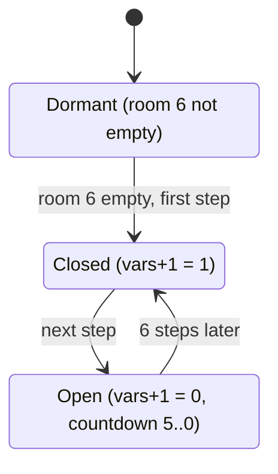

| State | Condition | Next state | Code |
|---|---|---|---|
| Dormant | [`room_lanterns_left+6`](../../src/constants.asm#L29) [`$30`](../reference/variables.md#room_lanterns_left) ≠ 0, or [`frame_parity`](../../src/constants.asm#L66) ≠ 0 | Dormant | [`room00_update`](../../src/room_update.asm#L6) [`$3642`](../reference/modules/room_update.md#room00_update) |
| Dormant or Open | a step, [`room_script_vars`](../../src/room_tables.asm#L390) decremented below 0, [`room_script_vars+1`](../../src/room_tables.asm#L390) = 0 | Closed: sound `$81`, message `$1D` (tile `$46`, mouth closed) at text row 9, column 7; [`room_script_vars+1`](../../src/room_tables.asm#L390) = 1 | [`room00_update`](../../src/room_update.asm#L6) [`$3654`](../../src/room_update.asm#L15) |
| Closed | the next step (the countdown is still below 0), [`room_script_vars+1`](../../src/room_tables.asm#L390) = 1 | Open: message `$1E` (tile `$47`, mouth open) at text row 9, column 7; [`room_script_vars+1`](../../src/room_tables.asm#L390) = 0; [`room_script_vars`](../../src/room_tables.asm#L390) = 5 | [`room00_bull_mouth_open`](../../src/room_update.asm#L24) [`$3667`](../reference/modules/room_update.md#room00_bull_mouth_open) |

- One cycle is 7 steps (14 passes, about 42 frames): the mouth is open for 6 steps and closed for 1 step, with sound `$81` on each close (**Code**).
- **Observed** (`room_events`): screen rows 17/18, column 7 changed `$46/$C6` → `$47/$C7` at 100 and 400 frames; [`room_script_vars`](../../src/room_tables.asm#L390) went `00 00` → `03 00`. The end value 3 fits 67 steps, which is 133-134 passes in 400 frames.
- **Observed** (`room_events2`): the same cells at 60 frames, and [`room_script_vars`](../../src/room_tables.asm#L390) = `02 00` at 400 frames.
- The 1-step closed frame and sound `$81` were not caught in a run (**Code** only).
- **Conclusion** from the screenshots: tile `$47` draws the bull with its mouth open.

**Links to other rooms.**
- The bull moves only when room 6 is empty.
- Exits `$02` and `$05` lead to room 1. Room 1 exits `$02`/`$04`, room 3 exit `$05`, room 6 exit `$05` and room 7 exits `$02`/`$05` lead here; the last four have no trigger cell in their maps.

## 4. Room 1: the hatch to room 5

**Description.** A courtyard between two pagodas, with a static vine in the middle (from the image). Six lanterns hang on two rows. A floor hatch in the middle of the bottom floor can open to room 5.

*Room 1 with the hatch closed: the bottom floor at text row 12 is solid.*

**Data.**

| Table entry | Value | Meaning |
|---|---|---|
| [`room01_map`](../../src/room_maps.asm#L44) [`$6A09`](../reference/modules/room_maps.md#room01_map) | 309 bytes, 440 cells | RLE map stream |
| [`room_char_colours+1`](../../src/room_colours.asm#L12) [`$47A1`](../reference/modules/room_colours.md#room_char_colours) | `$FE` | colour RAM fill: multicolour, colour 6 |
| [`room_lantern_counts+1`](../../src/room_tables.asm#L229) [`$4CCF`](../reference/modules/room_tables.md#room_lantern_counts) | 6 | lanterns at the start (list [`lantern_list_room01`](../../src/room_tables.asm#L253) [`$4D25`](../reference/modules/room_tables.md#lantern_list_room01)) |
| [`room_no_combat_flags+1`](../../src/room_tables.asm#L217) [`$4C9F`](../reference/modules/room_tables.md#room_no_combat_flags) | `$00` | enemies spawn |
| [`ninja_first_spawn_delay+1`](../../src/actor_room_tables.asm#L69) [`$130C`](../reference/modules/actor_room_tables.md#ninja_first_spawn_delay) / [`yamo_first_spawn_delay+1`](../../src/actor_room_tables.asm#L84) [`$1348`](../reference/modules/actor_room_tables.md#yamo_first_spawn_delay) | 120 / 238 | first spawn delay of the Ninja / the Yamo (passes) |
| [`room_spawn_x+1`](../../src/room_tables.asm#L156) [`$4BAF`](../reference/modules/room_tables.md#room_spawn_x) / [`room_spawn_y+1`](../../src/room_tables.asm#L161) [`$4BC3`](../reference/modules/room_tables.md#room_spawn_y) | 24 / 98 | Bruce's spawn point (x, y) |
| [`room_setup_handlers+2`](../../src/room_tables.asm#L401) [`$4E9E`](../reference/modules/room_tables.md#room_setup_handlers) | [`room01_init`](../../src/room_init.asm#L9) [`$33F6`](../reference/modules/room_init.md#room01_init) | init handler (RTS table: the entry holds the address - 1) |
| [`room_frame_handlers+2`](../../src/room_tables.asm#L411) [`$4EC6`](../reference/modules/room_tables.md#room_frame_handlers) | [`room01_update`](../../src/room_update.asm#L35) [`$3679`](../reference/modules/room_update.md#room01_update) | frame handler (RTS table: the entry holds the address - 1) |
| charset | set 0 (`$D018` = `$38`) | chosen by [`draw_room`](../../src/room_draw.asm#L6) from the room number |

| Exit tile | Entry | Destination room | Entry point (x, y) | Trigger cells in the map (map row, column) |
|---|---|---|---|---|
| `$02` | [`exit2_room+1`](../../src/room_tables.asm#L134) [`$4B5F`](../reference/modules/room_tables.md#exit2_room) | room 0 | (160, 146) | (6, 0) |
| `$03` | [`exit3_room+1`](../../src/room_tables.asm#L140) [`$4B73`](../reference/modules/room_tables.md#exit3_room) | room 5 | (44, 50) | none |
| `$04` | [`exit4_room+1`](../../src/room_tables.asm#L146) [`$4B87`](../reference/modules/room_tables.md#exit4_room) | room 0 | (161, 98) | (3, 0) |
| `$05` | [`exit5_room+1`](../../src/room_tables.asm#L151) [`$4B9B`](../reference/modules/room_tables.md#exit5_room) | room 2 | (16, 98) | (3, 39) |

| Lantern | Record | Text row | Column | Map tile | Collected tile |
|---|---|---|---|---|---|
| 0 | [`lantern_list_room01`](../../src/room_tables.asm#L253) [`$4D25`](../reference/modules/room_tables.md#lantern_list_room01) | 7 | 9 | `$13` | `$1E` |
| 1 | [`lantern_list_room01+$4`](../../src/room_tables.asm#L253) [`$4D29`](../reference/modules/room_tables.md#lantern_list_room01) | 7 | 30 | `$14` | `$1F` |
| 2 | [`lantern_list_room01+$8`](../../src/room_tables.asm#L253) [`$4D2D`](../reference/modules/room_tables.md#lantern_list_room01) | 10 | 6 | `$31` | `$12` |
| 3 | [`lantern_list_room01+$C`](../../src/room_tables.asm#L253) [`$4D31`](../reference/modules/room_tables.md#lantern_list_room01) | 10 | 15 | `$13` | `$1E` |
| 4 | [`lantern_list_room01+$10`](../../src/room_tables.asm#L253) [`$4D35`](../reference/modules/room_tables.md#lantern_list_room01) | 10 | 24 | `$14` | `$1F` |
| 5 | [`lantern_list_room01+$14`](../../src/room_tables.asm#L253) [`$4D39`](../reference/modules/room_tables.md#lantern_list_room01) | 10 | 32 | `$31` | `$12` |

The exit `$03` (to room 5) has no trigger cell in the map; the hatch creates it.

**Setup.** [`room01_init`](../../src/room_init.asm#L9) [`$33F6`](../reference/modules/room_init.md#room01_init) sets [`room_script_vars`](../../src/room_tables.asm#L390) = 3: the steps of the hatch.

**Behaviour: the floor hatch.** [`room01_update`](../../src/room_update.asm#L35) [`$3679`](../reference/modules/room_update.md#room01_update) checks, in this order: a step ([`frame_parity`](../../src/constants.asm#L66) = 0); [`room_script_vars`](../../src/room_tables.asm#L390) ≥ 0; [`room_lanterns_left+6`](../../src/constants.asm#L29) ≠ 0 (room 6 **still has** lanterns); [`room_lanterns_left`](../../src/constants.asm#L29) | [`room_lanterns_left+1`](../../src/constants.asm#L29) | [`room_lanterns_left+2`](../../src/constants.asm#L29) = 0 (rooms 0, 1 and 2 empty). Then it decrements [`room_script_vars`](../../src/room_tables.asm#L390) and draws message [`room_script_vars`](../../src/room_tables.asm#L390) + `$10` at text row 12, column 17 (**Code**).

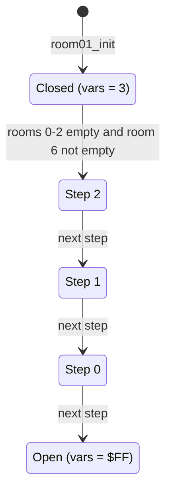

| State | Condition | Next state | Effect (message at text row 12, column 17) | Code |
|---|---|---|---|---|
| Closed | step, rooms 0-2 empty, room 6 not empty | Step 2 | sound `$8A`; message `$12`: tiles `$11 $5C $5D $5E $5F` | [`room01_update`](../../src/room_update.asm#L35) [`$3679`](../reference/modules/room_update.md#room01_update) |
| Step 2 | next step | Step 1 | message `$11`: `$11 $22 $22 $03 $03` | [`room01_hatch_draw_step`](../../src/room_update.asm#L51) [`$369B`](../reference/modules/room_update.md#room01_hatch_draw_step) |
| Step 1 | next step | Step 0 | message `$10`: `$5C $5D $5E $03 $03` | [`room01_hatch_draw_step`](../../src/room_update.asm#L51) [`$369B`](../reference/modules/room_update.md#room01_hatch_draw_step) |
| Step 0 | next step | Open | message `$0F`: `$22 $22 $03 $03 $03` | [`room01_hatch_draw_step`](../../src/room_update.asm#L51) [`$369B`](../reference/modules/room_update.md#room01_hatch_draw_step) |
| Open | [`room_script_vars`](../../src/room_tables.asm#L390) < 0 | Open | none | [`room01_update`](../../src/room_update.asm#L35) [`$3679`](../reference/modules/room_update.md#room01_update) |

- After the last step, the tiles `$03` at columns 19-21 of map row 10 are exit tiles to room 5. The hatch takes 4 steps (8 passes, 24 frames) (**Code**).
- **Observed** (`room_events`, negative): with every counter at 0, room 6 included, nothing changed and [`room_script_vars`](../../src/room_tables.asm#L390) stayed 3. The code ran up to the room 6 test and branched out.
- **Observed** (`room_events2`, negative): room 6 was empty too; no cell changed and [`room_script_vars`](../../src/room_tables.asm#L390) = 3 at 400 frames.
- **Observed** (`room_events3`, `r1_hatch`: rooms 0-2 empty, room 6 full): the hatch fired. Screen rows 23/24, columns 17-21 changed `$11 $11 $22 $22 $11` → `$22 $22 $03 $03 $03` (bottom row `$A2 $A2 $83 $83 $83`), already at 60 frames and unchanged at 400 frames. [`room_script_vars`](../../src/room_tables.asm#L390) = `$FF`. The drawing code [`room01_update`](../../src/room_update.asm#L35) [`$368E-$36A2`](../../src/room_update.asm#L46) ran.
- The intermediate steps and sound `$8A` were not seen (**Code**). Nobody walked onto the hatch into room 5 (Still open).

**Links to other rooms.**
- The hatch opens only when rooms 0, 1 and 2 are empty **and room 6 is not**.
- **Conclusion:** after room 6 is cleared, the map redraws the hatch closed on each later visit, and the route room 1 → room 5 is gone. Room 6's own event opens another route (room 6 → room 5).

## 5. Room 2: the exit to room 3 and the second bull

**Description.** Pagodas on two levels, a static vine in the middle, and a bull statue on a pedestal at the right (from the image). Ten lanterns hang on two rows. The only map exit leads back to room 1; the exit to room 3 appears when room 6 is empty.

*Room 2: the bull at the right stands above the wall where the exit to room 3 appears.*

**Data.**

| Table entry | Value | Meaning |
|---|---|---|
| [`room02_map`](../../src/room_maps.asm#L85) [`$6B3E`](../reference/modules/room_maps.md#room02_map) | 351 bytes, 440 cells | RLE map stream |
| [`room_char_colours+2`](../../src/room_colours.asm#L12) [`$47A2`](../reference/modules/room_colours.md#room_char_colours) | `$FE` | colour RAM fill: multicolour, colour 6 |
| [`room_lantern_counts+2`](../../src/room_tables.asm#L229) [`$4CD0`](../reference/modules/room_tables.md#room_lantern_counts) | 10 | lanterns at the start (list [`lantern_list_room02`](../../src/room_tables.asm#L258) [`$4D3E`](../reference/modules/room_tables.md#lantern_list_room02)) |
| [`room_no_combat_flags+2`](../../src/room_tables.asm#L217) [`$4CA0`](../reference/modules/room_tables.md#room_no_combat_flags) | `$00` | enemies spawn |
| [`ninja_first_spawn_delay+2`](../../src/actor_room_tables.asm#L69) [`$130D`](../reference/modules/actor_room_tables.md#ninja_first_spawn_delay) / [`yamo_first_spawn_delay+2`](../../src/actor_room_tables.asm#L84) [`$1349`](../reference/modules/actor_room_tables.md#yamo_first_spawn_delay) | 120 / 238 | first spawn delay of the Ninja / the Yamo (passes) |
| [`room_spawn_x+2`](../../src/room_tables.asm#L156) [`$4BB0`](../reference/modules/room_tables.md#room_spawn_x) / [`room_spawn_y+2`](../../src/room_tables.asm#L161) [`$4BC4`](../reference/modules/room_tables.md#room_spawn_y) | 48 / 196 | Bruce's spawn point (x, y) |
| [`room_setup_handlers+4`](../../src/room_tables.asm#L401) [`$4EA0`](../reference/modules/room_tables.md#room_setup_handlers) | [`room_init_none`](../../src/room_init.asm#L6) [`$33F5`](../reference/modules/room_init.md#room_init_none) | init handler (RTS table: the entry holds the address - 1) |
| [`room_frame_handlers+4`](../../src/room_tables.asm#L411) [`$4EC8`](../reference/modules/room_tables.md#room_frame_handlers) | [`room02_update`](../../src/room_update.asm#L60) [`$36A6`](../reference/modules/room_update.md#room02_update) | frame handler (RTS table: the entry holds the address - 1) |
| charset | set 0 (`$D018` = `$38`) | chosen by [`draw_room`](../../src/room_draw.asm#L6) from the room number |

| Exit tile | Entry | Destination room | Entry point (x, y) | Trigger cells in the map (map row, column) |
|---|---|---|---|---|
| `$02` | [`exit2_room+2`](../../src/room_tables.asm#L134) [`$4B60`](../reference/modules/room_tables.md#exit2_room) | x = 0: as tile `$04`: room 1 | (161, 98) | none |
| `$03` | [`exit3_room+2`](../../src/room_tables.asm#L140) [`$4B74`](../reference/modules/room_tables.md#exit3_room) | x = 0: as tile `$04`: room 1 | (161, 98) | none |
| `$04` | [`exit4_room+2`](../../src/room_tables.asm#L146) [`$4B88`](../reference/modules/room_tables.md#exit4_room) | room 1 | (161, 98) | (3, 0) |
| `$05` | [`exit5_room+2`](../../src/room_tables.asm#L151) [`$4B9C`](../reference/modules/room_tables.md#exit5_room) | room 3 | (16, 196) | none |

| Lantern | Record | Text row | Column | Map tile | Collected tile |
|---|---|---|---|---|---|
| 0 | [`lantern_list_room02`](../../src/room_tables.asm#L258) [`$4D3E`](../reference/modules/room_tables.md#lantern_list_room02) | 7 | 5 | `$31` | `$12` |
| 1 | [`lantern_list_room02+$4`](../../src/room_tables.asm#L258) [`$4D42`](../reference/modules/room_tables.md#lantern_list_room02) | 7 | 9 | `$13` | `$1E` |
| 2 | [`lantern_list_room02+$8`](../../src/room_tables.asm#L258) [`$4D46`](../reference/modules/room_tables.md#lantern_list_room02) | 7 | 22 | `$14` | `$1F` |
| 3 | [`lantern_list_room02+$C`](../../src/room_tables.asm#L258) [`$4D4A`](../reference/modules/room_tables.md#lantern_list_room02) | 7 | 26 | `$13` | `$1E` |
| 4 | [`lantern_list_room02+$10`](../../src/room_tables.asm#L258) [`$4D4E`](../reference/modules/room_tables.md#lantern_list_room02) | 7 | 30 | `$14` | `$1F` |
| 5 | [`lantern_list_room02+$14`](../../src/room_tables.asm#L258) [`$4D52`](../reference/modules/room_tables.md#lantern_list_room02) | 10 | 5 | `$13` | `$1E` |
| 6 | [`lantern_list_room02+$18`](../../src/room_tables.asm#L258) [`$4D56`](../reference/modules/room_tables.md#lantern_list_room02) | 10 | 9 | `$14` | `$1F` |
| 7 | [`lantern_list_room02+$1C`](../../src/room_tables.asm#L258) [`$4D5A`](../reference/modules/room_tables.md#lantern_list_room02) | 10 | 15 | `$13` | `$1E` |
| 8 | [`lantern_list_room02+$20`](../../src/room_tables.asm#L258) [`$4D5E`](../reference/modules/room_tables.md#lantern_list_room02) | 10 | 21 | `$14` | `$1F` |
| 9 | [`lantern_list_room02+$24`](../../src/room_tables.asm#L258) [`$4D62`](../reference/modules/room_tables.md#lantern_list_room02) | 10 | 27 | `$13` | `$1E` |

**Setup.** [`room_init_none`](../../src/room_init.asm#L6) [`$33F5`](../reference/modules/room_init.md#room_init_none).

**Behaviour.** [`room02_update`](../../src/room_update.asm#L60) [`$36A6`](../reference/modules/room_update.md#room02_update) has three parts (**Code**):
1. A protection remnant: `LDX $00,Y` with Y = 0 must read `$EF` from the 6510 data direction register [`D6510`](../../src/constants.asm#L7) [`$0000`](../reference/variables.md#D6510), or the handler loops forever. The crack keeps `$00` = `$EF`.
2. A one-shot that opens the exit ([`room_script_vars+1`](../../src/room_tables.asm#L390) [`$4E98`](../reference/modules/room_tables.md#room_script_vars)).
3. The bull's mouth, the same machine as in room 0, at text row 9, column 33 ([`room02_bull_tick`](../../src/room_update.asm#L79) [`$36CF`](../reference/modules/room_update.md#room02_bull_tick)). Here [`room_script_vars+2`](../../src/room_tables.asm#L390) [`$4E99`](../reference/modules/room_tables.md#room_script_vars) is the step countdown and [`room_script_vars`](../../src/room_tables.asm#L390) [`$4E97`](../reference/modules/room_tables.md#room_script_vars) the mouth state.

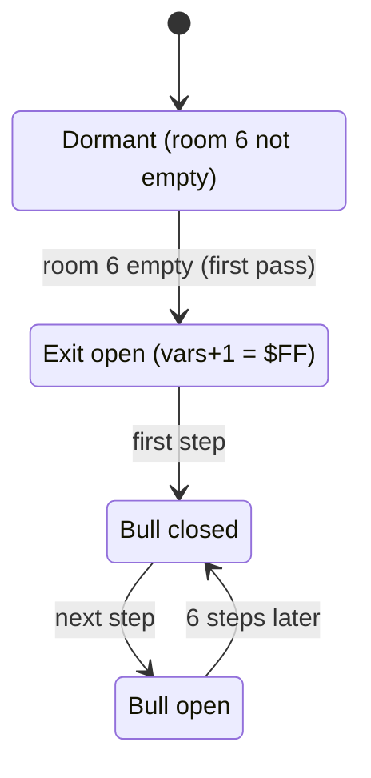

| State | Condition | Next state | Effect | Code |
|---|---|---|---|---|
| Dormant | [`room_lanterns_left+6`](../../src/constants.asm#L29) = 0 and [`room_script_vars+1`](../../src/room_tables.asm#L390) ≥ 0 | Exit open | [`room_script_vars+1`](../../src/room_tables.asm#L390) = `$FF`; sound `$8A`; message `$1A` (`$00 $00 $05`) at text row 11, column 37; message `$07` (`$11 $11 $11`) at text row 12, column 37 | [`room02_update`](../../src/room_update.asm#L60) [`$36AE`](../../src/room_update.asm#L65) |
| Exit open | a step, countdown below 0, mouth state 0 | Bull closed | sound `$81`; message `$1D` at text row 9, column 33 | [`room02_bull_tick`](../../src/room_update.asm#L79) [`$36CF`](../reference/modules/room_update.md#room02_bull_tick) |
| Bull closed | next step | Bull open | message `$1E` at text row 9, column 33; countdown = 5 | [`room02_bull_mouth_open`](../../src/room_update.asm#L95) [`$36F0`](../reference/modules/room_update.md#room02_bull_mouth_open) |

- The exit message puts exit tile `$05` (to room 3) at map row 9, column 39 in place of the wall tile `$32`, and floor `$11` below it.
- **Observed** (`room_events`): row 21: column 37 `$1C`→`$00`, column 39 `$32`→`$05`; row 22: `$9C`→`$80`, `$B2`→`$85`; row 23: column 37 `$4E`→`$11`, column 39 `$39`→`$11`; row 24: `$CE`→`$91`, `$B9`→`$91`. [`room_script_vars+1`](../../src/room_tables.asm#L390) = `$FF`. The bull: rows 17/18, column 33 `$46`→`$47`; at the end [`room_script_vars+2`](../../src/room_tables.asm#L390) = 3 and [`room_script_vars`](../../src/room_tables.asm#L390) = 0.
- **Observed** (`room_events2`): the same cells, and [`room_script_vars`](../../src/room_tables.asm#L390) = `00 FF 03` at 400 frames.

**Links to other rooms.**
- The exit to room 3 and the bull both need room 6 empty.
- Exit `$04` leads to room 1. Room 1 exit `$05` and room 3 exit `$04` lead here; room 6 exit `$04` also names room 2, with no trigger cell.

## 6. Room 3: the hatch to room 10 and the bridge

**Description.** Castle towers above two spike pits (tile `$0F`, deadly) at map row 10, columns 9-15 and 21-27. A bridge row at map row 4 (text row 6) lies above the pits. Two lanterns hang at the bottom right. No enemies come here.

*Room 3: the two spike pits at the bottom, with the bridge tiles above the right pit.*

**Data.**

| Table entry | Value | Meaning |
|---|---|---|
| [`room03_map`](../../src/room_maps.asm#L131) [`$6C9D`](../reference/modules/room_maps.md#room03_map) | 382 bytes, 440 cells | RLE map stream |
| [`room_char_colours+3`](../../src/room_colours.asm#L12) [`$47A3`](../reference/modules/room_colours.md#room_char_colours) | `$FE` | colour RAM fill: multicolour, colour 6 |
| [`room_lantern_counts+3`](../../src/room_tables.asm#L229) [`$4CD1`](../reference/modules/room_tables.md#room_lantern_counts) | 2 | lanterns at the start (list [`lantern_list_room03`](../../src/room_tables.asm#L265) [`$4D67`](../reference/modules/room_tables.md#lantern_list_room03)) |
| [`room_no_combat_flags+3`](../../src/room_tables.asm#L217) [`$4CA1`](../reference/modules/room_tables.md#room_no_combat_flags) | `$FF` | no enemies |
| [`ninja_first_spawn_delay+3`](../../src/actor_room_tables.asm#L69) [`$130E`](../reference/modules/actor_room_tables.md#ninja_first_spawn_delay) / [`yamo_first_spawn_delay+3`](../../src/actor_room_tables.asm#L84) [`$134A`](../reference/modules/actor_room_tables.md#yamo_first_spawn_delay) | 0 / 0 | first spawn delay of the Ninja / the Yamo (passes) |
| [`room_spawn_x+3`](../../src/room_tables.asm#L156) [`$4BB1`](../reference/modules/room_tables.md#room_spawn_x) / [`room_spawn_y+3`](../../src/room_tables.asm#L161) [`$4BC5`](../reference/modules/room_tables.md#room_spawn_y) | 32 / 192 | Bruce's spawn point (x, y) |
| [`room_setup_handlers+6`](../../src/room_tables.asm#L401) [`$4EA2`](../reference/modules/room_tables.md#room_setup_handlers) | [`room03_init`](../../src/room_init.asm#L14) [`$33FC`](../reference/modules/room_init.md#room03_init) | init handler (RTS table: the entry holds the address - 1) |
| [`room_frame_handlers+6`](../../src/room_tables.asm#L411) [`$4ECA`](../reference/modules/room_tables.md#room_frame_handlers) | [`room03_update`](../../src/room_update.asm#L106) [`$3702`](../reference/modules/room_update.md#room03_update) | frame handler (RTS table: the entry holds the address - 1) |
| charset | set 0 (`$D018` = `$38`) | chosen by [`draw_room`](../../src/room_draw.asm#L6) from the room number |

| Exit tile | Entry | Destination room | Entry point (x, y) | Trigger cells in the map (map row, column) |
|---|---|---|---|---|
| `$02` | [`exit2_room+3`](../../src/room_tables.asm#L134) [`$4B61`](../reference/modules/room_tables.md#exit2_room) | x = 0: as tile `$03`: room 10 | (16, 176) | none |
| `$03` | [`exit3_room+3`](../../src/room_tables.asm#L140) [`$4B75`](../reference/modules/room_tables.md#exit3_room) | room 10 | (16, 176) | none |
| `$04` | [`exit4_room+3`](../../src/room_tables.asm#L146) [`$4B89`](../reference/modules/room_tables.md#exit4_room) | room 2 | (161, 197) | (9, 0) |
| `$05` | [`exit5_room+3`](../../src/room_tables.asm#L151) [`$4B9D`](../reference/modules/room_tables.md#exit5_room) | room 0 | (16, 98) | none |

| Lantern | Record | Text row | Column | Map tile | Collected tile |
|---|---|---|---|---|---|
| 0 | [`lantern_list_room03`](../../src/room_tables.asm#L265) [`$4D67`](../reference/modules/room_tables.md#lantern_list_room03) | 10 | 29 | `$13` | `$1E` |
| 1 | [`lantern_list_room03+$4`](../../src/room_tables.asm#L265) [`$4D6B`](../reference/modules/room_tables.md#lantern_list_room03) | 10 | 38 | `$14` | `$1F` |

**Setup.** [`room03_init`](../../src/room_init.asm#L14) [`$33FC`](../reference/modules/room_init.md#room03_init) sets [`room_script_vars`](../../src/room_tables.asm#L390) = 3: the steps of the hatch.

**Behaviour.** [`room03_update`](../../src/room_update.asm#L106) [`$3702`](../reference/modules/room_update.md#room03_update) runs two independent machines (**Code**):
- *The hatch to room 10* ([`room_script_vars`](../../src/room_tables.asm#L390)): the room 1 pattern. It needs a step, [`room_script_vars`](../../src/room_tables.asm#L390) ≥ 0 and [`room_lanterns_left+3`](../../src/constants.asm#L29) = 0. Messages `$12`, `$11`, `$10`, `$0F` at text row 12, column 29 (sound `$8A` at the first, [`room03_hatch_draw_step`](../../src/room_update.asm#L118) [`$371C`](../reference/modules/room_update.md#room03_hatch_draw_step)).
- *The bridge* ([`room03_bridge_tick`](../../src/room_update.asm#L125) [`$3726`](../reference/modules/room_update.md#room03_bridge_tick)): on every pass, without the parity test and without a lantern condition. [`room_script_vars+2`](../../src/room_tables.asm#L390) counts the passes; below 0 it is reloaded with `$20` and the bridge changes side ([`room03_move_bridge`](../../src/room_update.asm#L130) [`$372C`](../reference/modules/room_update.md#room03_move_bridge)). [`room_script_vars+1`](../../src/room_tables.asm#L390) is the side.

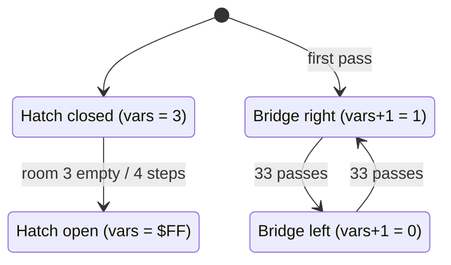

| Machine | State | Condition | Next state | Effect | Code |
|---|---|---|---|---|---|
| Hatch | Closed | step, room 3 empty | Open (after 4 steps) | text row 12, columns 29-33 end as `$22 $22 $03 $03 $03`; the tiles `$03` are exit tiles to room 10 | [`room03_update`](../../src/room_update.asm#L106) [`$3702`](../reference/modules/room_update.md#room03_update) |
| Bridge | right | [`room_script_vars+2`](../../src/room_tables.asm#L390) < 0, [`room_script_vars+1`](../../src/room_tables.asm#L390) = 1 | left | [`room_script_vars+1`](../../src/room_tables.asm#L390) = 0; message 6 (7 × tile `$4B`) at text row 6, column 9, and message `$60` (7 × tile `$09`) at text row 6, column 21 | [`room03_move_bridge`](../../src/room_update.asm#L130) [`$372C`](../reference/modules/room_update.md#room03_move_bridge) |
| Bridge | left | [`room_script_vars+2`](../../src/room_tables.asm#L390) < 0, [`room_script_vars+1`](../../src/room_tables.asm#L390) = 0 | right | [`room_script_vars+1`](../../src/room_tables.asm#L390) = 1; message `$60` at column 9 and message 6 at column 21 (the map state) | [`room03_bridge_to_right`](../../src/room_update.asm#L145) [`$374B`](../reference/modules/room_update.md#room03_bridge_to_right) |

- The first pass draws the map state again (bridge right). Each side lasts 33 passes (about 99 frames). The hatch takes 8 passes (**Code**).
- **Observed** (`room_events`): the hatch: rows 23/24, columns 29-33 `$11 $11 $22 $22 $11` → `$22 $22 $03 $03 $03`; [`room_script_vars`](../../src/room_tables.asm#L390) 3 → `$FF`. The bridge: at 100 frames rows 11/12, columns 9-15 `$09`→`$4B` and columns 21-27 `$4B`→`$09`; at 400 frames back to the map state; [`room_script_vars+2`](../../src/room_tables.asm#L390) = `$0F` before and `$0E` after, which fits 133 passes.
- **Observed** (`room_events2`): the same hatch cells, and [`room_script_vars`](../../src/room_tables.asm#L390) = `FF 01 20` at 400 frames (the bridge timer just reloaded).
- **Conclusion** (from the screenshots, not from the code): tile `$4B` is the walkable bridge.

**Links to other rooms.**
- The hatch needs only room 3 empty.
- Exit `$04` leads to room 2. Exit `$05` (to room 0) has no trigger cell, and no code of rooms 0-9 draws one. Room 2's event opens the way in from room 2; room 10 exit `$02` leads back here.

## 7. Room 4: the blinking lanterns

**Description.** A purple cave. An animated climbing texture (tiles `$61-$63`) runs down columns 18-21, with deadly spikes `$0F` under it. Each side has a small chamber with one lantern at text row 4. A floor shaft at the bottom left leads to room 7.

*Room 4: the texture column in the middle, the two lantern chambers and the shaft at the bottom left.*

**Data.**

| Table entry | Value | Meaning |
|---|---|---|
| [`room04_map`](../../src/room_maps.asm#L181) [`$6E1B`](../reference/modules/room_maps.md#room04_map) | 359 bytes, 442 cells | RLE map stream |
| [`room_char_colours+4`](../../src/room_colours.asm#L12) [`$47A4`](../reference/modules/room_colours.md#room_char_colours) | `$FC` | colour RAM fill: multicolour, colour 4 |
| [`room_lantern_counts+4`](../../src/room_tables.asm#L229) [`$4CD2`](../reference/modules/room_tables.md#room_lantern_counts) | 2 | lanterns at the start (list [`lantern_list_room04`](../../src/room_tables.asm#L268) [`$4D70`](../reference/modules/room_tables.md#lantern_list_room04)) |
| [`room_no_combat_flags+4`](../../src/room_tables.asm#L217) [`$4CA2`](../reference/modules/room_tables.md#room_no_combat_flags) | `$00` | enemies spawn |
| [`ninja_first_spawn_delay+4`](../../src/actor_room_tables.asm#L69) [`$130F`](../reference/modules/actor_room_tables.md#ninja_first_spawn_delay) / [`yamo_first_spawn_delay+4`](../../src/actor_room_tables.asm#L84) [`$134B`](../reference/modules/actor_room_tables.md#yamo_first_spawn_delay) | 112 / 192 | first spawn delay of the Ninja / the Yamo (passes) |
| [`room_spawn_x+4`](../../src/room_tables.asm#L156) [`$4BB2`](../reference/modules/room_tables.md#room_spawn_x) / [`room_spawn_y+4`](../../src/room_tables.asm#L161) [`$4BC6`](../reference/modules/room_tables.md#room_spawn_y) | 148 / 180 | Bruce's spawn point (x, y) |
| [`room_setup_handlers+8`](../../src/room_tables.asm#L401) [`$4EA4`](../reference/modules/room_tables.md#room_setup_handlers) | [`room04_init`](../../src/room_init.asm#L19) [`$3402`](../reference/modules/room_init.md#room04_init) | init handler (RTS table: the entry holds the address - 1) |
| [`room_frame_handlers+8`](../../src/room_tables.asm#L411) [`$4ECC`](../reference/modules/room_tables.md#room_frame_handlers) | [`room04_update`](../../src/room_update.asm#L156) [`$3760`](../reference/modules/room_update.md#room04_update) | frame handler (RTS table: the entry holds the address - 1) |
| charset | set 0 (`$D018` = `$38`) | chosen by [`draw_room`](../../src/room_draw.asm#L6) from the room number |

| Exit tile | Entry | Destination room | Entry point (x, y) | Trigger cells in the map (map row, column) |
|---|---|---|---|---|
| `$02` | [`exit2_room+4`](../../src/room_tables.asm#L134) [`$4B62`](../reference/modules/room_tables.md#exit2_room) | room 5 | (16, 194) | (2, 39) |
| `$03` | [`exit3_room+4`](../../src/room_tables.asm#L140) [`$4B76`](../reference/modules/room_tables.md#exit3_room) | room 7 | (31, 50) | (10, 1), (10, 2), (10, 3), (10, 4) |
| `$04` | [`exit4_room+4`](../../src/room_tables.asm#L146) [`$4B8A`](../reference/modules/room_tables.md#exit4_room) | x = 0: as tile `$05`: room 0 at x = 0 | (0, 0) | none |
| `$05` | [`exit5_room+4`](../../src/room_tables.asm#L151) [`$4B9E`](../reference/modules/room_tables.md#exit5_room) | x = 0: room 0 at x = 0 (tile `$05` has no fall-through) | (0, 0) | none |

| Lantern | Record | Text row | Column | Map tile | Collected tile |
|---|---|---|---|---|---|
| 0 | [`lantern_list_room04`](../../src/room_tables.asm#L268) [`$4D70`](../reference/modules/room_tables.md#lantern_list_room04) | 4 | 11 | `$13` | `$1E` |
| 1 | [`lantern_list_room04+$4`](../../src/room_tables.asm#L268) [`$4D74`](../reference/modules/room_tables.md#lantern_list_room04) | 4 | 28 | `$14` | `$1F` |

**Setup.** [`room04_init`](../../src/room_init.asm#L19) [`$3402`](../reference/modules/room_init.md#room04_init) (**Code**):
1. [`room_script_vars+3`](../../src/room_tables.asm#L390) = `$1F` (the blink counter of lantern 1).
2. The hazards (section 13.2):

   | Hazard | Text row, column | [`hazard_timer`](../../src/constants.asm#L64) |
   |---|---|---|
   | 0 | 11, 1 | `$FF` |
   | 1 | 7, 11 | `$FF` |
   | 2 | 7, 26 | `$F4` |

**Behaviour.** [`room04_update`](../../src/room_update.asm#L156) [`$3760`](../reference/modules/room_update.md#room04_update) runs these parts in order on every pass: blink lantern 0, lantern 0 taken, blink lantern 1, lantern 1 taken, hazard 0, hazard 1, hazard 2, then [`animate_scrolling_chars`](../../src/animated_chars.asm#L6) [`$2C70`](../reference/modules/animated_chars.md#animate_scrolling_chars) (**Code**).

| Variable | Meaning |
|---|---|
| [`room_script_vars`](../../src/room_tables.asm#L390) | one-shot of lantern 0 |
| [`room_script_vars+1`](../../src/room_tables.asm#L390) | one-shot of lantern 1 |
| [`room_script_vars+2`](../../src/room_tables.asm#L390) | blink counter of lantern 0 (0-`$3F`) |
| [`room_script_vars+3`](../../src/room_tables.asm#L390) | blink counter of lantern 1 (starts at `$1F`) |

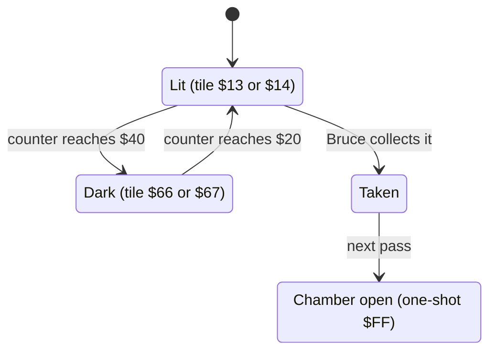

The diagram is for lantern n (n = 0 or 1).

| State | Condition | Next state | Effect | Code |
|---|---|---|---|---|
| Lit | lantern 0 present, [`room_script_vars+2`](../../src/room_tables.asm#L390) + 1 = `$40` | Dark | [`room_script_vars+2`](../../src/room_tables.asm#L390) = 0; message `$36` (tile `$66`) at text row 4, column 11 | [`room04_lantern0_dark_check`](../../src/room_update.asm#L168) [`$377B`](../reference/modules/room_update.md#room04_lantern0_dark_check) |
| Dark | lantern 0 present, [`room_script_vars+2`](../../src/room_tables.asm#L390) + 1 = `$20` | Lit | message `$34` (tile `$13`) at text row 4, column 11 | [`room04_update`](../../src/room_update.asm#L156) [`$3760`](../reference/modules/room_update.md#room04_update) |
| Lit / Dark | lantern 1 present, [`room_script_vars+3`](../../src/room_tables.asm#L390) + 1 = `$40` / `$20` | Dark / Lit | message `$37` (tile `$67`) / `$35` (tile `$14`) at text row 4, column 28 | [`room04_blink_lantern1`](../../src/room_update.asm#L194) [`$37B4`](../reference/modules/room_update.md#room04_blink_lantern1) |
| Taken (lantern 0) | lantern 0 collected, [`room_script_vars`](../../src/room_tables.asm#L390) ≥ 0 | Chamber open | [`room_script_vars`](../../src/room_tables.asm#L390) = `$FF`; sound `$8A`; message `$16` (4 blanks) at text rows 8 and 9, column 11; [`draw_hazard1_frame`](../../src/room_tiles.asm#L46) [`$4090`](../reference/modules/room_tiles.md#draw_hazard1_frame) with frame 6 erases hazard 1 | [`room04_check_lantern0_taken`](../../src/room_update.asm#L177) [`$378D`](../reference/modules/room_update.md#room04_check_lantern0_taken) |
| Taken (lantern 1) | lantern 1 collected, [`room_script_vars+1`](../../src/room_tables.asm#L390) ≥ 0 | Chamber open | [`room_script_vars+1`](../../src/room_tables.asm#L390) = `$FF`; [`scroll_direction`](../../src/constants.asm#L54) = 0 and [`anim_speed_index`](../../src/variables.asm#L43) = 7; sound `$8A`; message `$16` at text rows 8 and 9, column 25; [`draw_hazard2_frame`](../../src/room_tiles.asm#L53) [`$409A`](../reference/modules/room_tiles.md#draw_hazard2_frame) with frame 6 erases hazard 2 | [`room04_check_lantern1_taken`](../../src/room_update.asm#L215) [`$37E1`](../reference/modules/room_update.md#room04_check_lantern1_taken) |
| Hazard 0 | always | - | text row 11, columns 1-4 (above the shaft); alternate frames; limit column 3, restart column 1, wait `$A0`; cycle 105 passes | [`room04_step_hazard0`](../../src/room_update.asm#L236) [`$3811`](../reference/modules/room_update.md#room04_step_hazard0) |
| Hazard 1 | only while lantern 0 is present | - | text row 7, columns 11-13; normal frames; limit `$0C`, restart `$0B`, wait `$E4`; cycle 36 passes | [`room04_step_hazard1`](../../src/room_update.asm#L264) [`$3840`](../reference/modules/room_update.md#room04_step_hazard1) |
| Hazard 2 | only while lantern 1 is present | - | text row 7, columns 26-28; normal frames; limit `$1B`, restart `$1A`, wait `$E4`; cycle 36 passes | [`room04_step_hazard2`](../../src/room_update.asm#L294) [`$3874`](../reference/modules/room_update.md#room04_step_hazard2) |

- Each lantern is lit for 32 passes and dark for 32 passes. The map draws both lit. Lantern 0 stays lit for the first 64 passes; lantern 1 (counter `$1F`) goes dark after 33 passes, so the two blink about half a period apart (**Code**).
- Only the chars `$13`, `$14` and `$31` can be collected ([`pick_up_lantern`](../../src/background_touch.asm#L131) [`$2F04`](../reference/modules/background_touch.md#pick_up_lantern)), so a lantern can be taken only in its lit half (**Code**). The dark tile `$66` is deadly only from room 10 on ([`handle_touched_char`](../../src/background_touch.asm#L53) [`$2E89`](../reference/modules/background_touch.md#handle_touched_char)), so here it is harmless.
- The blanked cells are map rows 6-7, columns 11-14 or 25-28: the chamber floor and the rock under it. **Conclusion:** taking a lantern opens a way down out of its chamber.
- **Observed** (`room_events`, lanterns present): at 100 frames rows 7/8, column 11 `$66`→`$13` and column 28 `$14`→`$67`; at 400 frames both equal the start; the counters went `$08/$27` → `$0D/$2C`, which is +5 mod 64 (about 133 passes). No hazard cell was on the screens: the hazards wait for most of their cycle.
- **Observed** (`room_events2`, collected): rows 15/16, columns 11-14 `$2A/$AA`→`$00/$80`; rows 17/18 `$50 $53 $4F $51`→`$00`; rows 15-18, columns 25-28 → `$00/$80`; [`room_script_vars`](../../src/room_tables.asm#L390) = `FF FF 00 1F` at 400 frames. The blink counters never moved, so the blink code is skipped for a collected lantern. No hazard 1 or hazard 2 cell appeared. Hazard 0: rows 21/22, column 4 `$58/$D8` (frame 5 at the limit column 3) at 60 frames, erased by 400 frames.
- The sound and the texture reset of lantern 1 were not seen (**Code**).

**Links to other rooms.**
- Both events depend only on room 4's own lanterns.
- Exit `$02` leads to room 5; exit `$03` (the shaft, map row 10, columns 1-4) leads to room 7. Room 5's lantern-6 event creates the exit from room 5 back to here.

## 8. Room 5: three passages

**Description.** A blue cave with three floors of ledges and two lattice ladders at columns 13-15 and 17-19. An animated climbing texture rises at columns 34-36, under deadly spikes (tile `$40`) at map row 0. Ten lanterns hang on three rows. Two exits on the right lead to room 6; two more exits appear through events.

*Room 5: the spikes at the top right cap the texture column; the init handler colours them.*

**Data.**

| Table entry | Value | Meaning |
|---|---|---|
| [`room05_map`](../../src/room_maps.asm#L228) [`$6F82`](../reference/modules/room_maps.md#room05_map) | 347 bytes, 440 cells | RLE map stream |
| [`room_char_colours+5`](../../src/room_colours.asm#L12) [`$47A5`](../reference/modules/room_colours.md#room_char_colours) | `$FC` | colour RAM fill: multicolour, colour 4 |
| [`room_lantern_counts+5`](../../src/room_tables.asm#L229) [`$4CD3`](../reference/modules/room_tables.md#room_lantern_counts) | 10 | lanterns at the start (list [`lantern_list_room05`](../../src/room_tables.asm#L272) [`$4D79`](../reference/modules/room_tables.md#lantern_list_room05)) |
| [`room_no_combat_flags+5`](../../src/room_tables.asm#L217) [`$4CA3`](../reference/modules/room_tables.md#room_no_combat_flags) | `$00` | enemies spawn |
| [`ninja_first_spawn_delay+5`](../../src/actor_room_tables.asm#L69) [`$1310`](../reference/modules/actor_room_tables.md#ninja_first_spawn_delay) / [`yamo_first_spawn_delay+5`](../../src/actor_room_tables.asm#L84) [`$134C`](../reference/modules/actor_room_tables.md#yamo_first_spawn_delay) | 24 / 192 | first spawn delay of the Ninja / the Yamo (passes) |
| [`room_spawn_x+5`](../../src/room_tables.asm#L156) [`$4BB3`](../reference/modules/room_tables.md#room_spawn_x) / [`room_spawn_y+5`](../../src/room_tables.asm#L161) [`$4BC7`](../reference/modules/room_tables.md#room_spawn_y) | 34 / 81 | Bruce's spawn point (x, y) |
| [`room_setup_handlers+10`](../../src/room_tables.asm#L401) [`$4EA6`](../reference/modules/room_tables.md#room_setup_handlers) | [`room05_init`](../../src/room_init.asm#L40) [`$3428`](../reference/modules/room_init.md#room05_init) | init handler (RTS table: the entry holds the address - 1) |
| [`room_frame_handlers+10`](../../src/room_tables.asm#L411) [`$4ECE`](../reference/modules/room_tables.md#room_frame_handlers) | [`room05_update`](../../src/room_update.asm#L327) [`$38AB`](../reference/modules/room_update.md#room05_update) | frame handler (RTS table: the entry holds the address - 1) |
| charset | set 0 (`$D018` = `$38`) | chosen by [`draw_room`](../../src/room_draw.asm#L6) from the room number |

| Exit tile | Entry | Destination room | Entry point (x, y) | Trigger cells in the map (map row, column) |
|---|---|---|---|---|
| `$02` | [`exit2_room+5`](../../src/room_tables.asm#L134) [`$4B63`](../reference/modules/room_tables.md#exit2_room) | room 4 | (156, 81) | none |
| `$03` | [`exit3_room+5`](../../src/room_tables.asm#L140) [`$4B77`](../reference/modules/room_tables.md#exit3_room) | room 6 | (16, 64) | (2, 39) |
| `$04` | [`exit4_room+5`](../../src/room_tables.asm#L146) [`$4B8B`](../reference/modules/room_tables.md#exit4_room) | room 6 | (16, 116) | (5, 39) |
| `$05` | [`exit5_room+5`](../../src/room_tables.asm#L151) [`$4B9F`](../reference/modules/room_tables.md#exit5_room) | room 1 | (88, 102) | none |

| Lantern | Record | Text row | Column | Map tile | Collected tile |
|---|---|---|---|---|---|
| 0 | [`lantern_list_room05`](../../src/room_tables.asm#L272) [`$4D79`](../reference/modules/room_tables.md#lantern_list_room05) | 3 | 2 | `$13` | `$1E` |
| 1 | [`lantern_list_room05+$4`](../../src/room_tables.asm#L272) [`$4D7D`](../reference/modules/room_tables.md#lantern_list_room05) | 3 | 6 | `$13` | `$1E` |
| 2 | [`lantern_list_room05+$8`](../../src/room_tables.asm#L272) [`$4D81`](../reference/modules/room_tables.md#lantern_list_room05) | 3 | 28 | `$14` | `$1F` |
| 3 | [`lantern_list_room05+$C`](../../src/room_tables.asm#L272) [`$4D85`](../reference/modules/room_tables.md#lantern_list_room05) | 3 | 32 | `$13` | `$1E` |
| 4 | [`lantern_list_room05+$10`](../../src/room_tables.asm#L272) [`$4D89`](../reference/modules/room_tables.md#lantern_list_room05) | 3 | 38 | `$14` | `$1F` |
| 5 | [`lantern_list_room05+$14`](../../src/room_tables.asm#L272) [`$4D8D`](../reference/modules/room_tables.md#lantern_list_room05) | 6 | 30 | `$14` | `$1F` |
| 6 | [`lantern_list_room05+$18`](../../src/room_tables.asm#L272) [`$4D91`](../reference/modules/room_tables.md#lantern_list_room05) | 10 | 2 | `$13` | `$1E` |
| 7 | [`lantern_list_room05+$1C`](../../src/room_tables.asm#L272) [`$4D95`](../reference/modules/room_tables.md#lantern_list_room05) | 10 | 23 | `$14` | `$1F` |
| 8 | [`lantern_list_room05+$20`](../../src/room_tables.asm#L272) [`$4D99`](../reference/modules/room_tables.md#lantern_list_room05) | 10 | 26 | `$13` | `$1F` |
| 9 | [`lantern_list_room05+$24`](../../src/room_tables.asm#L272) [`$4D9D`](../reference/modules/room_tables.md#lantern_list_room05) | 10 | 30 | `$14` | `$1E` |

The exits `$02` (to room 4) and `$05` (to room 1) have no trigger cell in the map; events create them.

**Setup.** [`room05_init`](../../src/room_init.asm#L40) [`$3428`](../reference/modules/room_init.md#room05_init) (**Code**):
1. A protection remnant loops forever unless [`protection_marker`](../../src/constants.asm#L9) [`$0002`](../reference/variables.md#protection_marker) = `$32`.
2. Colour RAM `$D89A-$D89C` and `$D8C2-$D8C4` = `$FC`: the spike cells at screen rows 3/4, columns 34-36.
3. The hazards:

   | Hazard | Text row, column | [`hazard_timer`](../../src/constants.asm#L64) |
   |---|---|---|
   | 0 | 9, 27 | `$FF` |
   | 1 | 10, 27 | `$FC` |
   | 2 | 5, 1 | `$F8` |

**Behaviour.** [`room05_update`](../../src/room_update.asm#L327) [`$38AB`](../reference/modules/room_update.md#room05_update) checks three independent one-shots, then moves the hazards and calls [`animate_scrolling_chars`](../../src/animated_chars.asm#L6) (**Code**). [`room_script_vars`](../../src/room_tables.asm#L390) and [`room_script_vars+1`](../../src/room_tables.asm#L390) are not used.

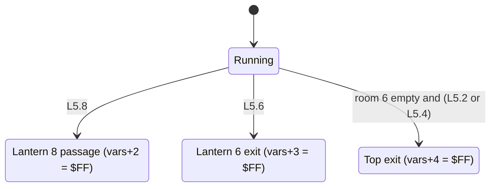

The three one-shots are independent; each can fire in any order.

| Event | Condition | Effect | Code |
|---|---|---|---|
| Lantern 8 | [`lantern_list_room05+$20`](../../src/room_tables.asm#L272) = 0, [`room_script_vars+2`](../../src/room_tables.asm#L390) ≥ 0 | [`open_wall_column`](../../src/room_update.asm#L591) [`$3A8A`](../reference/modules/room_update.md#open_wall_column) at text row 10, column 25 and at text row 10, column 26 (sound `$8A` each, tiles `$00 $00 $3E` in text rows 10-12); hazard 1 erased (frame 6) and stopped | [`room05_update`](../../src/room_update.asm#L327) [`$38AB`](../reference/modules/room_update.md#room05_update) |
| Lantern 6 | [`lantern_list_room05+$18`](../../src/room_tables.asm#L272) = 0, [`room_script_vars+3`](../../src/room_tables.asm#L390) ≥ 0 | [`open_wall_column`](../../src/room_update.asm#L591) at text row 10, column 0; message `$15` (tile `$02`) at text row 11, column 0: the exit to room 4 | [`room05_check_lantern6_taken`](../../src/room_update.asm#L341) [`$38CB`](../reference/modules/room_update.md#room05_check_lantern6_taken) |
| Top exit | [`room_lanterns_left+6`](../../src/constants.asm#L29) = 0 and ([`lantern_list_room05+8`](../../src/room_tables.asm#L272) = 0 or [`lantern_list_room05+$10`](../../src/room_tables.asm#L272) = 0), [`room_script_vars+4`](../../src/room_tables.asm#L390) ≥ 0 | message `$19` (`$61 $05 $63`) at text row 2, column 34: the spikes become texture with exit tile `$05` (to room 1) in the middle; [`open_wall_column`](../../src/room_update.asm#L591) at text row 3, column 30 and at text row 6, column 32 | [`room05_open_top_exit`](../../src/room_update.asm#L362) [`$38F6`](../reference/modules/room_update.md#room05_open_top_exit) |
| Hazard 0 | always | text row 9, columns 27-29; normal frames; limit `$1C`, restart `$1B`, wait `$E0`; cycle 40 passes | [`room05_step_hazard0`](../../src/room_update.asm#L376) [`$3915`](../reference/modules/room_update.md#room05_step_hazard0) |
| Hazard 1 | while lantern 8 is present | text row 10, columns 27-29; normal frames; same limits; cycle 40 passes | [`room05_step_hazard1`](../../src/room_update.asm#L404) [`$3944`](../reference/modules/room_update.md#room05_step_hazard1) |
| Hazard 2 | always | text row 5, columns 1-3; alternate frames; limit 2, restart 1, wait `$E2`; cycle 38 passes | [`room05_step_hazard2`](../../src/room_update.asm#L434) [`$3978`](../reference/modules/room_update.md#room05_step_hazard2) |

- **Observed** (`room_events2`, 60 frames): all three events fired; [`room_script_vars`](../../src/room_tables.asm#L390) = `00 00 FF FF FF`. Column 25, rows 19-24: `$32 $32 $2E`→`$00 $00 $3E`. Column 26: row 19 `$13`→`$00` (the column overwrites lantern 8's own cell); rows 21-24 already held `$00`/`$3E`. Column 0: rows 19/20 `$32`→`$00`, rows 21/22 `$32`→`$02/$82` (the exit tile), rows 23/24 `$2E`→`$3E`. Rows 3/4, columns 34-36: `$40`→`$61 $05 $63`. Column 30, rows 5-10 and column 32, rows 11-16: `$32 $32 $2E`→`$00 $00 $3E`.
- **Observed** (`room_events`): no evidence; the snapshot was the PLAYER 1 screen, and [`room_script_vars`](../../src/room_tables.asm#L390) stayed 0.
- The sounds and the stop of hazard 1 were not seen (**Code**).

**Links to other rooms.**
- The top exit needs **room 6 empty** and lantern 2 or 4 of room 5.
- Exits `$03` and `$04` lead to room 6; the created exits lead to room 4 (`$02`) and room 1 (`$05`). Room 1's hatch, room 4 exit `$02` and room 6 exits `$02`/`$03` lead here.

## 9. Room 6: the wall in front of the exit

**Description.** A purple cave with a two-storey pagoda in the middle. An animated climbing texture runs at columns 35-38 on the right, under spikes (tile `$40`) at map row 0. A wall column at column 1 (text rows 5-7) stands in front of the exit tile at column 0. One floor trap (tile `$60`) lies at map row 9, column 18. Eight lanterns hang on two rows.

*Room 6: the wall column at the left edge hides the exit to room 5.*

**Data.**

| Table entry | Value | Meaning |
|---|---|---|
| [`room06_map`](../../src/room_maps.asm#L274) [`$70DD`](../reference/modules/room_maps.md#room06_map) | 330 bytes, 440 cells | RLE map stream |
| [`room_char_colours+6`](../../src/room_colours.asm#L12) [`$47A6`](../reference/modules/room_colours.md#room_char_colours) | `$FC` | colour RAM fill: multicolour, colour 4 |
| [`room_lantern_counts+6`](../../src/room_tables.asm#L229) [`$4CD4`](../reference/modules/room_tables.md#room_lantern_counts) | 8 | lanterns at the start (list [`lantern_list_room06`](../../src/room_tables.asm#L283) [`$4DA2`](../reference/modules/room_tables.md#lantern_list_room06)) |
| [`room_no_combat_flags+6`](../../src/room_tables.asm#L217) [`$4CA4`](../reference/modules/room_tables.md#room_no_combat_flags) | `$00` | enemies spawn |
| [`ninja_first_spawn_delay+6`](../../src/actor_room_tables.asm#L69) [`$1311`](../reference/modules/actor_room_tables.md#ninja_first_spawn_delay) / [`yamo_first_spawn_delay+6`](../../src/actor_room_tables.asm#L84) [`$134D`](../reference/modules/actor_room_tables.md#yamo_first_spawn_delay) | 48 / 160 | first spawn delay of the Ninja / the Yamo (passes) |
| [`room_spawn_x+6`](../../src/room_tables.asm#L156) [`$4BB4`](../reference/modules/room_tables.md#room_spawn_x) / [`room_spawn_y+6`](../../src/room_tables.asm#L161) [`$4BC8`](../reference/modules/room_tables.md#room_spawn_y) | 134 / 179 | Bruce's spawn point (x, y) |
| [`room_setup_handlers+12`](../../src/room_tables.asm#L401) [`$4EA8`](../reference/modules/room_tables.md#room_setup_handlers) | [`room_init_none`](../../src/room_init.asm#L6) [`$33F5`](../reference/modules/room_init.md#room_init_none) | init handler (RTS table: the entry holds the address - 1) |
| [`room_frame_handlers+12`](../../src/room_tables.asm#L411) [`$4ED0`](../reference/modules/room_tables.md#room_frame_handlers) | [`room06_update`](../../src/room_update.asm#L465) [`$39AA`](../reference/modules/room_update.md#room06_update) | frame handler (RTS table: the entry holds the address - 1) |
| charset | set 0 (`$D018` = `$38`) | chosen by [`draw_room`](../../src/room_draw.asm#L6) from the room number |

| Exit tile | Entry | Destination room | Entry point (x, y) | Trigger cells in the map (map row, column) |
|---|---|---|---|---|
| `$02` | [`exit2_room+6`](../../src/room_tables.asm#L134) [`$4B64`](../reference/modules/room_tables.md#exit2_room) | room 5 | (160, 128) | (4, 0) |
| `$03` | [`exit3_room+6`](../../src/room_tables.asm#L140) [`$4B78`](../reference/modules/room_tables.md#exit3_room) | room 5 | (160, 102) | none |
| `$04` | [`exit4_room+6`](../../src/room_tables.asm#L146) [`$4B8C`](../reference/modules/room_tables.md#exit4_room) | room 2 | (22, 81) | none |
| `$05` | [`exit5_room+6`](../../src/room_tables.asm#L151) [`$4BA0`](../reference/modules/room_tables.md#exit5_room) | room 0 | (32, 81) | none |

| Lantern | Record | Text row | Column | Map tile | Collected tile |
|---|---|---|---|---|---|
| 0 | [`lantern_list_room06`](../../src/room_tables.asm#L283) [`$4DA2`](../reference/modules/room_tables.md#lantern_list_room06) | 5 | 8 | `$14` | `$1F` |
| 1 | [`lantern_list_room06+$4`](../../src/room_tables.asm#L283) [`$4DA6`](../reference/modules/room_tables.md#lantern_list_room06) | 5 | 10 | `$13` | `$1E` |
| 2 | [`lantern_list_room06+$8`](../../src/room_tables.asm#L283) [`$4DAA`](../reference/modules/room_tables.md#lantern_list_room06) | 5 | 14 | `$14` | `$1F` |
| 3 | [`lantern_list_room06+$C`](../../src/room_tables.asm#L283) [`$4DAE`](../reference/modules/room_tables.md#lantern_list_room06) | 5 | 22 | `$14` | `$1F` |
| 4 | [`lantern_list_room06+$10`](../../src/room_tables.asm#L283) [`$4DB2`](../reference/modules/room_tables.md#lantern_list_room06) | 5 | 26 | `$14` | `$1F` |
| 5 | [`lantern_list_room06+$14`](../../src/room_tables.asm#L283) [`$4DB6`](../reference/modules/room_tables.md#lantern_list_room06) | 5 | 28 | `$13` | `$1E` |
| 6 | [`lantern_list_room06+$18`](../../src/room_tables.asm#L283) [`$4DBA`](../reference/modules/room_tables.md#lantern_list_room06) | 9 | 6 | `$14` | `$1F` |
| 7 | [`lantern_list_room06+$1C`](../../src/room_tables.asm#L283) [`$4DBE`](../reference/modules/room_tables.md#lantern_list_room06) | 9 | 30 | `$13` | `$1E` |

Only exit `$02` has a trigger cell. Exits `$03` (room 5), `$04` (room 2) and `$05` (room 0) have table entries but no trigger cell in the map.

**Setup.** [`room_init_none`](../../src/room_init.asm#L6) [`$33F5`](../reference/modules/room_init.md#room_init_none).

**Behaviour.** [`room06_update`](../../src/room_update.asm#L465) [`$39AA`](../reference/modules/room_update.md#room06_update): one one-shot, then [`animate_floor_traps`](../../src/room_entry_traps.asm#L16) [`$3228`](../reference/modules/room_entry_traps.md#animate_floor_traps) (section 13.4) and [`animate_scrolling_chars`](../../src/animated_chars.asm#L6) (section 13.5) on every pass (**Code**).

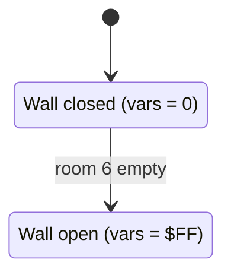

| State | Condition | Next state | Effect | Code |
|---|---|---|---|---|
| Wall closed | [`room_lanterns_left+6`](../../src/constants.asm#L29) = 0, [`room_script_vars`](../../src/room_tables.asm#L390) ≥ 0 | Wall open | [`room_script_vars`](../../src/room_tables.asm#L390) = `$FF`; [`open_wall_column_17`](../../src/room_update.asm#L602) [`$3AA0`](../reference/modules/room_update.md#open_wall_column_17) at text row 5, column 1: sound `$8A`, tiles `$00`, `$00`, `$11` at text rows 5, 6 and 7. The exit tile at column 0 can now be reached. | [`room06_update`](../../src/room_update.asm#L465) [`$39AA`](../reference/modules/room_update.md#room06_update) |

- The wall opens on the first pass after the last lantern is taken (**Code**).
- **Observed** (`room_events` and `room_events2`): column 1: rows 9-12 `$32/$B2`→`$00/$80`, rows 13/14 `$32/$B2`→`$11/$91`; [`room_script_vars`](../../src/room_tables.asm#L390) = `$FF`.

**Links to other rooms.**
- Room 6 is the room that most others depend on: rooms 0, 2 and 5 need it empty, and room 1 needs it **not** empty.
- Exit `$02` leads to room 5. Room 5 exits `$03`/`$04` and room 9's top exit lead here.

## 10. Room 7: the deadly strip and its slider

**Description.** A brown cave with two upper floors and a bottom corridor. The corridor floor (map row 9, columns 5-35) is drawn from the map as tile `$64`, which is deadly. Thirteen lanterns hang on three rows. Five floor traps (tile `$60`) lie at map row 2, columns 7 and 29, and map row 5, columns 3, 17 and 21.

*Room 7: the dotted strip of tile `$64` along the bottom corridor.*

**Data.**

| Table entry | Value | Meaning |
|---|---|---|
| [`room07_map`](../../src/room_maps.asm#L318) [`$7227`](../reference/modules/room_maps.md#room07_map) | 234 bytes, 442 cells | RLE map stream |
| [`room_char_colours+7`](../../src/room_colours.asm#L12) [`$47A7`](../reference/modules/room_colours.md#room_char_colours) | `$FF` | colour RAM fill: multicolour, colour 7 |
| [`room_lantern_counts+7`](../../src/room_tables.asm#L229) [`$4CD5`](../reference/modules/room_tables.md#room_lantern_counts) | 13 | lanterns at the start (list [`lantern_list_room07`](../../src/room_tables.asm#L289) [`$4DC3`](../reference/modules/room_tables.md#lantern_list_room07)) |
| [`room_no_combat_flags+7`](../../src/room_tables.asm#L217) [`$4CA5`](../reference/modules/room_tables.md#room_no_combat_flags) | `$00` | enemies spawn |
| [`ninja_first_spawn_delay+7`](../../src/actor_room_tables.asm#L69) [`$1312`](../reference/modules/actor_room_tables.md#ninja_first_spawn_delay) / [`yamo_first_spawn_delay+7`](../../src/actor_room_tables.asm#L84) [`$134E`](../reference/modules/actor_room_tables.md#yamo_first_spawn_delay) | 80 / 176 | first spawn delay of the Ninja / the Yamo (passes) |
| [`room_spawn_x+7`](../../src/room_tables.asm#L156) [`$4BB5`](../reference/modules/room_tables.md#room_spawn_x) / [`room_spawn_y+7`](../../src/room_tables.asm#L161) [`$4BC9`](../reference/modules/room_tables.md#room_spawn_y) | 28 / 68 | Bruce's spawn point (x, y) |
| [`room_setup_handlers+14`](../../src/room_tables.asm#L401) [`$4EAA`](../reference/modules/room_tables.md#room_setup_handlers) | [`room07_init`](../../src/room_init.asm#L72) [`$3461`](../reference/modules/room_init.md#room07_init) | init handler (RTS table: the entry holds the address - 1) |
| [`room_frame_handlers+14`](../../src/room_tables.asm#L411) [`$4ED2`](../reference/modules/room_tables.md#room_frame_handlers) | [`room07_update`](../../src/room_update.asm#L478) [`$39C3`](../reference/modules/room_update.md#room07_update) | frame handler (RTS table: the entry holds the address - 1) |
| charset | set 0 (`$D018` = `$38`) | chosen by [`draw_room`](../../src/room_draw.asm#L6) from the room number |

| Exit tile | Entry | Destination room | Entry point (x, y) | Trigger cells in the map (map row, column) |
|---|---|---|---|---|
| `$02` | [`exit2_room+7`](../../src/room_tables.asm#L134) [`$4B65`](../reference/modules/room_tables.md#exit2_room) | room 0 | (48, 81) | none |
| `$03` | [`exit3_room+7`](../../src/room_tables.asm#L140) [`$4B79`](../reference/modules/room_tables.md#exit3_room) | room 8 | (15, 70) | (4, 39) |
| `$04` | [`exit4_room+7`](../../src/room_tables.asm#L146) [`$4B8D`](../reference/modules/room_tables.md#exit4_room) | room 8 | (16, 192) | (8, 39) |
| `$05` | [`exit5_room+7`](../../src/room_tables.asm#L151) [`$4BA1`](../reference/modules/room_tables.md#exit5_room) | room 0 | (32, 81) | none |

| Lantern | Record | Text row | Column | Map tile | Collected tile |
|---|---|---|---|---|---|
| 0 | [`lantern_list_room07`](../../src/room_tables.asm#L289) [`$4DC3`](../reference/modules/room_tables.md#lantern_list_room07) | 2 | 3 | `$13` | `$1E` |
| 1 | [`lantern_list_room07+$4`](../../src/room_tables.asm#L289) [`$4DC7`](../reference/modules/room_tables.md#lantern_list_room07) | 2 | 12 | `$14` | `$1F` |
| 2 | [`lantern_list_room07+$8`](../../src/room_tables.asm#L289) [`$4DCB`](../reference/modules/room_tables.md#lantern_list_room07) | 2 | 13 | `$13` | `$1E` |
| 3 | [`lantern_list_room07+$C`](../../src/room_tables.asm#L289) [`$4DCF`](../reference/modules/room_tables.md#lantern_list_room07) | 2 | 25 | `$14` | `$1F` |
| 4 | [`lantern_list_room07+$10`](../../src/room_tables.asm#L289) [`$4DD3`](../reference/modules/room_tables.md#lantern_list_room07) | 2 | 26 | `$13` | `$1E` |
| 5 | [`lantern_list_room07+$14`](../../src/room_tables.asm#L289) [`$4DD7`](../reference/modules/room_tables.md#lantern_list_room07) | 5 | 5 | `$14` | `$1F` |
| 6 | [`lantern_list_room07+$18`](../../src/room_tables.asm#L289) [`$4DDB`](../reference/modules/room_tables.md#lantern_list_room07) | 5 | 6 | `$13` | `$1E` |
| 7 | [`lantern_list_room07+$1C`](../../src/room_tables.asm#L289) [`$4DDF`](../reference/modules/room_tables.md#lantern_list_room07) | 5 | 12 | `$14` | `$1F` |
| 8 | [`lantern_list_room07+$20`](../../src/room_tables.asm#L289) [`$4DE3`](../reference/modules/room_tables.md#lantern_list_room07) | 5 | 13 | `$13` | `$1E` |
| 9 | [`lantern_list_room07+$24`](../../src/room_tables.asm#L289) [`$4DE7`](../reference/modules/room_tables.md#lantern_list_room07) | 5 | 25 | `$14` | `$1F` |
| 10 | [`lantern_list_room07+$28`](../../src/room_tables.asm#L289) [`$4DEB`](../reference/modules/room_tables.md#lantern_list_room07) | 5 | 26 | `$13` | `$1E` |
| 11 | [`lantern_list_room07+$2C`](../../src/room_tables.asm#L289) [`$4DEF`](../reference/modules/room_tables.md#lantern_list_room07) | 9 | 2 | `$14` | `$1F` |
| 12 | [`lantern_list_room07+$30`](../../src/room_tables.asm#L289) [`$4DF3`](../reference/modules/room_tables.md#lantern_list_room07) | 9 | 3 | `$13` | `$1E` |

Exits `$02` and `$05` (to room 0) have table entries but no trigger cell.

**Setup.** [`room07_init`](../../src/room_init.asm#L72) [`$3461`](../reference/modules/room_init.md#room07_init) (**Code**):
- The slider: [`slider_col`](../../src/constants.asm#L59) = [`slider_prev_col`](../../src/constants.asm#L61) = 5, [`slider_row`](../../src/constants.asm#L60) = 11.
- Hazard 0 at text row 4, column `$22`, with [`hazard_timer`](../../src/constants.asm#L64) = `$FF`.

**Behaviour.** [`room07_update`](../../src/room_update.asm#L478) [`$39C3`](../reference/modules/room_update.md#room07_update) runs, in order: [`animate_floor_traps`](../../src/room_entry_traps.asm#L16), one-shot A, one-shot B, hazard 0, the slider (**Code**).

| Variable | Meaning |
|---|---|
| [`room_script_vars`](../../src/room_tables.asm#L390) | one-shot A (lanterns 0-4, text row 2) |
| [`room_script_vars+1`](../../src/room_tables.asm#L390) | one-shot B (lanterns 5-10, text row 5) |

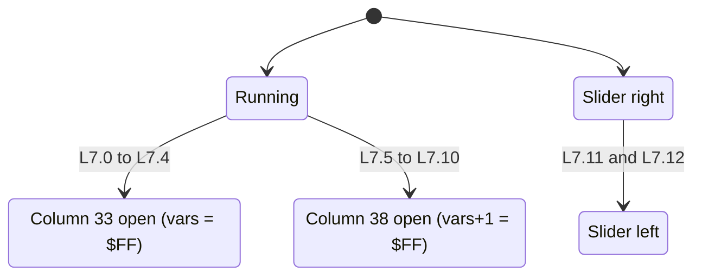

| Machine | Condition | Effect | Code |
|---|---|---|---|
| A | records 0-4 all 0, [`room_script_vars`](../../src/room_tables.asm#L390) ≥ 0 | [`room_script_vars`](../../src/room_tables.asm#L390) = `$FF`; [`open_wall_column_17`](../../src/room_update.asm#L602) at text row 2, column 33 (sound `$8A`, tiles `$00 $00 $11`). The `JMP` ends the handler for this pass, so hazard 0 and the slider skip one pass. | [`room07_update`](../../src/room_update.asm#L478) [`$39C3`](../reference/modules/room_update.md#room07_update) |
| B | records 5-10 all 0, [`room_script_vars+1`](../../src/room_tables.asm#L390) ≥ 0 | [`room_script_vars+1`](../../src/room_tables.asm#L390) = `$FF`; the same at text row 5, column 38, next to exit `$03` at map row 4, column 39; ends the pass | [`room07_check_row5_lanterns`](../../src/room_update.asm#L492) [`$39E6`](../reference/modules/room_update.md#room07_check_row5_lanterns) |
| Hazard 0 | always | text row 4, columns 34-37; alternate frames; limit `$24`, restart `$22`, wait `$E0`; cycle 41 passes | [`room07_step_hazard0`](../../src/room_update.asm#L506) [`$3A09`](../reference/modules/room_update.md#room07_step_hazard0) |
| Slider right | record 11 or 12 present | each pass: [`slider_prev_col`](../../src/constants.asm#L61) = column, column + 1; when the old column is ≥ `$23`, the new column is 5. [`draw_sliding_tile`](../../src/room_tiles.asm#L6) [`$404E`](../reference/modules/room_tiles.md#draw_sliding_tile) draws tile `$65` at the old column and the deadly `$64` at the new one, on text row 11, with sound `$89`. Range 5-35: 31 passes per sweep. | [`room07_move_slider`](../../src/room_update.asm#L534) [`$3A38`](../reference/modules/room_update.md#room07_move_slider) |
| Slider left | records 11 and 12 both 0 | column - 1; when the old column is < 6, the new column is `$24`; range 36 down to 5 | [`room07_slider_left`](../../src/room_update.asm#L548) [`$3A51`](../reference/modules/room_update.md#room07_slider_left) |

- **Conclusion:** on entry the whole strip is deadly (`$64`). The slider leaves the harmless `$65` behind it, so after its first sweep only the slider cell is deadly. The screenshots show one white-dotted cell on the strip. [`draw_sliding_tile`](../../src/room_tiles.asm#L6) plays sound `$89` on every pass while the slider runs.
- **Observed** (`room_events`): row 21, at 100 frames column 15 `$64`→`$65` and column 18 `$65`→`$64`; at 400 frames column 25 `$65`→`$64` (+3 and +10 columns, mod 31: 34 and 134 passes). At 400 frames rows 7/8, column 34 `$00`→`$5A`/`$DA` (hazard 0, frame 0 at the start column).
- **Observed** (`room_events2`, collected): column 33, rows 3-8: `$32 $32 $32`→`$00 $00 $11`; column 38, rows 9-14: `$00 $00 $11`; [`room_script_vars`](../../src/room_tables.asm#L390) = `FF FF`. Hazard 0 at columns 36-37: `$58 $59` (frame 3 at the limit column `$24`), erased by 400 frames. The slider moved left: at 60 frames row 21, columns 32-36 already `$65` while columns 6-12 were still `$64`; at 400 frames columns 6-31 `$64`→`$65`.
- **Observed** (`room_events2`): moving left, the slider wraps to column 36 (`$24`), one cell past the strip. It overwrites the map tile `$2A` there with `$65` (row 21, column 36 `$2A`→`$65`). Moving right never reaches column 36. See Still open.
- The skipped pass after events A and B was not seen (**Code**). A stray `RTS` byte (`$60`) at `$3A62` follows the handler; no code reaches it.

**Links to other rooms.**
- All three conditions use only room 7's own lanterns.
- Exits `$03` and `$04` lead to room 8. Room 4's shaft and room 8 exits `$02`/`$04` lead here.

## 11. Room 8: five passages

**Description.** A brown cave of rock pillars, with several climbing-texture columns (tiles `$61-$63`) and spikes `$0F` at the bottom. Four lanterns hang on two rows. Exits on both edges lead to rooms 7 and 9. No enemies come here.

*Room 8: wall columns stand in front of the exits; five events open them.*

**Data.**

| Table entry | Value | Meaning |
|---|---|---|
| [`room08_map`](../../src/room_maps.asm#L350) [`$7311`](../reference/modules/room_maps.md#room08_map) | 384 bytes, 440 cells | RLE map stream |
| [`room_char_colours+8`](../../src/room_colours.asm#L12) [`$47A8`](../reference/modules/room_colours.md#room_char_colours) | `$FA` | colour RAM fill: multicolour, colour 2 |
| [`room_lantern_counts+8`](../../src/room_tables.asm#L229) [`$4CD6`](../reference/modules/room_tables.md#room_lantern_counts) | 4 | lanterns at the start (list [`lantern_list_room08`](../../src/room_tables.asm#L317) [`$4DF8`](../reference/modules/room_tables.md#lantern_list_room08)) |
| [`room_no_combat_flags+8`](../../src/room_tables.asm#L217) [`$4CA6`](../reference/modules/room_tables.md#room_no_combat_flags) | `$FF` | no enemies |
| [`ninja_first_spawn_delay+8`](../../src/actor_room_tables.asm#L69) [`$1313`](../reference/modules/actor_room_tables.md#ninja_first_spawn_delay) / [`yamo_first_spawn_delay+8`](../../src/actor_room_tables.asm#L84) [`$134F`](../reference/modules/actor_room_tables.md#yamo_first_spawn_delay) | 0 / 0 | first spawn delay of the Ninja / the Yamo (passes) |
| [`room_spawn_x+8`](../../src/room_tables.asm#L156) [`$4BB6`](../reference/modules/room_tables.md#room_spawn_x) / [`room_spawn_y+8`](../../src/room_tables.asm#L161) [`$4BCA`](../reference/modules/room_tables.md#room_spawn_y) | 20 / 70 | Bruce's spawn point (x, y) |
| [`room_setup_handlers+16`](../../src/room_tables.asm#L401) [`$4EAC`](../reference/modules/room_tables.md#room_setup_handlers) | [`room08_init`](../../src/room_init.asm#L86) [`$3478`](../reference/modules/room_init.md#room08_init) | init handler (RTS table: the entry holds the address - 1) |
| [`room_frame_handlers+16`](../../src/room_tables.asm#L411) [`$4ED4`](../reference/modules/room_tables.md#room_frame_handlers) | [`room08_update`](../../src/room_update.asm#L632) [`$3AD4`](../reference/modules/room_update.md#room08_update) | frame handler (RTS table: the entry holds the address - 1) |
| charset | set 0 (`$D018` = `$38`) | chosen by [`draw_room`](../../src/room_draw.asm#L6) from the room number |

| Exit tile | Entry | Destination room | Entry point (x, y) | Trigger cells in the map (map row, column) |
|---|---|---|---|---|
| `$02` | [`exit2_room+8`](../../src/room_tables.asm#L134) [`$4B66`](../reference/modules/room_tables.md#exit2_room) | room 7 | (160, 116) | (1, 0) |
| `$03` | [`exit3_room+8`](../../src/room_tables.asm#L140) [`$4B7A`](../reference/modules/room_tables.md#exit3_room) | room 9 | (16, 83) | (1, 39) |
| `$04` | [`exit4_room+8`](../../src/room_tables.asm#L146) [`$4B8E`](../reference/modules/room_tables.md#exit4_room) | room 7 | (161, 181) | (9, 0) |
| `$05` | [`exit5_room+8`](../../src/room_tables.asm#L151) [`$4BA2`](../reference/modules/room_tables.md#exit5_room) | room 9 | (15, 198) | (9, 39) |

| Lantern | Record | Text row | Column | Map tile | Collected tile |
|---|---|---|---|---|---|
| 0 | [`lantern_list_room08`](../../src/room_tables.asm#L317) [`$4DF8`](../reference/modules/room_tables.md#lantern_list_room08) | 3 | 15 | `$14` | `$1F` |
| 1 | [`lantern_list_room08+$4`](../../src/room_tables.asm#L317) [`$4DFC`](../reference/modules/room_tables.md#lantern_list_room08) | 3 | 24 | `$14` | `$1F` |
| 2 | [`lantern_list_room08+$8`](../../src/room_tables.asm#L317) [`$4E00`](../reference/modules/room_tables.md#lantern_list_room08) | 7 | 6 | `$13` | `$1E` |
| 3 | [`lantern_list_room08+$C`](../../src/room_tables.asm#L317) [`$4E04`](../reference/modules/room_tables.md#lantern_list_room08) | 7 | 33 | `$14` | `$1F` |

**Setup.** [`room08_init`](../../src/room_init.asm#L86) [`$3478`](../reference/modules/room_init.md#room08_init): hazard 0 at text row 5, column 6 and hazard 1 at text row 5, column `$1B`, with [`hazard_timer`](../../src/constants.asm#L64) = `$FF` and `$F2` (**Code**).

**Behaviour.** [`room08_update`](../../src/room_update.asm#L632) [`$3AD4`](../reference/modules/room_update.md#room08_update): five one-shot passages, then hazards 0 and 1, then [`animate_scrolling_chars`](../../src/animated_chars.asm#L6) (**Code**).

| Variable | Meaning |
|---|---|
| [`room_script_vars+2`](../../src/room_tables.asm#L390) | passage at column 14 |
| [`room_script_vars+3`](../../src/room_tables.asm#L390) | passage at column 25 |
| [`room_script_vars+4`](../../src/room_tables.asm#L390) | passage at the top right |
| [`room_script_vars`](../../src/room_tables.asm#L390) | passage at the bottom left |
| [`room_script_vars+1`](../../src/room_tables.asm#L390) | passage at the bottom right |

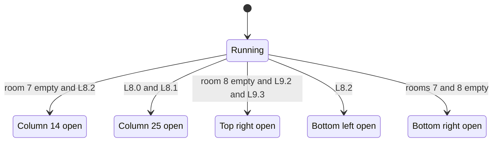

The passages are independent one-shots, in this code order:

| Event | Condition | Effect | Code |
|---|---|---|---|
| Column 14 | [`room_lanterns_left+7`](../../src/constants.asm#L29) = 0 and [`lantern_list_room08+8`](../../src/room_tables.asm#L317) = 0 | [`open_wall_column`](../../src/room_update.asm#L591) at text row 7, column 14 | [`room08_update`](../../src/room_update.asm#L632) [`$3AD4`](../reference/modules/room_update.md#room08_update) |
| Column 25 | [`lantern_list_room08`](../../src/room_tables.asm#L317) = 0 and [`lantern_list_room08+4`](../../src/room_tables.asm#L317) = 0 | if [`lantern_list_room08+$C`](../../src/room_tables.asm#L317) ≠ 0 (lantern 3 present): [`scroll_direction`](../../src/constants.asm#L54) = 1 (down) and [`anim_speed_index`](../../src/variables.asm#L43) = 7. Then [`open_wall_column`](../../src/room_update.asm#L591) at text row 7, column 25. | [`room08_check_lanterns_0_1`](../../src/room_update.asm#L642) [`$3AEA`](../reference/modules/room_update.md#room08_check_lanterns_0_1) |
| Top right | [`room_lanterns_left+8`](../../src/constants.asm#L29) = 0 and [`lantern_list_room09+8`](../../src/room_tables.asm#L325) = 0 and [`lantern_list_room09+$C`](../../src/room_tables.asm#L325) = 0 | [`open_wall_column_2d`](../../src/room_update.asm#L608) [`$3AAA`](../reference/modules/room_update.md#open_wall_column_2d) at text row 2, column 38 (tiles `$00 $00 $11`), which opens the way to exit `$03` at map row 1, column 39 | [`room08_check_top_right`](../../src/room_update.asm#L659) [`$3B0F`](../reference/modules/room_update.md#room08_check_top_right) |
| Bottom left | [`lantern_list_room08+8`](../../src/room_tables.asm#L317) = 0 | [`open_wall_column`](../../src/room_update.asm#L591) at text row 10, column 1, in front of exit `$04` at map row 9, column 0 | [`room08_check_lantern2`](../../src/room_update.asm#L670) [`$3B28`](../reference/modules/room_update.md#room08_check_lantern2) |
| Bottom right | [`room_lanterns_left+7`](../../src/constants.asm#L29) = 0 and [`room_lanterns_left+8`](../../src/constants.asm#L29) = 0 | [`open_wall_column`](../../src/room_update.asm#L591) at text row 10, column 38, in front of exit `$05` at map row 9, column 39 | [`room08_check_rooms_7_8`](../../src/room_update.asm#L679) [`$3B3C`](../reference/modules/room_update.md#room08_check_rooms_7_8) |
| Hazard 0 | always | text row 5, columns 6-12; normal frames; limit `$0B`, restart 6, wait `$DA`; cycle 50 passes | [`room08_step_hazard0`](../../src/room_update.asm#L689) [`$3B51`](../reference/modules/room_update.md#room08_step_hazard0) |
| Hazard 1 | always | text row 5, columns 27-33; normal frames; limit `$20`, restart `$1B`, wait `$DA`; cycle 50 passes | [`room08_step_hazard1`](../../src/room_update.asm#L717) [`$3B80`](../reference/modules/room_update.md#room08_step_hazard1) |

- **Observed** (`room_events`): bottom right: column 38, rows 19-22 `$32/$B2`→`$00/$80`, rows 23/24 `$32/$B2`→`$3E/$BE`; [`room_script_vars+1`](../../src/room_tables.asm#L390) = `$FF`. Hazard 0: rows 9/10, columns 9-10 `$00`→`$55 $56` (frame 2 in transit). Hazard 1: rows 9/10, columns 32-33 `$54 $55`→`$00` (frame 3 at the limit before, waiting after).
- **Observed** (`room_events2`, collected): all five fired; [`room_script_vars`](../../src/room_tables.asm#L390) = `FF FF FF FF FF`. Columns 14 and 25, rows 13-18: `$32 $32 $2E`→`$00 $00 $3E`; column 38, rows 3-8: `$32 $32 $32`→`$00 $00 $11`; column 1, rows 19-24: `$00 $00 $3E`. Hazard 0 at columns 11-12: `$55 $56` (frame 2 at the limit) at 60 frames; hazard 1 at columns 32-33: `$55 $56` at 400 frames.
- **Observed** (`room_events3`, `r8_l01`: lanterns 0 and 1 collected, lantern 3 present): column 25, rows 13-18 `$32 $32 $2E`→`$00 $00 $3E`; at 400 frames [`scroll_direction`](../../src/constants.asm#L54) = 1 (texture down) and [`room_script_vars+3`](../../src/room_tables.asm#L390) = `$FF`; the code [`room08_check_lanterns_0_1`](../../src/room_update.asm#L642) [`$3AFF-$3B05`](../../src/room_update.asm#L651) ran.

**Links to other rooms.**
- Three events depend on other rooms: column 14 needs **room 7 empty**; the top right needs **lanterns 2 and 3 of room 9**; the bottom right needs **room 7 empty**.
- Exits `$02`/`$04` lead to room 7, exits `$03`/`$05` to room 9. Room 7 exits `$03`/`$04` and room 9 exits `$02`/`$03` lead here.

## 12. Room 9: the staircases and the top exit

**Description.** A brown cave with diagonal climbing-texture "staircases", groups of spikes `$0F`, and a texture column at columns 35-38 under spikes (tile `$40`) at map row 0. The bottom corridor (map row 10, columns 4-24) is tile `$64`, as in room 7. Five lanterns. No enemies come here.

*Room 9: the deadly strip at the bottom and the spikes at the top right that hide the exit to room 6.*

**Data.**

| Table entry | Value | Meaning |
|---|---|---|
| [`room09_map`](../../src/room_maps.asm#L400) [`$7491`](../reference/modules/room_maps.md#room09_map) | 327 bytes, 440 cells | RLE map stream |
| [`room_char_colours+9`](../../src/room_colours.asm#L12) [`$47A9`](../reference/modules/room_colours.md#room_char_colours) | `$FA` | colour RAM fill: multicolour, colour 2 |
| [`room_lantern_counts+9`](../../src/room_tables.asm#L229) [`$4CD7`](../reference/modules/room_tables.md#room_lantern_counts) | 5 | lanterns at the start (list [`lantern_list_room09`](../../src/room_tables.asm#L325) [`$4E09`](../reference/modules/room_tables.md#lantern_list_room09)) |
| [`room_no_combat_flags+9`](../../src/room_tables.asm#L217) [`$4CA7`](../reference/modules/room_tables.md#room_no_combat_flags) | `$FF` | no enemies |
| [`ninja_first_spawn_delay+9`](../../src/actor_room_tables.asm#L69) [`$1314`](../reference/modules/actor_room_tables.md#ninja_first_spawn_delay) / [`yamo_first_spawn_delay+9`](../../src/actor_room_tables.asm#L84) [`$1350`](../reference/modules/actor_room_tables.md#yamo_first_spawn_delay) | 0 / 0 | first spawn delay of the Ninja / the Yamo (passes) |
| [`room_spawn_x+9`](../../src/room_tables.asm#L156) [`$4BB7`](../reference/modules/room_tables.md#room_spawn_x) / [`room_spawn_y+9`](../../src/room_tables.asm#L161) [`$4BCB`](../reference/modules/room_tables.md#room_spawn_y) | 18 / 198 | Bruce's spawn point (x, y) |
| [`room_setup_handlers+18`](../../src/room_tables.asm#L401) [`$4EAE`](../reference/modules/room_tables.md#room_setup_handlers) | [`room09_init`](../../src/room_init.asm#L100) [`$348F`](../reference/modules/room_init.md#room09_init) | init handler (RTS table: the entry holds the address - 1) |
| [`room_frame_handlers+18`](../../src/room_tables.asm#L411) [`$4ED6`](../reference/modules/room_tables.md#room_frame_handlers) | [`room09_update`](../../src/room_update.asm#L748) [`$3BB2`](../reference/modules/room_update.md#room09_update) | frame handler (RTS table: the entry holds the address - 1) |
| charset | set 0 (`$D018` = `$38`) | chosen by [`draw_room`](../../src/room_draw.asm#L6) from the room number |

| Exit tile | Entry | Destination room | Entry point (x, y) | Trigger cells in the map (map row, column) |
|---|---|---|---|---|
| `$02` | [`exit2_room+9`](../../src/room_tables.asm#L134) [`$4B67`](../reference/modules/room_tables.md#exit2_room) | room 8 | (160, 71) | (2, 0) |
| `$03` | [`exit3_room+9`](../../src/room_tables.asm#L140) [`$4B7B`](../reference/modules/room_tables.md#exit3_room) | room 8 | (160, 192) | (9, 0) |
| `$04` | [`exit4_room+9`](../../src/room_tables.asm#L146) [`$4B8F`](../reference/modules/room_tables.md#exit4_room) | room 6 | (157, 199) | none |
| `$05` | [`exit5_room+9`](../../src/room_tables.asm#L151) [`$4BA3`](../reference/modules/room_tables.md#exit5_room) | x = 0: room 0 at x = 0 (tile `$05` has no fall-through) | (0, 0) | none |

| Lantern | Record | Text row | Column | Map tile | Collected tile |
|---|---|---|---|---|---|
| 0 | [`lantern_list_room09`](../../src/room_tables.asm#L325) [`$4E09`](../reference/modules/room_tables.md#lantern_list_room09) | 2 | 32 | `$14` | `$1F` |
| 1 | [`lantern_list_room09+$4`](../../src/room_tables.asm#L325) [`$4E0D`](../reference/modules/room_tables.md#lantern_list_room09) | 7 | 15 | `$13` | `$1E` |
| 2 | [`lantern_list_room09+$8`](../../src/room_tables.asm#L325) [`$4E11`](../reference/modules/room_tables.md#lantern_list_room09) | 10 | 27 | `$13` | `$1E` |
| 3 | [`lantern_list_room09+$C`](../../src/room_tables.asm#L325) [`$4E15`](../reference/modules/room_tables.md#lantern_list_room09) | 10 | 28 | `$14` | `$1F` |
| 4 | [`lantern_list_room09+$10`](../../src/room_tables.asm#L325) [`$4E19`](../reference/modules/room_tables.md#lantern_list_room09) | 10 | 32 | `$13` | `$1E` |

Exit `$04` (to room 6) has no trigger cell in the map; the top-exit event creates it.

**Setup.** [`room09_init`](../../src/room_init.asm#L100) [`$348F`](../reference/modules/room_init.md#room09_init) (**Code**):
1. Colour RAM `$D89B-$D89E` and `$D8C3-$D8C6` = `$FA`: the spike cells.
2. The slider: column 4, previous column 4, text row 12.
3. Hazard 0 at text row 5, column `$10` and hazard 1 at text row 6, column `$10`, with [`hazard_timer`](../../src/constants.asm#L64) = `$FC` and `$FF`.

**Behaviour.** [`room09_update`](../../src/room_update.asm#L748) [`$3BB2`](../reference/modules/room_update.md#room09_update): three one-shots, the slider, hazards 0 and 1, then [`animate_scrolling_chars`](../../src/animated_chars.asm#L6) (**Code**).

| Variable | Meaning |
|---|---|
| [`room_script_vars+2`](../../src/room_tables.asm#L390) | texture-down one-shot |
| [`room_script_vars`](../../src/room_tables.asm#L390) | column-23 one-shot |
| [`room_script_vars+1`](../../src/room_tables.asm#L390) | top-exit one-shot |

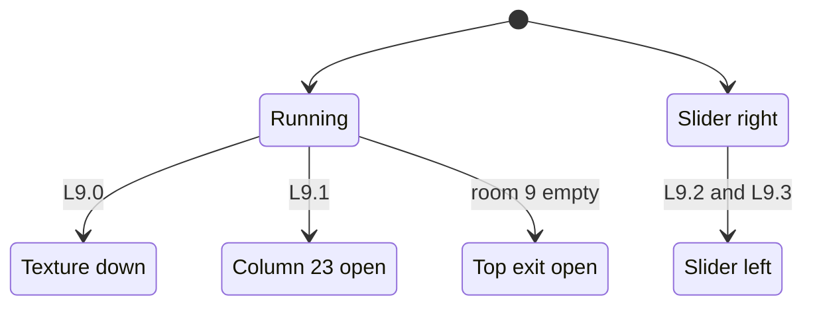

| Machine | Condition | Effect | Code |
|---|---|---|---|
| Texture down | [`room_script_vars+2`](../../src/room_tables.asm#L390) ≥ 0, [`lantern_list_room09`](../../src/room_tables.asm#L325) = 0 | [`scroll_direction`](../../src/constants.asm#L54) = 1, [`anim_speed_index`](../../src/variables.asm#L43) = 7 (no tiles, no sound) | [`room09_update`](../../src/room_update.asm#L748) [`$3BB2`](../reference/modules/room_update.md#room09_update) |
| Column 23 | [`lantern_list_room09+4`](../../src/room_tables.asm#L325) = 0, [`room_script_vars`](../../src/room_tables.asm#L390) ≥ 0 | [`open_wall_column`](../../src/room_update.asm#L591) at text row 7, column 23; [`scroll_direction`](../../src/constants.asm#L54) = 0, [`anim_speed_index`](../../src/variables.asm#L43) = 7 | [`room09_check_lantern1`](../../src/room_update.asm#L758) [`$3BC8`](../reference/modules/room_update.md#room09_check_lantern1) |
| Top exit | [`room_lanterns_left+9`](../../src/constants.asm#L29) = 0, [`room_script_vars+1`](../../src/room_tables.asm#L390) ≥ 0 | [`scroll_direction`](../../src/constants.asm#L54) = 0, [`anim_speed_index`](../../src/variables.asm#L43) = 7; sound `$8A`; message `$18` (`$61 $04 $04 $63`) at text row 2, column 35: the spikes become texture with exit tiles `$04` (to room 6) at columns 36-37 | [`room09_check_room_empty`](../../src/room_update.asm#L771) [`$3BE5`](../reference/modules/room_update.md#room09_check_room_empty) |
| Slider right | record 2 or 3 present | column + 1; when the old column is ≥ `$18`, the new column is 4; text row 12, range 4-24 (21 positions); sound `$89` on each pass | [`room09_slider_right`](../../src/room_update.asm#L800) [`$3C1E`](../reference/modules/room_update.md#room09_slider_right) |
| Slider left | records 2 and 3 both 0 | column - 1; when the old column is < 5, the new column is `$18` | [`room09_move_slider`](../../src/room_update.asm#L787) [`$3C06`](../reference/modules/room_update.md#room09_move_slider) |
| Hazard 0 | always | text row 5, columns 16-21; alternate frames; limit `$14`, restart `$10`, wait `$C0`; cycle 75 passes | [`room09_draw_slider`](../../src/room_update.asm#L808) [`$3C2F`](../../src/room_update.asm#L810) |
| Hazard 1 | always | text row 6, columns 16-21; alternate frames; cycle 75 passes; it starts 3 passes before hazard 0 | [`room09_step_hazard1`](../../src/room_update.asm#L837) [`$3C5E`](../reference/modules/room_update.md#room09_step_hazard1) |

- **Observed** (`room_events`): top exit: rows 3/4, columns 35-38: `$40`→`$61 $04 $04 $63` (bottom row `$C0`→`$E1 $84 $84 $E3`); [`room_script_vars+1`](../../src/room_tables.asm#L390) = `$FF`. The slider on row 23: column 13 before, column 5 at 100 frames, column 21 at 400 frames (34 and 134 passes mod 21).
- **Observed** (`room_events2`, collected): [`room_script_vars`](../../src/room_tables.asm#L390) = `FF FF FF 00 00`. Column 23, rows 13-18: `$32 $32 $2E`→`$00 $00 $3E`. The slider moved left: at 60 frames row 23, columns 18-24 already `$65`, columns 5-11 still `$64`; at 400 frames columns 5-17 `$64`→`$65`. Hazard 0: rows 9/10, columns 18-19 `$59 $5A` (frame 2) at 60 frames; hazard 1: rows 11/12, columns 20-21 `$58 $59` (frame 3 at the limit) at 60 frames; both erased by 400 frames.
- In the collected entry the texture-down event fired, but column 23 and the top exit set the direction back to 0 in the same pass, so no downward move resulted. The direction write of the texture-down event alone was not seen (**Code**).

**Links to other rooms.**
- All events depend only on room 9's own lanterns. Room 8's top-right passage needs **lanterns 2 and 3 of room 9**, the same lanterns that reverse the slider here.
- Exits `$02`/`$03` lead to room 8; the top exit leads to room 6. Room 8 exits `$03`/`$05` lead here.

## 13. Shared mechanisms

### 13.1 Cycling objects ([`animate_room_objects`](../../src/room_state.asm#L29) [`$104B`](../reference/modules/room_state.md#animate_room_objects))

Within rooms 0-19 only room 13 uses these, on every second pass ([rooms_10_19.md](rooms_10_19.md), room 13). Rooms 0-9 use the single slider (13.3). [`room13_init`](../../src/room_init.asm#L131) [`$34C3`](../reference/modules/room_init.md#room13_init) fills the six tables; each has ten slots, and [`animate_room_objects`](../../src/room_state.asm#L29) walks the slots 8..0 (**Code**).

| Table | Meaning |
|---|---|
| [`sliders_dir`](../../src/constants.asm#L129) [`$010F`](../reference/variables.md#sliders_dir) | 0 = slot off; bit 7 clear = moves left, bit 7 set = moves right |
| [`sliders_col`](../../src/constants.asm#L130) [`$0119`](../reference/variables.md#sliders_col) | current column |
| [`sliders_row`](../../src/constants.asm#L131) [`$0123`](../reference/variables.md#sliders_row) | text row; the value goes to [`slider_row`](../../src/constants.asm#L60) |
| [`sliders_prev_col`](../../src/constants.asm#L132) [`$012D`](../reference/variables.md#sliders_prev_col) | previous column |
| [`sliders_min_col`](../../src/constants.asm#L133) [`$0137`](../reference/variables.md#sliders_min_col) / [`sliders_max_col`](../../src/constants.asm#L134) [`$0141`](../reference/variables.md#sliders_max_col) | wrap limits |

For each active slot, [`animate_room_objects`](../../src/room_state.asm#L29) does this (**Code**):
1. The column goes to [`sliders_prev_col`](../../src/constants.asm#L132) and [`slider_prev_col`](../../src/constants.asm#L61); the row goes to [`slider_row`](../../src/constants.asm#L60).
2. Moving left: column - 1; below [`sliders_min_col`](../../src/constants.asm#L133) it becomes [`sliders_max_col`](../../src/constants.asm#L134). Moving right: column + 1; at [`sliders_max_col`](../../src/constants.asm#L134) it becomes [`sliders_min_col`](../../src/constants.asm#L133).
3. The slot is drawn at its text row with [`draw_sliding_tile`](../../src/room_tiles.asm#L6) [`$404E`](../reference/modules/room_tiles.md#draw_sliding_tile) (messages `$1C`/`$1B`), or on text rows 5 and 10 with [`draw_sliding_tile_alt`](../../src/room_tiles.asm#L17) [`$4063`](../reference/modules/room_tiles.md#draw_sliding_tile_alt) (messages `$55`/`$54`). Each draw plays sound `$89`.

Each slot has three states: off, moving left and moving right. Nothing changes them after [`room13_init`](../../src/room_init.asm#L131).

### 13.2 Travelling hazards ([`hazard_col`](../../src/constants.asm#L62) [`$71`](../reference/variables.md#hazard_col), [`hazard_row`](../../src/constants.asm#L63) [`$74`](../reference/variables.md#hazard_row), [`hazard_timer`](../../src/constants.asm#L64) [`$77`](../reference/variables.md#hazard_timer))

Three slots, X = 0-2. Slot X is drawn by its own routine (**Code**):

| Slot | Normal frames (message `$1F` + frame) | Alternate frames (message `$26` + frame) |
|---|---|---|
| 0 | [`draw_hazard0_frame`](../../src/room_tiles.asm#L39) [`$4086`](../reference/modules/room_tiles.md#draw_hazard0_frame) | [`draw_hazard0_frame_alt`](../../src/room_tiles.asm#L60) [`$40A4`](../reference/modules/room_tiles.md#draw_hazard0_frame_alt) |
| 1 | [`draw_hazard1_frame`](../../src/room_tiles.asm#L46) [`$4090`](../reference/modules/room_tiles.md#draw_hazard1_frame) | [`draw_hazard1_frame_alt`](../../src/room_tiles.asm#L67) [`$40AC`](../reference/modules/room_tiles.md#draw_hazard1_frame_alt) |
| 2 | [`draw_hazard2_frame`](../../src/room_tiles.asm#L53) [`$409A`](../reference/modules/room_tiles.md#draw_hazard2_frame) | [`draw_hazard2_frame_alt`](../../src/room_tiles.asm#L74) [`$40B4`](../reference/modules/room_tiles.md#draw_hazard2_frame_alt) |

Each frame handler of rooms 4-9 has its own inline copy of the stepping code, with its own limit, restart column and wait value. [`step_travelling_hazards`](../../src/room_update.asm#L1298) [`$3FDC`](../reference/modules/room_update.md#step_travelling_hazards) is the loop version of room 17 ([rooms_10_19.md](rooms_10_19.md)). On each pass, the code increments `hazard_timer,x` and acts on the new value (the phase):

| Phase | Normal frame (message: tiles) | Alternate frame | Action |
|---|---|---|---|
| negative | - | - | wait; nothing drawn |
| 0 | `$1F`: `$56` | `$26`: `$5A` | grow: one cell at the column |
| 1 | `$20`: `$55` | `$27`: `$59` | |
| 2 | `$21`: `$55 $56` | `$28`: `$59 $5A` | full: two cells |
| 3, column < limit | `$25` (erase) at the column, then `$21` at column + 1 | `$2C`, then `$28` | travel: column + 1, phase = 2 |
| 3, column ≥ limit | `$22`: `$54 $55` | `$29`: `$58 $59` | start to shrink |
| 4 | `$23`: `$00 $55` | `$2A`: `$00 $59` | |
| 5 | `$24`: `$00 $54` | `$2B`: `$00 $58` | |
| 6 | `$25`: `$00 $00` | `$2C`: `$00 $00` | erased |
| 7 | - | - | restart: column = start, phase = W (negative) |

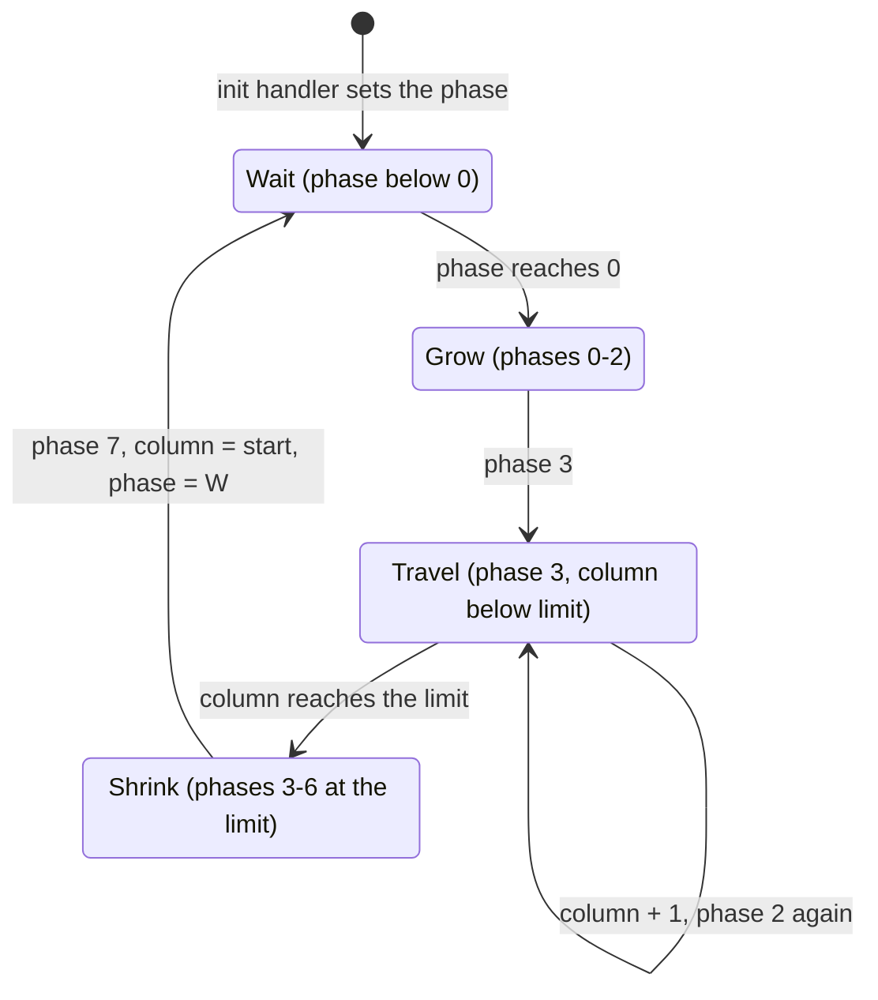

| State | Condition | Next state | Code |
|---|---|---|---|
| Wait | phase + 1 still negative | Wait | for example [`room04_step_hazard0`](../../src/room_update.asm#L236) [`$3811`](../reference/modules/room_update.md#room04_step_hazard0) |
| Wait | phase + 1 = 0 | Grow | the draw call with A = phase |
| Grow / Travel | phase 3 and column < limit | Travel | for example [`room04_hazard0_advance`](../../src/room_update.asm#L248) [`$3825`](../reference/modules/room_update.md#room04_hazard0_advance) |
| Travel | phase 3 and column ≥ limit | Shrink | the draw call with A = 3 |
| Shrink | phase 7 | Wait | for example [`room04_hazard0_restart`](../../src/room_update.asm#L259) [`$3838`](../reference/modules/room_update.md#room04_hazard0_restart) |

**Rules** (**Code**, and **Conclusion** where marked):
- [`handle_touched_char`](../../src/background_touch.asm#L53) treats `$54-$5A` except `$57` as deadly. So a hazard kills Bruce and removes an enemy.
- The erase frames write tile `$00`. **Conclusion:** a hazard runs only through empty cells.
- The cycle is (limit - start) + 263 - W passes, with W the restart phase as an unsigned byte. The first frame after entry comes `$100` - init timer passes after the entry.

| Room | Hazard | Text row | Columns | Frames | Init timer | W | Cycle (passes) | Runs while |
|---|---|---|---|---|---|---|---|---|
| 4 | 0 | 11 | 1-4 | alternate | `$FF` | `$A0` | 105 | always |
| 4 | 1 | 7 | 11-13 | normal | `$FF` | `$E4` | 36 | lantern 0 present |
| 4 | 2 | 7 | 26-28 | normal | `$F4` | `$E4` | 36 | lantern 1 present |
| 5 | 0 | 9 | 27-29 | normal | `$FF` | `$E0` | 40 | always |
| 5 | 1 | 10 | 27-29 | normal | `$FC` | `$E0` | 40 | lantern 8 present |
| 5 | 2 | 5 | 1-3 | alternate | `$F8` | `$E2` | 38 | always |
| 7 | 0 | 4 | 34-37 | alternate | `$FF` | `$E0` | 41 | always |
| 8 | 0 | 5 | 6-12 | normal | `$FF` | `$DA` | 50 | always |
| 8 | 1 | 5 | 27-33 | normal | `$F2` | `$DA` | 50 | always |
| 9 | 0 | 5 | 16-21 | alternate | `$FC` | `$C0` | 75 | always |
| 9 | 1 | 6 | 16-21 | alternate | `$FF` | `$C0` | 75 | always |

**Observed:** frames 0, 2 and 3 in rooms 7 and 8 (`room_events`); frames 2, 3 and 5 of the alternate set in rooms 4, 7 and 9, and the erase (`room_events2`). Frames 1 and 4 were never on a captured screen.

### 13.3 The single slider ([`slider_col`](../../src/constants.asm#L59) [`$6E`](../reference/variables.md#slider_col), [`slider_row`](../../src/constants.asm#L60) [`$6F`](../reference/variables.md#slider_row), [`slider_prev_col`](../../src/constants.asm#L61) [`$70`](../reference/variables.md#slider_prev_col))

The room handler moves the slider by one column per pass. Then [`draw_sliding_tile`](../../src/room_tiles.asm#L6) [`$404E`](../reference/modules/room_tiles.md#draw_sliding_tile) does this (**Code**):
1. [`play_sound_89`](../../src/room_tiles.asm#L28) [`$4078`](../reference/modules/room_tiles.md#play_sound_89): sound `$89`.
2. Message `$1C` (tile `$65`, the plain strip) at [`slider_prev_col`](../../src/constants.asm#L61).
3. Message `$1B` (tile `$64`, the dotted strip, deadly) at [`slider_col`](../../src/constants.asm#L59).

[`draw_sliding_tile_alt`](../../src/room_tiles.asm#L17) [`$4063`](../reference/modules/room_tiles.md#draw_sliding_tile_alt) uses messages `$55`/`$54` (tiles `$67`/`$66`). The slider moves right or left; rooms 7 and 9 choose the direction on every pass from lantern records, and room 17 always moves it right. The ranges are in the room sections.

### 13.4 Floor traps ([`trigger_floor_trap`](../../src/background_touch.asm#L341) [`$306D`](../../src/background_touch.asm#L343), [`animate_floor_traps`](../../src/room_entry_traps.asm#L16) [`$3228`](../reference/modules/room_entry_traps.md#animate_floor_traps))

[room_flow.md](room_flow.md) has the floor traps in the flow of the game. This is the state machine (**Code**).

**Trigger.**
- An actor touches tile `$60` with contact bit 1 set ([`handle_touched_char`](../../src/background_touch.asm#L53) [`$2E89`](../reference/modules/background_touch.md#handle_touched_char)). Any actor can set off a trap; the code has no actor test.
- [`trigger_floor_trap`](../../src/background_touch.asm#L341) reads the colour RAM of the cell. When its low 3 bits are 5, the trap is already running and nothing happens.
- Else it takes the first free slot of three (0, then 1, then 2) and sets `tile_anim_timer,x` = 1, `tile_anim_row,x` = the actor's text row - 1, `tile_anim_col,x` = the column - 1, and the colour RAM of the trap cell = `$FD`.

**Animation.** [`animate_floor_traps`](../../src/room_entry_traps.asm#L16) runs on every pass in rooms 6, 7, 10, 11, 12, 14, 16 and 17. For each slot with a timer ≠ 0 it increments the timer and acts on the old value:

| Timer | Effect |
|---|---|
| 1-7 | delay |
| 8 | sound `$8D` ([`play_sound_8d`](../../src/room_entry_traps.asm#L106) [`$32CC`](../reference/modules/room_entry_traps.md#play_sound_8d)); message `$2F` (`$71 $72 $73`) at (row, column) and message `$30` (`$74 $75 $76`) at (row + 1, column): the spikes come up |
| 12 | messages `$31`/`$32` (`$77-$79` / `$7A-$7C`) |
| 16 | messages `$2F`/`$30` again |
| 20 | message 0 (3 blanks) on the upper row; the colour RAM of the trap cell = `$F8` (armed again); message `$33` (`$7D $60 $7D`) on the lower row |
| 24 | the slot is free |

[`draw_room`](../../src/room_draw.asm#L6) frees all slots on room entry.

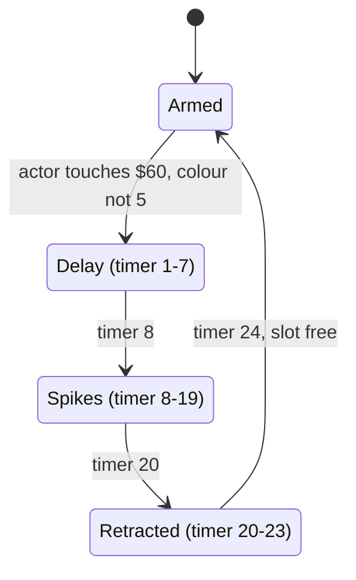

| State | Condition | Next state | Code |
|---|---|---|---|
| Armed | an actor touches `$60`, colour RAM low bits ≠ 5, a slot is free | Delay; colour `$FD` | [`trigger_floor_trap`](../../src/background_touch.asm#L341) [`$306D`](../../src/background_touch.asm#L343) |
| Delay | timer 8 | Spikes; sound `$8D`; messages `$2F`/`$30` | [`floor_trap_tick`](../../src/room_entry_traps.asm#L25) [`$3236`](../reference/modules/room_entry_traps.md#floor_trap_tick) |
| Spikes | timer 12 / 16 | Spikes; messages `$31`/`$32`, then `$2F`/`$30` | [`floor_trap_check_spikes2`](../../src/room_entry_traps.asm#L47) [`$3260`](../reference/modules/room_entry_traps.md#floor_trap_check_spikes2) / [`floor_trap_check_retract`](../../src/room_entry_traps.asm#L64) [`$3282`](../reference/modules/room_entry_traps.md#floor_trap_check_retract) |
| Spikes | timer 20 | Retracted; colour `$F8`; message `$33` | [`floor_trap_check_retract`](../../src/room_entry_traps.asm#L64) [`$3282`](../reference/modules/room_entry_traps.md#floor_trap_check_retract) |
| Retracted | timer 24 | Armed (slot free) | [`floor_trap_check_free`](../../src/room_entry_traps.asm#L94) [`$32BB`](../reference/modules/room_entry_traps.md#floor_trap_check_free) |

- The spikes come up 7 passes (21 frames) after the touch and stay for 12 passes. The tiles `$71-$7C` are deadly.
- The map has `$11 $60 $11` around each trap, but the retract draws `$7D $60 $7D` (**Code**; from the maps of rooms 6 and 7, each trap cell sits between two `$11` tiles with colour `$F8`).
- Slot 2 ([`trigger_floor_trap`](../../src/background_touch.asm#L341) [`$30B0-$30C5`](../../src/background_touch.asm#L373)) never ran in a run. The rooms 0-9 runs set off no trap; the room 10, 12 and 16 runs did ([rooms_10_19.md](rooms_10_19.md)).

### 13.5 The climbing texture ([`animate_scrolling_chars`](../../src/animated_chars.asm#L6) [`$2C70`](../reference/modules/animated_chars.md#animate_scrolling_chars))

Rooms 4, 5, 6, 8 and 9 call it on every pass (and room 11). Rooms 0-3 and 7 have no tiles `$61-$63` (**Code**, from the maps).

**What it does** (**Code**):
- It rewrites the pixels of the chars `$61`, `$62` and `$63` (top halves) and `$E1-$E3` (bottom halves): in charset `$A000` with the patterns [`anim_char_patterns_rooms_0_9`](../../src/variables.asm#L33) [`$42F1`](../reference/modules/variables.md#anim_char_patterns_rooms_0_9) for rooms 0-9, in charset `$A800` with [`anim_char_patterns_rooms_10_19`](../../src/variables.asm#L38) [`$4309`](../reference/modules/variables.md#anim_char_patterns_rooms_10_19) for rooms 10-19.
- Each char uses an 8-row pattern rotated by [`scroll_offset`](../../src/constants.asm#L53) [`$64`](../reference/variables.md#scroll_offset). **Conclusion:** the texture seems to move.
- While an actor climbs it (action state `$17`, entered through tile `$62`), [`action_climb`](../../src/object_actions.asm#L205) [`$2180`](../reference/modules/object_actions.md#action_climb) moves the actor two steps with it whenever [`scroll_timer`](../../src/constants.asm#L49) = 1: up ([`actor_move_up`](../../src/actor_movement.asm#L253)) for [`scroll_direction`](../../src/constants.asm#L54) 0, down ([`actor_move_down`](../../src/actor_movement.asm#L294)) for 1. The downward ride ([`continue_object_action`](../../src/object_actions.asm#L6) [`$21F8-$2200`](../../src/object_actions.asm#L272)) never ran in a run.

| Variable | Meaning |
|---|---|
| [`scroll_timer`](../../src/constants.asm#L49) [`$60`](../reference/variables.md#scroll_timer) | passes until the next move; bit 7 = pause mode |
| [`scroll_offset`](../../src/constants.asm#L53) [`$64`](../reference/variables.md#scroll_offset) | 0-7 |
| [`scroll_direction`](../../src/constants.asm#L54) [`$65`](../reference/variables.md#scroll_direction) | 0 = up, 1 = down; 0 after room entry |
| [`scroll_moves`](../../src/constants.asm#L55) [`$66`](../reference/variables.md#scroll_moves) | moves left at this speed |
| [`anim_speed_index`](../../src/variables.asm#L43) [`$4321`](../reference/modules/variables.md#anim_speed_index) | 7..0, the index into [`char_anim_delays`](../../src/room_tables.asm#L222) [`$4CB2`](../reference/modules/room_tables.md#char_anim_delays) = `$84, 8, 6, 4, 2, 4, 6, 8`; 7 after room entry |

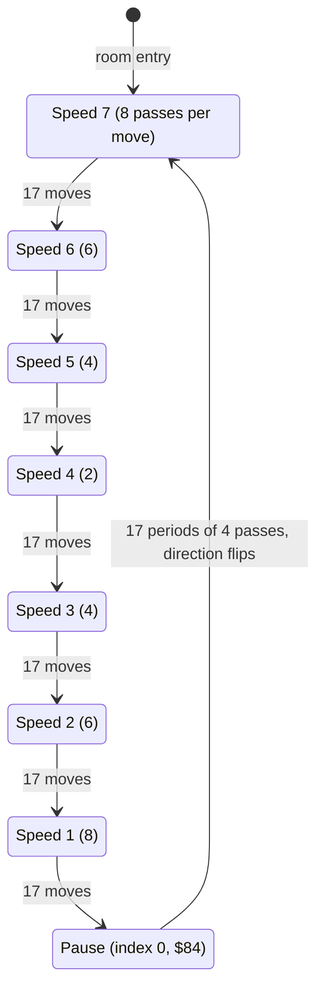

| State | Condition | Next state | Code |
|---|---|---|---|
| speed k | [`scroll_timer`](../../src/constants.asm#L49) counts down to 0 | the same speed; one move of [`scroll_offset`](../../src/constants.asm#L53) | [`scroll_chars_step`](../../src/animated_chars.asm#L29) [`$2C92`](../reference/modules/animated_chars.md#scroll_chars_step) |
| speed k (k ≥ 1) | [`scroll_moves`](../../src/constants.asm#L55) below 0 after a move | speed k - 1; [`scroll_moves`](../../src/constants.asm#L55) = `$10` | [`scroll_next_speed`](../../src/animated_chars.asm#L52) [`$2CBC`](../reference/modules/animated_chars.md#scroll_next_speed) |
| speed 1 | [`scroll_moves`](../../src/constants.asm#L55) below 0 | pause; [`scroll_timer`](../../src/constants.asm#L49) = `$84` (bit 7 set) | [`scroll_next_speed`](../../src/animated_chars.asm#L52) [`$2CBC`](../reference/modules/animated_chars.md#scroll_next_speed) |
| pause | 17 periods of 4 passes | speed 7; [`scroll_direction`](../../src/constants.asm#L54) XOR 1 | [`scroll_pause_period_end`](../../src/animated_chars.asm#L22) [`$2C85`](../reference/modules/animated_chars.md#scroll_pause_period_end) |

- Each speed makes 17 moves ([`scroll_moves`](../../src/constants.asm#L55) = `$10` counts down to below 0). The pause is 17 periods × 4 passes (about 68 passes) with no move. After the pause the index wraps to 7 and [`scroll_direction`](../../src/constants.asm#L54) flips. One full direction lasts about 17 × 38 + 68 = 714 passes, about 43 s (**Code**).
- The room events that set [`scroll_direction`](../../src/constants.asm#L54) and [`anim_speed_index`](../../src/variables.asm#L43) = 7 (rooms 4, 8 and 9) restart the ramp in the given direction. They do not reset [`scroll_moves`](../../src/constants.asm#L55) or [`scroll_timer`](../../src/constants.asm#L49) (**Code**).

**Observed** (`room_events2`, the room 4 log, 2400 frames):

| Frames | [`anim_speed_index`](../../src/variables.asm#L43) | Expected length of that speed (frames) |
|---|---|---|
| 100 | 7 | - |
| 200-400 | 6 | 17 × 6 × 3 = 306 |
| 500-600 | 5 | 204 |
| 700 | 4 | 102 |
| 800-1000 | 3 | 204 |
| 1100-1300 | 6 (the index jumped back) | 306 |
| 1400-1500 | 5 | 204 |
| 1600 | 4 | 102 |
| 1700-1800 | 3 | 204 |
| 1900-2100 | 2 | 306 |
| 2200 | 1 | 408 |
| 2300-2400 | 6 (jumped back again) | - |

- The index steps down 7 → 1 at the expected rates; [`scroll_timer`](../../src/constants.asm#L49) never exceeds the delay of the current speed; [`scroll_direction`](../../src/constants.asm#L54) stays 0.
- Twice the index jumped from 3 or 1 back to 6. **Conclusion:** only [`draw_room`](../../src/room_draw.asm#L6) [`$0A3C`](../../src/room_draw.asm#L72) and the one-shot of lantern 1 in room 4 write 7, and the one-shot cannot fire twice in one visit. So the room was drawn again: Bruce lost a fall and was respawned (the Yamo attacks him in this snapshot). [`draw_room`](../../src/room_draw.asm#L6) resets the index but not [`scroll_moves`](../../src/constants.asm#L55), so the moves left over end speed 7 quickly. The falls were not logged.

**Observed** (`room_events3`, `tex9`: room 9, which has no enemies, 3000 frames; the falls stayed 4 and the room stayed 9):

| Frames | [`anim_speed_index`](../../src/variables.asm#L43) | [`scroll_timer`](../../src/constants.asm#L49) [`$60`](../reference/variables.md#scroll_timer) | [`scroll_direction`](../../src/constants.asm#L54) [`$65`](../reference/variables.md#scroll_direction) | Notes |
|---|---|---|---|---|
| 160-360 | 7 | ≤ 8 | 0 | the speed after the entry |
| 460-660 | 6 | ≤ 6 | 0 | |
| 760-860 | 5 | ≤ 4 | 0 | |
| 960 | 4 | 1 | 0 | |
| 1060-1160 | 3 | ≤ 4 | 0 | |
| 1260-1460 | 2 | ≤ 6 | 0 | |
| 1560-1860 | 1 | ≤ 5 | 0 | |
| 1960, 2060, 2160 | 0 | `$83`, `$82`, `$81` | 0 | the pause: bit 7 set; [`scroll_moves`](../../src/constants.asm#L55) = `$10`, then `$08`, then `$00`; [`scroll_offset`](../../src/constants.asm#L53) stays 1 |
| 2260-2560 | 7 | ≤ 7 | **1** | wrapped to 7, the direction flipped |
| 2660-2860 | 6 | ≤ 6 | 1 | |
| 2960-3060 | 5 | ≤ 7 | 1 | |

- The full cycle runs as the code says: the ramp 7 → 1, the pause at index 0 with [`scroll_timer`](../../src/constants.asm#L49) in pause mode and no change of [`scroll_offset`](../../src/constants.asm#L53), then the wrap to 7 with [`scroll_direction`](../../src/constants.asm#L54) = 1. The pause lasted between 200 and 400 frames (the code gives 17 × 4 passes ≈ 204 frames). [`scroll_moves`](../../src/constants.asm#L55) fell by 8 per 100 frames in the pause (one period = 4 passes = 12 frames).
- In room 9 the index never jumped back and no fall was lost. This supports the conclusion above for room 4.
- The code of the pause ([`scroll_pause_tick`](../../src/animated_chars.asm#L13) [`$2C79`](../reference/modules/animated_chars.md#scroll_pause_tick), [`scroll_pause_period_end`](../../src/animated_chars.asm#L22) [`$2C85`](../reference/modules/animated_chars.md#scroll_pause_period_end)), the wrap and flip, and the downward move ([`scroll_offset_down`](../../src/animated_chars.asm#L75) [`$2CE6`](../reference/modules/animated_chars.md#scroll_offset_down)) ran. The texture changes charset bytes, not screen codes, so the screen diffs cannot show it.

### 13.6 Light flicker ([`flicker_lights`](../../src/light_flicker.asm#L6) [`$40BC`](../reference/modules/light_flicker.md#flicker_lights), [`light_flicker_timers`](../../src/constants.asm#L119) [`$0101`](../reference/variables.md#light_flicker_timers))

[`main_loop`](../../src/main_loop.asm#L6) calls it on every pass, in every room. Each of the three timers `$0101-$0103` counts down by 1 per pass. At 0 the timer is reloaded with a random 1-15 ([`random_byte`](../../src/interrupts.asm#L75) [`$1159`](../reference/modules/interrupts.md#random_byte); a 0 is drawn again), and random bits are written into one source row (2 pixel rows) of these bottom-half chars (**Code**):

| Timer | Bits | Chars changed |
|---|---|---|
| [`light_flicker_timers`](../../src/constants.asm#L119) [`$0101`](../reference/variables.md#light_flicker_timers) | `AND $30`, then `ORA $CC`, then `AND $B8` | `$93` (bottom of the lantern tile `$13`) in sets 1 and 0; `$86` (bottom of tile `$06`) in set 0 |
| [`light_flicker_timers+1`](../../src/constants.asm#L119) [`$0102`](../reference/variables.md#light_flicker_timers) | `AND $30`, then `ORA $CC` | `$B1` (bottom of the lantern tile `$31`) in sets 1 and 0 |
| [`light_flicker_timers+2`](../../src/constants.asm#L119) [`$0103`](../reference/variables.md#light_flicker_timers) | `AND $0C`, then `ORA $33`, then `AND $2E` | `$94` (bottom of the lantern tile `$14`) in sets 1 and 0; `$E7` (bottom of room 4's dark lantern tile `$67`) in set 0 |

Each light changes from "counting" to "flicker" (new random bits and a new random period of 1-15 passes) and back. **Conclusion:** this is the flame of the collectible lanterns.

### 13.7 Passage helpers ([`open_wall_column`](../../src/room_update.asm#L591) [`$3A8A`](../reference/modules/room_update.md#open_wall_column) to [`draw_tile_down`](../../src/room_update.asm#L625) [`$3ACA`](../reference/modules/room_update.md#draw_tile_down))

| Routine | Effect |
|---|---|
| [`open_wall_column`](../../src/room_update.asm#L591) [`$3A8A`](../reference/modules/room_update.md#open_wall_column) (A = text row, Y = column) | [`play_sound_8a`](../../src/final_room.asm#L6) [`$424F`](../reference/modules/final_room.md#play_sound_8a) (keeps A, X and Y); [`tile_row`](../../src/constants.asm#L57) = A, [`tile_col`](../../src/constants.asm#L58) = Y; [`draw_tile_down`](../../src/room_update.asm#L625) of the messages `$13`, `$13`, `$14`: tiles `$00`, `$00`, `$3E` in three text rows, one under the other. **Observed** in rooms 5, 8 and 9. |
| [`open_wall_column_17`](../../src/room_update.asm#L602) [`$3AA0`](../reference/modules/room_update.md#open_wall_column_17) | [`open_wall_column`](../../src/room_update.asm#L591), then [`tile_row`](../../src/constants.asm#L57) - 1 and message `$17` (tile `$11`) over the third cell. **Observed** in rooms 6 and 7: `$00 $00 $11`. |
| [`open_wall_column_2d`](../../src/room_update.asm#L608) [`$3AAA`](../reference/modules/room_update.md#open_wall_column_2d) | the same with message `$2D`. Message `$2D` is also tile `$11`, so the result equals [`open_wall_column_17`](../../src/room_update.asm#L602) (`assets/text/messages.json`). Only room 8 uses it. **Observed** in room 8: `$00 $00 $11`. |
| [`draw_column_63_64`](../../src/room_update.asm#L614) [`$3AB4`](../reference/modules/room_update.md#draw_column_63_64) | sound `$8A`; messages `$63`, `$63`, `$64`: tiles `$07`, `$07`, `$0E`. Only rooms 10, 12, 14 and 16 use it. |
| [`draw_tile_down`](../../src/room_update.asm#L625) [`$3ACA`](../reference/modules/room_update.md#draw_tile_down) | [`print_message`](../../src/text.asm#L6) with A, X = [`tile_row`](../../src/constants.asm#L57), Y = [`tile_col`](../../src/constants.asm#L58); then [`tile_row`](../../src/constants.asm#L57) + 1 |

Each helper is a one-step effect with no state of its own. The one-shot flag of the calling room is the state.

## 14. Dependencies between the rooms

"Empty" = `room_lanterns_left+r` = 0. "Lr.n" = lantern n of room r is collected. Each condition is tested on every pass while Bruce is in the room that owns the event.

| Room | Event | Depends on | Effect | Flag | Evidence |
|---|---|---|---|---|---|
| 0 | the bull snorts | room 6 empty | the mouth animation, sound `$81` | +0/+1 | **Observed** |
| 1 | floor hatch | rooms 0, 1 and 2 empty **and room 6 not empty** | exit `$03` → room 5 at (44, 50) | +0 | **Observed** (fires with room 6 full; stays shut with room 6 empty) |
| 2 | exit at the right edge | room 6 empty | exit `$05` → room 3 at (16, 196) | +1 | **Observed** |
| 2 | the bull snorts | room 6 empty | the mouth animation | +0/+2 | **Observed** |
| 3 | floor hatch | room 3 empty | exit `$03` → room 10 at (16, 176) | +0 | **Observed** |
| 3 | bridge | none | the bridge changes side over the spike pits | +1/+2 | **Observed** |
| 4 | chamber floor blanked, hazard 1 off | L4.0 | a way down from the left chamber | +0 | **Observed** |
| 4 | chamber floor blanked, hazard 2 off, texture up | L4.1 | a way down from the right chamber | +1 | **Observed** (the texture: **Code**) |
| 5 | columns 25-26 open | L5.8 | a passage on the bottom floor; hazard 1 off | +2 | **Observed** (the hazard: **Code**) |
| 5 | column 0 open and the exit tile | L5.6 | exit `$02` → room 4 at (156, 81) | +3 | **Observed** |
| 5 | top exit and two columns | **room 6 empty** and (L5.2 or L5.4) | exit `$05` → room 1 at (88, 102), at the top of the texture | +4 | **Observed** |
| 6 | left wall open | room 6 empty | exit `$02` → room 5 at (160, 128) can be reached | +0 | **Observed** |
| 7 | column 33 open | L7.0 to L7.4 | a passage at text rows 2-4 | +0 | **Observed** |
| 7 | column 38 open | L7.5 to L7.10 | the way to exit `$03` → room 8 | +1 | **Observed** |
| 7 | slider direction | L7.11 and L7.12 | the slider moves left | - | **Observed** |
| 8 | column 14 open | **room 7 empty** and L8.2 | an inner passage | +2 | **Observed** |
| 8 | column 25 open | L8.0 and L8.1 (texture down while lantern 3 is present) | an inner passage | +3 | **Observed** |
| 8 | top right open | room 8 empty and **L9.2 and L9.3** | the way to exit `$03` → room 9 at (16, 83) | +4 | **Observed** |
| 8 | bottom left open | L8.2 | the way to exit `$04` → room 7 at (161, 181) | +0 | **Observed** |
| 8 | bottom right open | **room 7 empty** and room 8 empty | the way to exit `$05` → room 9 at (15, 198) | +1 | **Observed** |
| 9 | texture down | L9.0 | the texture direction | +2 | **Observed** (the flag); **Code** (the direction) |
| 9 | column 23 open, texture up | L9.1 | an inner passage | +0 | **Observed** (the texture: **Code**) |
| 9 | top exit | room 9 empty | exit `$04` → room 6 at (157, 199); the spikes go | +1 | **Observed** |
| 9 | slider direction | L9.2 and L9.3 | the slider moves left | - | **Observed** |

- The rooms that other rooms depend on: **room 6** (rooms 0, 1, 2 and 5), **rooms 0-2** (room 1), **room 7** (room 8) and **lanterns 2 and 3 of room 9** (room 8).
- No handler of rooms 10-18 reads the lanterns of rooms 0-9 (**Code**). [`draw_room`](../../src/room_draw.asm#L6) reads rooms 12, 14 and 16 for room 11 ([rooms_10_19.md](rooms_10_19.md)).

**What a handler hard-codes** (**Conclusion** from the code; it matters when the rooms are reordered):
- the room numbers in `room_lanterns_left+r`;
- the record offsets `lantern_list_roomRR+4n` inside one lantern list;
- the text rows and columns of the tiles it draws;
- the exit tile (`$02`-`$05`) it draws, whose destination comes from the row of the room in [`exit2_room`](../../src/room_tables.asm#L134) [`$4B5E`](../reference/modules/room_tables.md#exit2_room) … [`exit5_room`](../../src/room_tables.asm#L151) [`$4B9A`](../reference/modules/room_tables.md#exit5_room) and the x/y tables.
- Outside the handlers: [`room_setup_handlers`](../../src/room_tables.asm#L401) [`$4E9C`](../reference/modules/room_tables.md#room_setup_handlers) and [`room_frame_handlers`](../../src/room_tables.asm#L411) [`$4EC4`](../reference/modules/room_tables.md#room_frame_handlers); the charset choice in [`draw_room`](../../src/room_draw.asm#L6) (rooms below 10 use set 0); the pattern choice in [`animate_scrolling_chars`](../../src/animated_chars.asm#L6) (room below 10); and [`handle_touched_char`](../../src/background_touch.asm#L53) (tile `$66` is deadly only from room 10 on, tiles `$2D`/`$2E` give the bonus fall only in room 16).

## 15. Still open

1. **Exits without trigger cells:** room 3 exit `$05` (room 0); room 6 exits `$03`, `$04` and `$05` (rooms 5, 2 and 0); room 7 exits `$02` and `$05` (room 0). No map cell has the tile, and no handler of rooms 0-9 draws it. Are they leftovers, or does other code write these tiles? Run: a watchpoint on writes of the values 2-5 to the screen `$8C78-$8FE7` in rooms 3, 6 and 7.
2. **Room 1 → room 5:** after the hatch opens, walk Bruce onto the exit tiles at text row 12, columns 19-21 and check that he arrives in room 5 at (44, 50).
3. **Floor trap timing and slot 2:** walk Bruce onto the trap of room 6 (map row 9, column 18) and capture every pass from timer 1 to 24. Put two enemies on traps at the same time to fill slot 2.
4. **The bull (rooms 0 and 2):** capture every pass for 20 passes after the event, to see the 1-step closed frame (tile `$46`) and sound `$81`. The game meaning of sound `$81` (a snort?) is not known; an enemy plays the same sound when it turns to Bruce.
5. **Tile `$4B` (the room 3 bridge):** is it solid ground? Is tile `$7D` (the floor trap after it retracts) the same picture as `$11`? Run: walk Bruce onto both and compare the screens.
6. **The hazard frames:** what the normal set (`$54-$56`) and the alternate set (`$58-$5A`) show (sparks or flames, a direction or a colour). Run: a screenshot of each frame.
7. **Room 7's slider moving left** overwrites map column 36 (`$2A`→`$65`). Is it a bug of the original, and does it change anything for Bruce? Run: let the slider wrap, then walk over column 36.
8. **The room 4 texture resets:** repeat the room 4 log and record the falls (breakpoint on [`lose_fall`](../../src/game_over.asm#L6) [`$1818`](../reference/modules/game_over.md#lose_fall)), to confirm that a respawn caused the two index resets.
