# Bruce Lee: rooms 10-19

**Scope.** This page has one section for each of the rooms 10 to 19: how the room looks, its table entries, its init handler, its frame handler and the conditions in other rooms that change it. It covers the room 11 diversion to room 13, the room 13 sliders, the room 16 bonus fall, the room 18 wizard (face, fireballs, defeat), the room 19 ending and what [`game_cycle`](../../src/constants.asm#L30) changes. It ends with the table of the dependencies between the rooms.

- How a room is built from its data: [room_pipeline.md](room_pipeline.md).
- The room-level game flow (exits, lanterns, death, the player change, enemies, the end of the game): [room_flow.md](room_flow.md).
- The entry page of the rooms: [../rooms.md](../rooms.md). Rooms 0-9 and the mechanisms that rooms share (hazards, slider, floor traps, climbing texture, passage helpers): [rooms_00_09.md](rooms_00_09.md).

**Sources.**
- Code: `src/room_update.asm` (the frame handlers, [reference](../reference/modules/room_update.md)), `src/room_init.asm` (the init handlers, [reference](../reference/modules/room_init.md)), `src/fireballs.asm` ([reference](../reference/modules/fireballs.md)), `src/final_room.asm` ([reference](../reference/modules/final_room.md)), `src/room_tiles.asm`, `src/room_state.asm`, `src/room_draw.asm`, `src/background_touch.asm` and `src/actors.asm`.
- Data: the room tables in [room_tables](../reference/modules/room_tables.md) and [tables.md](../reference/tables.md); the extracted rooms `assets/rooms/roomNN.json` and `roomNN.png`; the messages `assets/text/messages.json`.
- Runs: `room_events`, `room_events2`, `room_special` and `r17_freeze` (section 2).

**Conventions.**
- Addresses are C64 addresses. Names are the names of the knowledge.
- A *pass* is one run of [`main_loop`](../../src/main_loop.asm#L6) [`$1BC2`](../reference/modules/main_loop.md#main_loop); at most one pass every 3 frames. A *frame* is one video frame: one run of the raster IRQ chain (50 per second on PAL). All handler timings are in passes.
- An *actor* is one of the moving figures, numbered by the index into the actor tables: actor 0 = Bruce. Actor 1 = Yamo and actor 2 = Ninja rest on colours and the opponent option (report.md).
- A *room* is a screen, number 0-19 in [`current_room`](../../src/constants.asm#L28) [`$29`](../reference/variables.md#current_room). A *fall* is a life (the status line says FALLS). *Demo* is the attract mode ([`game_playing`](../../src/constants.asm#L120) = 0).
- A *message* is a string printed by [`print_message`](../../src/text.asm#L6) [`$17E2`](../reference/modules/text.md#print_message) (text or tile strings). "Message 99 (`$63`)" means message number `$63`. A tile message draws tile `t` as char `t` in the top row and char `t|$80` in the bottom row; it does not change colour RAM.
- A *text row* X is the row argument of [`print_message`](../../src/text.asm#L6). It covers screen rows 2X-1 and 2X, and it is map row X-2. Columns are 0-39.
- *Lantern n* of room r is the record at `lantern_list_roomRR+4n` (offsets in hex, as in the source); n counts from 0. Its first byte is 1 while the lantern is present and 0 after it is collected. "L14.2" in the tables means: lantern 2 of room 14 is collected. Room r is *empty* when `room_lanterns_left+r` = 0.
- An *exit tile* is a tile `$02`-`$05` in the map. Touching it uses the exit tables of that tile.
- **Observed** marks a fact that a run showed (the run is named). **Code** marks a fact from the code only. **Conclusion** marks an interpretation.

## 1. Building blocks shared by the handlers

### 1.1 [`room_script_vars`](../../src/room_tables.asm#L390) [`$4E97-$4E9B`](../reference/modules/room_tables.md#room_script_vars): five bytes of room state

[`dispatch_room_init`](../../src/lanterns.asm#L110) [`$33B3`](../reference/modules/lanterns.md#dispatch_room_init) (the tail of [`redraw_taken_lanterns`](../../src/lanterns.asm#L63) [`$336E`](../reference/modules/lanterns.md#redraw_taken_lanterns)) sets these five bytes to 0 each time a room is drawn. The init handler runs next and can preset them. They are not saved per player (**Code**).

Rooms 10-17 use them as one-shot flags. An event fires while its flag is not negative (`BMI` test) or not zero (`BEQ` test, room 17), and the event decrements the flag (**Code**).

The events persist because their conditions persist: the lantern records and the counters in [`room_lanterns_left`](../../src/constants.asm#L29) [`$2A`](../reference/variables.md#room_lanterns_left) (per player). On each later entry the flags are 0 again, so the handler fires the event again at once and draws the changed tiles over the freshly drawn map. **Conclusion:** a room always looks as its lantern state says. The room 16 run shows it (section 9).

**Double firing.** [`draw_room`](../../src/room_draw.asm#L6) [`$09BC`](../reference/modules/room_draw.md#draw_room) ends with a jump to [`run_room_update`](../../src/room_update.asm#L571) [`$3A6F`](../reference/modules/room_update.md#run_room_update), so the frame handler runs once inside [`draw_room`](../../src/room_draw.asm#L6) and again on the first pass. Rooms 12, 14 and 15 preset some flags to 1 and test them with `BMI`. So 1 → 0 fires once and 0 → `$FF` fires a second time: these events draw their tiles twice and play sound `$8A` twice (**Code**). **Observed** (`room_events`): room 15's flag went `01` → `FF`. Room 17 presets 1 and tests with `BEQ`, so its events fire once.

### 1.2 Drawing helpers

| Routine | What it draws |
|---|---|
| [`draw_column_63_64`](../../src/room_update.asm#L614) [`$3AB4`](../reference/modules/room_update.md#draw_column_63_64) | Sound `$8A` ([`play_sound_8a`](../../src/final_room.asm#L6) [`$424F`](../reference/modules/final_room.md#play_sound_8a)), then message 99 (`$63`, tile `$07`) at text rows A and A+1, and message 100 (`$64`, tile `$0E`) at text row A+2, all at column Y, through [`draw_tile_down`](../../src/room_update.asm#L625) [`$3ACA`](../reference/modules/room_update.md#draw_tile_down). Rooms 10, 12, 14 and 16 use it. Each time, it replaces a wall column of `$45` cells (`$C5` in the map: tile `$45` with colour `$F8`) by an open passage `$07`, `$07`, `$0E`; behind the passage lies an exit tile (**Code**, from the maps). |
| [`draw_sliding_tile`](../../src/room_tiles.asm#L6) [`$404E`](../reference/modules/room_tiles.md#draw_sliding_tile) | Sound `$89`, message 28 (`$1C`, tile `$65`) at [`slider_prev_col`](../../src/constants.asm#L61) [`$70`](../reference/variables.md#slider_prev_col), then message 27 (`$1B`, tile `$64`) at [`slider_col`](../../src/constants.asm#L59) [`$6E`](../reference/variables.md#slider_col), on text row [`slider_row`](../../src/constants.asm#L60) [`$6F`](../reference/variables.md#slider_row) ([rooms_00_09.md](rooms_00_09.md), the single slider). |
| [`draw_sliding_tile_alt`](../../src/room_tiles.asm#L17) [`$4063`](../reference/modules/room_tiles.md#draw_sliding_tile_alt) | The same with message 85 (`$55`, tile `$67`) at the old column and message 84 (`$54`, tile `$66`) at the new one. |
| [`draw_hazard0_frame`](../../src/room_tiles.asm#L39) [`$4086`](../reference/modules/room_tiles.md#draw_hazard0_frame) / [`draw_hazard1_frame`](../../src/room_tiles.asm#L46) [`$4090`](../reference/modules/room_tiles.md#draw_hazard1_frame) / [`draw_hazard2_frame`](../../src/room_tiles.asm#L53) [`$409A`](../reference/modules/room_tiles.md#draw_hazard2_frame) | Message `$1F` + A (31-37) at `hazard_row+n` `$74`, `hazard_col+n` `$71` for hazard n ([rooms_00_09.md](rooms_00_09.md), the travelling hazards). |
| [`animate_floor_traps`](../../src/room_entry_traps.asm#L16) [`$3228`](../reference/modules/room_entry_traps.md#animate_floor_traps) | The three floor-trap slots ([rooms_00_09.md](rooms_00_09.md), the floor traps). |
| [`animate_scrolling_chars`](../../src/animated_chars.asm#L6) [`$2C70`](../reference/modules/animated_chars.md#animate_scrolling_chars) | The moving climbing-texture chars ([`scroll_direction`](../../src/constants.asm#L54) [`$65`](../reference/variables.md#scroll_direction), [`anim_speed_index`](../../src/variables.asm#L43) [`$4321`](../reference/modules/variables.md#anim_speed_index); [rooms_00_09.md](rooms_00_09.md), the climbing texture). |

**Deadly chars.** [`handle_touched_char`](../../src/background_touch.asm#L53) [`$2E89`](../reference/modules/background_touch.md#handle_touched_char) treats these chars as deadly: `$0F`, `$40`, `$54-$5A` except `$57`, `$64`, `$71-$7C`, and `$66` from room 10 on. Bruce dies when he touches one with contact bit 1 of [`actor_contact`](../../src/constants.asm#L92) set (**Code**). So:
- the sliding tiles `$64` and `$66` of rooms 13 and 17 are deadly, and their trail tiles `$65` and `$67` are not;
- the travelling-hazard frames `$54`, `$55` and `$56` are deadly;
- the floor-trap spikes `$71-$7C` are deadly.

### 1.3 The rooms at a glance

| Room | Lanterns ([`room_lantern_counts`](../../src/room_tables.asm#L229) [`$4CCE`](../reference/modules/room_tables.md#room_lantern_counts)) | Enemies ([`room_no_combat_flags`](../../src/room_tables.asm#L217) [`$4C9E`](../reference/modules/room_tables.md#room_no_combat_flags)) | Init | Frame | Events |
|---|---|---|---|---|---|
| 10 | 3 | yes | [`room_init_none`](../../src/room_init.asm#L6) [`$33F5`](../reference/modules/room_init.md#room_init_none) | [`room10_update`](../../src/room_update.asm#L868) [`$3C90`](../reference/modules/room_update.md#room10_update) | passage to the exit to room 11; a protection check |
| 11 | 3 | no | [`room_init_none`](../../src/room_init.asm#L6) [`$33F5`](../reference/modules/room_init.md#room_init_none) | [`room11_update`](../../src/room_update.asm#L894) [`$3CC0`](../reference/modules/room_update.md#room11_update) | texture reset; **[`draw_room`](../../src/room_draw.asm#L6) diverts to room 13** |
| 12 | 3 | yes | [`room12_init`](../../src/room_init.asm#L126) [`$34BD`](../reference/modules/room_init.md#room12_init) | [`room12_update`](../../src/room_update.asm#L1094) [`$3E4C`](../reference/modules/room_update.md#room12_update) | two passages (one depends on room 14) |
| 13 | 0 (a dummy record) | no | [`room13_init`](../../src/room_init.asm#L131) [`$34C3`](../reference/modules/room_init.md#room13_init) | [`room13_update`](../../src/room_update.asm#L1117) [`$3E7C`](../reference/modules/room_update.md#room13_update) | 8 deadly sliders; 500-point floor bonuses |
| 14 | 4 | yes | [`room14_init`](../../src/room_init.asm#L221) [`$358D`](../reference/modules/room_init.md#room14_init) | [`room14_update`](../../src/room_update.asm#L1162) [`$3ECC`](../reference/modules/room_update.md#room14_update) | passage to the exit to room 11 |
| 15 | 6 | yes | [`room15_init`](../../src/room_init.asm#L226) [`$3593`](../reference/modules/room_init.md#room15_init) | [`room15_update`](../../src/room_update.asm#L1175) [`$3EE6`](../reference/modules/room_update.md#room15_update) | two tower openings; the exit to room 17 |
| 16 | 2 | yes | [`room16_init`](../../src/room_init.asm#L233) [`$359F`](../reference/modules/room_init.md#room16_init) | [`room16_update`](../../src/room_update.asm#L1229) [`$3F5B`](../reference/modules/room_update.md#room16_update) | passage to the exit to room 11; the bonus-fall object |
| 17 | 2 | no | [`room17_init`](../../src/room_init.asm#L251) [`$35C4`](../reference/modules/room_init.md#room17_init) | [`room17_update`](../../src/room_update.asm#L1241) [`$3F71`](../reference/modules/room_update.md#room17_update) | two mesh pieces; slider; 3 travelling hazards; blinking ceiling |
| 18 | 1 (the wizard) | no | [`room18_init`](../../src/room_init.asm#L279) [`$35FA`](../reference/modules/room_init.md#room18_init) | [`room18_wizard_update`](../../src/room_update.asm#L909) [`$3CDC`](../reference/modules/room_update.md#room18_wizard_update) | wizard face, fireballs, defeat, exit to room 19 |
| 19 | 0 (a dummy record) | no | [`room19_init`](../../src/final_room.asm#L21) [`$425F`](../reference/modules/final_room.md#room19_init) | [`room19_congratulations_update`](../../src/final_room.asm#L34) [`$4272`](../reference/modules/final_room.md#room19_congratulations_update) | congratulations, [`game_cycle`](../../src/constants.asm#L30) + 1, restart in room 0 |

"Enemies: no" means that [`draw_room`](../../src/room_draw.asm#L6) sets [`room_without_enemies`](../../src/constants.asm#L65) [`$7A`](../reference/variables.md#room_without_enemies) from the table: no enemy spawns, no enemy follows Bruce in, and [`main_loop`](../../src/main_loop.asm#L6) skips [`check_sprite_collisions`](../../src/combat_hits.asm#L6) [`$29C3`](../reference/modules/combat_hits.md#check_sprite_collisions) (**Code**).

## 2. The runs

These runs gave the **Observed** facts on this page. The runs are named so that they can be done again; their files are not part of the documentation.

| Run | What was done |
|---|---|
| `room_events` | For each room: a snapshot inside the room; all 20 bytes [`room_lanterns_left`](../../src/constants.asm#L29) [`$2A-$3D`](../reference/variables.md#room_lanterns_left) set to 0; then 100 and 400 frames. The lantern **records** were not changed. |
| `room_special`, wizard | A room 18 snapshot. The wizard's lantern record [`lantern_list_room18`](../../src/room_tables.asm#L377) [`$4E86`](../reference/modules/room_tables.md#lantern_list_room18) and [`room_lanterns_left+18`](../../src/constants.asm#L29) set to 0; then 100 and 400 frames. |
| `room_special`, room 11 | From room 0, [`room_lanterns_left+12`](../../src/constants.asm#L29), `+14` and `+16` set to 0, and room 11 entered with A = 11 forced at [`enter_room`](../../src/background_touch.asm#L210). Compared with a normal entry. |
| `room_special`, ending | A room 19 snapshot, run for 200, 1000 and 2500 frames. |
| `room_events2` | For each room: entered through [`enter_room`](../../src/background_touch.asm#L210) with the room forced, twice: normally, and with every lantern record state of every room and every [`room_lanterns_left`](../../src/constants.asm#L29) byte set to 0 ("collected"). Cell diffs normal → collected at 60 frames, collected 60 → 400 frames, and [`room_script_vars`](../../src/room_tables.asm#L390) at 400 frames. |
| `r17_freeze` | The room 17 freeze: the raster line of the `$D011` accesses in [`draw_room`](../../src/room_draw.asm#L6). |

**The limit of `room_events`.** Most handlers of rooms 10-17 test the state byte of single lantern records, not the counters. So zeroed counters set off only the events that test a counter: room 15 (its third event) and room 16. The collected entry of `room_events2` zeroed the records too and set off all lantern events at once; it shows the end state of each room, not the order of the events.

## 3. Room 10: the passage to room 11

**Description.** Three corridors stacked on each other, with pillars (from the image). A wall column at column 38 stands in front of the exit to room 11. Room 10's map also holds `$2D`/`$2E` cells in map row 1; those chars are the bonus-fall object only in room 16 ([`touch_bonus_fall_chars`](../../src/background_touch.asm#L110) [`$2EEA`](../reference/modules/background_touch.md#touch_bonus_fall_chars) tests for room 16), so they do nothing here (**Code**).

*Room 10: the exit to room 3 at the bottom left, the wall column at the right in front of the exit to room 11.*

**Data.**

| Table entry | Value | Meaning |
|---|---|---|
| [`room10_map`](../../src/room_maps.asm#L443) [`$75D8`](../reference/modules/room_maps.md#room10_map) | 372 bytes, 442 cells | RLE map stream |
| [`room_char_colours+10`](../../src/room_colours.asm#L12) [`$47AA`](../reference/modules/room_colours.md#room_char_colours) | `$F9` | colour RAM fill: multicolour, colour 1 |
| [`room_lantern_counts+10`](../../src/room_tables.asm#L229) [`$4CD8`](../reference/modules/room_tables.md#room_lantern_counts) | 3 | lanterns at the start (list [`lantern_list_room10`](../../src/room_tables.asm#L334) [`$4E1E`](../reference/modules/room_tables.md#lantern_list_room10)) |
| [`room_no_combat_flags+10`](../../src/room_tables.asm#L217) [`$4CA8`](../reference/modules/room_tables.md#room_no_combat_flags) | `$00` | enemies spawn |
| [`ninja_first_spawn_delay+10`](../../src/actor_room_tables.asm#L69) [`$1315`](../reference/modules/actor_room_tables.md#ninja_first_spawn_delay) / [`yamo_first_spawn_delay+10`](../../src/actor_room_tables.asm#L84) [`$1351`](../reference/modules/actor_room_tables.md#yamo_first_spawn_delay) | 8 / 48 | first spawn delay of the Ninja / the Yamo (passes) |
| [`room_spawn_x+10`](../../src/room_tables.asm#L156) [`$4BB8`](../reference/modules/room_tables.md#room_spawn_x) / [`room_spawn_y+10`](../../src/room_tables.asm#L161) [`$4BCC`](../reference/modules/room_tables.md#room_spawn_y) | 52 / 140 | Bruce's spawn point (x, y) |
| [`room_setup_handlers+20`](../../src/room_tables.asm#L401) [`$4EB0`](../reference/modules/room_tables.md#room_setup_handlers) | [`room_init_none`](../../src/room_init.asm#L6) [`$33F5`](../reference/modules/room_init.md#room_init_none) | init handler (RTS table: the entry holds the address - 1) |
| [`room_frame_handlers+20`](../../src/room_tables.asm#L411) [`$4ED8`](../reference/modules/room_tables.md#room_frame_handlers) | [`room10_update`](../../src/room_update.asm#L868) [`$3C90`](../reference/modules/room_update.md#room10_update) | frame handler (RTS table: the entry holds the address - 1) |
| charset | set 1 (`$D018` = `$3A`) | chosen by [`draw_room`](../../src/room_draw.asm#L6) from the room number |

| Exit tile | Entry | Destination room | Entry point (x, y) | Trigger cells in the map (map row, column) |
|---|---|---|---|---|
| `$02` | [`exit2_room+10`](../../src/room_tables.asm#L134) [`$4B68`](../reference/modules/room_tables.md#exit2_room) | room 3 | (160, 196) | (9, 0) |
| `$03` | [`exit3_room+10`](../../src/room_tables.asm#L140) [`$4B7C`](../reference/modules/room_tables.md#exit3_room) | room 11 | (16, 196) | (3, 39) |
| `$04` | [`exit4_room+10`](../../src/room_tables.asm#L146) [`$4B90`](../reference/modules/room_tables.md#exit4_room) | x = 0: as tile `$05`: room 0 at x = 0 | (0, 0) | none |
| `$05` | [`exit5_room+10`](../../src/room_tables.asm#L151) [`$4BA4`](../reference/modules/room_tables.md#exit5_room) | x = 0: room 0 at x = 0 (tile `$05` has no fall-through) | (0, 0) | none |

| Lantern | Record | Text row | Column | Map tile | Collected tile |
|---|---|---|---|---|---|
| 0 | [`lantern_list_room10`](../../src/room_tables.asm#L334) [`$4E1E`](../reference/modules/room_tables.md#lantern_list_room10) | 4 | 1 | `$14` | `$1F` |
| 1 | [`lantern_list_room10+$4`](../../src/room_tables.asm#L334) [`$4E22`](../reference/modules/room_tables.md#lantern_list_room10) | 7 | 30 | `$14` | `$1F` |
| 2 | [`lantern_list_room10+$8`](../../src/room_tables.asm#L334) [`$4E26`](../reference/modules/room_tables.md#lantern_list_room10) | 10 | 30 | `$14` | `$1F` |

**Setup.** [`room_init_none`](../../src/room_init.asm#L6) [`$33F5`](../reference/modules/room_init.md#room_init_none) (RTS).

**Behaviour.** [`room10_update`](../../src/room_update.asm#L868) [`$3C90`](../reference/modules/room_update.md#room10_update) (**Code**):

| Variable | Meaning |
|---|---|
| [`room_script_vars`](../../src/room_tables.asm#L390) | one-shot flag of the passage: 0 armed, `$FF` done |

1. **The passage.** If [`room_script_vars`](../../src/room_tables.asm#L390) ≥ 0 and lanterns 0 and 1 are collected ([`lantern_list_room10`](../../src/room_tables.asm#L334) and [`lantern_list_room10+4`](../../src/room_tables.asm#L334) both 0): decrement the flag, then [`draw_column_63_64`](../../src/room_update.asm#L614) with A = 4, Y = `$26`. This plays sound `$8A` and draws tiles `$07`/`$07`/`$0E` at column 38, text rows 4-6, which opens the way to the exit tile at map row 3, column 39.
2. **Protection** [`room10_check_cpu_port_ddr`](../../src/room_update.asm#L879) [`$3CA7`](../reference/modules/room_update.md#room10_check_cpu_port_ddr): `LDX $00,Y` with Y = 0 reads the 6510 data direction register. Unless it is `$EF`, [`room10_sabotage_room_data`](../../src/room_update.asm#L884) [`$3CAF`](../reference/modules/room_update.md#room10_sabotage_room_data) writes `$80` (the map end) into the first byte of [`room00_map`](../../src/room_maps.asm#L6) [`$68F9`](../reference/modules/room_maps.md#room00_map), [`room05_map`](../../src/room_maps.asm#L228) [`$6F82`](../reference/modules/room_maps.md#room05_map) and [`room01_map`](../../src/room_maps.asm#L44) [`$6A09`](../reference/modules/room_maps.md#room01_map), and jumps to [`title_screen`](../../src/title.asm#L6) [`$0584`](../reference/modules/title.md#title_screen). This release passes the test.
3. [`room10_animate_traps`](../../src/room_update.asm#L891) [`$3CBD`](../reference/modules/room_update.md#room10_animate_traps): [`animate_floor_traps`](../../src/room_entry_traps.asm#L16).

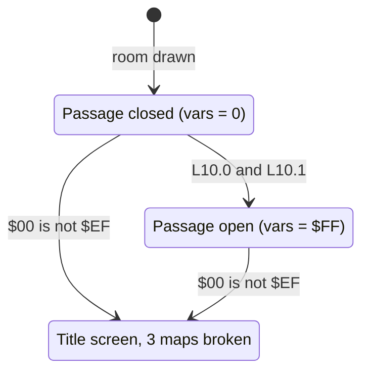

| State | Condition | Next state | Effect | Code |
|---|---|---|---|---|
| Closed | L10.0 and L10.1 | Open | sound `$8A`; message 99 at text row 4, column 38; 99 at (5, 38); 100 at (6, 38) | [`room10_update`](../../src/room_update.asm#L868) [`$3C90`](../reference/modules/room_update.md#room10_update) |
| any | [`D6510`](../../src/constants.asm#L7) [`$0000`](../reference/variables.md#D6510) ≠ `$EF` | title screen | `$80` into `$68F9`, `$6F82` and `$6A09`; `JMP title_screen` | [`room10_sabotage_room_data`](../../src/room_update.asm#L884) [`$3CAF`](../reference/modules/room_update.md#room10_sabotage_room_data) |

**Evidence.**
- **Observed** (`room_events`): the handler and the floor traps ran, and a floor trap went off: screen rows 11-12, columns 18/20 and 23/25 changed `$0D`→`$7D`. That is message 51 (`$33`: `$7D $60 $7D`), drawn at timer 20 of the trap. The flag stayed 0, because the records were not changed.
- **Observed** (`room_events2`, collected): the passage: column 38, screen rows 7-10 `$45`/`$C5` → `$07`/`$87` (message 100 at text row 6 matched the cell already there); [`room_script_vars`](../../src/room_tables.asm#L390) = `FF 00 …` at 400 frames; the three lanterns drawn as the collected tile `$1F`. Between 60 and 400 frames a floor trap showed its spikes `$71-$76` at screen rows 9-12, columns 18-20.
- **Code:** the sabotage path ([`room10_sabotage_room_data`](../../src/room_update.asm#L884) [`$3CAF-$3CBC`](../reference/modules/room_update.md#room10_sabotage_room_data) never ran).

**Links to other rooms.**
- The passage depends only on room 10's own lanterns.
- Exit `$02` leads to room 3, exit `$03` to room 11. Room 3's hatch and room 11 exit `$02` lead here.

## 4. Room 11: the hub and the diversion to room 13

**Description.** A hub (from the image). A climbing-texture column runs at the left. Three doorways at map row 5 lead to rooms 12, 14 and 16. [`check_exit_direction`](../../src/background_touch.asm#L392) [`$30D4`](../reference/modules/background_touch.md#check_exit_direction) returns "allowed" in room 11 without a direction test, so touching a doorway cell is enough (**Code**). No enemies come here.

*Room 11: the three doorways in the middle row, the texture column at the left.*

**Data.**

| Table entry | Value | Meaning |
|---|---|---|
| [`room11_map`](../../src/room_maps.asm#L492) [`$774C`](../reference/modules/room_maps.md#room11_map) | 247 bytes, 440 cells | RLE map stream |
| [`room_char_colours+11`](../../src/room_colours.asm#L12) [`$47AB`](../reference/modules/room_colours.md#room_char_colours) | `$FB` | colour RAM fill: multicolour, colour 3 |
| [`room_lantern_counts+11`](../../src/room_tables.asm#L229) [`$4CD9`](../reference/modules/room_tables.md#room_lantern_counts) | 3 | lanterns at the start (list [`lantern_list_room11`](../../src/room_tables.asm#L339) [`$4E2B`](../reference/modules/room_tables.md#lantern_list_room11)) |
| [`room_no_combat_flags+11`](../../src/room_tables.asm#L217) [`$4CA9`](../reference/modules/room_tables.md#room_no_combat_flags) | `$FF` | no enemies |
| [`ninja_first_spawn_delay+11`](../../src/actor_room_tables.asm#L69) [`$1316`](../reference/modules/actor_room_tables.md#ninja_first_spawn_delay) / [`yamo_first_spawn_delay+11`](../../src/actor_room_tables.asm#L84) [`$1352`](../reference/modules/actor_room_tables.md#yamo_first_spawn_delay) | 0 / 0 | first spawn delay of the Ninja / the Yamo (passes) |
| [`room_spawn_x+11`](../../src/room_tables.asm#L156) [`$4BB9`](../reference/modules/room_tables.md#room_spawn_x) / [`room_spawn_y+11`](../../src/room_tables.asm#L161) [`$4BCD`](../reference/modules/room_tables.md#room_spawn_y) | 64 / 76 | Bruce's spawn point (x, y) |
| [`room_setup_handlers+22`](../../src/room_tables.asm#L401) [`$4EB2`](../reference/modules/room_tables.md#room_setup_handlers) | [`room_init_none`](../../src/room_init.asm#L6) [`$33F5`](../reference/modules/room_init.md#room_init_none) | init handler (RTS table: the entry holds the address - 1) |
| [`room_frame_handlers+22`](../../src/room_tables.asm#L411) [`$4EDA`](../reference/modules/room_tables.md#room_frame_handlers) | [`room11_update`](../../src/room_update.asm#L894) [`$3CC0`](../reference/modules/room_update.md#room11_update) | frame handler (RTS table: the entry holds the address - 1) |
| charset | set 1 (`$D018` = `$3A`) | chosen by [`draw_room`](../../src/room_draw.asm#L6) from the room number |

| Exit tile | Entry | Destination room | Entry point (x, y) | Trigger cells in the map (map row, column) |
|---|---|---|---|---|
| `$02` | [`exit2_room+11`](../../src/room_tables.asm#L134) [`$4B69`](../reference/modules/room_tables.md#exit2_room) | room 10 | (160, 90) | (9, 0) |
| `$03` | [`exit3_room+11`](../../src/room_tables.asm#L140) [`$4B7D`](../reference/modules/room_tables.md#exit3_room) | room 12 | (16, 92) | (5, 9), (5, 10), (5, 11), (5, 12) |
| `$04` | [`exit4_room+11`](../../src/room_tables.asm#L146) [`$4B91`](../reference/modules/room_tables.md#exit4_room) | room 14 | (16, 94) | (5, 18), (5, 19), (5, 20), (5, 21) |
| `$05` | [`exit5_room+11`](../../src/room_tables.asm#L151) [`$4BA5`](../reference/modules/room_tables.md#exit5_room) | room 16 | (16, 92) | (5, 27), (5, 28), (5, 29), (5, 30) |

| Lantern | Record | Text row | Column | Map tile | Collected tile |
|---|---|---|---|---|---|
| 0 | [`lantern_list_room11`](../../src/room_tables.asm#L339) [`$4E2B`](../reference/modules/room_tables.md#lantern_list_room11) | 3 | 18 | `$13` | `$1E` |
| 1 | [`lantern_list_room11+$4`](../../src/room_tables.asm#L339) [`$4E2F`](../reference/modules/room_tables.md#lantern_list_room11) | 3 | 21 | `$14` | `$1F` |
| 2 | [`lantern_list_room11+$8`](../../src/room_tables.asm#L339) [`$4E33`](../reference/modules/room_tables.md#lantern_list_room11) | 10 | 7 | `$14` | `$1F` |

**Setup.** [`room_init_none`](../../src/room_init.asm#L6) [`$33F5`](../reference/modules/room_init.md#room_init_none). Before the room is drawn, [`draw_room`](../../src/room_draw.asm#L6) can send Bruce to room 13 instead (section 4.1).

### 4.1 The diversion in [`draw_room`](../../src/room_draw.asm#L6)

At [`draw_room_special`](../../src/room_draw.asm#L34) [`$09F6`](../reference/modules/room_draw.md#draw_room_special), after the screen has been blanked and colour RAM filled (**Code**):
- **Condition:** [`current_room`](../../src/constants.asm#L28) = 11 and [`room_lanterns_left+12`](../../src/constants.asm#L29), `+14` and `+16` (`$36`, `$38`, `$3A`) are all 0.
- **Action:** [`SPENA`](../../src/constants.asm#L160) is restored from [`saved_sprite_enable`](../../src/constants.asm#L33) [`$47`](../reference/variables.md#saved_sprite_enable); X = 13; jump to [`respawn_in_room`](../../src/room_entry_traps.asm#L6) [`$3217`](../reference/modules/room_entry_traps.md#respawn_in_room).

[`respawn_in_room`](../../src/room_entry_traps.asm#L6) puts Bruce at room 13's spawn point ([`room_spawn_x+13`](../../src/room_tables.asm#L156) [`$4BBB`](../reference/modules/room_tables.md#room_spawn_x) / [`room_spawn_y+13`](../../src/room_tables.asm#L161) [`$4BCF`](../reference/modules/room_tables.md#room_spawn_y): 152, 50) and jumps to [`enter_room`](../../src/background_touch.asm#L210) [`$2F8E`](../reference/modules/background_touch.md#enter_room) with destination 13, which draws room 13. Room 11 is then never drawn: it gets no entry bonus and its handler does not run (**Code**).

Each exit into room 11 (from rooms 10, 12, 14 and 16) and a respawn after a lost fall go through [`draw_room`](../../src/room_draw.asm#L6). **Conclusion:** once rooms 12, 14 and 16 are empty, room 13 replaces room 11 for the rest of the cycle.

**Observed** (`room_special`, room 11): [`current_room`](../../src/constants.asm#L28) = `$0D` after the entry. The screen equals the room 13 map (row 0 `45 43 11 10 11 45 00 2d 2e …` = `room13.json` row 0 without bit 7); 678 cells changed. The coverage shows [`draw_room`](../../src/room_draw.asm#L6) [`$0A04-$0A0D`](../../src/room_draw.asm#L42) and [`room13_update`](../../src/room_update.asm#L1117); the room 11 handler did not run. **Observed** (`room_events2`, collected): the same diversion.

### 4.2 Frame handler [`room11_update`](../../src/room_update.asm#L894) [`$3CC0`](../reference/modules/room_update.md#room11_update)

| Variable | Meaning |
|---|---|
| [`room_script_vars`](../../src/room_tables.asm#L390) | one-shot flag |

1. **Texture reset.** If the flag ≥ 0 and lantern 2 is collected ([`lantern_list_room11+8`](../../src/room_tables.asm#L339) [`$4E33`](../reference/modules/room_tables.md#lantern_list_room11) = 0): decrement the flag, then [`scroll_direction`](../../src/constants.asm#L54) = 0 and [`anim_speed_index`](../../src/variables.asm#L43) = 7. [`draw_room`](../../src/room_draw.asm#L6) sets the same two values on entry. **Conclusion:** the event matters only when [`animate_scrolling_chars`](../../src/animated_chars.asm#L6) has reversed the direction since the entry; it puts the texture back to "up" at the start speed. It plays no sound and draws no tiles.
2. [`room11_animate`](../../src/room_update.asm#L905) [`$3CD6`](../reference/modules/room_update.md#room11_animate): [`animate_floor_traps`](../../src/room_entry_traps.asm#L16), then [`animate_scrolling_chars`](../../src/animated_chars.asm#L6).

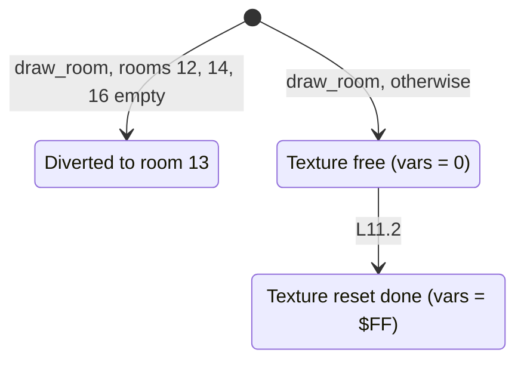

| State | Condition | Next state | Effect | Code |
|---|---|---|---|---|
| room entry | rooms 12, 14 and 16 empty | room 13 | [`respawn_in_room`](../../src/room_entry_traps.asm#L6) with X = 13 | [`draw_room_special`](../../src/room_draw.asm#L34) [`$09F6`](../reference/modules/room_draw.md#draw_room_special) |
| Free | L11.2 | Reset | [`scroll_direction`](../../src/constants.asm#L54) = 0, [`anim_speed_index`](../../src/variables.asm#L43) = 7 | [`room11_update`](../../src/room_update.asm#L894) [`$3CCA`](../../src/room_update.asm#L900) |

**Evidence.**
- **Observed:** the diversion, in two runs (above). In `room_events` the handler ran with no change, because the counter, not the record, was zeroed.
- **Code:** the texture reset ([`room11_update`](../../src/room_update.asm#L894) [`$3CCA-$3CD5`](../../src/room_update.asm#L900) never ran; in the collected entry of `room_events2` room 11 is never drawn).

**Links to other rooms.**
- The diversion depends on **rooms 12, 14 and 16 empty**. It is the only way into room 13.
- Exits: `$02` → room 10, `$03` → room 12, `$04` → room 14, `$05` → room 16. Room 10 exit `$03`, room 12 exit `$03`, room 14 exit `$03` and room 16 exit `$03` lead here (or to room 13).

## 5. Room 12: two passages, one tied to room 14

**Description.** Three floors with two diagonal climbing slopes, and a wall column at column 38 on the right (from the image). Three lanterns hang at column 36.

*Room 12: the wall column at the right edge hides both exits.*

**Data.**

| Table entry | Value | Meaning |
|---|---|---|
| [`room12_map`](../../src/room_maps.asm#L525) [`$7843`](../reference/modules/room_maps.md#room12_map) | 387 bytes, 440 cells | RLE map stream |
| [`room_char_colours+12`](../../src/room_colours.asm#L12) [`$47AC`](../reference/modules/room_colours.md#room_char_colours) | `$F9` | colour RAM fill: multicolour, colour 1 |
| [`room_lantern_counts+12`](../../src/room_tables.asm#L229) [`$4CDA`](../reference/modules/room_tables.md#room_lantern_counts) | 3 | lanterns at the start (list [`lantern_list_room12`](../../src/room_tables.asm#L343) [`$4E38`](../reference/modules/room_tables.md#lantern_list_room12)) |
| [`room_no_combat_flags+12`](../../src/room_tables.asm#L217) [`$4CAA`](../reference/modules/room_tables.md#room_no_combat_flags) | `$00` | enemies spawn |
| [`ninja_first_spawn_delay+12`](../../src/actor_room_tables.asm#L69) [`$1317`](../reference/modules/actor_room_tables.md#ninja_first_spawn_delay) / [`yamo_first_spawn_delay+12`](../../src/actor_room_tables.asm#L84) [`$1353`](../reference/modules/actor_room_tables.md#yamo_first_spawn_delay) | 4 / 32 | first spawn delay of the Ninja / the Yamo (passes) |
| [`room_spawn_x+12`](../../src/room_tables.asm#L156) [`$4BBA`](../reference/modules/room_tables.md#room_spawn_x) / [`room_spawn_y+12`](../../src/room_tables.asm#L161) [`$4BCE`](../reference/modules/room_tables.md#room_spawn_y) | 24 / 92 | Bruce's spawn point (x, y) |
| [`room_setup_handlers+24`](../../src/room_tables.asm#L401) [`$4EB4`](../reference/modules/room_tables.md#room_setup_handlers) | [`room12_init`](../../src/room_init.asm#L126) [`$34BD`](../reference/modules/room_init.md#room12_init) | init handler (RTS table: the entry holds the address - 1) |
| [`room_frame_handlers+24`](../../src/room_tables.asm#L411) [`$4EDC`](../reference/modules/room_tables.md#room_frame_handlers) | [`room12_update`](../../src/room_update.asm#L1094) [`$3E4C`](../reference/modules/room_update.md#room12_update) | frame handler (RTS table: the entry holds the address - 1) |
| charset | set 1 (`$D018` = `$3A`) | chosen by [`draw_room`](../../src/room_draw.asm#L6) from the room number |

| Exit tile | Entry | Destination room | Entry point (x, y) | Trigger cells in the map (map row, column) |
|---|---|---|---|---|
| `$02` | [`exit2_room+12`](../../src/room_tables.asm#L134) [`$4B6A`](../reference/modules/room_tables.md#exit2_room) | x = 0: as tile `$03`: room 11 | (52, 190) | none |
| `$03` | [`exit3_room+12`](../../src/room_tables.asm#L140) [`$4B7E`](../reference/modules/room_tables.md#exit3_room) | room 11 | (52, 190) | (6, 39) |
| `$04` | [`exit4_room+12`](../../src/room_tables.asm#L146) [`$4B92`](../reference/modules/room_tables.md#exit4_room) | room 14 | (16, 190) | (9, 39) |
| `$05` | [`exit5_room+12`](../../src/room_tables.asm#L151) [`$4BA6`](../reference/modules/room_tables.md#exit5_room) | x = 0: room 0 at x = 0 (tile `$05` has no fall-through) | (0, 0) | none |

| Lantern | Record | Text row | Column | Map tile | Collected tile |
|---|---|---|---|---|---|
| 0 | [`lantern_list_room12`](../../src/room_tables.asm#L343) [`$4E38`](../reference/modules/room_tables.md#lantern_list_room12) | 4 | 36 | `$13` | `$1E` |
| 1 | [`lantern_list_room12+$4`](../../src/room_tables.asm#L343) [`$4E3C`](../reference/modules/room_tables.md#lantern_list_room12) | 7 | 36 | `$13` | `$1E` |
| 2 | [`lantern_list_room12+$8`](../../src/room_tables.asm#L343) [`$4E40`](../reference/modules/room_tables.md#lantern_list_room12) | 10 | 36 | `$13` | `$1E` |

**Setup.** [`room12_init`](../../src/room_init.asm#L126) [`$34BD`](../reference/modules/room_init.md#room12_init): [`room_script_vars`](../../src/room_tables.asm#L390) = 1.

**Behaviour.** [`room12_update`](../../src/room_update.asm#L1094) [`$3E4C`](../reference/modules/room_update.md#room12_update) (**Code**):

| Variable | Meaning |
|---|---|
| [`room_script_vars`](../../src/room_tables.asm#L390) | flag of event A; preset 1, so A fires twice (1 → 0 → `$FF`) |
| [`room_script_vars+1`](../../src/room_tables.asm#L390) | flag of event B (0 → `$FF`) |

1. **Event A.** The flag ≥ 0 and lantern 2 is collected ([`lantern_list_room12+8`](../../src/room_tables.asm#L343) [`$4E40`](../reference/modules/room_tables.md#lantern_list_room12) = 0): decrement, then [`draw_column_63_64`](../../src/room_update.asm#L614) with A = `$0A`, Y = `$26`. Column 38, text rows 10-12 open, which uncovers the exit to room 14 at map row 9, column 39.
2. [`room12_check_upper_passage`](../../src/room_update.asm#L1103) [`$3E60`](../reference/modules/room_update.md#room12_check_upper_passage), **event B.** The flag ≥ 0, [`room_lanterns_left+12`](../../src/constants.asm#L29) = 0 **and** [`lantern_list_room14+8`](../../src/room_tables.asm#L350) [`$4E52`](../reference/modules/room_tables.md#lantern_list_room14) and [`lantern_list_room14+$C`](../../src/room_tables.asm#L350) [`$4E56`](../reference/modules/room_tables.md#lantern_list_room14) = 0. Those are **room 14's lanterns 2 and 3** at text row 10, columns 9 and 30. Then decrement, and [`draw_column_63_64`](../../src/room_update.asm#L614) with A = 7, Y = `$26`: column 38, text rows 7-9 open, which uncovers the exit to room 11 at map row 6, column 39.
3. [`room12_animate_traps`](../../src/room_update.asm#L1114) [`$3E79`](../reference/modules/room_update.md#room12_animate_traps): [`animate_floor_traps`](../../src/room_entry_traps.asm#L16).

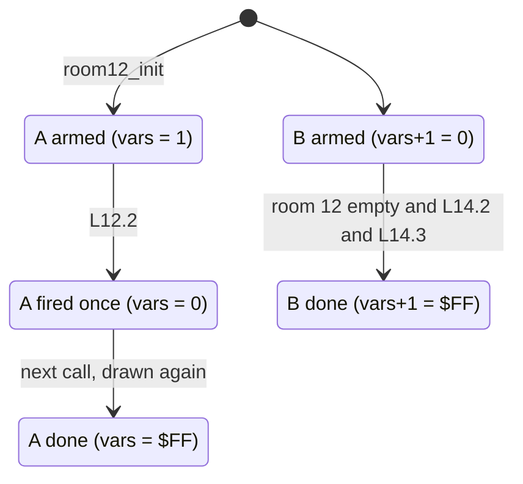

| State | Condition | Next state | Effect (text row, column) | Code |
|---|---|---|---|---|
| A armed / A fired once | L12.2 | A fired once / A done | sound `$8A`; message 99 at (10, 38), 99 at (11, 38), 100 at (12, 38) | [`room12_update`](../../src/room_update.asm#L1094) [`$3E4C`](../reference/modules/room_update.md#room12_update) |
| B armed | room 12 empty **and** L14.2 and L14.3 | B done | sound `$8A`; message 99 at (7, 38), 99 at (8, 38), 100 at (9, 38) | [`room12_check_upper_passage`](../../src/room_update.asm#L1103) [`$3E60`](../reference/modules/room_update.md#room12_check_upper_passage) |

**Evidence.**
- **Observed** (`room_events`): the handler ran, and a floor trap went off (screen rows 11-12, columns 14-20, `$0D`→`$7D`). The flags stayed `01 00`.
- **Observed** (`room_events2`, collected): both events. Column 38 changed to `$07`/`$87` at screen rows 13-16 (event B, text rows 7-8) and 19-22 (event A, text rows 10-11); [`room_script_vars`](../../src/room_tables.asm#L390) = `FF FF` at 400 frames, so event A went 1 → 0 → `$FF` (double firing).
- **Code:** each condition alone (the run zeroed all lanterns together).

**Links to other rooms.**
- Event B needs **lanterns 2 and 3 of room 14**.
- Room 12 is one of the three rooms that must be empty for the diversion to room 13.
- Exit `$03` leads to room 11, exit `$04` to room 14. Room 11 exit `$03` and room 14 exit `$04` lead here.

## 6. Room 13: the sliders

**Description.** Four long ledges in a zigzag, with a band of decorations at the top; the shortest map (from the image and [`room13_map`](../../src/room_maps.asm#L576)). Bruce arrives at the top right (152, 50) and must get down to the exit at the bottom right. Eight deadly sliders run along the ledges.

*Room 13 as the map draws it; the sliders are drawn by the frame handler.*

**Data.**

| Table entry | Value | Meaning |
|---|---|---|
| [`room13_map`](../../src/room_maps.asm#L576) [`$79C6`](../reference/modules/room_maps.md#room13_map) | 128 bytes, 442 cells | RLE map stream |
| [`room_char_colours+13`](../../src/room_colours.asm#L12) [`$47AD`](../reference/modules/room_colours.md#room_char_colours) | `$FA` | colour RAM fill: multicolour, colour 2 |
| [`room_lantern_counts+13`](../../src/room_tables.asm#L229) [`$4CDB`](../reference/modules/room_tables.md#room_lantern_counts) | 0 | lanterns at the start (list [`lantern_list_room13`](../../src/room_tables.asm#L348) [`$4E45`](../reference/modules/room_tables.md#lantern_list_room13)) |
| [`room_no_combat_flags+13`](../../src/room_tables.asm#L217) [`$4CAB`](../reference/modules/room_tables.md#room_no_combat_flags) | `$FF` | no enemies |
| [`ninja_first_spawn_delay+13`](../../src/actor_room_tables.asm#L69) [`$1318`](../reference/modules/actor_room_tables.md#ninja_first_spawn_delay) / [`yamo_first_spawn_delay+13`](../../src/actor_room_tables.asm#L84) [`$1354`](../reference/modules/actor_room_tables.md#yamo_first_spawn_delay) | 18 / 192 | first spawn delay of the Ninja / the Yamo (passes) |
| [`room_spawn_x+13`](../../src/room_tables.asm#L156) [`$4BBB`](../reference/modules/room_tables.md#room_spawn_x) / [`room_spawn_y+13`](../../src/room_tables.asm#L161) [`$4BCF`](../reference/modules/room_tables.md#room_spawn_y) | 152 / 50 | Bruce's spawn point (x, y) |
| [`room_setup_handlers+26`](../../src/room_tables.asm#L401) [`$4EB6`](../reference/modules/room_tables.md#room_setup_handlers) | [`room13_init`](../../src/room_init.asm#L131) [`$34C3`](../reference/modules/room_init.md#room13_init) | init handler (RTS table: the entry holds the address - 1) |
| [`room_frame_handlers+26`](../../src/room_tables.asm#L411) [`$4EDE`](../reference/modules/room_tables.md#room_frame_handlers) | [`room13_update`](../../src/room_update.asm#L1117) [`$3E7C`](../reference/modules/room_update.md#room13_update) | frame handler (RTS table: the entry holds the address - 1) |
| charset | set 1 (`$D018` = `$3A`) | chosen by [`draw_room`](../../src/room_draw.asm#L6) from the room number |

| Exit tile | Entry | Destination room | Entry point (x, y) | Trigger cells in the map (map row, column) |
|---|---|---|---|---|
| `$02` | [`exit2_room+13`](../../src/room_tables.asm#L134) [`$4B6B`](../reference/modules/room_tables.md#exit2_room) | room 15 | (16, 195) | (9, 39) |
| `$03` | [`exit3_room+13`](../../src/room_tables.asm#L140) [`$4B7F`](../reference/modules/room_tables.md#exit3_room) | x = 0: as tile `$05`: room 0 at x = 0 | (0, 0) | none |
| `$04` | [`exit4_room+13`](../../src/room_tables.asm#L146) [`$4B93`](../reference/modules/room_tables.md#exit4_room) | x = 0: as tile `$05`: room 0 at x = 0 | (0, 0) | none |
| `$05` | [`exit5_room+13`](../../src/room_tables.asm#L151) [`$4BA7`](../reference/modules/room_tables.md#exit5_room) | x = 0: room 0 at x = 0 (tile `$05` has no fall-through) | (0, 0) | none |

One dummy record at [`lantern_list_room13`](../../src/room_tables.asm#L348) [`$4E45`](../reference/modules/room_tables.md#lantern_list_room13) (state 1, column 0, text row 0); the count is 0.

Other properties (**Code**):
- **No lanterns:** **Conclusion:** the dummy record lies in the status line, where no lantern char is, so it can never be collected.
- **No enemies.** The handler also writes [`SPENA`](../../src/constants.asm#L160) = [`SPENA`](../../src/constants.asm#L160) AND 3 on each pass, so only Bruce's sprites 0 and 1 are shown.
- **Cell coordinates:** [`actor_char_coords`](../../src/actor_movement.asm#L6) [`$1C39`](../reference/modules/actor_movement.md#actor_char_coords) adds 4 to the y of each actor in room 13 before it computes the cell row.

**Setup.** [`room13_init`](../../src/room_init.asm#L131) [`$34C3`](../reference/modules/room_init.md#room13_init) fills the slider table: ten slots of six arrays, [`sliders_dir`](../../src/constants.asm#L129) [`$010F`](../reference/variables.md#sliders_dir), [`sliders_col`](../../src/constants.asm#L130) [`$0119`](../reference/variables.md#sliders_col), [`sliders_row`](../../src/constants.asm#L131) [`$0123`](../reference/variables.md#sliders_row), [`sliders_prev_col`](../../src/constants.asm#L132) [`$012D`](../reference/variables.md#sliders_prev_col), [`sliders_min_col`](../../src/constants.asm#L133) [`$0137`](../reference/variables.md#sliders_min_col) and [`sliders_max_col`](../../src/constants.asm#L134) [`$0141`](../reference/variables.md#sliders_max_col) (**Code**):
- **Direction:** slots 0-4 get [`sliders_dir`](../../src/constants.asm#L129) = 2 (bit 7 clear: move left), slots 5-9 get `$82` (bit 7 set: move right).
- **Off:** slots 3 and 9 are then set to 0. [`animate_room_objects`](../../src/room_state.asm#L29) [`$104B`](../reference/modules/room_state.md#animate_room_objects) walks only the slots 8..0.
- **Row and column:** the start column is copied to [`sliders_prev_col`](../../src/constants.asm#L132). The values depend on whether [`game_cycle`](../../src/constants.asm#L30) [`$40`](../reference/variables.md#game_cycle) is 0.

| Slot | Text row (map row) | Direction | Start column (cycle 0 / ≥ 1) | Min column (cycle 0 / ≥ 1) | Max column (cycle 0 / ≥ 1) |
|---|---|---|---|---|---|
| 5 | 5 (3) | right | 6 | 6 | 34 / 38 |
| 6 | 5 (3) | right | 22 | 6 | 34 / 38 |
| 0 | 7 (5) | left | 33 | 20 / 18 | 33 |
| 7 | 7 (5) | right | 6 / 2 | 6 / 2 | 20 / 18 |
| 1 | 10 (8) | left | 19 / 21 | 6 | 19 / 21 |
| 8 | 10 (8) | right | 20 / 22 | 20 / 22 | 34 / 38 |
| 2 | 12 (10) | left | 2 | 2 | 33 / 37 |
| 4 | 12 (10) | left | 22 | 2 | 33 / 37 |

[`animate_room_objects`](../../src/room_state.asm#L29) moves each active slot by one column and wraps it between its limits; text rows 5 and 10 use [`draw_sliding_tile_alt`](../../src/room_tiles.asm#L17) (deadly `$66` with the `$67` trail), text rows 7 and 12 use [`draw_sliding_tile`](../../src/room_tiles.asm#L6) (deadly `$64` with the `$65` trail). Each move plays sound `$89` ([rooms_00_09.md](rooms_00_09.md), the cycling objects). `$66` is deadly from room 10 on, so here (**Code**).

**Behaviour.** [`room13_update`](../../src/room_update.asm#L1117) [`$3E7C`](../reference/modules/room_update.md#room13_update) (**Code**):

| Variable | Meaning |
|---|---|
| [`room13_floor_bonus_flags`](../../src/constants.asm#L135) [`$014B`](../reference/variables.md#room13_floor_bonus_flags) | 4 bytes per player at `$014B` + 4 × [`current_player`](../../src/constants.asm#L10); bytes 0-2 are used, one per floor band; 1 = the bonus is still due. Set to 1 by [`init_game_vars`](../../src/game_vars.asm#L6) [`$0F72`](../reference/modules/game_vars.md#init_game_vars) (all 8 bytes) and by the room 19 restart (the 4 bytes of the current player). |
| [`frame_parity`](../../src/constants.asm#L66) [`$7B`](../reference/variables.md#frame_parity) | toggled by [`main_loop`](../../src/main_loop.asm#L6) on each pass; the sliders move when it is 0 |

1. **Floor bonus.** If Bruce's [`actor_y`](../../src/constants.asm#L86) [`$A1`](../reference/variables.md#actor_y) ≥ `$64`, the band is 0 when y < `$8A`, 1 ([`room13_check_band1`](../../src/room_update.asm#L1132) [`$3E96`](../reference/modules/room_update.md#room13_check_band1)) when y < `$B6`, and 2 ([`room13_check_band2`](../../src/room_update.asm#L1140) [`$3EA6`](../reference/modules/room_update.md#room13_check_band2)) otherwise. If the flag of that band is not 0, the handler decrements it, and [`room13_award_500`](../../src/room_update.asm#L1145) [`$3EAF`](../reference/modules/room_update.md#room13_award_500) adds `$01` × 256 + `$F4` = **500 points** (two [`add_score`](../../src/score.asm#L47) [`$3175`](../reference/modules/score.md#add_score) calls).
2. [`room13_update_objects`](../../src/room_update.asm#L1152) [`$3EBC`](../reference/modules/room_update.md#room13_update_objects): when [`frame_parity`](../../src/constants.asm#L66) = 0, [`animate_room_objects`](../../src/room_state.asm#L29). So each slider moves one column every 2 passes (6 frames).
3. [`room13_keep_bruce_sprites`](../../src/room_update.asm#L1156) [`$3EC3`](../reference/modules/room_update.md#room13_keep_bruce_sprites): [`SPENA`](../../src/constants.asm#L160) AND 3.

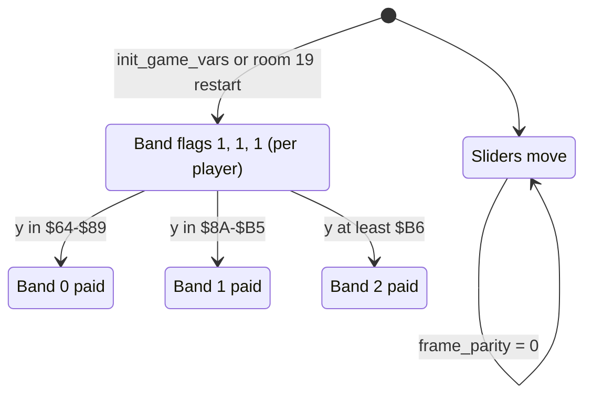

Each band pays once per player and game cycle, in any order.

| State | Condition | Next state | Effect | Code |
|---|---|---|---|---|
| band k due | Bruce's y in band k and [`room13_floor_bonus_flags`](../../src/constants.asm#L135) + 4p + k ≠ 0 | band k paid | the flag = 0; +500 points | [`room13_award_500`](../../src/room_update.asm#L1145) [`$3EAF`](../reference/modules/room_update.md#room13_award_500) |
| sliders | [`frame_parity`](../../src/constants.asm#L66) = 0 | sliders | each active slider steps one column; sound `$89` per slider | [`room13_update_objects`](../../src/room_update.asm#L1152) [`$3EBC`](../reference/modules/room_update.md#room13_update_objects) |
| Bruce alive | Bruce touches `$64`/`$66` with contact bit 1 | dying | [`touch_deadly_char`](../../src/background_touch.asm#L316) [`$304B`](../reference/modules/background_touch.md#touch_deadly_char) → state `$19` → [`lose_fall`](../../src/game_over.asm#L6) [`$1818`](../reference/modules/game_over.md#lose_fall) | [`handle_touched_char`](../../src/background_touch.asm#L53) [`$2E89`](../reference/modules/background_touch.md#handle_touched_char) |

**Evidence.**
- **Observed** (`room_events`): the sliders. 32 cells changed at 100 and at 400 frames: 8 sliders × (old column, new column) × 2 char rows, on screen rows 9/10 (text row 5, `$66`/`$67`), 13/14 (text row 7, `$64`/`$65`), 19/20 (text row 10, `$66`/`$67`) and 23/24 (text row 12, `$64`/`$65`). The positions fit the cycle 0 ranges. The room 11 diversion also ran this handler.
- **Code:** the floor bonus ([`room13_update`](../../src/room_update.asm#L1117) [`$3E87-$3EBB`](../../src/room_update.asm#L1126) never ran, in no run), the layout for cycle ≥ 1, and the deaths on a slider.

**Links to other rooms.**
- Room 13 is reached only through the room 11 diversion (**rooms 12, 14 and 16 empty**).
- Exit `$02` leads to room 15. Room 15 exit `$02` leads back here.

## 7. Room 14: the passage to room 11

**Description.** Two floors, two slopes, and a wall column at column 38 (from the image). Four lanterns; lanterns 2 and 3 also open room 12's event B.

*Room 14: the wall column at the right edge hides the exit to room 11.*

**Data.**

| Table entry | Value | Meaning |
|---|---|---|
| [`room14_map`](../../src/room_maps.asm#L594) [`$7A46`](../reference/modules/room_maps.md#room14_map) | 366 bytes, 440 cells | RLE map stream |
| [`room_char_colours+14`](../../src/room_colours.asm#L12) [`$47AE`](../reference/modules/room_colours.md#room_char_colours) | `$F9` | colour RAM fill: multicolour, colour 1 |
| [`room_lantern_counts+14`](../../src/room_tables.asm#L229) [`$4CDC`](../reference/modules/room_tables.md#room_lantern_counts) | 4 | lanterns at the start (list [`lantern_list_room14`](../../src/room_tables.asm#L350) [`$4E4A`](../reference/modules/room_tables.md#lantern_list_room14)) |
| [`room_no_combat_flags+14`](../../src/room_tables.asm#L217) [`$4CAC`](../reference/modules/room_tables.md#room_no_combat_flags) | `$00` | enemies spawn |
| [`ninja_first_spawn_delay+14`](../../src/actor_room_tables.asm#L69) [`$1319`](../reference/modules/actor_room_tables.md#ninja_first_spawn_delay) / [`yamo_first_spawn_delay+14`](../../src/actor_room_tables.asm#L84) [`$1355`](../reference/modules/actor_room_tables.md#yamo_first_spawn_delay) | 8 / 32 | first spawn delay of the Ninja / the Yamo (passes) |
| [`room_spawn_x+14`](../../src/room_tables.asm#L156) [`$4BBC`](../reference/modules/room_tables.md#room_spawn_x) / [`room_spawn_y+14`](../../src/room_tables.asm#L161) [`$4BD0`](../reference/modules/room_tables.md#room_spawn_y) | 24 / 92 | Bruce's spawn point (x, y) |
| [`room_setup_handlers+28`](../../src/room_tables.asm#L401) [`$4EB8`](../reference/modules/room_tables.md#room_setup_handlers) | [`room14_init`](../../src/room_init.asm#L221) [`$358D`](../reference/modules/room_init.md#room14_init) | init handler (RTS table: the entry holds the address - 1) |
| [`room_frame_handlers+28`](../../src/room_tables.asm#L411) [`$4EE0`](../reference/modules/room_tables.md#room_frame_handlers) | [`room14_update`](../../src/room_update.asm#L1162) [`$3ECC`](../reference/modules/room_update.md#room14_update) | frame handler (RTS table: the entry holds the address - 1) |
| charset | set 1 (`$D018` = `$3A`) | chosen by [`draw_room`](../../src/room_draw.asm#L6) from the room number |

| Exit tile | Entry | Destination room | Entry point (x, y) | Trigger cells in the map (map row, column) |
|---|---|---|---|---|
| `$02` | [`exit2_room+14`](../../src/room_tables.asm#L134) [`$4B6C`](../reference/modules/room_tables.md#exit2_room) | x = 0: as tile `$03`: room 11 | (80, 190) | none |
| `$03` | [`exit3_room+14`](../../src/room_tables.asm#L140) [`$4B80`](../reference/modules/room_tables.md#exit3_room) | room 11 | (80, 190) | (3, 39) |
| `$04` | [`exit4_room+14`](../../src/room_tables.asm#L146) [`$4B94`](../reference/modules/room_tables.md#exit4_room) | room 12 | (160, 190) | (9, 0) |
| `$05` | [`exit5_room+14`](../../src/room_tables.asm#L151) [`$4BA8`](../reference/modules/room_tables.md#exit5_room) | room 16 | (16, 190) | (9, 39) |

| Lantern | Record | Text row | Column | Map tile | Collected tile |
|---|---|---|---|---|---|
| 0 | [`lantern_list_room14`](../../src/room_tables.asm#L350) [`$4E4A`](../reference/modules/room_tables.md#lantern_list_room14) | 7 | 9 | `$14` | `$1F` |
| 1 | [`lantern_list_room14+$4`](../../src/room_tables.asm#L350) [`$4E4E`](../reference/modules/room_tables.md#lantern_list_room14) | 7 | 30 | `$13` | `$1E` |
| 2 | [`lantern_list_room14+$8`](../../src/room_tables.asm#L350) [`$4E52`](../reference/modules/room_tables.md#lantern_list_room14) | 10 | 9 | `$14` | `$1F` |
| 3 | [`lantern_list_room14+$C`](../../src/room_tables.asm#L350) [`$4E56`](../reference/modules/room_tables.md#lantern_list_room14) | 10 | 30 | `$13` | `$1E` |

**Setup.** [`room14_init`](../../src/room_init.asm#L221) [`$358D`](../reference/modules/room_init.md#room14_init): [`room_script_vars`](../../src/room_tables.asm#L390) = 1.

**Behaviour.** [`room14_update`](../../src/room_update.asm#L1162) [`$3ECC`](../reference/modules/room_update.md#room14_update) (**Code**):
1. **Event A** (fires twice, the flag 1 → 0 → `$FF`). Lanterns 0 and 1 collected ([`lantern_list_room14`](../../src/room_tables.asm#L350) and [`lantern_list_room14+4`](../../src/room_tables.asm#L350) = 0): decrement, then [`draw_column_63_64`](../../src/room_update.asm#L614) with A = 4, Y = `$26`. Column 38, text rows 4-6 open, which uncovers the exit to room 11 at map row 3, column 39.
2. [`room14_animate_traps`](../../src/room_update.asm#L1172) [`$3EE3`](../reference/modules/room_update.md#room14_animate_traps): [`animate_floor_traps`](../../src/room_entry_traps.asm#L16).

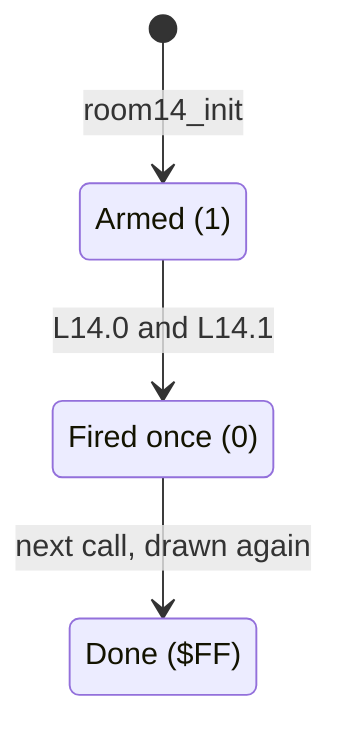

| State | Condition | Next state | Effect | Code |
|---|---|---|---|---|
| Armed / Fired once | L14.0 and L14.1 | Fired once / Done | sound `$8A`; message 99 at (4, 38), 99 at (5, 38), 100 at (6, 38) | [`room14_update`](../../src/room_update.asm#L1162) [`$3ECC`](../reference/modules/room_update.md#room14_update) |

**Evidence.**
- **Observed** (`room_events`): the handler ran with no change; the flag stayed 1.
- **Observed** (`room_events2`, collected): column 38, screen rows 7-10 → `$07`/`$87`, and [`room_script_vars`](../../src/room_tables.asm#L390) = `FF` at 400 frames (double firing).
- **Code:** the condition alone.

**Links to other rooms.**
- Lanterns 2 and 3 of this room take part in **room 12's event B**. Room 14 is one of the three rooms that must be empty for the diversion to room 13.
- Exit `$03` leads to room 11, `$04` to room 12, `$05` to room 16. Room 11 exit `$04`, room 12 exit `$04` and room 16 exit `$04` lead here.

## 8. Room 15: the tower and the exit to room 17

**Description.** A pagoda tower in the middle with ledges on both sides, and a fence and floor at the bottom (from the image). Six lanterns hang on the tower ledges.

*Room 15: the tower walls at columns 17 and 23 and the closed right edge.*

**Data.**

| Table entry | Value | Meaning |
|---|---|---|
| [`room15_map`](../../src/room_maps.asm#L644) [`$7BB4`](../reference/modules/room_maps.md#room15_map) | 168 bytes, 440 cells | RLE map stream |
| [`room_char_colours+15`](../../src/room_colours.asm#L12) [`$47AF`](../reference/modules/room_colours.md#room_char_colours) | `$FC` | colour RAM fill: multicolour, colour 4 |
| [`room_lantern_counts+15`](../../src/room_tables.asm#L229) [`$4CDD`](../reference/modules/room_tables.md#room_lantern_counts) | 6 | lanterns at the start (list [`lantern_list_room15`](../../src/room_tables.asm#L360) [`$4E5B`](../reference/modules/room_tables.md#lantern_list_room15)) |
| [`room_no_combat_flags+15`](../../src/room_tables.asm#L217) [`$4CAD`](../reference/modules/room_tables.md#room_no_combat_flags) | `$00` | enemies spawn |
| [`ninja_first_spawn_delay+15`](../../src/actor_room_tables.asm#L69) [`$131A`](../reference/modules/actor_room_tables.md#ninja_first_spawn_delay) / [`yamo_first_spawn_delay+15`](../../src/actor_room_tables.asm#L84) [`$1356`](../reference/modules/actor_room_tables.md#yamo_first_spawn_delay) | 8 / 48 | first spawn delay of the Ninja / the Yamo (passes) |
| [`room_spawn_x+15`](../../src/room_tables.asm#L156) [`$4BBD`](../reference/modules/room_tables.md#room_spawn_x) / [`room_spawn_y+15`](../../src/room_tables.asm#L161) [`$4BD1`](../reference/modules/room_tables.md#room_spawn_y) | 28 / 195 | Bruce's spawn point (x, y) |
| [`room_setup_handlers+30`](../../src/room_tables.asm#L401) [`$4EBA`](../reference/modules/room_tables.md#room_setup_handlers) | [`room15_init`](../../src/room_init.asm#L226) [`$3593`](../reference/modules/room_init.md#room15_init) | init handler (RTS table: the entry holds the address - 1) |
| [`room_frame_handlers+30`](../../src/room_tables.asm#L411) [`$4EE2`](../reference/modules/room_tables.md#room_frame_handlers) | [`room15_update`](../../src/room_update.asm#L1175) [`$3EE6`](../reference/modules/room_update.md#room15_update) | frame handler (RTS table: the entry holds the address - 1) |
| charset | set 1 (`$D018` = `$3A`) | chosen by [`draw_room`](../../src/room_draw.asm#L6) from the room number |

| Exit tile | Entry | Destination room | Entry point (x, y) | Trigger cells in the map (map row, column) |
|---|---|---|---|---|
| `$02` | [`exit2_room+15`](../../src/room_tables.asm#L134) [`$4B6D`](../reference/modules/room_tables.md#exit2_room) | room 13 | (160, 196) | (9, 0) |
| `$03` | [`exit3_room+15`](../../src/room_tables.asm#L140) [`$4B81`](../reference/modules/room_tables.md#exit3_room) | room 17 | (16, 179) | none |
| `$04` | [`exit4_room+15`](../../src/room_tables.asm#L146) [`$4B95`](../reference/modules/room_tables.md#exit4_room) | x = 0: as tile `$05`: room 0 at x = 0 | (0, 0) | none |
| `$05` | [`exit5_room+15`](../../src/room_tables.asm#L151) [`$4BA9`](../reference/modules/room_tables.md#exit5_room) | x = 0: room 0 at x = 0 (tile `$05` has no fall-through) | (0, 0) | none |

| Lantern | Record | Text row | Column | Map tile | Collected tile |
|---|---|---|---|---|---|
| 0 | [`lantern_list_room15`](../../src/room_tables.asm#L360) [`$4E5B`](../reference/modules/room_tables.md#lantern_list_room15) | 3 | 19 | `$13` | `$1F` |
| 1 | [`lantern_list_room15+$4`](../../src/room_tables.asm#L360) [`$4E5F`](../reference/modules/room_tables.md#lantern_list_room15) | 3 | 21 | `$14` | `$1E` |
| 2 | [`lantern_list_room15+$8`](../../src/room_tables.asm#L360) [`$4E63`](../reference/modules/room_tables.md#lantern_list_room15) | 4 | 14 | `$13` | `$1E` |
| 3 | [`lantern_list_room15+$C`](../../src/room_tables.asm#L360) [`$4E67`](../reference/modules/room_tables.md#lantern_list_room15) | 4 | 26 | `$14` | `$1F` |
| 4 | [`lantern_list_room15+$10`](../../src/room_tables.asm#L360) [`$4E6B`](../reference/modules/room_tables.md#lantern_list_room15) | 6 | 13 | `$13` | `$1E` |
| 5 | [`lantern_list_room15+$14`](../../src/room_tables.asm#L360) [`$4E6F`](../reference/modules/room_tables.md#lantern_list_room15) | 6 | 27 | `$14` | `$1F` |

Exit `$03` (to room 17) has no trigger cell in the map; event C draws it.

**Setup.** [`room15_init`](../../src/room_init.asm#L226) [`$3593`](../reference/modules/room_init.md#room15_init): [`room_script_vars`](../../src/room_tables.asm#L390), `+1` and `+2` = 1. So all three events fire twice.

**Behaviour.** [`room15_update`](../../src/room_update.asm#L1175) [`$3EE6`](../reference/modules/room_update.md#room15_update) (no floor traps) (**Code**):

| Event | Flag | Condition | Effect | Code |
|---|---|---|---|---|
| A (× 2) | [`room_script_vars`](../../src/room_tables.asm#L390) | L15.0 ([`lantern_list_room15`](../../src/room_tables.asm#L360) [`$4E5B`](../reference/modules/room_tables.md#lantern_list_room15)) | message 87 (`$57`, tile `$00`) at text row 3, column 17; message 88 (`$58`, tile `$2F`) at (4, 17); sound `$8A`. This replaces the `$45` wall cells at map rows 1-2, column 17 (the left wall of the tower). | [`room15_update`](../../src/room_update.asm#L1175) [`$3EE6`](../reference/modules/room_update.md#room15_update) |
| B (× 2) | [`room_script_vars+1`](../../src/room_tables.asm#L390) | L15.1, L15.2 and L15.4 (`$4E5F`, `$4E63`, `$4E6B`) | the same messages at column 23 (the right wall, `$43` cells); sound `$8A` | [`room15_check_right_wall`](../../src/room_update.asm#L1190) [`$3F08`](../reference/modules/room_update.md#room15_check_right_wall) |
| C (× 2) | [`room_script_vars+2`](../../src/room_tables.asm#L390) | [`room_lanterns_left+15`](../../src/constants.asm#L29) [`$39`](../reference/variables.md#room_lanterns_left) = 0 (all six) | message 89 (`$59`: `$2F $2F $2F`) at (9, 37); message 90 (`$5A`: `$00 $00 $03`) at (8, 37); message 91 (`$5B`: `$00 $00 $03`) at (7, 37); sound `$8A`. **This draws the exit tile `$03` at map rows 5-6, column 39** (to room 17) and a floor of `$2F` at map row 7, columns 37-39. | [`room15_check_exit`](../../src/room_update.asm#L1207) [`$3F30`](../reference/modules/room_update.md#room15_check_exit) |

The handler ends at [`room15_update_done`](../../src/room_update.asm#L1226) [`$3F5A`](../reference/modules/room_update.md#room15_update_done).

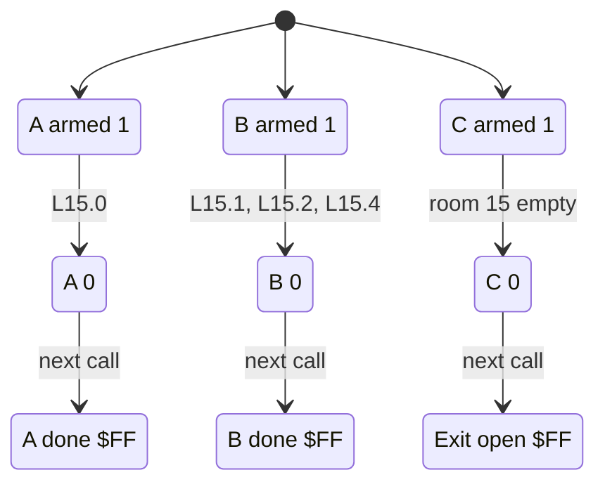

| State | Condition | Next state | Code |
|---|---|---|---|
| A armed / A 0 | L15.0 | A 0 / A done | [`room15_update`](../../src/room_update.asm#L1175) [`$3EE6`](../reference/modules/room_update.md#room15_update) |
| B armed / B 0 | L15.1, L15.2 and L15.4 | B 0 / B done | [`room15_check_right_wall`](../../src/room_update.asm#L1190) [`$3F08`](../reference/modules/room_update.md#room15_check_right_wall) |
| C armed / C 0 | room 15 empty | C 0 / exit open | [`room15_check_exit`](../../src/room_update.asm#L1207) [`$3F30`](../reference/modules/room_update.md#room15_check_exit) |

**Evidence.**
- **Observed** (`room_events`): event C. [`room_script_vars`](../../src/room_tables.asm#L390) went `01 01 01` → `01 01 FF`, which also shows the double firing. 18 cells changed at screen rows 13-18, columns 37-39, exactly as messages 91, 90 and 89 draw them: rows 13/14 `46 07 45` → `00 00 03`, rows 15/16 the same, rows 17/18 `42 42 45` → `2F 2F 2F`. The coverage shows [`room15_check_exit`](../../src/room_update.asm#L1207) [`$3F39`](../../src/room_update.asm#L1212).
- **Observed** (`room_events2`, collected): all three events. Screen rows 5/6, columns 17 and 23 → `$00`/`$80`; rows 7/8, the same columns → `$2F`/`$AF`; the event C cells as above; [`room_script_vars`](../../src/room_tables.asm#L390) = `FF FF FF` at 400 frames.
- **Code:** each condition alone.

**Links to other rooms.**
- All three events depend only on room 15's own lanterns.
- Exit `$02` leads to room 13; the created exit `$03` leads to room 17. Room 13 exit `$02` and room 17 exit `$02` lead here.

## 9. Room 16: the bonus-fall object

**Description.** Three floors, with a wall column at column 1 on the left (from the image). The **bonus-fall object** sits at the bottom right: chars `$2D`/`$2E` at map rows 8-9, columns 36-37. The same chars also stand at map row 1, columns 14-15 and 23-24 (**Code**, from the map).

*Room 16: the bonus-fall object at the bottom right, in the colour that [`room16_init`](../../src/room_init.asm#L233) sets.*

**Data.**

| Table entry | Value | Meaning |
|---|---|---|
| [`room16_map`](../../src/room_maps.asm#L667) [`$7C5C`](../reference/modules/room_maps.md#room16_map) | 305 bytes, 440 cells | RLE map stream |
| [`room_char_colours+16`](../../src/room_colours.asm#L12) [`$47B0`](../reference/modules/room_colours.md#room_char_colours) | `$F9` | colour RAM fill: multicolour, colour 1 |
| [`room_lantern_counts+16`](../../src/room_tables.asm#L229) [`$4CDE`](../reference/modules/room_tables.md#room_lantern_counts) | 2 | lanterns at the start (list [`lantern_list_room16`](../../src/room_tables.asm#L369) [`$4E74`](../reference/modules/room_tables.md#lantern_list_room16)) |
| [`room_no_combat_flags+16`](../../src/room_tables.asm#L217) [`$4CAE`](../reference/modules/room_tables.md#room_no_combat_flags) | `$00` | enemies spawn |
| [`ninja_first_spawn_delay+16`](../../src/actor_room_tables.asm#L69) [`$131B`](../reference/modules/actor_room_tables.md#ninja_first_spawn_delay) / [`yamo_first_spawn_delay+16`](../../src/actor_room_tables.asm#L84) [`$1357`](../reference/modules/actor_room_tables.md#yamo_first_spawn_delay) | 8 / 32 | first spawn delay of the Ninja / the Yamo (passes) |
| [`room_spawn_x+16`](../../src/room_tables.asm#L156) [`$4BBE`](../reference/modules/room_tables.md#room_spawn_x) / [`room_spawn_y+16`](../../src/room_tables.asm#L161) [`$4BD2`](../reference/modules/room_tables.md#room_spawn_y) | 24 / 92 | Bruce's spawn point (x, y) |
| [`room_setup_handlers+32`](../../src/room_tables.asm#L401) [`$4EBC`](../reference/modules/room_tables.md#room_setup_handlers) | [`room16_init`](../../src/room_init.asm#L233) [`$359F`](../reference/modules/room_init.md#room16_init) | init handler (RTS table: the entry holds the address - 1) |
| [`room_frame_handlers+32`](../../src/room_tables.asm#L411) [`$4EE4`](../reference/modules/room_tables.md#room_frame_handlers) | [`room16_update`](../../src/room_update.asm#L1229) [`$3F5B`](../reference/modules/room_update.md#room16_update) | frame handler (RTS table: the entry holds the address - 1) |
| charset | set 1 (`$D018` = `$3A`) | chosen by [`draw_room`](../../src/room_draw.asm#L6) from the room number |

| Exit tile | Entry | Destination room | Entry point (x, y) | Trigger cells in the map (map row, column) |
|---|---|---|---|---|
| `$02` | [`exit2_room+16`](../../src/room_tables.asm#L134) [`$4B6E`](../reference/modules/room_tables.md#exit2_room) | x = 0: as tile `$03`: room 11 | (128, 190) | none |
| `$03` | [`exit3_room+16`](../../src/room_tables.asm#L140) [`$4B82`](../reference/modules/room_tables.md#exit3_room) | room 11 | (128, 190) | (6, 0) |
| `$04` | [`exit4_room+16`](../../src/room_tables.asm#L146) [`$4B96`](../reference/modules/room_tables.md#exit4_room) | room 14 | (160, 190) | (9, 0) |
| `$05` | [`exit5_room+16`](../../src/room_tables.asm#L151) [`$4BAA`](../reference/modules/room_tables.md#exit5_room) | x = 0: room 0 at x = 0 (tile `$05` has no fall-through) | (0, 0) | none |

| Lantern | Record | Text row | Column | Map tile | Collected tile |
|---|---|---|---|---|---|
| 0 | [`lantern_list_room16`](../../src/room_tables.asm#L369) [`$4E74`](../reference/modules/room_tables.md#lantern_list_room16) | 4 | 32 | `$13` | `$1E` |
| 1 | [`lantern_list_room16+$4`](../../src/room_tables.asm#L369) [`$4E78`](../reference/modules/room_tables.md#lantern_list_room16) | 7 | 5 | `$14` | `$1F` |

**Setup.** [`room16_init`](../../src/room_init.asm#L233) [`$359F`](../reference/modules/room_init.md#room16_init) (**Code**):
- Colour RAM `$DB1C/$DB1D`, `$DB44/$DB45`, `$DB6C/$DB6D` and `$DB94/$DB95` = `$FF`: screen rows 19-22, columns 36-37, so the object is drawn in colour 7.
- If `bonus_falls_left+current_player` ([`bonus_falls_left`](../../src/room_tables.asm#L385) [`$4E95`](../reference/modules/room_tables.md#bonus_falls_left)) = 0, it calls [`erase_bonus_fall_object`](../../src/background_touch.asm#L270) [`$2FEF`](../reference/modules/background_touch.md#erase_bonus_fall_object), which draws message 86 (`$56`: `$00 $00`) at text rows 10 and 11, column 36. The object is then gone.
- [`init_game_vars`](../../src/game_vars.asm#L6) sets both [`bonus_falls_left`](../../src/room_tables.asm#L385) bytes to 5. Nothing else resets them; the room 19 restart does not.

**Picking up the object** ([`room16_bonus_fall`](../../src/background_touch.asm#L253) [`$2FD6`](../reference/modules/background_touch.md#room16_bonus_fall), from [`handle_touched_char`](../../src/background_touch.asm#L53) through [`touch_bonus_fall_chars`](../../src/background_touch.asm#L110) [`$2EEA`](../reference/modules/background_touch.md#touch_bonus_fall_chars)) (**Code**):
- `$2D`/`$2E` are tested **before** the contact bit, so any overlap of the 3 × 2 cells that the actor tests counts.
- It works only in room 16 ([`current_room`](../../src/constants.asm#L28) = `$10`), only for Bruce (X = 0), and only when [`actor_y`](../../src/constants.asm#L86) ≥ `$A0`.
- Effect: `bonus_falls_left+current_player` - 1; [`falls_left`](../../src/constants.asm#L27) [`$28`](../reference/variables.md#falls_left) + 1; [`print_falls_count`](../../src/status.asm#L200) [`$1AED`](../reference/modules/status.md#print_falls_count); sound `$8E`; [`erase_bonus_fall_object`](../../src/background_touch.asm#L270).
- **Conclusion:** the object gives one extra fall per visit, at most five per player and game. The y test keeps the `$2D`/`$2E` chars at map row 1 from paying the bonus.

**Behaviour.** [`room16_update`](../../src/room_update.asm#L1229) [`$3F5B`](../reference/modules/room_update.md#room16_update) (**Code**):
1. **Event A** (the flag [`room_script_vars`](../../src/room_tables.asm#L390) = 0, fires once). [`room_lanterns_left+16`](../../src/constants.asm#L29) [`$3A`](../reference/variables.md#room_lanterns_left) = 0: decrement, then [`draw_column_63_64`](../../src/room_update.asm#L614) with A = 7, Y = 1. Column 1, text rows 7-9 open, which uncovers the exit to room 11 at map row 6, column 0.
2. [`room16_animate_traps`](../../src/room_update.asm#L1238) [`$3F6E`](../reference/modules/room_update.md#room16_animate_traps): [`animate_floor_traps`](../../src/room_entry_traps.asm#L16).

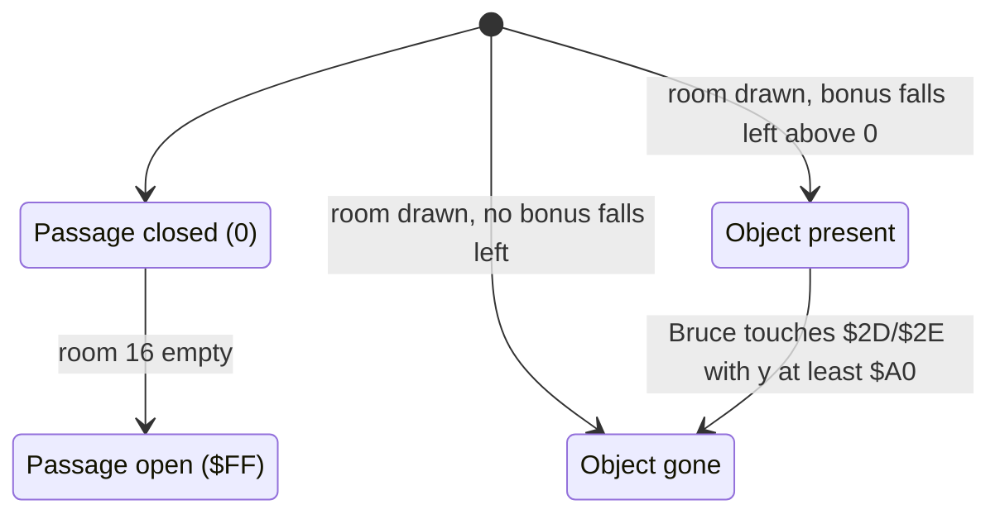

| State | Condition | Next state | Effect | Code |
|---|---|---|---|---|
| Passage closed | room 16 empty | Passage open | sound `$8A`; message 99, 99, 100 at column 1, text rows 7-9 | [`room16_update`](../../src/room_update.asm#L1229) [`$3F5B`](../reference/modules/room_update.md#room16_update) |
| Object present | Bruce touches `$2D`/`$2E`, [`actor_y`](../../src/constants.asm#L86) ≥ `$A0` | Object gone | [`falls_left`](../../src/constants.asm#L27) + 1, [`bonus_falls_left`](../../src/room_tables.asm#L385) - 1, sound `$8E`, the object erased | [`room16_bonus_fall`](../../src/background_touch.asm#L253) [`$2FD6`](../reference/modules/background_touch.md#room16_bonus_fall) |
| (room drawn) | `bonus_falls_left+current_player` = 0 | Object gone | [`erase_bonus_fall_object`](../../src/background_touch.asm#L270) | [`room16_init`](../../src/room_init.asm#L233) [`$35C0`](../../src/room_init.asm#L247) |

**Evidence.**
- **Observed** (`room_events`): event A: the flag went 0 → `$FF`, and screen rows 13-16, column 1 changed `$45`/`$C5` → `$07`/`$87` (message 100 at text row 9 matched the cell already there). A floor trap went off (rows 11-12, columns 9/11 at 100 frames). Bruce died in the run: [`touch_deadly_char`](../../src/background_touch.asm#L316) [`$304B`](../reference/modules/background_touch.md#touch_deadly_char), [`set_character_hit_state`](../../src/room_tiles.asm#L32) [`$407D`](../reference/modules/room_tiles.md#set_character_hit_state), [`lose_fall`](../../src/game_over.asm#L6), [`respawn_in_room`](../../src/room_entry_traps.asm#L6) and [`draw_room`](../../src/room_draw.asm#L6) ran, and [`falls_left`](../../src/constants.asm#L27) went 4 → 3. The room was drawn again and the passage was drawn again (still `$07` at 400 frames). This shows that the events are applied again on each entry.
- **Conclusion:** the death came from the floor-trap spikes, since [`trigger_floor_trap`](../../src/background_touch.asm#L341) and timer 8 of the trap ran in the same run.
- **Observed** (`room_events2`, collected, 60 frames): event A at column 1 as above; both lanterns drawn as collected (`$1E`, `$1F`). The object stayed ([`bonus_falls_left`](../../src/room_tables.asm#L385) was 5). Bruce lost a fall in that run too; the 400-frame screen is the player-turn screen.
- **Code:** the pickup ([`room16_bonus_fall`](../../src/background_touch.asm#L253) [`$2FD6-$3000`](../reference/modules/background_touch.md#room16_bonus_fall) never ran) and the erase in [`room16_init`](../../src/room_init.asm#L233) ([`room16_init`](../../src/room_init.asm#L233) [`$35C0`](../../src/room_init.asm#L247) never ran).

**Links to other rooms.**
- Room 16 is one of the three rooms that must be empty for the diversion to room 13.
- Exit `$03` leads to room 11, `$04` to room 14. Room 11 exit `$05` and room 14 exit `$05` lead here.

## 10. Room 17: the corridors before the wizard

**Description.** Corridors at map rows 1, 5 and 7; a strip of `$64` tiles at map row 3, columns 11-27; and yellow mesh pieces (tiles `$44`/`$49`) at the left and the right (from the image and the map). No enemies come here, though the spawn tables hold delays.

*Room 17: the deadly strip in the middle corridor and the mesh pieces at the sides.*

**Data.**

| Table entry | Value | Meaning |
|---|---|---|
| [`room17_map`](../../src/room_maps.asm#L708) [`$7D8D`](../reference/modules/room_maps.md#room17_map) | 259 bytes, 442 cells | RLE map stream |
| [`room_char_colours+17`](../../src/room_colours.asm#L12) [`$47B1`](../reference/modules/room_colours.md#room_char_colours) | `$FF` | colour RAM fill: multicolour, colour 7 |
| [`room_lantern_counts+17`](../../src/room_tables.asm#L229) [`$4CDF`](../reference/modules/room_tables.md#room_lantern_counts) | 2 | lanterns at the start (list [`lantern_list_room17`](../../src/room_tables.asm#L372) [`$4E7D`](../reference/modules/room_tables.md#lantern_list_room17)) |
| [`room_no_combat_flags+17`](../../src/room_tables.asm#L217) [`$4CAF`](../reference/modules/room_tables.md#room_no_combat_flags) | `$FF` | no enemies |
| [`ninja_first_spawn_delay+17`](../../src/actor_room_tables.asm#L69) [`$131C`](../reference/modules/actor_room_tables.md#ninja_first_spawn_delay) / [`yamo_first_spawn_delay+17`](../../src/actor_room_tables.asm#L84) [`$1358`](../reference/modules/actor_room_tables.md#yamo_first_spawn_delay) | 18 / 192 | first spawn delay of the Ninja / the Yamo (passes) |
| [`room_spawn_x+17`](../../src/room_tables.asm#L156) [`$4BBF`](../reference/modules/room_tables.md#room_spawn_x) / [`room_spawn_y+17`](../../src/room_tables.asm#L161) [`$4BD3`](../reference/modules/room_tables.md#room_spawn_y) | 24 / 180 | Bruce's spawn point (x, y) |
| [`room_setup_handlers+34`](../../src/room_tables.asm#L401) [`$4EBE`](../reference/modules/room_tables.md#room_setup_handlers) | [`room17_init`](../../src/room_init.asm#L251) [`$35C4`](../reference/modules/room_init.md#room17_init) | init handler (RTS table: the entry holds the address - 1) |
| [`room_frame_handlers+34`](../../src/room_tables.asm#L411) [`$4EE6`](../reference/modules/room_tables.md#room_frame_handlers) | [`room17_update`](../../src/room_update.asm#L1241) [`$3F71`](../reference/modules/room_update.md#room17_update) | frame handler (RTS table: the entry holds the address - 1) |
| charset | set 1 (`$D018` = `$3A`) | chosen by [`draw_room`](../../src/room_draw.asm#L6) from the room number |

| Exit tile | Entry | Destination room | Entry point (x, y) | Trigger cells in the map (map row, column) |
|---|---|---|---|---|
| `$02` | [`exit2_room+17`](../../src/room_tables.asm#L134) [`$4B6F`](../reference/modules/room_tables.md#exit2_room) | room 15 | (160, 147) | (8, 0) |
| `$03` | [`exit3_room+17`](../../src/room_tables.asm#L140) [`$4B83`](../reference/modules/room_tables.md#exit3_room) | room 18 | (16, 198) | (1, 39) |
| `$04` | [`exit4_room+17`](../../src/room_tables.asm#L146) [`$4B97`](../reference/modules/room_tables.md#exit4_room) | x = 0: as tile `$05`: room 0 at x = 0 | (0, 0) | none |
| `$05` | [`exit5_room+17`](../../src/room_tables.asm#L151) [`$4BAB`](../reference/modules/room_tables.md#exit5_room) | x = 0: room 0 at x = 0 (tile `$05` has no fall-through) | (0, 0) | none |

| Lantern | Record | Text row | Column | Map tile | Collected tile |
|---|---|---|---|---|---|
| 0 | [`lantern_list_room17`](../../src/room_tables.asm#L372) [`$4E7D`](../reference/modules/room_tables.md#lantern_list_room17) | 10 | 38 | `$13` | `$1E` |
| 1 | [`lantern_list_room17+$4`](../../src/room_tables.asm#L372) [`$4E81`](../reference/modules/room_tables.md#lantern_list_room17) | 11 | 31 | `$13` | `$1E` |

**Setup.** [`room17_init`](../../src/room_init.asm#L251) [`$35C4`](../reference/modules/room_init.md#room17_init) (**Code**):
- colour RAM `$DB1E` = `$FF` (screen row 19, column 38: lantern 0 in colour 7);
- [`room_script_vars`](../../src/room_tables.asm#L390) = [`room_script_vars+1`](../../src/room_tables.asm#L390) = 1;
- [`slider_row`](../../src/constants.asm#L60) = 5, [`slider_col`](../../src/constants.asm#L59) = `$0B`;
- the three travelling hazards all at column 8, on text rows 3, 7 and 9 (map rows 1, 5 and 7), with [`hazard_timer`](../../src/constants.asm#L64) = `$F8`, `$F1` and `$EA` (they wait 8, 15 and 22 passes).

**Behaviour.** [`room17_update`](../../src/room_update.asm#L1241) [`$3F71`](../reference/modules/room_update.md#room17_update) (**Code**):

| Variable | Meaning |
|---|---|
| [`room_script_vars`](../../src/room_tables.asm#L390) / `+1` | one-shot flags of events A and B (1 armed, 0 done, `BEQ` test) |
| [`room_script_vars+2`](../../src/room_tables.asm#L390) | ceiling blink counter, reloaded with 10 |
| [`room_script_vars+3`](../../src/room_tables.asm#L390) | slider half-rate toggle |
| [`slider_col`](../../src/constants.asm#L59) [`$6E`](../reference/variables.md#slider_col), [`slider_row`](../../src/constants.asm#L60) [`$6F`](../reference/variables.md#slider_row), [`slider_prev_col`](../../src/constants.asm#L61) [`$70`](../reference/variables.md#slider_prev_col) | the slider |
| [`hazard_col`](../../src/constants.asm#L62) [`$71`](../reference/variables.md#hazard_col), [`hazard_row`](../../src/constants.asm#L63) [`$74`](../reference/variables.md#hazard_row), [`hazard_timer`](../../src/constants.asm#L64) [`$77`](../reference/variables.md#hazard_timer) (3 bytes each) | the travelling hazards |

1. **Ceiling blink.** Decrement [`room_script_vars+2`](../../src/room_tables.asm#L390). When it goes negative: reload 10, then [`room17_colour_flip_loop`](../../src/room_update.asm#L1251) [`$3F86`](../reference/modules/room_update.md#room17_colour_flip_loop) writes ((colour RAM `$D880` AND 7) XOR 2) OR `$F8` into `$D880-$D89B`: screen row 3, columns 8-35, the top chars of map row 0. With the room colour `$FF` this blinks yellow (7) and green (5) every 11 passes.
2. **Slider** ([`room17_slider_tick`](../../src/room_update.asm#L1256) [`$3F8C`](../reference/modules/room_update.md#room17_slider_tick)). [`room_script_vars+3`](../../src/room_tables.asm#L390) counts down from 0: below 0 it is set to 1 and the slider moves; at 0 the slider waits. So the slider moves every second pass. [`room17_move_slider`](../../src/room_update.asm#L1262) [`$3F98`](../reference/modules/room_update.md#room17_move_slider) copies the column to [`slider_prev_col`](../../src/constants.asm#L61) and adds 1; when the old column was ≥ `$1B`, the column restarts at `$0B`. The slider runs over columns 11-27 of text row 5 (map row 3), drawn by [`room17_draw_slider`](../../src/room_update.asm#L1271) [`$3FA6`](../reference/modules/room_update.md#room17_draw_slider) with [`draw_sliding_tile`](../../src/room_tiles.asm#L6): the deadly `$64` at the new column, `$65` at the old one, sound `$89`. The map fills that strip with `$64` (cells `$E4`), so until the slider has passed, the whole strip is deadly.
3. **Event A** ([`room17_check_lantern_a`](../../src/room_update.asm#L1273) [`$3FA9`](../reference/modules/room_update.md#room17_check_lantern_a)): [`room_script_vars`](../../src/room_tables.asm#L390) ≠ 0 and L17.0 ([`lantern_list_room17`](../../src/room_tables.asm#L372) [`$4E7D`](../reference/modules/room_tables.md#lantern_list_room17)). Decrement, then message 93 (`$5D`: tiles `$44 $44`) at text row 10, column 37: map row 8, columns 37-38. No sound.
4. **Event B** ([`room17_check_lantern_b`](../../src/room_update.asm#L1283) [`$3FBF`](../reference/modules/room_update.md#room17_check_lantern_b)): [`room_script_vars+1`](../../src/room_tables.asm#L390) ≠ 0 and L17.1 ([`lantern_list_room17+4`](../../src/room_tables.asm#L372) [`$4E81`](../reference/modules/room_tables.md#lantern_list_room17)). Decrement, then message 92 (`$5C`: `$49 $49 $49`) at text row 10, column 24: map row 8, columns 24-26. No sound.
5. [`room17_traps_and_hazards`](../../src/room_update.asm#L1293) [`$3FD5`](../reference/modules/room_update.md#room17_traps_and_hazards): [`animate_floor_traps`](../../src/room_entry_traps.asm#L16) (the map has no trap), then [`step_travelling_hazards`](../../src/room_update.asm#L1298) [`$3FDC`](../reference/modules/room_update.md#step_travelling_hazards) for the hazards 2..0.

**The travelling hazards** ([`step_travelling_hazards`](../../src/room_update.asm#L1298); frame k = message 31 + k, the normal set; the full phase table is in [rooms_00_09.md](rooms_00_09.md)):

| [`hazard_timer`](../../src/constants.asm#L64) after the increment | Action |
|---|---|
| negative | wait |
| 0, 1, 2 | draw frame k: 31 `$56`, 32 `$55`, 33 `$55 $56` |
| 3, column below the limit (`$23` for hazard 0, `$25` for hazards 1 and 2) | [`hazard_move_column`](../../src/room_update.asm#L1332) [`$4016`](../reference/modules/room_update.md#hazard_move_column): frame 6 (message 37, blank) at the old column, column + 1, timer = 2, frame 2 at the new column. The hazard moves one column per pass. |
| 3 at the limit, then 4, 5, 6 | frames 34 `$54 $55`, 35 `$00 $55`, 36 `$00 $54`, 37 blank: the hazard fades out |
| 7 | [`hazard_restart_wait`](../../src/room_update.asm#L1352) [`$4039`](../reference/modules/room_update.md#hazard_restart_wait): column = 8, timer = `$CA` (hazard 0: `$C8`), so it waits 54 or 56 passes |

Each hazard crosses its corridor from column 8 to 35 or 37 in about 27-29 passes (1.6-1.8 s); the cycle is 90 passes for each hazard (**Code**).

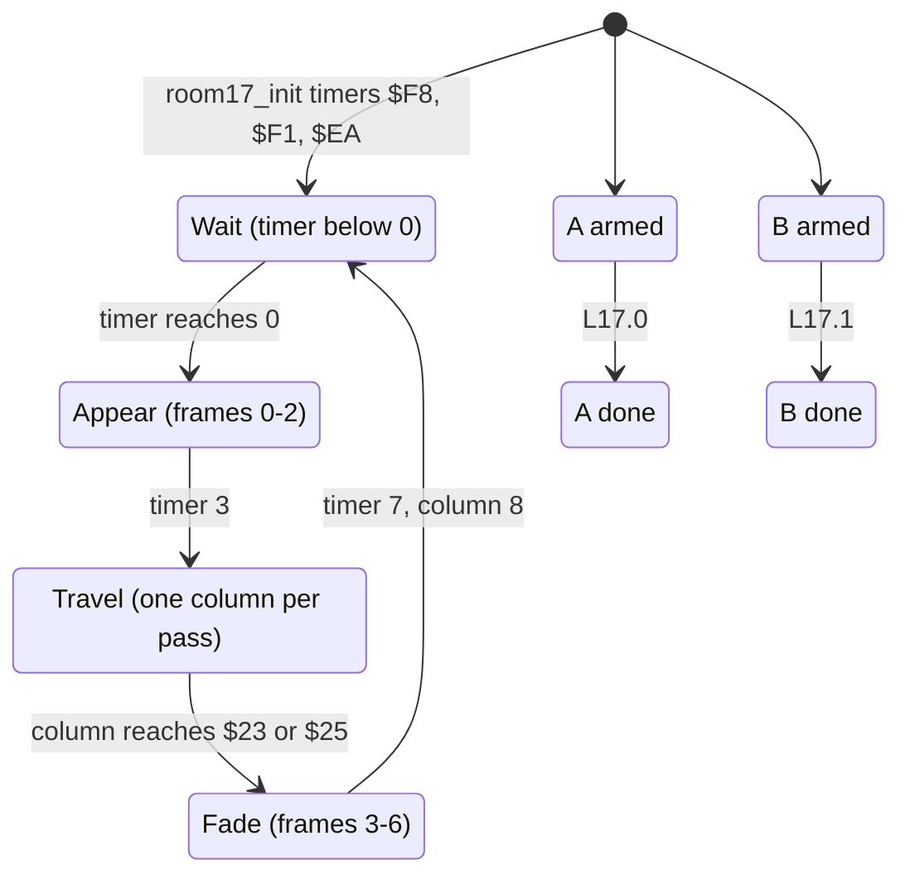

| State | Condition | Next state | Effect | Code |
|---|---|---|---|---|
| ceiling | [`room_script_vars+2`](../../src/room_tables.asm#L390) < 0 | ceiling | colour XOR 2 at `$D880-$D89B`, every 11 passes | [`room17_update`](../../src/room_update.asm#L1241) [`$3F71`](../reference/modules/room_update.md#room17_update) |
| slider | [`room_script_vars+3`](../../src/room_tables.asm#L390) below 0 after the decrement | slider | one column right, wraps after 27 → 11; sound `$89`; every 2 passes | [`room17_slider_tick`](../../src/room_update.asm#L1256) [`$3F8C`](../reference/modules/room_update.md#room17_slider_tick) |
| A armed | L17.0 | A done | tiles `$44 $44` at map row 8, columns 37-38 | [`room17_check_lantern_a`](../../src/room_update.asm#L1273) [`$3FA9`](../reference/modules/room_update.md#room17_check_lantern_a) |
| B armed | L17.1 | B done | tiles `$49 $49 $49` at map row 8, columns 24-26 | [`room17_check_lantern_b`](../../src/room_update.asm#L1283) [`$3FBF`](../reference/modules/room_update.md#room17_check_lantern_b) |
| hazard Wait / Appear / Travel / Fade | the timer, as in the table above | as in the table above | frames 31-37 | [`step_travelling_hazards`](../../src/room_update.asm#L1298) [`$3FDC`](../reference/modules/room_update.md#step_travelling_hazards) |

The map uses `$44` and `$49` for the yellow mesh pieces at map rows 2-6. **Conclusion:** the events add mesh pieces next to where the lanterns were. What the mesh does for the movement was not checked.

**Evidence.**
- **Observed** (`room_events2`, collected, 60 frames): events A and B. Screen rows 19/20, columns 24-26 → `$49`/`$C9`, and columns 37-38 → `$44`/`$C4` (the lantern cell at column 38 is overwritten). Lantern 1 is drawn as collected (`$1E`) at screen row 21, column 31. [`room_script_vars`](../../src/room_tables.asm#L390) = `00 00 09` at 400 frames: both flags went 1 → 0 (one firing each), and the ceiling counter was running. The coverage shows [`room17_update`](../../src/room_update.asm#L1241), the slider, events A and B, and [`hazard_move_column`](../../src/room_update.asm#L1332) [`$4016`](../reference/modules/room_update.md#hazard_move_column).
- **Observed: room 17 freezes.** In each room 17 capture the game stops. In `room_events` only [`main_loop_wait`](../../src/main_loop.asm#L59) [`$1C32`](../reference/modules/main_loop.md#main_loop_wait) executed. In `room_events2` no cell changed between 60 and 400 frames, and the first frame of hazard 1 ([`room17_update`](../../src/room_update.asm#L1241) [`$3FF6`](../../src/room_update.asm#L1314), 15 passes after the entry) never ran. The room 17 snapshot has PC = `$1C34`, the I flag clear, [`frame_countdown`](../../src/constants.asm#L34) [`$48`](../reference/variables.md#frame_countdown) = 3 and [`irq_chain_vector`](../../src/init.asm#L15) [`$0408`](../reference/modules/init.md#irq_chain_vector) = `$491E` ([`irq_playfield_top`](../../src/raster_irq_game.asm#L54) [`$491E`](../reference/modules/raster_irq_game.md#irq_playfield_top), waiting for raster line `$40`). So the main loop waits for a raster IRQ that never comes. The screen keeps the status charset `$32` that [`irq_frame_top`](../../src/raster_irq_game.asm#L6) [`$48C1`](../reference/modules/raster_irq_game.md#irq_frame_top) set.
- **Observed** (`r17_freeze`): the cause. [`draw_room`](../../src/room_draw.asm#L6) reads `$D011` and writes it back ([`draw_room`](../../src/room_draw.asm#L6) [`$09BC`](../reference/modules/room_draw.md#draw_room) and `$0B33`). When the read happens on raster lines 256-311, bit 7 (raster bit 8) is set, so the store sets bit 8 of the raster compare. The pending IRQ line `$40` becomes `$140` (320), which a PAL frame never reaches. In the capture, the read gave `$9B` on line 279 and the closing write ran on line 287, so the bit stayed set. **Conclusion:** this is a timing bug of the original game on PAL, not something of room 17; room 17's draw just ended in that window in these captures. [../rooms.md](../rooms.md) has the bug in its findings.
- **Code:** the ceiling blink, the slider wrap ([`room17_move_slider`](../../src/room_update.asm#L1262) [`$3FA2-$3FA5`](../../src/room_update.asm#L1269) never ran), hazards 1 and 2 ([`room17_update`](../../src/room_update.asm#L1241) [`$3FF6-$4005`](../../src/room_update.asm#L1314)), and the fade and restart ([`hazard_restart_wait`](../../src/room_update.asm#L1352) [`$4039-$4048`](../reference/modules/room_update.md#hazard_restart_wait)).

**Links to other rooms.**
- Room 17 is reached from room 15 after room 15 is empty.
- Exit `$02` leads to room 15, exit `$03` to room 18. Room 15's created exit and room 18 exit `$02` lead here.

## 11. Room 18: the wizard

**Description.** The wizard's face fills the top centre, above a long floor on columns (from the image). Bruce enters at the bottom left (16, 198 from room 17; spawn point 24, 198). The single "lantern" is at text row 11, column 37, the bottom right; its map cell is the lantern char `$13`. Room 18 uses charset 2 (`$B000`, `$D018` = `$3C`).

*Room 18: the wizard's face at the top, the lantern at the bottom right.*

**Data.**

| Table entry | Value | Meaning |
|---|---|---|
| [`room18_map`](../../src/room_maps.asm#L743) [`$7E90`](../reference/modules/room_maps.md#room18_map) | 336 bytes, 442 cells | RLE map stream |
| [`room_char_colours+18`](../../src/room_colours.asm#L12) [`$47B2`](../reference/modules/room_colours.md#room_char_colours) | `$FE` | colour RAM fill: multicolour, colour 6 |
| [`room_lantern_counts+18`](../../src/room_tables.asm#L229) [`$4CE0`](../reference/modules/room_tables.md#room_lantern_counts) | 1 | lanterns at the start (list [`lantern_list_room18`](../../src/room_tables.asm#L377) [`$4E86`](../reference/modules/room_tables.md#lantern_list_room18)) |
| [`room_no_combat_flags+18`](../../src/room_tables.asm#L217) [`$4CB0`](../reference/modules/room_tables.md#room_no_combat_flags) | `$FF` | no enemies |
| [`ninja_first_spawn_delay+18`](../../src/actor_room_tables.asm#L69) [`$131D`](../reference/modules/actor_room_tables.md#ninja_first_spawn_delay) / [`yamo_first_spawn_delay+18`](../../src/actor_room_tables.asm#L84) [`$1359`](../reference/modules/actor_room_tables.md#yamo_first_spawn_delay) | 0 / 0 | first spawn delay of the Ninja / the Yamo (passes) |
| [`room_spawn_x+18`](../../src/room_tables.asm#L156) [`$4BC0`](../reference/modules/room_tables.md#room_spawn_x) / [`room_spawn_y+18`](../../src/room_tables.asm#L161) [`$4BD4`](../reference/modules/room_tables.md#room_spawn_y) | 24 / 198 | Bruce's spawn point (x, y) |
| [`room_setup_handlers+36`](../../src/room_tables.asm#L401) [`$4EC0`](../reference/modules/room_tables.md#room_setup_handlers) | [`room18_init`](../../src/room_init.asm#L279) [`$35FA`](../reference/modules/room_init.md#room18_init) | init handler (RTS table: the entry holds the address - 1) |
| [`room_frame_handlers+36`](../../src/room_tables.asm#L411) [`$4EE8`](../reference/modules/room_tables.md#room_frame_handlers) | [`room18_wizard_update`](../../src/room_update.asm#L909) [`$3CDC`](../reference/modules/room_update.md#room18_wizard_update) | frame handler (RTS table: the entry holds the address - 1) |
| charset | set 2 (`$D018` = `$3C`) | chosen by [`draw_room`](../../src/room_draw.asm#L6) from the room number |

| Exit tile | Entry | Destination room | Entry point (x, y) | Trigger cells in the map (map row, column) |
|---|---|---|---|---|
| `$02` | [`exit2_room+18`](../../src/room_tables.asm#L134) [`$4B70`](../reference/modules/room_tables.md#exit2_room) | room 17 | (160, 68) | (9, 0) |
| `$03` | [`exit3_room+18`](../../src/room_tables.asm#L140) [`$4B84`](../reference/modules/room_tables.md#exit3_room) | room 19 | (16, 150) | none |
| `$04` | [`exit4_room+18`](../../src/room_tables.asm#L146) [`$4B98`](../reference/modules/room_tables.md#exit4_room) | x = 0: as tile `$05`: room 0 at x = 0 | (0, 0) | (0, 13), (6, 7), (6, 13), (6, 26), (6, 32), (7, 7), (7, 13), (7, 26), (7, 32) |
| `$05` | [`exit5_room+18`](../../src/room_tables.asm#L151) [`$4BAC`](../reference/modules/room_tables.md#exit5_room) | x = 0: room 0 at x = 0 (tile `$05` has no fall-through) | (0, 0) | (0, 4), (0, 8), (0, 12), (0, 30), (0, 34), (0, 38) |

| Lantern | Record | Text row | Column | Map tile | Collected tile |
|---|---|---|---|---|---|
| 0 | [`lantern_list_room18`](../../src/room_tables.asm#L377) [`$4E86`](../reference/modules/room_tables.md#lantern_list_room18) | 11 | 37 | `$13` | `$1E` |

**The wizard's life is the state byte of this lantern record** (**Code**). Bruce defeats the wizard by touching its cell, like any lantern ([`pick_up_lantern`](../../src/background_touch.asm#L131) [`$2F04`](../reference/modules/background_touch.md#pick_up_lantern)): Bruce only, contact bit 1; +125 points and sound `$8E`; the collected tile `$1E` is drawn in the cell; [`room_lanterns_left+18`](../../src/constants.asm#L29) is decremented.

Charset 2 also uses the chars `$04` and `$05` in map row 0 and map rows 6-7 (the wizard and the columns). For those codes the exit entries have x = 0, so they lead to room 0 at x = 0 if [`check_exit_direction`](../../src/background_touch.asm#L392) allows it (**Code**; Still open).

[`touch_deadly_char`](../../src/background_touch.asm#L316) [`$304B`](../reference/modules/background_touch.md#touch_deadly_char) returns at once in room 18 ([`current_room`](../../src/constants.asm#L28) = `$12`): no char is deadly there, and the only danger is the fireballs. There are no enemies, so [`main_loop`](../../src/main_loop.asm#L6) skips [`check_sprite_collisions`](../../src/combat_hits.asm#L6), and the handler tests the sprite collisions itself (**Code**).

### 11.1 Setup [`room18_init`](../../src/room_init.asm#L279) [`$35FA`](../reference/modules/room_init.md#room18_init)

(**Code**)
- Fills colour RAM `$D878-$DBFF` with `$FE` (colour 6, multicolour), in four loops of 256 bytes from `$D878`, `$D900`, `$DA00` and `$DB00`.
- Clears [`sprite_blocks+$1C0`](../../src/vic_bank2.asm#L6) [`$8340`](../reference/modules/vic_bank2.md#sprite_blocks) to `$83BF` (the fireball shapes); [`YXPAND`](../../src/constants.asm#L162) = 0 and [`XXPAND`](../../src/constants.asm#L168) = `$FF`.
- [`room_script_vars`](../../src/room_tables.asm#L390) = 1 (the wizard is alive) and [`room_script_vars+1`](../../src/room_tables.asm#L390) = 1 (the face timer: the face is drawn on the first call).
- [`fireball_active`](../../src/variables.asm#L52) [`$432E`](../reference/modules/variables.md#fireball_active) and [`fireball_active+1`](../../src/variables.asm#L52) = 0; [`fireball_launch_delay`](../../src/variables.asm#L56) [`$4330`](../reference/modules/variables.md#fireball_launch_delay) = 0 and [`fireball_launch_delay+1`](../../src/variables.asm#L56) [`$4331`](../reference/modules/variables.md#fireball_launch_delay) = `$10` (fireball 1 starts 16 passes later).
- [`room18_unused_init_bytes`](../../src/variables.asm#L69) [`$4336`](../reference/modules/variables.md#room18_unused_init_bytes) = 6, 7. Nothing reads them.

### 11.2 Variables

| Variable | Meaning |
|---|---|
| [`room_script_vars`](../../src/room_tables.asm#L390) | 1 = the wizard is alive, 0 = defeated (the effect or the exit phase) |
| [`room_script_vars+1`](../../src/room_tables.asm#L390) | alive: the face timer (8 passes); defeated: the effect countdown from `$50` (80 passes) |
| [`room_script_vars+2`](../../src/room_tables.asm#L390) | the face zone 0-2 |
| [`room_script_vars+3`](../../src/room_tables.asm#L390) | alive: the face frame toggle (1 → message set + 6, 0 → set + 0); in the effect: the body-tile toggle |
| [`lantern_list_room18`](../../src/room_tables.asm#L377) [`$4E86`](../reference/modules/room_tables.md#lantern_list_room18) | the wizard's state: ≠ 0 alive |
| [`fireball_active`](../../src/variables.asm#L52) [`$432E`](../reference/modules/variables.md#fireball_active), [`fireball_launch_delay`](../../src/variables.asm#L56) [`$4330`](../reference/modules/variables.md#fireball_launch_delay), [`fireball_x`](../../src/variables.asm#L60) [`$4332`](../reference/modules/variables.md#fireball_x), [`fireball_y`](../../src/variables.asm#L64) [`$4334`](../reference/modules/variables.md#fireball_y) | 2 bytes each, one per fireball |

### 11.3 The wizard alive ([`room18_wizard_alive`](../../src/room_update.asm#L939) [`$3D1D`](../reference/modules/room_update.md#room18_wizard_alive))

(**Code**)
1. **Fireballs** ([`update_fireballs`](../../src/fireballs.asm#L6) [`$4133`](../reference/modules/fireballs.md#update_fireballs)). Fireball 0 is sprite 6 (pointer `$0D`, block `$8340`) and fireball 1 is sprite 7 (pointer `$0E`, block `$8380`).
   - **Shape:** on each pass, rows 0, 3, 6 and 9 of both shapes get random bytes AND [`fireball_shape_masks`](../../src/variables.asm#L45) [`$4322`](../reference/modules/variables.md#fireball_shape_masks) (`$18 $3C $3C $18`). **Conclusion:** a flickering ball.
   - **Launch:** an inactive fireball counts its delay down. At 0, [`launch_fireball0`](../../src/fireballs.asm#L124) [`$4201`](../reference/modules/fireballs.md#launch_fireball0) / [`launch_fireball1`](../../src/fireballs.asm#L138) [`$4220`](../reference/modules/fireballs.md#launch_fireball1) puts it at x = `$50` / `$5E`, y = `$37` (sprite y = y + `$1D`), enables its sprite and plays sound `$86` ([`play_sound_86`](../../src/actor_checks.asm#L148) [`$2E29`](../reference/modules/actor_checks.md#play_sound_86)).
   - **Fall:** y + 5 per pass. At y ≥ `$E0` the fireball becomes inactive with a delay of 2.
   - **Steering:** x moves toward Bruce's [`actor_x`](../../src/constants.asm#L85) [`$9E`](../reference/variables.md#actor_x), by up to 3 steps per pass while y < `$A8` and up to 2 steps below that.
   - **VIC:** the position goes to [`SP6X`](../../src/constants.asm#L155)/[`SP6Y`](../../src/constants.asm#L156) (x × 2, with the MSB in [`MSIGX`](../../src/constants.asm#L157) [`$D010`](../reference/variables.md#MSIGX)); the colour is a random byte OR `$F0` in [`SP6COL`](../../src/constants.asm#L179) [`$D02D`](../reference/variables.md#SP6COL).
2. **Hit test.** The handler reads [`SPSPCL`](../../src/constants.asm#L169) [`$D01E`](../reference/variables.md#SPSPCL). If a bit of the sprites 0/1 (Bruce: [`actor_body_sprite`](../../src/sprite_render.asm#L299) = 0, [`actor_overlay_sprite`](../../src/sprite_render.asm#L306) = 1) **and** a bit of the sprites 6/7 are set, and Bruce's [`actor_state`](../../src/constants.asm#L95) is not `$19`, then [`set_character_hit_state`](../../src/room_tiles.asm#L32) [`$407D`](../reference/modules/room_tiles.md#set_character_hit_state) (X = 0): state `$19` (dying), timer `$10`. When the timer runs out, [`action_dying`](../../src/object_actions.asm#L190) [`$216B`](../reference/modules/object_actions.md#action_dying) calls [`lose_fall`](../../src/game_over.asm#L6).
3. **Face** ([`room18_face_timer`](../../src/room_update.asm#L954) [`$3D38`](../reference/modules/room_update.md#room18_face_timer)). Decrement [`room_script_vars+1`](../../src/room_tables.asm#L390). At 0: reload 8, then choose the zone from [`actor_x`](../../src/constants.asm#L85) against [`room18_zone_x_limits`](../../src/room_tables.asm#L71) [`$4A89`](../reference/modules/room_tables.md#room18_zone_x_limits) (`$00 $3A $76`): zone 2 if x ≥ `$76`, zone 1 if x ≥ `$3A`, zone 0 otherwise. [`room18_draw_face`](../../src/room_update.asm#L967) [`$3D4E`](../reference/modules/room_update.md#room18_draw_face) then:
   - stores the zone in [`room_script_vars+2`](../../src/room_tables.asm#L390);
   - draws message 56 + zone (`$38`) at text row 2, column 16 (8 tiles, screen rows 3-4);
   - toggles [`room_script_vars+3`](../../src/room_tables.asm#L390): from 0 it is set to 1 and the messages 65 + zone and 68 + zone are drawn (set + 6); else it is set to 0 and the messages 59 + zone and 62 + zone are drawn ([`room18_face_frame_set0`](../../src/room_update.asm#L983) [`$3D73`](../reference/modules/room_update.md#room18_face_frame_set0));
   - draws those two messages at text rows 3 and 4, column 18 ([`draw_wizard_face_row3`](../../src/room_update.asm#L992) [`$3D81`](../reference/modules/room_update.md#draw_wizard_face_row3), [`draw_wizard_face_row4`](../../src/room_update.asm#L1000) [`$3D8E`](../reference/modules/room_update.md#draw_wizard_face_row4)).

   So the face is drawn again every 8 passes (24 frames). **Conclusion:** the zone follows Bruce's x, so the eyes follow him, and the lower face changes between two frames.

### 11.4 The defeat and the effect

**Trigger** [`room18_wizard_just_defeated`](../../src/room_update.asm#L917) [`$3CE9`](../reference/modules/room_update.md#room18_wizard_just_defeated): [`room_script_vars`](../../src/room_tables.asm#L390) ≠ 0 and [`lantern_list_room18`](../../src/room_tables.asm#L377) = 0 (**Code**):
- [`room_script_vars`](../../src/room_tables.asm#L390) = 0;
- [`clear_fireball_shapes`](../../src/fireballs.asm#L152) [`$423F`](../reference/modules/fireballs.md#clear_fireball_shapes); [`SPENA`](../../src/constants.asm#L160) AND `$1F` (sprites 5-7 off);
- **message 97** (`$61`, tile `$06`) at text row 11, column 0. This replaces the exit tile `$02` at map row 9, column 0, so **the way back to room 17 closes**;
- **+3000 points** (`$0BB8`: `$B8` to score byte 2, then `$0B` to byte 1, two [`add_score`](../../src/score.asm#L47) calls);
- [`room_script_vars+3`](../../src/room_tables.asm#L390) = 0, [`room_script_vars+1`](../../src/room_tables.asm#L390) = `$50`;
- jump to [`room18_draw_face`](../../src/room_update.asm#L967) with zone 1 (a last drawing of the face).

**Effect** [`room18_defeat_effect`](../../src/room_update.asm#L1019) [`$3DAF`](../reference/modules/room_update.md#room18_defeat_effect), while [`room_script_vars+1`](../../src/room_tables.asm#L390) ≠ 0, on each pass (**Code**):
- **Colours:** the wizard area of colour RAM gets one random colour (random AND 7, OR `$F8`): `$D8D3`, `$D8FB`, `$D923`, `$D94B` + 0..17 (screen rows 5-8, columns 11-28), and `$D886`, `$D8AE`, `$D976`, `$D99E`, `$D9C6`, `$D9EE` + 0..11 (screen rows 3-4 and 9-12, columns 14-25). On the last pass (counter 1) the colour is `$F8` (black). The first [`random_byte`](../../src/interrupts.asm#L75) call of the routine ([`room18_defeat_effect`](../../src/room_update.asm#L1019) [`$3DB5`](../../src/room_update.asm#L1023)) gives a value that the code never uses.
- **Charset:** [`room_charset_d018`](../../src/constants.asm#L109) [`$F2`](../reference/variables.md#room_charset_d018) = `$3E`: charset 3 at `$B800`, the room without the wizard. While the counter is ≥ `$11` (the first 64 passes), a random byte below `$10` (1 in 16) sets `$3C` (charset 2, with the wizard) instead. **Conclusion:** the wizard flashes in and out, then stays gone.
- **Sound** `$8B`.
- **Body tiles:** [`room_script_vars+3`](../../src/room_tables.asm#L390) XOR 1 = t, then message 71 + t at (3, 12) and 73 + t at (3, 25), and message 75 + t at (6, 14) and 77 + t at (6, 23).

The effect lasts 80 passes (about 240 frames, 4.8 s). The charset stays `$3E` afterwards.

**Exit** [`room18_draw_open_exit`](../../src/room_update.asm#L1008) [`$3D9B`](../reference/modules/room_update.md#room18_draw_open_exit), on each pass once [`room_script_vars+1`](../../src/room_tables.asm#L390) = 0 (**Code**):
- message 94 (`$5E`: `$00 $00 $03`) at text row 11, column 37: map row 9, column 39 becomes **the exit tile `$03`** (to room 19 at (16, 150)), and the lantern cell at column 37 is blanked;
- message 95 (`$5F`: `$5A $5A`) at text row 12, column 38: a floor under it.

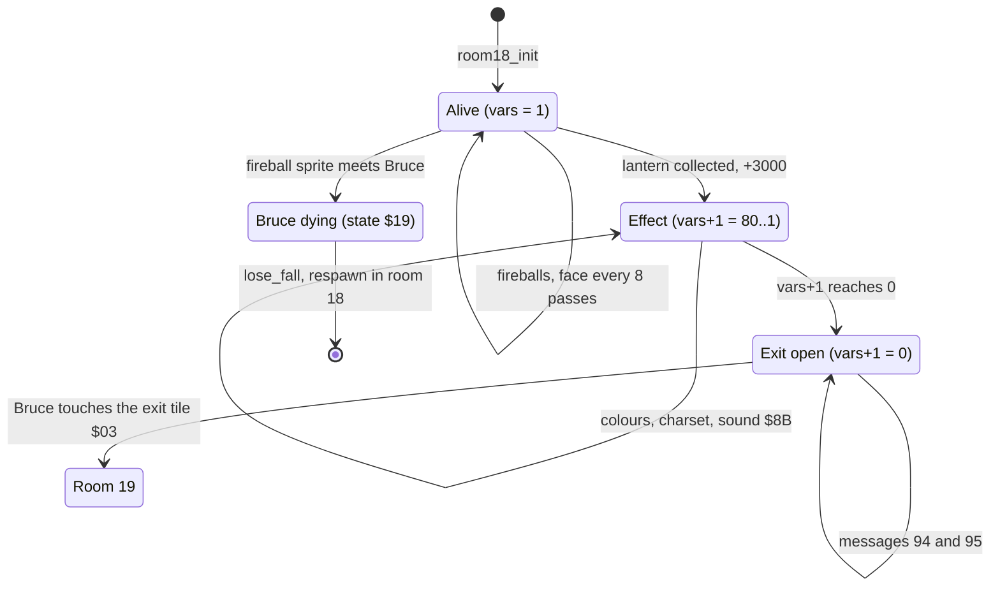

| State | Condition | Next state | Effect | Code |
|---|---|---|---|---|
| Alive | a fireball sprite (6/7) meets Bruce's sprites 0/1, Bruce not dying | Bruce dying | state `$19`, timer `$10` → [`lose_fall`](../../src/game_over.asm#L6) | [`room18_wizard_alive`](../../src/room_update.asm#L939) [`$3D1D`](../reference/modules/room_update.md#room18_wizard_alive) |
| Alive | [`lantern_list_room18`](../../src/room_tables.asm#L377) = 0 | Effect | fireballs and sprites 5-7 off; message 97 at (11, 0); +3000; [`room_script_vars+1`](../../src/room_tables.asm#L390) = `$50` | [`room18_wizard_just_defeated`](../../src/room_update.asm#L917) [`$3CE9`](../reference/modules/room_update.md#room18_wizard_just_defeated) |
| Effect | [`room_script_vars+1`](../../src/room_tables.asm#L390) > 0 | Effect | colours, charset, sound `$8B`, messages 71-78 | [`room18_defeat_effect`](../../src/room_update.asm#L1019) [`$3DAF`](../reference/modules/room_update.md#room18_defeat_effect) |
| Effect | [`room_script_vars+1`](../../src/room_tables.asm#L390) = 0 | Exit open | messages 94 at (11, 37) and 95 at (12, 38) on each pass | [`room18_draw_open_exit`](../../src/room_update.asm#L1008) [`$3D9B`](../reference/modules/room_update.md#room18_draw_open_exit) |
| Exit open | Bruce touches `$03` (the exit test passes at x > `$A1` when he moves right) | room 19 | [`enter_room`](../../src/background_touch.asm#L210) | [`check_exit_direction`](../../src/background_touch.asm#L392) [`$30D4`](../reference/modules/background_touch.md#check_exit_direction) |

**Evidence.**
- **Observed** (`room_events`, normal): the fireballs ran ([`update_fireballs`](../../src/fireballs.asm#L6) [`$4133`](../reference/modules/fireballs.md#update_fireballs) in the coverage); the face was drawn again (screen rows 5-8, columns 18-20: message set 65/68 → 59/62 for zone 0); [`room_script_vars`](../../src/room_tables.asm#L390) `01 05 00 01` → `01 08 00 00`.
- **Observed** (`room_special`, wizard defeat): the score went `$0007D0` → `$001388` (+3000); [`room_script_vars`](../../src/room_tables.asm#L390) was `00 30 01 01 00` at 100 frames (32 passes in 100 frames) and `00 00 01 01 00` at 400 frames; [`room_charset_d018`](../../src/constants.asm#L109) = `$3E` at 400 frames. The face cells show message 57 at rows 3/4 and messages 66/69 at rows 5-8 (zone 1, set + 6). The body-tile messages changed at rows 5/6 (columns 12, 14, 25, 27) and 11/12 (columns 14-16, 23-24). Screen row 21, column 0 changed `$02` → `$06` (the exit to room 17 closed). At 400 frames, rows 21-24, columns 37-39 hold `00 00 03` and `5A 5A` (the exit drawn). The 400-frame screenshot shows the room without the wizard. The coverage shows [`room18_wizard_just_defeated`](../../src/room_update.asm#L917) [`$3CE9`](../reference/modules/room_update.md#room18_wizard_just_defeated), [`room18_defeat_effect`](../../src/room_update.asm#L1019) [`$3DAF`](../reference/modules/room_update.md#room18_defeat_effect) and [`room18_draw_open_exit`](../../src/room_update.asm#L1008) [`$3D9B`](../reference/modules/room_update.md#room18_draw_open_exit).
- **Observed** (`room_events2`, collected): entering room 18 with [`lantern_list_room18`](../../src/room_tables.asm#L377) already 0 runs the defeat on the first call. At 60 frames the face shows zone 1, screen row 21, column 0 is `$06`, and the lantern cell (row 21, column 37) is the collected tile `$1E` (drawn by [`redraw_taken_lanterns`](../../src/lanterns.asm#L63)). At 400 frames the exit cells are drawn and [`room_script_vars`](../../src/room_tables.asm#L390) = `00 00 01 01`.
- **Code:** the fireball hit ([`room18_wizard_alive`](../../src/room_update.asm#L939) [`$3D28-$3D37`](../../src/room_update.asm#L946) never ran), the flash to `$3C`, a real pickup of the lantern by touch, and the steering to the right ([`update_fireballs`](../../src/fireballs.asm#L6) [`$41B8`](../../src/fireballs.asm#L76)).

**Links to other rooms.**
- The defeat depends only on the wizard's lantern. After the defeat, the way back to room 17 is closed and the only way out is room 19.
- Exit `$02` leads to room 17 (until the defeat); the created exit `$03` leads to room 19.

## 12. Room 19: congratulations and the next cycle

**Description.** Castle walls and arches with flames at the bottom (from the image). There are no exits and no lanterns (a dummy record). No enemies come here.

*Room 19 as the map draws it; the flames get random colours while CONGRATULATIONS is shown.*

**Data.**

| Table entry | Value | Meaning |
|---|---|---|
| [`room19_map`](../../src/room_maps.asm#L787) [`$7FE0`](../reference/modules/room_maps.md#room19_map) | 416 bytes, 440 cells | RLE map stream |
| [`room_char_colours+19`](../../src/room_colours.asm#L12) [`$47B3`](../reference/modules/room_colours.md#room_char_colours) | `$FF` | colour RAM fill: multicolour, colour 7 |
| [`room_lantern_counts+19`](../../src/room_tables.asm#L229) [`$4CE1`](../reference/modules/room_tables.md#room_lantern_counts) | 0 | lanterns at the start (list [`lantern_list_room19`](../../src/room_tables.asm#L380) [`$4E8B`](../reference/modules/room_tables.md#lantern_list_room19)) |
| [`room_no_combat_flags+19`](../../src/room_tables.asm#L217) [`$4CB1`](../reference/modules/room_tables.md#room_no_combat_flags) | `$FF` | no enemies |
| [`ninja_first_spawn_delay+19`](../../src/actor_room_tables.asm#L69) [`$131E`](../reference/modules/actor_room_tables.md#ninja_first_spawn_delay) / [`yamo_first_spawn_delay+19`](../../src/actor_room_tables.asm#L84) [`$135A`](../reference/modules/actor_room_tables.md#yamo_first_spawn_delay) | 0 / 0 | first spawn delay of the Ninja / the Yamo (passes) |
| [`room_spawn_x+19`](../../src/room_tables.asm#L156) [`$4BC1`](../reference/modules/room_tables.md#room_spawn_x) / [`room_spawn_y+19`](../../src/room_tables.asm#L161) [`$4BD5`](../reference/modules/room_tables.md#room_spawn_y) | 18 / 149 | Bruce's spawn point (x, y) |
| [`room_setup_handlers+38`](../../src/room_tables.asm#L401) [`$4EC2`](../reference/modules/room_tables.md#room_setup_handlers) | [`room19_init`](../../src/final_room.asm#L21) [`$425F`](../reference/modules/final_room.md#room19_init) | init handler (RTS table: the entry holds the address - 1) |
| [`room_frame_handlers+38`](../../src/room_tables.asm#L411) [`$4EEA`](../reference/modules/room_tables.md#room_frame_handlers) | [`room19_congratulations_update`](../../src/final_room.asm#L34) [`$4272`](../reference/modules/final_room.md#room19_congratulations_update) | frame handler (RTS table: the entry holds the address - 1) |
| charset | set 1 (`$D018` = `$3A`) | chosen by [`draw_room`](../../src/room_draw.asm#L6) from the room number |

| Exit tile | Entry | Destination room | Entry point (x, y) | Trigger cells in the map (map row, column) |
|---|---|---|---|---|
| `$02` | [`exit2_room+19`](../../src/room_tables.asm#L134) [`$4B71`](../reference/modules/room_tables.md#exit2_room) | x = 0: as tile `$05`: room 0 at x = 0 | (0, 0) | none |
| `$03` | [`exit3_room+19`](../../src/room_tables.asm#L140) [`$4B85`](../reference/modules/room_tables.md#exit3_room) | x = 0: as tile `$05`: room 0 at x = 0 | (0, 0) | none |
| `$04` | [`exit4_room+19`](../../src/room_tables.asm#L146) [`$4B99`](../reference/modules/room_tables.md#exit4_room) | x = 0: as tile `$05`: room 0 at x = 0 | (0, 0) | none |
| `$05` | [`exit5_room+19`](../../src/room_tables.asm#L151) [`$4BAD`](../reference/modules/room_tables.md#exit5_room) | x = 0: room 0 at x = 0 (tile `$05` has no fall-through) | (0, 0) | none |

One dummy record at [`lantern_list_room19`](../../src/room_tables.asm#L380) [`$4E8B`](../reference/modules/room_tables.md#lantern_list_room19) (state 1, column 0, text row 0); the count is 0.

**Setup.** [`room19_init`](../../src/final_room.asm#L21) [`$425F`](../reference/modules/final_room.md#room19_init) (**Code**):
- [`attract_countdown`](../../src/constants.asm#L35) [`$49`](../reference/variables.md#attract_countdown) = `$58` and [`title_timeout_hi`](../../src/constants.asm#L36) [`$4A`](../reference/variables.md#title_timeout_hi) = `$04`, so the 16-bit countdown is `$0458` = **1112 frames** (22 s on PAL). [`game_frame_update`](../../src/frame_update.asm#L6) [`$15A8`](../reference/modules/frame_update.md#game_frame_update) in the raster IRQ counts it down once per **frame**, not per pass ([`game_frame_update`](../../src/frame_update.asm#L6) [`$1678-$1688`](../../src/frame_update.asm#L129)).
- It clears the top text line [`screen_ram`](../../src/vic_bank2.asm#L376) [`$8C00-$8C27`](../reference/modules/vic_bank2.md#screen_ram).

**Bruce's input in room 19** ([`update_actors`](../../src/actor_input.asm#L6) [`$179E`](../reference/modules/actor_input.md#update_actors), `$17C4-$17D6`): while [`current_room`](../../src/constants.asm#L28) = `$13`, Bruce's [`actor_joy_dir`](../../src/constants.asm#L83) [`$98`](../reference/variables.md#actor_joy_dir) is forced on each pass: `$0E` (joystick up) while [`room_timer`](../../src/constants.asm#L77) [`$88`](../reference/variables.md#room_timer) < 2, which is the first 512 frames of play; `$0F` (none) after that. **Conclusion:** the player has no control in this room.

**Behaviour.** [`room19_congratulations_update`](../../src/final_room.asm#L34) [`$4272`](../reference/modules/final_room.md#room19_congratulations_update) (**Code**):
1. **While the countdown is not 0** ([`room19_flash_and_message`](../../src/final_room.asm#L55) [`$4298`](../reference/modules/final_room.md#room19_flash_and_message)): one random colour (AND 7, OR `$F8`) into colour RAM `$DAAC`, `$DAD4`, `$DAFC`, `$DB24`, `$DB4C`, `$DB74`, `$DB9C` and `$DBC4` + 0..28 (screen rows 17-24, columns 4-32: the flames); message 4 "** CONGRATULATIONS **" at text row 0, column 10.
2. **When it is 0** (one call, [`room19_congratulations_update`](../../src/final_room.asm#L34) [`$4278-$4297`](../../src/final_room.asm#L38)):
   - [`game_cycle`](../../src/constants.asm#L30) [`$40`](../reference/variables.md#game_cycle) + 1 ([`room19_congratulations_update`](../../src/final_room.asm#L34) [`$4278`](../../src/final_room.asm#L38));
   - [`room13_floor_bonus_flags`](../../src/constants.asm#L135) + 4 × [`current_player`](../../src/constants.asm#L10) + 0..3 = 1 ([`room19_reset_floor_bonus_loop`](../../src/final_room.asm#L45) [`$4283`](../reference/modules/final_room.md#room19_reset_floor_bonus_loop));
   - [`reset_room_table_2a`](../../src/room_state.asm#L101) [`$10C5`](../reference/modules/room_state.md#reset_room_table_2a): [`room_lanterns_left`](../../src/constants.asm#L29) from [`room_lantern_counts`](../../src/room_tables.asm#L229) [`$4CCE`](../reference/modules/room_tables.md#room_lantern_counts);
   - [`reset_all_lanterns`](../../src/lanterns.asm#L126) [`$33CA`](../reference/modules/lanterns.md#reset_all_lanterns): every lantern record of rooms 0-19 present;
   - [`reset_player_room_flags`](../../src/room_state.asm#L123) [`$10E0`](../reference/modules/room_state.md#reset_player_room_flags): the entry-bonus flags of the current player for rooms 1-19 = 1, room 0 = 0;
   - [`respawn_in_room`](../../src/room_entry_traps.asm#L6) with X = 0: Bruce at room 0's spawn point (26, 196), and room 0 is drawn.

The handler calls nothing else. So the score, the falls, [`bonus_falls_left`](../../src/room_tables.asm#L385) (room 16), [`high_score`](../../src/variables.asm#L106) [`$4388`](../reference/modules/variables.md#high_score) and the other player's saved block [`other_player_state`](../../src/variables.asm#L152) [`$439F`](../reference/modules/variables.md#other_player_state) stay as they are (**Code**).

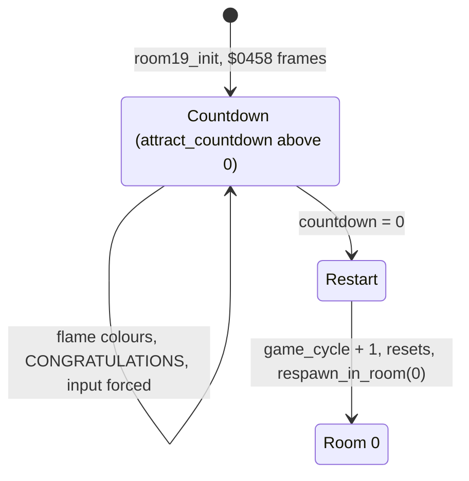

| State | Condition | Next state | Effect | Code |
|---|---|---|---|---|
| Countdown | [`attract_countdown`](../../src/constants.asm#L35) \| [`title_timeout_hi`](../../src/constants.asm#L36) ≠ 0 | Countdown | flame colours, message 4 | [`room19_flash_and_message`](../../src/final_room.asm#L55) [`$4298`](../reference/modules/final_room.md#room19_flash_and_message) |
| Countdown | the countdown = 0 | Restart → room 0 | [`game_cycle`](../../src/constants.asm#L30) + 1, the floor flags, the lantern counters and records, the entry flags, [`respawn_in_room`](../../src/room_entry_traps.asm#L6) | [`room19_congratulations_update`](../../src/final_room.asm#L34) [`$4278`](../../src/final_room.asm#L38) |

**Evidence.**
- **Observed** (`room_special`, ending): [`room19_flash_and_message`](../../src/final_room.asm#L55) ran. [`game_cycle`](../../src/constants.asm#L30) was 0 at the start and 1 at 1000 frames, and room 0 was drawn ([`current_room`](../../src/constants.asm#L28) 0, [`room_charset_d018`](../../src/constants.asm#L109) = `$38`). The score stayed `$0007D0`: no entry bonus for room 0. The restart code `$4278-$4297` ran. At 2500 frames [`falls_left`](../../src/constants.asm#L27) was 3: [`lose_fall`](../../src/game_over.asm#L6) ran, so Bruce died in room 0 in cycle 1 with no input.
- **Code:** the floor-flag reset, the entry-flag reset, the input override and the cycle 1 timers.

### 12.1 What [`game_cycle`](../../src/constants.asm#L30) changes

[`game_cycle`](../../src/constants.asm#L30) is only tested for zero (`BEQ`/`BNE`). So cycle 1 and each later cycle play the same, until the byte wraps after 255 (**Code**). Except for the room 13 layout and the first spawn delays, a cycle ≥ 1 gives the same timers as a long stay in a room: [`get_room_time_level`](../../src/room_state.asm#L110) [`$10D0`](../reference/modules/room_state.md#get_room_time_level) returns V = 1 when [`room_timer`](../../src/constants.asm#L77) ≥ `$20`, and the same code then sets the same short values.

| Where | Code | Cycle 0 ([`room_timer`](../../src/constants.asm#L77) < `$19`) | Cycle ≥ 1 |
|---|---|---|---|
| first spawn delays on entry | [`draw_room`](../../src/room_draw.asm#L6) [`$0A58`](../../src/room_draw.asm#L86) | [`ninja_first_spawn_delay`](../../src/actor_room_tables.asm#L69) [`$130B`](../reference/modules/actor_room_tables.md#ninja_first_spawn_delay) / [`yamo_first_spawn_delay`](../../src/actor_room_tables.asm#L84) [`$1347`](../reference/modules/actor_room_tables.md#yamo_first_spawn_delay) of the room | both 3 passes (the Yamo still 8 with a human opponent) |
| spawn delay after a spawn | [`try_spawn_yamo`](../../src/actors.asm#L207) [`$0D35`](../../src/actors.asm#L226), [`try_spawn_ninja`](../../src/actors.asm#L315) [`$0DF0`](../../src/actors.asm#L346) | the room table (`$30` for a human Yamo); halved when [`room_timer`](../../src/constants.asm#L77) ≥ `$19`, 3 when ≥ `$20` | 3 |
| spawn delay after a removal | [`reset_yamo_timer`](../../src/actors.asm#L243) [`$0D6A`](../../src/actors.asm#L263), [`reset_ninja_timer`](../../src/actors.asm#L274) [`$0D76`](../reference/modules/actors.md#reset_ninja_timer) | the same | 3 |
| the Ninja waits while the Yamo is active | [`try_spawn_ninja`](../../src/actors.asm#L315) [`$0DBB`](../../src/actors.asm#L321) | with a computer Yamo, a random byte ≥ `$19` sets the Ninja timer to `$10` | never |
| an enemy's recovery after its own attack | [`start_attack_recovery`](../../src/object_actions.asm#L356) [`$22AD`](../../src/object_actions.asm#L374) | 6 | 1 |
| an enemy's recovery after a hit | [`apply_hit_effects`](../../src/combat_hits.asm#L227) [`$2B72`](../../src/combat_hits.asm#L246) | `$18` | 2 |
| an enemy's recovery when it wakes up | [`ai_wake_idle_enemies`](../../src/actor_checks.asm#L33) [`$2DCE`](../../src/actor_checks.asm#L79) | `$18` | 1 |
| room 13 slider ranges | [`room13_init`](../../src/room_init.asm#L131) [`$34F9-$355D`](../../src/room_init.asm#L154) | section 6 | other start columns, wider ranges |

**Conclusion:** from cycle 1 on, enemies appear about 3 passes after Bruce enters, come back 3 passes after they are removed, and recover from attacks, hits and wake-ups almost at once. The room 13 sliders cover more columns. The random postponement of the Ninja happens for about 90 % of the random bytes (231 of 256).

## 13. Dependencies between the rooms

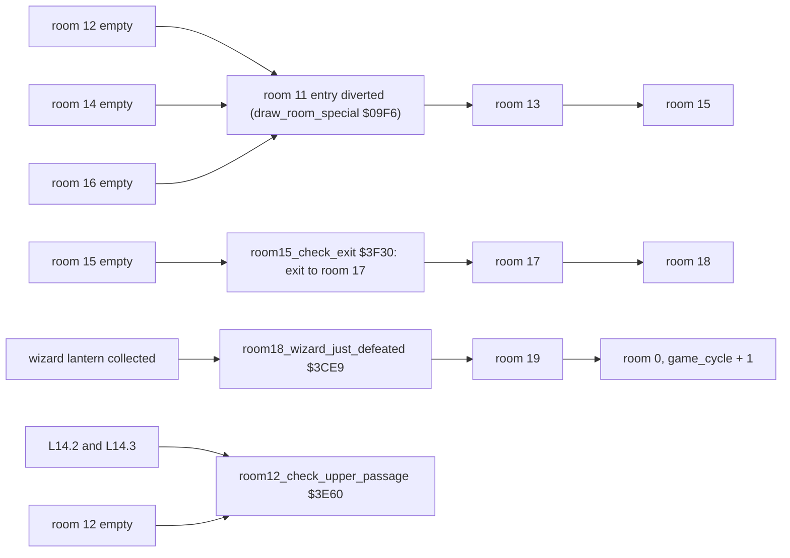

| Room | Event | Depends on | Effect | Flag | Evidence |
|---|---|---|---|---|---|
| 10 | passage at column 38 | L10.0 and L10.1 | the way to exit `$03` → room 11 | +0 | **Observed** |
| 11 | diversion (in [`draw_room`](../../src/room_draw.asm#L6)) | **rooms 12, 14 and 16 empty** | room 13 is drawn instead of room 11 | - | **Observed** |
| 11 | texture reset | L11.2 | the texture up at the start speed | +0 | **Code** |
| 12 | event A, passage at text rows 10-12 | L12.2 | the way to exit `$04` → room 14 | +0 | **Observed** |
| 12 | event B, passage at text rows 7-9 | room 12 empty and **L14.2 and L14.3** | the way to exit `$03` → room 11 | +1 | **Observed** |
| 13 | floor bonuses | Bruce's y (per player and cycle) | 3 × 500 points | [`room13_floor_bonus_flags`](../../src/constants.asm#L135) | **Code** |
| 14 | passage at text rows 4-6 | L14.0 and L14.1 | the way to exit `$03` → room 11 | +0 | **Observed** |
| 15 | left tower wall | L15.0 | an opening at column 17 | +0 | **Observed** |
| 15 | right tower wall | L15.1, L15.2 and L15.4 | an opening at column 23 | +1 | **Observed** |
| 15 | exit | room 15 empty | exit `$03` → room 17 at (16, 179) | +2 | **Observed** |
| 16 | passage at column 1 | room 16 empty | the way to exit `$03` → room 11 | +0 | **Observed** |
| 16 | bonus fall | [`bonus_falls_left`](../../src/room_tables.asm#L385) of the player > 0 | one extra fall | - | **Code** |
| 17 | mesh pieces | L17.0 / L17.1 | tiles `$44`/`$49` at map row 8 | +0/+1 | **Observed** |
| 18 | defeat | L18.0 (the wizard) | +3000, the exit to room 17 closed, exit `$03` → room 19 | +0/+1 | **Observed** |
| 19 | restart | the 1112-frame countdown | [`game_cycle`](../../src/constants.asm#L30) + 1, all lanterns back, room 0 | - | **Observed** |

- **Conclusion:** the only way into room 13 is the room 11 diversion, and room 15's exit `$02` leads back to room 13. So rooms 13-19 are reached only after rooms 12, 14 and 16 have no lanterns left (**Code**; the diversion was **Observed**).
- No handler of rooms 10-19 reads the lanterns of rooms 0-9 (**Code**). The dependencies of rooms 0-9 are in [rooms_00_09.md](rooms_00_09.md).

## 14. Still open

1. **Room 18, the chars `$04`/`$05`:** these cells lead to room 0 at x = 0 when [`check_exit_direction`](../../src/background_touch.asm#L392) allows it, for example when Bruce moves up with y < `$31`. Can Bruce reach such a cell? Run: walk or jump Bruce to the top of a wizard column in room 18 and watch [`current_room`](../../src/constants.asm#L28).
2. **Room 18, a later drawing:** a drawing of room 18 with [`lantern_list_room18`](../../src/room_tables.asm#L377) = 0 runs the defeat again (**Observed** in `room_events2`), so it would give another 3000 points (**Code**; the score was not recorded there). In normal play this needs a respawn in room 18 after the defeat, and no way to die there after the defeat was found (no fireballs, no deadly chars, no enemies). Run: after the defeat, force a lost fall in room 18 and record the score.
3. **Room 18, the fireball hit:** [`room18_wizard_alive`](../../src/room_update.asm#L939) [`$3D28-$3D37`](../../src/room_update.asm#L946) never ran. Run: let a fireball fall onto Bruce and check state `$19` and the lost fall.
4. **Room 19:** what joystick "up" does for Bruce during the first 512 frames. Run: the ending run with a log of [`actor_state`](../../src/constants.asm#L95) and [`actor_y`](../../src/constants.asm#L86) every 10 frames.
5. **Room 17:** what the mesh tiles `$44`/`$49` do for the movement. Run: walk Bruce into a mesh piece and compare [`actor_state`](../../src/constants.asm#L95).
6. **Room 13, the floor bonus:** [`room13_update`](../../src/room_update.asm#L1117) [`$3E87-$3EBB`](../../src/room_update.asm#L1126) never ran. Run: a room 13 snapshot, walk Bruce down through the three bands and record the score and [`room13_floor_bonus_flags`](../../src/constants.asm#L135) [`$014B`](../reference/variables.md#room13_floor_bonus_flags).
7. **Room 16, the bonus fall:** [`room16_bonus_fall`](../../src/background_touch.asm#L253) [`$2FD6-$3000`](../reference/modules/background_touch.md#room16_bonus_fall) never ran. Run: walk Bruce onto the object at the bottom right and record [`falls_left`](../../src/constants.asm#L27) and [`bonus_falls_left`](../../src/room_tables.asm#L385).
8. **Room 11, the texture reset:** the event never ran; in the collected entry of `room_events2` room 11 was diverted to room 13. Run: enter room 11 with only lantern 2 of room 11 collected.
