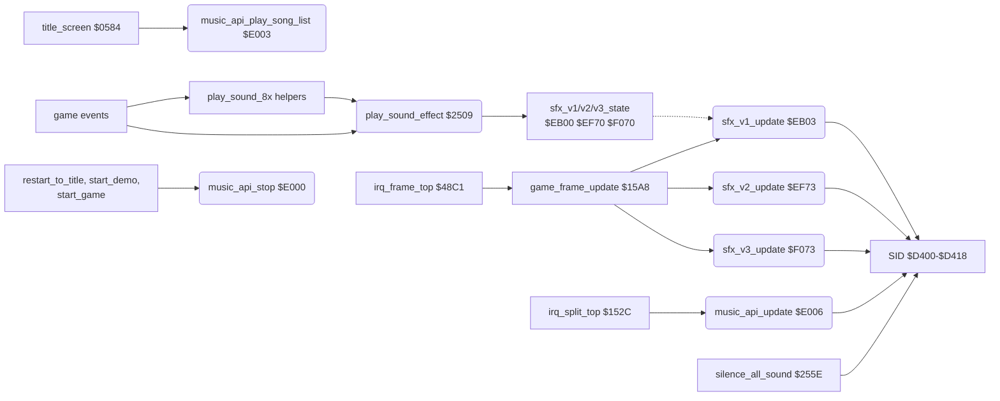
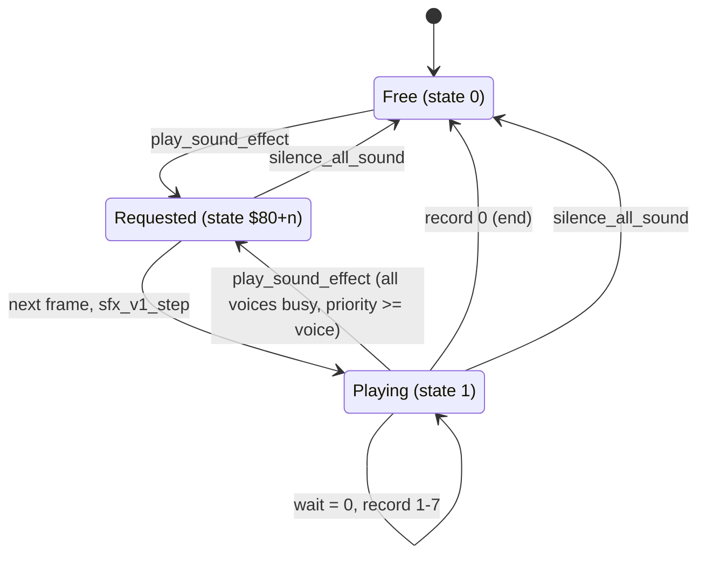

# Bruce Lee: sound

This page covers:
- the two sound drivers in `$E000-$F2FF`: the MicroPearl music player at `$E000` and the three sound effect players at `$EB00`, `$EF70` and `$F070`;
- how the game starts, updates and stops the music, and when the title tune plays;
- the start of a sound effect and the channel allocation ([`play_sound_effect`](../../src/sound_effects.asm#L6) [`$2509`](../reference/modules/sound_effects.md#play_sound_effect));
- the sound effect players, their tables and the stream format;
- all 15 sound effects with the game events that start them;
- the S key (sound on/off) and the sound helper [`play_sound_8a`](../../src/final_room.asm#L6) [`$424F`](../reference/modules/final_room.md#play_sound_8a).

The stream format of the music and the title tune are on [music_format.md](music_format.md).

Sources: [sound_effects.asm](../reference/modules/sound_effects.md), [music_player.asm](../reference/modules/music_player.md), [music_data.asm](../reference/modules/music_data.md), [sfx_voice1.asm](../reference/modules/sfx_voice1.md), [sfx_data.asm](../reference/modules/sfx_data.md), [sfx_voice2.asm](../reference/modules/sfx_voice2.md), [sfx_voice3.asm](../reference/modules/sfx_voice3.md), [final_room.asm](../reference/modules/final_room.md) (only [`play_sound_8a`](../../src/final_room.asm#L6) [`$424F`](../reference/modules/final_room.md#play_sound_8a)). Assets: [sfx.json](../../assets/sound/sfx.json), [sfx_data_ebe5-ee82.bin](../../assets/sound/sfx_data_ebe5-ee82.bin), [music_player_e000-eaff.bin](../../assets/sound/music_player_e000-eaff.bin).

**Conventions.**
- Addresses are C64 addresses. Names are the names of the knowledge.
- A *frame* is one video frame: one run of the raster IRQ chain (50 per second on PAL). A *pass* is one run of [`main_loop`](../../src/main_loop.asm#L6) [`$1BC2`](../reference/modules/main_loop.md#main_loop).
- A *voice* is one of the three SID voices: voice 1 at `$D400`, voice 2 at `$D407`, voice 3 at `$D40E`. Each sound effect player owns one voice. The code calls the three players *channels* 0, 1 and 2.
- An *effect* is one sound effect, numbered 0-14. The game requests effect n with the *sound id* `$80` + n in Y.
- A *note* number indexes the frequency tables [`note_freq_lo`](../../src/music_player.asm#L145) [`$E200`](../reference/modules/music_player.md#note_freq_lo) and [`note_freq_hi`](../../src/music_player.asm#L158) [`$E254`](../reference/modules/music_player.md#note_freq_hi): 1 = C1, 13 = C2, 82 = A7. Note names on this page use that numbering.
- **Observed** marks a fact that a run showed. Here this is the coverage of all the recorded runs (the `access` of the knowledge listing). **Code** marks a fact from the code only. **Conclusion** marks an interpretation.

## 1. Overview



1. The music plays only on the title screen and the game-over screen. Their raster IRQ [`irq_split_top`](../../src/raster_irq_screens.asm#L74) [`$152C`](../reference/modules/raster_irq_screens.md#irq_split_top) calls [`music_api_update`](../../src/music_player.asm#L13) [`$E006`](../reference/modules/music_player.md#music_api_update) once per frame (**Code**, the call at [`irq_split_top`](../../src/raster_irq_screens.asm#L74) [`$154C`](../../src/raster_irq_screens.asm#L92); **Observed**).
2. Only [`title_screen`](../../src/title.asm#L6) [`$0584`](../reference/modules/title.md#title_screen) starts the music, at [`title_music`](../../src/title.asm#L146) [`$06BD`](../reference/modules/title.md#title_music) (section 7).
3. [`restart_to_title`](../../src/restart.asm#L6) [`$050F`](../reference/modules/restart.md#restart_to_title), [`start_demo`](../../src/restart.asm#L24) [`$0531`](../reference/modules/restart.md#start_demo) and [`start_game`](../../src/title.asm#L185) [`$070E`](../reference/modules/title.md#start_game) stop the music with [`music_api_stop`](../../src/music_player.asm#L6) [`$E000`](../reference/modules/music_player.md#music_api_stop) (calls at `$051C`, `$054A` and `$0729`). So the music never plays in the demo or in a game (**Code**).
4. In the demo and in a game, the raster IRQ [`irq_frame_top`](../../src/raster_irq_game.asm#L6) [`$48C1`](../reference/modules/raster_irq_game.md#irq_frame_top) calls [`game_frame_update`](../../src/frame_update.asm#L6) [`$15A8`](../reference/modules/frame_update.md#game_frame_update). It calls the three effect players first, once per frame ([`game_frame_update`](../../src/frame_update.asm#L6) [`$15AF`](../../src/frame_update.asm#L11)) (**Code**; **Observed**).
5. A game event requests an effect with [`play_sound_effect`](../../src/sound_effects.asm#L6) [`$2509`](../reference/modules/sound_effects.md#play_sound_effect). That routine only sets the volume and writes the sound id into the state byte of a free player. The player starts the effect at the next frame.
6. [`silence_all_sound`](../../src/sound_effects.asm#L55) [`$255E`](../reference/modules/sound_effects.md#silence_all_sound) frees the three players and writes 0 to `$D400-$D420`. [`title_screen`](../../src/title.asm#L6) [`$0584`](../reference/modules/title.md#title_screen), [`draw_room`](../../src/room_draw.asm#L6) [`$09BC`](../reference/modules/room_draw.md#draw_room), [`show_player_turn_screen`](../../src/player_turn.asm#L6) [`$0EA7`](../reference/modules/player_turn.md#show_player_turn_screen), [`init_game_vars`](../../src/game_vars.asm#L6) [`$0F72`](../reference/modules/game_vars.md#init_game_vars) and [`lose_fall`](../../src/game_over.asm#L6) [`$1818`](../reference/modules/game_over.md#lose_fall) call it. So a room change cuts all effects (**Code**).

**Conclusion:** the music player and the effect players never run at the same time. The game does not share a voice between them.

## 2. The catalogue

| Name | Address | Layout | Read by | Written by |
|---|---|---|---|---|
| [`sound_priority_table`](../../src/sound_effects.asm#L67) | `$2572-$2580` | 15 bytes: priority of effect 0-14, by the low nibble of the sound id | [`play_sound_effect`](../../src/sound_effects.asm#L6) [`$2509`](../reference/modules/sound_effects.md#play_sound_effect) | - |
| [`sound_channel0_priority`](../../src/sound_effects.asm#L71) / [`sound_channel1_priority`](../../src/sound_effects.asm#L73) / [`sound_channel2_priority`](../../src/sound_effects.asm#L75) | `$2581-$2583` | priority of the effect last started on voice 1, 2, 3 | [`play_sound_effect`](../../src/sound_effects.asm#L6) [`$2509`](../reference/modules/sound_effects.md#play_sound_effect) | [`play_sound_effect`](../../src/sound_effects.asm#L6) [`$2509`](../reference/modules/sound_effects.md#play_sound_effect) |
| [`sfx_v1_state`](../../src/sfx_voice1.asm#L6) | `$EB00` | 0 = free; `$80`+n = effect n requested; 1 = playing | [`play_sound_effect`](../../src/sound_effects.asm#L6), [`sfx_v1_update`](../../src/sfx_voice1.asm#L13) | [`play_sound_effect`](../../src/sound_effects.asm#L6), [`silence_all_sound`](../../src/sound_effects.asm#L55), [`sfx_v1_update`](../../src/sfx_voice1.asm#L13), [`boot_cold_init`](../../src/init.asm#L23) [`$0415`](../reference/modules/init.md#boot_cold_init) |
| [`sfx_v1_index`](../../src/sfx_voice1.asm#L8) | `$EB01` | offset of the next record in the stream | [`sfx_v1_update`](../../src/sfx_voice1.asm#L13) | [`sfx_v1_update`](../../src/sfx_voice1.asm#L13) |
| [`sfx_v1_wait`](../../src/sfx_voice1.asm#L10) | `$EB02` | frames until the next record | [`sfx_v1_update`](../../src/sfx_voice1.asm#L13) | [`sfx_v1_update`](../../src/sfx_voice1.asm#L13) |
| [`sfx_v1_ptr`](../../src/constants.asm#L112) | `$F6` | zero-page pointer to the stream of voice 1 | [`sfx_v1_update`](../../src/sfx_voice1.asm#L13) | [`sfx_v1_update`](../../src/sfx_voice1.asm#L13) |
| [`sfx_v2_state`](../../src/sfx_voice2.asm#L6), [`sfx_v2_index`](../../src/sfx_voice2.asm#L8), [`sfx_v2_wait`](../../src/sfx_voice2.asm#L10) | `$EF70-$EF72` | the same for voice 2; pointer [`sfx_v2_ptr`](../../src/constants.asm#L113) [`$F8`](../reference/variables.md#sfx_v2_ptr) | [`sfx_v2_update`](../../src/sfx_voice2.asm#L13) | as voice 1 |
| [`sfx_v3_state`](../../src/sfx_voice3.asm#L6), [`sfx_v3_index`](../../src/sfx_voice3.asm#L8), [`sfx_v3_wait`](../../src/sfx_voice3.asm#L10) | `$F070-$F072` | the same for voice 3; pointer [`sfx_v3_ptr`](../../src/constants.asm#L114) [`$FA`](../reference/variables.md#sfx_v3_ptr) | [`sfx_v3_update`](../../src/sfx_voice3.asm#L13) | as voice 1 |
| [`sfx_table`](../../src/sfx_data.asm#L6) | `$EBE5-$EC02` | 15 words: stream address of effect 0-14 | the three players | - |
| [`sfx_op_offsets`](../../src/sfx_data.asm#L15) | `$EC03-$EC10` | 14 branch offsets `$00, $03, ... $27` into the opcode JMP table of a player | the three players | - |
| [`sfx_adsr_table`](../../src/sfx_data.asm#L19) | `$EC11-$EC1A` | 5 pairs (AD, SR): `$11/$97`, `$00/$F0`, `$89/$00`, `$09/$40`, `$08/$00`; indexed by a byte offset | [`sfx_v1_read_adsr`](../../src/sfx_voice1.asm#L70) [`$EB6A`](../reference/modules/sfx_voice1.md#sfx_v1_read_adsr) and the same routine of voices 2, 3 | - |
| [`sfx_pulse_table`](../../src/sfx_data.asm#L28) | `$EC1B-$EC30` | 11 pulse widths (low, high), indexed by a byte offset | [`sfx_v1_read_pulse`](../../src/sfx_voice1.asm#L94) [`$EB91`](../reference/modules/sfx_voice1.md#sfx_v1_read_pulse) and the same routine of voices 2, 3 | - |
| [`sfx_00`](../../src/sfx_data.asm#L43) ... [`sfx_14`](../../src/sfx_data.asm#L139) | `$EC31-$EE82` | the 15 effect streams (sections 4.3 and 5) | the three players | - |
| [`note_freq_lo`](../../src/music_player.asm#L145) / [`note_freq_hi`](../../src/music_player.asm#L158) | `$E200-$E253` / `$E254-$E2A7` | 84 SID frequencies, notes 0-83 (0 = B0, 1 = C1, 83 = A#7) | music player and the three effect players | - |
| [`sound_toggle`](../../src/actor_room_tables.asm#L105) | `$1385` | 0 = title music on, 1 = off | [`title_screen`](../../src/title.asm#L6), [`handle_game_keys`](../../src/status.asm#L236) [`$1B29`](../reference/modules/status.md#handle_game_keys) | [`handle_game_keys`](../../src/status.asm#L236) |
| [`title_music_countdown`](../../src/title_menu.asm#L150) | `$09BB` | title visits until the tune plays again | [`title_screen`](../../src/title.asm#L6) | [`title_screen`](../../src/title.asm#L6), [`handle_game_keys`](../../src/status.asm#L236), [`lose_fall`](../../src/game_over.asm#L6) |

**Code:** the frequency table is tuned for the NTSC clock. Note `$2E` (A4) is `$1C21`, which is 439 Hz with the NTSC clock of 1022727 Hz. With the PAL clock of 985248 Hz it is 423 Hz. **Conclusion:** on a PAL machine every note sounds about 0.6 semitone lower.

## 3. Starting an effect

### 3.1 [`play_sound_effect`](../../src/sound_effects.asm#L6) [`$2509`](../reference/modules/sound_effects.md#play_sound_effect)

Input: Y = sound id `$80` + n. A, X and the flags are lost; most callers save them (section 3.3).

1. Writes `$15` to [`SIGVOL`](../../src/constants.asm#L207) [`$D418`](../reference/variables.md#SIGVOL): volume 5, filter mode low pass.
2. When [`sfx_v1_state`](../../src/sfx_voice1.asm#L6) [`$EB00`](../reference/modules/sfx_voice1.md#sfx_v1_state) is 0: writes Y there, writes [`sound_priority_table`](../../src/sound_effects.asm#L67) [Y & `$0F`] to [`sound_channel0_priority`](../../src/sound_effects.asm#L71) [`$2581`](../reference/modules/sound_effects.md#sound_channel0_priority), and returns ([`play_sound_effect`](../../src/sound_effects.asm#L6) [`$2513`](../../src/sound_effects.asm#L12)).
3. Else when [`sfx_v2_state`](../../src/sfx_voice2.asm#L6) [`$EF70`](../reference/modules/sfx_voice2.md#sfx_v2_state) is 0: the same for voice 2 ([`play_sound_effect`](../../src/sound_effects.asm#L6) [`$2526`](../../src/sound_effects.asm#L23)).
4. Else when [`sfx_v3_state`](../../src/sfx_voice3.asm#L6) [`$F070`](../reference/modules/sfx_voice3.md#sfx_v3_state) is 0: the same for voice 3 ([`play_sound_effect`](../../src/sound_effects.asm#L6) [`$2539`](../../src/sound_effects.asm#L34)).
5. All three are busy ([`play_sound_effect`](../../src/sound_effects.asm#L6) [`$2547`](../../src/sound_effects.asm#L42)): it reads the priority p of the new effect. When p >= [`sound_channel0_priority`](../../src/sound_effects.asm#L71), it replaces the effect of voice 1 (step 2). Else when p >= [`sound_channel1_priority`](../../src/sound_effects.asm#L73), voice 2. Else when p >= [`sound_channel2_priority`](../../src/sound_effects.asm#L75), voice 3.
6. Else the request is lost (the `rts` at [`play_sound_effect`](../../src/sound_effects.asm#L6) [`$255D`](../../src/sound_effects.asm#L53)).

**Observed:** the busy path at [`play_sound_effect`](../../src/sound_effects.asm#L6) [`$2547`](../../src/sound_effects.asm#L42) ran in the recorded runs; the lost request at `$255D` did not.

```text
p = sound_priority_table[Y & $0F]
for v in voice 1, 2, 3:  if state[v] == 0: state[v] = Y; prio[v] = p; return
for v in voice 1, 2, 3:  if p >= prio[v]:  state[v] = Y; prio[v] = p; return
return                                  ; dropped
```

- The priority of a voice keeps its value after the effect ends. This does no harm: a free voice is always taken before any compare (**Code**).
- A request is not played at once. The player of that voice starts it at the next frame. Two requests in the same frame take two voices (**Code**).
- **Code:** [`SIGVOL`](../../src/constants.asm#L207) [`$D418`](../reference/variables.md#SIGVOL) = `$15` turns on the low-pass mode bit, but no voice goes through the filter: `$D417` stays 0 in a game. **Conclusion:** the effects play at volume 5 of 15. The title tune plays at volume 15 ([music_format.md](music_format.md)).

### 3.2 [`silence_all_sound`](../../src/sound_effects.asm#L55) [`$255E`](../reference/modules/sound_effects.md#silence_all_sound)

1. Writes 0 to [`sfx_v1_state`](../../src/sfx_voice1.asm#L6) [`$EB00`](../reference/modules/sfx_voice1.md#sfx_v1_state), [`sfx_v2_state`](../../src/sfx_voice2.asm#L6) [`$EF70`](../reference/modules/sfx_voice2.md#sfx_v2_state) and [`sfx_v3_state`](../../src/sfx_voice3.asm#L6) [`$F070`](../reference/modules/sfx_voice3.md#sfx_v3_state).
2. Writes 0 to the 33 addresses `$D400-$D420` (X = `$20` down to 0). This also sets the volume to 0. `$D419-$D41C` are read-only, `$D41D-$D420` are unused or mirrors.

It does not reset [`sound_channel0_priority`](../../src/sound_effects.asm#L71) [`$2581`](../reference/modules/sound_effects.md#sound_channel0_priority).

### 3.3 The helpers

Small wrappers load Y and call [`play_sound_effect`](../../src/sound_effects.asm#L6) [`$2509`](../reference/modules/sound_effects.md#play_sound_effect). All but [`play_sound_89`](../../src/room_tiles.asm#L28) keep A, X and Y on the stack.

| Helper | Sound id | Extra work |
|---|---|---|
| [`play_sound_80_checked`](../../src/actor_movement.asm#L531) [`$1FC4`](../reference/modules/actor_movement.md#play_sound_80_checked) | `$80` | two copy-protection checks after the request; see [protection.md](protection.md) |
| [`play_sound_82`](../../src/room_state.asm#L86) [`$10B5`](../reference/modules/room_state.md#play_sound_82) | `$82` | - |
| [`play_sound_86`](../../src/actor_checks.asm#L148) [`$2E29`](../reference/modules/actor_checks.md#play_sound_86) | `$86` | - |
| [`play_sound_89`](../../src/room_tiles.asm#L28) [`$4078`](../reference/modules/room_tiles.md#play_sound_89) | `$89` | a `jmp` to [`play_sound_effect`](../../src/sound_effects.asm#L6); A and X are lost |
| [`play_sound_8a`](../../src/final_room.asm#L6) [`$424F`](../reference/modules/final_room.md#play_sound_8a) | `$8A` | - |
| [`play_sound_8d`](../../src/room_entry_traps.asm#L106) [`$32CC`](../reference/modules/room_entry_traps.md#play_sound_8d) | `$8D` | - |

[`play_sound_8a`](../../src/final_room.asm#L6) [`$424F`](../reference/modules/final_room.md#play_sound_8a) is the sound helper of `final_room.asm`. It sits in front of [`room19_init`](../../src/final_room.asm#L21) [`$425F`](../reference/modules/final_room.md#room19_init), but room 19 does not call it. Its callers are the room events of section 5 and [`game_frame_update`](../../src/frame_update.asm#L6) [`$1771`](../../src/frame_update.asm#L267) (**Code**).

## 4. The effect players

### 4.1 [`sfx_v1_update`](../../src/sfx_voice1.asm#L13) [`$EB03`](../reference/modules/sfx_voice1.md#sfx_v1_update)

The three players are copies of one routine. They differ only in their state bytes, their zero-page pointer and their SID registers. [`sfx_v2_update`](../../src/sfx_voice2.asm#L13) [`$EF73`](../reference/modules/sfx_voice2.md#sfx_v2_update) and [`sfx_v3_update`](../../src/sfx_voice3.asm#L13) [`$F073`](../reference/modules/sfx_voice3.md#sfx_v3_update) work the same way.

1. Reads [`sfx_v1_state`](../../src/sfx_voice1.asm#L6) [`$EB00`](../reference/modules/sfx_voice1.md#sfx_v1_state). When it is 0, returns.
2. When bit 7 is set, starts the effect ([`sfx_v1_step`](../../src/sfx_voice1.asm#L18) [`$EB09`](../reference/modules/sfx_voice1.md#sfx_v1_step)):
   1. `ASL` drops bit 7 and doubles n. X = 2n.
   2. Copies [`sfx_table`](../../src/sfx_data.asm#L6) [X] to [`sfx_v1_ptr`](../../src/constants.asm#L112) [`$F6`](../reference/variables.md#sfx_v1_ptr).
   3. Sets [`sfx_v1_wait`](../../src/sfx_voice1.asm#L10) [`$EB02`](../reference/modules/sfx_voice1.md#sfx_v1_wait) = 1 and [`sfx_v1_state`](../../src/sfx_voice1.asm#L6) = 1 (playing).
   4. Writes 0 to [`VCREG1`](../../src/constants.asm#L187) [`$D404`](../reference/variables.md#VCREG1) (gate off, no waveform) and 0 to [`sfx_v1_index`](../../src/sfx_voice1.asm#L8) [`$EB01`](../reference/modules/sfx_voice1.md#sfx_v1_index).
3. Decrements [`sfx_v1_wait`](../../src/sfx_voice1.asm#L10). When it is not 0, returns. On the start frame the wait goes from 1 to 0, so the first record runs in the same frame.
4. Reads the opcode at ([`sfx_v1_ptr`](../../src/constants.asm#L112)),[`sfx_v1_index`](../../src/sfx_voice1.asm#L8). It writes [`sfx_op_offsets`](../../src/sfx_data.asm#L15) [opcode] into the operand of the `bcc` at [`sfx_v1_update`](../../src/sfx_voice1.asm#L13) [`$EB38`](../../src/sfx_voice1.asm#L43) ([`sfx_v1_op_branch`](../../src/sfx_voice1.asm#L42) [`$EB39`](../reference/modules/sfx_voice1.md#sfx_v1_op_branch)). The `bcc` then branches into the JMP table [`sfx_v1_op_jumps`](../../src/sfx_voice1.asm#L44) [`$EB3A`](../reference/modules/sfx_voice1.md#sfx_v1_op_jumps).
5. The handler reads the arguments of the record, writes the SID, stores the new wait and the index of the next record.

### 4.2 The state of a player



| State | Condition | Next state | Code |
|---|---|---|---|
| Free `0` | a request | Requested `$80`+n | [`play_sound_effect`](../../src/sound_effects.asm#L6) [`$2513`](../../src/sound_effects.asm#L12) |
| Playing `1` | a request, all voices busy, priority >= this voice | Requested `$80`+n | [`play_sound_effect`](../../src/sound_effects.asm#L6) [`$2547`](../../src/sound_effects.asm#L42) |
| Requested `$80`+n | the next frame | Playing `1` | [`sfx_v1_step`](../../src/sfx_voice1.asm#L18) [`$EB09`](../reference/modules/sfx_voice1.md#sfx_v1_step) |
| Playing `1` | [`sfx_v1_wait`](../../src/sfx_voice1.asm#L10) reaches 0, opcode 1-7 | Playing `1` | [`sfx_v1_update`](../../src/sfx_voice1.asm#L13) [`$EB26`](../../src/sfx_voice1.asm#L33) |
| Playing `1` | [`sfx_v1_wait`](../../src/sfx_voice1.asm#L10) reaches 0, opcode 0 | Free `0` | [`sfx_v1_op_end`](../../src/sfx_voice1.asm#L86) [`$EB82`](../reference/modules/sfx_voice1.md#sfx_v1_op_end) |
| any | a room change and the other callers of section 1 | Free `0` | [`silence_all_sound`](../../src/sound_effects.asm#L55) [`$255E`](../reference/modules/sound_effects.md#silence_all_sound) |

### 4.3 The stream format

An effect stream is a list of records. The first byte of a record is the opcode. *w* is the number of frames until the next record. *n* is a note number. *a* and *p* are byte offsets into [`sfx_adsr_table`](../../src/sfx_data.asm#L19) [`$EC11`](../reference/modules/sfx_data.md#sfx_adsr_table) and [`sfx_pulse_table`](../../src/sfx_data.asm#L28) [`$EC1B`](../reference/modules/sfx_data.md#sfx_pulse_table). *c* is the value for the voice control register (`$D404`, `$D40B` or `$D412`).

| Opcode | Bytes | What it does | Handler (voice 1) |
|---|---|---|---|
| `$00` | `00` | frequency 0, [`sfx_v1_state`](../../src/sfx_voice1.asm#L6) = 0, [`sfx_v1_index`](../../src/sfx_voice1.asm#L8) = 0: the effect ends | [`sfx_v1_op_end`](../../src/sfx_voice1.asm#L86) [`$EB82`](../reference/modules/sfx_voice1.md#sfx_v1_op_end) |
| `$01` | `01 w n` | wait w, frequency of note n | [`sfx_v1_op_note`](../../src/sfx_voice1.asm#L104) [`$EBA2`](../reference/modules/sfx_voice1.md#sfx_v1_op_note) |
| `$02` | `02 w n c` | wait w, note n, control c | [`sfx_v1_op_note_ctrl`](../../src/sfx_voice1.asm#L109) [`$EBA9`](../reference/modules/sfx_voice1.md#sfx_v1_op_note_ctrl) |
| `$03` | `03 w n a c` | wait w, note n, AD/SR from offset a, control c | [`sfx_v1_op_note_adsr_ctrl`](../../src/sfx_voice1.asm#L115) [`$EBB3`](../reference/modules/sfx_voice1.md#sfx_v1_op_note_adsr_ctrl) |
| `$04` | `04 w n a p c` | wait w, note n, AD/SR from a, pulse width from p, control c | [`sfx_v1_op_note_adsr_pulse_ctrl`](../../src/sfx_voice1.asm#L122) [`$EBC0`](../reference/modules/sfx_voice1.md#sfx_v1_op_note_adsr_pulse_ctrl) |
| `$05`, `$06` | `0x w n p c` | wait w, note n, pulse width from p, control c | [`sfx_v1_op_note_pulse_ctrl`](../../src/sfx_voice1.asm#L130) [`$EBD0`](../reference/modules/sfx_voice1.md#sfx_v1_op_note_pulse_ctrl) |
| `$07` | `07 c` | control c only; the wait stays 0 | [`sfx_v1_op_ctrl`](../../src/sfx_voice1.asm#L137) [`$EBDD`](../reference/modules/sfx_voice1.md#sfx_v1_op_ctrl) |

The decoder ([`sfx_v1_read_note`](../../src/sfx_voice1.asm#L56) [`$EB52`](../reference/modules/sfx_voice1.md#sfx_v1_read_note), [`sfx_v1_read_adsr`](../../src/sfx_voice1.asm#L70) [`$EB6A`](../reference/modules/sfx_voice1.md#sfx_v1_read_adsr), [`sfx_v1_read_pulse`](../../src/sfx_voice1.asm#L94) [`$EB91`](../reference/modules/sfx_voice1.md#sfx_v1_read_pulse), [`sfx_v1_read_ctrl`](../../src/sfx_voice1.asm#L80) [`$EB7B`](../reference/modules/sfx_voice1.md#sfx_v1_read_ctrl)):

```text
y = index
op = stream[y]
if op == 0: freq = 0; state = 0; index = 0; return
if op == 7: y++; ctrl = stream[y++]           ; never used
else:
  y++; wait = stream[y++]; freq = note_freq[stream[y++]]
  if op in (3, 4):    AD, SR = adsr[stream[y]], adsr[stream[y]+1]; y++
  if op in (4, 5, 6): PW = pulse[stream[y]], pulse[stream[y]+1]; y++
  ctrl = stream[y++]                           ; not for op 1
index = y
```

**Code** facts of the format:
- The records use opcodes 0, 1, 2, 3, 4 and 6. Opcodes 5 and 7 are in no stream. Their JMPs did not run in any recorded run (**Observed**).
- [`sfx_op_offsets`](../../src/sfx_data.asm#L15) [`$EC03`](../reference/modules/sfx_data.md#sfx_op_offsets) has 14 entries, but the JMP table has 8. Opcodes 8-13 would branch past the table into [`sfx_v1_read_note`](../../src/sfx_voice1.asm#L56) [`$EB52`](../reference/modules/sfx_voice1.md#sfx_v1_read_note). No stream uses them.
- The end record sets the frequency to 0. It does not clear the gate. The next start writes 0 to the control register.
- The effect length in frames is the sum of the waits. The end record runs at that frame.
- [`sfx_adsr_table`](../../src/sfx_data.asm#L19) is 10 bytes, but effect 13 uses offset `$0A` (AD/SR `$0C/$07`) and effect 9 uses offset `$0C` (AD/SR `$02/$08`). Both read bytes of [`sfx_pulse_table`](../../src/sfx_data.asm#L28) [`$EC1B`](../reference/modules/sfx_data.md#sfx_pulse_table).
- Note `$54` reads `$01` from [`note_freq_hi`](../../src/music_player.asm#L158) [`$E254`](../reference/modules/music_player.md#note_freq_hi) as its low byte and `$00` from [`music_state_template`](../../src/music_player.asm#L173) [`$E2A8`](../reference/modules/music_player.md#music_state_template) as its high byte: frequency `$0001`. Note `$55` gives `$0002`. Both are silent. Effects 3, 4 and 6 use them.

## 5. The sound effects

All effects can play on any voice: [`play_sound_effect`](../../src/sound_effects.asm#L6) takes the first free voice (section 3.1). The table gives the priority instead. "Frames" is the length of the effect. The waveform comes from the control bytes: `$11` triangle, `$21` sawtooth, `$41` pulse, `$51` pulse + triangle, `$81` noise; `$40` and `$00` release the gate.

| # | Id | Stream | Frames | Priority | Sound | Started by (caller) |
|---|---|---|---|---|---|---|
| 0 | `$80` | [`sfx_00`](../../src/sfx_data.asm#L43) [`$EC31`](../reference/modules/sfx_data.md#sfx_00) | 1 | 11 | one frame of noise, AD/SR `$00/$F0` | a step of an actor: [`play_sound_80_checked`](../../src/actor_movement.asm#L531) [`$1FC4`](../reference/modules/actor_movement.md#play_sound_80_checked), from 7 places (note 1) |
| 1 | `$81` | [`sfx_01`](../../src/sfx_data.asm#L46) [`$EC37`](../reference/modules/sfx_data.md#sfx_01) | 32 | 12 | pulse, A#1 C2 B1 A#1, AD/SR `$89/$00` | an enemy turns to Bruce: [`enemy_appear_facing_player`](../../src/object_actions.asm#L312) [`$225F`](../../src/object_actions.asm#L328); the bull's mouth in rooms 0 and 2: [`room00_update`](../../src/room_update.asm#L6) [`$3656`](../../src/room_update.asm#L16), [`room02_update`](../../src/room_update.asm#L60) [`$36DF`](../../src/room_update.asm#L87) |
| 2 | `$82` | [`sfx_02`](../../src/sfx_data.asm#L50) [`$EC47`](../reference/modules/sfx_data.md#sfx_02) | 12 | 10 | pulse, 12 high notes C6-E7, one per frame | an enemy appears: [`play_sound_82`](../../src/room_state.asm#L86) [`$10B5`](../reference/modules/room_state.md#play_sound_82) from [`spawn_yamo`](../../src/actors.asm#L177) [`$0CD5`](../reference/modules/actors.md#spawn_yamo) and [`spawn_ninja`](../../src/actors.asm#L355) [`$0DF8`](../reference/modules/actors.md#spawn_ninja) |
| 3 | `$83` | [`sfx_03`](../../src/sfx_data.asm#L59) [`$EC7A`](../reference/modules/sfx_data.md#sfx_03) | 6 | 0 | noise, C7, silent notes, C5, C2 | no caller |
| 4 | `$84` | [`sfx_04`](../../src/sfx_data.asm#L65) [`$EC90`](../reference/modules/sfx_data.md#sfx_04) | 21 | 8 | noise rising C#4-C7 | a flying kick starts (timer `$0C`): [`action_flying_kick_left`](../../src/object_actions.asm#L40) [`$205A`](../../src/object_actions.asm#L50), [`action_flying_kick_right`](../../src/object_actions.asm#L78) [`$209F`](../../src/object_actions.asm#L89) |
| 5 | `$85` | [`sfx_05`](../../src/sfx_data.asm#L73) [`$ECBE`](../reference/modules/sfx_data.md#sfx_05) | 6 | 7 | noise rising A4-C6 | a punch (timer 8): [`action_punch`](../../src/object_actions.asm#L336) [`$227C`](../../src/object_actions.asm#L347); a kick (timer `$0C`): [`action_kick`](../../src/object_actions.asm#L391) [`$22D2`](../../src/object_actions.asm#L406) |
| 6 | `$86` | [`sfx_06`](../../src/sfx_data.asm#L79) [`$ECD8`](../reference/modules/sfx_data.md#sfx_06) | 5 | 9 | noise falling C5-C1 | a hit lands: [`play_sound_86`](../../src/actor_checks.asm#L148) [`$2E29`](../reference/modules/actor_checks.md#play_sound_86) from [`partner_punches`](../../src/combat_hits.asm#L135) [`$2AC0`](../../src/combat_hits.asm#L150), [`partner_flying_kicks`](../../src/combat_hits.asm#L161) [`$2AE6`](../../src/combat_hits.asm#L170), [`partner_drops_on`](../../src/combat_hits.asm#L181) [`$2B2C`](../../src/combat_hits.asm#L206); a fireball starts: [`launch_fireball0`](../../src/fireballs.asm#L124) [`$421D`](../../src/fireballs.asm#L136), [`launch_fireball1`](../../src/fireballs.asm#L138) [`$423C`](../../src/fireballs.asm#L150) |
| 7 | `$87` | [`sfx_07`](../../src/sfx_data.asm#L84) [`$ECEC`](../reference/modules/sfx_data.md#sfx_07) | 8 | 6 | triangle, C4-G7 arpeggio up | a kick hits: [`partner_kicks`](../../src/combat_hits.asm#L111) [`$2A93`](../../src/combat_hits.asm#L125) |
| 8 | `$88` | [`sfx_08`](../../src/sfx_data.asm#L91) [`$ED0E`](../reference/modules/sfx_data.md#sfx_08) | 20 | 0 | pulse, F#7 down to C#5, gate on/off each frame | no caller |
| 9 | `$89` | [`sfx_09`](../../src/sfx_data.asm#L103) [`$ED59`](../reference/modules/sfx_data.md#sfx_09) | 1 | 0 | one frame of pulse C6 | a sliding tile moves: [`play_sound_89`](../../src/room_tiles.asm#L28) [`$4078`](../reference/modules/room_tiles.md#play_sound_89) from [`draw_sliding_tile`](../../src/room_tiles.asm#L6) [`$404E`](../reference/modules/room_tiles.md#draw_sliding_tile), [`draw_sliding_tile_alt`](../../src/room_tiles.asm#L17) [`$4063`](../reference/modules/room_tiles.md#draw_sliding_tile_alt) |
| 10 | `$8A` | [`sfx_10`](../../src/sfx_data.asm#L106) [`$ED60`](../reference/modules/sfx_data.md#sfx_10) | 79 | 1 | 16 frames silence, low pulse + triangle rumble B0-C#2, then B6 for 47 frames | something opens or changes in a room: [`play_sound_8a`](../../src/final_room.asm#L6) [`$424F`](../reference/modules/final_room.md#play_sound_8a) (note 2) |
| 11 | `$8B` | [`sfx_11`](../../src/sfx_data.asm#L114) [`$ED8E`](../reference/modules/sfx_data.md#sfx_11) | 14 | 2 | A7, noise and pulse + triangle by turns, then E4, A3 | the wizard's defeat in room 18: [`room18_effect_sound_and_tiles`](../../src/room_update.asm#L1063) [`$3E0B`](../reference/modules/room_update.md#room18_effect_sound_and_tiles), once per pass |
| 12 | `$8C` | [`sfx_12`](../../src/sfx_data.asm#L124) [`$EDC8`](../reference/modules/sfx_data.md#sfx_12) | 14 | 3 | pulse C4/C#4 trill with a shrinking pulse width, then falling to E3 | Bruce touches a deadly char: [`touch_deadly_char`](../../src/background_touch.asm#L316) [`$3059`](../../src/background_touch.asm#L329) |
| 13 | `$8D` | [`sfx_13`](../../src/sfx_data.asm#L134) [`$EE07`](../reference/modules/sfx_data.md#sfx_13) | 103 | 4 | noise D#2, D#5, D#7, D#4, then D#2 for 96 frames | a floor trap opens (frame 8): [`play_sound_8d`](../../src/room_entry_traps.asm#L106) [`$32CC`](../reference/modules/room_entry_traps.md#play_sound_8d) from [`animate_floor_traps`](../../src/room_entry_traps.asm#L16) [`$323D`](../../src/room_entry_traps.asm#L29) |
| 14 | `$8E` | [`sfx_14`](../../src/sfx_data.asm#L139) [`$EE19`](../reference/modules/sfx_data.md#sfx_14) | 26 | 5 | sawtooth, 26 notes B5 F#4 B4 D4 ... one per frame | a lantern is taken: [`pick_up_lantern`](../../src/background_touch.asm#L131) [`$2F36`](../../src/background_touch.asm#L161); the room 16 bonus fall: [`room16_bonus_fall`](../../src/background_touch.asm#L253) [`$2FEC`](../../src/background_touch.asm#L268) |

Notes:
1. Effect 0 is the step sound. [`play_sound_80_checked`](../../src/actor_movement.asm#L531) [`$1FC4`](../reference/modules/actor_movement.md#play_sound_80_checked) is called when an actor moves by its joystick direction: up on a climbable char ([`actor_descend_two_steps`](../../src/actor_movement.asm#L225) [`$1DDC`](../../src/actor_movement.asm#L240)), down ([`actor_move_up`](../../src/actor_movement.asm#L253) [`$1E29`](../../src/actor_movement.asm#L286)), left ([`actor_move_down`](../../src/actor_movement.asm#L294) [`$1E63`](../../src/actor_movement.asm#L319)), right ([`actor_move_left`](../../src/actor_movement.asm#L341) [`$1EA4`](../../src/actor_movement.asm#L357)), the jumps up-left and up-right ([`actor_move_right`](../../src/actor_movement.asm#L377) [`$1F46`](../../src/actor_movement.asm#L453), [`actor_move_right`](../../src/actor_movement.asm#L377) [`$1F5C`](../../src/actor_movement.asm#L464)), and each move of the climbing action ([`continue_object_action`](../../src/object_actions.asm#L6) [`$21EB`](../../src/object_actions.asm#L264)). The names are the routines of the knowledge that hold these places. The places themselves are branches of the joystick dispatch that follow those routines in memory (see [actors.md](actors.md)).
2. The callers of [`play_sound_8a`](../../src/final_room.asm#L6) [`$424F`](../reference/modules/final_room.md#play_sound_8a): [`game_frame_update`](../../src/frame_update.asm#L6) [`$1771`](../../src/frame_update.asm#L267) (a human Yamo did nothing for 7 × 256 frames and goes back to the computer), [`room01_update`](../../src/room_update.asm#L35) [`$3698`](../../src/room_update.asm#L50) and [`room03_update`](../../src/room_update.asm#L106) [`$3719`](../../src/room_update.asm#L117) (the floor hatch opens), [`room02_update`](../../src/room_update.asm#L60) [`$36BA`](../../src/room_update.asm#L70) (the exit to room 3 opens), [`room04_update`](../../src/room_update.asm#L156) [`$379A`](../../src/room_update.asm#L183) and [`room04_update`](../../src/room_update.asm#L156) [`$37F7`](../../src/room_update.asm#L225) (lantern 0 or 1 taken), [`open_wall_column`](../../src/room_update.asm#L591) [`$3A8A`](../reference/modules/room_update.md#open_wall_column), [`draw_column_63_64`](../../src/room_update.asm#L614) [`$3AB4`](../reference/modules/room_update.md#draw_column_63_64), [`room09_update`](../../src/room_update.asm#L748) [`$3BFA`](../../src/room_update.asm#L781) (room 9 empty), and [`room15_update`](../../src/room_update.asm#L1175) [`$3F05`](../../src/room_update.asm#L1189), [`room15_update`](../../src/room_update.asm#L1175) [`$3F2D`](../../src/room_update.asm#L1206), [`room15_update`](../../src/room_update.asm#L1175) [`$3F54`](../../src/room_update.asm#L1224) (the walls and the exit of room 15). See [rooms_00_09.md](rooms_00_09.md) and [rooms_10_19.md](rooms_10_19.md).

Evidence:
- **Code:** the table comes from a search of the image for `JSR`/`JMP` to [`play_sound_effect`](../../src/sound_effects.asm#L6) [`$2509`](../reference/modules/sound_effects.md#play_sound_effect) and to each helper, with the `LDY #` before it. All writes to the three state bytes are in [`play_sound_effect`](../../src/sound_effects.asm#L6), [`silence_all_sound`](../../src/sound_effects.asm#L55), [`boot_cold_init`](../../src/init.asm#L23) [`$0415`](../reference/modules/init.md#boot_cold_init) and the players. So effects 3 and 8 have no caller.
- **Observed:** these call sites ran in the recorded runs: `$10BC`, `$1FCB`, `$205A`, `$209F`, `$225F`, `$22D2`, `$2A93`, `$2E30`, `$2F36`, `$3059`, `$32D3`, `$4256`, `$407A`, and the helper calls `$1DDC`, `$1E63`, `$1EA4`, `$1F46`, `$1F5C`, `$21EB`, `$2AC0`, `$2AE6`, `$421D`, `$423C`, `$404E`, `$4063`, `$1771`, `$323D`.
- Not reached in any recorded run: [`action_punch`](../../src/object_actions.asm#L336) [`$227C`](../../src/object_actions.asm#L347), [`room16_bonus_fall`](../../src/background_touch.asm#L253) [`$2FEC`](../../src/background_touch.asm#L268), [`room00_update`](../../src/room_update.asm#L6) [`$3656`](../../src/room_update.asm#L16), [`room02_update`](../../src/room_update.asm#L60) [`$36DF`](../../src/room_update.asm#L87), [`room18_effect_sound_and_tiles`](../../src/room_update.asm#L1063) [`$3E0B`](../reference/modules/room_update.md#room18_effect_sound_and_tiles), [`actor_move_up`](../../src/actor_movement.asm#L253) [`$1E29`](../../src/actor_movement.asm#L286), [`partner_drops_on`](../../src/combat_hits.asm#L181) [`$2B2C`](../../src/combat_hits.asm#L206), and all [`play_sound_8a`](../../src/final_room.asm#L6) calls from the rooms.
- The reference lists of callers miss [`pick_up_lantern`](../../src/background_touch.asm#L131) [`$2F36`](../../src/background_touch.asm#L161) (effect 14) and [`room15_update`](../../src/room_update.asm#L1175) `$3F05`/`$3F2D`/`$3F54` (helper `$424F`). The image has these calls.

The priorities favour the short combat sounds: the step sound (11) and the enemy sound (12) win over the room sounds (1-5). **Conclusion:** with three busy voices, a room event sound is often lost or replaced, and a step sound almost always plays.

## 6. Worked example: effect 1

[`sfx_table+2`](../../src/sfx_data.asm#L6) [`$EBE7`](../reference/modules/sfx_data.md#sfx_table) holds `$EC37` ([`sfx_01`](../../src/sfx_data.asm#L46)). The stream bytes are `04 08 0B 04 00 41 01 10 0D 01 04 0C 01 04 0B 00`.

| Frame | Bytes | Decoded | SID writes (voice v) |
|---|---|---|---|
| 0 | (start) | [`sfx_v1_step`](../../src/sfx_voice1.asm#L18) [`$EB09`](../reference/modules/sfx_voice1.md#sfx_v1_step): pointer = `$EC37`, wait = 1, state = 1 | control = `$00` |
| 0 | `04 08 0B 04 00 41` | opcode 4: wait 8, note `$0B` (A#1), AD/SR offset 4, pulse offset 0, control `$41` | frequency `$03B8`; AD = `$89`, SR = `$00` ([`sfx_adsr_table+4`](../../src/sfx_data.asm#L19) [`$EC15`](../reference/modules/sfx_data.md#sfx_adsr_table)); pulse width `$070C` ([`sfx_pulse_table`](../../src/sfx_data.asm#L28) [`$EC1B`](../reference/modules/sfx_data.md#sfx_pulse_table)); control `$41` = pulse, gate on |
| 8 | `01 10 0D` | opcode 1: wait 16, note `$0D` (C2) | frequency `$042D` |
| 24 | `01 04 0C` | opcode 1: wait 4, note `$0C` (B1) | frequency `$03F1` |
| 28 | `01 04 0B` | opcode 1: wait 4, note `$0B` (A#1) | frequency `$03B8` |
| 32 | `00` | opcode 0: the end | frequency `$0000`; state 0 |

Attack 8 and decay 9 with sustain 0 make one swelling, fading tone. The gate stays on after the end, but the frequency is 0.

## 7. The music: entry points and the game's calls

The music player is the *MicroPearl Music Player* by John A. Fitzpatrick, 1983. Its copyright text is at [`music_copyright_text`](../../src/music_player.asm#L229) [`$E315`](../reference/modules/music_player.md#music_copyright_text); no code reads it. The stream format and the title tune are on [music_format.md](music_format.md).

| Entry | Target | What it does | Called from |
|---|---|---|---|
| [`music_api_stop`](../../src/music_player.asm#L6) [`$E000`](../reference/modules/music_player.md#music_api_stop) | [`music_jmp_stop`](../../src/music_player.asm#L197) [`$E300`](../reference/modules/music_player.md#music_jmp_stop) → [`music_stop`](../../src/music_player.asm#L379) [`$E434`](../reference/modules/music_player.md#music_stop) | [`music_silence`](../../src/music_player.asm#L311) [`$E3DA`](../reference/modules/music_player.md#music_silence): clears [`music_stop_request`](../../src/music_player.asm#L207), [`music_end_flag`](../../src/music_player.asm#L215), [`music_playing`](../../src/music_player.asm#L211) and [`music_transpose`](../../src/music_player.asm#L46), and writes 0 to `$D400-$D417` | [`restart_to_title`](../../src/restart.asm#L6) [`$051C`](../../src/restart.asm#L14), [`start_demo`](../../src/restart.asm#L24) [`$054A`](../../src/restart.asm#L36), [`start_game`](../../src/title.asm#L185) [`$0729`](../../src/title.asm#L197) |
| [`music_api_play_song_list`](../../src/music_player.asm#L10) [`$E003`](../reference/modules/music_player.md#music_api_play_song_list) | [`music_jmp_start_list`](../../src/music_player.asm#L203) [`$E306`](../reference/modules/music_player.md#music_jmp_start_list) → [`music_start_song_list`](../../src/music_player.asm#L427) [`$E479`](../reference/modules/music_player.md#music_start_song_list) | starts the song list at [`music_song_list`](../../src/music_data.asm#L34) [`$E870`](../reference/modules/music_data.md#music_song_list) + [`music_list_start`](../../src/music_data.asm#L30) [`$E86D`](../reference/modules/music_data.md#music_list_start) | [`title_screen`](../../src/title.asm#L6) [`$06DA`](../../src/title.asm#L159) |
| [`music_api_update`](../../src/music_player.asm#L13) [`$E006`](../reference/modules/music_player.md#music_api_update) | [`music_update`](../../src/music_player.asm#L449) [`$E49E`](../reference/modules/music_player.md#music_update) | one frame of the music | [`irq_split_top`](../../src/raster_irq_screens.asm#L74) [`$154C`](../../src/raster_irq_screens.asm#L92) |
| [`music_jmp_start_tune`](../../src/music_player.asm#L200) [`$E303`](../reference/modules/music_player.md#music_jmp_start_tune) | [`music_start_tune`](../../src/music_player.asm#L233) [`$E352`](../reference/modules/music_player.md#music_start_tune) | starts tune [`music_tune_number`](../../src/music_player.asm#L205) [`$E309`](../reference/modules/music_player.md#music_tune_number) | only the player itself |

How [`title_screen`](../../src/title.asm#L6) [`$0584`](../reference/modules/title.md#title_screen) starts the tune ([`title_music`](../../src/title.asm#L146) [`$06BD`](../reference/modules/title.md#title_music)):
1. When [`sound_toggle`](../../src/actor_room_tables.asm#L105) [`$1385`](../reference/modules/actor_room_tables.md#sound_toggle) is not 0, no music.
2. Decrements [`title_music_countdown`](../../src/title_menu.asm#L150) [`$09BB`](../reference/modules/title_menu.md#title_music_countdown). When it is still >= 0, no music.
3. Sets [`title_music_countdown`](../../src/title_menu.asm#L150) = 4 and [`music_end_action`](../../src/music_player.asm#L226) [`$E314`](../reference/modules/music_player.md#music_end_action) = 3.
4. Writes `$00` to [`music_song_list`](../../src/music_data.asm#L34) [`$E870`](../reference/modules/music_data.md#music_song_list) and `$FF` to [`music_song_list+1`](../../src/music_data.asm#L34) [`$E871`](../reference/modules/music_data.md#music_song_list): tune 0, then the end of the list.
5. Calls [`music_api_play_song_list`](../../src/music_player.asm#L10) [`$E003`](../reference/modules/music_player.md#music_api_play_song_list). With end action 3, the song list starts again at its end, so tune 0 loops until the music is stopped.

The countdown starts at 0, so the first title visit plays the tune. Then it plays on every fifth visit. [`lose_fall`](../../src/game_over.asm#L6) [`$1818`](../reference/modules/game_over.md#lose_fall) writes 0 to the countdown when a fall is lost in the demo, and the S key writes 0 too. In both cases the next title visit plays the tune (**Code**; the tune path at `$06DA` ran, **Observed**).

[`start_demo`](../../src/restart.asm#L24) [`$0531`](../reference/modules/restart.md#start_demo) and [`start_game`](../../src/title.asm#L185) [`$070E`](../reference/modules/title.md#start_game) write 1 to [`music_stop_request`](../../src/music_player.asm#L207) [`$E30A`](../reference/modules/music_player.md#music_stop_request) before they call [`music_api_stop`](../../src/music_player.asm#L6) [`$E000`](../reference/modules/music_player.md#music_api_stop). The stop clears it again at once, and the IRQs are off (`sei`). So the write has no effect: the stop-request branch of [`music_update`](../../src/music_player.asm#L449) [`$E4BB`](../../src/music_player.asm#L466) did not run in any recorded run (**Code**; **Observed**).

## 8. The S key: sound on/off

[`handle_game_keys`](../../src/status.asm#L236) [`$1B29`](../reference/modules/status.md#handle_game_keys) runs on each pass of a game, not in the demo ([`main_loop`](../../src/main_loop.asm#L6) [`$1BC2`](../reference/modules/main_loop.md#main_loop) calls it only when [`game_playing`](../../src/constants.asm#L120) [`$0104`](../reference/variables.md#game_playing) is not 0). Key code `$0D` is S ([`handle_game_keys`](../../src/status.asm#L236) [`$1B4A`](../../src/status.asm#L253)):
1. [`sound_toggle`](../../src/actor_room_tables.asm#L105) [`$1385`](../reference/modules/actor_room_tables.md#sound_toggle) = [`sound_toggle`](../../src/actor_room_tables.asm#L105) XOR 1.
2. [`title_music_countdown`](../../src/title_menu.asm#L150) [`$09BB`](../reference/modules/title_menu.md#title_music_countdown) = 0.

Only [`title_screen`](../../src/title.asm#L6) [`$0584`](../reference/modules/title.md#title_screen) reads [`sound_toggle`](../../src/actor_room_tables.asm#L105) (**Code**: the knowledge has no other reader). So the S key turns the title tune off and on. It does not mute the sound effects: [`play_sound_effect`](../../src/sound_effects.asm#L6) [`$2509`](../reference/modules/sound_effects.md#play_sound_effect) and the players never read it (**Code**).

## 9. Still open

- The call sites that no run reached (section 5): which sounds they make in play. A run that clears the lanterns of rooms 0-4, 9 and 15, defeats the wizard in room 18 and takes the room 16 bonus fall can answer it (an extension of the `room_events` run with a SID watch on `$EB00`, `$EF70`, `$F070`).
- How often a request is dropped or replaces a playing effect ([`play_sound_effect`](../../src/sound_effects.asm#L6) [`$2547`](../../src/sound_effects.asm#L42)). A run in a busy fight with a watchpoint on `$2547` and `$255D` can answer it.
- Whether the S key was meant to mute the effects too. The code shows no such check; an original disk or the manual can answer it.
