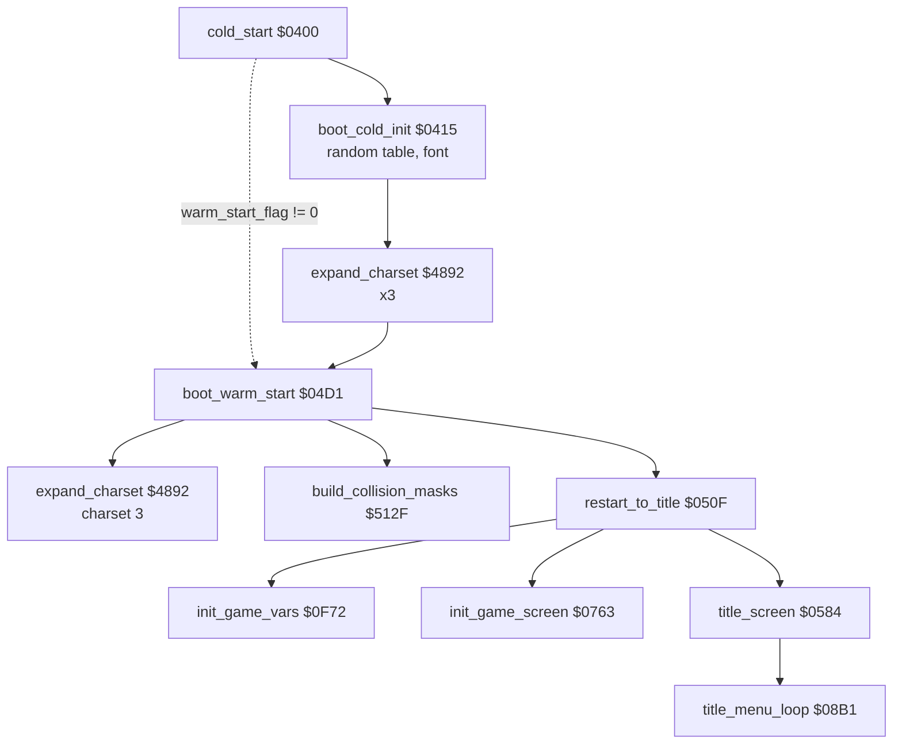
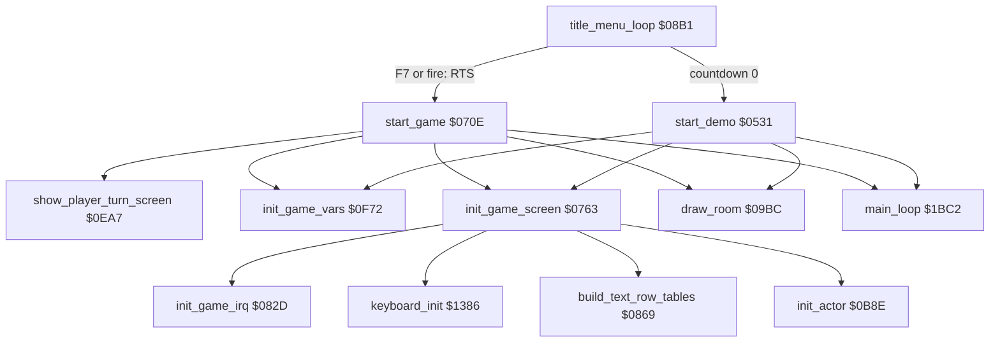
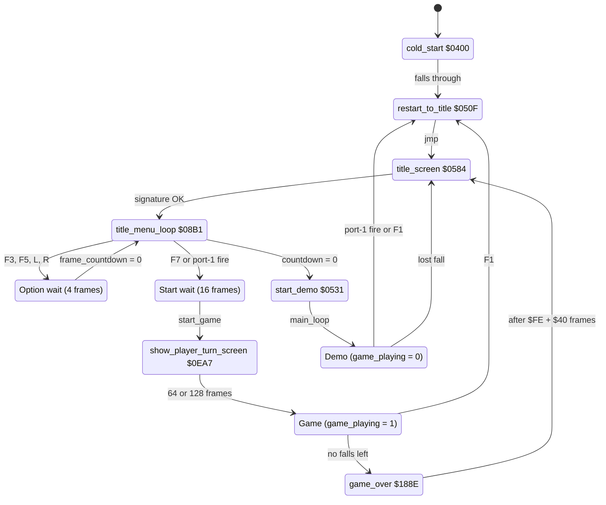

# Bruce Lee: start-up, title and game start

This page covers the way from the program entry to the first pass of the main loop:
- the cold start and its one-time work: the random table, the title font and the expansion of the room charsets;
- the warm start path, that no code in this release uses;
- [`restart_to_title`](../../src/restart.asm#L6) [`$050F`](../reference/modules/restart.md#restart_to_title), the title screen and its menu loop (F3, F5, F7, L/R, fire);
- the option highlights and the TM sprite;
- the countdown that starts the demo, and [`start_demo`](../../src/restart.asm#L24) [`$0531`](../reference/modules/restart.md#start_demo);
- [`start_game`](../../src/title.asm#L185) [`$070E`](../reference/modules/title.md#start_game), the game screen and its interrupt setup, and the player-turn screen.

**Sources:** [init.asm](../reference/modules/init.md), [restart.asm](../reference/modules/restart.md), [title.asm](../reference/modules/title.md), [game_setup.asm](../reference/modules/game_setup.md), [title_menu.asm](../reference/modules/title_menu.md), [title_options.asm](../reference/modules/title_options.md), [player_turn.asm](../reference/modules/player_turn.md), [casbuf.asm](../reference/modules/casbuf.md), the title part of [keyboard.asm](../reference/modules/keyboard.md) and [raster_irq_screens.asm](../reference/modules/raster_irq_screens.md). **Assets:** [../../assets/fonts/](../../assets/fonts/) and the TM sprite in [../../assets/sprites/](../../assets/sprites/).

**Other pages.** The raster IRQ mechanics are in [interrupts.md](interrupts.md). The main loop and the demo exit are in [main_loop.md](main_loop.md). [`init_actor`](../../src/actors.asm#L6) [`$0B8E`](../reference/modules/actors.md#init_actor) and the joystick handedness are in [actors.md](actors.md). The title tune is in [sound.md](sound.md). The signature checks are in [protection.md](protection.md). [`print_message`](../../src/text.asm#L6) [`$17E2`](../reference/modules/text.md#print_message) and the message table are in [text_messages.md](text_messages.md). [`draw_room`](../../src/room_draw.asm#L6) [`$09BC`](../reference/modules/room_draw.md#draw_room), the charset expansion and the text row tables are in [room_pipeline.md](room_pipeline.md). The game state machine after the start is in [room_flow.md](room_flow.md).

**Conventions.**
- Addresses are C64 addresses. Names are the names of the knowledge.
- A *pass* is one run of [`main_loop`](../../src/main_loop.asm#L6) [`$1BC2`](../reference/modules/main_loop.md#main_loop). A *frame* is one video frame: one run of the raster IRQ chain, 50 per second on PAL. On the title, a frame is one run of [`irq_split_top`](../../src/raster_irq_screens.asm#L74) [`$152C`](../reference/modules/raster_irq_screens.md#irq_split_top). On the player-turn screen, it is one run of [`irq_player_up_screen`](../../src/raster_irq_screens.asm#L6) [`$14A4`](../reference/modules/raster_irq_screens.md#irq_player_up_screen).
- The *demo* is the attract mode: [`game_playing`](../../src/constants.asm#L120) [`$0104`](../reference/variables.md#game_playing) = 0. In a game, [`game_playing`](../../src/constants.asm#L120) = 1.
- A *visit* of the title is one run of [`title_screen`](../../src/title.asm#L6) [`$0584`](../reference/modules/title.md#title_screen).
- A *text line* is an entry of the text row tables [`text_row_top_lo`](../../src/variables.asm#L74) [`$4338`](../reference/modules/variables.md#text_row_top_lo) and the others. Text line *n* (n ≥ 1) starts at screen row 2n-1 ([room_pipeline.md](room_pipeline.md), section 3.3).
- A *key code* is the value in [`key_code`](../../src/constants.asm#L123) [`$0109`](../reference/variables.md#key_code): column×8 + row of the keyboard matrix, bit 7 = shift.
- **Observed** marks a fact that a run showed. **Code** marks a fact from the code only. **Conclusion** marks an interpretation.
- The coverage is the OR of all coverage runs (`cov_all.bin`). "Ran" or "never ran" in this page comes from it.

## 1. Overview

From the entry to the title:



From the title to the game or the demo:



| Node | Link |
|---|---|
| Cold start | [`cold_start`](../../src/init.asm#L6) [`$0400`](../reference/modules/init.md#cold_start), [`boot_cold_init`](../../src/init.asm#L23) [`$0415`](../reference/modules/init.md#boot_cold_init), [`boot_warm_start`](../../src/init.asm#L114) [`$04D1`](../reference/modules/init.md#boot_warm_start) |
| One-time work | [`expand_charset`](../../src/charset_expand.asm#L43) [`$4892`](../reference/modules/charset_expand.md#expand_charset), [`build_collision_masks`](../../src/collision.asm#L21) [`$512F`](../reference/modules/collision.md#build_collision_masks) |
| Title | [`restart_to_title`](../../src/restart.asm#L6) [`$050F`](../reference/modules/restart.md#restart_to_title), [`title_screen`](../../src/title.asm#L6) [`$0584`](../reference/modules/title.md#title_screen), [`title_menu_loop`](../../src/title_menu.asm#L6) [`$08B1`](../reference/modules/title_menu.md#title_menu_loop) |
| Start | [`start_game`](../../src/title.asm#L185) [`$070E`](../reference/modules/title.md#start_game), [`start_demo`](../../src/restart.asm#L24) [`$0531`](../reference/modules/restart.md#start_demo), [`show_player_turn_screen`](../../src/player_turn.asm#L6) [`$0EA7`](../reference/modules/player_turn.md#show_player_turn_screen) |
| Setup | [`init_game_vars`](../../src/game_vars.asm#L6) [`$0F72`](../reference/modules/game_vars.md#init_game_vars), [`init_game_screen`](../../src/game_setup.asm#L6) [`$0763`](../reference/modules/game_setup.md#init_game_screen), [`init_game_irq`](../../src/game_setup.asm#L97) [`$082D`](../reference/modules/game_setup.md#init_game_irq), [`keyboard_init`](../../src/keyboard.asm#L6) [`$1386`](../reference/modules/keyboard.md#keyboard_init), [`build_text_row_tables`](../../src/game_setup.asm#L124) [`$0869`](../reference/modules/game_setup.md#build_text_row_tables), [`init_actor`](../../src/actors.asm#L6) [`$0B8E`](../reference/modules/actors.md#init_actor), [`draw_room`](../../src/room_draw.asm#L6) [`$09BC`](../reference/modules/room_draw.md#draw_room), [`main_loop`](../../src/main_loop.asm#L6) [`$1BC2`](../reference/modules/main_loop.md#main_loop) |

The way through the code:
1. **Code:** [`cold_start`](../../src/init.asm#L6) [`$0400`](../reference/modules/init.md#cold_start) has no RTS and no JMP at its end. It falls into [`restart_to_title`](../../src/restart.asm#L6) [`$050F`](../reference/modules/restart.md#restart_to_title), the first byte after `init.asm`.
2. **Code:** [`title_screen`](../../src/title.asm#L6) [`$0584`](../reference/modules/title.md#title_screen) calls [`title_menu_loop`](../../src/title_menu.asm#L6) [`$08B1`](../reference/modules/title_menu.md#title_menu_loop) with JSR. The loop returns only when a game is to start. The code after the JSR is [`start_game`](../../src/title.asm#L185) [`$070E`](../reference/modules/title.md#start_game).
3. **Code:** for the demo, [`title_menu_loop`](../../src/title_menu.asm#L6) jumps to [`start_demo`](../../src/restart.asm#L24) [`$0531`](../reference/modules/restart.md#start_demo) and does not return. [`start_demo`](../../src/restart.asm#L24) sets the stack pointer to `$FD`, so the return address of the JSR is dropped.
4. **Code:** [`start_game`](../../src/title.asm#L185) and [`start_demo`](../../src/restart.asm#L24) both end with `jmp main_loop`. From there on, [main_loop.md](main_loop.md) and [room_flow.md](room_flow.md) describe the game.

## 2. The state machine of the title, the demo and the game start



| State | Condition | Next state | Code |
|---|---|---|---|
| Entry | the loader jumps to `$0400` | [`cold_start`](../../src/init.asm#L6) | [`cold_start`](../../src/init.asm#L6) [`$0400`](../reference/modules/init.md#cold_start) |
| [`cold_start`](../../src/init.asm#L6) | always (no branch at the end) | [`restart_to_title`](../../src/restart.asm#L6) | [`cold_start`](../../src/init.asm#L6) [`$050C`](../../src/init.asm#L142) is the last instruction |
| [`restart_to_title`](../../src/restart.asm#L6) | always | [`title_screen`](../../src/title.asm#L6) | [`restart_to_title`](../../src/restart.asm#L6) [`$052E`](../../src/restart.asm#L22) |
| [`title_screen`](../../src/title.asm#L6) | the six signature bytes XOR to 0 | menu loop | [`title_tamper_check`](../../src/title.asm#L160) [`$06DD`](../reference/modules/title.md#title_tamper_check), [`title_wait_input`](../../src/title.asm#L174) [`$070B`](../../src/title.asm#L183) |
| [`title_screen`](../../src/title.asm#L6) | the XOR is not 0 | endless memory wipe | [`tamper_wipe_loop`](../../src/title.asm#L169) [`$06F3`](../reference/modules/title.md#tamper_wipe_loop) (never ran) |
| Menu loop | key code `$05`, `$06`, `$2A`, `$AA`, `$11` or `$91` | option wait | [`title_toggle_players`](../../src/title_menu.asm#L73) [`$092C`](../reference/modules/title_menu.md#title_toggle_players), [`title_toggle_opponent`](../../src/title_menu.asm#L54) [`$0908`](../reference/modules/title_menu.md#title_toggle_opponent), [`title_handedness_keys`](../../src/title_menu.asm#L95) [`$0956`](../reference/modules/title_menu.md#title_handedness_keys) |
| Option wait | [`frame_countdown`](../../src/constants.asm#L34) [`$48`](../reference/variables.md#frame_countdown) = 0 (after 4 frames) | menu loop | [`title_wait_frames`](../../src/title_menu.asm#L68) [`$0925`](../reference/modules/title_menu.md#title_wait_frames) |
| Menu loop | key code `$03` (F7), or bit 4 of [`CIAPRB`](../../src/constants.asm#L231) [`$DC01`](../reference/variables.md#CIAPRB) = 0 (port-1 fire) | start wait | [`title_function_keys`](../../src/title_menu.asm#L21) [`$08D6`](../../src/title_menu.asm#L24), [`title_check_fire`](../../src/title_menu.asm#L40) [`$08F5`](../reference/modules/title_menu.md#title_check_fire) |
| Start wait | fire released and 16 frames | [`start_game`](../../src/title.asm#L185) | [`title_start_pressed`](../../src/title_menu.asm#L44) [`$08FC`](../reference/modules/title_menu.md#title_start_pressed) |
| [`start_game`](../../src/title.asm#L185) | [`show_player_turn_screen`](../../src/player_turn.asm#L6) returns | game | [`start_game`](../../src/title.asm#L185) [`$0738`](../../src/title.asm#L202), [`start_game`](../../src/title.asm#L185) [`$0760`](../../src/title.asm#L219) |
| Menu loop | [`attract_countdown`](../../src/constants.asm#L35) [`$49`](../reference/variables.md#attract_countdown) = 0 and [`title_timeout_hi`](../../src/constants.asm#L36) [`$4A`](../reference/variables.md#title_timeout_hi) = 0 | [`start_demo`](../../src/restart.asm#L24) | [`title_menu_loop`](../../src/title_menu.asm#L6) [`$08B7`](../../src/title_menu.asm#L10) |
| [`start_demo`](../../src/restart.asm#L24) | always | demo | [`start_demo`](../../src/restart.asm#L24) [`$0581`](../../src/restart.asm#L58) |
| Demo | port-1 fire, or the F1 key | [`restart_to_title`](../../src/restart.asm#L6) | [`check_demo_exit`](../../src/status.asm#L18) [`$19B8`](../reference/modules/status.md#check_demo_exit) ([main_loop.md](main_loop.md)) |
| Demo | Bruce loses a fall | [`title_screen`](../../src/title.asm#L6) (and [`title_music_countdown`](../../src/title_menu.asm#L150) = 0) | [`lose_fall`](../../src/game_over.asm#L6) [`$1818`](../reference/modules/game_over.md#lose_fall) |
| Game | the F1 key | [`restart_to_title`](../../src/restart.asm#L6) | [`handle_game_keys`](../../src/status.asm#L236) [`$1B47`](../../src/status.asm#L251) |
| Game | no falls left | [`game_over`](../../src/game_over.asm#L67) | [`lose_fall`](../../src/game_over.asm#L6) [`$1818`](../reference/modules/game_over.md#lose_fall) ([room_flow.md](room_flow.md), section 6) |
| [`game_over`](../../src/game_over.asm#L67) | one player, or the other player has no falls | [`title_screen`](../../src/title.asm#L6) | [`game_over`](../../src/game_over.asm#L67) [`$1981`](../../src/game_over.asm#L184) |
| Game in room 10 | `$00` is not `$EF` (does not happen in this release) | [`title_screen`](../../src/title.asm#L6) | [`room10_sabotage_room_data`](../../src/room_update.asm#L884) [`$3CAF`](../reference/modules/room_update.md#room10_sabotage_room_data) ([rooms_10_19.md](rooms_10_19.md)) |

**Observed:**
- The `title` test reaches [`title_menu_loop`](../../src/title_menu.asm#L6) from the entry. The `game_start` test starts a game with port-1 fire and reaches [`main_loop`](../../src/main_loop.asm#L6). The `demo` test reaches [`start_demo`](../../src/restart.asm#L24) without input.
- In the `explore1` run, the title still shows 2400 frames after the entry. 220 frames later a room of the demo shows. Fire on port 1 in the demo then brings back the title.
- In the `modes` run, F1 in a game brings back the title.

**Code:** three ways back go to [`title_screen`](../../src/title.asm#L6) [`$0584`](../reference/modules/title.md#title_screen) directly and skip [`restart_to_title`](../../src/restart.asm#L6): [`lose_fall`](../../src/game_over.asm#L6) in the demo, [`game_over`](../../src/game_over.asm#L67), and the room 10 protection failure. They do not run [`init_game_vars`](../../src/game_vars.asm#L6) and [`init_game_screen`](../../src/game_setup.asm#L6) before the title. [`start_game`](../../src/title.asm#L185) runs both later.

## 3. Catalogue

| Name | Address | Layout | Readers | Writers |
|---|---|---|---|---|
| [`random_table`](../../src/constants.asm#L137) | `$0200-$02FF` | 256 bytes of SID voice-3 noise | [`random_byte`](../../src/interrupts.asm#L75) [`$1159`](../reference/modules/interrupts.md#random_byte), through [`random_ptr`](../../src/constants.asm#L18) | [`cold_start`](../../src/init.asm#L6) [`$043A`](../../src/init.asm#L41) |
| [`random_ptr`](../../src/constants.asm#L18) | `$0016` | pointer into [`random_table`](../../src/constants.asm#L137) | [`random_byte`](../../src/interrupts.asm#L75) [`$1159`](../reference/modules/interrupts.md#random_byte) | [`restart_to_title`](../../src/restart.asm#L6) [`$0521`](../../src/restart.asm#L16) (set to `$0200`); [`random_byte`](../../src/interrupts.asm#L75) and [`game_frame_update`](../../src/frame_update.asm#L6) [`$15A8`](../reference/modules/frame_update.md#game_frame_update) (low byte + 1) |
| [`warm_start_flag`](../../src/casbuf.asm#L30) | `$03FF` | 1 byte, non-zero = warm start | [`cold_start`](../../src/init.asm#L6) [`$040D`](../../src/init.asm#L19) | nothing in the image |
| [`irq_chain_vector`](../../src/init.asm#L15) / [`irq_vector_hi`](../../src/init.asm#L16) | `$0408`/`$0409` | address of the next raster IRQ handler. The two bytes are the `AND #$EF` of the boot code. | [`irq_handler`](../../src/interrupts.asm#L6) [`$1103`](../reference/modules/interrupts.md#irq_handler) | [`title_screen`](../../src/title.asm#L6) [`$05DC`](../../src/title.asm#L45), [`init_game_irq`](../../src/game_setup.asm#L97) [`$083E`](../../src/game_setup.asm#L105), [`show_player_turn_screen`](../../src/player_turn.asm#L6) [`$0F02`](../../src/player_turn.asm#L50), the IRQ handlers |
| [`title_charset`](../../src/vic_bank2.asm#L254) | `$8800-$8BFF` | 128 chars: the ROM font and its inverse (section 4.3) | VIC, below the title split and in the status line | [`cold_start`](../../src/init.asm#L6) [`$0449-$0478`](../../src/init.asm#L49), [`init_game_screen`](../../src/game_setup.asm#L6) [`$07B9`](../../src/game_setup.asm#L43) (char `$20`) |
| [`title_font`](../../src/vic_bank2.asm#L124) | `$8400-$87FF` | chars `$80-$FF` of the charset at `$8000`, multicolour | VIC only | nothing (image data) |
| [`screen_ram`](../../src/vic_bank2.asm#L376) | `$8C00-$8FE7` | the screen of VIC bank 2 | VIC | [`title_screen`](../../src/title.asm#L6), [`show_player_turn_screen`](../../src/player_turn.asm#L6), [`init_game_screen`](../../src/game_setup.asm#L6) |
| [`sprite_blocks+$240`](../../src/vic_bank2.asm#L6) | `$83C0-$83FF` | sprite block `$0F`: the TM sign on the title | VIC | [`title_screen`](../../src/title.asm#L6) [`$059F`](../../src/title.asm#L19), [`title_screen`](../../src/title.asm#L6) [`$05D4`](../../src/title.asm#L41) |
| [`tm_sprite_rows`](../../src/title_options.asm#L24) | `$0E40-$0E4B` | 12 bytes: rows 4-7 of the TM sprite, 3 bytes per row | [`title_screen`](../../src/title.asm#L6) [`$05D1`](../../src/title.asm#L40) | none |
| [`title_row_datasoft`](../../src/room_tables.asm#L26) | `$4A0D` | 40 big-font codes: "DATASOFT PRESENTS" | [`title_copy_text`](../../src/title.asm#L76) [`$0628`](../reference/modules/title.md#title_copy_text) | none |
| [`title_row_bruce_lee_top`](../../src/room_tables.asm#L6) / [`title_row_bruce_lee_bottom`](../../src/room_tables.asm#L16) | `$49BD`/`$49E5` | 40 codes each: the two halves of "BRUCE LEE" | [`title_copy_text`](../../src/title.asm#L76) [`$0630`](../../src/title.asm#L80), [`title_copy_text`](../../src/title.asm#L76) [`$0638`](../../src/title.asm#L83) | none |
| [`title_row_byline`](../../src/room_tables.asm#L36) | `$4A35` | 40 codes: "BY RON J FORTIER" | [`title_copy_text`](../../src/title.asm#L76) [`$0640`](../../src/title.asm#L86) | none |
| [`player_banner_top`](../../src/room_tables.asm#L47) / [`player_banner_bottom`](../../src/room_tables.asm#L53) | `$4A5D`/`$4A6D` | 16 codes each: "PLAYER n", the digit in bytes 14-15 | [`show_player_turn_screen`](../../src/player_turn.asm#L6) [`$0EED`](../../src/player_turn.asm#L41) | [`show_player_turn_screen`](../../src/player_turn.asm#L6) [`$0ED9`](../../src/player_turn.asm#L31) (the digit) |
| [`player_digit_top`](../../src/room_tables.asm#L60) / [`player_digit_bottom`](../../src/room_tables.asm#L64) | `$4A7D`/`$4A81` | 2 codes per player | [`show_player_turn_screen`](../../src/player_turn.asm#L6) [`$0ED9`](../../src/player_turn.asm#L31) | none |
| [`two_player_mode`](../../src/variables.asm#L9) | `$42C9` | 0 = one player, 1 = two players | [`start_game`](../../src/title.asm#L185), [`show_player_turn_screen`](../../src/player_turn.asm#L6), [`lose_fall`](../../src/game_over.asm#L6) | [`title_toggle_players`](../../src/title_menu.asm#L73) [`$092C`](../reference/modules/title_menu.md#title_toggle_players), [`title_restore_options`](../../src/title.asm#L132) [`$06A4`](../../src/title.asm#L134), [`start_demo`](../../src/restart.asm#L24) [`$056A`](../../src/restart.asm#L48) |
| [`human_opponent_mode`](../../src/variables.asm#L11) | `$42CA` | 0 = computer, 1 = human opponent (joystick 2) | [`init_game_vars`](../../src/game_vars.asm#L6), [`start_game`](../../src/title.asm#L185), many game routines | [`title_toggle_opponent`](../../src/title_menu.asm#L54) [`$0908`](../reference/modules/title_menu.md#title_toggle_opponent), [`title_restore_options`](../../src/title.asm#L132) [`$06AA`](../../src/title.asm#L136), [`start_demo`](../../src/restart.asm#L24) [`$0567`](../../src/restart.asm#L47) |
| [`saved_two_player_mode`](../../src/variables.asm#L13) / [`saved_human_opponent_mode`](../../src/variables.asm#L15) | `$42CB`/`$42CC` | the options while the demo runs | [`title_restore_options`](../../src/title.asm#L132) [`$06A1`](../reference/modules/title.md#title_restore_options) | `title_toggle_*`, [`start_game`](../../src/title.asm#L185) [`$072F`](../../src/title.asm#L199), [`start_demo`](../../src/restart.asm#L24) [`$055C`](../../src/restart.asm#L43) |
| [`joy_handedness_p1`](../../src/actor_room_tables.asm#L99) / [`joy_handedness_p2`](../../src/actor_room_tables.asm#L102) | `$1383`/`$1384` | 0 = left-handed, 1 = right-handed | the joystick code ([actors.md](actors.md)) | [`set_joy1_left`](../../src/title_menu.asm#L105) [`$0969`](../reference/modules/title_menu.md#set_joy1_left) and the three others |
| [`frame_countdown`](../../src/constants.asm#L34) | `$0048` | frames to wait; each IRQ handler decrements it to 0 | the wait loops | [`title_start_pressed`](../../src/title_menu.asm#L44) [`$08FF`](../../src/title_menu.asm#L47), [`title_option_done`](../../src/title_menu.asm#L60) [`$0921`](../../src/title_menu.asm#L66), [`show_player_turn_screen`](../../src/player_turn.asm#L6) [`$0F3C`](../../src/player_turn.asm#L74) |
| [`attract_countdown`](../../src/constants.asm#L35) / [`title_timeout_hi`](../../src/constants.asm#L36) | `$0049`/`$004A` | the title countdown (section 7.3) | [`title_menu_loop`](../../src/title_menu.asm#L6) [`$08B1`](../reference/modules/title_menu.md#title_menu_loop), [`title_idle`](../../src/title_menu.asm#L29) [`$08E0`](../reference/modules/title_menu.md#title_idle) | [`title_wait_input`](../../src/title.asm#L174) [`$06FA`](../reference/modules/title.md#title_wait_input), [`title_option_done`](../../src/title_menu.asm#L60) [`$0919`](../../src/title_menu.asm#L62), [`irq_split_top`](../../src/raster_irq_screens.asm#L74) [`$1532`](../../src/raster_irq_screens.asm#L79) |
| [`title_music_countdown`](../../src/title_menu.asm#L150) | `$09BB` | visits until the title tune plays again | [`title_music`](../../src/title.asm#L146) [`$06C2`](../../src/title.asm#L149) | [`title_music`](../../src/title.asm#L146) [`$06C9`](../../src/title.asm#L152), [`lose_fall`](../../src/game_over.asm#L6) [`$1820`](../../src/game_over.asm#L10), [`handle_game_keys`](../../src/status.asm#L236) [`$1B58`](../../src/status.asm#L259) |
| [`sound_toggle`](../../src/actor_room_tables.asm#L105) | `$1385` | 0 = sound on | [`title_music`](../../src/title.asm#L146) [`$06BD`](../reference/modules/title.md#title_music) | [`handle_game_keys`](../../src/status.asm#L236) (S key) |
| [`key_code`](../../src/constants.asm#L123) / [`key_pending`](../../src/constants.asm#L126) / [`key_scan_mode`](../../src/constants.asm#L128) | `$0109`/`$010C`/`$010E` | the last key code; 1 = a new key; 0 = full matrix | [`title_scan_keys`](../../src/title_menu.asm#L11) [`$08BA`](../reference/modules/title_menu.md#title_scan_keys) | [`keyboard_scan`](../../src/keyboard.asm#L18) [`$139E`](../reference/modules/keyboard.md#keyboard_scan), [`title_scan_keys`](../../src/title_menu.asm#L11) |
| [`game_playing`](../../src/constants.asm#L120) | `$0104` | 0 = demo, 1 = game | [`random_byte`](../../src/interrupts.asm#L75), [`lose_fall`](../../src/game_over.asm#L6), [`check_demo_exit`](../../src/status.asm#L18) and others | [`init_game_vars`](../../src/game_vars.asm#L6) [`$0F72`](../reference/modules/game_vars.md#init_game_vars) (1), [`start_demo`](../../src/restart.asm#L24) [`$0556`](../../src/restart.asm#L41) (0) |
| [`text_single_height`](../../src/constants.asm#L118) | `$0100` | non-zero = [`print_message`](../../src/text.asm#L6) writes only the upper row | [`set_text_line_ptrs`](../../src/status.asm#L120) [`$1A67`](../reference/modules/status.md#set_text_line_ptrs) | [`title_screen`](../../src/title.asm#L6) [`$0592`](../../src/title.asm#L13), [`title_screen`](../../src/title.asm#L6) [`$064D`](../../src/title.asm#L92) |
| [`turn_wait_lo`](../../src/constants.asm#L19) / [`turn_wait_mid`](../../src/constants.asm#L20) / [`turn_wait_hi`](../../src/constants.asm#L21) | `$0018`/`$0019`/`$001A` | 3-byte busy-wait counter of the player-turn screen | [`turn_screen_wait`](../../src/player_turn.asm#L79) [`$0F47`](../reference/modules/player_turn.md#turn_screen_wait) | [`show_player_turn_screen`](../../src/player_turn.asm#L6) [`$0F34`](../../src/player_turn.asm#L70) |
| [`dead_copy_values`](../../src/title_options.asm#L17) | `$0E3B-$0E3F` | 5 bytes, read and discarded | [`dummy_table_read`](../../src/title_options.asm#L6) [`$0E2E`](../reference/modules/title_options.md#dummy_table_read) | none |

## 4. The cold start, step by step

[`cold_start`](../../src/init.asm#L6) [`$0400`](../reference/modules/init.md#cold_start) is the program entry. The rebuilt loader jumps there with the entry state of the crack ([report.md](../../report.md), section 1).

1. [`cold_start`](../../src/init.asm#L6) [`$0400`](../reference/modules/init.md#cold_start): `SEI`, `CLD`, stack pointer `$FF`.
2. [`cold_start`](../../src/init.asm#L6) [`$0405`](../../src/init.asm#L13): clears bit 4 of [`SCROLY`](../../src/constants.asm#L158) ([`$D011`](../reference/variables.md#SCROLY)). The screen is blank. The `AND #$EF` at `$0408` is also [`irq_chain_vector`](../../src/init.asm#L15) [`$0408`](../reference/modules/init.md#irq_chain_vector) (section 4.4).
3. [`cold_start`](../../src/init.asm#L6) [`$040D`](../../src/init.asm#L19): when [`warm_start_flag`](../../src/casbuf.asm#L30) [`$03FF`](../reference/modules/casbuf.md#warm_start_flag) is not 0, jumps to [`boot_warm_start`](../../src/init.asm#L114) [`$04D1`](../reference/modules/init.md#boot_warm_start) (section 4.1). **Observed:** this jump never ran.
4. [`boot_cold_init`](../../src/init.asm#L23) [`$0415`](../reference/modules/init.md#boot_cold_init): writes 0 to [`sfx_v1_state`](../../src/sfx_voice1.asm#L6) [`$EB00`](../reference/modules/sfx_voice1.md#sfx_v1_state), [`sfx_v2_state`](../../src/sfx_voice2.asm#L6) and [`sfx_v3_state`](../../src/sfx_voice3.asm#L6). The three sound-effect players are idle.
5. [`boot_cold_init`](../../src/init.asm#L23) [`$0420`](../../src/init.asm#L28): writes 0 to [`RANDOM`](../../src/constants.asm#L208) ([`$D41B`](../reference/variables.md#RANDOM)). **Code:** `$D41B` is a read-only SID register, so the write does nothing.
6. [`boot_cold_init`](../../src/init.asm#L23) [`$0423`](../../src/init.asm#L29): SID voice 3 gets the frequency `$FFFF` and the noise waveform ([`VCREG3`](../../src/constants.asm#L201) = `$80`, gate off).
7. [`boot_random_fill`](../../src/init.asm#L35) [`$0432`](../reference/modules/init.md#boot_random_fill): fills [`random_table`](../../src/constants.asm#L137) [`$0200-$02FF`](../reference/variables.md#random_table) with 256 reads of [`RANDOM`](../../src/constants.asm#L208). A `DEY` loop of 96 steps runs between two reads (section 4.2).
8. [`cold_start`](../../src/init.asm#L6) [`$0440`](../../src/init.asm#L44): `JSR colour_cycle_counter` `$0080`. The byte at `$0080` is `RTS`, a patch of the crack ([report.md](../../report.md), section 1). The call returns at once.
9. [`cold_start`](../../src/init.asm#L6) [`$0443`](../../src/init.asm#L45): [`R6510`](../../src/constants.asm#L8) = `$32`. The character ROM is visible at `$D000`.
10. [`boot_copy_font`](../../src/init.asm#L48) [`$0449`](../reference/modules/init.md#boot_copy_font): copies the first 512 bytes of the character ROM to [`title_charset`](../../src/vic_bank2.asm#L254) [`$8800-$89FF`](../reference/modules/vic_bank2.md#title_charset), with an inverted copy at `$8A00-$8BFF` (section 4.3).
11. [`cold_start`](../../src/init.asm#L6) [`$0462`](../../src/init.asm#L59): [`R6510`](../../src/constants.asm#L8) = `$36`. I/O is visible again.
12. [`boot_patch_font`](../../src/init.asm#L62) [`$0468`](../reference/modules/init.md#boot_patch_font): changes three chars: char `$20` = solid block (`$FF` × 8 at `$8900`), char `$42` = right bar (`$03` × 8 at `$8A10`), char `$56` = left bar (`$C0` × 8 at `$8AB0`). The bars frame the selected options (section 7.4).
13. [`boot_expand_charsets`](../../src/init.asm#L71) [`$047A`](../reference/modules/init.md#boot_expand_charsets): three calls of [`expand_charset`](../../src/charset_expand.asm#L43) [`$4892`](../reference/modules/charset_expand.md#expand_charset). [`charset_src_0`](../../src/room_charset_src.asm#L6) [`$9000`](../reference/graphics.md#charset_src_0) goes to [`room_charset_0`](../../src/constants.asm#L142) [`$A000`](../reference/variables.md#room_charset_0), `$9400` to `$A800`, `$9800` to `$B000`. Each call expands 128 source chars ([`draw_count`](../../src/constants.asm#L110) [`$F3`](../reference/variables.md#draw_count) = `$7F`): source rows 0-3 go to the first 1 KB, rows 4-7 to the second 1 KB, and each row is written two times. [room_pipeline.md](room_pipeline.md), section 3.1, has the format.
14. [`boot_warm_start`](../../src/init.asm#L114) [`$04D1`](../reference/modules/init.md#boot_warm_start): the fourth call, `$9C00` to [`room_charset_3`](../../src/constants.asm#L145) [`$B800`](../reference/variables.md#room_charset_3). At `$04E5` the stack pointer becomes `$B8` (the high byte of `$B800`, in A at that moment). It stays `$B8` until [`restart_to_title`](../../src/restart.asm#L6).
15. [`cold_start`](../../src/init.asm#L6) [`$04F0`](../../src/init.asm#L131): [`build_collision_masks`](../../src/collision.asm#L21) [`$512F`](../reference/modules/collision.md#build_collision_masks). It first waits until the signature bytes at `$CF8F` and `$CFAF` are both `$B9` ([protection.md](protection.md)). It then builds the actor collision masks. **Code:** the masks overwrite the charset sources at `$9000-$9FBF`, so the expansion must come first ([room_pipeline.md](room_pipeline.md), section 3.2).
16. [`cold_start`](../../src/init.asm#L6) [`$04F3`](../../src/init.asm#L132): [`init_hook_rts`](../../src/room_state.asm#L139) [`$10F7`](../reference/modules/room_state.md#init_hook_rts), a bare `RTS`.
17. [`cold_start`](../../src/init.asm#L6) [`$04F6`](../../src/init.asm#L133): [`R6510`](../../src/constants.asm#L8) = `$35`. RAM is at `$A000-$BFFF` and `$E000-$FFFF`, I/O at `$D000`. The IRQ vector at `$FFFE` is now the RAM vector of the game.
18. [`cold_start`](../../src/init.asm#L6) [`$04FA`](../../src/init.asm#L135): sprite colours. Sprites 1, 3 and 4 = `$F0` (black), sprite 0 = `$F7` (yellow), sprite 2 = `$F5` (green).
19. The next byte is [`restart_to_title`](../../src/restart.asm#L6) [`$050F`](../reference/modules/restart.md#restart_to_title) (section 5).

**Observed:** every step except step 3's jump ran in the coverage. The c64-testing scenarios stop at [`cold_start`](../../src/init.asm#L6) [`$0440`](../../src/init.asm#L44) and write a fixed [`random_table`](../../src/constants.asm#L137), so that the original and the rebuild use the same table.

### 4.1 The warm start path

- **Code:** with [`warm_start_flag`](../../src/casbuf.asm#L30) [`$03FF`](../reference/modules/casbuf.md#warm_start_flag) ≠ 0, the cold start skips steps 4-13. It does not fill the random table, does not copy the ROM font and does not expand charsets 0-2. It still expands charset 3, builds the collision masks and sets the sprite colours.
- **Code:** no code in the clean image writes [`warm_start_flag`](../../src/casbuf.asm#L30). The crack's mover writes 0 there (`STA $03FF` in the mover code at `$A062` of the full image `unpacked/image.json`). The rebuild's loader takes the value 0 from the entry state.
- **Observed:** the warm start path never ran. The jump at [`cold_start`](../../src/init.asm#L6) [`$0412-$0414`](../../src/init.asm#L22) is the only code of `init.asm` that never ran.
- **Conclusion:** a warm start after a first run cannot work in this image. The charset source at `$9C00` is then overwritten by collision masks (step 15), so step 14 would expand mask bytes into charset 3. Also, [`irq_chain_vector`](../../src/init.asm#L15) (section 4.4) is no longer the `AND #$EF` instruction. The evidence does not show what set the flag in the original release.

### 4.2 The random table

- **Code:** [`random_table`](../../src/constants.asm#L137) [`$0200`](../reference/variables.md#random_table) holds 256 samples of the SID voice-3 noise output. Between two samples, the loop [`boot_random_fill`](../../src/init.asm#L35) [`$0432-$043E`](../reference/modules/init.md#boot_random_fill) runs 96 `DEY` steps, about 480 cycles.
- **Code:** [`restart_to_title`](../../src/restart.asm#L6) [`$051F`](../../src/restart.asm#L15) sets [`random_ptr`](../../src/constants.asm#L18) [`$0016`](../reference/variables.md#random_ptr) to `$0200` on each restart. [`random_byte`](../../src/interrupts.asm#L75) [`$1159`](../reference/modules/interrupts.md#random_byte) adds 1 to the low byte of [`random_ptr`](../../src/constants.asm#L18) and reads through it ([interrupts.md](interrupts.md)). [`game_frame_update`](../../src/frame_update.asm#L6) [`$15A8`](../reference/modules/frame_update.md#game_frame_update) also adds 1 in each frame of the game.
- **Code:** [`random_byte`](../../src/interrupts.asm#L75) is the only reader of the table. In the demo it returns 1 without a read, so the demo does not depend on the table.
- **Conclusion:** the noise depends on the time from power-on, so the table differs from run to run. This is why the tests write a fixed table.

### 4.3 The title font at `$8800`

[`boot_copy_font`](../../src/init.asm#L48) [`$0449-$0460`](../reference/modules/init.md#boot_copy_font) copies with X = 0-255:
- ROM `$D000+X` (ROM chars `$00-$1F`) to [`title_charset+$100`](../../src/vic_bank2.asm#L254) [`$8900`](../reference/modules/vic_bank2.md#title_charset) and its inverse to [`title_charset+$300`](../../src/vic_bank2.asm#L254) [`$8B00`](../reference/modules/vic_bank2.md#title_charset);
- ROM `$D100+X` (ROM chars `$20-$3F`) to [`title_charset`](../../src/vic_bank2.asm#L254) [`$8800`](../reference/modules/vic_bank2.md#title_charset) and its inverse to [`title_charset+$200`](../../src/vic_bank2.asm#L254) [`$8A00`](../reference/modules/vic_bank2.md#title_charset).

The result is a 128-char set:

| Chars | Content | Example |
|---|---|---|
| `$00-$1F` | ROM chars `$20-$3F`: space, punctuation, digits | char `$11` = "1" |
| `$20-$3F` | ROM chars `$00-$1F`: "@", A-Z, "[", "£", "]", arrows | char `$21` = "A"; char `$20` = solid block (patched) |
| `$40-$5F` | ROM chars `$20-$3F`, inverted | char `$40` = inverted space; char `$4D` = inverted "-"; char `$42` = right bar and char `$56` = left bar (patched) |
| `$60-$7F` | ROM chars `$00-$1F`, inverted | char `$61` = inverted "A" |

- **Code:** [`print_message`](../../src/text.asm#L6) [`$17E2`](../reference/modules/text.md#print_message) draws a message byte b as char (b - `$20`) & `$7F`. With this font, an ASCII letter or digit shows as itself. Adding `$40` to a char shows it inverted.
- **Code:** the VIC uses this font with [`VMCSB`](../../src/constants.asm#L163) ([`$D018`](../reference/variables.md#VMCSB)) = `$32`: below the title split ([`irq_split_bottom`](../../src/raster_irq_screens.asm#L112) [`$1574`](../reference/modules/raster_irq_screens.md#irq_split_bottom)) and for the status line of the game ([`irq_frame_top`](../../src/raster_irq_game.asm#L6) [`$48C1`](../reference/modules/raster_irq_game.md#irq_frame_top), [interrupts.md](interrupts.md)).
- **Code:** [`init_game_screen`](../../src/game_setup.asm#L6) [`$07B7-$07B9`](../../src/game_setup.asm#L42) writes the solid block of char `$20` again each time it runs.

The big font of the upper title is not built at run time. It is image data at [`title_font`](../../src/vic_bank2.asm#L124) [`$8400-$87FF`](../reference/graphics.md#title_font), the chars `$80-$FF` of the charset at `$8000`:


The image shows the 128 chars of [`title_font`](../../src/vic_bank2.asm#L124) as multicolour chars, in the order of their codes.

### 4.4 The IRQ vector inside the boot code

- **Code:** [`irq_handler`](../../src/interrupts.asm#L6) [`$1103`](../reference/modules/interrupts.md#irq_handler) ends with `JMP ($0408)`. The two bytes at `$0408/$0409` are the opcode and the operand of the `AND #$EF` at [`cold_start`](../../src/init.asm#L6) [`$0408`](../../src/init.asm#L17), `$29 $EF` in the image.
- **Code:** each screen writes its first IRQ handler there: [`irq_split_top`](../../src/raster_irq_screens.asm#L74) [`$152C`](../reference/modules/raster_irq_screens.md#irq_split_top) on the title, [`irq_frame_top`](../../src/raster_irq_game.asm#L6) [`$48C1`](../reference/modules/raster_irq_game.md#irq_frame_top) in the game, [`irq_player_up_screen`](../../src/raster_irq_screens.asm#L6) [`$14A4`](../reference/modules/raster_irq_screens.md#irq_player_up_screen) on the player-turn screen.
- **Conclusion:** after the first title, the instruction at `$0408` is no longer `AND #$EF`. A second run of [`cold_start`](../../src/init.asm#L6) from `$0400` would execute the vector bytes as an instruction. Nothing in the image jumps to `$0400`.

## 5. [`restart_to_title`](../../src/restart.asm#L6) [`$050F`](../reference/modules/restart.md#restart_to_title)

[`restart_to_title`](../../src/restart.asm#L6) runs after the cold start, after F1 in a game, and after the demo exit.

1. [`restart_to_title`](../../src/restart.asm#L6) [`$050F`](../reference/modules/restart.md#restart_to_title): `SEI`, `CLD`, stack pointer `$FD`.
2. [`restart_to_title`](../../src/restart.asm#L6) [`$0514`](../../src/restart.asm#L11): blanks the screen (bit 4 of [`SCROLY`](../../src/constants.asm#L158)).
3. [`restart_to_title`](../../src/restart.asm#L6) [`$051C`](../../src/restart.asm#L14): [`music_api_stop`](../../src/music_player.asm#L6) [`$E000`](../reference/modules/music_player.md#music_api_stop) stops the music and silences the SID.
4. [`restart_to_title`](../../src/restart.asm#L6) [`$051F`](../../src/restart.asm#L15): [`random_ptr`](../../src/constants.asm#L18) = [`random_table`](../../src/constants.asm#L137) [`$0200`](../reference/variables.md#random_table).
5. [`restart_to_title`](../../src/restart.asm#L6) [`$0528`](../../src/restart.asm#L20): [`init_game_vars`](../../src/game_vars.asm#L6) [`$0F72`](../reference/modules/game_vars.md#init_game_vars) ([room_flow.md](room_flow.md), section 2). This sets [`game_playing`](../../src/constants.asm#L120) to 1.
6. [`restart_to_title`](../../src/restart.asm#L6) [`$052B`](../../src/restart.asm#L21): [`init_game_screen`](../../src/game_setup.asm#L6) [`$0763`](../reference/modules/game_setup.md#init_game_screen) (section 10). It installs the game IRQ, which [`title_screen`](../../src/title.asm#L6) replaces at once.
7. [`restart_to_title`](../../src/restart.asm#L6) [`$052E`](../../src/restart.asm#L22): `jmp title_screen`.

**Code:** [`restart_to_title`](../../src/restart.asm#L6) does not change [`title_music_countdown`](../../src/title_menu.asm#L150) [`$09BB`](../reference/modules/title_menu.md#title_music_countdown). After F1, the title tune plays only when the countdown runs out (section 6.3).

## 6. The title screen, [`title_screen`](../../src/title.asm#L6) [`$0584`](../reference/modules/title.md#title_screen)

### 6.1 Step by step

1. [`title_screen`](../../src/title.asm#L6) [`$0584`](../reference/modules/title.md#title_screen): `SEI`, blank screen, [`silence_all_sound`](../../src/sound_effects.asm#L55) [`$255E`](../reference/modules/sound_effects.md#silence_all_sound).
2. [`title_screen`](../../src/title.asm#L6) [`$0590`](../../src/title.asm#L12): [`text_single_height`](../../src/constants.asm#L118) = 0, then [`clear_text_lines`](../../src/status.asm#L109) [`$1A56`](../reference/modules/status.md#clear_text_lines) clears text lines 0-12.
3. [`title_screen`](../../src/title.asm#L6) [`$0598`](../../src/title.asm#L15): [`dummy_table_read`](../../src/title_options.asm#L6) [`$0E2E`](../reference/modules/title_options.md#dummy_table_read). It loads the 5 bytes of [`dead_copy_values`](../../src/title_options.asm#L17) [`$0E3B`](../reference/modules/title_options.md#dead_copy_values) and keeps X. **Code:** it has no effect.
4. [`title_screen`](../../src/title.asm#L6) [`$059B`](../../src/title.asm#L16): clears sprite block `$0F` ([`sprite_blocks+$240`](../../src/vic_bank2.asm#L6) [`$83C0`](../reference/modules/vic_bank2.md#sprite_blocks), 64 bytes).
5. [`title_screen`](../../src/title.asm#L6) [`$05A5`](../../src/title.asm#L22): sprite 0 on, X-expanded, X bit 8 set; no Y expansion, no priority, no multicolour. [`SP0X`](../../src/constants.asm#L153) = `$0A` (X = 266), [`SP0Y`](../../src/constants.asm#L154) = `$56`, colour `$FF` (light grey), pointer `$0F`.
6. [`title_screen`](../../src/title.asm#L6) [`$05CF`](../../src/title.asm#L38): copies the 12 bytes of [`tm_sprite_rows`](../../src/title_options.asm#L24) [`$0E40`](../reference/modules/title_options.md#tm_sprite_rows) to [`sprite_blocks+$24C`](../../src/vic_bank2.asm#L6) [`$83CC`](../reference/modules/vic_bank2.md#sprite_blocks): rows 4-7 of the sprite. This is the TM sign after "BRUCE LEE".
7. [`title_screen`](../../src/title.asm#L6) [`$05DA`](../../src/title.asm#L44): [`irq_chain_vector`](../../src/init.asm#L15) = [`irq_split_top`](../../src/raster_irq_screens.asm#L74) [`$152C`](../reference/modules/raster_irq_screens.md#irq_split_top). The raster IRQ is on, at line `$FD`.
8. [`title_screen`](../../src/title.asm#L6) [`$05F9`](../../src/title.asm#L56): border and background `$F6` (blue). [`BGCOL1`](../../src/constants.asm#L172) [`$D022`](../reference/variables.md#BGCOL1) and [`BGCOL2`](../../src/constants.asm#L173) [`$D023`](../reference/variables.md#BGCOL2) = `$FF` (light grey). [`SCROLX`](../../src/constants.asm#L161) = `$08`.
9. [`title_screen`](../../src/title.asm#L6) [`$060E`](../../src/title.asm#L64): [`fill_colour_ram`](../../src/title_menu.asm#L139) [`$09A9`](../reference/modules/title_menu.md#fill_colour_ram) with A = `$FF`: all colour RAM = `$F`.
10. [`title_screen`](../../src/title.asm#L6) [`$0611-$0624`](../../src/title.asm#L65): colour RAM `$D9E0-$DBDF` (rows 12-24) = `$F1`. Screen `$8C00-$8D67` (rows 0-8) = `$DC`, the blank char of the big font.
11. [`title_copy_text`](../../src/title.asm#L76) [`$0628`](../reference/modules/title.md#title_copy_text): copies four rows of 40 codes, each ORed with `$80`: [`title_row_datasoft`](../../src/room_tables.asm#L26) [`$4A0D`](../reference/modules/room_tables.md#title_row_datasoft) to row 2, [`title_row_bruce_lee_top`](../../src/room_tables.asm#L6) [`$49BD`](../reference/modules/room_tables.md#title_row_bruce_lee_top) to row 5, [`title_row_bruce_lee_bottom`](../../src/room_tables.asm#L16) [`$49E5`](../reference/modules/room_tables.md#title_row_bruce_lee_bottom) to row 6, [`title_row_byline`](../../src/room_tables.asm#L36) [`$4A35`](../reference/modules/room_tables.md#title_row_byline) to row 9.
12. [`title_screen`](../../src/title.asm#L6) [`$064B`](../../src/title.asm#L91): [`text_single_height`](../../src/constants.asm#L118) = `$FF`. Then three [`print_message`](../../src/text.asm#L6) [`$17E2`](../reference/modules/text.md#print_message) calls (section 6.2).
13. [`title_invert_options`](../../src/title.asm#L106) [`$066D`](../reference/modules/title.md#title_invert_options): adds `$40` to the chars of the default options and of the key names (section 7.4).
14. [`title_restore_options`](../../src/title.asm#L132) [`$06A1`](../reference/modules/title.md#title_restore_options): copies [`saved_two_player_mode`](../../src/variables.asm#L13) [`$42CB`](../reference/modules/variables.md#saved_two_player_mode) to [`two_player_mode`](../../src/variables.asm#L9) [`$42C9`](../reference/modules/variables.md#two_player_mode) and [`saved_human_opponent_mode`](../../src/variables.asm#L15) [`$42CC`](../reference/modules/variables.md#saved_human_opponent_mode) to [`human_opponent_mode`](../../src/variables.asm#L11) [`$42CA`](../reference/modules/variables.md#human_opponent_mode). For each option that is 1, it calls [`toggle_players_highlight`](../../src/title_options.asm#L49) [`$0E65`](../reference/modules/title_options.md#toggle_players_highlight) or [`toggle_opponent_highlight`](../../src/title_options.asm#L34) [`$0E4C`](../reference/modules/title_options.md#toggle_opponent_highlight).
15. [`title_music`](../../src/title.asm#L146) [`$06BD`](../reference/modules/title.md#title_music): the title tune (section 6.3).
16. [`title_tamper_check`](../../src/title.asm#L160) [`$06DD`](../reference/modules/title.md#title_tamper_check): XORs [`protection_sig_a+$16`](../../src/protection_signature.asm#L23) [`$CF8F`](../reference/modules/protection_signature.md#protection_sig_a), [`protection_sig_a+$17`](../../src/protection_signature.asm#L23) [`$CF90`](../reference/modules/protection_signature.md#protection_sig_a), [`protection_sig_a+$18`](../../src/protection_signature.asm#L23) [`$CF91`](../reference/modules/protection_signature.md#protection_sig_a), [`protection_sig_b+$16`](../../src/protection_signature.asm#L41) [`$CFAF`](../reference/modules/protection_signature.md#protection_sig_b), [`protection_sig_b+$17`](../../src/protection_signature.asm#L41) [`$CFB0`](../reference/modules/protection_signature.md#protection_sig_b) and [`protection_sig_b+$18`](../../src/protection_signature.asm#L41) [`$CFB1`](../reference/modules/protection_signature.md#protection_sig_b). When the result is not 0, [`tamper_wipe_loop`](../../src/title.asm#L169) [`$06F3`](../reference/modules/title.md#tamper_wipe_loop) writes A through [`demo_input_ptr`](../../src/constants.asm#L24) [`$001D`](../reference/variables.md#demo_input_ptr) and adds 1 to its high byte, without end: one byte in each page ([protection.md](protection.md)).
17. [`title_wait_input`](../../src/title.asm#L174) [`$06FA`](../reference/modules/title.md#title_wait_input): [`title_timeout_hi`](../../src/constants.asm#L36) = `$09`, [`attract_countdown`](../../src/constants.asm#L35) = `$60` (section 7.3). Screen on, `CLI`.
18. [`title_screen`](../../src/title.asm#L6) [`$070B`](../../src/title.asm#L183): `JSR title_menu_loop` `$08B1`. On return, [`start_game`](../../src/title.asm#L185) [`$070E`](../reference/modules/title.md#start_game) follows (section 9).

**Observed:**
- Steps 1-13 and 15-18 ran. In step 14 the two calls ([`title_screen`](../../src/title.asm#L6) [`$06B2`](../../src/title.asm#L140) and [`title_screen`](../../src/title.asm#L6) [`$06BA`](../../src/title.asm#L145)) never ran: no run came back to the title with a saved option of 1.
- The [`tamper_wipe_loop`](../../src/title.asm#L169) never ran. The XOR of the six bytes in the image is 0.

### 6.2 The screen layout

| Rows | Content | Charset | Code |
|---|---|---|---|
| 0-1, 3-4, 7-8 | char `$DC`: blank | big font | [`title_screen`](../../src/title.asm#L6) [`$061D`](../../src/title.asm#L71) |
| 2 | "DATASOFT PRESENTS" | big font, single height | [`title_copy_text`](../../src/title.asm#L76) [`$062D`](../../src/title.asm#L79) |
| 5-6 | "BRUCE LEE", double height; TM sprite at the right | big font | [`title_copy_text`](../../src/title.asm#L76) [`$0635`](../../src/title.asm#L82) |
| 9 | "BY RON J FORTIER" | big font | [`title_copy_text`](../../src/title.asm#L76) [`$0645`](../../src/title.asm#L88) |
| 12 | message `$4F`: "F3 - 1 PLAYER - 2 PLAYERS", from column 9 | ROM font copy | [`title_screen`](../../src/title.asm#L6) [`$0650`](../../src/title.asm#L93) |
| 14 | message `$50`: "PRESS F5 - COMPUTER - OPPONENT", from column 3 | ROM font copy | [`title_screen`](../../src/title.asm#L6) [`$0659`](../../src/title.asm#L97) |
| 16 | message `$51`: "F7 - TO BEGIN GAME", from column 9 | ROM font copy | [`title_screen`](../../src/title.asm#L6) [`$0662`](../../src/title.asm#L101) |
| 19 | the handedness messages `$08`, `$09`, `$0A`, `$0D`; message `$0E` clears them | ROM font copy | [`set_joy1_left`](../../src/title_menu.asm#L105) [`$0969`](../reference/modules/title_menu.md#set_joy1_left) and the others |

- **Code:** [`print_message`](../../src/text.asm#L6) gets the text line in X and the column in Y. The title gives Y = `$31` (49) for text line 6. Text line 6 starts at row 11, so column 49 is row 12, column 9. In the same way Y = `$2B` (43) on text line 7 is row 14, column 3, and Y = 2 on text line `$0A` is row 19, column 2. With [`text_single_height`](../../src/constants.asm#L118) set, the second row of the text line goes to `$DE00` and is lost.
- **Code:** a big-font letter is two codes side by side, or four codes for a double-height letter ([../../assets/fonts/title_layout.json](../../assets/fonts/title_layout.json)).


The image shows the upper part of the title, rendered from the four text rows, the big font, the title colours and the TM sprite.

**Observed:** the `modes` run shows the full title with the option lines on rows 12, 14 and 16. After the keys L, Shift-L, R and Shift-R, row 19 shows "JOYSTICK # 2 IS IN RIGHT HANDED MODE".

### 6.3 The raster split and the tune

The title has two raster IRQs ([interrupts.md](interrupts.md) has the mechanics):

| Handler | Line | What it sets |
|---|---|---|
| [`irq_split_top`](../../src/raster_irq_screens.asm#L74) [`$152C`](../reference/modules/raster_irq_screens.md#irq_split_top) | `$FD` | decrements [`frame_countdown`](../../src/constants.asm#L34) and the title countdown; [`VMCSB`](../../src/constants.asm#L163) = `$30` (charset `$8000`, the big font for the next frame), [`SCROLX`](../../src/constants.asm#L161) = `$18` (multicolour); calls [`music_api_update`](../../src/music_player.asm#L13) [`$E006`](../reference/modules/music_player.md#music_api_update); next IRQ at line `$82` |
| [`irq_split_bottom`](../../src/raster_irq_screens.asm#L112) [`$1574`](../reference/modules/raster_irq_screens.md#irq_split_bottom) | `$82` | [`VMCSB`](../../src/constants.asm#L163) = `$32` (charset `$8800`, the ROM font copy), [`SCROLX`](../../src/constants.asm#L161) = `$16` (38 columns, X scroll 6); next IRQ at line `$FD` |

- **Code:** line `$82` is the last line of row 9, so rows 0-9 use the big font and rows 10-24 the ROM font copy.
- **Code:** the music runs only from the title IRQ. [`game_over`](../../src/game_over.asm#L67) [`$188E`](../reference/modules/game_over.md#game_over) uses the same pair of handlers.

The title tune, [`title_music`](../../src/title.asm#L146) [`$06BD`](../reference/modules/title.md#title_music):
1. When [`sound_toggle`](../../src/actor_room_tables.asm#L105) [`$1385`](../reference/modules/actor_room_tables.md#sound_toggle) is not 0 (sound off), nothing happens.
2. Else [`title_music_countdown`](../../src/title_menu.asm#L150) [`$09BB`](../reference/modules/title_menu.md#title_music_countdown) is decremented. While it stays 0 or more, nothing happens.
3. When it becomes negative: [`title_music_countdown`](../../src/title_menu.asm#L150) = 4, [`music_end_action`](../../src/music_player.asm#L226) [`$E314`](../reference/modules/music_player.md#music_end_action) = 3, [`music_song_list`](../../src/music_data.asm#L34) [`$E870`](../reference/modules/music_data.md#music_song_list) = `$00, $FF`, and [`music_api_play_song_list`](../../src/music_player.asm#L10) [`$E003`](../reference/modules/music_player.md#music_api_play_song_list) starts the tune ([sound.md](sound.md)).

- **Code:** the countdown is 0 in the image, so the tune plays on the first visit, and then on every fifth visit.
- **Code:** [`lose_fall`](../../src/game_over.asm#L6) [`$1820`](../../src/game_over.asm#L10) writes 0 to the countdown when the demo ends with a lost fall. The S key in a game ([`handle_game_keys`](../../src/status.asm#L236) [`$1B58`](../../src/status.asm#L259)) also writes 0. The next title visit then plays the tune.
- **Observed:** the music code [`title_music`](../../src/title.asm#L146) [`$06C7-$06DA`](../../src/title.asm#L151) ran.

### 6.4 The TM sprite


The image shows sprite block `$0F` with the 12 bytes of [`tm_sprite_rows`](../../src/title_options.asm#L24) in rows 4-7.

- **Code:** sprite 0 is at X = `$10A` (266), Y = `$56` (86), X-expanded, colour 15. Rows 4-7 of the sprite are raster lines 90-93, the top of the "BRUCE LEE" row 5. X = 266 is column 30, right of "LEE".
- **Code:** [`start_game`](../../src/title.asm#L185) [`$0717`](../../src/title.asm#L190) and [`start_demo`](../../src/restart.asm#L24) [`$053A`](../../src/restart.asm#L30) switch the sprite off and set [`SP0X`](../../src/constants.asm#L153)/[`SP0Y`](../../src/constants.asm#L154) to 0.

## 7. The menu loop, [`title_menu_loop`](../../src/title_menu.asm#L6) [`$08B1`](../reference/modules/title_menu.md#title_menu_loop)

### 7.1 Step by step

1. [`title_menu_loop`](../../src/title_menu.asm#L6) [`$08B1`](../reference/modules/title_menu.md#title_menu_loop): when [`attract_countdown`](../../src/constants.asm#L35) [`$49`](../reference/variables.md#attract_countdown) and [`title_timeout_hi`](../../src/constants.asm#L36) [`$4A`](../reference/variables.md#title_timeout_hi) are both 0, `jmp start_demo` `$0531`.
2. [`title_scan_keys`](../../src/title_menu.asm#L11) [`$08BA`](../reference/modules/title_menu.md#title_scan_keys): [`key_scan_mode`](../../src/constants.asm#L128) [`$010E`](../reference/variables.md#key_scan_mode) = 0 (full matrix), then [`keyboard_scan`](../../src/keyboard.asm#L18) [`$139E`](../reference/modules/keyboard.md#keyboard_scan).
3. When [`key_pending`](../../src/constants.asm#L126) [`$010C`](../reference/variables.md#key_pending) is 1: clears it, loads [`key_code`](../../src/constants.asm#L123) [`$0109`](../reference/variables.md#key_code) and jumps to [`title_handedness_keys`](../../src/title_menu.asm#L95) [`$0956`](../reference/modules/title_menu.md#title_handedness_keys).
4. [`title_handedness_keys`](../../src/title_menu.asm#L95) [`$0956`](../reference/modules/title_menu.md#title_handedness_keys): the key codes `$2A`, `$AA`, `$11` and `$91` go to [`set_joy1_left`](../../src/title_menu.asm#L105) [`$0969`](../reference/modules/title_menu.md#set_joy1_left), [`set_joy2_left`](../../src/title_menu.asm#L113) [`$0979`](../reference/modules/title_menu.md#set_joy2_left), [`set_joy1_right`](../../src/title_menu.asm#L121) [`$0988`](../reference/modules/title_menu.md#set_joy1_right) and [`set_joy2_right`](../../src/title_menu.asm#L129) [`$0998`](../reference/modules/title_menu.md#set_joy2_right). Each prints its message at text line `$0A`, column 2, sets its handedness byte and goes to [`title_option_done`](../../src/title_menu.asm#L60) [`$0916`](../reference/modules/title_menu.md#title_option_done).
5. [`title_function_keys`](../../src/title_menu.asm#L21) [`$08D2`](../reference/modules/title_menu.md#title_function_keys): clears bit 7 (shift). `$03` goes to [`title_start_pressed`](../../src/title_menu.asm#L44) [`$08FC`](../reference/modules/title_menu.md#title_start_pressed), `$06` to [`title_toggle_opponent`](../../src/title_menu.asm#L54) [`$0908`](../reference/modules/title_menu.md#title_toggle_opponent), `$05` to [`title_toggle_players`](../../src/title_menu.asm#L73) [`$092C`](../reference/modules/title_menu.md#title_toggle_players). Other keys fall through.
6. [`title_idle`](../../src/title_menu.asm#L29) [`$08E0`](../reference/modules/title_menu.md#title_idle): when [`title_timeout_hi`](../../src/constants.asm#L36) = 8 and [`attract_countdown`](../../src/constants.asm#L35) < 2, prints message `$0E` (36 spaces) at the handedness position. This clears the handedness message.
7. [`title_check_fire`](../../src/title_menu.asm#L40) [`$08F5`](../reference/modules/title_menu.md#title_check_fire): when bit 4 of [`CIAPRB`](../../src/constants.asm#L231) ([`$DC01`](../reference/variables.md#CIAPRB), joystick port 1) is 1 (no fire), back to step 1.
8. [`title_start_pressed`](../../src/title_menu.asm#L44) [`$08FC`](../reference/modules/title_menu.md#title_start_pressed): [`wait_fire_release`](../../src/title_menu.asm#L88) [`$094B`](../reference/modules/title_menu.md#wait_fire_release) waits until the fire buttons of both ports are up. Then [`frame_countdown`](../../src/constants.asm#L34) = `$10`, a wait of 16 frames, and `RTS` to [`start_game`](../../src/title.asm#L185).

An option key ends in this tail:
- [`title_toggle_players`](../../src/title_menu.asm#L73) [`$092C`](../reference/modules/title_menu.md#title_toggle_players): [`two_player_mode`](../../src/variables.asm#L9) [`$42C9`](../reference/modules/variables.md#two_player_mode) XOR 1, also stored in [`saved_two_player_mode`](../../src/variables.asm#L13); [`toggle_players_highlight`](../../src/title_options.asm#L49) [`$0E65`](../reference/modules/title_options.md#toggle_players_highlight).
- [`title_toggle_opponent`](../../src/title_menu.asm#L54) [`$0908`](../reference/modules/title_menu.md#title_toggle_opponent): [`human_opponent_mode`](../../src/variables.asm#L11) [`$42CA`](../reference/modules/variables.md#human_opponent_mode) XOR 1, also stored in [`saved_human_opponent_mode`](../../src/variables.asm#L15); [`toggle_opponent_highlight`](../../src/title_options.asm#L34) [`$0E4C`](../reference/modules/title_options.md#toggle_opponent_highlight).
- [`title_option_done`](../../src/title_menu.asm#L60) [`$0916`](../reference/modules/title_menu.md#title_option_done) (and the same code at [`title_toggle_players`](../../src/title_menu.asm#L73) [`$093A`](../../src/title_menu.asm#L79)): [`wait_fire_release`](../../src/title_menu.asm#L88), the countdown starts again ([`title_timeout_hi`](../../src/constants.asm#L36) = 9, [`attract_countdown`](../../src/constants.asm#L35) = `$60`), then [`title_wait_frames`](../../src/title_menu.asm#L68) [`$0925`](../reference/modules/title_menu.md#title_wait_frames) waits 4 frames and jumps to step 1.

### 7.2 The keys

| Input | Key code | Effect | Code |
|---|---|---|---|
| F7 | `$03` | start the game | [`title_function_keys`](../../src/title_menu.asm#L21) [`$08D4`](../../src/title_menu.asm#L23) |
| F3 | `$05` | [`two_player_mode`](../../src/variables.asm#L9) 0 ↔ 1 | [`title_toggle_players`](../../src/title_menu.asm#L73) [`$092C`](../reference/modules/title_menu.md#title_toggle_players) |
| F5 | `$06` | [`human_opponent_mode`](../../src/variables.asm#L11) 0 ↔ 1 | [`title_toggle_opponent`](../../src/title_menu.asm#L54) [`$0908`](../reference/modules/title_menu.md#title_toggle_opponent) |
| L | `$2A` | [`joy_handedness_p1`](../../src/actor_room_tables.asm#L99) = 0, message `$08` "JOYSTICK # 1 IS IN LEFT HANDED MODE" | [`set_joy1_left`](../../src/title_menu.asm#L105) [`$0969`](../reference/modules/title_menu.md#set_joy1_left) |
| Shift-L | `$AA` | [`joy_handedness_p2`](../../src/actor_room_tables.asm#L102) = 0, message `$0A` "JOYSTICK # 2 IS IN LEFT HANDED MODE" | [`set_joy2_left`](../../src/title_menu.asm#L113) [`$0979`](../reference/modules/title_menu.md#set_joy2_left) |
| R | `$11` | [`joy_handedness_p1`](../../src/actor_room_tables.asm#L99) = 1, message `$09` "JOYSTICK # 1 IS IN RIGHT HANDED MODE" | [`set_joy1_right`](../../src/title_menu.asm#L121) [`$0988`](../reference/modules/title_menu.md#set_joy1_right) |
| Shift-R | `$91` | [`joy_handedness_p2`](../../src/actor_room_tables.asm#L102) = 1, message `$0D` "JOYSTICK # 2 IS IN RIGHT HANDED MODE" | [`set_joy2_right`](../../src/title_menu.asm#L129) [`$0998`](../reference/modules/title_menu.md#set_joy2_right) |
| Fire, port 1 | bit 4 of [`CIAPRB`](../../src/constants.asm#L231) [`$DC01`](../reference/variables.md#CIAPRB) | start the game | [`title_check_fire`](../../src/title_menu.asm#L40) [`$08F5`](../reference/modules/title_menu.md#title_check_fire) |

- **Code:** the handedness keys are tested before the shift bit is cleared, so Shift-L and Shift-R are separate keys. The F-keys are tested after `AND #$7F`. F8, F4 and F6 (shift + F7, F3, F5) therefore act as F7, F3 and F5.
- **Code:** fire on port 2 does not start a game from the title. [`wait_fire_release`](../../src/title_menu.asm#L88) still waits for both ports.
- **Code:** [`keyboard_scan`](../../src/keyboard.asm#L18) [`$139E`](../reference/modules/keyboard.md#keyboard_scan) reports one key code per press. It scans only when no joystick line of either port is low. It sets [`key_pending`](../../src/constants.asm#L126) only when the code differs from the code of the last scan ([../reference/modules/keyboard.md](../reference/modules/keyboard.md)).
- **Observed:** in all runs, the matrix scan [`keyboard_scan_lines`](../../src/keyboard.asm#L27) [`$13AE-$1487`](../reference/modules/keyboard.md#keyboard_scan_lines) never ran. The VICE in use holds bits of `$DC00`/`$DC01` low ([report.md](../../report.md), section 4). The runs wrote the key code into [`key_code`](../../src/constants.asm#L123) and 1 into [`key_pending`](../../src/constants.asm#L126). In the `title_options` test, F3, F5 and L written that way change the options and the screen, the same in the original and the rebuild. In the `modes` run, F3 and F5 give the screen with "2 PLAYERS" and "OPPONENT" selected, and F7 then starts a two-player game.

### 7.3 The countdown to the demo

[`title_wait_input`](../../src/title.asm#L174) [`$06FA`](../reference/modules/title.md#title_wait_input) and [`title_option_done`](../../src/title_menu.asm#L60) [`$0919`](../../src/title_menu.asm#L62) set [`title_timeout_hi`](../../src/constants.asm#L36) = 9 and [`attract_countdown`](../../src/constants.asm#L35) = `$60`. [`irq_split_top`](../../src/raster_irq_screens.asm#L74) [`$152C`](../reference/modules/raster_irq_screens.md#irq_split_top) counts once per frame:

```
irq_split_top ($1532):
  if attract_countdown != 0:
      attract_countdown -= 1
      if attract_countdown == 0 and title_timeout_hi != 0:
          title_timeout_hi -= 1
          attract_countdown = $FF
```

- **Code:** the low byte needs 96 frames to reach 0 the first time and 255 frames for each of the 9 steps of the high byte. The menu loop sees both bytes at 0 after 96 + 9 × 255 = **2391 frames**, about 48 s on PAL.
- **Code:** step 6 of section 7.1 is true when [`title_timeout_hi`](../../src/constants.asm#L36) = 8 and [`attract_countdown`](../../src/constants.asm#L35) is 1. That is about frame 350, 7 s after the countdown started. So a handedness message stays about 7 s.
- **Observed:** in the `explore1` run the title still shows 2400 frames after the entry, and the demo shows 220 frames later. The cold start before the title takes some frames (the screen is blank during the charset expansion and the mask build), so this agrees with 2391 frames.

### 7.4 The option highlights

The option lines are drawn once by [`print_message`](../../src/text.asm#L6). [`title_invert_options`](../../src/title.asm#L106) [`$066D`](../reference/modules/title.md#title_invert_options) then adds `$40` (the inverse font half) to:
- [`screen_ram+$1F0`](../../src/vic_bank2.asm#L376) [`$8DF0`](../reference/modules/vic_bank2.md#screen_ram) to `$8DF9` (row 12, columns 16-25: "1 PLAYER -") and [`screen_ram+$240`](../../src/vic_bank2.asm#L376) [`$8E40`](../reference/modules/vic_bank2.md#screen_ram) to `$8E49` (row 14, columns 16-25: "COMPUTER -");
- [`screen_ram+$1EB`](../../src/vic_bank2.asm#L376) [`$8DEB`](../reference/modules/vic_bank2.md#screen_ram), [`screen_ram+$23B`](../../src/vic_bank2.asm#L376) [`$8E3B`](../reference/modules/vic_bank2.md#screen_ram) and [`screen_ram+$28B`](../../src/vic_bank2.asm#L376) [`$8E8B`](../reference/modules/vic_bank2.md#screen_ram), two chars each: the key names F3, F5 and F7 in rows 12, 14 and 16.

The messages already hold a right-bar char `$42` before and a left-bar char `$56` after each key name and each default option. The inverted text between two bars looks like a button.

[`toggle_players_highlight`](../../src/title_options.asm#L49) [`$0E65`](../reference/modules/title_options.md#toggle_players_highlight) and [`toggle_opponent_highlight`](../../src/title_options.asm#L34) [`$0E4C`](../reference/modules/title_options.md#toggle_opponent_highlight) change the selection:
1. For X = `$13` down to 0: each char of [`screen_ram+$1F0`](../../src/vic_bank2.asm#L376) (row 12) or [`screen_ram+$240`](../../src/vic_bank2.asm#L376) (row 14), columns 16-35, is XORed with `$40`. A char `$4D` (inverted "-") is skipped.
2. [`draw_option_markers`](../../src/title_options.asm#L63) [`$0E7B`](../reference/modules/title_options.md#draw_option_markers) gets X = 0 (row 12) or `$50` (row 14) and A = the new option.
3. A = 0 (left option): column 15 = `$42`, column 24 = `$40`, column 26 = `$56`, column 36 = `$00`. A = 1 (right option, [`option_markers_right`](../../src/title_options.asm#L75) [`$0E92`](../reference/modules/title_options.md#option_markers_right)): column 15 = `$00`, column 24 = `$42`, column 26 = `$40`, column 36 = `$56`.

- **Code:** the "-" in column 25 is inverted in both states. It is the edge of both the left and the right selection.
- **Observed:** [`option_markers_right`](../../src/title_options.asm#L75) ran (F3 and F5 in the `modes` and `title_options` runs). The path for A = 0, [`draw_option_markers`](../../src/title_options.asm#L63) [`$0E7D-$0E91`](../../src/title_options.asm#L66), never ran: no run pressed F3 or F5 two times.

## 8. The demo start, [`start_demo`](../../src/restart.asm#L24) [`$0531`](../reference/modules/restart.md#start_demo)

1. [`start_demo`](../../src/restart.asm#L24) [`$0531`](../reference/modules/restart.md#start_demo): `SEI`, blank screen, all sprites off, [`SP0X`](../../src/constants.asm#L153) = [`SP0Y`](../../src/constants.asm#L154) = 0.
2. [`start_demo`](../../src/restart.asm#L24) [`$0545`](../../src/restart.asm#L34): [`music_stop_request`](../../src/music_player.asm#L207) [`$E30A`](../reference/modules/music_player.md#music_stop_request) = 1, [`music_api_stop`](../../src/music_player.asm#L6) [`$E000`](../reference/modules/music_player.md#music_api_stop).
3. [`start_demo`](../../src/restart.asm#L24) [`$054D`](../../src/restart.asm#L37): stack pointer `$FD`.
4. [`start_demo`](../../src/restart.asm#L24) [`$0550`](../../src/restart.asm#L39): [`init_game_vars`](../../src/game_vars.asm#L6) [`$0F72`](../reference/modules/game_vars.md#init_game_vars) and [`init_game_screen`](../../src/game_setup.asm#L6) [`$0763`](../reference/modules/game_setup.md#init_game_screen).
5. [`start_demo`](../../src/restart.asm#L24) [`$0556`](../../src/restart.asm#L41): `LSR game_playing`: 1 becomes 0, the demo flag.
6. [`start_demo`](../../src/restart.asm#L24) [`$0559`](../../src/restart.asm#L42): copies [`two_player_mode`](../../src/variables.asm#L9) and [`human_opponent_mode`](../../src/variables.asm#L11) to [`saved_two_player_mode`](../../src/variables.asm#L13) [`$42CB`](../reference/modules/variables.md#saved_two_player_mode) and [`saved_human_opponent_mode`](../../src/variables.asm#L15) [`$42CC`](../reference/modules/variables.md#saved_human_opponent_mode), then sets both options to 0.
7. [`start_demo`](../../src/restart.asm#L24) [`$056D`](../../src/restart.asm#L49): [`draw_room`](../../src/room_draw.asm#L6) [`$09BC`](../reference/modules/room_draw.md#draw_room) draws room 0 ([`current_room`](../../src/constants.asm#L28) [`$29`](../reference/variables.md#current_room) = 0 after [`init_game_vars`](../../src/game_vars.asm#L6)).
8. [`start_demo`](../../src/restart.asm#L24) [`$0570`](../../src/restart.asm#L50): [`demo_input_ptr`](../../src/constants.asm#L24) [`$001D`](../reference/variables.md#demo_input_ptr) = [`demo_input_data`](../../src/demo_input.asm#L6) [`$F300`](../reference/modules/demo_input.md#demo_input_data), the recorded input ([actors.md](actors.md)).
9. [`start_demo`](../../src/restart.asm#L24) [`$0578`](../../src/restart.asm#L54): screen on, `CLI`, `jmp main_loop` `$1BC2`.

- **Code:** the demo always plays with one player and a computer opponent. The saved options come back at the next title visit (section 6.1, step 14).
- **Code:** [`init_game_vars`](../../src/game_vars.asm#L6) runs before step 6, while [`human_opponent_mode`](../../src/variables.asm#L11) still holds the title option. With the human opponent selected, the demo starts with [`falls_left`](../../src/constants.asm#L27) [`$28`](../reference/variables.md#falls_left) = 9 instead of 4.
- **Code:** the demo ends in one of two ways. [`check_demo_exit`](../../src/status.asm#L18) [`$19B8`](../reference/modules/status.md#check_demo_exit) goes to [`restart_to_title`](../../src/restart.asm#L6) on port-1 fire or F1 ([main_loop.md](main_loop.md)). [`lose_fall`](../../src/game_over.asm#L6) [`$1818`](../reference/modules/game_over.md#lose_fall) goes to [`title_screen`](../../src/title.asm#L6) when Bruce loses a fall.
- **Observed:** the `demo` test reaches [`start_demo`](../../src/restart.asm#L24) and [`main_loop`](../../src/main_loop.asm#L6) without input, and the two programs show the same demo.

## 9. The game start, [`start_game`](../../src/title.asm#L185) [`$070E`](../reference/modules/title.md#start_game)

1. [`start_game`](../../src/title.asm#L185) [`$070E`](../reference/modules/title.md#start_game): `SEI`, blank screen, all sprites off, [`SP0X`](../../src/constants.asm#L153) = [`SP0Y`](../../src/constants.asm#L154) = 0, [`current_player`](../../src/constants.asm#L10) [`$0003`](../reference/variables.md#current_player) = 0.
2. [`start_game`](../../src/title.asm#L185) [`$0724`](../../src/title.asm#L195): [`music_stop_request`](../../src/music_player.asm#L207) = 1, [`music_api_stop`](../../src/music_player.asm#L6).
3. [`start_game`](../../src/title.asm#L185) [`$072C`](../../src/title.asm#L198): copies the two options to [`saved_two_player_mode`](../../src/variables.asm#L13) and [`saved_human_opponent_mode`](../../src/variables.asm#L15).
4. [`start_game`](../../src/title.asm#L185) [`$0738`](../../src/title.asm#L202): [`show_player_turn_screen`](../../src/player_turn.asm#L6) [`$0EA7`](../reference/modules/player_turn.md#show_player_turn_screen) (section 11).
5. [`start_game`](../../src/title.asm#L185) [`$073B`](../../src/title.asm#L203): blank screen, stack pointer `$FD`.
6. [`start_game`](../../src/title.asm#L185) [`$0746`](../../src/title.asm#L208): [`init_game_vars`](../../src/game_vars.asm#L6) [`$0F72`](../reference/modules/game_vars.md#init_game_vars). [`falls_left`](../../src/constants.asm#L27) = 4, or 9 with the human opponent ([room_flow.md](room_flow.md), section 2).
7. [`start_game`](../../src/title.asm#L185) [`$0749`](../../src/title.asm#L209): [`init_game_screen`](../../src/game_setup.asm#L6) [`$0763`](../reference/modules/game_setup.md#init_game_screen) (section 10).
8. [`start_game`](../../src/title.asm#L185) [`$074C`](../../src/title.asm#L210): [`draw_room`](../../src/room_draw.asm#L6) [`$09BC`](../reference/modules/room_draw.md#draw_room) draws room 0.
9. [`start_game`](../../src/title.asm#L185) [`$074F`](../../src/title.asm#L211): [`demo_input_ptr`](../../src/constants.asm#L24) = [`demo_input_data`](../../src/demo_input.asm#L6) [`$F300`](../reference/modules/demo_input.md#demo_input_data), as in the demo.
10. [`start_game`](../../src/title.asm#L185) [`$0757`](../../src/title.asm#L215): screen on, `CLI`, `jmp main_loop` `$1BC2`.

- **Observed:** in the `modes` run, a game with F5 (human opponent) starts with "FALLS 09" in the status line.
- **Observed:** the `game_start` test starts with port-1 fire and shows room 0 the same in the original and the rebuild.

## 10. The game screen and interrupt setup, [`init_game_screen`](../../src/game_setup.asm#L6) [`$0763`](../reference/modules/game_setup.md#init_game_screen)

[`init_game_screen`](../../src/game_setup.asm#L6) runs before each title (from [`restart_to_title`](../../src/restart.asm#L6)), at the game and demo start, and after each lost fall ([`lose_fall`](../../src/game_over.asm#L6) [`$1886`](../../src/game_over.asm#L63)).

1. [`init_game_screen`](../../src/game_setup.asm#L6) [`$0763`](../reference/modules/game_setup.md#init_game_screen): [`enemy_entry_x`](../../src/constants.asm#L79) [`$008B`](../reference/variables.md#enemy_entry_x) and [`enemy_entry_x+1`](../../src/constants.asm#L79) = 0.
2. [`init_game_screen`](../../src/game_setup.asm#L6) [`$0769`](../../src/game_setup.asm#L10): [`init_game_irq`](../../src/game_setup.asm#L97) [`$082D`](../reference/modules/game_setup.md#init_game_irq):
   1. [`init_game_irq`](../../src/game_setup.asm#L97) [`$082D`](../reference/modules/game_setup.md#init_game_irq): `$7F` to [`CIAICR`](../../src/constants.asm#L234) and [`CI2ICR`](../../src/constants.asm#L238): all CIA interrupts off; reads both to clear pending flags.
   2. [`init_game_irq`](../../src/game_setup.asm#L97) [`$083C`](../../src/game_setup.asm#L104): [`irq_chain_vector`](../../src/init.asm#L15) = [`irq_frame_top`](../../src/raster_irq_game.asm#L6) [`$48C1`](../reference/modules/raster_irq_game.md#irq_frame_top). The raster IRQ is on, at line `$FB`.
   3. [`init_game_irq`](../../src/game_setup.asm#L97) [`$085B`](../../src/game_setup.asm#L117): SID voice 3 noise at frequency `$FFFF` again.
3. [`init_game_screen`](../../src/game_setup.asm#L6) [`$076C`](../../src/game_setup.asm#L11): [`keyboard_init`](../../src/keyboard.asm#L6) [`$1386`](../reference/modules/keyboard.md#keyboard_init): [`key_code`](../../src/constants.asm#L123) = `$FF`, [`key_pending`](../../src/constants.asm#L126) = 0, both CIA 1 ports to input, CIA interrupts off.
4. [`init_game_screen`](../../src/game_setup.asm#L6) [`$076F`](../../src/game_setup.asm#L12): [`last_key`](../../src/constants.asm#L37) [`$004B`](../reference/variables.md#last_key) = `$FF`.
5. [`init_game_screen`](../../src/game_setup.asm#L6) [`$0773`](../../src/game_setup.asm#L14): [`build_text_row_tables`](../../src/game_setup.asm#L124) [`$0869`](../reference/modules/game_setup.md#build_text_row_tables) from `$8BD8`, then text line 0 = `$8C00`, with the second rows of text lines 0 and 1 at `$DE00` ([room_pipeline.md](room_pipeline.md), section 3.3).
6. [`init_game_screen`](../../src/game_setup.asm#L6) [`$0792`](../../src/game_setup.asm#L26): [`clear_text_lines`](../../src/status.asm#L109) [`$1A56`](../reference/modules/status.md#clear_text_lines), then colour RAM = `$F8`.
7. [`init_game_screen`](../../src/game_setup.asm#L6) [`$079A-$07BD`](../../src/game_setup.asm#L29): rows 0 and 1 of colour RAM = 0; screen row 0 = char `$20`; screen row 2 = char `$06`; the 8 sprite pointers = `$0F`; char `$20` of [`title_charset`](../../src/vic_bank2.asm#L254) = solid block again.
8. [`init_game_screen`](../../src/game_setup.asm#L6) [`$07BF`](../../src/game_setup.asm#L47): clears [`sprite_blocks`](../../src/vic_bank2.asm#L6) [`$8180-$83FF`](../reference/modules/vic_bank2.md#sprite_blocks).
9. [`init_game_screen`](../../src/game_setup.asm#L6) [`$07CE`](../../src/game_setup.asm#L55): [`initial_vic_colours`](../../src/room_colours.asm#L5) [`$479B`](../reference/modules/room_colours.md#initial_vic_colours) to `$D020-$D023` (border, background, [`BGCOL1`](../../src/constants.asm#L172), [`BGCOL2`](../../src/constants.asm#L173)): `$F0`, `$FB`, `$F1`, `$FE`.
10. [`init_game_screen`](../../src/game_setup.asm#L6) [`$07D9`](../../src/game_setup.asm#L61): [`CI2PRA`](../../src/constants.asm#L237) ([`$DD00`](../reference/variables.md#CI2PRA)) = `$01`: VIC bank 2, `$8000-$BFFF`.
11. [`init_game_screen`](../../src/game_setup.asm#L6) [`$07DE`](../../src/game_setup.asm#L63): [`VMCSB`](../../src/constants.asm#L163) = `$38` (screen `$8C00`, charset `$A000`), also in [`room_charset_d018`](../../src/constants.asm#L109) [`$00F2`](../reference/variables.md#room_charset_d018). [`SCROLX`](../../src/constants.asm#L161) = `$18` (multicolour, 40 columns).
12. [`init_game_screen`](../../src/game_setup.asm#L6) [`$07EA`](../../src/game_setup.asm#L68): sprites off; no Y expansion, priority or multicolour; all sprites X-expanded.
13. [`init_game_screen`](../../src/game_setup.asm#L6) [`$07FD`](../../src/game_setup.asm#L75): the status line: [`show_score`](../../src/score.asm#L35) [`$315A`](../reference/modules/score.md#show_score) (A = `$80`), [`show_high_score`](../../src/score.asm#L95), [`player_tag_blink_timer`](../../src/variables.asm#L165) [`$43BD`](../reference/modules/variables.md#player_tag_blink_timer) = `$11`, [`blink_player_label`](../../src/status.asm#L149), [`print_top_label`](../../src/status.asm#L171), [`print_falls_label`](../../src/status.asm#L178), [`print_falls_count`](../../src/status.asm#L200).
14. [`init_game_screen`](../../src/game_setup.asm#L6) [`$0816`](../../src/game_setup.asm#L84): [`scroll_timer`](../../src/constants.asm#L49) [`$0060`](../reference/variables.md#scroll_timer) = 1, [`scroll_moves`](../../src/constants.asm#L55) [`$0066`](../reference/variables.md#scroll_moves) = 1.
15. [`init_game_screen`](../../src/game_setup.asm#L6) [`$081C`](../../src/game_setup.asm#L87): [`sprite_owner`](../../src/actor_vars.asm#L184) [`$4F40`](../reference/modules/actor_vars.md#sprite_owner) to [`sprite_owner+4`](../../src/actor_vars.asm#L184) = `$FF`: no sprite has an owner.
16. [`init_game_screen`](../../src/game_setup.asm#L6) [`$0826`](../../src/game_setup.asm#L93): `jmp init_actor` `$0B8E` with X = 0, A = 0: Bruce ([actors.md](actors.md)).

**Code:** step 2 replaces the IRQ chain of any earlier screen. The chain of the game ([`irq_frame_top`](../../src/raster_irq_game.asm#L6) and the handlers after it) is described in [interrupts.md](interrupts.md).

## 11. The player-turn screen, [`show_player_turn_screen`](../../src/player_turn.asm#L6) [`$0EA7`](../reference/modules/player_turn.md#show_player_turn_screen)

The screen shows "PLAYER 1" or "PLAYER 2" in the big font. [`start_game`](../../src/title.asm#L185) calls it once. [`lose_fall`](../../src/game_over.asm#L6) [`$184B`](../../src/game_over.asm#L32) calls it after each lost fall that leaves falls.

1. [`show_player_turn_screen`](../../src/player_turn.asm#L6) [`$0EA7`](../reference/modules/player_turn.md#show_player_turn_screen): `SEI`, blank screen, sprites off. Border and background = `$06` (blue).
2. [`show_player_turn_screen`](../../src/player_turn.asm#L6) [`$0EBD`](../../src/player_turn.asm#L16): fills the screen `$8C00-$8FFF` with `$DC`, the blank of the big font. This also writes the sprite pointers at `$8FF8`.
3. [`show_player_turn_screen`](../../src/player_turn.asm#L6) [`$0ED0`](../../src/player_turn.asm#L25): [`silence_all_sound`](../../src/sound_effects.asm#L55) [`$255E`](../reference/modules/sound_effects.md#silence_all_sound).
4. [`show_player_turn_screen`](../../src/player_turn.asm#L6) [`$0ED3`](../../src/player_turn.asm#L26): copies 2 codes from [`player_digit_top`](../../src/room_tables.asm#L60) [`$4A7D`](../reference/modules/room_tables.md#player_digit_top) and 2 codes from [`player_digit_bottom`](../../src/room_tables.asm#L64) [`$4A81`](../reference/modules/room_tables.md#player_digit_bottom), at offset 2 × [`current_player`](../../src/constants.asm#L10), into bytes 14-15 of [`player_banner_top`](../../src/room_tables.asm#L47) [`$4A5D`](../reference/modules/room_tables.md#player_banner_top) and [`player_banner_bottom`](../../src/room_tables.asm#L53) [`$4A6D`](../reference/modules/room_tables.md#player_banner_bottom). **Code:** this changes the banner data in place.
5. [`show_player_turn_screen`](../../src/player_turn.asm#L6) [`$0EEB`](../../src/player_turn.asm#L39): copies the 16 codes of each banner row, ORed with `$80`, to [`screen_ram+$124`](../../src/vic_bank2.asm#L376) (row 7, columns 12-27) and [`screen_ram+$14C`](../../src/vic_bank2.asm#L376) (row 8).
6. [`show_player_turn_screen`](../../src/player_turn.asm#L6) [`$0F00`](../../src/player_turn.asm#L49): [`irq_chain_vector`](../../src/init.asm#L15) = [`irq_player_up_screen`](../../src/raster_irq_screens.asm#L6) [`$14A4`](../reference/modules/raster_irq_screens.md#irq_player_up_screen), at line `$63`. [`VMCSB`](../../src/constants.asm#L163) = `$30` (charset `$8000`, the big font), [`SCROLX`](../../src/constants.asm#L161) = `$18`.
7. [`show_player_turn_screen`](../../src/player_turn.asm#L6) [`$0F29`](../../src/player_turn.asm#L65): screen on, `CLI`.
8. [`show_player_turn_screen`](../../src/player_turn.asm#L6) [`$0F32`](../../src/player_turn.asm#L69): [`turn_wait_lo`](../../src/constants.asm#L19) [`$0018`](../reference/variables.md#turn_wait_lo) = `$80`, [`turn_wait_mid`](../../src/constants.asm#L20) [`$0019`](../reference/variables.md#turn_wait_mid) = `$80`, [`turn_wait_hi`](../../src/constants.asm#L21) [`$001A`](../reference/variables.md#turn_wait_hi) = 3; [`frame_countdown`](../../src/constants.asm#L34) = `$40`, doubled to `$80` when [`two_player_mode`](../../src/variables.asm#L9) is 1.
9. [`turn_screen_wait`](../../src/player_turn.asm#L79) [`$0F47`](../reference/modules/player_turn.md#turn_screen_wait): loops until [`frame_countdown`](../../src/constants.asm#L34) is 0 or the three counter bytes are all 0.
10. [`turn_screen_done`](../../src/player_turn.asm#L103) [`$0F71`](../reference/modules/player_turn.md#turn_screen_done): `RTS`.

The counter in step 9:

```
turn_screen_wait ($0F47):
  while frame_countdown != 0:
      if   lo != 0:  lo -= 1                          ; turn_wait_lo  $18
      elif mid != 0: lo -= 1 (to $FF); mid -= 1       ; turn_wait_mid $19
      elif hi != 0:  lo -= 1; mid -= 1; hi -= 1       ; turn_wait_hi  $1A
      if lo | mid | hi == 0: break
```

- **Code:** the wait is 64 frames (1.3 s) with one player and 128 frames with two players.
- **Conclusion:** the counter needs about 230,000 passes of about 30 cycles, about 7 s. [`frame_countdown`](../../src/constants.asm#L34) ends the wait long before. The counter is a timeout for the case that the IRQ does not count.
- **Code:** [`irq_player_up_screen`](../../src/raster_irq_screens.asm#L6) [`$14A4`](../reference/modules/raster_irq_screens.md#irq_player_up_screen) waits for raster line `$6D/$6E`, then changes [`BGCOL1`](../../src/constants.asm#L172) ([`$D022`](../reference/variables.md#BGCOL1)) seven times about every two raster lines (`$FB`, `$FC`, `$FF`, `$F1`, `$FF`, `$FC`, `$FB`). The bands go over the banner rows 7-8. It decrements [`frame_countdown`](../../src/constants.asm#L34) and sets the next IRQ at line `$63` again ([interrupts.md](interrupts.md)).
- **Observed:** [`show_player_turn_screen`](../../src/player_turn.asm#L6) and [`irq_player_up_screen`](../../src/raster_irq_screens.asm#L6) ran (coverage of the game start and the two-player runs).

## 12. Worked example: the players line, row 12

Message `$4F` at `$46A3` is 27 bytes, then the end byte `$A0`. [`print_message`](../../src/text.asm#L6) draws each byte b as char (b - `$20`) & `$7F`, from row 12, column 9. Then [`title_invert_options`](../../src/title.asm#L106) adds `$40` to columns 11-12 and 16-25.

| Column | 9 | 10 | 11 | 12 | 13 | 14 | 15 | 16 | 17 | 18-23 | 24 | 25 | 26 | 27 | 28 | 29-35 |
|---|---|---|---|---|---|---|---|---|---|---|---|---|---|---|---|---|
| Message byte | `$20` | `$62` | `$C6` | `$B3` | `$76` | `$2D` | `$62` | `$31` | `$20` | "PLAYER" | `$20` | `$2D` | `$76` | `$32` | `$20` | "PLAYERS" |
| Char after [`print_message`](../../src/text.asm#L6) | `$00` | `$42` | `$26` | `$13` | `$56` | `$0D` | `$42` | `$11` | `$00` | `$30 $2C $21 $39 $25 $32` | `$00` | `$0D` | `$56` | `$12` | `$00` | `$30 $2C $21 $39 $25 $32 $33` |
| Char after [`title_invert_options`](../../src/title.asm#L106) | `$00` | `$42` | `$66` | `$53` | `$56` | `$0D` | `$42` | `$51` | `$40` | `$70 $6C $61 $79 $65 $72` | `$40` | `$4D` | `$56` | `$12` | `$00` | (same) |
| Shown | space | right bar | inverted F | inverted 3 | left bar | - | right bar | inverted 1 | inverted space | inverted PLAYER | inverted space | inverted - | left bar | 2 | space | PLAYERS |

- Byte `$C6` gives (`$C6` - `$20`) & `$7F` = `$26`: char `$26` is ROM char `$06`, "F". Byte `$B3` gives `$13`: ROM char `$33`, "3". The message bytes with bit 7 set are the key names.
- Byte `$62` ("b") gives char `$42`, the right bar of [`boot_patch_font`](../../src/init.asm#L62). Byte `$76` ("v") gives char `$56`, the left bar.

After F3, [`toggle_players_highlight`](../../src/title_options.asm#L49) XORs columns 16-35 with `$40`, except the `$4D` in column 25, and [`option_markers_right`](../../src/title_options.asm#L75) writes column 15 = `$00`, 24 = `$42`, 26 = `$40`, 36 = `$56`. Row 12 then shows "F3 - 1 PLAYER" in normal video and "- 2 PLAYERS" inverted between the bars in columns 24 and 36. This is the screen of the `modes` run after F3 (**Observed**). The bytes in this example come from the image and the code (**Code**).

## 13. Still open

- Whether the matrix scan [`keyboard_scan_lines`](../../src/keyboard.asm#L27) [`$13AE`](../reference/modules/keyboard.md#keyboard_scan_lines) decodes F3, F5, F7, L and R as the code says. No run reached it. A run on an emulator without the CIA port bug, that presses each key on the title and logs [`key_code`](../../src/constants.asm#L123) [`$0109`](../reference/variables.md#key_code), can answer it.
- Whether the title restores the option highlights correctly after a game with two players or with the human opponent ([`title_screen`](../../src/title.asm#L6) [`$06B2`](../../src/title.asm#L140), [`title_screen`](../../src/title.asm#L6) [`$06BA`](../../src/title.asm#L145) and [`draw_option_markers`](../../src/title_options.asm#L63) [`$0E7D`](../../src/title_options.asm#L66) never ran). A run that selects both options, starts a game, presses F1 and then F3 and F5 again can answer it.
- What set [`warm_start_flag`](../../src/casbuf.asm#L30) [`$03FF`](../reference/modules/casbuf.md#warm_start_flag) in the original release. Only an uncracked original can answer it.
- Whether the "PLAYER n" banner looks the same after a lost fall. The turn screen does not set colour RAM, so after a fall the colour RAM holds the room colours, not the title colours. A run that captures the screen during [`show_player_turn_screen`](../../src/player_turn.asm#L6) called from [`lose_fall`](../../src/game_over.asm#L6) [`$184B`](../../src/game_over.asm#L32) can answer it.
- How long the cold start takes before the title (the frames between the entry and [`title_wait_input`](../../src/title.asm#L174) [`$06FA`](../reference/modules/title.md#title_wait_input)). A run with a breakpoint at `$06FA` that counts frames from the entry can answer it.
