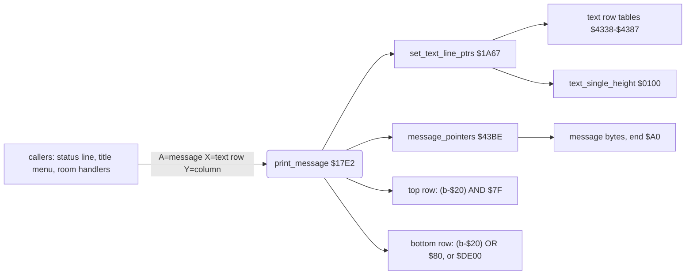

# Bruce Lee: messages and the message printer

Up: [the documentation](../README.md)

*Bruce Lee* (Datasoft 1984, C64 REV.2) draws all its short texts and many small room changes with one routine, [`print_message`](../../src/text.asm#L6) [`$17E2`](../reference/modules/text.md#print_message). A *message* is a string of bytes ended by `$A0`. The same format holds two kinds of content: text in a copy of the char ROM, and *tile strings* that change cells of the room map. This page gives the format, the printer, a decode of both kinds, and a catalogue of all 101 messages.

**Scope.**
- The message printer [`print_message`](../../src/text.asm#L6) [`$17E2`](../reference/modules/text.md#print_message) and its row pointers [`set_text_line_ptrs`](../../src/status.asm#L120) [`$1A67`](../reference/modules/status.md#set_text_line_ptrs) ([text.md](../reference/modules/text.md), [status.md](../reference/modules/status.md)).
- The pointer table [`message_pointers`](../../src/messages.asm#L6) [`$43BE`](../reference/modules/messages.md#message_pointers) and the message strings `$4488-$4785` ([messages.md](../reference/modules/messages.md)).
- The strings in that area that are not messages: [`version_text`](../../src/messages.asm#L168) [`$4707`](../reference/modules/messages.md#version_text), [`credits_text_unused`](../../src/messages.asm#L77) [`$4563`](../reference/modules/messages.md#credits_text_unused), [`game_over_text_unused`](../../src/messages.asm#L91) [`$4598`](../reference/modules/messages.md#game_over_text_unused).
- The title text rows `$49BD-$4A5C`, the PLAYER banner rows `$4A5D-$4A84` and the title font [`title_font`](../../src/vic_bank2.asm#L124) [`$8400`](../reference/graphics.md#title_font) ([room_tables.md](../reference/modules/room_tables.md)).
- The 16-bit pointer increment helpers `$4786-$479A` ([pointer_helpers.md](../reference/modules/pointer_helpers.md)).

Not here: the title screen flow ([startup_title.md](startup_title.md)), the pause key ([main_loop.md](main_loop.md)), the charset switches of the raster IRQs ([interrupts.md](interrupts.md)), and what each room event means for the game ([rooms_00_09.md](rooms_00_09.md), [rooms_10_19.md](rooms_10_19.md)).

**Sources.** The generated source `src/text.asm`, `src/messages.asm`, `src/status.asm`, `src/pointer_helpers.asm`, `src/room_tables.asm`; the image `unpacked/image.bin`; the coverage map of all runs `.c64-re-tools/local/cov_all.bin`; the assets [messages.json](../../assets/text/messages.json), [title_layout.json](../../assets/fonts/title_layout.json) and the charset images.

**Conventions.**
- Addresses are C64 addresses. Names are the names of the knowledge.
- A *message* is a string printed by [`print_message`](../../src/text.asm#L6) [`$17E2`](../reference/modules/text.md#print_message). *Message n* is entry n of [`message_pointers`](../../src/messages.asm#L6) [`$43BE`](../reference/modules/messages.md#message_pointers), written in decimal with its hex value: message 18 (`$12`).
- A *text row* is the X input of [`print_message`](../../src/text.asm#L6): index into the text row tables [`text_row_top_lo`](../../src/variables.asm#L74) [`$4338`](../reference/modules/variables.md#text_row_top_lo). In the game, text row k ≥ 2 is screen rows 2k-1 (top) and 2k (bottom), that is map row k-2 ([room_pipeline.md](room_pipeline.md), section 3.3).
- A *tile* is one 8x16 room cell: char t in the top row and char t+`$80` in the bottom row of the expanded room charset.
- A *pass* is one run of [`main_loop`](../../src/main_loop.asm#L6) [`$1BC2`](../reference/modules/main_loop.md#main_loop). A *frame* is one video frame.
- **Observed** marks a fact that a run showed. Here it is mostly the coverage map: the two bytes of a message pointer were read in at least one run. **Code** marks a fact from the code or the image only. **Conclusion** marks an interpretation.

## 1. Where the data is

| Name | Address | Content | Read by |
|---|---|---|---|
| [`message_pointers`](../../src/messages.asm#L6) | `$43BE-$4487` | 101 little-endian words, message 0 to 100. Word n at `$43BE`+2n. | [`print_message`](../../src/text.asm#L6) [`$17EB`](../../src/text.asm#L13), `$17F3` |
| message strings | `$4488-$4785` | 15 data regions, from [`msg_status_texts`](../../src/messages.asm#L36) [`$4488`](../reference/modules/messages.md#msg_status_texts) to [`msg_passage_tiles`](../../src/messages.asm#L198) [`$4782`](../reference/modules/messages.md#msg_passage_tiles). The order of the strings does not follow the message numbers. | [`print_message_loop`](../../src/text.asm#L20) [`$17FA`](../reference/modules/text.md#print_message_loop) |
| [`version_text`](../../src/messages.asm#L168) | `$4707-$472E` | 40 codes of the version line. No end byte, no pointer. | [`toggle_version_line`](../../src/status.asm#L270) [`$1B71`](../../src/status.asm#L276) |
| [`credits_text_unused`](../../src/messages.asm#L77), [`game_over_text_unused`](../../src/messages.asm#L91) | `$4563-$457D`, `$4598-$45A9` | Strings in message format with no pointer. | nothing |
| [`text_row_top_lo`](../../src/variables.asm#L74)/[`text_row_top_hi`](../../src/variables.asm#L82) | `$4338`/`$434C` | 14 entries each: screen address of the top row of text row k. | [`set_text_line_ptrs`](../../src/status.asm#L120) [`$1A67`](../reference/modules/status.md#set_text_line_ptrs) |
| [`text_row_bottom_lo`](../../src/variables.asm#L90)/[`text_row_bottom_hi`](../../src/variables.asm#L98) | `$4360`/`$4374` | 14 entries each: address of the bottom row. | [`set_text_line_ptrs`](../../src/status.asm#L120) [`$1A67`](../reference/modules/status.md#set_text_line_ptrs) |
| [`text_single_height`](../../src/constants.asm#L118) | `$0100` | Nonzero: the bottom row goes to `$DE00`. | [`set_text_line_ptrs`](../../src/status.asm#L120) [`$1A7B`](../../src/status.asm#L129) |
| [`title_row_bruce_lee_top`](../../src/room_tables.asm#L6) .. [`title_row_byline`](../../src/room_tables.asm#L36) | `$49BD-$4A5C` | 4 rows of 40 title font codes (section 8). | [`title_copy_text`](../../src/title.asm#L76) [`$0628`](../reference/modules/title.md#title_copy_text) |
| [`player_banner_top`](../../src/room_tables.asm#L47), [`player_banner_bottom`](../../src/room_tables.asm#L53) | `$4A5D-$4A7C` | 2 rows of 16 title font codes: big "PLAYER n". | [`show_player_turn_screen`](../../src/player_turn.asm#L6), [`game_over`](../../src/game_over.asm#L67) |

**Code:** the tables `$4338-$4387` hold leftover bytes in the image. [`build_text_row_tables`](../../src/game_setup.asm#L124) [`$0869`](../reference/modules/game_setup.md#build_text_row_tables) fills them each time [`init_game_screen`](../../src/game_setup.asm#L6) [`$0763`](../reference/modules/game_setup.md#init_game_screen) runs, and [`restart_to_title`](../../src/restart.asm#L6) [`$050F`](../reference/modules/restart.md#restart_to_title) runs it before the first title screen.

## 2. Overview



- The status line, the title menu and the room 19 text print **text**. They print on text rows 0, 1 and 6-10, where the bottom row is not on the screen or [`text_single_height`](../../src/constants.asm#L118) is set. So the text is one char high.
- The room handlers print **tile strings** on text rows 2-12. Both rows are written, so each byte becomes one 8x16 cell.
- [`print_message`](../../src/text.asm#L6) does not touch colour RAM. A tile string keeps the colour of the cell that was there (**Code**: no colour RAM address in `$17E2-$1817`).

## 3. The byte layout

### 3.1 The string

| Byte b | Meaning |
|---|---|
| `$A0` | End of the message. [`print_message`](../../src/text.asm#L6) [`$1801`](../../src/text.asm#L25) tests b-`$20` = `$80`. |
| any other | One cell: top char (b-`$20`) AND `$7F`, bottom char (b-`$20`) OR `$80`. |

**Code:** bit 7 of b has no effect on the chars: b and b XOR `$80` print the same, except that `$A0` ends the string and `$20` does not. The title menu uses this: its "F" is `$C6` and its key digits are `$B3`, `$B5`, `$B7`, where `$46` and `$33`-`$37` would print the same.

**Code:** the formula wraps. A byte below `$20` gives a top char of `$60-$7F`, for example b = `$04` gives top char `$64` and bottom char `$E4`. So any top char `$00-$7F` can be encoded: tile t is b = t+`$20` (mod `$80`), with bit 7 free. Only tile `$00` has a single encoding, `$20`, because its other one is the end byte `$A0`.

### 3.2 Text: the charset at `$8800`

Text messages are mostly ASCII codes `$20-$5F`. The printer turns them into codes `$00-$3F` of the charset at `$8800` ([`title_charset`](../../src/vic_bank2.asm#L254), `$D018` = `$32`). [`cold_start`](../../src/init.asm#L6) builds that charset at [`boot_copy_font`](../../src/init.asm#L48) [`$0449`](../reference/modules/init.md#boot_copy_font) from the char ROM:

| Code (b-`$20`) | Glyph | ASCII b |
|---|---|---|
| `$00-$1F` | ROM chars `$20-$3F`: space, `!` .. `?`, digits | `$20-$3F` |
| `$20-$3F` | ROM chars `$00-$1F`: `@`, A-Z, `[` .. `←` | `$40-$5F` |
| `$40-$7F` | the same 64 glyphs inverted | `$60-$9F` |

[`boot_patch_font`](../../src/init.asm#L62) [`$0468`](../reference/modules/init.md#boot_patch_font) then changes three glyphs (**Code**):
- code `$20` (ASCII `@`) = a solid block;
- code `$42` (byte `$62`) = a bar on the right (`▐`);
- code `$56` (byte `$76`) = a bar on the left (`▌`).

The title menu draws its key frames with the two bars, as in "▐F3▌". [`version_text`](../../src/messages.asm#L168) [`$4707`](../reference/modules/messages.md#version_text) holds codes of this charset directly (ASCII - `$20`), and [`toggle_version_line`](../../src/status.asm#L270) copies them straight to the screen.

The charset at `$8800` is 1 KiB: 128 chars. A bottom char `$80-$FF` would come from `$8C00-$8FFF`, the screen RAM. **Conclusion:** this is why text is only printed where the bottom row is discarded.

### 3.3 Tile strings: the room charset

A tile string uses the same formula with the room charset ([`room_charset_d018`](../../src/constants.asm#L109) [`$F2`](../reference/variables.md#room_charset_d018): `$A000`, `$A800`, `$B000` or `$B800`). [`expand_charset`](../../src/charset_expand.asm#L43) [`$4892`](../reference/modules/charset_expand.md#expand_charset) puts the top half of tile t in char t and the bottom half in char t+`$80` ([room_pipeline.md](room_pipeline.md), section 3.1). So one byte gives one complete 8x16 cell, exactly like a map cell of [`draw_room`](../../src/room_draw.asm#L6) [`$09BC`](../reference/modules/room_draw.md#draw_room).


The image shows the tiles of set 0 (rooms 0-9), 16 per row; tile t is at row t/16, column t mod 16.

### 3.4 The inputs

| Register | Meaning |
|---|---|
| A | Message number, 0-100. [`print_message`](../../src/text.asm#L6) doubles it with ASL (`$17E7`), so bit 7 is lost: message n and n+128 are the same. |
| X | Text row 0-13. |
| Y | Byte offset from the start of the text row. It is the column for Y < 40. |

The text row tables after [`init_game_screen`](../../src/game_setup.asm#L6) (**Code**, the same values as in [room_pipeline.md](room_pipeline.md)):

| Text row k | Top row address | Bottom row address | Screen rows |
|---|---|---|---|
| 0 | `$8C00` | `$DE00` | 0 (bottom discarded) |
| 1 | `$8C28` | `$DE00` | 1 (bottom discarded) |
| 2-12 | `$8BD8`+`$50`k | `$8C00`+`$50`k | 2k-1 and 2k (map row k-2) |
| 13 | `$8FE8` | `$9010` | below the screen |

**Code:** Y is added to the row address and can be 40 or more. Then the string starts in the next screen row. The game uses this: the status labels go through text row 0 with Y = `$2C`, `$38` and `$44`, which is screen row 1, columns 4, 16 and 28. The title menu uses text rows 6-8 with Y = `$31` and `$2B`, which is screen rows 12, 14 and 16.

### 3.5 Single height

[`set_text_line_ptrs`](../../src/status.asm#L120) [`$1A67`](../reference/modules/status.md#set_text_line_ptrs) sets [`work_ptr_c`](../../src/constants.asm#L13) to `$DE00` when [`text_single_height`](../../src/constants.asm#L118) [`$0100`](../reference/variables.md#text_single_height) is nonzero. The bottom row then goes to `$DE00`+Y, in the I/O 1 area, where a write has no effect on a plain C64 (**Code**: [`cold_start`](../../src/init.asm#L6) sets [`R6510`](../../src/constants.asm#L8) = `$35`, I/O visible).

| Writer | Value | When |
|---|---|---|
| [`title_screen`](../../src/title.asm#L6) [`$0592`](../../src/title.asm#L13), `$064D` | 0, then `$FF` | `$FF` before the title menu messages; it stays set during the title menu |
| [`init_game_vars`](../../src/game_vars.asm#L6) [`$0F8D`](../../src/game_vars.asm#L25) | 1 (`$0100-$0107`) | [`restart_to_title`](../../src/restart.asm#L6), [`start_game`](../../src/title.asm#L185) and [`start_demo`](../../src/restart.asm#L24), each time before [`init_game_screen`](../../src/game_setup.asm#L6) |
| [`clear_text_lines`](../../src/status.asm#L109) [`$1A56`](../reference/modules/status.md#clear_text_lines) | 0 | each [`init_game_screen`](../../src/game_setup.asm#L6) |
| [`print_top_label`](../../src/status.asm#L171), [`print_paused`](../../src/status.asm#L312), [`erase_paused`](../../src/status.asm#L324) | the message number | before one status print |
| [`print_status_message`](../../src/status.asm#L318) [`$1BAD`](../reference/modules/status.md#print_status_message) | 0 | after that print |
| [`check_actors_background`](../../src/background_touch.asm#L6) [`$2E39`](../reference/modules/background_touch.md#check_actors_background) | 0 | every pass |

**Code:** the three status writers set the flag for text rows 0 and 1, whose bottom row is `$DE00` in the table anyway. The flag has an effect only on the title, where text rows 6-10 have real screen addresses below.

## 4. The decoder

### 4.1 [`print_message`](../../src/text.asm#L6) [`$17E2`](../reference/modules/text.md#print_message) step by step

1. `$17E2`: push A (the message number).
2. `$17E3`: [`set_text_line_ptrs`](../../src/status.asm#L120) [`$1A67`](../reference/modules/status.md#set_text_line_ptrs) with X = text row. It sets [`work_ptr_a`](../../src/constants.asm#L11) [`$04`](../reference/variables.md#work_ptr_a) to the top row address and [`work_ptr_c`](../../src/constants.asm#L13) [`$08`](../reference/variables.md#work_ptr_c) to the bottom row address, or to `$DE00` when [`text_single_height`](../../src/constants.asm#L118) [`$0100`](../reference/variables.md#text_single_height) is nonzero.
3. `$17E6-$17E8`: pull A, A = 2A, X = A.
4. `$17E9-$17F8`: [`work_ptr_b`](../../src/constants.asm#L12) [`$06`](../reference/variables.md#work_ptr_b) = [`message_pointers`](../../src/messages.asm#L6)[X] - Y, a 16-bit subtraction. So `(work_ptr_b),Y` is the first byte of the message, while Y is also the column in `(work_ptr_a),Y` and `(work_ptr_c),Y`. One index register serves the source and both destinations.
5. [`print_message_loop`](../../src/text.asm#L20) [`$17FA`](../reference/modules/text.md#print_message_loop): read b = `(work_ptr_b),Y`. Subtract `$20`. A result of `$80` (b = `$A0`) ends the routine at `$1817`.
6. `$1803-$1809`: write the result AND `$7F` to the top row and the result OR `$80` to the bottom row.
7. `$180B`: Y = Y+1. If Y is not 0, go to step 5.
8. `$180E-$1814`: Y wrapped to 0: increment the high bytes of the three pointers and go on. **Observed:** no run executed it (`; not executed $180e-$1816` in the source; the coverage map has no execute flag there). It would need column + length > 255.

On return, A and X are changed, Y is the column after the last char, and the three work pointers are changed.

### 4.2 Pseudo-code

```
print_message(A = n, X = row, Y = col):          ; $17E2
    top    = text_row_top[row]                    ; work_ptr_a
    bottom = text_row_bottom[row]                 ; work_ptr_c
    if text_single_height != 0: bottom = $DE00    ; set_text_line_ptrs $1A67
    src = message_pointers[n AND $7F] - col       ; work_ptr_b
    y = col
    loop:                                         ; $17FA
        v = (src[y] - $20) AND $FF
        if v == $80: return                       ; the end byte $A0
        top[y]    = v AND $7F
        bottom[y] = v OR  $80
        y = y + 1
        if y == 0: top += $100; src += $100; bottom += $100   ; never reached
```

### 4.3 The wrappers

| Routine | What it does |
|---|---|
| [`print_status_message`](../../src/status.asm#L318) [`$1BAD`](../reference/modules/status.md#print_status_message) | [`print_message`](../../src/text.asm#L6), then [`text_single_height`](../../src/constants.asm#L118) = 0. [`print_paused`](../../src/status.asm#L312) [`$1BA4`](../reference/modules/status.md#print_paused) falls into it; [`print_top_label`](../../src/status.asm#L171) [`$1ABB`](../reference/modules/status.md#print_top_label) and [`erase_paused`](../../src/status.asm#L324) [`$1BB6`](../reference/modules/status.md#erase_paused) jump to it. |
| [`blink_player_label`](../../src/status.asm#L149) [`$1A96`](../reference/modules/status.md#blink_player_label) | Counts [`player_tag_blink_timer`](../../src/variables.asm#L165) [`$43BD`](../reference/modules/variables.md#player_tag_blink_timer) down from `$20`. At 0 it prints message 0 (blank), at `$10` message [`current_player`](../../src/constants.asm#L10)+1 (1UP or 2UP), both at text row 0, Y = `$2C`. |
| [`draw_tile_down`](../../src/room_update.asm#L625) [`$3ACA`](../reference/modules/room_update.md#draw_tile_down) | Message A at text row [`tile_row`](../../src/constants.asm#L57) [`$6C`](../reference/variables.md#tile_row), column [`tile_col`](../../src/constants.asm#L58) [`$6D`](../reference/variables.md#tile_col), then [`tile_row`](../../src/constants.asm#L57) + 1. Used by the passage helpers [`open_wall_column`](../../src/room_update.asm#L591) [`$3A8A`](../reference/modules/room_update.md#open_wall_column) and [`draw_column_63_64`](../../src/room_update.asm#L614) [`$3AB4`](../reference/modules/room_update.md#draw_column_63_64). |
| [`draw_hazard0_frame`](../../src/room_tiles.asm#L39) [`$4086`](../reference/modules/room_tiles.md#draw_hazard0_frame) (and 1, 2) | Message `$1F`+A at the slot's [`hazard_row`](../../src/constants.asm#L63) [`$74`](../reference/variables.md#hazard_row) / [`hazard_col`](../../src/constants.asm#L62) [`$71`](../reference/variables.md#hazard_col). The `_alt` entries add 7 first. |
| [`draw_sliding_tile`](../../src/room_tiles.asm#L6) [`$404E`](../reference/modules/room_tiles.md#draw_sliding_tile) | Message 28 at the old column, message 27 at the new column of the slider. |

## 5. Worked examples

### 5.1 A text message: message 5 "FALLS"

[`print_falls_label`](../../src/status.asm#L178) [`$1AC7`](../reference/modules/status.md#print_falls_label) loads A = 5, X = 0, Y = `$44` and jumps to [`print_message`](../../src/text.asm#L6). [`init_game_screen`](../../src/game_setup.asm#L6) calls it at `$0810`.

1. Pointer: word 5 is at `$43BE`+10 = `$43C8`. The image has `98 44` there, so the message is at `$4498` ([`msg_falls`](../../src/messages.asm#L48)).
2. Rows: text row 0 gives [`work_ptr_a`](../../src/constants.asm#L11) = `$8C00` and [`work_ptr_c`](../../src/constants.asm#L13) = `$DE00`.
3. Source: [`work_ptr_b`](../../src/constants.asm#L12) = `$4498` - `$44` = `$4454`.
4. The bytes at `$4498` are `46 41 4C 4C 53 A0`:

| Y | Address read | b | b-`$20` | Top char at | Bottom char at | Glyph |
|---|---|---|---|---|---|---|
| `$44` | `$4498` | `$46` | `$26` | `$8C44` = `$26` | `$DE44` = `$A6` | F (ROM char `$06`) |
| `$45` | `$4499` | `$41` | `$21` | `$8C45` = `$21` | `$DE45` = `$A1` | A |
| `$46` | `$449A` | `$4C` | `$2C` | `$8C46` = `$2C` | `$DE46` = `$AC` | L |
| `$47` | `$449B` | `$4C` | `$2C` | `$8C47` = `$2C` | `$DE47` = `$AC` | L |
| `$48` | `$449C` | `$53` | `$33` | `$8C48` = `$33` | `$DE48` = `$B3` | S |
| `$49` | `$449D` | `$A0` | `$80` | - | - | end |

`$8C44` is screen row 1, column 28 (`$44` - `$28` = 28). The status line shows "FALLS" there with the charset at `$8800`, where code `$26` is ROM char `$06`, the letter F (section 3.2).

### 5.2 A tile string: message 18 (`$12`), the room 1 hatch

[`room01_update`](../../src/room_update.asm#L35) [`$3679`](../reference/modules/room_update.md#room01_update) opens the floor hatch in four steps. On the first step [`room_script_vars`](../../src/room_tables.asm#L390) [`$4E97`](../reference/modules/room_tables.md#room_script_vars) goes from 3 to 2, and [`room01_hatch_draw_step`](../../src/room_update.asm#L51) [`$369B`](../reference/modules/room_update.md#room01_hatch_draw_step) adds `$10`: A = `$12`, X = `$0C`, Y = `$11` ([rooms_00_09.md](rooms_00_09.md), room 1).

1. Pointer: word 18 is at `$43BE`+36 = `$43E2`. The image has `AA 45` there: [`msg_room_tiles`](../../src/messages.asm#L97) [`$45AA`](../reference/modules/messages.md#msg_room_tiles).
2. Rows: text row 12 gives [`work_ptr_a`](../../src/constants.asm#L11) = `$8BD8`+`$3C0` = `$8F98` (screen row 23) and [`work_ptr_c`](../../src/constants.asm#L13) = `$8FC0` (screen row 24). [`text_single_height`](../../src/constants.asm#L118) is 0 in the game.
3. Source: [`work_ptr_b`](../../src/constants.asm#L12) = `$45AA` - `$11` = `$4599`.
4. The bytes at `$45AA` are `31 7C 7D 7E 7F A0`:

| Y (column) | b | Tile = (b-`$20`) AND `$7F` | Top char at | Bottom char at | Map cell before |
|---|---|---|---|---|---|
| `$11` (17) | `$31` | `$11` | `$8FA9` = `$11` | `$8FD1` = `$91` | `$91` (tile `$11`) |
| `$12` (18) | `$7C` | `$5C` | `$8FAA` = `$5C` | `$8FD2` = `$DC` | `$91` (tile `$11`) |
| `$13` (19) | `$7D` | `$5D` | `$8FAB` = `$5D` | `$8FD3` = `$DD` | `$A2` (tile `$22`) |
| `$14` (20) | `$7E` | `$5E` | `$8FAC` = `$5E` | `$8FD4` = `$DE` | `$A2` (tile `$22`) |
| `$15` (21) | `$7F` | `$5F` | `$8FAD` = `$5F` | `$8FD5` = `$DF` | `$91` (tile `$11`) |
| `$16` | `$A0` | end | - | - | - |

The "before" column is map row 10 of [room01.json](../../assets/rooms/room01.json). Those cells have bit 7 set, so their colour RAM is `$F8`, and the message keeps that colour. The next three steps print messages 17, 16 and 15 at the same place. Message 15 is `$22 $22 $03 $03 $03`: it leaves exit tile 3 (to room 5) at columns 19-21 (**Code**; the exit tile meaning is in [room_pipeline.md](room_pipeline.md)).

## 6. Catalogue of all messages

Columns: the message number, the address (name of the knowledge + offset), the length without the end byte, the content, the code that prints it with its text row and column, and the evidence that it was printed. "Observed" means that the coverage map shows the pointer of the message as read. For a text message the content is the text. For a tile string it is the tile numbers, (b-`$20`) AND `$7F`. The tiles belong to the charset of the room that prints them.

Shared helpers print some messages for several rooms (**Code**, from the caller lists of the reference):
- [`open_wall_column`](../../src/room_update.asm#L591) [`$3A8A`](../reference/modules/room_update.md#open_wall_column) (messages 19, 20): rooms 5, 8 and 9. [`open_wall_column_17`](../../src/room_update.asm#L602) [`$3AA0`](../reference/modules/room_update.md#open_wall_column_17) (adds 23): rooms 6 and 7. [`open_wall_column_2d`](../../src/room_update.asm#L608) [`$3AAA`](../reference/modules/room_update.md#open_wall_column_2d) (adds 45): room 8.
- [`draw_column_63_64`](../../src/room_update.asm#L614) [`$3AB4`](../reference/modules/room_update.md#draw_column_63_64) (messages 99, 100): rooms 10, 12, 14 and 16.
- [`animate_floor_traps`](../../src/room_entry_traps.asm#L16) [`$3228`](../reference/modules/room_entry_traps.md#animate_floor_traps) (messages 0, 47-51): rooms 6, 7, 10, 11, 12, 14, 16 and 17.
- [`draw_hazard0_frame`](../../src/room_tiles.asm#L39) [`$4086`](../reference/modules/room_tiles.md#draw_hazard0_frame), [`draw_hazard1_frame`](../../src/room_tiles.asm#L46) [`$4090`](../reference/modules/room_tiles.md#draw_hazard1_frame), [`draw_hazard2_frame`](../../src/room_tiles.asm#L53) [`$409A`](../reference/modules/room_tiles.md#draw_hazard2_frame) (messages 31-37): rooms 4, 5, 8 and 17. The `_alt` entries (messages 38-44): rooms 4, 5, 7 and 9.
- [`draw_sliding_tile`](../../src/room_tiles.asm#L6) [`$404E`](../reference/modules/room_tiles.md#draw_sliding_tile) (messages 27, 28): [`animate_room_objects`](../../src/room_state.asm#L29) [`$104B`](../reference/modules/room_state.md#animate_room_objects) and rooms 7, 9 and 17. [`draw_sliding_tile_alt`](../../src/room_tiles.asm#L17) [`$4063`](../reference/modules/room_tiles.md#draw_sliding_tile_alt) (messages 84, 85): [`animate_room_objects`](../../src/room_state.asm#L29) on text rows 5 and 10.

| Message | Address | Len | Content | Printed by: text row, column | Evidence |
|---|---|---|---|---|---|
| 0 (`$00`) | [`msg_status_texts`](../../src/messages.asm#L36) [`$4488`](../reference/modules/messages.md#msg_status_texts) | 3 | 3 spaces | [`blink_player_label`](../../src/status.asm#L149) [`$1AA5`](../../src/status.asm#L157): text row 0, Y = `$2C`: screen row 1, column 4 (blanks 1UP/2UP). [`floor_trap_check_retract`](../../src/room_entry_traps.asm#L64) [`$3293`](../../src/room_entry_traps.asm#L73): trap row, as 3 x tile `$00` | Observed |
| 1 (`$01`) | [`msg_1up`](../../src/messages.asm#L39) [`$448C`](../reference/modules/messages.md#msg_1up) | 3 | "1UP" | [`blink_player_label`](../../src/status.asm#L149) [`$1AB7`](../../src/status.asm#L167) (A = [`current_player`](../../src/constants.asm#L10) + 1): text row 0, Y = `$2C`: screen row 1, column 4 | Observed |
| 2 (`$02`) | [`msg_2up`](../../src/messages.asm#L42) [`$4490`](../reference/modules/messages.md#msg_2up) | 3 | "2UP" | [`blink_player_label`](../../src/status.asm#L149) [`$1AB7`](../../src/status.asm#L167): as message 1 | Observed |
| 3 (`$03`) | [`msg_top`](../../src/messages.asm#L45) [`$4494`](../reference/modules/messages.md#msg_top) | 3 | "TOP" | [`print_top_label`](../../src/status.asm#L171) [`$1AC4`](../../src/status.asm#L176) through [`print_status_message`](../../src/status.asm#L318) [`$1BAD`](../reference/modules/status.md#print_status_message): text row 0, Y = `$38`: screen row 1, column 16 | Observed |
| 4 (`$04`) | [`msg_congratulations`](../../src/messages.asm#L186) [`$4750`](../reference/modules/messages.md#msg_congratulations) | 21 | "** CONGRATULATIONS **" | [`room19_flame_colour_loop`](../../src/final_room.asm#L60) [`$42C2`](../../src/final_room.asm#L74): text row 0, Y = `$0A`: screen row 0, column 10 | Observed |
| 5 (`$05`) | [`msg_falls`](../../src/messages.asm#L48) [`$4498`](../reference/modules/messages.md#msg_falls) | 5 | "FALLS" | [`print_falls_label`](../../src/status.asm#L178) [`$1ACD`](../../src/status.asm#L182): text row 0, Y = `$44`: screen row 1, column 28 | Observed |
| 6 (`$06`) | [`msg_status_tiles`](../../src/messages.asm#L52) [`$449E`](../reference/modules/messages.md#msg_status_tiles) | 7 | 7 x tile `$4B` | [`room03_move_bridge`](../../src/room_update.asm#L130) [`$373F`](../../src/room_update.asm#L139), [`room03_bridge_to_right`](../../src/room_update.asm#L145) [`$375D`](../../src/room_update.asm#L154): text row 6, column 9 or 21 (bridge) | Observed |
| 7 (`$07`) | [`msg_status_tiles+8`](../../src/messages.asm#L52) [`$44A6`](../reference/modules/messages.md#msg_status_tiles) | 3 | 3 x tile `$11` | [`room02_update`](../../src/room_update.asm#L60) [`$36CC`](../../src/room_update.asm#L78): text row 12, column 37 | Code |
| 8 (`$08`) | [`msg_joystick1_left`](../../src/messages.asm#L60) [`$44CF`](../reference/modules/messages.md#msg_joystick1_left) | 36 | "JOYSTICK # 1 IS IN LEFT HANDED MODE " | [`set_joy1_left`](../../src/title_menu.asm#L105) [`$096F`](../../src/title_menu.asm#L109): text row 10, column 2 (screen row 19) | Observed |
| 9 (`$09`) | [`msg_joystick1_right`](../../src/messages.asm#L64) [`$44F4`](../reference/modules/messages.md#msg_joystick1_right) | 36 | "JOYSTICK # 1 IS IN RIGHT HANDED MODE" | [`set_joy1_right`](../../src/title_menu.asm#L121) [`$098E`](../../src/title_menu.asm#L125): text row 10, column 2 (screen row 19) | Observed |
| 10 (`$0A`) | [`msg_joystick2_left`](../../src/messages.asm#L68) [`$4519`](../reference/modules/messages.md#msg_joystick2_left) | 36 | "JOYSTICK # 2 IS IN LEFT HANDED MODE " | [`set_joy2_left`](../../src/title_menu.asm#L113) [`$097E`](../../src/title_menu.asm#L117) (X = A = `$0A`): text row 10, column 2 (screen row 19) | Observed |
| 11 (`$0B`) | [`msg_paused`](../../src/messages.asm#L85) [`$457E`](../reference/modules/messages.md#msg_paused) | 12 | "** PAUSED **" | [`print_paused`](../../src/status.asm#L312) [`$1BA4`](../reference/modules/status.md#print_paused) through [`print_status_message`](../../src/status.asm#L318) [`$1BAD`](../reference/modules/status.md#print_status_message): text row 1, column 15 (screen row 1) | Observed |
| 12 (`$0C`) | [`msg_paused+13`](../../src/messages.asm#L85) [`$458B`](../reference/modules/messages.md#msg_paused) | 12 | 12 spaces | [`erase_paused`](../../src/status.asm#L324) [`$1BBF`](../../src/status.asm#L329): text row 1, column 15 (screen row 1) | Observed |
| 13 (`$0D`) | [`msg_joystick2_right`](../../src/messages.asm#L72) [`$453E`](../reference/modules/messages.md#msg_joystick2_right) | 36 | "JOYSTICK # 2 IS IN RIGHT HANDED MODE" | [`set_joy2_right`](../../src/title_menu.asm#L129) [`$099E`](../../src/title_menu.asm#L133): text row 10, column 2 (screen row 19) | Observed |
| 14 (`$0E`) | [`msg_joystick_modes`](../../src/messages.asm#L56) [`$44AA`](../reference/modules/messages.md#msg_joystick_modes) | 36 | 36 spaces | [`title_idle`](../../src/title_menu.asm#L29) [`$08F2`](../../src/title_menu.asm#L39): text row 10, column 2 (screen row 19) (erases the joystick line) | Observed |
| 15 (`$0F`) | [`msg_room_tiles+18`](../../src/messages.asm#L97) [`$45BC`](../reference/modules/messages.md#msg_room_tiles) | 5 | tiles `$22` `$22` `$03` `$03` `$03` | hatch step 4 (A = `$FF`+`$10`): [`room01_hatch_draw_step`](../../src/room_update.asm#L51) [`$36A2`](../../src/room_update.asm#L56) text row 12, column 17; [`room03_hatch_draw_step`](../../src/room_update.asm#L118) [`$3723`](../../src/room_update.asm#L123) text row 12, column 29 | Code |
| 16 (`$10`) | [`msg_room_tiles+12`](../../src/messages.asm#L97) [`$45B6`](../reference/modules/messages.md#msg_room_tiles) | 5 | tiles `$5C` `$5D` `$5E` `$03` `$03` | hatch step 3: as message 15 | Code |
| 17 (`$11`) | [`msg_room_tiles+6`](../../src/messages.asm#L97) [`$45B0`](../reference/modules/messages.md#msg_room_tiles) | 5 | tiles `$11` `$22` `$22` `$03` `$03` | hatch step 2: as message 15 | Code |
| 18 (`$12`) | [`msg_room_tiles`](../../src/messages.asm#L97) [`$45AA`](../reference/modules/messages.md#msg_room_tiles) | 5 | tiles `$11` `$5C` `$5D` `$5E` `$5F` | hatch step 1: as message 15 | Code |
| 19 (`$13`) | [`msg_room_tiles+24`](../../src/messages.asm#L97) [`$45C2`](../reference/modules/messages.md#msg_room_tiles) | 1 | tile `$00` | [`open_wall_column`](../../src/room_update.asm#L591) [`$3A8A`](../reference/modules/room_update.md#open_wall_column) through [`draw_tile_down`](../../src/room_update.asm#L625) [`$3ACE`](../../src/room_update.asm#L628): text rows A and A+1, column Y | Code |
| 20 (`$14`) | [`msg_room_tiles+26`](../../src/messages.asm#L97) [`$45C4`](../reference/modules/messages.md#msg_room_tiles) | 1 | tile `$3E` | [`open_wall_column`](../../src/room_update.asm#L591) [`$3A8A`](../reference/modules/room_update.md#open_wall_column): text row A+2, column Y | Code |
| 21 (`$15`) | [`msg_room_tiles+28`](../../src/messages.asm#L97) [`$45C6`](../reference/modules/messages.md#msg_room_tiles) | 1 | tile `$02` | [`room05_check_lantern6_taken`](../../src/room_update.asm#L341) [`$38E5`](../../src/room_update.asm#L353): text row 11, column 0 | Code |
| 22 (`$16`) | [`msg_room_tiles+30`](../../src/messages.asm#L97) [`$45C8`](../reference/modules/messages.md#msg_room_tiles) | 4 | 4 x tile `$00` | [`room04_check_lantern0_taken`](../../src/room_update.asm#L177) `$37A3`/`$37AC`: text rows 8 and 9, column 11; [`room04_check_lantern1_taken`](../../src/room_update.asm#L215) `$3800`/`$3809`: text rows 8 and 9, column 25 | Code |
| 23 (`$17`) | [`msg_room_tiles+35`](../../src/messages.asm#L97) [`$45CD`](../reference/modules/messages.md#msg_room_tiles) | 1 | tile `$11` | [`open_wall_column_17`](../../src/room_update.asm#L602) [`$3AA0`](../reference/modules/room_update.md#open_wall_column_17): the third cell again | Code |
| 24 (`$18`) | [`msg_room_tiles+37`](../../src/messages.asm#L97) [`$45CF`](../reference/modules/messages.md#msg_room_tiles) | 4 | tiles `$61` `$04` `$04` `$63` | [`room09_check_room_empty`](../../src/room_update.asm#L771) [`$3C03`](../../src/room_update.asm#L785): text row 2, column 35 | Code |
| 25 (`$19`) | [`msg_room_tiles+42`](../../src/messages.asm#L97) [`$45D4`](../reference/modules/messages.md#msg_room_tiles) | 3 | tiles `$61` `$05` `$63` | [`room05_open_top_exit`](../../src/room_update.asm#L362) [`$3904`](../../src/room_update.asm#L369): text row 2, column 34 | Code |
| 26 (`$1A`) | [`msg_room_tiles+46`](../../src/messages.asm#L97) [`$45D8`](../reference/modules/messages.md#msg_room_tiles) | 3 | tiles `$00` `$00` `$05` | [`room02_update`](../../src/room_update.asm#L60) [`$36C3`](../../src/room_update.asm#L74): text row 11, column 37 | Code |
| 27 (`$1B`) | [`msg_room_tiles+50`](../../src/messages.asm#L97) [`$45DC`](../reference/modules/messages.md#msg_room_tiles) | 1 | tile `$64` | [`draw_sliding_tile`](../../src/room_tiles.asm#L6) [`$4060`](../../src/room_tiles.asm#L15): [`slider_row`](../../src/constants.asm#L60), new column [`slider_col`](../../src/constants.asm#L59) | Observed |
| 28 (`$1C`) | [`msg_room_tiles+52`](../../src/messages.asm#L97) [`$45DE`](../reference/modules/messages.md#msg_room_tiles) | 1 | tile `$65` | [`draw_sliding_tile`](../../src/room_tiles.asm#L6) [`$4057`](../../src/room_tiles.asm#L11): [`slider_row`](../../src/constants.asm#L60), old column [`slider_prev_col`](../../src/constants.asm#L61) | Observed |
| 29 (`$1D`) | [`msg_room_tiles+58`](../../src/messages.asm#L97) [`$45E4`](../reference/modules/messages.md#msg_room_tiles) | 1 | tile `$46` | [`room00_update`](../../src/room_update.asm#L6) [`$365F`](../../src/room_update.asm#L20): text row 9, column 7; [`room02_bull_tick`](../../src/room_update.asm#L79) [`$36E8`](../../src/room_update.asm#L91): text row 9, column 33 (mouth closed) | Code |
| 30 (`$1E`) | [`msg_room_tiles+60`](../../src/messages.asm#L97) [`$45E6`](../reference/modules/messages.md#msg_room_tiles) | 1 | tile `$47` | [`room00_bull_mouth_open`](../../src/room_update.asm#L24) [`$366D`](../../src/room_update.asm#L28): text row 9, column 7; [`room02_bull_mouth_open`](../../src/room_update.asm#L95) [`$36F6`](../../src/room_update.asm#L99): text row 9, column 33 (mouth open) | Code |
| 31 (`$1F`) | [`msg_room_tiles+62`](../../src/messages.asm#L97) [`$45E8`](../reference/modules/messages.md#msg_room_tiles) | 1 | tile `$56` | [`draw_hazard0_frame`](../../src/room_tiles.asm#L39) [`$4086`](../reference/modules/room_tiles.md#draw_hazard0_frame), [`draw_hazard1_frame`](../../src/room_tiles.asm#L46) [`$4090`](../reference/modules/room_tiles.md#draw_hazard1_frame), [`draw_hazard2_frame`](../../src/room_tiles.asm#L53) [`$409A`](../reference/modules/room_tiles.md#draw_hazard2_frame) with A = phase 0: text row and column of the hazard slot ([`hazard_row`](../../src/constants.asm#L63), [`hazard_col`](../../src/constants.asm#L62)) | Observed |
| 32 (`$20`) | [`msg_room_tiles+64`](../../src/messages.asm#L97) [`$45EA`](../reference/modules/messages.md#msg_room_tiles) | 1 | tile `$55` | as message 31, A = phase 1 | Observed |
| 33 (`$21`) | [`msg_room_tiles+66`](../../src/messages.asm#L97) [`$45EC`](../reference/modules/messages.md#msg_room_tiles) | 2 | tiles `$55` `$56` | as message 31, A = phase 2 | Observed |
| 34 (`$22`) | [`msg_room_tiles+69`](../../src/messages.asm#L97) [`$45EF`](../reference/modules/messages.md#msg_room_tiles) | 2 | tiles `$54` `$55` | as message 31, A = phase 3 | Observed |
| 35 (`$23`) | [`msg_room_tiles+72`](../../src/messages.asm#L97) [`$45F2`](../reference/modules/messages.md#msg_room_tiles) | 2 | tiles `$00` `$55` | as message 31, A = phase 4 | Observed |
| 36 (`$24`) | [`msg_room_tiles+75`](../../src/messages.asm#L97) [`$45F5`](../reference/modules/messages.md#msg_room_tiles) | 2 | tiles `$00` `$54` | as message 31, A = phase 5 | Observed |
| 37 (`$25`) | [`msg_room_tiles+78`](../../src/messages.asm#L97) [`$45F8`](../reference/modules/messages.md#msg_room_tiles) | 2 | tiles `$00` `$00` | as message 31, A = phase 6 (blank: erases the hazard) | Observed |
| 38 (`$26`) | [`msg_room_tiles+81`](../../src/messages.asm#L97) [`$45FB`](../reference/modules/messages.md#msg_room_tiles) | 1 | tile `$5A` | [`draw_hazard0_frame_alt`](../../src/room_tiles.asm#L60) [`$40A4`](../reference/modules/room_tiles.md#draw_hazard0_frame_alt), [`draw_hazard1_frame_alt`](../../src/room_tiles.asm#L67) [`$40AC`](../reference/modules/room_tiles.md#draw_hazard1_frame_alt), [`draw_hazard2_frame_alt`](../../src/room_tiles.asm#L74) [`$40B4`](../reference/modules/room_tiles.md#draw_hazard2_frame_alt) (A + 7, then the plain entry) with A = phase 0 | Observed |
| 39 (`$27`) | [`msg_room_tiles+83`](../../src/messages.asm#L97) [`$45FD`](../reference/modules/messages.md#msg_room_tiles) | 1 | tile `$59` | as message 38, A = phase 1 | Observed |
| 40 (`$28`) | [`msg_room_tiles+85`](../../src/messages.asm#L97) [`$45FF`](../reference/modules/messages.md#msg_room_tiles) | 2 | tiles `$59` `$5A` | as message 38, A = phase 2 | Observed |
| 41 (`$29`) | [`msg_room_tiles+88`](../../src/messages.asm#L97) [`$4602`](../reference/modules/messages.md#msg_room_tiles) | 2 | tiles `$58` `$59` | as message 38, A = phase 3 | Observed |
| 42 (`$2A`) | [`msg_room_tiles+91`](../../src/messages.asm#L97) [`$4605`](../reference/modules/messages.md#msg_room_tiles) | 2 | tiles `$00` `$59` | as message 38, A = phase 4 | Observed |
| 43 (`$2B`) | [`msg_room_tiles+94`](../../src/messages.asm#L97) [`$4608`](../reference/modules/messages.md#msg_room_tiles) | 2 | tiles `$00` `$58` | as message 38, A = phase 5 | Observed |
| 44 (`$2C`) | [`msg_room_tiles+97`](../../src/messages.asm#L97) [`$460B`](../reference/modules/messages.md#msg_room_tiles) | 2 | tiles `$00` `$00` | as message 38, A = phase 6 (blank) | Observed |
| 45 (`$2D`) | [`msg_room_tiles+100`](../../src/messages.asm#L97) [`$460E`](../reference/modules/messages.md#msg_room_tiles) | 1 | tile `$11` | [`open_wall_column_2d`](../../src/room_update.asm#L608) [`$3AAA`](../reference/modules/room_update.md#open_wall_column_2d): the third cell again | Code |
| 46 (`$2E`) | [`msg_room_tiles+102`](../../src/messages.asm#L97) [`$4610`](../reference/modules/messages.md#msg_room_tiles) | 1 | tile `$2A` | **none** (no load of `$2E` reaches [`print_message`](../../src/text.asm#L6)) | Code |
| 47 (`$2F`) | [`msg_room_tiles+104`](../../src/messages.asm#L97) [`$4612`](../reference/modules/messages.md#msg_room_tiles) | 3 | tiles `$71` `$72` `$73` | [`floor_trap_show_spikes1`](../../src/room_entry_traps.asm#L31) [`$324B`](../../src/room_entry_traps.asm#L37): trap row, trap column | Observed |
| 48 (`$30`) | [`msg_room_tiles+108`](../../src/messages.asm#L97) [`$4616`](../reference/modules/messages.md#msg_room_tiles) | 3 | tiles `$74` `$75` `$76` | [`floor_trap_show_spikes1`](../../src/room_entry_traps.asm#L31) [`$325A`](../../src/room_entry_traps.asm#L44): trap row + 1 | Observed |
| 49 (`$31`) | [`msg_room_tiles+112`](../../src/messages.asm#L97) [`$461A`](../reference/modules/messages.md#msg_room_tiles) | 3 | tiles `$77` `$78` `$79` | [`floor_trap_check_spikes2`](../../src/room_entry_traps.asm#L47) [`$326D`](../../src/room_entry_traps.asm#L54): trap row | Observed |
| 50 (`$32`) | [`msg_room_tiles+116`](../../src/messages.asm#L97) [`$461E`](../reference/modules/messages.md#msg_room_tiles) | 3 | tiles `$7A` `$7B` `$7C` | [`floor_trap_check_spikes2`](../../src/room_entry_traps.asm#L47) [`$327C`](../../src/room_entry_traps.asm#L61): trap row + 1 | Observed |
| 51 (`$33`) | [`msg_room_tiles+120`](../../src/messages.asm#L97) [`$4622`](../reference/modules/messages.md#msg_room_tiles) | 3 | tiles `$7D` `$60` `$7D` | [`floor_trap_check_retract`](../../src/room_entry_traps.asm#L64) [`$32B5`](../../src/room_entry_traps.asm#L91): trap row + 1 (trap cleared) | Observed |
| 52 (`$34`) | [`msg_room_tiles+124`](../../src/messages.asm#L97) [`$4626`](../reference/modules/messages.md#msg_room_tiles) | 1 | tile `$13` | [`room04_update`](../../src/room_update.asm#L156) [`$3775`](../../src/room_update.asm#L166): text row 4, column 11 (lantern 0 lit) | Observed |
| 53 (`$35`) | [`msg_room_tiles+126`](../../src/messages.asm#L97) [`$4628`](../reference/modules/messages.md#msg_room_tiles) | 1 | tile `$14` | [`room04_blink_lantern1`](../../src/room_update.asm#L194) [`$37C9`](../../src/room_update.asm#L204): text row 4, column 28 (lantern 1 lit) | Observed |
| 54 (`$36`) | [`msg_room_tiles+128`](../../src/messages.asm#L97) [`$462A`](../reference/modules/messages.md#msg_room_tiles) | 1 | tile `$66` | [`room04_lantern0_dark_check`](../../src/room_update.asm#L168) [`$378A`](../../src/room_update.asm#L176): text row 4, column 11 (lantern 0 dark) | Observed |
| 55 (`$37`) | [`msg_room_tiles+130`](../../src/messages.asm#L97) [`$462C`](../reference/modules/messages.md#msg_room_tiles) | 1 | tile `$67` | [`room04_lantern1_dark_check`](../../src/room_update.asm#L206) [`$37DE`](../../src/room_update.asm#L214): text row 4, column 28 (lantern 1 dark) | Observed |
| 56 (`$38`) | [`msg_wizard_face_tiles+29`](../../src/messages.asm#L116) [`$464B`](../reference/modules/messages.md#msg_wizard_face_tiles) | 8 | tiles `$00` `$67` `$68` `$69` `$6A` `$6B` `$6C` `$00` | [`room18_draw_face`](../../src/room_update.asm#L967) [`$3D5B`](../../src/room_update.asm#L974) (zone 0): text row 2, column 16 | Observed |
| 57 (`$39`) | [`msg_wizard_face_tiles`](../../src/messages.asm#L116) [`$462E`](../reference/modules/messages.md#msg_wizard_face_tiles) | 8 | tiles `$07` `$08` `$09` `$0A` `$0B` `$0C` `$0D` `$0E` | [`room18_draw_face`](../../src/room_update.asm#L967) [`$3D5B`](../../src/room_update.asm#L974) (zone 1): text row 2, column 16 | Code |
| 58 (`$3A`) | [`msg_wizard_face_tiles+58`](../../src/messages.asm#L116) [`$4668`](../reference/modules/messages.md#msg_wizard_face_tiles) | 8 | tiles `$00` `$28` `$0F` `$59` `$79` `$7A` `$7B` `$00` | [`room18_draw_face`](../../src/room_update.asm#L967) [`$3D5B`](../../src/room_update.asm#L974) (zone 2): text row 2, column 16 | Code |
| 59 (`$3B`) | [`msg_wizard_face_tiles+38`](../../src/messages.asm#L116) [`$4654`](../reference/modules/messages.md#msg_wizard_face_tiles) | 4 | tiles `$10` `$11` `$70` `$71` | [`draw_wizard_face_row3`](../../src/room_update.asm#L992) [`$3D8B`](../../src/room_update.asm#L998) (A = 0, zone 0): text row 3, column 18 | Observed |
| 60 (`$3C`) | [`msg_wizard_face_tiles+9`](../../src/messages.asm#L116) [`$4637`](../reference/modules/messages.md#msg_wizard_face_tiles) | 4 | tiles `$1D` `$1E` `$1F` `$20` | [`draw_wizard_face_row3`](../../src/room_update.asm#L992) [`$3D8B`](../../src/room_update.asm#L998) (A = 0, zone 1): text row 3, column 18 | Code |
| 61 (`$3D`) | [`msg_wizard_face_tiles+67`](../../src/messages.asm#L116) [`$4671`](../reference/modules/messages.md#msg_wizard_face_tiles) | 4 | tiles `$63` `$53` `$29` `$2A` | [`draw_wizard_face_row3`](../../src/room_update.asm#L992) [`$3D8B`](../../src/room_update.asm#L998) (A = 0, zone 2): text row 3, column 18 | Code |
| 62 (`$3E`) | [`msg_wizard_face_tiles+43`](../../src/messages.asm#L116) [`$4659`](../reference/modules/messages.md#msg_wizard_face_tiles) | 4 | tiles `$16` `$1C` `$21` `$77` | [`draw_wizard_face_row4`](../../src/room_update.asm#L1000) [`$3D98`](../../src/room_update.asm#L1006) (A = 0, zone 0): text row 4, column 18 | Observed |
| 63 (`$3F`) | [`msg_wizard_face_tiles+14`](../../src/messages.asm#L116) [`$463C`](../reference/modules/messages.md#msg_wizard_face_tiles) | 4 | tiles `$72` `$78` `$7C` `$34` | [`draw_wizard_face_row4`](../../src/room_update.asm#L1000) [`$3D98`](../../src/room_update.asm#L1006) (A = 0, zone 1): text row 4, column 18 | Code |
| 64 (`$40`) | [`msg_wizard_face_tiles+72`](../../src/messages.asm#L116) [`$4676`](../reference/modules/messages.md#msg_wizard_face_tiles) | 4 | tiles `$72` `$30` `$31` `$32` | [`draw_wizard_face_row4`](../../src/room_update.asm#L1000) [`$3D98`](../../src/room_update.asm#L1006) (A = 0, zone 2): text row 4, column 18 | Code |
| 65 (`$41`) | [`msg_wizard_face_tiles+48`](../../src/messages.asm#L116) [`$465E`](../reference/modules/messages.md#msg_wizard_face_tiles) | 4 | tiles `$6E` `$6F` `$70` `$71` | [`draw_wizard_face_row3`](../../src/room_update.asm#L992) [`$3D8B`](../../src/room_update.asm#L998) (A = 6, zone 0): text row 3, column 18 | Observed |
| 66 (`$42`) | [`msg_wizard_face_tiles+19`](../../src/messages.asm#L116) [`$4641`](../reference/modules/messages.md#msg_wizard_face_tiles) | 4 | tiles `$1D` `$33` `$3D` `$20` | [`draw_wizard_face_row3`](../../src/room_update.asm#L992) [`$3D8B`](../../src/room_update.asm#L998) (A = 6, zone 1): text row 3, column 18 | Code |
| 67 (`$43`) | [`msg_wizard_face_tiles+77`](../../src/messages.asm#L116) [`$467B`](../reference/modules/messages.md#msg_wizard_face_tiles) | 4 | tiles `$63` `$53` `$54` `$60` | [`draw_wizard_face_row3`](../../src/room_update.asm#L992) [`$3D8B`](../../src/room_update.asm#L998) (A = 6, zone 2): text row 3, column 18 | Code |
| 68 (`$44`) | [`msg_wizard_face_tiles+53`](../../src/messages.asm#L116) [`$4663`](../reference/modules/messages.md#msg_wizard_face_tiles) | 4 | tiles `$74` `$75` `$76` `$77` | [`draw_wizard_face_row4`](../../src/room_update.asm#L1000) [`$3D98`](../../src/room_update.asm#L1006) (A = 6, zone 0): text row 4, column 18 | Observed |
| 69 (`$45`) | [`msg_wizard_face_tiles+24`](../../src/messages.asm#L116) [`$4646`](../reference/modules/messages.md#msg_wizard_face_tiles) | 4 | tiles `$72` `$3E` `$4F` `$34` | [`draw_wizard_face_row4`](../../src/room_update.asm#L1000) [`$3D98`](../../src/room_update.asm#L1006) (A = 6, zone 1): text row 4, column 18 | Code |
| 70 (`$46`) | [`msg_wizard_face_tiles+82`](../../src/messages.asm#L116) [`$4680`](../reference/modules/messages.md#msg_wizard_face_tiles) | 4 | tiles `$72` `$65` `$66` `$15` | [`draw_wizard_face_row4`](../../src/room_update.asm#L1000) [`$3D98`](../../src/room_update.asm#L1006) (A = 6, zone 2): text row 4, column 18 | Code |
| 71 (`$47`) | [`msg_wizard_face_tiles+87`](../../src/messages.asm#L116) [`$4685`](../reference/modules/messages.md#msg_wizard_face_tiles) | 3 | tiles `$17` `$18` `$19` | [`room18_effect_sound_and_tiles`](../../src/room_update.asm#L1063) [`$3E22`](../../src/room_update.asm#L1074) (toggle 0): text row 3, column 12 | Code |
| 72 (`$48`) | [`msg_wizard_face_tiles+91`](../../src/messages.asm#L116) [`$4689`](../reference/modules/messages.md#msg_wizard_face_tiles) | 3 | tiles `$1C` `$18` `$7C` | [`room18_effect_sound_and_tiles`](../../src/room_update.asm#L1063) [`$3E22`](../../src/room_update.asm#L1074) (toggle 1): text row 3, column 12 | Code |
| 73 (`$49`) | [`msg_wizard_face_tiles+95`](../../src/messages.asm#L116) [`$468D`](../reference/modules/messages.md#msg_wizard_face_tiles) | 3 | tiles `$24` `$25` `$26` | [`room18_effect_sound_and_tiles`](../../src/room_update.asm#L1063) [`$3E2F`](../../src/room_update.asm#L1080) (toggle 0): text row 3, column 25 | Code |
| 74 (`$4A`) | [`msg_wizard_face_tiles+99`](../../src/messages.asm#L116) [`$4691`](../reference/modules/messages.md#msg_wizard_face_tiles) | 3 | tiles `$10` `$25` `$21` | [`room18_effect_sound_and_tiles`](../../src/room_update.asm#L1063) [`$3E2F`](../../src/room_update.asm#L1080) (toggle 1): text row 3, column 25 | Code |
| 75 (`$4B`) | [`msg_wizard_face_tiles+103`](../../src/messages.asm#L116) [`$4695`](../reference/modules/messages.md#msg_wizard_face_tiles) | 3 | tiles `$55` `$56` `$57` | [`room18_effect_sound_and_tiles`](../../src/room_update.asm#L1063) [`$3E3C`](../../src/room_update.asm#L1086) (toggle 0): text row 6, column 14 | Code |
| 76 (`$4C`) | [`msg_wizard_face_tiles+107`](../../src/messages.asm#L116) [`$4699`](../reference/modules/messages.md#msg_wizard_face_tiles) | 3 | tiles `$1E` `$1F` `$78` | [`room18_effect_sound_and_tiles`](../../src/room_update.asm#L1063) [`$3E3C`](../../src/room_update.asm#L1086) (toggle 1): text row 6, column 14 | Code |
| 77 (`$4D`) | [`msg_wizard_face_tiles+111`](../../src/messages.asm#L116) [`$469D`](../reference/modules/messages.md#msg_wizard_face_tiles) | 2 | tiles `$52` `$62` | [`room18_effect_sound_and_tiles`](../../src/room_update.asm#L1063) [`$3E49`](../../src/room_update.asm#L1092) (toggle 0): text row 6, column 23 | Code |
| 78 (`$4E`) | [`msg_wizard_face_tiles+114`](../../src/messages.asm#L116) [`$46A0`](../reference/modules/messages.md#msg_wizard_face_tiles) | 2 | tiles `$11` `$16` | [`room18_effect_sound_and_tiles`](../../src/room_update.asm#L1063) [`$3E49`](../../src/room_update.asm#L1092) (toggle 1): text row 6, column 23 | Code |
| 79 (`$4F`) | [`msg_title_menu`](../../src/messages.asm#L133) [`$46A3`](../reference/modules/messages.md#msg_title_menu) | 27 | " ▐F3▌-▐1 PLAYER -▌2 PLAYERS" | [`title_copy_text`](../../src/title.asm#L76) [`$0656`](../../src/title.asm#L96): text row 6, Y = `$31`: screen row 12, column 9 | Observed |
| 80 (`$50`) | [`msg_title_menu+28`](../../src/messages.asm#L133) [`$46BF`](../reference/modules/messages.md#msg_title_menu) | 32 | " PRESS ▐F5▌-▐COMPUTER -▌OPPONENT" | [`title_copy_text`](../../src/title.asm#L76) [`$065F`](../../src/title.asm#L100): text row 7, Y = `$2B`: screen row 14, column 3 | Observed |
| 81 (`$51`) | [`msg_title_menu+61`](../../src/messages.asm#L133) [`$46E0`](../reference/modules/messages.md#msg_title_menu) | 20 | " ▐F7▌- TO BEGIN GAME" | [`title_copy_text`](../../src/title.asm#L76) [`$0668`](../../src/title.asm#L104): text row 8, Y = `$31`: screen row 16, column 9 | Observed |
| 82 (`$52`) | [`msg_player_1`](../../src/messages.asm#L161) [`$46F5`](../reference/modules/messages.md#msg_player_1) | 8 | "PLAYER 1" | **none** | Code |
| 83 (`$53`) | [`msg_player_2`](../../src/messages.asm#L164) [`$46FE`](../reference/modules/messages.md#msg_player_2) | 8 | "PLAYER 2" | **none** | Code |
| 84 (`$54`) | [`msg_room_tiles+54`](../../src/messages.asm#L97) [`$45E0`](../reference/modules/messages.md#msg_room_tiles) | 1 | tile `$66` | [`draw_sliding_tile_alt`](../../src/room_tiles.asm#L17) [`$4075`](../../src/room_tiles.asm#L26): new column | Observed |
| 85 (`$55`) | [`msg_room_tiles+56`](../../src/messages.asm#L97) [`$45E2`](../reference/modules/messages.md#msg_room_tiles) | 1 | tile `$67` | [`draw_sliding_tile_alt`](../../src/room_tiles.asm#L17) [`$406C`](../../src/room_tiles.asm#L22): old column | Observed |
| 86 (`$56`) | [`msg_room15_16_tiles`](../../src/messages.asm#L179) [`$472F`](../reference/modules/messages.md#msg_room15_16_tiles) | 2 | tiles `$00` `$00` | [`erase_bonus_fall_object`](../../src/background_touch.asm#L270) `$2FF5`/`$2FFE`: text rows 10 and 11, column 36 | Code |
| 87 (`$57`) | [`msg_room15_16_tiles+3`](../../src/messages.asm#L179) [`$4732`](../reference/modules/messages.md#msg_room15_16_tiles) | 1 | tile `$00` | [`room15_update`](../../src/room_update.asm#L1175) [`$3EF6`](../../src/room_update.asm#L1183): text row 3, column 17; [`room15_check_right_wall`](../../src/room_update.asm#L1190) [`$3F1E`](../../src/room_update.asm#L1200): text row 3, column 23 | Code |
| 88 (`$58`) | [`msg_room15_16_tiles+5`](../../src/messages.asm#L179) [`$4734`](../reference/modules/messages.md#msg_room15_16_tiles) | 1 | tile `$2F` | [`room15_update`](../../src/room_update.asm#L1175) [`$3EFF`](../../src/room_update.asm#L1187): text row 4, column 17; [`room15_check_right_wall`](../../src/room_update.asm#L1190) [`$3F27`](../../src/room_update.asm#L1204): text row 4, column 23 | Code |
| 89 (`$59`) | [`msg_room15_16_tiles+7`](../../src/messages.asm#L179) [`$4736`](../reference/modules/messages.md#msg_room15_16_tiles) | 3 | 3 x tile `$2F` | [`room15_check_exit`](../../src/room_update.asm#L1207) [`$3F3F`](../../src/room_update.asm#L1215): text row 9, column 37 | Code |
| 90 (`$5A`) | [`msg_room15_16_tiles+11`](../../src/messages.asm#L179) [`$473A`](../reference/modules/messages.md#msg_room15_16_tiles) | 3 | tiles `$00` `$00` `$03` | [`room15_check_exit`](../../src/room_update.asm#L1207) [`$3F48`](../../src/room_update.asm#L1219): text row 8, column 37 | Code |
| 91 (`$5B`) | [`msg_room15_16_tiles+15`](../../src/messages.asm#L179) [`$473E`](../reference/modules/messages.md#msg_room15_16_tiles) | 3 | tiles `$00` `$00` `$03` | [`room15_check_exit`](../../src/room_update.asm#L1207) [`$3F51`](../../src/room_update.asm#L1223): text row 7, column 37 | Code |
| 92 (`$5C`) | [`msg_room15_16_tiles+19`](../../src/messages.asm#L179) [`$4742`](../reference/modules/messages.md#msg_room15_16_tiles) | 3 | 3 x tile `$49` | [`room17_check_lantern_b`](../../src/room_update.asm#L1283) [`$3FD2`](../../src/room_update.asm#L1292): text row 10, column 24 | Code |
| 93 (`$5D`) | [`msg_room15_16_tiles+23`](../../src/messages.asm#L179) [`$4746`](../reference/modules/messages.md#msg_room15_16_tiles) | 2 | tiles `$44` `$44` | [`room17_check_lantern_a`](../../src/room_update.asm#L1273) [`$3FBC`](../../src/room_update.asm#L1282): text row 10, column 37 | Code |
| 94 (`$5E`) | [`msg_room15_16_tiles+26`](../../src/messages.asm#L179) [`$4749`](../reference/modules/messages.md#msg_room15_16_tiles) | 3 | tiles `$00` `$00` `$03` | [`room18_draw_open_exit`](../../src/room_update.asm#L1008) [`$3DA3`](../../src/room_update.asm#L1013): text row 11, column 37 | Code |
| 95 (`$5F`) | [`msg_room15_16_tiles+30`](../../src/messages.asm#L179) [`$474D`](../reference/modules/messages.md#msg_room15_16_tiles) | 2 | tiles `$5A` `$5A` | [`room18_draw_open_exit`](../../src/room_update.asm#L1008) [`$3DAC`](../../src/room_update.asm#L1017): text row 12, column 38 | Code |
| 96 (`$60`) | [`msg_misc_tiles`](../../src/messages.asm#L190) [`$4766`](../reference/modules/messages.md#msg_misc_tiles) | 7 | 7 x tile `$09` | [`room03_move_bridge`](../../src/room_update.asm#L130) [`$3748`](../../src/room_update.asm#L143), [`room03_bridge_to_right`](../../src/room_update.asm#L145) [`$3754`](../../src/room_update.asm#L150): text row 6, column 21 or 9 (no bridge) | Observed |
| 97 (`$61`) | [`msg_misc_tiles+8`](../../src/messages.asm#L190) [`$476E`](../reference/modules/messages.md#msg_misc_tiles) | 1 | tile `$06` | [`room18_wizard_just_defeated`](../../src/room_update.asm#L917) [`$3CFD`](../../src/room_update.asm#L926): text row 11, column 0 | Code |
| 98 (`$62`) | [`msg_diabolo_presents`](../../src/messages.asm#L194) [`$4770`](../reference/modules/messages.md#msg_diabolo_presents) | 17 | "DIABOLO  PRESENTS" | **none** | Code |
| 99 (`$63`) | [`msg_passage_tiles`](../../src/messages.asm#L198) [`$4782`](../reference/modules/messages.md#msg_passage_tiles) | 1 | tile `$07` | [`draw_column_63_64`](../../src/room_update.asm#L614) [`$3AB4`](../reference/modules/room_update.md#draw_column_63_64) through [`draw_tile_down`](../../src/room_update.asm#L625): text rows A and A+1, column Y | Code |
| 100 (`$64`) | [`msg_passage_tiles+2`](../../src/messages.asm#L198) [`$4784`](../reference/modules/messages.md#msg_passage_tiles) | 1 | tile `$0E` | [`draw_column_63_64`](../../src/room_update.asm#L614) [`$3AB4`](../reference/modules/room_update.md#draw_column_63_64): text row A+2, column Y | Code |

**Unreferenced messages.** Messages 46, 82, 83 and 98 have a pointer, but no code prints them (**Code**):
- No instruction loads A with `$2E`, `$52`, `$53` or `$62` before a call of [`print_message`](../../src/text.asm#L6). Outside the pointer table, their addresses occur in the image only as bytes of the room maps and of the charset source area `$9000-$9FFF`.
- The computed numbers never reach them: hatch steps `$0F-$12`, hazard phases `$1F-$2C`, wizard face `$38-$46`, defeat effect `$47-$4E`.
- The coverage map shows none of their pointers as read.

**Conclusion:** message 98 "DIABOLO  PRESENTS" is not shown in this release. report.md leaves open whether it is a crack group text or an original leftover. Messages 82/83 "PLAYER 1"/"PLAYER 2" are not used because the player-up screen shows the big banner of section 8 instead.

**Odd names.** [`msg_status_tiles`](../../src/messages.asm#L52) [`$449E`](../reference/modules/messages.md#msg_status_tiles) holds messages 6 and 7, but no status code prints them. Message 6 is the room 3 bridge and message 7 is a floor piece of room 2.

## 7. Strings in the message area that are not messages

| Name | Address | Content | Use |
|---|---|---|---|
| [`version_text`](../../src/messages.asm#L168) | `$4707-$472E` | 40 codes, already minus `$20`: "BRUCE LEE (C) 1984 DATASOFT REV.2 BY RJF" | [`toggle_version_line`](../../src/status.asm#L270) [`$1B68`](../reference/modules/status.md#toggle_version_line) copies it to screen row 0 when the row holds `$20`, and fills the row with `$20` otherwise. [`handle_game_keys`](../../src/status.asm#L236) [`$1B29`](../reference/modules/status.md#handle_game_keys) jumps to it for key code `$1F`, the V key. |
| [`credits_text_unused`](../../src/messages.asm#L77) | `$4563-$457D` | "BRUCE LEE", "BY", "RON J FORTIER", each ended by `$A0` | no pointer, no reader |
| [`game_over_text_unused`](../../src/messages.asm#L91) | `$4598-$45A9` | "GAME OVER", "PLAYER ", each ended by `$A0` | no pointer, no reader |

**Code:** no word in the image equals `$4563`, `$456D`, `$4570`, `$4598` or `$45A2`. The game-over screen draws its text with the title font instead ([`game_over`](../../src/game_over.asm#L67) [`$188E`](../reference/modules/game_over.md#game_over), from [`game_over_logo_top`](../../src/variables.asm#L18) [`$42CD`](../reference/modules/variables.md#game_over_logo_top) and [`player_banner_top`](../../src/room_tables.asm#L47) [`$4A5D`](../reference/modules/room_tables.md#player_banner_top)).

## 8. The title text and the title font

### 8.1 The rows

[`title_screen`](../../src/title.asm#L6) [`$0584`](../reference/modules/title.md#title_screen) fills screen rows 0-8 with `$DC` (the loop at `$0613`) and then copies four rows of 40 codes at [`title_copy_text`](../../src/title.asm#L76) [`$0628`](../reference/modules/title.md#title_copy_text). Each code is ORed with `$80`, so it selects chars `$80-$FF` of the charset at `$8000`. Those chars are [`title_font`](../../src/vic_bank2.asm#L124) [`$8400-$87FF`](../reference/graphics.md#title_font), shown in multicolour above raster line `$82` ([`irq_split_top`](../../src/raster_irq_screens.asm#L74) [`$152C`](../reference/modules/raster_irq_screens.md#irq_split_top) sets `$D018` = `$30`). The rows below raster line `$82` use the charset at `$8800` ([`irq_split_bottom`](../../src/raster_irq_screens.asm#L112) [`$1574`](../reference/modules/raster_irq_screens.md#irq_split_bottom)), where the title menu messages 79-81 are.

| Name | Address | Screen row | Text |
|---|---|---|---|
| [`title_row_datasoft`](../../src/room_tables.asm#L26) | `$4A0D` | 2 | DATASOFT PRESENTS (single height) |
| [`title_row_bruce_lee_top`](../../src/room_tables.asm#L6) | `$49BD` | 5 | BRUCE LEE, top half |
| [`title_row_bruce_lee_bottom`](../../src/room_tables.asm#L16) | `$49E5` | 6 | BRUCE LEE, bottom half |
| [`title_row_byline`](../../src/room_tables.asm#L36) | `$4A35` | 9 | BY  RON J FORTIER (single height) |


The image shows rows 0-10 of the title with the title colours and the TM sprite.

### 8.2 The font codes

A code c in the rows selects char c+`$80`. The font has two letter sizes (**Code**: decoded from the image and the rows):

| Size | Glyph layout | Codes |
|---|---|---|
| double height, 2x2 chars | top left n, bottom left n+1, top right n+2, bottom right n+3 | A `$00`, B `$04`, C `$08`, E `$0C`, G `$10`, L `$14`, M `$18`, O `$1C`, P `$20`, R `$24`, U `$28`, V `$2C`, Y `$30`; digits 0-9 at `$34`+4d |
| blank | one char | `$5C` (screen code `$DC`, the fill char) |
| single height, 2x1 chars | left n, right n+1 | A `$5D`, B `$5F`, D `$61`, E `$63`, F `$65`, I `$67`, J `$69`, N `$6B`, O `$6D`, P `$6F`, R `$71`, S `$73`, T `$75`, Y `$77` |

The font holds only the letters of its texts: BRUCE LEE, PLAYER, GAME OVER and the digits of the big score for the double size; DATASOFT PRESENTS and BY RON J FORTIER for the single size. [`draw_big_digit`](../../src/game_over.asm#L186) [`$1984`](../reference/modules/game_over.md#draw_big_digit) draws digit d as chars `$B4`+4d (**Code**, its comment).


The image shows the 128 chars of [`title_font`](../../src/vic_bank2.asm#L124) [`$8400-$87FF`](../reference/graphics.md#title_font) in the bit pair colours of the charset images.

### 8.3 The PLAYER banner

[`player_banner_top`](../../src/room_tables.asm#L47) [`$4A5D`](../reference/modules/room_tables.md#player_banner_top) and [`player_banner_bottom`](../../src/room_tables.asm#L53) [`$4A6D`](../reference/modules/room_tables.md#player_banner_bottom) hold 16 codes each: "PLAYER " in double-height letters (`$20 $22 $14 $16 $00 $02 $30 $32 $0C $0E $24 $26`, blank `$5C $5C`) and two codes for the digit. [`show_player_turn_screen`](../../src/player_turn.asm#L6) [`$0EA7`](../reference/modules/player_turn.md#show_player_turn_screen) and [`game_over`](../../src/game_over.asm#L67) [`$188E`](../reference/modules/game_over.md#game_over) copy the digit codes from [`player_digit_top`](../../src/room_tables.asm#L60) [`$4A7D`](../reference/modules/room_tables.md#player_digit_top) / [`player_digit_bottom`](../../src/room_tables.asm#L64) [`$4A81`](../reference/modules/room_tables.md#player_digit_bottom) (`$38`/`$3A` for 1, `$3C`/`$3E` for 2) into the last two places, then print both rows ORed with `$80`. The screen flow is in [startup_title.md](startup_title.md).

**Code:** [`show_player_turn_screen`](../../src/player_turn.asm#L6) copies both digit codes of each row (loop `$0ED9`, Y = 0 and 1). [`game_over`](../../src/game_over.asm#L67) copies only the first one (loop `$1909` starts with Y = 0 and ends at DEY, BPL). **Conclusion:** the second code is left from the last player-up screen. In the turn order that screen was the one of the same player, so the digit looks right; with `ldy #$01` both codes would be copied, as in [`show_player_turn_screen`](../../src/player_turn.asm#L6).

## 9. The 16-bit pointer helpers

`$4786-$479A` holds three copies of one routine. Each increments one 16-bit zero page pointer: the low byte, and the high byte when the low byte wraps.

| Routine | Pointer | Callers |
|---|---|---|
| [`inc_ptr_04`](../../src/pointer_helpers.asm#L6) [`$4786`](../reference/modules/pointer_helpers.md#inc_ptr_04) | [`work_ptr_a`](../../src/constants.asm#L11) [`$04`](../reference/variables.md#work_ptr_a) | [`draw_room`](../../src/room_draw.asm#L6) [`$0AF0`](../../src/room_draw.asm#L169), `$0B18`; [`expand_charset`](../../src/charset_expand.asm#L43) [`$48A2`](../../src/charset_expand.asm#L52), `$48B6`; [`build_frame_mask`](../../src/collision.asm#L64) [`$51E8`](../../src/collision.asm#L119) |
| [`inc_ptr_06`](../../src/pointer_helpers.asm#L13) [`$478D`](../reference/modules/pointer_helpers.md#inc_ptr_06) | [`work_ptr_b`](../../src/constants.asm#L12) [`$06`](../reference/variables.md#work_ptr_b) | [`draw_room`](../../src/room_draw.asm#L6) [`$0AE0`](../../src/room_draw.asm#L160), `$0AF3`, `$0B08`, `$0B2A`; [`animate_scrolling_chars`](../../src/animated_chars.asm#L6) [`$2D34`](../../src/animated_chars.asm#L122); [`expand_charset`](../../src/charset_expand.asm#L43) [`$489A`](../../src/charset_expand.asm#L49), `$489F` |
| [`inc_ptr_08`](../../src/pointer_helpers.asm#L20) [`$4794`](../reference/modules/pointer_helpers.md#inc_ptr_08) | [`work_ptr_c`](../../src/constants.asm#L13) [`$08`](../reference/variables.md#work_ptr_c) | [`draw_room`](../../src/room_draw.asm#L6) [`$0AF6`](../../src/room_draw.asm#L171), `$0B1B`; [`animate_scrolling_chars`](../../src/animated_chars.asm#L6) [`$2D3E`](../../src/animated_chars.asm#L127); [`expand_charset`](../../src/charset_expand.asm#L43) [`$48AE`](../../src/charset_expand.asm#L59), `$48B3` |

[`print_message`](../../src/text.asm#L6) uses the same three pointers but does not call the helpers: it walks with Y. **Conclusion:** a caller of [`print_message`](../../src/text.asm#L6) loses any value it keeps in `$04-$09`; the room handlers that call it do not keep one there across the call (**Code**: [`draw_tile_down`](../../src/room_update.asm#L625) keeps its position in [`tile_row`](../../src/constants.asm#L57)/[`tile_col`](../../src/constants.asm#L58)).

## 10. Findings

| Finding | Evidence |
|---|---|
| The column input Y is a byte offset and may be 40 or more. The status labels 1UP/2UP, TOP and FALLS are printed through text row 0 with Y = `$2C`/`$38`/`$44` and appear on screen row 1. The title menu lines go to screen rows 12, 14 and 16. | **Code**: callers in section 6 and the row table in section 3.4. |
| One routine draws text and room changes. A tile string is a message whose bytes are tile numbers + `$20`. Message 0 (three spaces) is both the blank 1UP/2UP label and the tile string that clears a floor trap. | **Code**: [`blink_player_label`](../../src/status.asm#L149) [`$1AA5`](../../src/status.asm#L157), [`floor_trap_check_retract`](../../src/room_entry_traps.asm#L64) [`$3293`](../../src/room_entry_traps.asm#L73). |
| Four messages are never printed: 46, 82 "PLAYER 1", 83 "PLAYER 2" and 98 "DIABOLO  PRESENTS". Three more strings in message format have no pointer. | **Code**, and the coverage map (section 6). |
| [`print_top_label`](../../src/status.asm#L171), [`print_paused`](../../src/status.asm#L312) and [`erase_paused`](../../src/status.asm#L324) set [`text_single_height`](../../src/constants.asm#L118), but the bottom row of text rows 0 and 1 is `$DE00` anyway. The flag matters only on the title. | **Code**: section 3.5. |
| Single-height text writes its bottom row into `$DE00-$DEFF`, the I/O 1 area. | **Code**: [`set_text_line_ptrs`](../../src/status.asm#L120) [`$1A81`](../../src/status.asm#L133). |
| Bit 7 of a message byte has no effect except for the end byte `$A0`; the title menu mixes `$46`-style and `$C6`-style codes. | **Code**: section 3.1. |
| [`msg_status_tiles`](../../src/messages.asm#L52) [`$449E`](../reference/modules/messages.md#msg_status_tiles) is not status data: messages 6 and 7 are tiles of rooms 3 and 2. | **Code**: [`room03_move_bridge`](../../src/room_update.asm#L130) [`$373F`](../../src/room_update.asm#L139), [`room02_update`](../../src/room_update.asm#L60) [`$36CC`](../../src/room_update.asm#L78). |
| [`game_over`](../../src/game_over.asm#L67) [`$188E`](../reference/modules/game_over.md#game_over) patches only the left half of the banner digit; the right half stays from the last player-up screen. | **Code**: loop `$1909` runs once (section 8.3). |
| The page-crossing branch of the printer (`$180E-$1816`) never runs. | **Observed**: coverage map. |

## 11. Still open

- Is message 98 "DIABOLO  PRESENTS" a crack group text over an original string, or an original leftover? A c64-provenance comparison with another release of the game (an uncracked original, or a crack by another group) at `$4770-$4781` would answer it.
- Do the writes to `$DE00-$DEFF` disturb a cartridge in the expansion port (for example an REU or a freezer cartridge, which decode I/O 1)? A run with such a cartridge attached, on the title menu and the status line, would show it.
- The coverage map does not show the pointers of messages 7, 15-26, 29-30, 45, 57-58, 60-61, 63-64, 66-67, 69-78, 86-95, 97, 99 and 100 as read, although the room pages show several of these events in runs. A coverage run through the `room_events2` scenario would mark them **Observed** here.
