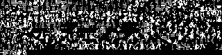
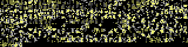
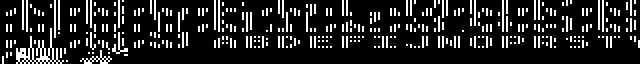
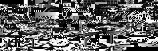
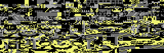

<!-- Generated by c64-docs from knowledge revision 20261016T170255.379-vv114c and src/source-map.json. Do not edit: change the knowledge, generate the source again, then run generate.ts. -->
# Graphics

Each sprite, bitmap and screen region of the knowledge. The knowledge gives no display mode and no colours, so a sprite or bitmap shows in hires and in multicolour, in pattern colours: black is pixel value 0, white is 1 in hires; in multicolour light grey is 1, grey is 2 and yellow is 3. Index: [the reference](index.md).

## [`frame_graphics`](../../src/sprite_data.asm#L167) [`$5D91`](modules/sprite_data.md#frame_graphics) `$5D91-$68F8`

*bitmap*

Sprite frame graphics, 1 bit per pixel (bit 7 leftmost), shown as hi-res X-expanded sprites; frames share rows.

## [`title_font`](../../src/vic_bank2.asm#L124) [`$8400`](modules/vic_bank2.md#title_font) `$8400-$87FF`

*bitmap*

Chars $80-$FF of the title charset at $8000 ($D018=$30 at $1544): multicolour title letters, read only by the VIC.

## [`charset_src_0`](../../src/room_charset_src.asm#L6) [`$9000`](modules/room_charset_src.md#charset_src_0) `$9000-$9FFF`

*bitmap*

Room charset sources: 4 sets of 128 chars x 8 multicolour rows. expand_charset doubles every row into room_charset_0-3 (rows 0-3 -> chars 0-127, rows 4-7 -> chars 128-255). Set 0 rooms 0-9, set 1 rooms 10-17 and 19, set 2 room 18, set 3 the room 18 effect at $3DF8. After expansion build_collision_masks overwrites $9000-$9FBF with collision masks.

